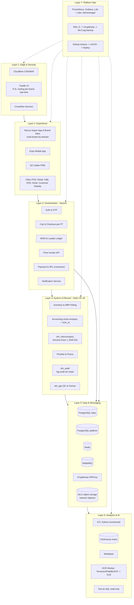
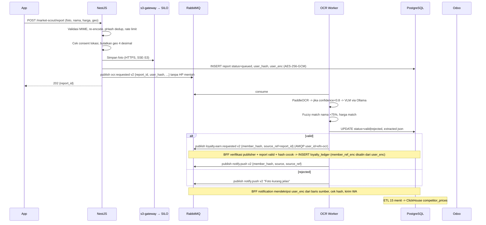
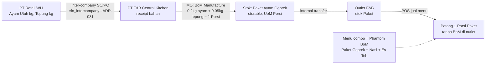
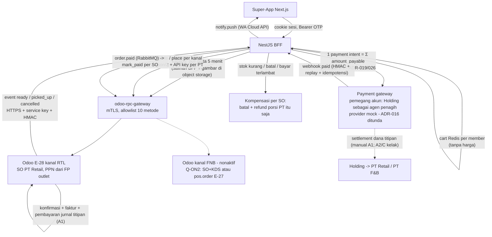
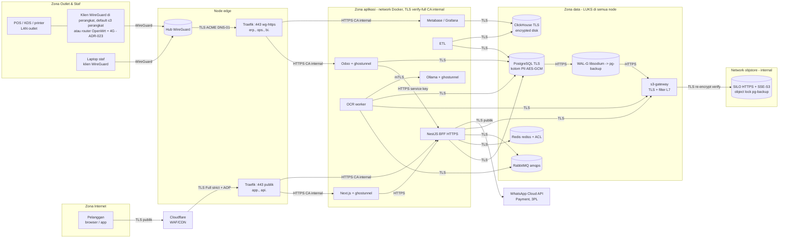
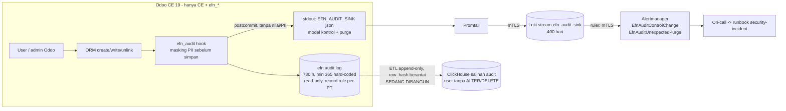

# ARSITEKTUR TARGET EFN (KONSOLIDASI)

Dokumen ini adalah satu-satunya acuan arsitektur. Jika bertentangan dengan 6 dokumen asli, dokumen ini yang menang sampai ADR baru mengubahnya. Alasan tiap pilihan ada di `01_REVIEW_RISK_GAP_ANALYSIS.md` Bagian 2 dan 6.

Revisi 2026-10-05 (v2): enkripsi di setiap hop & penyimpanan (ADR-022), Odoo hanya via WireGuard + 2FA (ADR-023), kredensial per service (ADR-024), event tanpa nomor HP mentah (`docs/04 §4`). Lihat §5.

Revisi 2026-10-06 (v3, keputusan klien 6 Okt): kustodi kunci hanya Superadmin & mTLS sesuai rekomendasi (ADR-022); konektivitas outlet open source — klien WireGuard di perangkat / OpenWrt (ADR-023); payment gateway-agnostic, vendor belum ditentukan (ADR-026, `docs/04 §8.3`); pajak PB1 per kota & include/exclude configurable di Odoo, Super-App menampilkan pajak dari Odoo via BFF (ADR-027); captcha ALTCHA self-hosted (ADR-028); JWT `sub` = UUID member (ADR-029); privasi/DSAR (`docs/04 §8.4`, `docs/compliance/`).

Revisi 2026-10-06 (v4, Gelombang 12): object storage = **SILO** (fork komunitas MinIO, dibangun dari source) di belakang filter L7 **`s3-gateway`** (ADR-030); **tanpa modul Odoo pihak ketiga** — OCA/Cybrosys hanya referensi, gap = `efn_*` (ADR-031): inter-company = `efn_intercompany` (rencana Fase 1), audit = `efn_audit` + sink Loki 400 hari + salinan ClickHouse append-only (sedang dibangun); mTLS Loki→Alertmanager. Lihat §5.5.

Revisi 2026-10-09 (v5, Gelombang 17): penjualan online Super-App = BFF + modul `efn_online_order` lewat `/json/2` terfilter (`odoo-rpc-gateway`, mTLS), tanpa `website_sale` (ADR-034, Proposed); kontrak `docs/04 §10`; diagram §3.4 diperbarui.

## 1. Context Diagram

```mermaid
flowchart LR
  subgraph Pengguna
    C[Pelanggan<br/>Super-App Web / Mobile]
    K[Kasir & Kitchen<br/>POS, KDS, Kiosk]
    W[Staf Warehouse & QC<br/>QC Intake PWA]
    M[Manajemen<br/>Metabase, AI Analyst]
  end

  subgraph EFN[Platform EFN]
    E[Edge: Cloudflare + Traefik]
    F[Next.js Web]
    B[NestJS BFF & Workers]
    O[Odoo CE 19 Multi-Company]
    D[(PostgreSQL)]
    R[(Redis)]
    Q[(RabbitMQ)]
    GW[s3-gateway<br/>filter L7]
    S[(Object storage<br/>SILO)]
    CH[(ClickHouse)]
    MB[Metabase]
    AI[Ollama + OCR Worker]
  end

  subgraph Eksternal
    WA[WhatsApp Cloud API]
    PG[Payment Gateway<br/>vendor belum ditentukan - ADR-026]
    L3[3PL: GoSend, GrabExpress, Lalamove]
    FM[Food Marketplace<br/>GoFood / GrabFood - fase lanjut]
    TAX[Coretax / e-Faktur]
  end

  C --> E --> F --> B
  K -- WireGuard --> E --> O
  W --> E --> F
  M -- WireGuard --> E --> MB
  M -- WireGuard --> E --> AI
  B --> O
  B --> D
  B --> R
  B --> Q
  B --> GW --> S
  O --> D
  Q --> AI
  AI --> GW
  D -. ETL 15 mnt .-> CH --> MB
  B --> WA
  B <--> PG
  B <--> L3
  O -. fase lanjut .-> FM
  O -. export .-> TAX
```



## 2. Layered Architecture



## 3. Alur Kritis

### 3.1 OTP-Gated Promo di POS (online)

```mermaid
sequenceDiagram
  participant Kasir as POS (Odoo)
  participant Odoo
  participant BFF as NestJS
  participant Redis
  participant WA as WhatsApp Cloud API
  participant Cust as Pelanggan
  Kasir->>Odoo: Pilih "Gunakan Poin/MGM" (pelanggan = partner order)
  Note over Odoo: member_ref diambil server dari HP partner_id, bukan diketik kasir (kontrak v2, SEC-07)
  Odoo->>BFF: POST /v1/pos/otp/request {member_ref, order_ref, amount} (HTTPS verify-full, service key)
  BFF->>Redis: HSET otp:{challenge_id} HMAC(kode), member_hash TTL 180s (rediss, ACL)
  BFF->>WA: Template "kode OTP"
  WA-->>Cust: OTP
  Cust-->>Kasir: Sebutkan / input di customer display
  Kasir->>Odoo: Input OTP
  Odoo->>BFF: POST /otp/verify
  BFF->>Redis: GET & compare; attempts++ (max 3)
  BFF-->>Odoo: {ok:true, discount_token}
  Odoo->>Odoo: Apply promo, lock token ke order
  Note over Kasir,Odoo: Jika POS offline: tombol promo nonaktif (ADR-017)
```

### 3.2 Price Hunter (asynchronous)



### 3.3 Kitting yang benar (Manufacture BoM, bukan Phantom)



### 3.4 Checkout Unified Cart lintas PT

Revisi 2026-10-09 (Gelombang 17): alur mengikuti kontrak `docs/04 §10` (v5.0) dan ADR-034 (Proposed). Pilot = kanal PT Retail saja, ambil di toko; F&B online, delivery/3PL, dan reservasi stok **belum** aktif (menunggu Q-ON2/Q-ON3/Q-ON4) — tetapi struktur sudah per kanal sehingga kanal F&B kelak ditambahkan tanpa mengubah kontrak. Ini **bukan** keputusan klien; ADR-019 & ADR-034 masih Proposed.



Pelanggan mengambil barang dengan **kode ambil** (rahasia: terenkripsi di BFF, hash KDF di Odoo). Delivery & dispatch 3PL (diagram lama) menjadi fase lanjut (Q-39/Q-40/Q-ON3).

## 4. Environments

| Env | Tujuan | Infra | Deploy |
|---|---|---|---|
| `dev` | Laptop developer | `docker compose -f docker-compose.yml -f docker-compose.dev.yml --profile core up` | manual |
| `staging` | Integrasi, UAT, DAST | 1 VPS, Compose, data sintetis | otomatis dari `main` |
| `prod` | Live | 4 node, Compose/Swarm | manual approval dari tag `v*` |

## 5. Keamanan Jaringan & Enkripsi (v2, 5 Okt 2026)

Prinsip: **enkripsi di setiap transaksi data** (instruksi klien; ADR-022), Odoo hanya via WireGuard (ADR-023), kredensial per service (ADR-024). Kontrak teknis yang mengikat: `docs/04_SERVICE_CONTRACTS.md` §7.

### 5.1 Zona & hop terenkripsi



| Zona | Siapa | Kontrol |
|---|---|---|
| Internet | Pelanggan | Hanya `app.`/`api.` lewat Cloudflare (Full strict + Authenticated Origin Pulls); firewall origin 443 hanya dari rentang Cloudflare + WireGuard. `/v1/pos/*`, `/internal/*`, `/metrics` tidak dirutekan di host publik (SEC-14). |
| Outlet & staf | POS, KDS, back-office, manajemen | **WireGuard** (klien resmi di perangkat untuk outlet ≤ 3 perangkat; router OpenWrt untuk outlet besar; klien laptop untuk staf — ADR-023 rev. 6 Okt 2026) → entrypoint `wg-https` di IP WireGuard; peer outlet hanya ke `:443` edge. User internal Odoo wajib 2FA (`auth_totp.policy = employee_required`). |
| Aplikasi | Container service | Semua hop HTTPS/TLS **verify-full** terhadap CA internal (`/run/secrets/efn_ca_crt`); app tanpa TLS native dibungkus sidecar **ghostunnel** (app listen `127.0.0.1`). Tidak ada fallback plaintext. |
| Data | PostgreSQL, Redis, RabbitMQ, s3-gateway → SILO, ClickHouse | TLS wajib; disk **LUKS2**; kolom PII AES-256-GCM (kunci hanya di BFF); SSE-S3; ClickHouse encrypted disk; backup WAL-G libsodium + object lock. Storage hanya di network `objstore` (klien tidak bisa menjangkaunya langsung); access key per klien acak (ADR-030, `docs/04 §8.12–8.14`). |
| Antar-node | 4 node (ADR-004) | **WireGuard mesh** sebagai lapisan kedua; SSH hanya via WireGuard, key-only. |

Pengecualian enkripsi hanya lewat tabel "Pengecualian terdaftar" di ADR-022.

### 5.2 Kredensial per service (ADR-024, ringkas dari `docs/04 §7.3`)

| Service | PostgreSQL | RabbitMQ | MinIO | Redis | ClickHouse | Kunci kripto |
|---|---|---|---|---|---|---|
| Odoo | `efn_odoo` (owner DB `efn_odoo`) | — | — | — | — | `odoo_bff_api_key` (klien) |
| BFF | `efn_bff` (owner skema `platform`) | `efn-bff` | `efn-bff` (Put/Delete `market-scout/reports/*`) | `efn-bff` (ACL prefix) | — | `pii_encryption_key`, `otp_pepper`, `jwt_secret`, `discount_token_secret` |
| OCR worker | `efn_ocr` (kolom terbatas) | `efn-ocr` | `efn-ocr` (Get) | — | — | — (tidak memegang kunci PII) |
| ETL | `efn_etl` (grant kolom, tanpa PII terenkripsi) | — | — | — | `efn_etl` (usulan) | `member_hash_pepper` turunan (bukan `otp_pepper`, SEC-16) |
| Metabase | `efn_metabase` (DB `metabase`) | — | — | — | read-only view (usulan) | — |
| Text-to-SQL | — | — | — | — | `efn_text2sql` view whitelist | — |
| Exporter | `efn_exporter` (`pg_monitor`) | monitoring | — | read-only | — | — |
| Bootstrap/backup | `postgres` (socket lokal) | admin (init) | root acak (`minio-init`, satu-satunya yang ke storage langsung), user backup | — | — | `walg_libsodium_key`, `minio_kms_key` |

Catatan v4: kolom MinIO = **access key acak** dari secret `minio_{bff,ocr,backup,prometheus}_access_key` (nama di tabel adalah peran, bukan access key); semua lewat `s3-gateway`. Pemilik skema `platform` = role NOLOGIN `efn_platform_owner`; `efn_bff` hanya DML minimum (SEC-39).

### 5.3 Event v2 — tanpa nomor HP mentah di antrean
- Payload `ocr.requested`, `loyalty.earn.requested`, `notify.push` hanya membawa `user_hash`/`member_hash` + `source`/`source_ref` (`docs/04 §4`, `schema_version: 2`).
- Penerima notifikasi diselesaikan BFF dengan mendekripsi `user_enc`/`member_ref_enc` dari baris sumber dan memverifikasi hash-nya.
- Publisher diautentikasi lewat properti AMQP `user_id` = user RabbitMQ (SEC-08); BFF memvalidasi semantik per `source`.
- Konsekuensi: DLQ, outbox, dan log broker tidak lagi berisi PII langsung (pseudonim tetap data pribadi — retensi di `docs/compliance/PDP_DATA_INVENTORY.md`).

### 5.4 Lainnya
- Odoo: `list_db = False`, `/web/database/*` diblok, `proxy_mode = True`, `/xmlrpc` & `/jsonrpc` hanya dari subnet service internal.
- Secrets: GitHub Environments (CI) → file di `/run/secrets` via Docker secrets. Tidak ada `.env` berisi secret di repo. Kunci yang kehilangannya = kehilangan data (PII, MinIO KMS, WAL-G, LUKS, root CA) wajib punya salinan offline di brankas (ADR-022).
- Kepatuhan UU PDP: `docs/compliance/` (inventaris data/RoPA v3, DSAR, consent, respons breach). Insiden keamanan: `docs/runbooks/security-incident.md`.

### 5.5 Jejak audit Odoo & object storage (v4, Gelombang 9–12)



| Lapisan | Melindungi dari | Batas yang diakui |
|---|---|---|
| `efn.audit.log` (ORM read-only, retensi minimum di kode, log kontrol/purge tidak di-GC) | Pengubahan/penghapusan log lewat UI/RPC, retensi diturunkan | Admin sistem dengan server action/SQL/uninstall/akses DB tetap bisa → deteksi, bukan pencegahan (SEC-43/46) |
| Sink Loki 400 hari + alert | Penghapusan jejak di Odoo tanpa ketahuan | Loki bukan WORM; admin host dapat mematikan Promtail (terlihat sebagai target hilang) |
| Salinan ClickHouse append-only + rekonsiliasi id | Penghapusan di luar GC terdeteksi; integritas berantai | Belum selesai; konflik dengan erasure PII → Q-P9 |

Object storage: klien (BFF, ocr-worker, WAL-G, Prometheus) → `s3-gateway` (HAProxy, TLS, menolak retensi/legal-hold/object-lock, bypass-governance, unsigned trailer, header replikasi, `?select`, presigned, admin API, query/path ter-encode) → SILO di network internal `objstore`. Hanya `minio-init` (root acak) yang menjangkau storage langsung. Detail: ADR-030 "Status implementasi", `docs/04 §8.14`.

## 6. Konvensi Repo

```
efn-platform/
├── docs/                    # dokumen bisnis & arsitektur, ADR
├── infra/
│   ├── compose/             # docker-compose base + override dev/prod
│   ├── traefik/             # konfigurasi static & dynamic
│   ├── postgres/init/       # init DB platform
│   └── observability/       # prometheus, loki, promtail, grafana provisioning
├── services/
│   ├── odoo/                # Dockerfile, odoo.conf, addons/efn_*
│   ├── api-gateway/         # NestJS BFF
│   ├── superapp-web/        # Next.js
│   ├── ai-ocr-worker/       # Python worker (RabbitMQ -> OCR -> Odoo)
│   └── etl/                 # Python ETL PostgreSQL -> ClickHouse
├── scripts/                 # deploy, backup, restore
└── .github/                 # workflows, dependabot, CODEOWNERS
```
