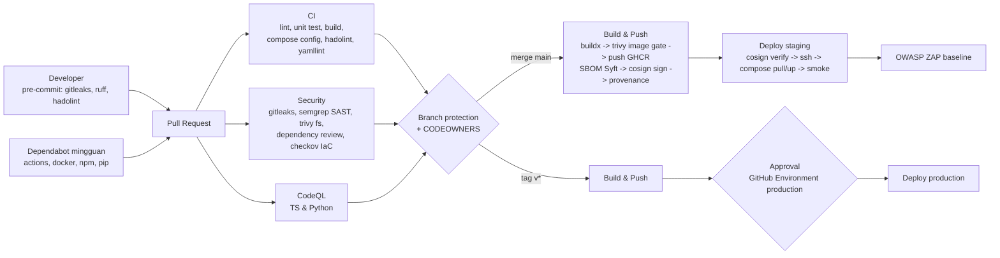

# PIPELINE DEVSECOPS EFN

## 1. Gambaran



## 2. Kontrol per tahap dan risiko yang ditutup

| Tahap | Kontrol | File | Risiko (docs/01) |
|---|---|---|---|
| Commit | gitleaks, detect-private-key, ruff, hadolint, yamllint | `.pre-commit-config.yaml` | R-S01 |
| PR | Path-filtered lint/test/build per service | `ci.yml` | R-T12 |
| PR | `docker compose config` dev & prod dengan secrets dummy | `ci.yml` job `infra` | konfigurasi rusak tidak sampai server |
| PR | Semgrep rulesets OWASP, secrets, docker, TS, Python | `security.yml` | R-S04, R-S05, R-S06 |
| PR | Trivy fs: vuln + secret + misconfig (Dockerfile, compose) | `security.yml` | R-S02 |
| PR | Dependency review: blok severity high & lisensi GPL/AGPL untuk dependensi NPM/Py | `security.yml` | R-S02, R-L08 |
| PR | Checkov: Dockerfile, GitHub Actions (hardening compose: `check-encryption.sh` + cek CI job `infra`) | `security.yml` | R-S07 |
| PR | CodeQL security-extended | `codeql.yml` | R-S05 |
| Build | Gerbang rilis: job `gate` menunggu CI (`CI gate`) + Security (gitleaks, semgrep, Trivy fs, checkov) commit yang sama = success sebelum push/sign (SEC-80, `scripts/verify-commit-gates.sh`) | `build-push.yml` | R-S07, R-S08 |
| Build | Push sekali, Trivy image BY DIGEST hasil push; HIGH/CRITICAL memblokir tanda tangan (SEC-83). PR: job `scan-pr` build + load + scan, token `contents: read` saja (SEC-81) | `build-push.yml` | R-S02 |
| Build | SBOM SPDX tingkat paket (Syft) di-attest cosign ke registry (bukan artifact) + SBOM buildx; Rekor publik hanya menyimpan hash + sertifikat (SEC-84) | `build-push.yml` | audit supply chain |
| Build | Cosign keyless (OIDC GitHub) + `attest-build-provenance` (SLSA) | `build-push.yml` | R-S08 |
| Deploy | Gerbang rilis ulang (CI, Security, Build & Push success untuk SHA penuh) + `cosign verify` identitas workflow + ref + SHA commit sebelum pull; `workflow_run` hanya dari push repo sendiri (SEC-80/82) | `deploy.yml` | R-S07, R-S08 |
| Deploy | Secrets dari GitHub Environments (lewat stdin SSH ke `sudo -n bash -s`; `deploy.sh` berjalan sebagai **root**) → file `/opt/efn/secrets/*.txt` (direktori `root:efn-superadmin 0750`, file 0444 — docs/04 §8.6, `docs/runbooks/key-custody.md`) → Docker secrets. Leaf TLS diterbitkan di host dari intermediate (`EFN_PKI_*`); `member_hash_pepper` & `minio_prometheus_token` diturunkan di host (`derive-secrets.sh`). Daftar tunggal: `scripts/secrets.list` | `deploy.yml`, `scripts/deploy.sh` | R-S01 |
| Deploy | Environment `production` dengan required reviewers | GitHub Settings | perubahan tidak disetujui |
| Deploy | Smoke test health endpoint, rollback dengan re-deploy tag sebelumnya (`workflow_dispatch`) | `deploy.yml` | downtime |
| Runtime | Traefik: HSTS, frame deny, rate limit, IP allowlist dashboard internal, blok Odoo db manager, TLS 1.2+ | `infra/traefik/dynamic/middlewares.yml` | R-S03, R-S04 |
| Runtime | Container non-root, `no-new-privileges`, `read_only` + tmpfs, network `internal: true`, port backend tidak dipublish | `docker-compose.yml`, `docker-compose.prod.yml` | lateral movement |
| Runtime | Log redaksi nomor HP & token (Promtail), retensi 30 hari | `promtail.yml`, `loki.yml` | R-L01 |
| Post-deploy | ZAP baseline tiap deploy staging + mingguan; issue otomatis | `dast.yml` | R-S11 |
| Berkelanjutan | Dependabot mingguan untuk actions, docker, compose, npm, pip | `dependabot.yml` | R-S02, R-S07 |

### 2.1 Arsitektur keamanan runtime (v2, 5 Okt 2026 — pemilik bagian ini: efn-architect)

Instruksi klien: **enkripsi di setiap transaksi data**. Keputusan: ADR-022 (enkripsi), ADR-023 (Odoo via WireGuard + 2FA), ADR-024 (kredensial per service). Kontrak teknis: `docs/04 §7`. Zona & diagram: `docs/02 §5`.

| Lapisan | Kontrol | Gate di pipeline (usulan untuk devsecops/QA) |
|---|---|---|
| PKI | CA internal berbasis skrip: root offline, intermediate per env (nameConstraints), leaf ECDSA P-256 90 hari diterbitkan `deploy.sh` | Deploy gagal bila leaf < 30 hari atau CA tidak ada; alert `EfnCertExpiringSoon` |
| In transit | TLS verify-full semua hop internal; ghostunnel untuk app tanpa TLS native (app bind `127.0.0.1`); WireGuard antar-node & outlet | CI job `infra`: tolak `redis://`, `amqp://`, `http://` ke service internal, `sslmode` selain `verify-full`, dan `EFN_ALLOW_PLAINTEXT` di file prod; test integrasi negatif (klien menolak sertifikat CA lain) |
| At rest | LUKS2 semua node; kolom PII AES-256-GCM (BFF); MinIO SSE-S3 + object lock `pg-backup`; WAL-G libsodium (dipilih menggantikan pgBackRest — lihat laporan devsecops); ClickHouse encrypted disk | Checklist provisioning host (LUKS, AES-NI); `minio-init` memverifikasi SSE & object lock |
| Identitas | Kredensial per service, superuser hanya bootstrap/backup; Redis ACL; RabbitMQ `user_id` publisher | CI: tidak ada service aplikasi yang memakai `pg_password`/`minio_root_password`/admin RabbitMQ |
| Akses manusia | Odoo, Grafana, Metabase, Traefik dashboard hanya via entrypoint WireGuard; 2FA Odoo wajib | ZAP/blackbox: `erp.<domain>` tidak terjangkau dari internet |
| Pengecualian | Hanya lewat tabel "Pengecualian terdaftar" ADR-022 | PR yang menambah hop plaintext tanpa baris pengecualian ditolak reviewer |
| Kepatuhan PDP | Inventaris, retensi, DSAR, consent, respons breach di `docs/compliance/` | Job purge & lifecycle diuji di staging |

## 3. Setup repo GitHub (sekali)

### 3.1 Branch protection `main`
- Require PR, minimal 1 approval, require review from CODEOWNERS.
- Required status checks: `CI gate`, `Secret scan (gitleaks)`, `SAST (semgrep)`, `Trivy filesystem`, `IaC (checkov)`, `Analyze (javascript-typescript)`, `Analyze (python)`.
- Require signed commits (disarankan). Block force push.

### 3.2 Environments
| Environment | Protection | Secrets | Variables |
|---|---|---|---|
| `staging` | tidak ada (auto) | Lihat daftar di bawah tabel | Lihat daftar di bawah tabel |
| `production` | Required reviewers = **Superadmin saja** (docs/04 §8.6; min 2 orang disarankan ADR-022), wait timer 10 menit, hanya dari tag `v*` | sama, nilai berbeda (`EFN_PKI_*` intermediate production) | sama; `PAYMENT_PROVIDER` ≠ `mock` |

**Secrets per Environment (diperbarui G6 QA dari `scripts/secrets.list` + `deploy.yml`):**
- Akses: `DEPLOY_SSH_KEY`, `DEPLOY_KNOWN_HOSTS`, `DEPLOY_HOST`, `DEPLOY_USER`.
- PKI (bukan Docker secret; dipakai `deploy.sh` menerbitkan leaf di host): `EFN_PKI_INTERMEDIATE_KEY` [SA], `EFN_PKI_INTERMEDIATE_CRT`, `EFN_PKI_ROOT_CRT`, opsional `EFN_PKI_EXTRA_TRUST` (CA lama selama rotasi). Dibuat Superadmin: `make pki-root` (offline) lalu `make pki-intermediate ENV=<env>`.
- Aplikasi = setiap baris `scripts/secrets.list` yang **bukan** `pki`/`derived:*`, nama UPPERCASE (38 item): `PG_PASSWORD`, `ODOO_ADMIN_PASSWORD`, `RABBITMQ_PASSWORD`, `MINIO_ROOT_PASSWORD`, `CLICKHOUSE_PASSWORD`, `GRAFANA_ADMIN_PASSWORD`; `PG_PASSWORD_{ODOO,BFF,OCR,ETL,METABASE,EXPORTER}`, `RABBITMQ_PASSWORD_{BFF,OCR,ETL}`, `REDIS_PASSWORD_{BFF,EXPORTER}`, `MINIO_BFF_SECRET`, `MINIO_OCR_SECRET`, `MINIO_PROMETHEUS_SECRET`, `CLICKHOUSE_PASSWORD_{ETL,TEXT2SQL,METABASE}`; `JWT_SECRET`, `OTP_PEPPER` [SA], `DISCOUNT_TOKEN_SECRET`, `ODOO_BFF_API_KEY`, `WHATSAPP_TOKEN`, `WEBHOOK_PAYMENT_SECRET`, `PII_ENCRYPTION_KEY` [SA], `ALTCHA_HMAC_KEY`, `PAYMENT_PROVIDER_API_KEY` (isi `disabled` selama `mock`/`disabled`), `ACME_DNS_API_TOKEN` (wajib nyata, deploy menolak `disabled`); `MINIO_BACKUP_PASSWORD`, `WALG_LIBSODIUM_KEY` [SA], `MINIO_KMS_KEY` [SA], `CLICKHOUSE_DISK_KEY` [SA], `ALERTMANAGER_WEBHOOK_URL` (wajib `https://`).
- **Tidak** di GitHub: `member_hash_pepper`, `minio_prometheus_token` (diturunkan di host) dan semua `tls_*`/`efn_ca_crt` (diterbitkan di host).

**Variables:** `TRAEFIK_DOMAIN`, `ACME_EMAIL`, `COMPOSE_PROFILES` (default `core,data,ai,observability,ops`), `PG_SUPERUSER`, `WHATSAPP_ENABLED` (default `false`), `WHATSAPP_PHONE_NUMBER_ID`, `WHATSAPP_OTP_TEMPLATE`, **`PAYMENT_PROVIDER`** (wajib: `mock` staging, `disabled` production sampai ADR-016/026 diputuskan; `xendit|midtrans` butuh `PAYMENT_PROVIDER_EXPERIMENTAL=true` di host), **`EFN_PUBLIC_BIND`** (wajib), `EFN_WG_BIND` (10.88.0.1), `EFN_WG_HTTPS_PORT` (443), `EFN_WG_OUTLET_CIDR` (10.88.0.0/16), `EFN_WG_STAFF_CIDR` (10.89.0.0/16), `ACME_DNS_PROVIDER` (cloudflare), `ACME_DNS_TOKEN_ENV` (CF_DNS_API_TOKEN), `RABBITMQ_STRICT_PERMISSIONS` (default **true** sejak G6; `false` = fallback), `MARKET_SCOUT_PHOTO_RETENTION_DAYS` (90), `CH_MART_RETENTION_YEARS` (5), `CONSENT_LOCATION_VERSION` / `CONSENT_LOCATION_TEXT_SHA256` / `CONSENT_MARKETING_VERSION` / `CONSENT_MARKETING_TEXT_SHA256` (versi + SHA-256 UTF-8 teks persetujuan aktif di `superapp-web/lib/consent.ts`; kosong = grant consent `503`), `DSAR_DELETE_GRACE_DAYS` (7).

Repository variable: `STAGING_DOMAIN` (dipakai DAST).

Catatan secret:
- `OTP_PEPPER` dipakai BFF (dan, lewat turunan `member_hash_pepper`, Odoo `efn_privacy`); ETL **tidak** lagi memegangnya (SEC-16; turunan HKDF `efn:member_hash:v1` untuk `member_hash`, docs/04 §1). Rotasi mengubah semua `member_hash` (ledger, ClickHouse) → butuh prosedur migrasi; jangan dirotasi tanpa rencana (lihat `docs/runbooks/secret-rotation.md`).
- `WALG_LIBSODIUM_KEY` hilang = backup tidak bisa dibuka. Simpan salinan offline (brankas) di luar GitHub.
- CI job `infra` gagal bila daftar `secrets:` compose ≠ `scripts/secrets.list`.

### 3.3 Security settings
- Code scanning: aktifkan agar SARIF dari semgrep/trivy/checkov/CodeQL muncul di tab Security.
- Secret scanning + push protection: aktifkan.
- Dependabot alerts & security updates: aktifkan.
- Packages (GHCR): visibility private; izinkan Actions menulis.

### 3.4 Host target (staging/prod)
```bash
# Ubuntu 24.04 LTS
curl -fsSL https://get.docker.com | sh
sudo useradd -m -G docker deploy
sudo groupadd efn-superadmin            # docs/04 §8.6: hanya Superadmin; secrets root:efn-superadmin 0750
sudo mkdir -p /opt/efn && sudo chown deploy:deploy /opt/efn
# deploy.sh berjalan sebagai ROOT lewat sudo (deploy.yml: ssh ... 'sudo -n bash -s'):
echo 'deploy ALL=(root) NOPASSWD: /usr/bin/bash -s' | sudo tee /etc/sudoers.d/efn-deploy && sudo chmod 0440 /etc/sudoers.d/efn-deploy
# tambahkan public key deploy ke /home/deploy/.ssh/authorized_keys (key pair khusus CI, bukan key personal)
# WireGuard wg0 (10.88.0.1) harus aktif SEBELUM docker (EFN_WG_BIND); tutup 22 dari publik; 443 publik hanya Cloudflare
sudo apt install -y jq openssl
```
Catatan: user `deploy` (grup docker) sudah setara root; kontrol sebenarnya = approval Superadmin di GitHub Environment (`docs/runbooks/key-custody.md`).
Isi `DEPLOY_KNOWN_HOSTS` dengan `ssh-keyscan -H <host>`.

### 3.5 Pin actions ke SHA
Sebelum produksi jalankan `pinact run` (atau pakai PR Dependabot pertama) agar semua `uses:` memakai SHA commit 40 karakter. Scaffold memakai tag mayor agar mudah dibaca.

## 4. Strategi branching & versi
- Trunk-based: branch pendek → PR → `main`. `main` selalu dapat dideploy ke staging.
- Rilis produksi = tag semver `vX.Y.Z` pada commit `main` yang sudah lolos UAT di staging.
- Image tag: `sha-<7>` (setiap commit main), `main`, `vX.Y.Z`, `X.Y`, `latest` (hanya tag rilis).
- Rollback: `workflow_dispatch` Deploy dengan `image_tag` versi sebelumnya. Migrasi DB harus backward-compatible satu versi.

## 5. Definisi "aman untuk produksi" (Definition of Done keamanan)
1. Semua status check hijau, tidak ada suppress Trivy/Semgrep tanpa justifikasi di PR.
2. Endpoint baru tercatat di OpenAPI, punya auth + rate limit, dan muncul di ZAP scope.
3. Secrets baru ditambahkan ke GitHub Environments **dan** `scripts/deploy.sh` **dan** `docker-compose.yml` secrets block.
4. Runbook di `docs/runbooks/` untuk komponen baru (start/stop, health, alert, rollback).
5. Backup restore test terakhir < 30 hari (R-T08).

## 6. Yang belum ada dan kapan ditambahkan
| Item | Fase |
|---|---|
| ~~Odoo module test~~ — sudah ada: `ci.yml` job `odoo-test` (install `efn_core,efn_pos_otp_gate,efn_kitting`, `--test-tags efn`) | Fase 0 (selesai) |
| Tour POS (HttpCase/`start_tour`) untuk alur OTP frontend, e2e Playwright Super-App | Fase 1 (lihat `docs/testing/TEST_STRATEGY.md`) |
| Integration test NestJS ↔ Odoo (testcontainers) | Fase 2 |
| Load test k6 terhadap staging (POS <1s, API p95) | Fase 2 |
| Pentest manual pihak ketiga | sebelum tiap go-live mayor |
| Docker Swarm / k3s multi-node, PostgreSQL HA (Patroni) | Fase 6 |
| Keycloak SSO untuk Odoo/Metabase/Grafana | Fase 6 |
| Mobile (Expo) pipeline: EAS build atau self-hosted, store deploy | Fase 3 |
