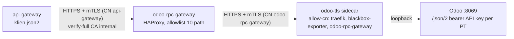
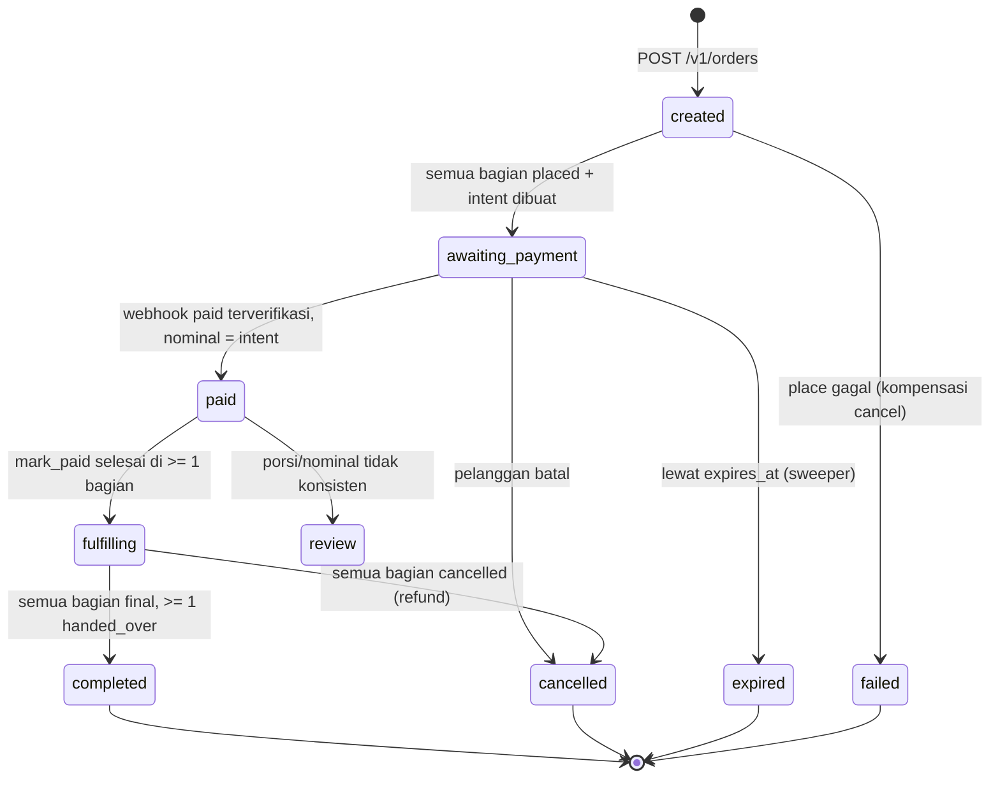
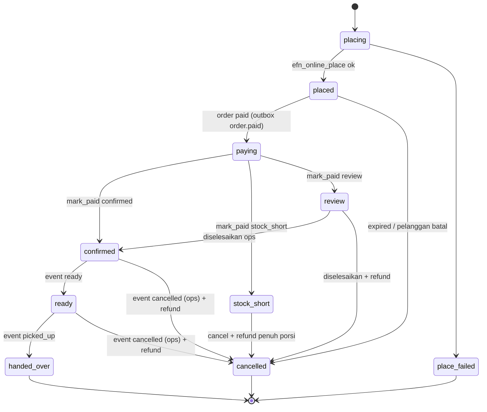
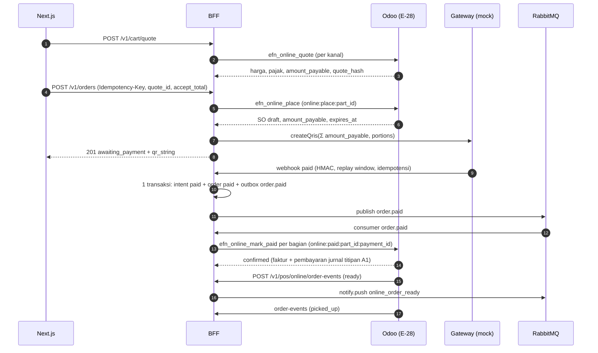
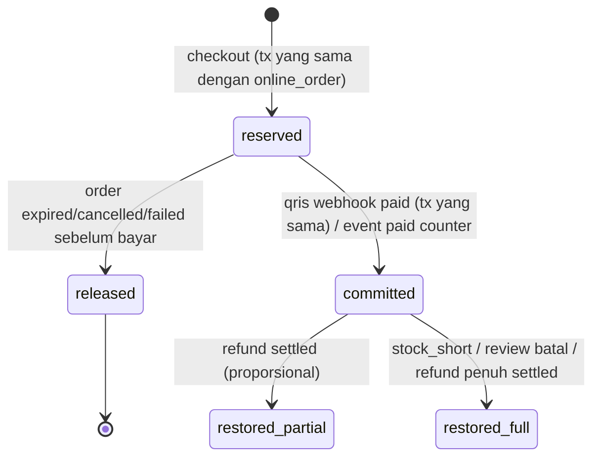
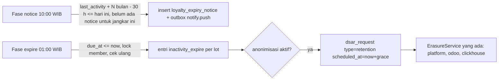

# KONTRAK ANTAR-SERVICE (v16.1 — 1 Nov 2026, G38 §23 Text-to-SQL "Tanya Data" (Odoo → text2sql → 9router/Ollama → ClickHouse per PT); v16.0 — 1 Nov 2026, G37 §22 gateway LLM 9router + fallback Ollama untuk OCR tahap 2 (K25-01, ADR-037); v15.1 — 31 Okt 2026, G33 §20.11 notifikasi reward MGM + layar referral Super-App; v15.0 — 30 Okt 2026, G32 §21 mart & dashboard waste/yield (K25-08); v14.1 — 30 Okt 2026, G31b §20.10 dasar MGM per baris (`excluded_categ_ids`); v14.0 — 30 Okt 2026, G31 §20 engine MGM: referral, akrual, settle, clawback; v13.0 — 29 Okt 2026, G30 §19 kebijakan MGM per PT (K25-10); v11.0 — 25 Okt 2026, G26 §17 pesanan online wajib lunas: VA, e-wallet, transfer + bukti, kiosk; v10.1 — 24 Okt 2026, G24 §16 entitas WTZ Wetzel's Pretzels; v10.0 — 21 Okt 2026, G23 §15 reservasi meja & pre-order berjadwal; v9.1 — 19 Okt 2026, G22 §14 sinkron r15 K1–K3 + L-82; v9.0 — 19 Okt 2026, G22 §14; v8.0 — G21 §13; v7.0 — G20 §12; v6.0 — G19 §11; v5.1 — 10 Okt 2026, privasi G18 L-21; v5.0 — 9 Okt 2026; §8 v3.x, §9 v4.x Fase 1, §10 v5.0 Fase 3 penjualan online)

Status: **Draft untuk Fase 0 / PoC**. Mengikuti rekomendasi ADR yang masih `Proposed`. Semua service (Odoo, BFF, Next.js, worker) wajib memakai nama, path, dan payload di dokumen ini. Perubahan kontrak = ubah dokumen ini dulu.

## 1. Identitas & kode

| Hal | Nilai |
|---|---|
| `member_ref` | Nomor HP format E.164 tanpa `+` (mis. `6281234567890`). Di log selalu di-mask `62812****890`. Di DB analitik di-hash: `member_hash = hex(sha256(pepper_hex + member_ref))` dengan `pepper_hex = hex(HKDF-SHA256(ikm=otp_pepper, salt "", info "efn:member_hash:v1", 32 byte))` (implementasi acuan: `services/api-gateway/src/config/app-config.ts`). Kunci HMAC OTP memakai info `"efn:otp_code:v1"` (kunci berbeda). ETL wajib memakai derivasi yang sama (lihat `services/api-gateway/src/common` untuk implementasi acuan). |
| `user_id` (JWT `sub`, `price_hunter_report.user_id`, payload event) | Sama dengan `member_ref` (E.164). Karena itu data pribadi: tidak boleh masuk ClickHouse tanpa di-hash. |
| Kode brand / company (`res.company.efn_brand_code`) | `EFN` (holding, merchant of record), `RTL` (PT Retail / supermarket, PPN), `FNB` (PT F&B, PB1), `FARM` (collection center). |
| `order_ref` | String opaque ≤ 64 karakter, unik per order. Odoo 19 mengirim `pos.order.uuid` (karena `pos_reference` baru dibuat server saat sync pertama, setelah OTP diminta). BFF tidak boleh mem-parse formatnya. |
| Versi API | Prefix `/v1`. Endpoint internal server-to-server di bawah `/v1/pos/*` dan `/internal/v1/*`. |

## 2. Autentikasi antar-service

| Pemanggil → Penerima | Mekanisme | Secret (file `/run/secrets/<nama>`) |
|---|---|---|
| Odoo → BFF (`/v1/pos/*`) | Header `X-EFN-Service-Key: <key>`; BFF membandingkan dengan `timingSafeEqual` | `odoo_bff_api_key` (Odoo membaca env `EFN_BFF_API_KEY_FILE`) |
| Browser → BFF (customer) | `Authorization: Bearer <access_token>` (JWT HS256, exp 1 jam). Next.js menyimpan token di cookie `efn_session` HttpOnly dan meneruskannya server-side | `jwt_secret` |
| Webhook payment/3PL → BFF | HMAC-SHA256 atas string `"<t>." + rawBody` (timestamp ikut ditandatangani agar replay window tidak bisa diakali), header `X-EFN-Signature: t=<unix>,v1=<hex>`, replay window 300 s | `webhook_payment_secret` |
| Worker ↔ BFF | Tidak ada HTTP; hanya lewat RabbitMQ | — |

Secret baru yang harus ada di compose + `scripts/gen-secrets.sh`: `otp_pepper`, `discount_token_secret`, `odoo_bff_api_key`, `whatsapp_token`, `webhook_payment_secret`. Env non-rahasia: `WHATSAPP_PHONE_NUMBER_ID`, `WHATSAPP_OTP_TEMPLATE` (default `efn_otp`), `WHATSAPP_ENABLED` (`false` di dev → sender console).

## 3. BFF HTTP API

Semua error berbentuk `{ "error": { "code": "<snake_case>", "message": "<pesan generik Bahasa Indonesia>" } }`. Tidak pernah membocorkan apakah nomor terdaftar.

### 3.1 POS OTP gate (dipanggil server Odoo, bukan browser POS)

`POST /v1/pos/otp/request`
```json
{ "member_ref": "6281234567890", "order_ref": "Order 00012-003-0004", "amount": 125000, "company_code": "FNB", "pos_config_id": 3 }
```
→ `202 { "challenge_id": "<uuid>", "expires_in": 180 }` (selalu 202 meski nomor tidak dikenal; pengiriman WA dilakukan bila valid). `429` bila rate limit.

`POST /v1/pos/otp/verify`
```json
{ "challenge_id": "<uuid>", "order_ref": "Order 00012-003-0004", "code": "123456" }
```
→ `200 { "ok": true, "discount_token": "<token>", "expires_in": 600 }`
→ `400 { "ok": false, "reason": "invalid" | "expired" | "locked", "attempts_left": 0..2 }`

`POST /v1/pos/discount-token/consume` (dipanggil Odoo saat order di-sync/di-validasi di server)
```json
{ "discount_token": "<token>", "order_ref": "Order 00012-003-0004", "member_ref": "6281234567890" }
```
**v2 (SEC-07):** `member_ref` di request OTP **dan** consume diambil server Odoo dari nomor HP `partner_id` order (bukan diketik kasir). Order tanpa partner ber-HP tidak bisa memakai promo ber-OTP. BFF menolak consume (`409 member_mismatch`) bila `member_hash(member_ref)` ≠ klaim `member_hash` token. Nomor di luar Indonesia (`^62[0-9]{8,13}$`) ditolak `400 invalid_phone`.
→ `200 { "ok": true }` | `409 { "ok": false, "reason": "already_used" | "order_mismatch" | "expired" | "invalid" }`

`discount_token` = JWT HS256 (`discount_token_secret`) dengan klaim `{ jti, purpose: "pos_promo", order_ref, member_hash, company_code, exp }`. Sekali pakai: `jti` disimpan di Redis `dtok:used:<jti>` (nilai = `order_ref`) saat consume. Consume **idempotent** untuk pasangan `jti` + `order_ref` yang sama: panggilan ulang dengan order yang sama → `200 { ok: true }` (menangani retry Odoo bila commit gagal setelah consume sukses); dengan `order_ref` berbeda → `409 already_used`.

Aturan OTP: 6 digit `crypto.randomInt`, disimpan sebagai HMAC-SHA256(`otp_pepper`) di Redis `otp:<challenge_id>` TTL 180 s, maks 3 attempt lalu `locked`. Rate limit request: per `member_ref` 3 / 15 menit, per IP/pos_config 20 / 15 menit. Setiap hasil dicatat di `platform.otp_audit` (subject = member_hash).

### 3.2 Login pelanggan (Super-App)

`POST /v1/auth/otp/request` `{ "phone": "6281234567890" }` → `202 { "challenge_id": "<uuid>", "expires_in": 180 }`
`POST /v1/auth/otp/verify` `{ "challenge_id": "<uuid>", "code": "123456" }` → `200 { "access_token": "<jwt>", "token_type": "Bearer", "expires_in": 3600 }` | `400` seperti 3.1.
**(v5.1, L-21b — G18, Q-P3)** Body wajib menyertakan `"age_confirmed": true` (pernyataan usia minimal 17 tahun; diminta setiap login karena login = daftar). Tidak ada/`false` → `400 { error: { code: "age_confirmation_required" } }` dicek **sebelum** OTP (challenge tidak hangus); non-boolean → `400 invalid_request`. BFF mengisi `member.age_confirmed_at` (tanpa tanggal lahir). `MEMBER_MIN_AGE` (17..21) hanya untuk teks. Teks pelanggan menunggu persetujuan Legal.
`GET /v1/me` (Bearer) → `{ "member_ref_masked": "62812****890", "points_balance": 1200 }`
**(v5.2 — mode uji OTP dev, 26 Okt 2026)** Selama WhatsApp Cloud API belum aktif, APK uji tidak bisa menerima OTP. Bila `APP_ENV=dev` + `NODE_ENV=development` + `WHATSAPP_ENABLED=false` dan nomor ada di `DEV_OTP_REVEAL_MEMBERS` (allowlist 62xxx, maks 10), respons request menjadi `202 { "challenge_id", "expires_in", "dev_code": "123456" }`. Nomor lain / environment lain: field `dev_code` **tidak ada** (bentuk respons identik dengan sebelumnya). Allowlist terisi di luar kondisi itu = BFF gagal start. Klien menampilkan kode itu dengan label "mode uji"; rate limit, ALTCHA, TTL, dan batas percobaan tetap berlaku.

### 3.3 Price Hunter (Market Scout)

`POST /v1/market-scout/reports` (Bearer, `multipart/form-data`): `photo` (JPEG/PNG/WebP, maks 8 MB), `product_name`, `price` (angka Rupiah), `competitor_name?`, `lat?`, `lng?`
→ `202 { "report_id": "<uuid>", "status": "queued" }` | `413` | `415` | `429` (cap harian per user default 20)

`GET /v1/market-scout/reports/:id` (Bearer, hanya pemilik) → `{ "report_id", "status": "queued|processing|valid|rejected|flagged", "reason": null|string, "points_awarded": 0 }`

BFF: magic-bytes check, re-encode dengan `sharp` (strip EXIF, maks 2048 px, JPEG q85), simpan ke MinIO bucket `market-scout` key `reports/<yyyy>/<mm>/<report_id>.jpg`, `INSERT platform.price_hunter_report` status `queued`, publish `ocr.requested`.

### 3.4 Loyalty (dibaca POS & app)

`GET /v1/pos/loyalty/balance?member_ref=...` (service key) → `{ "points_balance": 1200 }`
Ledger tunggal di `platform.loyalty_ledger` (D-05: satu ledger poin). Odoo tidak menyimpan saldo poin sendiri untuk member platform.

## 4. Event RabbitMQ

Default exchange, queue durable tipe `quorum`, setiap queue punya DLQ `<queue>.dlq` (via `x-dead-letter-exchange: ""` + `x-dead-letter-routing-key`). Properti AMQP `message_id` = `idempotency_key`, `content_type: application/json`, `persistent: true`. Semua payload punya `schema_version: 1`.

| Queue | Publisher | Consumer | Payload |
|---|---|---|---|
| `ocr.requested` | BFF | ai-ocr-worker | `{ schema_version: 2, report_id, user_hash, image_bucket, image_object, product_name, reported_price, competitor_name, geo: {lat,lng}|null, submitted_at }` |
| `loyalty.earn.requested` | ai-ocr-worker (dan nanti MGM) | BFF | `{ schema_version: 2, idempotency_key: "price_hunter:<report_id>", member_hash, points, reason, source: "price_hunter", source_ref: "<report_id>" }` |
| `notify.push` | worker / BFF | BFF notification | `{ schema_version: 2, idempotency_key, member_hash, source: "price_hunter", source_ref: "<report_id>", template: "price_hunter_valid" | "price_hunter_rejected" | ..., params: {} }` |

**v2 (5 Okt 2026): tidak ada nomor HP mentah di payload event.** Payload hanya membawa `user_hash`/`member_hash`. BFF menyelesaikan penerima notifikasi dengan mendekripsi `user_enc` dari baris sumber (`source` + `source_ref`, mis. `price_hunter_report`) dan memverifikasi hash-nya cocok. Lihat §7.

**Autentikasi publisher (SEC-08):** setiap publisher menyetel properti AMQP `user_id` = nama user RabbitMQ-nya (RabbitMQ menolak bila tidak cocok dengan user koneksi). Consumer BFF hanya menerima `loyalty.earn.requested` dengan `user_id = efn-ocr` untuk `source=price_hunter`, `points` ≤ `LOYALTY_MAX_POINTS_PER_EVENT` (default 100), dan memverifikasi `price_hunter_report` dengan `id = source_ref` berstatus `valid` dan `user_hash = member_hash`.

Consumer idempotent: BFF menyimpan `idempotency_key` di `platform.processed_message (consumer, idempotency_key)` unik; worker memeriksa status report sebelum memproses (`queued` → `processing` via `UPDATE ... WHERE status='queued' RETURNING`).

Worker menulis hasil ke `platform.price_hunter_report` (status `valid|rejected|flagged`, `extracted`, `confidence`, `reason`). `flagged` = perlu review manual (mis. VLM tidak tersedia, kemungkinan fraud).

## 5. Tabel platform baru (dimiliki BFF)

Didefinisikan di `infra/postgres/init/02-platform-loyalty.sql`:
- `platform.loyalty_ledger (id, member_ref_hash, member_ref_enc?, company_code, delta_points, reason, source, source_ref, idempotency_key UNIQUE, expires_at NULL, created_at)`; saldo = SUM entri yang belum kedaluwarsa. `company_code` = PT yang menanggung liabilitas poin (ADR-020, settlement antar-PT).
- `platform.processed_message (consumer, idempotency_key, processed_at, PRIMARY KEY(consumer, idempotency_key))`.
- `platform.outbox (id, queue, payload jsonb, message_id, created_at, published_at)`.

## 6. Konfigurasi Odoo (`ir.config_parameter`)

`efn.bff_url` (**v2: `https://api-gateway:3000`**, verifikasi sertifikat dengan CA di env `EFN_CA_FILE`, default `/run/secrets/efn_ca_crt`), `efn.pos.otp_required_for_promo`, `efn.pos.promo_disabled_when_offline`, `efn.pos.otp_timeout_seconds` (default 5). API key BFF **tidak** disimpan di config parameter; dibaca dari file secret.

## 7. Enkripsi & Kredensial (v2, wajib — instruksi user "enkripsi di setiap transaksi data")

### 7.1 Enkripsi in transit — setiap hop TCP antar-container memakai TLS terverifikasi
- **PKI internal**: CA internal ECDSA P-256 dibuat `scripts/gen-pki.sh` (dev) / disuplai dari GitHub Environments (staging/prod). Semua klien memverifikasi server terhadap CA di `/run/secrets/efn_ca_crt` (verify-full, hostname = nama service compose). Sertifikat server per service: secret `tls_<service>_crt` + `tls_<service>_key` (nama service dengan `_`, mis. `tls_api_gateway_key`).
- Aplikasi tanpa TLS native (Odoo HTTP, Next.js standalone, Ollama, Metabase bila perlu) dibungkus **sidecar TLS `ghostunnel`** yang berbagi network namespace (`network_mode: service:<app>`), sehingga plaintext hanya ada di loopback di dalam namespace yang sama. Pengecualian lain hanya lewat ADR-022 dengan kontrol kompensasi.
- Antar-node: WireGuard (lapisan kedua, bukan pengganti TLS).

| Koneksi | Parameter klien (env) |
|---|---|
| PostgreSQL | `PG_SSLMODE=verify-full`, `PG_SSLROOTCERT=/run/secrets/efn_ca_crt` (Odoo: `db_sslmode = verify-full` + env `PGSSLROOTCERT`) |
| Redis | `REDIS_URL=rediss://redis:6379`, `REDIS_USERNAME`, `REDIS_PASSWORD_FILE`, `REDIS_TLS_CA_FILE` |
| RabbitMQ | `AMQP_URL=amqps://<user>@rabbitmq:5671` (tanpa password), `RABBITMQ_PASSWORD_FILE`, `AMQP_TLS_CA_FILE` |
| MinIO | `MINIO_ENDPOINT=minio`, `MINIO_PORT=9000`, `MINIO_USE_SSL=true`, `MINIO_CA_FILE`, `MINIO_ACCESS_KEY`, `MINIO_SECRET_KEY_FILE` (menggantikan `MINIO_ROOT_*` di aplikasi) |
| ClickHouse | `CH_SECURE=true`, `CH_PORT=8443` (HTTPS) / `9440` (native TLS), `CH_CA_FILE` |
| BFF (server) | Mendengar **HTTPS** di `:3000` dengan `TLS_CERT_FILE`, `TLS_KEY_FILE`. Klien: Traefik (`serversTransport` rootCAs), Next.js (`BFF_INTERNAL_URL=https://api-gateway:3000` + `NODE_EXTRA_CA_CERTS`), Odoo (`EFN_CA_FILE`), Prometheus (scrape https) |
| Ollama | `OLLAMA_URL=https://ollama:11434` via sidecar, `OLLAMA_CA_FILE` |
| Traefik → upstream | Semua router memakai `https` ke upstream + `serversTransport` dengan CA internal |

Semua env `*_CA_FILE` default ke `/run/secrets/efn_ca_crt`. Kode **gagal start** bila TLS diminta tetapi CA tidak terbaca; tidak ada fallback diam-diam ke plaintext. Mode plaintext hanya boleh lewat flag eksplisit `EFN_ALLOW_PLAINTEXT=true` yang **ditolak** saat `NODE_ENV/APP_ENV=production`.

### 7.2 Enkripsi at rest
- **Kolom PII** dienkripsi di aplikasi: AES-256-GCM, kunci secret `pii_encryption_key` (32 byte, base64). Format `bytea` = `0x01` (versi) ‖ IV 12 byte ‖ ciphertext ‖ tag 16 byte; AAD = `"efn:<tabel>.<kolom>:v1"`. Implementasi acuan di BFF `src/common/pii/`. **Key ring**: byte versi = versi kunci. Kunci v1 = secret `pii_encryption_key`; kunci berikutnya `pii_encryption_key_v2`, `_v3`, … (env `PII_ENCRYPTION_KEY_V<n>_FILE`). Enkripsi memakai `PII_ACTIVE_KEY_VERSION` (default 1); dekripsi memilih kunci dari byte versi. Rotasi = tambah kunci baru, naikkan versi aktif, jalankan re-encrypt job, lalu pensiunkan kunci lama — tanpa downtime.
- `platform.price_hunter_report`: kolom `user_id` (HP mentah) **dihapus**, diganti `user_hash char(64) NOT NULL` (rumus `member_hash` §1) + `user_enc bytea NOT NULL`. Cap harian & dedup memakai `user_hash`.
- `platform.loyalty_ledger.member_ref_enc` **wajib diisi** (BFF mengenkripsi saat member_ref diketahui; untuk earn price hunter disalin dari `price_hunter_report.user_enc`).
- `platform.otp_audit.ip` → `ip_enc bytea` (forensik hanya lewat dekripsi oleh admin).
- MinIO: SSE-S3 aktif untuk bucket `market-scout` dan `pg-backup` (KMS key secret `minio_kms_key`), versioning + object lock (governance) di `pg-backup`.
- Backup PostgreSQL: WAL-G libsodium (sudah). Disk host: LUKS (runbook).
- ETL **tidak lagi membutuhkan `otp_pepper`** (SEC-16): ClickHouse menerima `user_hash`/`member_ref_hash` yang sudah di-hash dari Postgres.

### 7.3 Kredensial per service (SEC-02, least privilege)
| Sistem | User | Secret | Hak |
|---|---|---|---|
| PostgreSQL | `efn_odoo` | `pg_password_odoo` | owner DB `efn_odoo`, `CREATEDB`, bukan superuser |
| PostgreSQL | `efn_bff` | `pg_password_bff` | owner skema `platform` di DB `efn_platform` |
| PostgreSQL | `efn_ocr` | `pg_password_ocr` | `SELECT` + `UPDATE(status, reason, extracted, confidence, image_phash, updated_at)` pada `platform.price_hunter_report`, `SELECT` kolom non-PII yang dibutuhkan anti-fraud |
| PostgreSQL | `efn_etl` (anggota `efn_readonly`) | `pg_password_etl` | grant level-kolom (lihat 01/02 SQL) |
| PostgreSQL | `efn_metabase` | `pg_password_metabase` | owner DB `metabase` saja |
| PostgreSQL | `efn_exporter` | `pg_password_exporter` | `pg_monitor` |
| PostgreSQL | superuser `postgres` | `pg_password` | hanya entrypoint/backup via socket lokal; tidak dipakai aplikasi |
| MinIO | `efn-bff` | `minio_bff_secret` | `PutObject`/`DeleteObject` `market-scout/reports/*` + `GetBucketLocation` pada bucket `market-scout` (dibutuhkan library klien) |
| MinIO | `efn-ocr` | `minio_ocr_secret` | `GetObject` `market-scout/reports/*` + `GetBucketLocation` pada bucket `market-scout` |
| RabbitMQ | `efn-bff` | `rabbitmq_password_bff` | configure/read/write queue miliknya; read `loyalty.earn.requested`, `notify.push`; write `ocr.requested` |
| RabbitMQ | `efn-ocr` | `rabbitmq_password_ocr` | read `ocr.requested`; write `loyalty.earn.requested`, `notify.push` (+ `.dlq`) |
| Redis | `efn-bff` (ACL) | `redis_password_bff` | `~otp:* ~dtok:* ~rl:* …` (prefix yang dipakai BFF); user `default` dinonaktifkan; `maxmemory-policy noeviction` |

| ClickHouse | `efn_etl` | `clickhouse_password_etl` | INSERT/SELECT tabel mart & `etl_watermark` |
| ClickHouse | `efn_text2sql` | `clickhouse_password_text2sql` | `readonly=2`, SELECT view whitelist saja |
| ClickHouse | `efn_metabase` | `clickhouse_password_metabase` | SELECT view/mart |

Role/user dibuat oleh skrip init (devsecops) dengan password dari secret; grant tabel ditulis bersama skema (pemilik skema).

Tambahan Fase 3 (user teknis Odoo per PT, `odoo-rpc-gateway`, secret event HMAC, prefix Redis, bucket `catalog`): lihat §10.10.

### 7.4 Akses jaringan Odoo (SEC-01)
- Router Traefik `odoo` dan `odoo-ws` hanya menerima sumber dari rentang WireGuard (`internal-only`); outlet/POS terhubung via WireGuard (router outlet atau perangkat POS). Tidak ada akses Odoo dari internet publik.
- User internal Odoo wajib 2FA (`auth_totp` CE; kebijakan wajib dikonfigurasi efn-odoo-functional).
- Rate limit ketat `/web/login` & `/web/session/authenticate`; `/xmlrpc`, `/jsonrpc` diblok di Traefik kecuali dari subnet internal service.

### 7.5 Client IP (SEC-03)
Traefik mempercayai `X-Forwarded-For` hanya dari rentang Cloudflare (+WireGuard); BFF `TRUSTED_PROXIES` = subnet internal Docker + rentang Cloudflare (env, daftar disuplai devsecops). Firewall origin: 443 hanya dari Cloudflare + WireGuard.

## 8. Tambahan v3 (6 Okt 2026 — keputusan user setelah review gelombang 4)

### 8.1 Captcha OTP (SEC-06) — ALTCHA (open source, self-hosted, tanpa pihak ketiga)
`GET /v1/auth/challenge` → challenge ALTCHA (proof-of-work, HMAC secret `altcha_hmac_key`, TTL 5 menit, sekali pakai di Redis `altcha:used:<sig>`). `POST /v1/auth/otp/request` wajib field `altcha` (payload base64 dari widget); tanpa/invalid → `400 captcha_required`. Endpoint POS (service key) tidak memakai captcha.

### 8.2 Identitas member opak
Tabel `platform.member (id uuid PK, member_hash char(64) UNIQUE, member_ref_enc bytea NOT NULL, created_at, deleted_at NULL)`. JWT pelanggan `sub` = `member.id` (UUID), **bukan** nomor HP. `GET /v1/me` tetap `{ member_ref_masked, points_balance }`. Ledger & report tetap memakai `member_hash`.

### 8.3 Payment gateway-agnostic (QRIS POS & online) — provider belum ditentukan
- Abstraksi `PaymentGateway` di BFF (`createQris`, `getStatus`, `cancel`, `verifyWebhook`, `parseWebhook`). Adapter: `mock` (default dev/staging, QR dummy), `xendit`, `midtrans` (kerangka; **nonaktif** sampai ADR-016 diputuskan dan diuji ke sandbox vendor). Pilihan via `PAYMENT_PROVIDER=mock|xendit|midtrans`; produksi menolak `mock`.
- Secret: `payment_provider_api_key` (dibaca hanya bila provider ≠ mock), `webhook_payment_secret` (sudah ada). Tidak ada data kartu (PCI SAQ A); hanya QRIS/VA/e-wallet.
- `POST /v1/pos/payments` (service key, dipanggil server Odoo) `{ order_ref, amount, currency: "IDR", company_code, pos_config_id, method: "qris", idempotency_key }` → `201 { payment_id, provider, status: "pending", qr_string, expires_at }` (idempotent per `idempotency_key`).
- `GET /v1/pos/payments/:payment_id` → `{ payment_id, status: "pending|paid|expired|failed|cancelled", paid_at, provider_ref, amount }`
- `POST /v1/pos/payments/:payment_id/cancel` → `200 { status }`
- `POST /v1/webhooks/payments/:provider` (publik via Traefik, verifikasi signature provider/HMAC + replay window + idempotensi) → `200`. Status final hanya berubah lewat webhook terverifikasi atau `getStatus` ke provider, tidak dari klien.
- Tabel `platform.payment_intent (id uuid, provider, provider_ref, order_ref, company_code, amount numeric(14,2), currency, method, status, qr_string, expires_at, paid_at, idempotency_key UNIQUE, created_at, updated_at)`. Settlement per PT mengikuti ADR-019 (merchant of record) — belum diimplementasi.
- Odoo: metode pembayaran POS `efn_gateway` (modul gap, lihat docs/08) membuat intent, menampilkan QR di layar pelanggan, polling `GET` tiap 2 s sampai final/timeout; offline → metode ini nonaktif.
- Online (Super-App): ekstensi `purpose`, porsi per PT, refund — lihat §10.7.

### 8.4 Privasi (UU PDP) — endpoint, consent, penghapusan
- Consent: `GET /v1/me/consents` → `[{ purpose: "location"|"marketing", granted, version, updated_at }]`; `PUT /v1/me/consents/:purpose` `{ granted, version }` → `200`. Tabel append-only `platform.consent (id, member_id, purpose, granted, version, source, ip_enc, created_at)` (grant INSERT/SELECT saja untuk `efn_bff`). Market Scout membuang koordinat bila consent `location` tidak aktif.
- DSAR sesuai `docs/compliance/PDP_DSAR_DESIGN.md` §3: `GET /v1/me/data`, `POST /v1/me/reauth` (step-up token `purpose: dsar`, 10 menit), `DELETE /v1/me` (step-up wajib; masa tenggang `DSAR_DELETE_GRACE_DAYS`, default 7), `POST /v1/me/delete/cancel`, `GET /v1/me/requests`. Tabel `platform.dsar_request (id uuid, member_id, member_hash, type, status, stores_pending text[], requested_at, scheduled_at, completed_at)`.
- Penghapusan lintas-store (tanpa HP mentah): BFF menandai `dsar_request` `processing` dengan `stores_pending = {platform, odoo, clickhouse}`.
  - **Odoo** menarik via cron: `GET /v1/pos/privacy/erasures?store=odoo` (service key) → `[{ request_id, member_hash }]`; Odoo menganonimkan `res.partner` dengan `efn_member_hash` cocok, lalu `POST /v1/pos/privacy/erasures/:request_id/complete` `{ store: "odoo", records: n }`. Odoo menghitung `efn_member_hash` (stored, indexed) dari `phone` ternormalisasi dengan rumus §1 memakai secret `member_hash_pepper` (= `pepper_hex` turunan HKDF, dibuat deploy dari `otp_pepper`; env `EFN_MEMBER_HASH_PEPPER_FILE`).
  - **ClickHouse**: ETL membaca `platform.dsar_request` (kolom `id, member_hash, status, stores_pending`) setiap siklus, menjalankan `DELETE`/`ALTER ... DELETE` pada mart untuk `member_hash`, lalu publish `privacy.erasure.completed` `{ schema_version: 2, idempotency_key: "erasure:<request_id>:clickhouse", request_id, store: "clickhouse" }` sebagai user RabbitMQ `efn-etl` (secret `rabbitmq_password_etl`).
  - **Platform**: BFF menghapus/menganonimkan `member`, `consent` (dipertahankan sebagai bukti tanpa PII), `price_hunter_report.user_enc` di-null-kan, ledger dipertahankan dengan `member_ref_enc` di-null-kan (catatan keuangan 10 th, ADR-020) — kolom `member_ref_enc` menjadi NULLABLE hanya untuk baris terhapus.
- Retensi default (usulan, **menunggu DPO**; semua configurable via env): `otp_audit` 90 h; foto Market Scout 90 h (objek MinIO lifecycle) dan `user_enc` laporan di-null-kan setelah 90 h; baris laporan 2 th; ClickHouse mart TTL 5 th; ledger poin 10 th; consent selama akun + 5 th.

### 8.5 mTLS (Q-E4 — keputusan: sesuai rekomendasi ADR-022)
Wajib untuk hop **tanpa kredensial aplikasi**: semua sidecar ghostunnel (Odoo, Next.js, Metabase, Ollama, cAdvisor, docker-socket-proxy) dan semua endpoint observability (Prometheus, Loki, Alertmanager, Grafana datasource, exporter, metrics BFF/worker/ClickHouse). Server memverifikasi sertifikat klien dari CA internal dan membatasi CN/SAN yang diizinkan (ghostunnel `--allow-cn`, Prometheus/exporter `web-config` `client_auth_type: RequireAndVerifyClientCert` + `client_allowed_sans`). Klien membawa sertifikat sendiri `tls_<client>_crt/key`: Traefik, Prometheus, Grafana, Promtail, ocr-worker (ke Ollama: `OLLAMA_CLIENT_CERT_FILE`, `OLLAMA_CLIENT_KEY_FILE`), Odoo-tidak-perlu. Hop dengan kredensial aplikasi (PostgreSQL, Redis, RabbitMQ, MinIO, ClickHouse, BFF API) tetap server-TLS + password per service (opsional mTLS fase 2).

### 8.6 Kepemilikan kunci (keputusan user: hanya Superadmin)
Root CA key (offline), `pii_encryption_key*`, `walg_libsodium_key`, `minio_kms_key`, `clickhouse_disk_key`, passphrase LUKS, `otp_pepper`/`member_hash_pepper` hanya dipegang peran **Superadmin**: GitHub Environment `production` hanya bisa dikelola/di-approve Superadmin; di host, `/opt/efn/secrets` = `root:efn-superadmin 0750`, file 0444 (dibutuhkan bind-mount ke container non-root; batas akses host = izin direktori), akses sudo hanya grup `efn-superadmin`; root CA key tidak pernah berada di server. Prosedur custody, break-glass, dan pewarisan kunci di `docs/runbooks/key-custody.md`.

### 8.7 Klarifikasi v3.1 (usulan architect, diterima lead)
- `platform.dsar_request.type ∈ {export, delete, correction, phone_change}`; `status ∈ {pending_reauth, scheduled, cancelled, processing, completed, rejected, failed}`; kolom tambahan `reason text NULL` (alasan penolakan/kegagalan, tanpa PII).
- `platform.consent` kolom tambahan `text_sha256 char(64) NOT NULL` = SHA-256 dari teks kebijakan/consent versi yang disetujui (bukti isi yang disetujui).
- `loyalty_ledger.member_ref_enc` NULLABLE hanya untuk baris milik member yang dihapus (CHECK: NOT NULL kecuali `member_hash` ada di tombstone / ditandai `erased_at`).
- Retensi foto Market Scout default **90 hari** (lifecycle MinIO harus sama).
- Odoo `/json/2/` diblok dari luar seperti `/xmlrpc` dan `/jsonrpc`.

### 8.8 Klarifikasi v3.2
- **Consume token POS membawa nominal (SEC-07 sisa):** `POST /v1/pos/discount-token/consume` body `{ discount_token, order_ref, member_ref, amount_total }`; token menyimpan `amount` saat OTP; BFF menolak `409 amount_mismatch` bila `amount_total` di luar toleransi `POS_OTP_AMOUNT_TOLERANCE_PCT` (default 20%) dari nilai saat OTP → Odoo menandai order `review`.
- **Erasure Odoo** mencakup: anonimisasi `res.partner` (termasuk arsip, lintas company), salinan kontak di `pos.order` (`email`, `mobile`), chatter/tracking dan auditlog milik partner, `privacy.log` standar; dokumen akuntansi & `pos.order` dipertahankan dengan partner teranonim (menunggu DPO).
- **Refund QRIS** belum ada di v3: fase 1 refund lewat metode lain sesuai SOP. Endpoint `POST /v1/pos/payments/:id/refund` dicadangkan (belum diimplementasi).
- Odoo membutuhkan `GET` ke BFF (`efn.bff.client._efn_get`) untuk status payment & daftar erasure.

### 8.9 Detail endpoint privasi v3.3 (disepakati frontend ↔ BFF)
- `POST /v1/me/reauth`: body `{}` → `202 { challenge_id, expires_in }` (OTP ke nomor akun sendiri, ALTCHA tidak diperlukan karena sudah login); body `{ challenge_id, code }` → `200 { step_up_token, expires_in }` | `400` format §3.1.
- `DELETE /v1/me`: header `X-Step-Up-Token: <token>`, tanpa body → `202 { request_id, scheduled_at, points_forfeited }`; token hilang/invalid → `403 { error: { code: "step_up_required" | "step_up_invalid" } }`.
- **(v5.1, L-21a — G18, Q-P18, menggantikan aturan 409 permanen L-4)** Bila ada bagian pesanan online `paying|confirmed|ready|review`: `DELETE /v1/me` → `409 { error: { code: "open_online_orders", message, open_parts, max_defer_days, confirm_param: "confirm_open_orders" } }` (langkah informasi; step-up token **belum** dikonsumsi). Pelanggan mengonfirmasi → `DELETE /v1/me?confirm_open_orders=true` dengan **token step-up yang sama** → `202 { request_id, scheduled_at, points_forfeited, open_online_orders, erasure_deadline }`; `dsar_request.open_orders_ack_at` = bukti persetujuan sadar. Erasure ditunda selama pesanan terbuka, **paling lama `DSAR_OPEN_ORDER_MAX_DEFER_DAYS` (default & plafon 14) sejak `requested_at`**; `erasure_deadline` = maks(`requested_at` + 14 h, `scheduled_at`). Detail di §10.17 L-21.
- `GET /v1/me/data` (juga butuh `X-Step-Up-Token`) → `200` JSON, atau `202 { request_id, download_url?, expires_at? }` untuk export besar.
- `GET /v1/me/requests` → `{ items: [{ id, type, status, requested_at, scheduled_at, completed_at, download_url? }] }`.
- `PUT /v1/me/consents/:purpose` `{ granted, version }`: bila `granted=true` dan `version` ≠ versi teks aktif → `409 { error: { code: "stale_text" } }`; penarikan (`granted=false`) selalu diterima. Versi & `text_sha256` aktif dikonfigurasi di BFF (`CONSENT_<PURPOSE>_VERSION`, `CONSENT_<PURPOSE>_TEXT_SHA256`).
- Selama masa tenggang hapus akun, login tetap diizinkan agar pengguna bisa `POST /v1/me/delete/cancel`.

### 8.10 Keputusan lead gelombang 5 (infra)
- Queue RabbitMQ dideklarasikan oleh broker (definitions). Aplikasi (BFF, worker, ETL) memakai **passive declare** (`checkQueue`/`queue_declare(passive=True)`) agar hak `configure` user aplikasi bisa dicabut (SEC-25).
- Pengecualian E13 **disetujui**: `blackbox-exporter` boleh menjadi klien mTLS sidecar Odoo/Next.js/Metabase/Ollama khusus probe kesehatan (read-only).
- Alokasi WireGuard final: outlet `10.88.0.0/16`, staf `10.89.0.0/16` (ADR-023).
- BFF `/metrics` wajib memverifikasi sertifikat klien Prometheus (mTLS) — menutup sisi BFF dari E12.
### 8.11 Catatan implementasi BFF gelombang 5 (v3.4, menjadi bagian kontrak)
- JWT `sub` = UUID member → sesi lama tidak valid (login ulang). Login saat DSAR `processing` → `409 account_deleting`; selama masa tenggang login boleh.
- Redis prefix baru `altcha:used:*` (ACL `efn-bff` wajib mencakup).
- Consent: `503 consent_unavailable` bila teks aktif belum dikonfigurasi; `efn_bff` punya `UPDATE(ip_enc)` di `consent` (untuk erasure/re-encrypt) — penyimpangan kecil dari "append-only", sisanya dijaga trigger.
- Erasure platform satu transaksi dengan `processing`; tombstone `sha256("erased:"||request_id)` di `loyalty_ledger.member_ref_hash`, `price_hunter_report.user_hash`, `otp_audit.subject`; saldo dihanguskan per PT via entri ledger `source='dsar'`; `stores_pending = {odoo, clickhouse}` setelah commit. Complete Odoo → `200 { ok, status }` | `404` | `409 not_processing`.
- Payment: `PAYMENT_PROVIDER ∈ {mock, xendit, midtrans, disabled}` (prod default `disabled`); error `409 idempotency_conflict`, `409 payment_in_progress`, `502 payment_provider_error`, `503 payment_provider_unavailable`; `POST /v1/pos/payments/:id/simulate` dev-only (404 di prod); pembayaran terlambat (`expired|cancelled|failed → paid`) diterima dan ditandai untuk refund manual; nominal webhook berbeda → status tidak berubah.
- Metrics BFF: `https://api-gateway:9464/metrics`, mTLS, CN klien `prometheus`.
- Export DSAR saat ini sinkron (maks 1000 baris per bagian); jalur `202` + unduhan belum diimplementasi.

### 8.12 Catatan v3.5 (ADR-030, gelombang 8)
- **Access key object storage diperlakukan sebagai secret**: nama access key (`MINIO_ACCESS_KEY`) tidak boleh berupa string mudah ditebak (`efn-bff`, `pgbackup`, dsb.); dibuat acak oleh `gen-secrets.sh` dan disimpan sebagai secret (`minio_bff_access_key`, `minio_ocr_access_key`, `minio_backup_access_key`, `minio_prometheus_access_key`), env `MINIO_ACCESS_KEY_FILE`. Alasan: CVE-2026-41145/40344 (penulisan objek hanya dengan access key ID) pada build MinIO lama.
- Sumber image object storage mengikuti ADR-030 (Proposed): build dari tag source fork komunitas aktif (SILO) di pipeline sendiri; nama service compose tetap `minio` agar klien tidak berubah.

### 8.13 Perubahan v3.6 (gelombang 9 — hasil smoke E2E & review r3)
- **R2 — tidak ada PII di query string**: `GET /v1/pos/loyalty/balance?member_ref=` **dihapus**, diganti `POST /v1/pos/loyalty/balance` body `{ member_ref }` → `200 { points_balance }`. Aturan umum: nomor HP, token, dan identitas tidak pernah dikirim lewat URL/query (masuk access log).
- **SEC-31 — tombstone tidak bisa ditautkan**: tombstone erasure = 32 byte acak (hex 64), **tidak** diturunkan dari `request_id`/`member_hash` dan tidak disimpan di mana pun selain baris yang di-tombstone. Saat `dsar_request` `completed`, kolom `member_hash` di-NULL-kan (selama `processing` boleh ada). Odoo tidak menyimpan `request_id` atau `member_hash` pada partner yang sudah dianonimkan; idempotensi `complete` memakai penanda yang dihapus/tidak menautkan setelah selesai (desain diserahkan ke odoo-engineer dengan syarat ini).
- **R6 — status penghapusan setelah akun hilang**: `DELETE /v1/me` mengembalikan juga `receipt_token` (opak, HMAC, `purpose: dsar_receipt`, berlaku 30 hari, terikat `request_id`, tanpa PII). `GET /v1/dsar/requests/:id` dengan header `X-DSAR-Receipt: <token>` → `{ id, type, status, requested_at, scheduled_at, completed_at }` (tanpa PII, rate limit). Next.js menyimpan receipt di cookie HttpOnly `efn_dsar_receipt` (Path `/api/dsar`, SameSite=Strict, 30 hari).
- **Access key object storage** dibaca dari `MINIO_ACCESS_KEY_FILE` (lihat §8.12) oleh BFF dan worker; `MINIO_ACCESS_KEY` literal hanya diterima bila `APP_ENV=dev`.

### 8.14 Catatan v3.7 (gelombang 9 infra)
- **Endpoint object storage untuk semua klien = `s3-gateway:9000`** (HAProxy filter L7, TLS dengan sertifikat `tls_s3_gateway_*`, verifikasi CA internal). Service `minio` (SILO) hanya ada di network `objstore` dan tidak dijangkau klien langsung. Klien: `MINIO_ENDPOINT=s3-gateway`.
- Request yang ditolak gateway (403): header `x-amz-bypass-governance-retention`, PUT `?retention`/`?legal-hold`/`?object-lock`, unsigned trailer, header `X-Minio-Replication-*`, `?select`, admin API (kecuali minio-init/prometheus).
- Access key per klien dari file (§8.12): `minio_{bff,ocr,backup,prometheus}_access_key`.
- Metrik Loki/redis_exporter/RabbitMQ 15691/Traefik 8082 hanya via sidecar ghostunnel dengan allowlist CN (menggantikan pengecualian E12).

### 8.15 Catatan v3.8 (gelombang 11)
- mTLS tambahan: Loki ruler → Alertmanager (sertifikat `loki` ber-EKU server+client; Alertmanager memakai `web-config-alertmanager.yml` yang hanya mengizinkan klien `prometheus` dan `loki`).
- Stream log `efn_audit_sink` (baris `EFN_AUDIT_SINK {json}` dari Odoo `efn_audit`) diretensi 400 hari di Loki; alert `EfnAuditControlChange`, `EfnAuditUnexpectedPurge`, `EfnAuditRetentionPurgeBurst`.
- Root user object storage dari secret `minio_root_user` (acak), bukan nilai default.

### 8.16 Klarifikasi v3.9 (gelombang 12, usulan architect diterima)
- **Retensi (default, menunggu DPO)**: outbox & processed_message 14 hari; `efn.audit.log` Odoo 730 hari (minimum 365 di kode; log kontrol & purge tidak pernah dihapus); stream Loki `efn_audit_sink` 400 hari, stream Loki lain 30 hari; WAL-G 14 base backup penuh.
- **§8.11 diralat**: tombstone erasure BUKAN `sha256("erased:"||request_id)` — berlaku §8.13 (32 byte acak).
- **§8.8 diralat**: erasure Odoo menghapus log `efn.audit.log` subjek via `_efn_audit_purge_records` (bukan OCA auditlog).
- **Redis**: setiap IP/HP di nama key wajib di-HMAC (pepper turunan `efn:redis_key:v1`); prefix yang dikenal: `otp:*` (termasuk `otp:stepup-used:*`), `dtok:*`, `rl:*`, `altcha:*` (termasuk `altcha:used:*`, `altcha:ip:*`), `dsar:receipt-ip:*`, `ms:*`.
- **mTLS (§8.5)**: tambah loki→alertmanager. Sisa pengecualian E12: `/metrics` ocr-worker (mTLS tanpa allowlist CN) — ditutup dengan bind loopback + sidecar ghostunnel `--allow-cn=prometheus`.

### 8.17 Catatan v3.10 (gelombang 12 BFF)
- **ALTCHA v2 (§8.1)**: signature = HMAC(`efn-altcha:v2` ‖ challenge ‖ IP klien; IPv6 per /64) — solusi dari IP lain → `400 captcha_required`. Biaya adaptif: `maxnumber = ALTCHA_MAX_NUMBER × 2^level` (level 0..3 dari kuota per-IP & budget OTP global), dibatasi `ALTCHA_MAX_NUMBER_CAP` (default 4 000 000); `ALTCHA_ADAPTIVE=false` mematikan. Metrik `efn_altcha_challenge_total{level}`.
- **Secret (§7.3)**: BFF membaca semua secret dari `<NAMA>_FILE` → `/run/secrets/<nama>`; env literal secret hanya diterima saat `APP_ENV=dev`. Tidak ada secret yang ditulis ke `process.env`.

### 8.18 Catatan v3.11 (gelombang 12 infra)
- **E12 ditutup**: `/metrics` ocr-worker kini HTTPS+mTLS di 127.0.0.1:9101; jaringan `:9100` dilayani ghostunnel server (`--allow-cn=prometheus`) → ghostunnel bridge client (`--verify-cn=ocr-worker`).
- **ACME (SEC-37)**: hanya service `acme-dns` (lego, tanpa port, network `egress`) yang memegang token DNS; Traefik membaca sertifikat dari volume read-only. `ACME_SERVER` hanya URL Let's Encrypt produksi/staging.
- Job ETL `ETL_ENABLE_GL` & `ETL_AUDIT_COPY_ENABLED` aktif hanya setelah `efn_audit` ≥ 19.0.1.2.0 dan grant `services/etl/sql/odoo-readonly-grants.sql` sukses.
- Sisa SEC-22: traceback `data.debug` JSON-RPC Odoo hanya bisa dihilangkan di modul `efn_*` (bukan di infra).

## 9. Fase 1 — Loyalty di POS (v4.0, 7 Okt 2026)

Ledger tunggal tetap di BFF (`platform.loyalty_ledger`, ADR-020). Odoo POS tidak menyimpan saldo; semua panggilan server-to-server (service key, HTTPS + CA), idempoten, dan dicatat Odoo di outbox lokal untuk retry (order yang sudah dibayar tidak boleh gagal karena BFF mati — POS tetap jalan, sinkron poin menyusul).

### 9.1 Parameter (configurable, menunggu Q-13/Finance)
`LOYALTY_EARN_IDR_PER_POINT` (default 10000 → 1 poin per Rp10.000 setelah diskon, sebelum pajak), `LOYALTY_POINT_VALUE_IDR` (default 100), `LOYALTY_REDEEM_MIN_POINTS` (default 50), `LOYALTY_REDEEM_MAX_PCT_OF_ORDER` (default 50), `LOYALTY_EARN_EXCLUDED_CATEGORIES` (daftar kode kategori, default kosong), masa berlaku poin `LOYALTY_POINT_EXPIRY_DAYS` (default 365). Semua nilai adalah PLACEHOLDER.

### 9.2 Earn dari penjualan POS
`POST /v1/pos/loyalty/earn` `{ idempotency_key: "pos_earn:<order_uuid>", order_ref, member_ref, company_code, eligible_amount }` → `200 { points_earned, points_balance }`. `eligible_amount` dihitung Odoo (subtotal tanpa pajak, tanpa baris reward/diskon poin, tanpa kategori dikecualikan). Order tanpa member → tidak dipanggil.

### 9.3 Redeem poin di POS (wajib OTP — ADR-017; dinonaktifkan saat offline)
1. OTP seperti §3.1 dengan `purpose: "pos_redeem"` di request (`POST /v1/pos/otp/request` body tambahan `purpose`, default `pos_promo`). Token hasil verify membawa `purpose`.
2. `POST /v1/pos/loyalty/redeem/reserve` `{ discount_token, order_ref, member_ref, points, amount_total }` → `200 { reservation_id, points, value_idr, expires_at }` | `409 insufficient_points | below_minimum | exceeds_max_pct | token_invalid | member_mismatch`. Reservasi menahan poin (TTL 15 menit).
3. `POST /v1/pos/loyalty/redeem/commit` `{ reservation_id, order_ref, idempotency_key: "pos_redeem:<order_uuid>" }` → `200 { points_redeemed, points_balance }` (entri ledger negatif, idempoten). Dipanggil saat order disinkron server.
4. `POST /v1/pos/loyalty/redeem/release` `{ reservation_id }` → `200` (order dibatalkan/baris dihapus). Reservasi kedaluwarsa dilepas otomatis.
Odoo memasang baris diskon dengan produk "Poin EFN" senilai `value_idr`; server Odoo memvalidasi baris itu terhadap reservasi saat sync (seperti gate OTP).

### 9.4 Retur / refund (clawback)
`POST /v1/pos/loyalty/reverse` `{ idempotency_key: "pos_reverse:<refund_order_uuid>", original_order_ref, refund_order_ref, member_ref, refunded_eligible_amount, refund_ratio }` → `200 { points_clawed_back, points_restored, points_balance }`. BFF menarik poin earn secara proporsional dan **mengembalikan** poin redeem secara proporsional; saldo boleh negatif (dicatat, ditagih di earn berikutnya) — kebijakan menunggu Finance.

### 9.5 Tabel BFF baru
`platform.loyalty_reservation (id uuid, member_hash, order_ref, points, value_idr, status reserved|committed|released|expired, expires_at, created_at)`; entri ledger memakai `source ∈ {pos_earn, pos_redeem, pos_reverse}` dan `company_code` PT order.

### 9.6 Klarifikasi v4.1 (keputusan lead atas usulan functional K-1..K-8)
- **K-1 `eligible_amount`** = jumlah subtotal **tanpa pajak** baris produk setelah diskon baris & reward promo, **tidak termasuk** baris produk "Poin EFN" (bagian yang dibayar poin tidak menghasilkan poin) dan kategori yang dikecualikan.
- **K-2** Kategori tanpa poin dikonfigurasi di **Odoo** (flag kategori produk); `LOYALTY_EARN_EXCLUDED_CATEGORIES` di BFF dihapus/diabaikan.
- **K-3** `commit` membawa `{ reservation_id, order_ref, member_ref, value_idr, idempotency_key }`; BFF memverifikasi kecocokan. TTL reservasi 15 menit hanya untuk UI; reservasi berstatus `reserved` tetap bisa di-commit sampai **24 jam** (job pelepas otomatis memakai batas 24 jam), agar order offline-sync terlambat tidak kehilangan poin.
- **K-4** `discount_token` purpose `pos_redeem` **dikonsumsi saat reserve** (sekali pakai).
- **K-5** `release` idempoten (release ulang / reservasi sudah released → 200).
- **K-6** `reverse` sebelum earn order asal tercatat → `409 { reason: "earn_pending" }` (Odoo retry via outbox).
- **K-7** Migrasi: `POST /internal/v1/migration/members` (member_ref, consent awal bila ada bukti) dan `POST /internal/v1/migration/opening-balance` (member_ref, points, company_code, source_ref) — hanya aktif bila `MIGRATION_ENABLED=true`, kunci terpisah `migration_api_key`, idempoten per `source_ref`, tidak terekspos Traefik publik.
- **(v5.1, L-21c — G18, Q-P13)** `source_ref` impor member & saldo pembuka **wajib opak**: hanya **UUID v4** atau **hex huruf kecil 32–64** (HMAC-SHA256 id lama dengan kunci migrasi di luar platform, dimusnahkan setelah rekonsiliasi). Lainnya (id lama, nomor HP `62…/08…/+62…`, email, hex seluruhnya angka, hex < 8 simbol berbeda, UUID versi lain) → `400 invalid_source_ref`.
- **K-8** `POST /v1/pos/loyalty/balance` tetap tanpa OTP (service key + rate limit per member & per pos_config); respons hanya saldo.

### 9.7 Catatan implementasi v4.2 (BFF gelombang 13, diterima lead)
- **Format error loyalty** mengikuti format global §3: `{ error: { code, message } }` (termasuk `earn_pending` — ralat §9.6 K-6 yang menulis `{ reason }`). Kode tambahan: `amount_mismatch`, `value_mismatch`, `reservation_exists`, `reservation_released`, `reservation_expired`, `already_committed`, `order_mismatch`, `idempotency_conflict`, `earn_limit_exceeded`, `404 reservation_not_found`.
- `GET /v1/pos/loyalty/params` (service key) → nilai poin, minimum & maksimum redeem — Odoo mengambil parameter dari sini, tidak menyalinnya.
- Reserve mengembalikan `hold_until` (default 24 jam, `LOYALTY_RESERVATION_COMMIT_WINDOW_SECONDS`); setelah lewat → `409 reservation_expired` (review manual di Odoo).
- Earn dipanggil untuk **setiap** order ber-member (termasuk eligible 0) sebelum reverse; tabel `platform.loyalty_pos_earn` mencatatnya.
- Retry outbox Odoo hanya untuk `earn_pending`, 429, 5xx; 409 lain final. 404 pada release = selesai.
- Migrasi: header `X-EFN-Migration-Key` (secret `migration_api_key`, wajib berbeda dari `odoo_bff_api_key`), path `/internal/v1/migration/*`, 404 bila `MIGRATION_ENABLED` ≠ true.
- Poin kedaluwarsa FIFO per bucket `expires_at` (dibulatkan 00:00 WIB); saldo negatif dicatat sebagai utang dan dilunasi kredit berikutnya — **placeholder menunggu Finance**.
- Env baru: `LOYALTY_POS_MAX_EARN_POINTS`, `LOYALTY_RL_*`, `LOYALTY_BALANCE_RL_*`, `LOYALTY_POS_EARN_RETENTION_DAYS`, `MIGRATION_ENABLED`.
- **K-1 diperjelas (implementasi Odoo, diterima lead)**: `eligible_amount = Σ subtotal tanpa pajak baris eligible × (1 − value_poin ÷ total barang eligible)`; `refund_ratio` = eligible yang direfund ÷ eligible asal (kumulatif ≤ 1). Partner dengan HP non-+62/teranonim tidak dikirim (dicatat `skipped` di Odoo). Penolakan bisnis reserve (`insufficient_points`, `below_minimum`, `exceeds_max_pct`, `reservation_exists`) tidak menggugurkan challenge OTP; `token_invalid`/`member_mismatch`/`amount_mismatch`/timeout menggugurkannya.

### 9.8 Catatan v4.3 (gelombang 13c, SEC-61/65)
- §9.2 earn: field opsional `pos_config_id` (mengaktifkan batas per kasir/jam). `409 earn_limit_exceeded` juga untuk batas harian per member dan per PT/kasir per jam (default placeholder: order 5000, harian 2000, PT/jam 50000, kasir/jam 10000).
- Migrasi: `409 member_deleting` (DSAR delete aktif) dan `409 member_erased` (subjek dalam `platform.erasure_suppression`, default 90 hari, menunggu DPO).
- Log alert: `EFN_LOYALTY_ANOMALY {json}` (field `kind`, `severity`), heartbeat `EFN_LOYALTY_RECON`, `EFN_LOYALTY_MIGRATION`.

### 9.9 Kontrak v6 — redeem poin = alat bayar (G18, keputusan pemilik proyek P-8, 10 Okt 2026; lead L-23)

Menggantikan desain "diskon per kelompok pajak" di §9.3–§9.4 untuk POS. Rincian desain: `docs/08_ODOO_FIT_GAP.md` §9.2 (E-30, E-31, E-34).

| # | Ketentuan |
|---|---|
| K-18-1 | Redeem di POS = **baris pembayaran** metode *Poin EFN* (satu `pos.payment.method` per PT, akun liabilitas/kliring poin) senilai `value_idr`; DPP & PPN/PB1 tetap atas harga penuh. Produk "Poin EFN" (baris diskon) dihapus dari kontrak; server Odoo memvalidasi baris pembayaran terhadap reservasi BFF saat sync (toleransi 0). |
| K-18-2 | `reserve.amount_total` = total order **termasuk pajak** (dasar `LOYALTY_REDEEM_MAX_PCT_OF_ORDER`); `value_idr` **integer** Rupiah (presisi IDR Rp1, W-03). |
| K-18-3 | `commit` membawa `payment_amount` (= `value_idr`); BFF memverifikasi sama dengan reservasi. |
| K-18-4 | Dasar earn: `eligible_amount = Σ subtotal tanpa pajak baris eligible × (1 − bayar_poin ÷ amount_total)`. **Default sementara** (configurable `LOYALTY_EARN_EXCLUDE_POINT_PAYMENT=true`); keputusan final Finance. |
| K-18-5 | `reverse` membawa `points_restored_value` (IDR integer, dari baris pembayaran Poin EFN negatif pada refund, alokasi **proporsional** — default Q-F18-4); BFF mengembalikan poin redeem dari nilai ini, `refund_ratio` tetap untuk clawback earn. |
| K-18-6 | Rekonsiliasi harian: Σ `pos.payment` Poin EFN per PT/tanggal (Odoo) = Σ `pos_redeem` − Σ `points_restored_value` (BFF); beda → `EFN_LOYALTY_RECON` (ETL). Jurnal liabilitas poin di Odoo: **rekonsiliasi saja** sampai Finance memutuskan impor akrual (Q-F18-3). |
| K-18-7 | Online (W-12, G20) memakai model yang sama (porsi poin pada payment intent tidak lewat gateway); dirinci saat W-12. |
| K-18-8 | OTP POS `purpose: "pos_enroll"` (kasir mendaftarkan member) wajib `age_confirmed: true` (centang kasir atas pernyataan pelanggan, teks Legal); kode galat sama dengan §3.2 (`400 age_confirmation_required`); Odoo tidak menyimpan usia; BFF mengisi `member.age_confirmed_at` + `source=pos`. Offline: pendaftaran member nonaktif. |
| L-23 | Default sementara keputusan klien G18 (configurable, sampai dijawab): Q-F18-4 alokasi refund berpoin **proporsional**; Q-F18-5 retur tanpa struk → **tunai saja**; Q-F18-6 refund metode yang tidak bisa dibalik (QRIS statis) dicatat atas metode asal + **transfer manual SOP Finance**; Q-F18-7 harga member = **promo ber-OTP** (pricelist member tidak dapat dipilih bebas di kasir, R-B06); Q-F18-1/Q-F18-2 pembulatan pajak & selisih Coretax ±Rp1 → **default CE + rekonsiliasi PPN bulanan** sampai Finance/konsultan pajak memutuskan. |
| L-24 | (implementasi BFF G18) Verify OTP `purpose: "pos_enroll"` membalas `{ ok: true, enrolled: true }` **tanpa** `discount_token`; member di-upsert dengan `age_confirmed_at`, `age_confirmed_source='pos'` (Super-App: `'app'`) dan `age_confirmed_pos_config_id`. `commit` tanpa/beda `payment_amount` → `409 payment_mismatch` (reservasi tetap `reserved`; Odoo menahan order untuk review). `GET /v1/pos/loyalty/params` memuat `earn_exclude_point_payment`. Tabel `platform.loyalty_pos_reverse` (migrasi 08) menyimpan `points_restored_value` untuk rekonsiliasi harian (retensi 10 th). Env: `LOYALTY_EARN_EXCLUDE_POINT_PAYMENT` (BFF, default true), `ETL_LOYALTY_POINTS_MODE` (ETL; `product` sampai E-30 terpasang, lalu `payment`). |
| L-25 | **Perbaikan review r11 (SEC-113..124), mengikat:** (a) SEC-113 — `pos.payment` order POS tidak bisa dibuat/diubah/dihapus di luar jalur sync/refund resmi (penanda `cr.cache`), terlepas dari ACL standar. (b) SEC-114 — `ETL_LOYALTY_POINTS_MODE` default **`payment`** (E-30 sudah menjadi desain G18); mode `product` hanya untuk data historis dan ditolak `deploy-validate` di production. (c) SEC-115 — kunci HP member bersifat **permanen** selama partner adalah member (penanda tahan lama di partner, diisi saat pendaftaran/OTP/redeem/earn; tidak bergantung umur challenge); hanya alur resmi (OTP pemilik nomor lama + baru, atau admin teraudit) yang boleh mengubah HP. (d) SEC-116 — `is_change` dan field turunan lain dari payload browser tidak dipercaya; dihitung ulang server. (e) SEC-117 — refund mengunci order asal (`FOR UPDATE`) sebelum menghitung sisa per metode. (f) SEC-118 — `payment_amount` dikirim dari **jumlah baris pembayaran Poin EFN aktual**, bukan dari reservasi; BFF menghitung restore yang diharapkan dari data redeem miliknya sendiri. (g) SEC-119 — flag `efn_is_loyalty_points` tidak bisa diubah bila metode sudah punya pembayaran (atau hanya admin teraudit). (h) SEC-120 — rotasi key dan deploy berbagi lock host; key hasil parse gagal dicabut. (i) SEC-121 — kasir memakai grup sempit "buat pelanggan" (create `res.partner` individu di company sendiri saja; tanpa partner bersama lintas PT dan tanpa `res.partner.bank`). (j) SEC-122 — `efn_pos_refund_origin` terpasang otomatis (dependency `efn_setup_pos` / auto_install). (k) SEC-123 — pagar earn juga berlaku pada commit yang di-retry. (l) SEC-124 — erasure/purge tidak menghapus nilai keuangan reservasi committed (tautan member saja yang dilepas) agar rekonsiliasi K-18-6 tidak positif palsu. |
| L-26 | **SEC-128 (re-review G18):** cek restore poin di BFF memakai nilai barang **termasuk pajak** (selaras alokasi Odoo Q-F18-4): `round(min(Σ refund_goods_incl, T) × V ÷ T) − Σ restore sebelumnya`, toleransi Rp1. Field baru (opsional, kompatibel mundur): `commit.order_goods_incl` (int Rp > 0; < `payment_amount` → 409 `payment_mismatch`), `reverse.refund_goods_incl` (int Rp ≥ 0), `reverse.restore_approved: true` (hanya setelah persetujuan supervisor di Odoo; BFF melewati cek nilai tetapi tetap membatasi ke sisa redeem, mencatat anomali `restore_value_override` + kolom `restore_approved`). Odoo memasukkan `409 restore_value_mismatch` ke state **`hold`** (pola SEC-60) — supervisor setuju → kirim ulang dengan `restore_approved`; tolak → batal. Tanpa field baru: rasio eligible 0 tidak ditolak (anomali `restore_value_unverified`, dibatasi sisa redeem). |

## 10. Fase 3 — Penjualan online Super-App (v5.0, 9 Okt 2026)

> **Ringkasan manajemen.** Pelanggan memilih barang PT Retail di Super-App, membayar sekali (QRIS, provider masih `mock`), lalu mengambil di toko dengan **kode ambil**. Odoo menghitung harga & pajak dan membuat pesanan per PT; BFF hanya menjumlahkan tagihan dan mengatur urutan langkah (bayar → konfirmasi → siap → diambil, atau batal + refund). Odoo tetap tidak terlihat dari internet. Semua angka (batas bayar 15 menit, batas jumlah, retensi) adalah **PLACEHOLDER** yang bisa diubah tanpa kode. Belum ada keputusan klien atas Q-ON1..Q-ON13; bagian ini mengikuti default lead 9 Okt 2026.

Dasar: ADR-034 (Proposed, kanal online = BFF + `/json/2` terfilter), ADR-019 (Proposed, + catatan revisi 9 Okt), ADR-016/026 (provider `mock`), ADR-020 (poin — tidak dipakai di online pilot), ADR-022/024 (enkripsi & kredensial), ADR-023 (Odoo privat), ADR-027 (pajak dari Odoo), ADR-029 (member opak). Fit-gap & spesifikasi Odoo: `docs/08_ODOO_FIT_GAP.md` §8 (E-28 `efn_online_order`, `efn_setup_online`). Bila §10 dan docs/08 §8 berbeda, **§10 menang** (delta di §10.4.4).

### 10.1 Prinsip & default pilot (semua configurable)
1. **Odoo = sumber kebenaran harga, pajak, stok, dokumen.** BFF tidak menghitung harga/pajak, tidak menerima harga dari klien, dan tidak memanggil ORM generik. Total bayar = Σ `amount_payable` per SO (bilangan bulat Rupiah, hasil `account.cash.rounding` Odoo).
2. **Satu platform order = satu checkout = satu payment intent**, dipecah menjadi **bagian (part) per kanal** (`channel_code`; satu kanal = satu PT atau brand dalam PT) → satu SO Odoo per bagian (ADR-019 §1–3). Pilot hanya kanal `RTL`, tetapi semua struktur sudah multi-bagian sehingga F&B (atau brand lain) kelak = kanal baru **tanpa breaking change**.
3. Setiap langkah lintas service **idempoten** dengan kunci deterministik (§10.6.4); setiap event punya outbox di pengirim dan inbox/`processed_message` di penerima.
4. **Tanpa PII di Odoo dan di event/log.** Pemetaan order ↔ member hanya di BFF (`member_id` UUID, ADR-029). Kode ambil diperlakukan sebagai rahasia (§10.3.6).

| Hal | Default pilot | Tempat mengubah | Q |
|---|---|---|---|
| Kanal aktif | `RTL` saja; kanal `FNB` ada di Odoo `active=False`, tidak muncul di `GET /v1/catalog/channels` | Odoo kanal + env BFF `ONLINE_CHANNELS` | Q-ON1, Q-ON2, Q-ON12 |
| Fulfilment | `pickup` di 1 outlet; `delivery` → `422 fulfilment_unavailable` | Odoo outlet + `ONLINE_FULFILMENTS=pickup` | Q-ON3, Q-39/40 |
| Tampilan harga | termasuk pajak (`price_incl`) + label pajak dari Odoo | frontend | Q-ON5 |
| Stok | cek saat quote & saat paid, **tanpa reservasi**; kurang setelah bayar → bagian itu dibatalkan + refund penuh porsi PT itu | Odoo `stock_hold_mode`, `stock_buffer` | Q-ON4 |
| Batas bayar | 15 menit (`ONLINE_PAYMENT_TIMEOUT_SECONDS=900`); Odoo `payment_timeout_minutes` ≥ BFF + 10 menit (default 25) | env BFF + kanal Odoo | Q-ON4 |
| Faktur | dibuat saat paid (`invoice_on_paid=True`) | kanal Odoo | Q-ON8 |
| Promo | pricelist saja; `loyalty.program.sale_ok=False` | Odoo | Q-ON10 |
| Payment | `PAYMENT_PROVIDER=mock`; xendit/midtrans tetap disabled (ADR-026) | env | ADR-016 |
| Poin loyalty | **tidak** dipakai (redeem) dan **tidak** didapat (earn) di online pilot — ditunda (§10.14) | — | Q-13, Q-ON11 |
| Dana titipan | ADR-019 **A1**: jurnal titipan dikonfigurasi di kanal Odoo (`journal_titipan_id`), tanpa kode akun di kode | Odoo kanal | Q-ON9, Q-1/2/4 |
| Kill switch | `ONLINE_ENABLED=false` (default **production**) → cart/quote/order `503 online_unavailable`; katalog diatur terpisah (`ONLINE_CATALOG_ENABLED`) | env BFF | — |

### 10.2 Identitas & kode
| Hal | Format | Keterangan |
|---|---|---|
| `channel_code` | `^[A-Z][A-Z0-9-]{1,15}$` (`RTL`, kelak `FNB`, `FNB-<BRAND>`) | = `efn.online.channel.code` Odoo. PT ditentukan kanal (`company_code` hanya turunan, tidak pernah dipercaya dari klien). |
| `outlet_code` | `^[A-Z0-9][A-Z0-9-]{1,23}$` | = `efn.online.outlet.code`, unik per kanal |
| `order_id` | UUID v4 acak | id platform order; dipakai di URL pelanggan (opak, tidak berurutan); dikirim ke Odoo sebagai **`checkout_ref`** |
| `part_id` | UUID v4 acak | id bagian per kanal; dikirim ke Odoo sebagai **`platform_order_ref`** (unik), disalin ke `sale.order.client_order_ref` |
| `product_id` | integer `product.product.id` Odoo | hanya dari katalog kanal; Odoo memvalidasi ulang |
| `quote_id` | UUID v4 | quote tersimpan di Redis, terikat member |
| `pickup_code` | 8 karakter dari alfabet `ABCDEFGHJKMNPQRSTUVWXYZ23456789` (≈ 39,6 bit), tampil `ABCD-EFGH` | dibuat BFF (`crypto.randomInt`), **rahasia** (§10.3.6) |
| `sale_order_name` | mis. `S00042` | boleh tampil ke pelanggan sebagai nomor pesanan PT; bukan id akses |
| Nominal | JSON number; `amount_payable`, porsi intent, refund = **bilangan bulat Rupiah**; subtotal/pajak boleh 2 desimal | BFF menolak `amount_payable` non-bulat dari Odoo (alert `online_config_error`) |

### 10.3 API BFF untuk pelanggan
#### 10.3.1 Umum
- Prefix `/v1`. Klien: Next.js server-side (`BFF_INTERNAL_URL`, cookie `efn_session` HttpOnly → Bearer) dan kelak aplikasi mobile (Bearer langsung lewat router Traefik `api`). Route handler Next.js (`/api/...`) yang mengubah state wajib `isSameOrigin` (Origin = Host) + cookie SameSite=Lax (pola `lib/request-guard.ts`); BFF sendiri hanya menerima Bearer (tidak memakai cookie) sehingga tidak rawan CSRF.
- Auth: **publik** (tanpa login) hanya katalog, gambar, & stok; cart/quote/order wajib Bearer member (OTP §3.2 + ALTCHA §8.1 saat login). JWT `sub` = `member.id`.
- Format error global §3. Respons order/cart/kode ambil: `Cache-Control: no-store`. Katalog: `public, max-age=60`; gambar: `public, max-age=31536000, immutable` (alamat berbasis hash).
- Validasi input DTO/manual; id yang bukan UUID → `404 not_found`; body ≤ 16 KB.
- **Anti-enumeration:** order milik member lain → `404 not_found` (bukan 403). Tidak ada endpoint pelanggan yang menerima `part_id` atau `sale_order_name`.

Rate limit (default PLACEHOLDER; key Redis `rl:*`, IP di-HMAC §8.16):

| Endpoint | Batas |
|---|---|
| katalog | 120 / menit / IP |
| gambar katalog (G25: bucket terpisah `ONLINE_RL_IMAGE_*`; satu halaman memuat 24–40 foto beralamat hash yang immutable, jadi berbagi kuota katalog membuat foto gagal dimuat dengan 429) | 600 / menit / IP |
| stok | 60 / menit / IP |
| cart tulis | 60 / menit / member |
| quote | 20 / menit / member |
| checkout | 5 / 10 menit / member; maks `ONLINE_MAX_OPEN_ORDERS_PER_MEMBER=3` order `created\|awaiting_payment` (`429 too_many_open_orders`) |
| status/daftar order | 60 / menit / member |
| kode ambil | 10 / menit / member |
| batal | 10 / 10 menit / member |

ALTCHA tidak diwajibkan di checkout pilot (login sudah OTP + ALTCHA; tanpa reservasi stok tidak ada *stock griefing*). Kode `400 captcha_required` **dicadangkan** untuk checkout bila reservasi diaktifkan (`stock_hold_mode=confirm`).

#### 10.3.2 Katalog (publik, dari salinan BFF — §10.8.2)
- `GET /v1/catalog/channels` → `{ items: [{ channel_code, company_code, name, fulfilment: { pickup: true, delivery: false }, outlets: [{ outlet_code, public_name, pickup_enabled, prep_minutes }] }] }` — hanya kanal aktif dan termasuk `ONLINE_CHANNELS`.
- `GET /v1/catalog/categories?channel=RTL` → `{ items: [{ category_id, name, parent_id, sequence, image_sha|null }] }`
- `GET /v1/catalog/products?channel=RTL&category=<id>&q=<teks ≤ 64>&cursor=<opak>&limit=<≤ 50>` → `{ items: [ProductSummary], next_cursor|null, catalog_synced_at }`; `ProductSummary = { product_id, name, uom, category_id, image_sha|null, price_incl, price_excl, tax_labels: ["PPN 11%"], max_qty }`. Harga **indikatif**; harga tagihan selalu dari quote. Pencarian `q` di salinan BFF (bukan ke Odoo).
- `GET /v1/catalog/products/:product_id?channel=RTL` → `ProductSummary + { description }` (teks polos ≤ 2.000 karakter; frontend merender sebagai teks, bukan HTML).
- `GET /v1/catalog/images/:image_sha?size=512|1024` → `image/jpeg` dari object storage (§10.8.2), hanya hash yang dirujuk item katalog aktif (selain itu `404`). **Tidak pernah ada URL Odoo** di respons mana pun.
- `GET /v1/catalog/stock?channel=RTL&outlet=<kode>&ids=1,2,3` (≤ 50 id) → `{ items: [{ product_id, status: "in_stock"|"low"|"out" }], checked_at }` — `efn_online_stock` live, cache Redis `ocat:stk:<channel>:<outlet>:<product_id>` TTL 30 s. `qty` tidak diteruskan ke pelanggan pada pilot.

#### 10.3.3 Cart (Redis per member)
- Redis `cart:<member_id>` (JSON, TTL **7 hari** diperpanjang setiap tulis; `member_id` UUID bukan PII). Isi **hanya** `{ version, groups: [{ channel_code, outlet_code, fulfilment, lines: [{ product_id, qty }] }] }` — **tanpa harga**. Batas: ≤ 50 baris total, `qty` integer 1..`max_qty` (default 99), satu outlet per kanal. Cart boleh berisi beberapa kanal (multi-PT) walau pilot hanya `RTL`.
- `GET /v1/cart` → cart (`{ version: 0, groups: [] }` bila kosong).
- `PUT /v1/cart` `{ version, groups }` → `200 { version: n+1, groups, warnings }` | `409 cart_version_conflict`. Validasi server: kanal aktif & di `ONLINE_CHANNELS`, outlet milik kanal & `pickup_enabled`, fulfilment diizinkan, produk ada di salinan katalog kanal (yang hilang dibuang dengan `warnings: [{ product_id, code: "item_unavailable" }]`).
- `DELETE /v1/cart` → `204`.
- Keranjang tamu boleh disimpan frontend di `localStorage` (tanpa harga) lalu dikirim lewat `PUT /v1/cart` setelah login. Isi cart tidak pernah dipercaya: selalu divalidasi ulang di quote.

#### 10.3.4 Quote
`POST /v1/cart/quote` body `{}` (memakai cart tersimpan) → BFF memanggil `efn_online_quote` **per kanal** (paralel, timeout 8 s):
```json
{ "quote_id": "<uuid>", "valid_until": "<iso>", "cart_version": 7,
  "groups": [{ "channel_code": "RTL", "company_code": "RTL", "outlet_code": "TOKO-01", "fulfilment": "pickup",
    "lines": [{ "product_id": 11, "name": "…", "qty": 2, "price_unit_incl": 19900, "subtotal_incl": 39800, "tax_labels": ["PPN 11%"], "available": true }],
    "tax_groups": [{ "label": "PPN 11%", "base": 35855.86, "amount": 3944.14 }],
    "amount_total": 39800.00, "amount_payable": 39800,
    "issues": [{ "product_id": 12, "code": "out_of_stock" }] }],
  "amount_payable_total": 39800 }
```
- Disimpan di Redis `oq:<quote_id>` = `{ member_id, cart_version, groups[{ channel_code, outlet_code, fulfilment, lines, quote_hash, amount_total, amount_payable }], amount_payable_total }`, TTL = min(`valid_until` Odoo, `ONLINE_QUOTE_TTL_SECONDS=600`). `quote_hash` **tidak** dikirim ke klien. Nilai pajak/label = apa adanya dari Odoo.
- Grup dengan `issues` tidak bisa di-checkout (`409 cart_has_issues`). Satu kanal gagal → `503 online_unavailable` untuk seluruh quote (quote parsial ditunda).

#### 10.3.5 Checkout
`POST /v1/orders` header **`Idempotency-Key: <16–64 karakter [A-Za-z0-9_-]>`** (wajib; frontend `crypto.randomUUID()` per percobaan checkout, disimpan `sessionStorage` agar reload/klik ganda memakai key yang sama) body `{ "quote_id": "<uuid>", "accept_total": 39800 }`.
1. Idempotensi per member: `UNIQUE(member_id, idempotency_key)` + `request_sha256`. Key + body sama → respons yang sama (status terkini); body beda → `409 idempotency_conflict`; header hilang → `400 idempotency_key_required`.
2. Validasi: quote milik member & belum kedaluwarsa (`409 quote_expired`), `cart_version` sama (`409 cart_changed`), `accept_total` = `amount_payable_total` (`409 price_changed`), tanpa `issues`, batas order terbuka.
3. Transaksi DB: `online_order(status=created, expires_at=now+ONLINE_PAYMENT_TIMEOUT_SECONDS)` + `online_order_part(status=placing)` per grup; kode ambil dibuat & disimpan terenkripsi.
4. Per bagian: `efn_online_place` (§10.4.3 no. 5) dengan `quote_hash`; Odoo menghitung ulang, berbeda → `price_changed` (`409`, klien quote ulang). Gagal di bagian mana pun → bagian yang sudah dibuat dibatalkan (`efn_online_cancel`, idempoten; bila gagal → outbox `order.unpaid_closed`), order `failed`, respons §10.3.7.
5. Konsistensi: Σ `amount_payable` hasil place = `accept_total` (beda → batal semua + `409 price_changed`); `expires_at` Odoo ≥ `expires_at` order + 5 menit (bila tidak → batal + `503 online_unavailable` + alert `online_config_error`).
6. Satu payment intent (§10.7): `purpose=online`, `company_code=EFN` (pemegang akun, ADR-019), `amount = Σ amount_payable`, `portions[]` per bagian, `idempotency_key = online:intent:<order_id>`, `expires_at` = order.
7. Order `awaiting_payment`, bagian `placed`, cart dikosongkan, quote dihapus.

→ `201`
```json
{ "order_id": "<uuid>", "status": "awaiting_payment", "amount_payable": 39800, "currency": "IDR",
  "payment": { "method": "qris", "status": "pending", "qr_string": "<string>", "expires_at": "<iso>" },
  "parts": [{ "channel_code": "RTL", "company_code": "RTL", "outlet_code": "TOKO-01", "status": "placed", "amount_payable": 39800 }] }
```
`qr_string` dirender **di perangkat** (library QR lokal, tanpa layanan QR pihak ketiga) dan tidak masuk log/analytics.

#### 10.3.6 Status, daftar, pembatalan, kode ambil
- `GET /v1/orders?cursor=&limit=≤20` → `{ items: [{ order_id, status, created_at, amount_payable, parts: [{ channel_code, status }] }], next_cursor }` (hanya milik member, terbaru dulu).
- `GET /v1/orders/:order_id` → `{ order_id, status, created_at, expires_at, paid_at, amount_payable, payment: { status, qr_string?, expires_at } (qr hanya saat awaiting_payment), parts: [{ channel_code, company_code, outlet_code, outlet_name, status, sale_order_name|null, lines, tax_groups, amount_total, amount_payable, refunded_amount, ready_at, handed_over_at, cancel_reason|null }] }`. Tanpa PII, tanpa kode ambil, tanpa id internal Odoo/payment. Polling klien: 3 s saat `awaiting_payment`, 30 s setelahnya; BFF menjawab dari DB-nya (tidak memanggil Odoo saat polling).
- `POST /v1/orders/:order_id/cancel` → hanya bila `created|awaiting_payment`: kunci order, `cancelled` (`close_reason=customer`), batalkan intent di gateway, outbox `order.unpaid_closed` → `200 { status: "cancelled" }`. Sudah dibayar → `409 order_not_cancellable` (pembatalan setelah bayar = CS/refund §10.6.6). Idempoten.
- `GET /v1/orders/:order_id/pickup-code` → `200 { items: [{ channel_code, outlet_code, outlet_name, pickup_code: "ABCD-EFGH" }] }` hanya bagian `confirmed|ready`; selain itu `409 pickup_code_unavailable`. `no-store`, rate limit sendiri.

**Kode ambil = rahasia:**
- BFF menyimpan **ciphertext** `pickup_code_enc` (AES-256-GCM §7.2, AAD `efn:online_order_part.pickup_code_enc:v1`) karena harus bisa ditampilkan ulang ke pemilik; di-NULL-kan saat bagian `handed_over|cancelled` atau `ONLINE_PICKUP_CODE_MAX_DAYS=7` hari setelah `ready`.
- Odoo menerima kode **sekali** di `efn_online_place` (TLS + mTLS) dan langsung menyimpan **hash KDF lambat** `pickup_code_hash` (pbkdf2-sha512 lewat passlib/CryptContext seperti password user Odoo); teks asli tidak disimpan. Verifikasi di wizard serah terima; 5 salah → `review` (docs/08 §8.3).
- Tidak pernah ada di log (BFF, Odoo, Traefik, HAProxy), event, metrik, URL/query, ClickHouse, atau pesan WA (WA hanya "pesanan siap, buka aplikasi").

#### 10.3.7 Peta error pelanggan (K-ON5)
| Sumber | HTTP BFF | `error.code` |
|---|---|---|
| Odoo `price_changed`; `accept_total`/Σ porsi beda | 409 | `price_changed` |
| Odoo `out_of_stock` | 409 | `out_of_stock` |
| Odoo `not_found` (produk/outlet), `channel_inactive` | 409 | `item_unavailable` |
| Odoo `invalid_state` | 409 | `order_not_cancellable` / `invalid_state` |
| Odoo `idempotency_conflict`, `amount_mismatch`, `invalid_input` (bug/konfigurasi) | 503 + alert | `online_unavailable` |
| Odoo 401/403 (key kedaluwarsa/dicabut) | 503 + alert `EfnOnlineOdooAuthFailure` | `online_unavailable` |
| Odoo timeout / 5xx / gateway 403 / circuit terbuka | 503 | `online_unavailable` |
| Gateway payment gagal / tidak tersedia | 502 / 503 | `payment_provider_error` / `payment_provider_unavailable` |
| Validasi BFF | 400 / 404 / 409 / 422 / 429 | `invalid_request`, `not_found`, `quote_expired`, `cart_changed`, `cart_has_issues`, `cart_version_conflict`, `idempotency_conflict`, `idempotency_key_required`, `too_many_open_orders`, `fulfilment_unavailable`, `pickup_code_unavailable`, `rate_limited` |

Pesan generik Bahasa Indonesia; tidak pernah memuat detail Odoo (model, traceback, nomor SO lain).

### 10.4 Transport BFF → Odoo (K-ON2)
#### 10.4.1 Jalur & autentikasi

- `POST https://odoo-rpc-gateway:8443/json/2/<model>/<metode>` (env `ODOO_RPC_URL`), `Content-Type: application/json`, `Authorization: bearer <API key kanal>` dari `/run/secrets/odoo_api_key_online_<channel huruf kecil>` (`odoo_api_key_online_rtl`; `odoo_api_key_online_fnb` disiapkan; env `ODOO_API_KEY_ONLINE_<CHANNEL>_FILE`). Satu key = satu user teknis = satu PT (`efn_online_rtl`, `efn_online_fnb`). BFF memilih key dari `channel_code` dan **tidak pernah** memakai key PT lain untuk kanal itu.
- TLS verify-full terhadap `/run/secrets/efn_ca_crt` (hostname `odoo-rpc-gateway`); sertifikat klien BFF CN `api-gateway` (EKU clientAuth; secret `tls_api_gateway_client_crt/key` bila sertifikat server BFF tidak ber-EKU client). Tanpa fallback plaintext (§7.1).
- **`odoo-rpc-gateway`** (desain devsecops, pola `s3-gateway` ADR-030): mTLS masuk hanya CN `api-gateway`; **hanya `POST`** ke **10 path persis** §10.4.3 setelah normalisasi (tolak `%`, `;`, `//`, segmen titik, query string apa pun; path lain → `403`); paksa `X-Odoo-Database: <ODOO_DB>` (timpa nilai klien); buang `Cookie` dan `X-Forwarded-*` dari klien; `Content-Type` wajib `application/json`; body request ≤ 256 KB; timeout 30 s; log akses tanpa body dan tanpa `Authorization`. Tidak di-label Traefik, tanpa port host.
- Metode UI staf (`action_efn_ready`, `action_efn_retry_events`, `efn.online.handover.wizard.action_confirm`) **tidak** lewat gateway ini — dipanggil web client Odoo oleh staf lewat WireGuard (`/web/dataset/call_kw`) dan tetap masuk `RPC_ALLOWLIST`. Odoo `/json/2` dari Traefik tetap diblok (§7.4, §8.7).

#### 10.4.2 Bentuk request/response, retry
- Body = objek **argumen bernama** metode, opsional `"context": { "lang": "id_ID" }`. E-28 **membuang semua kunci context selain `lang`** (§10.4.4) — klien tidak bisa menyetel `allowed_company_ids`, `active_test`, dsb.
- Sukses: HTTP 200, body = nilai kembalian metode (JSON).
- Error: status non-2xx berisi JSON error Odoo; BFF hanya membaca `name` (kelas exception) dan `message`. Penolakan bisnis E-28 = `UserError` dengan `message` **persis** `efn_online:<kode>`, kode ∈ `price_changed`, `out_of_stock`, `amount_mismatch`, `invalid_state`, `idempotency_conflict`, `not_found`, `invalid_input`, `channel_inactive`. Pesan/traceback lain tidak diteruskan dan tidak di-log utuh (log hanya `name` + kode). Status HTTP per jenis exception di json2 19.0 **belum terverifikasi** → klien hanya bergantung pada 200, 401/403, 404, 429, 5xx + isi `message`.
- Timeout: `ODOO_RPC_TIMEOUT_MS=8000` (katalog 20 000, gambar 15 000). Retry hanya pada error jaringan/timeout/429/5xx, maks 3× (0,5/1/2 s + jitter) — aman karena metode baca tanpa efek samping dan metode tulis membawa `idempotency_key`. Tidak retry pada `UserError`/401/403/404.
- Circuit breaker per kanal: 5 kegagalan transport beruntun → terbuka 30 s → quote/checkout `503 online_unavailable`; katalog tetap dari salinan. POS tidak terdampak.

#### 10.4.3 Metode untuk BFF (10)
| # | Path `/json/2/…` | Argumen bernama → hasil | Kunci idempotensi |
|---|---|---|---|
| 1 | `efn.online.channel/efn_online_catalog` | `channel_code, since (iso\|null), cursor (str\|null), limit (≤200)` → `{ items:[{ product_id, tmpl_id, name, description, categ:{ id, name, parent_id, sequence }, uom, image_sha, sequence, prices:[{ outlet_code\|null, price_excl, price_incl, tax_labels }], max_qty }], deleted:[product_id], next_cursor, server_time }` | baca |
| 2 | `efn.online.channel/efn_online_stock` | `channel_code, outlet_code, product_ids (≤200)` → `[{ product_id, status, qty? }]` | baca |
| 3 | `efn.online.channel/efn_online_image` | `channel_code, tmpl_id, size (512\|1024)` → `{ sha, mimetype, data_b64 }` | baca |
| 4 | `efn.online.channel/efn_online_quote` | `channel_code, outlet_code, fulfilment, lines:[{ product_id, qty }]` → bentuk docs/08 §8.3 C no. 4 | baca (tanpa tulis DB) |
| 5 | `efn.online.order/efn_online_place` | `channel_code, order:{ idempotency_key, platform_order_ref, checkout_ref, outlet_code, fulfilment, lines, quote_hash, pickup_code }` → `{ order_state, sale_order_name, amount_total, amount_payable, expires_at }` | `online:place:<part_id>` |
| 6 | `efn.online.order/efn_online_mark_paid` | `channel_code, platform_order_ref, payment:{ payment_ref, amount_paid, paid_at, idempotency_key }` → `{ order_state, short_lines?, refund_required? }` | `online:paid:<part_id>:<payment_id>` |
| 7 | `efn.online.order/efn_online_cancel` | `channel_code, platform_order_ref, reason, idempotency_key` → `{ order_state, refund?:{ refund_ref, amount } }` | `online:cancel:<part_id>` |
| 8 | `efn.online.order/efn_online_refund` | `channel_code, platform_order_ref, refund:{ idempotency_key, lines atau full, restock, reason }` → `{ refund_ref, amount, credit_note }` | `online:refund:<refund_id>` |
| 9 | `efn.online.order/efn_online_refund_settled` | `channel_code, refund_ref, settlement:{ provider_refund_ref, settled_at, ok, idempotency_key }` → `{ state }` | `online:refund_settled:<refund_id>` |
| 10 | `efn.online.order/efn_online_status` | `channel_code, platform_order_refs (≤100)` → `[{ platform_order_ref, state, seq, ready_at, picked_up_at, refunds }]` | baca |

`payment_ref` = `payment_intent.id`; `reason` cancel ∈ `payment_expired|customer|place_failed|stock_short|ops|review`; `reason` refund ∈ `stock_short|customer_cs|ops_cancelled|review`. `credit_note` = nama dokumen saja (bukan id akses).

#### 10.4.4 Delta terhadap spesifikasi E-28 (docs/08 §8.3) — kontrak ini menang
1. **Kode ambil**: `pickup_code` Char(8) diganti `pickup_code_hash` (KDF lambat, §10.3.6); teks asli tidak disimpan; hash dihapus saat final.
2. **Format error**: `UserError("efn_online:<kode>")` persis; tambah `invalid_input`, `channel_inactive`.
3. **`efn_online_cancel` untuk `platform_order_ref` yang tidak ada** → hasil `{ "order_state": "absent" }` (bukan error) agar kompensasi BFF aman diulang.
4. **Context**: setiap metode BFF membuang context klien kecuali `lang` (whitelist `id_ID`, `en_US`) sebelum `with_company`.
5. **Event** membawa `seq` dan ditandatangani HMAC (§10.5); `404`/`409` dari BFF = final.
6. **`expires_at`** place = sekarang + `payment_timeout_minutes` kanal (default 25 = BFF 15 + margin 10); cron batal draf memakai nilai ini (bukan 30 menit tetap).
7. **Nominal**: `amount_payable` & `amount_paid` bilangan bulat; `amount_paid ≠ amount_payable` → `review` (sama dengan spec).
8. Parameter `checkout_ref` = `order_id` BFF dan `platform_order_ref` = `part_id` (K-ON3 diperjelas: satu `platform_order_ref` per SO).

### 10.5 Event Odoo → BFF (K-ON1)
`POST https://api-gateway:3000/v1/pos/online/order-events` (dikirim cron/trigger outbox `efn.online.event.outbox`, verifikasi CA `EFN_CA_FILE`).
- Header: `X-EFN-Service-Key` (§2, `odoo_bff_api_key`) **dan** `X-EFN-Signature: t=<unix>,v1=<hex HMAC-SHA256(odoo_online_event_hmac, "<t>." + rawBody)>` — secret baru, Odoo membaca `EFN_ONLINE_EVENT_HMAC_FILE`. Replay window **300 s** terhadap `t` (waktu kirim; outbox boleh mengirim ulang sampai 48 jam dengan `t` baru — `occurred_at` tidak dipakai untuk window).
- Body (≤ 8 KB):
```json
{ "schema_version": 1, "idempotency_key": "online:<efn.online.order id>:<event>:<seq>", "seq": 3,
  "platform_order_ref": "<part_id>", "checkout_ref": "<order_id>", "channel_code": "RTL", "company_code": "RTL",
  "event": "placed|paid|confirmed|stock_short|ready|picked_up|cancelled|refunded|review",
  "state": "<state efn.online.order>", "occurred_at": "<iso>",
  "refund": null }
```
  `refund` (pada `cancelled` setelah faktur dan `refunded`) = `{ "refund_ref": "…", "amount": 12000, "kind": "full|lines", "initiator": "bff|odoo" }`. `seq` = urutan event per `efn.online.order` (naik monoton). Tanpa PII, tanpa kode ambil.
- Pemrosesan BFF (satu transaksi): service key + HMAC + window → validasi skema → `claimMessage('online.order-events', idempotency_key)` (duplikat → `200 duplicate`) → cari bagian (`id = platform_order_ref` **dan** `order_id = checkout_ref` **dan** `channel_code`/`company_code` cocok; tidak ada → `404`, tidak cocok → `409 company_mismatch`) → `seq ≤ last_seq` → `200 ignored_stale` → transisi monoton (§10.6.2) → catat `online_order_event` → efek samping via outbox: `ready` → `notify.push` `online_order_ready`; `cancelled|refunded` dengan `initiator=odoo` → `online_refund` + `order.refund.requested`; `review` → metrik + log anomali.
- Respons: `200 { ok: true, status: "applied"|"duplicate"|"ignored_stale"|"ignored_unknown_event" }` (event tak dikenal dari skema masa depan **diabaikan**, bukan error); `400 invalid_request`, `401 unauthorized|invalid_signature`, `404 not_found`, `409 company_mismatch` → **final** di Odoo (outbox `failed` + aktivitas, tanpa retry); `429`/`5xx`/timeout → retry backoff 1 m → 1 j (docs/08 §8.3 B).
- Event bisa hilang → rekonsiliasi pull `efn_online_status` (§10.6.5).

### 10.6 Saga (BFF orkestrator)
#### 10.6.1 State platform order (`online_order.status`)

`completed|cancelled|expired|failed` final; `review` diselesaikan manual (CLI §10.6.6). Setelah `paid`, status order **diturunkan dari bagian**. Pembayaran terlambat pada order `expired|cancelled|failed` tidak mengubah status order; dicatat sebagai refund `late_payment` (§10.6.5).

#### 10.6.2 State bagian per SO (`online_order_part.status`)

Peringkat monoton: `placing 0 < placed 1 < paying 2 < confirmed|stock_short|review 3 < ready 4 < handed_over|cancelled|place_failed 5`; transisi mundur diabaikan (+ metrik), kecuali `review → confirmed|cancelled`. Pemetaan state Odoo → bagian: `placed→placed`, `paid→paying`, `confirmed→confirmed`, `stock_short→stock_short`, `ready→ready`, `picked_up→handed_over`, `cancelled→cancelled`, `review→review`. Refund dicatat terpisah (`online_refund`, `refunded_amount`).

#### 10.6.3 Alur utama


#### 10.6.4 Kunci idempotensi (K-ON3)
| Langkah | Kunci | Disimpan di |
|---|---|---|
| Checkout (klien) | header `Idempotency-Key`, unik per member | `online_order (member_id, idempotency_key)` |
| Place | `online:place:<part_id>` | Odoo `efn.online.order.idempotency_key` |
| Payment intent | `online:intent:<order_id>` | `payment_intent.idempotency_key` |
| Webhook payment | event id provider | `processed_message ('webhook.payments.<provider>', event_id)` |
| Mark paid | `online:paid:<part_id>:<payment_id>` | Odoo |
| Cancel | `online:cancel:<part_id>` | Odoo |
| Refund (Odoo) | `online:refund:<refund_id>` | Odoo `efn.online.refund` |
| Refund (gateway) | `online:gwrefund:<refund_id>` | `online_refund` + provider |
| Refund settled | `online:refund_settled:<refund_id>` | Odoo |
| Event Odoo → BFF | `online:<odoo order id>:<event>:<seq>` | `processed_message ('online.order-events', …)` |
| Pesan RabbitMQ (`message_id`) | `order.paid:<order_id>:<payment_id>`, `order.unpaid_closed:<order_id>`, `order.compensate:<part_id>:<reason>`, `order.refund.requested:<refund_id>`, `notify:online_order_<template>:<part_id>` | `processed_message (<consumer>, message_id)` |

#### 10.6.5 Timeout, bayar terlambat, rekonsiliasi (sweeper BFF, advisory lock per job)
- **Kedaluwarsa** (setiap 30 s): order `awaiting_payment` dengan `expires_at + 30 s < now`, atau `created` > 5 menit → (1) `cancel` intent di gateway (tidak didukung → lokal); (2) transaksi: kunci order `FOR UPDATE`; bila intent ternyata `paid` → lewati (webhook menang); selain itu `expired` (`close_reason=payment_expired`) + outbox `order.unpaid_closed` → consumer memanggil `efn_online_cancel` per bagian `placing|placed` (`absent` = selesai).
- **Bayar terlambat** (webhook `paid` saat order `expired|cancelled|failed`; transisi intent `expired→paid` sudah diizinkan §8.11): dalam transaksi webhook → outbox `order.compensate` per bagian `reason=late_payment`. **Tidak** memanggil `mark_paid` (SO sudah/akan dibatalkan); `online_refund(kind=late_payment, amount=porsi)` → refund gateway; tanpa langkah Odoo (tidak ada faktur/pembayaran tercatat).
- **Nominal webhook ≠ intent**: intent tidak berubah (perilaku §8.11) + `efn_online_amount_mismatch_total{stage="webhook"}` + log `EFN_ONLINE_ANOMALY`; order kedaluwarsa normal; uang yang benar-benar masuk ditangani manual (runbook).
- **Rekonsiliasi**: setiap 5 menit, bagian `paying` > 5 menit → terbitkan ulang `order.paid` (idempoten); refund `requested|odoo_done|gateway_pending` > 15 menit → terbitkan ulang `order.refund.requested`; setiap 15 menit, bagian `confirmed|ready` → `efn_online_status` (batch ≤ 100 per kanal) → terapkan state tertinggal; Σ porsi vs intent dan Σ refund vs porsi dicek. Heartbeat `EFN_ONLINE_RECON {json}` setiap siklus.
- **Tidak diambil** (Q-ON13): Odoo membuat aktivitas; BFF tidak membatalkan otomatis.

#### 10.6.6 Kompensasi & refund (R-O05, ADR-019 §3)
| Pemicu | Langkah | Nominal |
|---|---|---|
| `stock_short` dari mark_paid | `order.compensate` → `efn_online_cancel(reason=stock_short)` (SO draft → batal, tanpa faktur) → `online_refund(kind=full)` → refund gateway porsi bagian → selesai (tanpa `refund_settled`: Odoo tidak mencatat pembayaran) | porsi bagian |
| `refund_required=full` dari mark_paid (SO sudah dibatalkan cron Odoo) | sama dengan baris di atas | porsi bagian |
| `review` diselesaikan "batal" | CLI `online-resolve --part <id> --action cancel` → `efn_online_cancel(reason=review)` → bila Odoo mengembalikan `refund` → `order.refund.requested` (+ `refund_settled`) | dari Odoo (nota kredit) |
| Batal ops setelah bayar (event `cancelled`, `initiator=odoo`, membawa `refund`) | `online_refund(odoo_refund_ref, amount Odoo)` → refund gateway → `efn_online_refund_settled` | dari Odoo |
| Refund parsial CS | CLI `online-refund --part <id> --lines …` (pilot; UI CS ditunda) → `efn_online_refund` (sinkron) → `order.refund.requested` → gateway → `refund_settled` | dari Odoo, kumulatif ≤ porsi − refund sebelumnya |
| Bayar terlambat | §10.6.5 | porsi bagian |

Aturan: refund **selalu** terikat satu bagian (`part_id`) dan ≤ `porsi − refunded_amount` bagian itu (dicek BFF dan Odoo); tidak pernah mengambil dari porsi PT lain. Gateway tidak mendukung refund (adapter selain mock saat ini) → `manual_required` + alert; Finance mengembalikan dana manual lalu CLI `online-refund-settle --refund <id> --provider-ref <ref>` → `refund_settled`. Gateway gagal → `failed` + alert.

### 10.7 Payment (ekstensi §8.3, K-ON4)
- `platform.payment_intent` + `purpose text NOT NULL DEFAULT 'pos' CHECK (purpose IN ('pos','online'))`, `online_order_id uuid NULL UNIQUE REFERENCES platform.online_order(id)`. Untuk online: `order_ref = order_id`, `company_code = 'EFN'` (pemegang akun gateway/agen penagih, ADR-019), `method='qris'`, `expires_at` = order. Perilaku POS tidak berubah.
- `platform.payment_intent_portion (payment_intent_id, part_id, channel_code, company_code, amount numeric(14,2) CHECK (amount > 0 AND amount = trunc(amount)), PRIMARY KEY (payment_intent_id, part_id))`; Σ porsi = `payment_intent.amount` (dicek di transaksi pembuatan + rekonsiliasi; selisih → `review` + alert).
- `CreateQrisInput` + `purpose` dan `portions?: { reference: part_id, companyCode, amount }[]`; `mock` mengabaikan porsi; kelak adapter split (ADR-019 opsi C) memakainya → **tanpa perubahan kontrak publik**.
- Interface `PaymentGateway` + `refund(intent, { refundId, amount, reason }) → { status: 'succeeded'|'pending'|'failed', providerRefundRef }`; `mock` mendukung (sinkron, Σ refund ≤ amount); `xendit`/`midtrans` melempar `PaymentOperationUnsupportedError` → `manual_required`. Webhook refund vendor menunggu ADR-016. Endpoint POS `/v1/pos/payments/:id/refund` tetap dicadangkan (§8.8).
- Webhook `POST /v1/webhooks/payments/:provider` tidak berubah bentuk; setelah intent `purpose=online` bertransisi ke `paid`, **dalam transaksi yang sama** hook orders: kunci order → `awaiting_payment → paid`, bagian `placed → paying`, outbox `order.paid`; atau jalur bayar terlambat (§10.6.5).
- Dev/staging saja: `POST /v1/orders/:order_id/simulate-payment` (Bearer pemilik) `{ status: "paid"|"expired"|"failed" }` → webhook mock bertanda tangan (pola `simulate` §8.11); `404` di production atau bila provider ≠ mock.
  **G26 transfer bank** (stub Odoo `ODOO_ONLINE_MOCK` saja, 404 bila Odoo nyata): meniru keputusan Verifikator atas
  bukti `awaiting_verification`. `paid` = disetujui (jalur `paid` internal), `failed` = ditolak dengan
  `reject_reason` opsional (allowlist §17.3, default `unreadable`), `expired` → `400`. Status lain → `409 invalid_state`.
  `reject_reason` pada metode lain / status ≠ `failed` → `400`.

### 10.8 Tabel BFF baru (migrasi `infra/postgres/init/07-platform-online.sql`, owner `efn_bff`)
#### 10.8.1 Transaksi
| Tabel | Kolom inti | Catatan |
|---|---|---|
| `platform.online_order` | `id uuid PK`, `member_id uuid NULL → member(id)`, `idempotency_key text`, `request_sha256 char(64)`, `quote_id uuid`, `status` (§10.6.1 + `review`), `amount_payable numeric(14,2)` (bulat), `currency 'IDR'`, `payment_intent_id uuid NULL UNIQUE`, `expires_at`, `paid_at`, `closed_at`, `close_reason NULL CHECK (payment_expired, customer, place_failed, stock_short, ops, review)`, `member_unlinked_at`, `created_at`, `updated_at` | `UNIQUE (member_id, idempotency_key)`; index `(member_id, created_at DESC)` dan parsial status non-final |
| `platform.online_order_part` | `id uuid PK`, `order_id → online_order`, `channel_code`, `company_code`, `outlet_code`, `fulfilment CHECK (pickup, delivery)`, `status` (§10.6.2), `lines jsonb` (snapshot quote: product_id, name, qty, price_unit_incl, subtotal_incl, tax_labels), `tax_groups jsonb`, `amount_total numeric(14,2)`, `amount_payable numeric(14,2)`, `quote_hash`, `sale_order_name NULL`, `odoo_state NULL`, `last_seq int DEFAULT 0`, `pickup_code_enc bytea NULL`, `refunded_amount numeric(14,2) DEFAULT 0 CHECK (refunded_amount <= amount_payable)`, `confirmed_at`, `ready_at`, `handed_over_at`, `cancelled_at`, `cancel_reason`, `created_at`, `updated_at` | `UNIQUE (order_id, channel_code)`. Kolom alamat/slot delivery **tidak** dibuat sekarang (ditambah saat Q-ON3, tanpa mengubah API yang ada) |
| `platform.online_refund` | `id uuid PK`, `part_id`, `payment_intent_id`, `kind CHECK (full, lines, late_payment)`, `reason`, `lines jsonb NULL`, `amount numeric(14,2) NULL` (bulat), `odoo_refund_ref NULL`, `provider_refund_ref NULL`, `status CHECK (requested, odoo_done, gateway_pending, gateway_done, settled, manual_required, failed)`, `requested_by CHECK (system, cs)`, `created_at`, `updated_at`, `settled_at` | Σ refund per bagian ≤ porsi (transaksi + rekonsiliasi) |
| `platform.payment_intent_portion` | §10.7 | |
| `platform.online_order_event` | `id bigserial`, `part_id`, `source CHECK (odoo, bff, gateway)`, `event`, `seq int NULL`, `idempotency_key UNIQUE`, `outcome CHECK (applied, duplicate, ignored_stale, ignored_unknown_event)`, `occurred_at`, `received_at` | riwayat/inbox, tanpa payload mentah |

Outbox = `platform.outbox` (§5); idempotensi consumer = `platform.processed_message`.

#### 10.8.2 Katalog (non-PII)
`platform.online_catalog_item (channel_code, product_id, tmpl_id, data jsonb, image_sha NULL, category_id, sequence, search_text, updated_at, deleted_at, PRIMARY KEY (channel_code, product_id))`, `platform.online_catalog_category (channel_code, category_id, data jsonb, updated_at, deleted_at)`, `platform.online_catalog_sync (channel_code PK, since, cursor, last_ok_at, last_error_code)`. Job BFF setiap `ONLINE_CATALOG_SYNC_SECONDS=300` memanggil `efn_online_catalog(since)` sampai `next_cursor=null`; `deleted` → `deleted_at`. Gambar: `image_sha` baru → `efn_online_image` (512 & 1024) → **re-encode `sharp`** (magic bytes JPEG/PNG/WebP saja, strip metadata, JPEG q85, ≤ 1024 px) → bucket **`catalog`**, key `<channel_code>/<image_sha>/<size>.jpg` (SSE aktif, tanpa object lock) lewat `s3-gateway`.

#### 10.8.3 Retensi & minimisasi PII (UU PDP; **angka diputuskan pemilik proyek 10 Okt 2026**, Q-P17; semua env)
| Data | Retensi | Mekanisme |
|---|---|---|
| Redis `cart:*` | 7 hari sejak tulis terakhir; **dihapus saat erasure** (`purgeMemberOnlineRedis`, sejak G17) | TTL + erasure |
| Redis `oq:*` (quote) / `ocat:stk:*` (stok) | ≤ 10 menit / 30 s | TTL |
| `online_order_part.pickup_code_enc` | sampai `handed_over\|cancelled`, maks 7 hari setelah `ready` | job retensi |
| `payment_intent.qr_string` (online) | NULL 1 hari setelah status final (usulan juga untuk POS) | job retensi |
| `online_order.member_id` | **730 hari** sejak `closed_at` (`ONLINE_ORDER_MEMBER_LINK_DAYS`), lalu NULL + `member_unlinked_at` | job retensi |
| Baris order/bagian/refund/porsi (tanpa PII) | 10 tahun (pasangan dokumen akuntansi di Odoo, Q-P2) | — |
| `online_order_event` | 180 hari (`ONLINE_EVENT_RETENTION_DAYS`) | job retensi |
| `outbox`, `processed_message` | 14 hari (§8.16) | sudah ada |
| Katalog & gambar | selama aktif + 30 hari setelah `deleted_at` | job sinkron |

Data pribadi di jalur online hanya tautan `member_id` (pseudonim) dan riwayat belanja per member. **DSAR**: `GET /v1/me/data` memuat order (tanpa kode ambil/QR); `DELETE /v1/me` → `409 open_online_orders` bila ada bagian `paying|confirmed|ready|review` (order `created|awaiting_payment` dibatalkan otomatis lebih dulu) → **(v5.1, L-21a)** konfirmasi `?confirm_open_orders=true` → `202` + `erasure_deadline`; ditunda maks **14 hari**, eskalasi CS hari 3 (warning) / 10 (critical), lalu **erasure paksa** (tautan dilepas, pesanan diselesaikan CS — runbook `online-orders.md#erasure-paksa`); erasure platform = `member_id` NULL di semua order (baris keuangan tetap, tanpa tautan). Odoo tidak menyimpan PII online → di luar lingkup erasure Odoo.

Grant: `efn_bff` SELECT/INSERT/UPDATE tabel online; DELETE hanya untuk job retensi `online_order_event` & katalog. `efn_readonly`/`efn_etl` **tidak** diberi akses (analitik penjualan online diambil dari Odoo `sale.order`/`account.move`).

### 10.9 RabbitMQ (dideklarasikan broker §8.10; quorum + DLQ `<queue>.dlq`; argumen tambahan `x-delivery-limit: 10`)
| Queue | Publisher → consumer | Payload (`schema_version: 1`, tanpa PII) | Tugas consumer |
|---|---|---|---|
| `order.paid` | BFF → BFF `bff.order-paid` | `{ idempotency_key, order_id, payment_id }` | mark_paid per bagian `paying`; `stock_short`/`refund_required` → `order.compensate` |
| `order.unpaid_closed` | BFF → BFF `bff.order-unpaid-closed` | `{ idempotency_key, order_id, reason: "payment_expired"|"customer"|"place_failed" }` | `efn_online_cancel` per bagian `placing\|placed` |
| `order.compensate` | BFF → BFF `bff.order-compensate` | `{ idempotency_key, part_id, reason: "stock_short"|"late_payment"|"review" }` | cancel Odoo bila perlu + `online_refund` + `order.refund.requested` |
| `order.refund.requested` | BFF → BFF `bff.order-refund` | `{ idempotency_key, refund_id }` | (Odoo refund bila belum) → refund gateway → `refund_settled` |
| `notify.push` (sudah ada) | BFF → BFF | `source: "online_order"`, `source_ref: <part_id>`, template `online_order_ready` / `online_order_cancelled` / `online_order_refunded`, `member_hash` pemilik | penerima di-resolve dari `online_order.member_id → member.member_ref_enc`; `member_id` sudah dilepas → dilewati |

Semua consumer idempoten (`processed_message`); error transien → `nack(requeue)` sampai `x-delivery-limit` lalu DLQ; penolakan bisnis final → `ack` + state bagian. Izin `efn-bff`: read + write empat queue baru (DLQ diisi DLX broker).

### 10.10 Kredensial, secret, jaringan (tambahan §7.3 / §8.5)
| Sistem | Identitas | Secret / sertifikat | Hak |
|---|---|---|---|
| Odoo | user teknis `efn_online_rtl` (kelak `efn_online_fnb`) | `odoo_api_key_online_rtl` (`_fnb` disiapkan, tidak dimount selama kanal mati) | `base.group_user` + `efn_online_order.group_online_channel`, satu company, tanpa ACL dokumen; key dibuat & dirotasi otomatis oleh timer host `efn-rotate-online-key` (`with_user` di `odoo shell`), masa berlaku 30 hari (`api_key_duration` grup 35), secret jenis `host:` (dikelola di host, bukan GitHub Environment), rotasi dua kunci + overlap 1 jam (ADR-024, W-11) |
| `odoo-rpc-gateway` | server `odoo-rpc-gateway`; klien ke `odoo-tls` CN `odoo-rpc-gateway` | `tls_odoo_rpc_gateway_crt/key` (EKU server + client) | `odoo-tls --allow-cn=odoo-rpc-gateway` |
| BFF → `odoo-rpc-gateway` | klien CN `api-gateway` | `tls_api_gateway_client_crt/key` (bila perlu terpisah) | — |
| Odoo → BFF (event) | service key + HMAC | `odoo_bff_api_key` (ada) + **`odoo_online_event_hmac`** (baru; dimount ke Odoo & BFF) | — |
| Redis `efn-bff` | prefix baru | — | `~cart:* ~oq:* ~ocat:*` |
| Object storage `efn-bff` | bucket baru `catalog` | — | Get/Put/Delete objek di `catalog` + GetBucketLocation |
| RabbitMQ `efn-bff` | queue baru | — | §10.9 |
| PostgreSQL `efn_bff` | tabel §10.8 | — | owner |

### 10.11 Observability
Metrik BFF (`/metrics` mTLS):
- `efn_online_orders_total{status}`, `efn_online_parts_total{channel,status}`
- `efn_online_stuck_parts{state}` (gauge: `placing` > 2 m, `paying` > 10 m, `awaiting_payment` > `expires_at` + 5 m, refund belum final > 24 j)
- `efn_online_amount_mismatch_total{stage="checkout|webhook|portion|odoo"}`
- `efn_online_odoo_requests_total{method,outcome}`, `efn_online_odoo_request_seconds{method}`, `efn_online_odoo_auth_failures_total{channel}`, `efn_online_circuit_open{channel}`
- `efn_online_events_total{event,outcome}`, `efn_online_refunds_total{status}`, `efn_online_catalog_sync_age_seconds{channel}`
- DLQ: metrik RabbitMQ yang sudah di-scrape (`order.*.dlq`).

Alert minimum (runbook `docs/runbooks/online-orders.md`):
| Alert | Kondisi | Severity |
|---|---|---|
| `EfnOnlineOrderStuck` | `efn_online_stuck_parts > 0` selama 15 m | critical |
| `EfnOnlineAmountMismatch` | `increase(efn_online_amount_mismatch_total[15m]) > 0` | critical |
| `EfnOnlineDlqNotEmpty` | DLQ `order.*` > 0 selama 5 m | warning |
| `EfnOnlineOdooAuthFailure` | `increase(efn_online_odoo_auth_failures_total[5m]) > 0` (key kedaluwarsa/dicabut) | critical |
| `EfnOnlineCircuitOpen` | `efn_online_circuit_open == 1` selama 5 m | warning |
| `EfnOnlineCatalogStale` | `efn_online_catalog_sync_age_seconds > 1800` | warning |
| `EfnOnlineRefundPending` | refund `manual_required\|failed` > 0 selama 1 j | warning |
| `EfnOnlineReconDeadman` | tidak ada log `EFN_ONLINE_RECON` 20 m (Loki rule) | warning |

Log hanya `order_id`/`part_id`, `channel_code`, state, kode error, durasi. **Dilarang**: kode ambil, `qr_string`, `quote_hash`, API key/`Authorization`, JWT, `member_ref`/HP, body Odoo/gateway. Anomali: `EFN_ONLINE_ANOMALY {json}` (`kind`, `severity`, id). Uji redaksi Promtail ditambah pola kode ambil (`[A-HJ-NP-Z2-9]{4}-[A-HJ-NP-Z2-9]{4}`) dan `bearer `.

### 10.12 Keamanan — ringkas
- Harga/pajak/total tidak pernah dari klien: cart hanya `product_id` + `qty`; quote server-side; `accept_total` hanya pembanding; Odoo menghitung ulang saat place (`quote_hash`) dan memverifikasi nominal saat mark_paid.
- Id opak UUID v4 + cek pemilik → `404`; tidak ada id berurutan Odoo di API pelanggan.
- Rate limit §10.3.1, batas order terbuka, body ≤ 16 KB, `limit` ≤ 50.
- Web: cookie `efn_session` HttpOnly/Secure/SameSite=Lax, `isSameOrigin` pada route handler tulis, CSP tanpa layanan QR eksternal, deskripsi produk dirender sebagai teks.
- Webhook payment: HMAC + replay 300 s + idempotensi (§2, §8.3). Event Odoo: service key + HMAC + replay 300 s + idempotensi + `seq`.
- Odoo: hanya 10 path lewat `odoo-rpc-gateway` (mTLS); user teknis tanpa ACL dokumen; context dibersihkan; `RPC_ALLOWLIST` + test SEC-58 (13 metode = 10 BFF + 3 UI staf); BFF tidak memakai `get_portal_url`/`access_token` SO (route portal `/my/orders`, temuan #38).
- Kode ambil: KDF di Odoo, AES-GCM di BFF, 5 salah → `review`, tidak di log/URL/event.

### 10.13 Env baru
BFF (non-rahasia kecuali ditandai): `ONLINE_ENABLED` (prod default `false`), `ONLINE_CATALOG_ENABLED`, `ONLINE_CHANNELS=RTL`, `ONLINE_FULFILMENTS=pickup`, `ONLINE_PAYMENT_TIMEOUT_SECONDS=900`, `ONLINE_QUOTE_TTL_SECONDS=600`, `ONLINE_MAX_OPEN_ORDERS_PER_MEMBER=3`, `ONLINE_CATALOG_SYNC_SECONDS=300`, `ONLINE_PICKUP_CODE_MAX_DAYS=7`, `ONLINE_ORDER_MEMBER_LINK_DAYS=730`, `ONLINE_EVENT_RETENTION_DAYS=180`, `ONLINE_RL_*`, `ODOO_RPC_URL=https://odoo-rpc-gateway:8443`, `ODOO_DB`, `ODOO_RPC_TIMEOUT_MS=8000`, `ODOO_RPC_CA_FILE` (default `/run/secrets/efn_ca_crt`), `ODOO_RPC_CLIENT_CERT_FILE`, `ODOO_RPC_CLIENT_KEY_FILE`, `ODOO_API_KEY_ONLINE_<CHANNEL>_FILE` (rahasia), `ODOO_ONLINE_EVENT_HMAC_FILE` (rahasia), `MINIO_CATALOG_BUCKET=catalog`. Odoo: `EFN_ONLINE_EVENT_HMAC_FILE` (rahasia).

### 10.14 Ditunda / belum terverifikasi
- **Poin online** (earn saat `handed_over` setelah masa retur; redeem ber-OTP di checkout) — ditunda; kontrak §9 tidak berubah. Saat diaktifkan: `source=online_earn`, `idempotency_key=online_earn:<part_id>`, `eligible_amount` dihitung Odoo.
- Delivery/ongkir/slot/3PL (Q-ON3, Q-39/40); F&B online (Q-ON2, E-29, ADR-032) — cukup kanal baru + (bila E-29b) target Odoo berbeda di balik metode yang sama; reservasi stok (`stock_hold_mode=confirm`); push hint katalog (fase 3b); UI CS refund (pilot via CLI); quote parsial bila satu kanal gagal; settlement & jurnal Holding otomatis (ADR-019 A2, setelah opini pajak); webhook refund vendor (ADR-016); ETL penjualan online (dari Odoo); inventaris PDP versi berikut (tabel §10.8, kode ambil).
- **Belum terverifikasi:** status HTTP error `/json/2` per jenis exception di 19.0; perlu/tidaknya header `X-Odoo-Database` pada server satu DB; ketersediaan CryptContext/pbkdf2 untuk hash kode ambil dari addon (diharapkan, dipakai `res.users`); dukungan `x-delivery-limit` pada versi RabbitMQ yang dipin; status deprecation XML-RPC/JSON-RPC di 19.0 (dari dokumentasi, bukan source).

### 10.15 Paket kerja G17 (batas file untuk builder paralel)
Urutan: kontrak ini → paralel (Odoo E-28, BFF, frontend dengan mock BFF, devsecops) → integrasi → QA smoke → security review. Agent **tidak** menyentuh file di luar batasnya; perubahan kontrak diajukan ke lead.

| Agent | Boleh menulis | Isi | Selesai bila |
|---|---|---|---|
| **efn-odoo-engineer** | `services/odoo/addons/efn_online_order/**` (baru); `services/odoo/addons/efn_setup_online/**` (baru, setelah E-28 lulus test); `services/odoo/addons/efn_core/tests/test_rpc_surface.py` (hanya entri `RPC_ALLOWLIST` 13 metode) | E-28 sesuai docs/08 §8.3 **+ delta §10.4.4**; outbox event §10.5 (service key + HMAC `EFN_ONLINE_EVENT_HMAC_FILE`, `seq`, 404/409 final); `efn_setup_online` docs/08 §8.4 (`payment_timeout_minutes` 25); README (ADR-034/019/026/027/029/031, R-T10, R-O05); test `tag efn` docs/08 §8.3 F + context dibersihkan + cancel `absent` + kode ambil tidak tersimpan teks asli | test `efn` lulus di container dengan `sale_stock` terpasang, termasuk regresi POS (auto-install `sale_loyalty`/`pos_sale`) |
| **efn-bff-engineer** | `services/api-gateway/src/catalog/**`, `src/cart/**`, `src/orders/**`, `src/odoo-rpc/**` (klien json2 + circuit breaker), `src/payments/**` (purpose/portions/refund/hook — perilaku POS tetap), `src/notification/**` (template + resolver `online_order`), `src/privacy/**` (hanya export/delete §10.8.3), `src/cli/**` (`online-refund`, `online-refund-settle`, `online-resolve`), `src/common/amqp/queues.ts`, `src/config/app-config.ts` (+spec), `src/app.module.ts`, `infra/postgres/init/07-platform-online.sql` | §10.3, §10.4 (klien), §10.5 (endpoint), §10.6 (saga, sweeper, rekonsiliasi), §10.7, §10.8, §10.9, metrik & log §10.11; Jest untuk idempotensi, transisi monoton, bayar terlambat, refund ≤ porsi, anti-enumeration, redaksi log | Jest lulus di container; README per folder |
| **efn-frontend-engineer** | `services/superapp-web/app/belanja/**`, `app/keranjang/**`, `app/pesanan/**`, `app/api/catalog/**`, `app/api/cart/**`, `app/api/orders/**`, `lib/catalog*.ts`, `lib/cart*.ts`, `lib/orders*.ts`, `components/online/**`, `tests/**` (file baru), `package.json`/`package-lock.json` (hanya library QR lokal, versi dipin), `app/page.tsx` (ganti `CartDemo`/`mock-catalog`) | katalog/kategori/detail/gambar via `/api/catalog/*`; cart (tamu `localStorage` → `PUT` setelah login); quote & checkout (`Idempotency-Key` di `sessionStorage`, `accept_total`); halaman bayar (QR lokal, polling, hitung mundur, batal); status order; layar kode ambil (no-store, tanpa analytics); route handler tulis `isSameOrigin`; harga tampil termasuk pajak + label dari BFF, tanpa hitung pajak di klien | Vitest lulus; build Next.js di container |
| **efn-devsecops-engineer** | `infra/odoo-rpc-gateway/**` (baru), `infra/compose/*.yml`, `infra/rabbitmq/**`, `infra/redis/**`, `infra/minio/**`, `infra/s3-gateway/**` (bucket `catalog` bila perlu), `infra/observability/**`, `scripts/gen-secrets.sh`, `scripts/gen-pki.sh`, `scripts/secrets.list`, `scripts/test-promtail-redaction.sh`, `.github/workflows/**` (DB test Odoo dengan `sale_stock` + `efn_online_order`, `haproxy -c`), `docs/runbooks/online-orders.md`, `docs/runbooks/odoo-online-api-key.md` (baru) | gateway §10.4.1 + uji negatif (path lain, `%`, `;`, GET, query, tanpa/dengan sertifikat CN lain → ditolak); `odoo-tls --allow-cn=odoo-rpc-gateway`; secret & sertifikat §10.10; queue §10.9 + izin; ACL Redis; bucket `catalog`; alert §10.11; runbook pembuatan & rotasi API key | `docker compose config` + CI hijau; smoke negatif gateway |
| **efn-qa-engineer** | `scripts/smoke/online_smoke.py` (baru), `scripts/smoke/run-e2e-smoke.sh` (tahap `online`), `docs/testing/**` (UAT online) | E2E (mock): (1) katalog → cart → quote → checkout → simulate paid → confirmed → ready → kode ambil → handed_over; (2) kedaluwarsa (timeout dipercepat env) → SO batal; (3) bayar terlambat → refund penuh; (4) stok habis setelah bayar → `stock_short` → batal + refund porsi; (5) Idempotency-Key sama 2× → satu order/SO; (6) harga berubah → `409 price_changed`; (7) order member lain → 404; (8) event Odoo duplikat / tanpa HMAC / di luar window; (9) gateway menolak path selain 10 metode; (10) kode ambil salah 5× → review; (11) refund parsial CLI ≤ porsi; (12) log tanpa kode ambil/QR | laporan konsistensi kontrak Odoo ↔ BFF ↔ frontend di `docs/agent-reports/efn-qa-engineer.md` |

Setelah integrasi: **efn-security-reviewer** (read-only) — permukaan `/json/2` + gateway, kode ambil, webhook/event, PDP; **efn-architect** — inventaris PDP versi berikut.

### 10.16 Keputusan lead G17 (9 Okt 2026) — mengikat builder

| # | Keputusan |
|---|---|
| L-1 | **Disetujui**: delta E-28 di §10.4.4 (kode ambil = hash KDF lambat di Odoo; galat `UserError("efn_online:<kode>")`; cancel ref tak dikenal → `absent`; context hanya `lang`; `payment_timeout_minutes` Odoo default 25). Delta ini **menggantikan** spesifikasi docs/08 §8.3 yang bertentangan (efn-odoo-functional diberi tahu lewat laporan). |
| L-2 | **Disetujui**: secret baru `odoo_online_event_hmac` (HMAC event Odoo → BFF + replay window 300 dtk + `seq`). Prinsip enkripsi/integritas di setiap transaksi data; tanpa fallback tanpa tanda tangan. |
| L-3 | **Disetujui**: refund CS pilot lewat CLI BFF (`src/cli`), teraudit (aktor, alasan, order, porsi), tanpa UI. UI CS = backlog. |
| L-4 | **(Diganti L-21a, G18)** **Disetujui usulan architect**: `DELETE /v1/me` → `409 open_online_orders` selama ada bagian `paying|confirmed|ready|review`; respons menjelaskan langkah (ambil/batalkan lewat CS). Order belum dibayar dibatalkan otomatis. Ditinjau DPO (masa tunda maksimum = batas ambil, Q-ON13). |
| L-5 | Retensi usulan (tautan member 730 hari, riwayat event 180 hari, baris keuangan 10 tahun) = **usulan untuk paket DPO**, bukan keputusan; inventaris PDP diperbarui setelah implementasi. |
| L-6 | Risiko baru **R-T15** (API key kanal online kedaluwarsa → checkout berhenti; mitigasi: `api_key_duration` grup teknis, alert sisa umur key, runbook rotasi) dicatat di register; renumbering R-T13 ganda diserahkan ke pemilik register. |
| L-7 | Builder paralel dimulai sekarang: odoo-engineer (E-28 + `efn_setup_online`, jalur kritis), BFF terhadap stub json2 (`ODOO_ONLINE_MOCK` hanya dev/test, ditolak di production), frontend terhadap BFF/kontrak, devsecops (`odoo-rpc-gateway`). Integrasi nyata + smoke setelah ketiganya selesai. |

### 10.17 Ralat lead G17 (setelah implementasi frontend)

| # | Keputusan |
|---|---|
| L-8 | **Meralat §10.3.5**: `Idempotency-Key` checkout dibuat **server-side oleh route handler Next.js**, deterministik per quote: `chk1_` + base64url(SHA-256(`efn:checkout:v1:` + quote_id)) (48 karakter). Header dari browser diabaikan. Klik ganda/reload → key sama → satu order; quote baru → key baru. BFF memperlakukan key sebagai opak (regex `^[A-Za-z0-9_-]{16,128}$`) dan tetap mengikatnya ke `member_id` + hash payload. |
| L-9 | `image_sha` = hex huruf kecil 40 (checksum lampiran Odoo, SHA-1) atau 64 karakter (SHA-256). |
| L-10 | BFF mempercayai `X-Forwarded-For` hanya dari CIDR internal tervalidasi (pola `trustProxy` yang ada); route handler Next.js meneruskan XFF agar rate limit per IP pengunjung. |
| L-11 | **Menambah §10.4.3**: hasil `efn_online_catalog` WAJIB memuat blok `channel`: `{ code, name, company_code, currency, outlets: [{ code, public_name, pickup_enabled, prep_minutes, active }] }` — outlet berasal dari `efn.online.outlet` kanal (bukan dari `prices[]`), sehingga outlet tanpa harga khusus tetap muncul. BFF menghapus cadangan prefiks kode kanal setelah E-28 mengirim blok ini. |
| L-12 | Usulan BFF diterima: kolom tambahan migrasi 07 (`image_ready_sha`, `channel_data`, `last_attempt_at`, `online_admin_audit`, `cancel_reason=late_payment`); bagian `review` yang dibatalkan tanpa nota kredit → refund porsi penuh; checkout `409 account_deleting` selama DSAR hapus terjadwal; env tambahan `ODOO_RPC_{CATALOG,IMAGE}_TIMEOUT_MS`, `ONLINE_*_INTERVAL_MS`, `ONLINE_RL_*`. |
| L-13 | Kolom `pickup_code_enc` WAJIB masuk daftar kolom PII (`common/pii/pii-columns.ts`) agar ikut rotasi/re-encrypt key ring §7.2; AmqpService menghormati `x-delivery-limit` broker (tidak DLQ setelah 2 percobaan sendiri). |
| L-14 | **Meralat §10.6.2 (G17-QA-03)**: transisi `confirmed|ready → review` dari Odoo SELALU diterapkan BFF (pengecualian aturan monoton peringkat). Selama `review`, `GET /v1/orders/:id/pickup-code` → `409 order_in_review` dan pelanggan melihat status "sedang diperiksa". Event yang tidak diterapkan dicatat `ignored_stale`, bukan `applied`. |
| L-15 | §10.14 ditutup sebagian (G17-QA-06, terverifikasi di stack dev): json2 Odoo 19 menjawab `UserError` dengan HTTP 422; header `X-Odoo-Database` dari gateway bekerja. |
| L-16 | **Perbaikan review r10 (SEC-95..103), mengikat**: (a) SEC-95 — pembatalan SO online yang sudah dibayar dari Odoo hanya untuk `sales_team.group_sale_manager` + alasan wajib, dan event `cancelled` ber-`initiator=odoo` atas bagian berbayar **tidak** memicu refund otomatis: BFF menandai `refund_attention` dan refund butuh persetujuan CS lewat CLI (pemisahan tugas). Validasi picking SO online di luar wizard serah terima (kode ambil) ditolak. (b) SEC-96 — `/v1/catalog/stock` hanya untuk `product_id` yang ada di katalog kanal (selain itu 404 tanpa memanggil Odoo), cache negatif, batas konkurensi global panggilan Odoo di BFF (default 4), `maxconn` gateway ke Odoo ≤ jumlah worker yang disisihkan untuk kanal online (default 4). (c) SEC-97 — klaim eksklusif refund (transisi status atomik) dan refund in-flight ikut dihitung dalam batas porsi. (d) SEC-98 — aktor CLI diambil dari identitas OS/host (bukan argumen bebas) dan dicatat; BFF mengecek porsi SEBELUM meminta nota kredit Odoo; `settle-manual` menolak refund yang melebihi porsi. (e) SEC-99 — kode ambil (BFF terenkripsi + hash Odoo) dihapus saat bagian final, termasuk `cancelled` dan `review` yang diselesaikan. (f) SEC-100 — erasure mengunci & mengecek ulang order terbuka; checkout menolak saat erasure berjalan (atomik). (g) SEC-101 — user teknis kanal hanya boleh memiliki grup kanal + `base.group_user`. (h) SEC-102 — AAD kode ambil terikat ke `part_id`. (i) SEC-103 — kode di wizard serah terima tidak tersimpan setelah aksi (gagal maupun sukses). |
| L-17 | Adapter payment vendor (ADR-016/026, saat vendor dipilih) WAJIB memakai `refundId` BFF sebagai idempotency key refund di provider; refund dari pembatalan Odoo berstatus `approval_required` dan hanya diteruskan lewat CLI `online-refund-approve` (aktor dari identitas host, SEC-98). Sizing produksi: `ODOO_WORKERS ≥ worker POS + ODOO_RPC_MAXCONN` (runbook `online-orders.md#sizing-worker`) — keputusan sebelum `ONLINE_ENABLED=true` di prod. |
| L-18 | **Menambah §10.5** (payload event): `cancelled` boleh membawa `cancel_reason` (kode saja: `ops`, `review`, `timeout`, `bff`; tanpa teks bebas); blok `refund` dengan `initiator=odoo` membawa `initiator_uid` (id user Odoo) dan `initiator_login` hanya bila cocok `^[A-Za-z0-9._-]{1,64}$` (login email TIDAK pernah dikirim). Refund yang dipicu BFF tidak membawa identitas. Dipakai aturan empat mata persetujuan refund (SEC-95). |
| L-19 | **Perbaikan re-review G17 (SEC-104..109), mengikat**: (a) SEC-104 — semua penanda internal Odoo (bypass guard) memakai `cr.cache`/atribut transaksi yang tidak bisa diisi dari context RPC; serah terima ditolak bila tidak ada picking keluar yang tervalidasi lewat wizard. (b) SEC-105 — guard serah terima dipindah ke `stock.move._action_done` (move ber-`sale_line_id` SO online menuju lokasi customer), dan SO online dikecualikan dari pemuatan/settle `pos_sale` bila modul itu terpasang. (c) SEC-107/SEC-98 — pemisahan tugas berbasis peran: grup host `efn-cs-approver` terpisah dari `efn-cs`; wrapper meneruskan peran (`EFN_CS_ROLE`) yang tidak bisa ditimpa; `online-refund-approve` hanya untuk peran approver dan tidak untuk pembuat refund yang sama; SEMUA refund buatan CS berstatus `approval_required` (ambang configurable `ONLINE_CS_REFUND_APPROVAL_MIN_IDR`, default 0 = semua); CLI menolak jalan tanpa identitas wrapper (tidak ada cadangan `node/<container>`) kecuali `APP_ENV=dev|test`. (d) SEC-106 — `claim_token` pada klaim refund; penulisan status pasca-gateway dikondisikan pada token. (e) SEC-108 — `--reason` dibaca dari stdin oleh wrapper (bukan argv, tidak tercatat sudo), sudoers tanpa `log_input`; jejak journald `efn-online-cs` dikirim ke Loki (promtail journal) + alert anomali. (f) SEC-109 — semaphore json2 terpisah untuk jalur publik (katalog/stok/quote) dan saga; slot dilepas selama backoff. |
| L-20 | `online-resolve --action=cancel` (memicu refund) hanya untuk peran approver. Env konkurensi json2 BFF: `ODOO_RPC_PUBLIC_MAX_CONCURRENCY` (default 2) + `ODOO_RPC_SAGA_MAX_CONCURRENCY` (default 2), menggantikan `ODOO_RPC_MAX_CONCURRENCY`; jumlah keduanya ≤ `ODOO_RPC_MAXCONN` gateway. |
| L-21 | **Keputusan lead G18 (10 Okt 2026, privasi — Q-P3/Q-P13/Q-P18; implementasi BFF G18), mengikat.** (a) **Hapus akun dengan pesanan online terbuka**: `DELETE /v1/me` → `409 open_online_orders` (`message` menyebut "paling lambat 14 hari sejak permintaan", `open_parts`, `max_defer_days`, `confirm_param`) → `DELETE /v1/me?confirm_open_orders=true` + token step-up yang sama (urutan: `requireStepUp` → pra-cek → konsumsi jti → buat request) → `202 { …, open_online_orders, erasure_deadline }`; `dsar_request.open_orders_ack_at`. Checkout baru selama request aktif → `409 account_deleting`. Job erasure menunda (rollback) selama ada bagian terbuka dan `requested_at + DSAR_OPEN_ORDER_MAX_DEFER_DAYS` (default 14, **plafon 14**) belum lewat. Eskalasi CS sekali per tingkat (`dsar_request.defer_escalation` 0..2, UPDATE bersyarat): **hari 3** `EFN_ONLINE_ANOMALY kind=erasure_deferred_open_orders` warning, **hari 10** critical. Setelah 14 h → **erasure paksa**: `online_order.member_id` NULL, order/bagian/refund tetap; anomali `erasure_forced_open_orders` (critical, `part_ids` opak maks 20 + `parts_total`); metrik `efn_dsar_erasure_deferral_total{event=escalation_d3, escalation_d10, forced}`. Log/metrik tanpa HP/`member_id`/`member_hash`. CS menyelesaikan lewat CLI read-only `online-erasure-pending` lalu `online-refund`/`online-resolve`/serah terima Odoo (runbook `online-orders.md#erasure-paksa`); kode ambil tidak pernah ditampilkan ke CS. Bila `DSAR_DELETE_GRACE_DAYS` > 14, erasure tetap menunggu `scheduled_at`. (b) **Usia 17+**: `POST /v1/auth/otp/verify` wajib `age_confirmed: true` (§3.2). (c) **`source_ref` opak** (UUID v4 / hex 32–64) untuk impor migrasi (§9.6 K-7). (d) **Migrasi `infra/postgres/init/08-platform-g18-privacy.sql`** (idempoten, hanya ADD COLUMN): `dsar_request.open_orders_ack_at`, `dsar_request.defer_escalation` (CHECK 0..2), `member.age_confirmed_at`; **wajib** di daftar migrasi deploy (BFF G18 gagal tanpa 08). Env: `DSAR_OPEN_ORDER_MAX_DEFER_DAYS`, `MEMBER_MIN_AGE`, `PRICE_HUNTER_GEO_RETENTION_DAYS` (90), default `ERASURE_SUPPRESSION_DAYS` 365, `ONLINE_ADMIN_AUDIT_RETENTION_DAYS` 3650. (e) **Teks pelanggan** (pesan 409/konfirmasi hapus akun, pernyataan usia) = draf; **menunggu persetujuan Legal (DPO sementara)** sebelum produksi. |
| L-22 | Item status DSAR (`GET /v1/dsar/requests/:id` jalur receipt dan `GET /v1/me/requests`) bertambah `open_online_orders` (jumlah bagian terbuka saja, tanpa detail) dan `erasure_deadline` (`max(requested_at + DSAR_OPEN_ORDER_MAX_DEFER_DAYS, scheduled_at)` bila ada pesanan terbuka, selain itu `null`); aditif, klien lama tidak rusak. Frontend memakai field ini; query `?batas=` hanya cadangan. |

## 11. Gelombang 19 — pilot online ritel per brand (v6.0, 18 Okt 2026)

> **Ringkasan manajemen.** Pesanan online kini **mencadangkan stok selama 1 jam** sejak checkout (barang tidak bisa dibeli pembeli online lain selama menunggu bayar), pelanggan bisa memasukkan **kode promo** dan promo otomatis per brand ikut dihitung Odoo, dan setiap brand (Grand Lucky, Bacha butik, Paris Baguette, Bacha kafe) punya **kanal sendiri** dengan harga dan katalognya. Odoo tetap satu-satunya penghitung harga, pajak, dan promo. Enkripsi data pribadi di Odoo (ADR-036) dimulai dengan uji coba teknis 3 hari sebelum dibangun penuh.

Dasar: docs/08 §10 (fit-gap G19, efn-odoo-functional 18 Okt), ADR-034, ADR-036 (Proposed), ADR-020 (poin Odoo tidak dipakai). §11 **menambah/meralat** §10; bila bertentangan, §11 menang.

### 11.1 Reservasi stok 1 jam (W-02, E-35) — meralat §10.1 baris "Stok" & "Batas bayar", §10.4.4 no. 6
| Hal | Nilai baru | Catatan |
|---|---|---|
| `efn.online.channel.stock_hold_mode` | `confirm` untuk kanal ritel (data `efn_setup_online`); default field tetap `none` agar kanal lain tidak berubah diam-diam | `efn_online_place` mengonfirmasi SO (picking `at_confirm` tercadang). Reservasi tidak penuh → rollback savepoint (tanpa SO setengah tercadang) + ~~`issues:[{code:"out_of_stock"}]` → BFF `409 cart_has_issues`~~ **diralat L-38 (§11.7): `UserError("efn_online:out_of_stock")` → BFF `409 out_of_stock`** |
| `payment_timeout_minutes` Odoo | default field **70** | aturan tetap: Odoo ≥ BFF + 10 menit |
| `ONLINE_PAYMENT_TIMEOUT_SECONDS` BFF | default **3600** (batas config 60..3600 tidak berubah) | **Urutan aktivasi: Odoo 70 dulu, baru BFF 3600.** Pengecekan §10.3.5 no. 5 (`expires_at` Odoo ≥ order + 5 menit) tetap menjadi pengaman |
| `mark_paid` (mode `confirm`) | cek **move SO masih `assigned`** (bukan `free_qty`); dicabut POS → coba `action_assign`, tetap kurang → `short_lines` / `stock_short` (alur kompensasi §10.6.6 yang ada) | POS tidak memblokir stok (docs/08 §10.1) — risiko diterima, SOP Q-F19-2 |
| `action_efn_ready` | menandai move SO `picked=True` | barang yang sudah disisihkan tidak dicabut penjualan kasir |
| Pembatalan / kedaluwarsa | cron `_cron_efn_online_expire` yang ada → `_action_cancel` melepas reservasi + mengembalikan kupon | tanpa cron baru |
| Anti *stock griefing* | `ONLINE_MAX_OPEN_ORDERS_PER_MEMBER` default **2** (dari 3); rate limit checkout tetap; `400 captcha_required` **tetap dicadangkan, belum diaktifkan** (login sudah OTP + ALTCHA) | metrik penolakan `429 too_many_open_orders` (pakai metrik yang ada bila sudah ada) |

Smoke & test: `scripts/smoke/odoo_online_smoke.py` memakai 70; BFF test memakai default 3600.

### 11.2 Promo online (W-09, E-36) — meralat §10.1 baris "Promo", §10.3.4, §10.4.3 no. 4–5
1. **Klien → BFF:** `POST /v1/cart/quote` body `{ "promo_codes": ["KODE1"] }` (opsional; maks **3**, tiap kode `^[A-Za-z0-9_-]{1,40}$`, dinormalisasi **huruf besar**, duplikat dibuang). Body `{}` tetap sah. Format salah → `400 invalid_request` (kode validasi BFF §10.3.7).
2. **BFF → Odoo:** `efn_online_quote(channel_code, outlet_code, fulfilment, lines, promo_codes)` dan `efn_online_place(... order:{ ..., promo_codes })` (`promo_codes` masuk `payload_sha256`). BFF mengirim daftar kode yang sama ke **setiap** kanal dalam quote; Odoo hanya menerapkan program milik pricelist kanal itu (`loyalty.program.pricelist_ids`).
3. **Hasil Odoo** per grup bertambah:
   - `lines[]` boleh memuat baris reward: `{ "product_id": <id produk reward>, "name": "<label program>", "qty": 1, "price_unit_incl": -5000, "subtotal_incl": -5000, "tax_labels": [...], "available": true, "reward": true }`. Cart BFF hanya berisi produk katalog; baris reward tidak pernah diterima dari klien.
   - `promo_applied: [...]` (kode yang terpakai di grup itu) dan `promo_rejected: [...]` (kode yang tidak berlaku di grup itu, apa pun sebabnya). Odoo memetakan semua galat `_try_apply_code` ke `promo_rejected` dan tidak pernah meneruskan pesan Odoo.
   - `quote_hash` memuat kode terpakai (urut) + `reward_id` per baris reward.
4. **BFF → klien:** respons quote bertambah `promo: { "applied": [...], "invalid": [...] }`; `invalid` = kode yang tidak terpakai di grup **mana pun**. Satu pesan generik untuk semua penyebab (tidak dikenal, kedaluwarsa, kuota habis, bukan untuk brand ini) — **anti-enumerasi kupon**. Kode invalid **tidak** memblokir checkout (bukan `issues`); klien menampilkan "kode tidak dapat digunakan".
5. **Redis `oq:<quote_id>`** menyimpan `promo_codes` (hasil normalisasi) dan per grup `promo_applied`; place mengirim `promo_applied` grup itu (bukan dari klien). Hash beda di place (promo berakhir/kuota habis di antara quote & place) → `409 price_changed` (klien quote ulang).
6. **Rate limit:** quote yang membawa `promo_codes` dihitung terpisah: `ONLINE_RL_PROMO_MEMBER` default **10 / 15 menit / member** dan `ONLINE_RL_PROMO_IP` **30 / 15 menit / IP** → `429 rate_limited`. Metrik `efn_online_promo_codes_total{result="applied|invalid"}` tanpa label kode. Kode promo **tidak** masuk log BFF/Odoo dalam bentuk asli (paling banyak 8 karakter heks pertama SHA-256 untuk korelasi) dan tidak masuk analytics.
7. **Program yang diizinkan di kanal online** (constraint Odoo): `sale_ok=True` hanya tipe `promotion`, `promo_code`, `buy_x_get_y`, `coupons`; `pricelist_ids` wajib dan ⊆ pricelist kanal online company itu; bukan `efn_requires_otp`; tipe `loyalty`/`ewallet`/`gift_card`/`next_order_coupons` ditolak (ADR-020). Default `sale_ok=False` tetap.
8. Kupon sekali pakai terkonsumsi saat **place** (mode `confirm`) dan dikembalikan saat batal/kedaluwarsa. `promo_codes` pada kanal ber-mode `none` → diabaikan (`promo_rejected` semua) agar dobel pakai antar-checkout tidak mungkin.

### 11.3 Kanal per brand (W-21, E-37a)
1. **Kode kanal** (usulan functional diterima): `RTL-GL` (Grand Lucky, PT Retail), `RTL-BACHA` (Bacha butik, PT Retail), `FNB-PB` (Paris Baguette, PT F&B), `FNB-BACHA` (Bacha kafe, PT F&B). Kanal `RTL`/`FNB` dipertahankan untuk dev/smoke. Kanal baru `active=False` sampai data outlet & SKU dari klien.
2. **`efn.online.channel.brand_code`** (E-37a): `^[A-Z][A-Z0-9]{1,9}$`, tidak unik (`GL`, `BACHA`, `PB`), boleh kosong. Blok `channel` katalog (L-11) bertambah `brand_code` (`null` bila kosong).
3. **BFF:** `GET /v1/catalog/channels?brand=<brand_code>` (opsional; tanpa parameter = semua kanal aktif; nilai tidak cocok regex → `400 invalid_request`). `ONLINE_CHANNELS` menerima kode berhifen (`RTL-GL,RTL-BACHA`). File secret API key per kanal: `ODOO_API_KEY_ONLINE_<CHANNEL>_FILE` dengan `-` → `_` (mis. `ODOO_API_KEY_ONLINE_RTL_GL_FILE`, secret `odoo_api_key_online_rtl_gl`); skrip rotasi `efn-rotate-online-key` mengikuti pemetaan yang sama.
4. **Frontend:** konfigurasi tenant per domain (sudah ada, R-T14) menyimpan `brand_code` (non-rahasia); di domain brand, katalog memanggil `?brand=` dan hanya menampilkan kanal brand itu. Ini pembatasan UI saja — BFF tidak mempercayai domain; cart tetap per member lintas kanal (ADR-019).

### 11.4 Pajak F&B per layanan (W-14) — konfigurasi saja
Diterapkan data-only (`efn_setup_company` 19.0.1.5.0, `efn_setup_pos` 19.0.1.10.0): fiscal position dine-in (SC 5 % masuk DPP PB1) dan non-dine-in (tanpa SC). **PB1 non-dine-in tetap dipungut** sebagai default aman, bertanda TODO R-L09, menunggu konsultan pajak (Q-F19-1). Kanal online F&B memakai FP non-dine-in outlet. Tidak ada perubahan kontrak BFF (label pajak tetap dari Odoo).

### 11.5 Enkripsi PII Odoo (W-08, E-38) — gerbang PoC
ADR-036 (Proposed) opsi C diikuti. G19 menjalankan **PoC** (`efn_pii` minimal pada `res.partner.phone/email/vat` untuk partner `efn_pii_protected`) dengan 5 kriteria lulus ADR-036 §8 (SQL mentah = `efnpii1:…` di semua jalur tulis; ORM/form/POS/QWeb plaintext; domain `=`/`in` → blind index; test vector bersama BFF; overhead < 5 % pada 1.000 partner POS). Hasil PoC menentukan apakah E-38 penuh masuk G19 atau G20. K-36-1..K-36-8 belum masuk kontrak sampai PoC lulus. Modul PoC **tidak** dimasukkan ke daftar install produksi/CI wajib sampai lulus.

### 11.6 Paket kerja G19 (batas file untuk builder paralel)
| Builder | Cakupan | File |
|---|---|---|
| efn-odoo-engineer (A) | E-35, E-36, E-37a | `services/odoo/addons/efn_online_order/**`, `efn_setup_online/**` (bila perlu), `scripts/smoke/odoo_online_smoke.py` |
| efn-odoo-engineer (B) | E-38 PoC | `services/odoo/addons/efn_pii/**` (baru), laporan `docs/testing/` |
| efn-bff-engineer | §11.1 env & limit, §11.2 promo, §11.3 brand/kanal berhifen | `services/api-gateway/src/**` (online, catalog, config), stub `ODOO_ONLINE_MOCK` |
| efn-frontend-engineer | input kode promo + baris reward + pesan generik; katalog per brand | `services/superapp-web/**` |
| efn-devsecops-engineer | secret kanal berhifen + rotasi, env compose | `infra/**`, `scripts/gen-secrets.sh`, `scripts/secrets.list`, `scripts/host/efn-rotate-online-key*` |

### 11.7 Keputusan lead G19 (18 Okt 2026) — mengikat builder
| # | Keputusan |
|---|---|
| L-27 | Reservasi saat place (opsi A docs/08 §10.1) disetujui; opsi B/C ditolak. Risiko POS mencabut reservasi diterima untuk pilot dengan SOP (Q-F19-2) dan `picked` saat siap. |
| L-28 | Kode promo invalid **tidak** memblokir checkout dan **tidak** pernah membedakan penyebab ke klien; BFF rate-limit terpisah. Quote berpromo memakai SO nyata dalam savepoint yang di-rollback (nomor SO bolong diterima — SO bukan dokumen pajak). |
| L-29 | E-37a `brand_code` dibangun (lebih murah daripada peta domain→kanal di config BFF). E-37b (pricelist per outlet) ditunda G21+. |
| L-30 | W-14 konfigurasi diterima; PB1 non-dine-in tidak diputuskan lead (menunggu konsultan pajak, R-L09). |
| L-31 | ADR-036: lead menerima rekomendasi L-36-1..L-36-6 sebagai default kerja (ADR tetap Proposed menunggu PO/DPO); pilot ritel **tidak** ditahan; E14 versi baru berlaku bila DB produksi dibuat sebelum E-38 merge. PoC dulu (§11.5). |
| L-32 | `ONLINE_MAX_OPEN_ORDERS_PER_MEMBER` default 2 sejak reservasi aktif. |
| L-33 | ~~Tenant Super-App yang sudah ada (`efn-mart`, `efn-kitchen`) memakai `brandCode: null` sampai klien menjawab Q-F19-5.~~ **Diperbarui 20 Okt 2026 (keputusan user: tenant per brand):** tenant `grandlucky` = `GL`, `parisbaguette` = `PB`, `bacha` = `BACHA` (BCR+BCF); holding `efn` tetap `brandCode: null` (semua kanal). Tetap pembatasan UI saja — BFF tidak mempercayai domain. Konsekuensi: kanal tanpa `brand_code` hanya tampil di domain holding; nama domain produksi masih menunggu klien. Galat format kode promo di route Next.js (sebelum BFF) memakai pesan generik yang sama. |
| L-34 | Kode promo dikirim BFF dalam huruf besar; Odoo mencocokkan **case-insensitive** (kupon `coupons` buatan Odoo berkode huruf kecil tetap terpakai) dan mengembalikan `promo_applied`/`promo_rejected` dalam bentuk yang dikirim BFF (subset kode yang diminta, tidak beririsan). Baris reward per grup ≤ 20, `subtotal_incl ≤ 0`. |
| L-35 | Bila setelah reward `amount_payable` grup < 1, reward kode promo grup itu dibatalkan dan kodenya masuk `promo_rejected` (QRIS tidak bisa Rp0). |
| L-36 | Galat validasi `promo_codes` / `?brand=` di BFF memakai `400 invalid_request` (sama dengan validasi BFF lain §10.3.7), meralat `invalid_input` di §11.2–§11.3 versi awal. `invalid_input` tetap hanya kode galat Odoo (→ 503). Tag log kode promo (8 heks SHA-256) boleh di level debug. |
| L-37 | Satu user teknis Odoo per kanal online (API key & rotasi per kanal); Odoo menolak user teknis yang sama di dua kanal. |
| L-38 | **Meralat §11.1:** reservasi gagal saat place → Odoo `UserError("efn_online:out_of_stock")` (seluruh place di-rollback) → BFF `409 out_of_stock` (peta §10.3.7 yang ada), bukan `cart_has_issues`. Promo **otomatis** tetap berlaku di kanal mode `none`; hanya **kode** yang ditolak di mode itu (§11.2 no. 8). `efn_online_order` kini bergantung pada `sale_loyalty` (CE). |
| L-39 | **Hasil PoC E-38 (18 Okt 2026, dijalankan lead di container): lulus bersyarat.** K1 (SQL mentah `efnpii1:` di create/write/sudo/load/copy) **lulus**, termasuk run gabungan dengan semua modul `efn_*` + accounting (574 test, 0 gagal) setelah modul penghubung `efn_pii_base_vat` — R-T18 terbukti nyata (`base_vat` mendefinisikan ulang `vat` → NPWP plaintext; terdeteksi CRITICAL). K2 **sebagian** (ORM/web_read/ekspor/QWeb generik lulus; `_load_pos_data`, laporan faktur, ekspor Coretax belum). K3 **lulus** (`=`/`in`/`!=`/`not in` via blind index; `ilike` tidak error). K4 **sebagian** (sisi Odoo; vektor publik; vektor AAD EFN + test BFF belum). K5 **tidak lulus pada ukuran pengganti**: `search_read` 1.000 partner +280–430 % (≈ +0,08 ms/partner), bukan pemuatan POS nyata. Keputusan: E-38 penuh **dijadwalkan G20** dengan syarat: (a) ukur `_load_pos_data` nyata (partner terlindungi tidak di-preload, L-36-3) + cache dekripsi per request; (b) vektor bersama AAD EFN dipakai BFF & Odoo; (c) test laporan faktur & Coretax; (d) gerbang CI run gabungan `efn_pii` + semua modul (deteksi R-T18). `efn_pii`/`efn_pii_base_vat` tetap **tidak** di daftar install produksi/CI wajib sampai itu. |
| L-40 | **SEC-130 (r12):** jalur place mengunci program ber-`limit_usage` dengan `UPDATE loyalty_program SET write_date = write_date` sebelum menghitung kuota → dua place paralel = serialization failure (Odoo mengulang request), bukan kuota terlampaui. |
| L-41 | **SEC-131 (r12):** kanal mode `confirm` wajib `max_order_amount > 0` dan batas qty per baris `max_line_qty` (default 20); pelanggaran → issue `{product_id, code: "qty_limit"}` → BFF `409 cart_has_issues` (issue diteruskan ke klien). Pilot placeholder: Rp5.000.000 / 20 unit. |
| L-42 | **SEC-132 (r12), meralat L-36:** tidak ada tag hash kode promo di log Odoo maupun BFF (hash tanpa kunci atas ruang kode ±32 bit bisa dibalik); log hanya jumlah kode/terpakai. |
| L-43 | **SEC-139 (r12):** SO online mode `confirm` yang belum `paid` tidak boleh difakturkan manual; pembatalan/kedaluwarsa order yang tidak pernah dibayar tidak menghasilkan refund/nota kredit. |
| L-44 | **QA G19:** reward produk hadiah yang stoknya tidak cukup tidak menghasilkan `issues`; reward dilepas (kode → `promo_rejected`, promo otomatis dilewati). |
| L-45 | **SEC-134 (r12):** rate limit promo dihitung per **kode** (quote dengan n kode mengonsumsi n unit). SEC-133: pemeriksaan env literal API key online mengabaikan `*_FILE`. SEC-136/137/138 (PoC PII) = syarat E-38 penuh G20 bersama L-39. |
| L-46 | Kode kanal online tidak boleh berakhiran `-FILE` (bentrok dengan env `ODOO_API_KEY_ONLINE_<KANAL>_FILE` kanal lain); BFF menolak di `ONLINE_CHANNELS`. |
| L-47 | **Re-review r12 (f7d699b): GO merge, online OFF di prod.** Syarat sebelum aktivasi fitur (G20/backlog): promo **berkuota** — bukti paralel dua koneksi di staging (SEC-130) + kunci hanya program yang benar-benar diklaim, dengan `lock_timeout` (SEC-142; sementara: jangan buat promo otomatis berkuota di kanal online); go-live online — kuota rate limit hanya untuk kode baru + konfirmasi sebelum Bayar bila diskon tidak terhitung (SEC-143); mode confirm publik — metrik qty tercadang & batas akumulatif per member/SKU (sisa SEC-131); L-46 juga di constraint Odoo & skrip host (SEC-144). |

## 12. Gelombang 20 — fondasi 6 entitas, enkripsi data pelanggan, bayar di kasir (v7.0, 18 Okt 2026)

> **Ringkasan manajemen.** Setiap brand kini PT sendiri (Holding EFN, PT Grand Lucky, PT Paris Baguette, Bacha Coffee Retail, Bacha Coffee F&B, FARM). Pelanggan bisa memesan online lalu **membayar di kasir** (tunai/EDC/QRIS statis) selama vendor payment belum dipilih. Pesanan online bisa dibatasi berat. Retur tanpa struk hanya dengan persetujuan Store Manager. Enkripsi data pribadi pelanggan di Odoo dibangun penuh (ADR-036 Accepted).

Dasar: keputusan pemilik proyek 18 Okt (`docs/decisions/README.md` 18-1..18-42), ADR-001 (revisi 6 entitas), ADR-036 (Accepted, §0), docs/08 §11, docs/10 §A. §12 menang atas §1–§11 bila bertentangan.

### 12.1 Kode entitas & kanal (W-32, K-20-1) — meralat §1 baris "Kode brand / company" dan §10.2/§11.3
| Entitas | `efn_brand_code` (= `company_code`) | xmlid Odoo | Jenis | Pajak penjualan | Kanal online |
|---|---|---|---|---|---|
| Holding EFN | `EFN` | `efn_setup_company.company_efn` (tetap) | holding | PPN (bila PKP) | — (agen penagih ADR-019 A1) |
| PT Grand Lucky | **`GL`** (dulu `RTL`) | `company_rtl` (xmlid **tetap**, hanya kode & nama berubah) | retail | PPN 11 % incl | `GL` |
| PT Paris Baguette (+ CK) | **`PB`** (dulu `FNB`) | `company_fnb` (xmlid tetap) | fnb | PB1 + SC (FP dine-in/non-dine-in) | `PB` |
| Bacha Coffee Retail | **`BCR`** | `company_bcr` (baru) | retail | PPN 11 % incl | `BCR` |
| Bacha Coffee F&B | **`BCF`** | `company_bcf` (baru) | fnb | PB1 + SC | `BCF` |
| PT Wetzel's Pretzels (**G24, §16**) | **`WTZ`** | `company_wtz` (baru) | fnb | PB1 + SC | `WTZ` (nonaktif, L-93) |
| FARM | `FARM` | `company_farm` (tetap) | farm | ⚠ Q-AD1-2 (placeholder tanpa PPN keluaran) | — |

- Semua company **root** (bukan cabang; hierarki Odoo tidak bisa diubah setelah dibuat). Struktur dikunci sebelum DB produksi dibuat.
- Kode `RTL`/`FNB` **dihapus** dari Selection `efn_core`, BFF (`COMPANY_CODES`, default `ONLINE_CHANNELS`), ETL, smoke, compose, secret. Kanal dev `RTL`/`FNB` diganti `GL`/`PB`; kanal `RTL-GL`, `RTL-BACHA`, `FNB-PB`, `FNB-BACHA` (G19) dihapus — kode kanal = kode PT. Satu user teknis per kanal tetap (L-37): `efn_online_gl`, `efn_online_pb`, `efn_online_bcr`, `efn_online_bcf`.
- Secret API key: `odoo_api_key_online_{gl,pb,bcr,bcf}` (env `ODOO_API_KEY_ONLINE_<KODE>_FILE`). `brand_code` kanal (E-37a) tetap ada: `GL`, `PB`, `BACHA` (dua kanal Bacha berbagi brand untuk Super-App satu domain).
- `business_type` per kode: `GL,BCR → retail`, `PB,BCF → fnb`. Harga transfer cost-plus **hanya BCR ↔ BCF** dan Holding ↔ PT (W-15). Produk lintas entitas = **produk kembar per company + pemetaan** (Q-AD1-4 default).
- Tidak ada migrasi data (belum ada produksi): DB dev/CI dibuat ulang. Event/ledger BFF lama di dev boleh dibuang (`docs/runbooks/dev-reset.md`).

### 12.2 Bayar di kasir (W-30, E-45) — menambah §10.3.5, §10.4.3, §10.5
1. **Kanal:** `efn.online.channel.payment_modes` (kumpulan dari `qris`, `counter`); pilot tanpa vendor = `counter` saja. `counter` hanya untuk pesanan **satu PT** (satu bagian).
2. **Klien → BFF:** `POST /v1/orders` body bertambah `payment_method: "qris" | "counter"` (default `qris`). `counter` dengan >1 bagian → `422 counter_payment_single_part_only`; kanal tidak mengizinkan → `422 payment_method_unavailable`; batas `ONLINE_MAX_OPEN_COUNTER_ORDERS_PER_MEMBER` (default 1) → `429 too_many_open_orders`. Tidak ada payment intent gateway.
3. **BFF → Odoo:** `efn_online_place(... order:{..., payment_mode: "counter"})` → hasil bertambah `counter_code` (kode bayar 8 karakter alfabet §10.2 `pickup_code`, **bukan** kode ambil; ditampilkan aplikasi sebagai "kode bayar", tanpa PII). Reservasi & `expires_at` sama dengan mode `qris` (70 menit Odoo / 3600 s BFF).
4. **Status platform:** `awaiting_counter_payment` (order) / `placed` (bagian). Respons checkout: `{ order_id, status: "awaiting_counter_payment", amount_payable, payment: { method: "counter", counter_code, expires_at }, parts: [...] }`.
5. **POS:** tombol "Bayar pesanan online" → kasir mengetik kode → RPC `pos.config/efn_online_counter_lookup(config_id, code)` (grup POS user + sesi terbuka + company & outlet config = order; rate limit per sesi) → `{ order_label, amount_payable }` saja → baris layanan *Pelunasan Pesanan Online* terkunci (nominal tidak bisa diubah, tanpa pajak, akun kliring per PT) → bayar tunai/EDC/QRIS statis.
6. **Sync POS → Odoo** (validasi server, pola E-30): tepat satu baris pelunasan = `amount_payable`, order `placed` dan belum kedaluwarsa, company sama → jalur internal `mark_paid` (`method: "counter"`, `payment_ref` = `pos.order.uuid`, idempotensi = `pos.order.uuid`) → konfirmasi/faktur SO; pembayaran faktur di jurnal kliring sehingga kliring bersih 0. Pajak hanya di faktur SO. **SEC-105 tidak berubah**: POS tidak memuat SO; barang keluar tetap lewat wizard serah terima kode ambil.
7. **Event Odoo → BFF** `paid` membawa `payment: { method: "counter" }` (tanpa identitas kasir); BFF: bagian `confirmed`, order `fulfilling`, kode ambil tampil. Kedaluwarsa tanpa bayar = alur batal yang ada, tanpa refund (L-43).
8. **Refund** setelah bayar di kasir: alur refund online yang ada (CS + approver) → uang keluar = refund order POS pelunasan ke metode asal (E-31). BFF tidak memanggil gateway untuk order `counter`.

### 12.3 Batas berat pesanan (W-33, E-35b)
`efn.online.channel.max_order_weight_kg` (Float, 0 = mati) + `weight_missing_policy` (`block` default bila batas aktif | `ignore`); Σ `product.weight × qty` (rumus sama dengan `delivery.carrier._match_weight`). Pelanggaran → issue `{ product_id: null, code: "weight_limit" }` di grup quote (masuk `quote_hash`) → BFF `409 cart_has_issues` (issue diteruskan); produk tanpa berat saat `block` → issue `{ product_id, code: "weight_missing" }`. Katalog item bertambah `weight_kg` (nullable). BFF & frontend menerima kedua kode (allowlist issue).

### 12.4 Retur tanpa struk dengan persetujuan Store Manager (W-24b, E-41) — meralat Q-F18-5
`efn_pos_refund_origin`: mode `manager_approval` (default). Kasir memilih Store Manager + PIN + alasan → RPC server memverifikasi PIN (hash di server, **bukan** `pos_hr` hash di browser), approver ≠ kasir, approver punya grup *Store Manager* (sementara: grup `point_of_sale.group_pos_manager` di company itu sampai W-31) → token sekali pakai (TTL 5 menit, terikat sesi + nominal maks). Sync retur tanpa struk tanpa token sah → `UserError`; tetap **hanya tunai**; catatan `efn.pos.return.approval` teraudit (`efn_audit`). **Offline: diblokir.** Rate limit PIN salah per approver (kunci 15 menit setelah 5 kali).

### 12.5 Enkripsi data pelanggan (E-38a) — ADR-036 §0 menggantikan K-36-1..8
Mengikuti ADR-036 §0 (Accepted): cakupan S1+ tahap 1a = pelanggan (member, pelanggan kasir, pembeli online); field `name`, `complete_name`, `street`, `street2`, `city`, `zip`, `phone`, `email`, `email_normalized` (blind index), `vat`, NIK; `pos.order.email/mobile` dienkripsi; `account.move.invoice_partner_display_name`; XML Coretax. Format `efnpii2:` (AAD terikat id record, SEC-138). Pencarian: nama lengkap, kata utuh, awalan kata 3–15 huruf (`efn_name_tokens`, kunci `odoo_pii_name_key`), HP/email/NPWP lengkap. Nama karyawan/user internal plaintext (18-40). Kriteria penerimaan AC-1..AC-14 ADR-036 (termasuk L-39 a–d dan SEC-136/137/138/140). Tahap 1b (vendor individu, akun portal, data pribadi karyawan, `efn_region`) = G21.

### 12.6 Paket kerja G20 (batas file untuk builder paralel)
| Builder | Cakupan | File |
|---|---|---|
| efn-odoo-engineer (A) | W-32 kode & 6 company (E-43 + data), lalu W-33 | `efn_core/**`, `efn_setup_*/**`, `efn_online_order/**` (W-33), test semua modul yang memakai kode lama |
| efn-odoo-engineer (B) | E-38a tahap inti (efn_pii: efnpii2, token nama, cakupan field, SEC-136/137/138) | `efn_pii/**`, `efn_pii_base_vat/**`, modul jembatan baru `efn_pii_*` |
| efn-odoo-engineer (C) | E-41 retur tanpa struk + E-45 bayar di kasir (setelah A selesai W-32) | `efn_pos_refund_origin/**`, `efn_online_pos_counter/**` (baru), `efn_online_order/**` (hanya `payment_mode`, koordinasi dengan A) |
| efn-bff-engineer | kode entitas/kanal baru, `payment_method: counter`, issue `weight_limit`/`weight_missing` | `services/api-gateway/src/**` |
| efn-frontend-engineer | kode bayar di kasir, issue berat, tenant Bacha dua kanal | `services/superapp-web/**` |
| efn-data-ai-engineer | `COMPANY_CODES` ETL, `dim_company` 6 entitas | `services/etl/**`, `infra/clickhouse/**` |
| efn-devsecops-engineer | secret/overlay kanal `gl/pb/bcr/bcf`, `odoo_pii_name_key` (dev), compose & rotasi | `infra/**`, `scripts/**` |

### 12.7 Keputusan lead G20 (18 Okt 2026)
| # | Keputusan |
|---|---|
| L-48 | Kode entitas EFN/GL/PB/BCR/BCF/FARM; kode kanal = kode PT; xmlid company lama dipertahankan untuk mengurangi perubahan (§12.1). |
| L-49 | Nilai tukar 1 poin seragam untuk semua PT (Q-AD1-6 default); laju earn & batas per PT (W-29, G21). Penerbit poin = PT tempat earn; ledger BFF dialokasikan FIFO per lot earn (G21). |
| L-50 | Bayar di kasir hanya satu PT per pesanan; kode bayar ≠ kode ambil; lookup tanpa data pelanggan. |
| L-51 | Retur tanpa struk: PIN diverifikasi server (bukan `pos_hr` di browser); offline diblokir. |
| L-52 | Pembacaan bayar di kasir: `GET /v1/orders/:id` selama `awaiting_counter_payment` membawa `payment: { method: "counter", counter_code, expires_at }` (hanya untuk member pemilik; status lain tanpa `counter_code`); `GET /v1/catalog/channels` membawa `payment_modes` per kanal (nullable; Odoo blok `channel` E-45); `awaiting_counter_payment` tampil di `GET /v1/orders` dan bisa dibatalkan (`POST /v1/orders/:id/cancel`, tanpa refund); katalog produk `weight_kg` nullable. Kode bayar tidak masuk payload RSC/URL/storage. |
| L-53 | CHECK `company_code` di skema platform Postgres (init 02/03/05/07/08) diganti ke EFN/GL/PB/BCR/BCF/FARM lewat migrasi idempoten `09-platform-g20.sql` (DROP/ADD constraint) + file asli diperbarui; ETL & BFF menolak kode lama. Data dev lama (RTL/FNB) dibuang saat reset dev. |
| L-54 | E-41 (retur tanpa struk): token sekali pakai = record persetujuan di server (dicocokkan saat sync lewat config + uuid order; tanpa token di payload); TTL 5 menit; PIN di `res.users` (kasir = user Odoo yang login, bukan karyawan `pos_hr` dari browser); kunci 15 menit per approver lintas POS; tukar barang tanpa struk tanpa uang keluar juga butuh persetujuan; jejak audit = record persetujuan append-only (aturan log `efn_setup_audit` menyusul). Risiko diterima: kasir bisa mengunci Store Manager 15 menit dengan PIN salah (tercatat). |
| L-55 | **Gerbang deploy pilot bayar di kasir:** production tetap melarang `PAYMENT_PROVIDER=mock` (§8.3). `ONLINE_ENABLED=true` tanpa vendor nyata diizinkan dengan `PAYMENT_PROVIDER=disabled` **hanya** bila `ONLINE_PAYMENT_METHODS=counter` (env baru BFF, default `qris,counter` di dev); `qris` di production wajib `xendit|midtrans`. BFF menolak checkout metode di luar env (`422 payment_method_unavailable`) dan menolak start production bila `qris` aktif tanpa provider nyata. Jurnal titipan Holding (A1) hanya untuk `qris`; pesanan `counter` tidak memakai titipan (dibayar langsung ke PT penjual) sehingga jurnal titipan tetap data demo sampai vendor dipilih. Ditinjau security r13. |
| L-56 | **Meralat §12.2 no. 3:** `counter_code` dibuat **BFF** (pola `pickup_code`, `crypto.randomInt`, alfabet §10.2) dan dikirim di `efn_online_place` `order.counter_code` bila `payment_mode: "counter"`; Odoo hanya menyimpan hash KDF (lookup POS mencocokkan hash) dan **tidak** mengembalikannya. BFF menyimpan terenkripsi (`counter_code_enc`, AAD terikat `part_id`), sehingga replay idempoten mengembalikan kode yang sama. Pembayaran POS atas order yang sudah batal/kedaluwarsa → `review` + anomali `late_counter_payment`. |
| L-57 | Digest kode bayar di Odoo **deterministik per company** (PBKDF2-SHA512 210 000 putaran, salt = company + `database.secret`) karena kasir mengetik kode tanpa memilih pesanan (pencarian = persamaan digest); dihapus saat bayar/batal/review; lookup POS dibatasi 5 gagal/15 menit per sesi+kasir dan wajib klaim lookup saat sync. Pembayaran POS atas order batal/kedaluwarsa → event `review` (`counter_paid_after_cancel|expiry`); BFF wajib menerima `review` setelah `cancelled`. Ditinjau security r13. |
| L-58 | **Refund pesanan bayar di kasir:** event `refunded` = refund **diminta** (nota kredit dibuat), BUKAN lunas. Saat kasir me-refund order POS pelunasan, Odoo mengirim event baru **`refund_settled`** `{ refund: { refund_ref, amount, settled_at, provider_refund_ref: "pos:<uuid order POS>" } }` (HMAC + `seq` seperti event lain). BFF menandai refund counter `settled` **hanya** dari event `refund_settled` (atau CLI `online-refund-settle`), tidak pernah dari `refunded`. `efn_online_status` tidak berubah. |
| L-59 | **Re-review r13 (G20): GO merge, online & efn_pii* tetap OFF di prod.** SEC-145 (refund POS pelunasan counter hanya dengan refund BFF yang disetujui CS + outlet sama), SEC-147 (order retur campuran), SEC-151 (PIN tidak tersimpan di wizard) diperbaiki di G20. Syarat aktivasi (G21): SEC-153 (E-38a: `invoice_partner_display_name`, residu `mail.message`/`mail.mail`, gerbang CI gabungan AC-4, kunci produksi + `deploy-validate` AC-13, ukur AC-1), SEC-146 (notifikasi approver + laporan harian retur tanpa struk sebelum outlet live), SEC-148 (tolak `efnpii1` di luar migrasi), SEC-149 (padding token deterministik per record), SEC-150/152 (SOP lockout & lookup ganda). |
| L-60 | **SEC-145 (r13):** refund POS atas pelunasan bayar di kasir hanya dengan otorisasi Odoo `efn.online.order/efn_online_counter_refund_authorize(channel_code, platform_order_ref, {idempotency_key, refund_id, refund_ref\|null, amount})` (path ke-11 `odoo-rpc-gateway`), dipanggil BFF **setelah** approver CS menyetujui (`online:counter_refund_auth:<refund_id>`); nominal persis, Σ otorisasi ≤ pembayaran, sekali pakai; `refund_ref: null` hanya untuk pesanan batal tanpa faktur. Refund POS hanya dari kasir di gudang/outlet yang sama dengan kasir pelunasan. Order retur campuran (ber-struk + tanpa struk) ditolak (SEC-147). PIN wizard tidak pernah tersimpan plaintext (SEC-151). |

## 13. Gelombang 21 — keuangan poin per PT, enkripsi tahap 1b, struktur organisasi, PPN Coretax (v8.0, 19 Okt 2026)

> **Ringkasan manajemen.** Finance bisa mengatur nilai dan batas poin di Odoo (dengan persetujuan orang kedua), dan liabilitas poin tiap PT dijurnal otomatis setiap hari dari ledger. Enkripsi data pribadi diperluas ke vendor perorangan, akun portal vendor, data pribadi karyawan, NIK, dan dokumen Coretax. Hak akses di Odoo disusun dari struktur organisasi (departemen/jabatan) dengan pemisahan tugas yang ditegakkan sistem. Selisih ±Rp1 PPN antara Odoo dan Coretax dibukukan otomatis ke akun beban pembulatan.

Dasar: keputusan 18-5, 18-9..18-11, 18-24, 18-33, 18-40, 18-42 (`docs/decisions/README.md`); ADR-020, ADR-036 §0 (Accepted), ADR-001 revisi; docs/08 §11.2, §11.4, §11.10; docs/10 §A.5 (urutan G21). §13 menang atas §1–§12 bila bertentangan.

### 13.1 Kebijakan poin per PT (W-29, E-44) — meralat §9 (parameter poin dari env)
1. **Model Odoo `efn.loyalty.policy`** (modul baru `efn_loyalty_accounting`, depends `efn_pos_loyalty_ledger`, `account`): satu record per `company_id` per `version` + satu record **global** (company Holding EFN) untuk `point_value_idr` (L-49: nilai tukar seragam). Field per PT: `earn_idr_per_point`, `redeem_min_points`, `redeem_max_pct`, `max_points_per_order`, `daily_max_points_member`, `pos_config_hourly_max`, `company_hourly_max`, `earn_on_money_only` (default True, 18-10), `effective_from`, `version` (naik monoton per company), `state` (`draft → approved → published | rejected`). Integer ≥ 0, tanpa desimal.
2. **Empat mata:** pembuat (grup baru *EFN / Loyalty Manager*) ≠ penyetuju (grup *Accounting / Manager* company yang sama); teraudit `efn_audit`. Record `approved/published` read-only; perubahan = versi baru. Versi baru tidak mengubah transaksi lalu.
3. **Publikasi Odoo → BFF:** outbox `efn.loyalty.policy.outbox` (pola outbox poin yang ada, retry/backoff) → `PUT /v1/pos/loyalty/policies/{company_code}/{version}` lewat klien Odoo→BFF yang ada (mTLS + `X-EFN-Service-Key` POS) dengan header `X-EFN-Signature: t=<unix>,v1=<hex HMAC-SHA256(key, "<t>." + body)>`, kunci baru **`loyalty_policy_signing_key`** (secret Odoo + BFF), replay window 300 s. Body `{ schema_version: 1, company_code, version, effective_from, approved_by_uid, params: {...}, point_value_idr? }` (`point_value_idr` hanya untuk `company_code=EFN`), `additionalProperties: false`.
4. **BFF:** tabel append-only `platform.loyalty_policy` (migrasi `10-platform-g21.sql`); versi sama + isi beda → `409 policy_conflict`; nilai di luar plafon env `LOYALTY_POLICY_CEILING_*` (env lama menjadi batas keras) → `422 policy_out_of_bounds`; tanda tangan/replay salah → `401`. `GET /v1/pos/loyalty/params?company_code=` mengembalikan kebijakan aktif (versi tertinggi dengan `effective_from ≤ now`); tanpa kebijakan → env lama (fallback, log warning). Earn/redeem memakai kebijakan aktif PT tempat transaksi.
5. **Lot earn FIFO (ADR-020 revisi, ADR-001 §poin):** ledger BFF mencatat **PT penerbit** per lot earn; redeem/expire/clawback mengonsumsi lot FIFO; setiap konsumsi mencatat `issuer_company_code`. Migrasi data dev tidak diperlukan (dev reset).
6. **Akrual harian Odoo ← BFF:** cron Odoo harian (02:00 Asia/Jakarta) per company memanggil `GET /v1/pos/loyalty/accruals?company_code=<PT>&date=<YYYY-MM-DD>` (klien Odoo→BFF, mTLS + service key) → `{ company_code, date, earned_value_idr, earn_reversed_value_idr, redeemed_value_idr_by_issuer: { <issuer>: n }, restored_value_idr, expired_value_idr, closing_liability_idr, generated_at }` (integer IDR). Odoo membuat satu `account.move` per (company, tanggal) dengan `ref = EFN-LOY-<company_code>-<date>` (unik, idempoten; sudah ada → lewati): Earn Dr Beban Program Poin / Cr Liabilitas Poin; clawback kebalikannya; penukaran **lintas PT** (issuer ≠ PT penebus): Dr Kliring Poin Antar-PT / Cr Liabilitas (PT penerbit menanggung, settlement W-15); breakage `expired_value` disiapkan (W-17, G22). Penukaran di PT yang sama **tidak** dijurnal di sini (sudah lewat POS §9.2). Akun per PT di `res.config.settings` (PLACEHOLDER; tanpa akun → cron mencatat galat + aktivitas Finance, tidak membuat jurnal).
7. **Rekonsiliasi:** setelah akrual, saldo akun liabilitas PT vs `closing_liability_idr` BFF; selisih → log `EFN_LOYALTY_RECON` + alert (data-ai) + aktivitas Finance. Tidak ada koreksi otomatis.
8. **Settlement bulanan antar-PT (W-15, G29c, `efn_loyalty_accounting` 19.0.1.3.0):** dokumen `efn.loyalty.settlement` per (PT penerbit → PT penebus, `YYYY-MM`), nilai = Σ `issuer_by_redeemer.redeemed[penebus]` − Σ `restored[penebus]` dari akrual **PT penerbit** bulan itu. Syarat: periode sudah lewat, akrual setiap tanggal ada dan final (`done`/`no_entry`), selain itu `efn_loyalty_settlement:accrual_incomplete` / `period_open`. Empat mata: penyiap ≠ penyetuju, keduanya Accounting Manager dengan akses **kedua** PT. Saat disetujui nilai dihitung ulang (berubah → `changed`), referensi transfer + tanggal bayar wajib, lalu dua jurnal ber-ref `EFN-LOYSET-<PENERBIT>-<PENEBUS>-<YYYY-MM> <ref transfer>`: penerbit Dr Utang Poin Antar-PT / Cr Bank; penebus Dr Bank / Cr Kliring Poin Antar-PT. Tanpa netting otomatis (dua arah = dua dokumen), tanpa transfer dana otomatis, nilai negatif ditangani manual. Satu dokumen aktif per pasangan & periode (UNIQUE parsial; batal boleh dibuat ulang). Tidak ada RPC baru untuk BFF.

### 13.2 Enkripsi PII tahap 1a sisa + 1b (E-38a/E-38b) — ADR-036 §0, SEC-148/149/153
- **1a sisa (SEC-153):** `account.move.invoice_partner_display_name` terenkripsi; residu `mail.message` (`record_name`, body log merge) & `mail.mail` (penerima) untuk partner terlindungi; `efn_pii_l10n_id` (NIK `l10n_id_nik`, `l10n_id_buyer_document_number`, XML Coretax tersimpan terenkripsi — 18-8); SEC-148 (`efnpii1` ditolak di luar migrasi); SEC-149 (padding token deterministik per record: jumlah token pad = f(HMAC(id))); AC-2 vektor bersama dipakai BFF (Jest membaca JSON yang sama).
- **1b (E-38b):** vendor perorangan, akun portal vendor (login opak, Q-PII8 default), data pribadi karyawan (`hr.employee`/`hr.version`: HP & alamat pribadi, NIK, rekening — rekening `res.partner.bank` tahap 1b Q-PII9 default), `efn_region` (kode wilayah Kemendagri, Q-PII10 default) + view ETL `efn_etl.partner_region`. Nama karyawan/user internal plaintext (18-40).
- **AC-4 (CI):** job CI baru `odoo-test-pii`: install `efn_pii*` + semua `EFN_TEST_MODULES` dengan 3 kunci uji acak (dibuat di job, tidak di repo), `--test-tags efn`; ERROR/CRITICAL = gagal. **AC-13:** secret produksi `odoo_pii_key_v1`, `odoo_pii_bidx_key`, `odoo_pii_name_key` (kustodi Superadmin, `docs/runbooks/key-custody.md`), `deploy-validate` memeriksa `EFN_ODOO_PII_REQUIRED=true` di production bila `efn_pii` terpasang. Modul `efn_pii*` tetap **tidak** di daftar install produksi sampai PO menyatakan aktivasi (L-59).

### 13.3 Struktur organisasi → peran & pemisahan tugas (W-31, E-47)
1. Data `efn_setup_org` (functional): departemen & jabatan `hr` CE per PT (templat: Direksi, Finance, Store Manager, Kasir, Merchandiser, Gudang, CS, IT/Superadmin, Auditor) — nama orang **tidak** di data.
2. Modul `efn_role`: `efn.role` (per company) = jabatan → himpunan `res.groups`; menetapkan peran ke user mengganti grup EFN user (grup non-EFN tidak disentuh); teraudit.
3. **SoD ditegakkan** (`efn.sod.rule`: pasangan grup yang tidak boleh dimiliki satu user, per company): minimal Sales Manager ⟂ approver refund CS (catatan: approver CS = grup host `efn-cs-approver`, di Odoo dicerminkan grup *EFN / Refund Approver* untuk laporan), Kasir ⟂ Store Manager (E-41), Loyalty Manager ⟂ Accounting Manager (E-44), pembuat ⟂ penyetuju promo bila ada. Pelanggaran saat menulis grup user → `ValidationError`; pengecualian hanya Superadmin dengan alasan (teraudit).
4. Laporan review akses bulanan (A-5, R-S14): user × peran × grup per PT, ekspor CSV/XLSX standar.

### 13.4 PPN rumus Coretax (W-34, E-40)
Modul `efn_l10n_id_coretax_rounding` sesuai docs/08 §11.2 (memanggil `_l10n_id_coretax_build_invoice_line_vals`, jurnal penyesuaian per faktur, akun *Selisih Pembulatan Pajak* per PT PLACEHOLDER, `|d| ≤ baris × Rp1`, idempoten, piutang tidak berubah). Hanya faktur `out_invoice` yang diekspor Coretax (B2B/permintaan faktur pajak, 18-7). `out_refund` = [B] berikutnya.

### 13.5 Faktur atas nama pembeli (W-06, E-39) — opsional per pesanan
- **Klien → BFF:** `POST /v1/orders` body opsional `invoice_request: { buyer_type: "npwp"|"nik"|"passport", tax_id, name, address, email }` (hanya bila pelanggan meminta faktur pajak atau B2B; 18-7). Validasi BFF: NPWP 16 digit, NIK 16 digit, nama 2–100, alamat 5–255, email RFC dasar. **BFF tidak menyimpan** isi `invoice_request` (K-36-7): diteruskan sekali ke Odoo lalu dibuang; tidak masuk log/outbox/Redis.
- **BFF → Odoo:** setelah place berhasil, `efn.online.order/efn_online_set_invoice_party(channel_code, platform_order_ref, profile, idempotency_key)` (path gateway ke-12) — Odoo mencari/membuat partner pembeli **terlindungi** (blind index NPWP/NIK, ADR-036) per company dan memasang `partner_invoice_id` SO; gagal → bagian tetap jalan dengan partner generik + anomali (pelanggan diberi tahu faktur atas nama akan dibuat CS). Tidak ada PII di hasil RPC.
- Hanya kanal PT PPN (GL, BCR); PT F&B (PB1) → `422 invoice_not_available`. Bila `efn_pii` tidak terpasang/aktif di Odoo, `efn_online_set_invoice_party` → `UserError("efn_online:invoice_not_available")` → BFF `422 invoice_not_available` (L-63: profil pembeli tidak pernah masuk Odoo tanpa enkripsi).

### 13.6 Paket kerja G21 (batas file)
| Builder | Cakupan | File |
|---|---|---|
| efn-odoo-engineer (A) | E-44 kebijakan poin + akrual | `efn_loyalty_accounting/**` (baru), `efn_pos_loyalty_ledger/**` (hanya integrasi params) |
| efn-odoo-engineer (B) | E-38a sisa + E-38b + SEC-148/149/153 | `efn_pii*/**`, `efn_region/**` (baru) |
| efn-odoo-engineer (C) | E-40 Coretax rounding, lalu E-39 faktur pembeli | `efn_l10n_id_coretax_rounding/**` (baru), `efn_online_order/**` (hanya `efn_online_set_invoice_party`) |
| efn-odoo-functional → efn-odoo-engineer (D) | W-31 desain OC + SoD, lalu `efn_role` | `efn_setup_org/**` (baru), `efn_role/**` (baru) |
| efn-bff-engineer | §13.1 policy/accrual/FIFO, §13.5 invoice_request, AC-2 vektor | `services/api-gateway/src/**`, `infra/postgres/init/10-platform-g21.sql` |
| efn-frontend-engineer | form "minta faktur pajak" di checkout (opsional, kanal PPN) | `services/superapp-web/**` |
| efn-devsecops-engineer | AC-4 job CI, AC-13 secret produksi PII + deploy-validate, `loyalty_policy_signing_key`, path gateway ke-12 | `.github/workflows/**`, `infra/**`, `scripts/**` |
| efn-data-ai-engineer | `EFN_LOYALTY_RECON` alert, `efn_etl.partner_region` | `services/etl/**`, `infra/observability/**`, `infra/clickhouse/**` |

### 13.7 Keputusan lead G21 (19 Okt 2026)
| # | Keputusan |
|---|---|
| L-61 | Akrual poin = **Odoo menarik** dari BFF (klien Odoo→BFF mTLS yang ada), bukan BFF memanggil Odoo — tanpa user teknis/API key Odoo baru. Publikasi kebijakan = outbox Odoo → BFF bertanda tangan kunci baru `loyalty_policy_signing_key`. |
| L-62 | `point_value_idr` hanya di kebijakan global (company EFN); per PT hanya laju & batas (L-49). |
| L-63 | Faktur atas nama pembeli tidak pernah menyimpan profil di BFF; profil hanya di Odoo sebagai partner terlindungi (W-06 bergantung E-38a; pilot boleh tanpa W-06 bila E-38a belum diaktifkan — profil pembeli **tidak** boleh masuk Odoo tanpa `efn_pii` aktif, E14). |
| L-64 | SoD minimal §13.3 no. 3 ditegakkan sistem; nama orang menyusul dari klien (18-24). |
| L-65 | Klien memutuskan 1 Superadmin (R-B11): pengecualian SoD (`efn.sod.exception`) dibuat Superadmin dengan alasan wajib, maks 90 hari, notifikasi otomatis ke grup Auditor, dan wajib tampil di review akses bulanan (E-47c); bukan persetujuan dua Superadmin. Q-ORG-1..5 memakai default functional (docs/08 §12) sampai klien menjawab. |
| L-66 | **Jurnal poin lintas PT simetris (memperbaiki selisih rekonsiliasi §13.1 no. 7):** respons akrual BFF bertambah `redeemed_value_idr_as_issuer_by_redeemer` dan `restored_value_idr_as_issuer_by_redeemer` (`{ <PT penebus>: n }`, **tanpa** PT sendiri). Odoo PT **penerbit**: Dr Liabilitas Poin / Cr Utang Poin Antar-PT (per PT penebus) atas penukaran lot-nya di PT lain (restore = kebalikan); PT **penebus**: Dr Piutang Kliring Poin Antar-PT / Cr Liabilitas (sudah ada). Saldo liabilitas Odoo per PT = `closing_liability_idr` BFF per PT penerbit; utang/piutang antar-PT tereliminasi di konsolidasi dan diselesaikan W-15. Akun Utang & Piutang Poin Antar-PT per PT di Settings (PLACEHOLDER). |
| L-67 | **r14:** poin hangus karena erasure (DSAR, `forfeited_value_idr`) dan kedaluwarsa (`expired_value_idr`) dijurnal di PT penerbit: Dr Liabilitas Poin / Cr Pendapatan Poin Kedaluwarsa (akun per PT, PLACEHOLDER) — tanpa ini RECON menyimpang terus (SEC-160). Sinkron jabatan → peran hanya untuk peran **non-sensitif** (`efn.role.sync_from_job`; peran yang memuat grup manajer akuntansi/penjualan/POS/sistem wajib manual oleh Access Rights, SEC-154). Auditor **tidak** diberi `base.group_allow_export`; ekspor review akses lewat aksi khusus snapshot (SEC-155). |
| L-68 | **QA G21:** restore poin lintas PT dijurnal juga di PT **penebus**: per PT penerbit lain (`restored_value_idr_by_issuer`), Dr Liabilitas Poin / Cr Piutang Poin Antar-PT. Sisa erasure K-36-4 yang belum tercakup G21 → G22: `res.partner.bank`, data pribadi HR, `mail.mail` tanpa partner (hanya `email_to`), dan partner pembeli faktur (`efn_online_invoice_buyer`) — yang terakhir menunggu keputusan DPO atas retensi faktur pajak 10 th vs hak hapus. Plafon `LOYALTY_POLICY_CEILING_*` BFF hanya bisa diperketat Finance lewat kebijakan (dilonggarkan = ubah env oleh Superadmin). |
| L-69 | Syarat aktivasi kebijakan poin di produksi (r14 SEC-157 rekomendasi 2): aturan SoD `SOD-03` (Loyalty Manager ⟂ Accounting Manager) wajib berstatus `block` (bukan `report_only`) sebelum kebijakan pertama dipublikasikan — diperiksa Superadmin di checklist aktivasi. Forfeit BFF = semua debit non-POS (DSAR + penyesuaian manual) masuk Pendapatan Poin Kedaluwarsa; pemisahan akun penyesuaian = keputusan Finance (Q-F21-2), butuh perubahan kontrak BFF. |

## 14. Gelombang 22 — restoran: QR ponsel, F&B online, poin online, poin hangus (v9.0, 19 Okt 2026)

> **Ringkasan manajemen.** Tamu restoran memindai QR meja, memesan dari ponselnya, lalu membayar di kasir; pesanan masuk dapur (KDS). Pesanan online Paris Baguette & Bacha Coffee F&B juga masuk KDS. Member bisa membayar sebagian belanja online dengan poin dan mendapat poin saat pesanan diambil. Poin hangus bila member tidak aktif 12 bulan, dengan pengingat WhatsApp 30 hari sebelumnya.

Dasar: ADR-032 (Accepted opsi B), ADR-020, docs/08 §13 (fit-gap G22), draf architect `docs/decisions/G22_CONTRACT_DRAFT.md` (bagian A–E di bawah disalin dari draf; **§14.7 keputusan lead menang** atas opsi/usulan di dalamnya dan atas docs/08 §13 bila bertentangan).

> **v9.1 (19 Okt 2026, sinkron QA G22 #4 dan security review r15).** Badan §14.A kini mengikuti L-70/L-76/L-78/L-80/L-81 (sebelumnya hanya tabel §14.7 yang benar) dan **kontrak bersama r15**:
> - **K1** `order_uuid`: dikembalikan Odoo di hasil `efn_qr_submit`, entri `efn_qr_status`, dan event `submission_status`.
> - **K2** `close.orders[]`: entri `{order_uuid, eligible_amount, company_code, pos_member_attached}`.
> - **K3** refund vs close: tidak ada earn atas uang yang sudah kembali.
> - Perbaikan SEC-166 (lekat order), SEC-167 (`print_no` monoton), SEC-168 (filter catatan identik), SEC-171 (consent notifikasi hangus), SEC-173 (rate limit event).
>
> Keputusan penundaan SEC-169/SEC-170 dan penerimaan SEC-172: **L-82**. Sumber: `docs/reviews/SECURITY_REVIEW_2026-10-19_r15.md`, `docs/agent-reports/efn-qa-engineer.md` §G22. Status implementasi K1–K3 dan SEC-166..173: **dikerjakan paralel di G22, belum diverifikasi architect** (lihat laporan builder).

### 14.A W-07 — QR order dari ponsel (E-27, `/v1/fnb/*`)

#### 14.A.1 Alur

```mermaid
sequenceDiagram
    autonumber
    participant W as Pelayan (POS Odoo)
    participant O as Odoo (privat)
    participant B as BFF
    participant P as Ponsel tamu (Super-App)
    participant K as KDS
    W->>O: Buka meja → order draft tersinkron (order jangkar)
    W->>O: pos.config/efn_qr_session_open(config, table)
    O->>B: POST /v1/pos/fnb/table-sessions (mTLS + service key, tanpa order_uuid — L-76)
    B-->>O: {table_session_id, qr_url (token di fragment), expires_at}
    O-->>W: Cetak slip QR (printer struk), token tidak disimpan
    P->>B: GET /v1/fnb/session + /v1/fnb/menu (X-Table-Session)
    P->>B: POST /v1/fnb/orders (Idempotency-Key)
    B->>O: json2 efn_qr_submit (user efn_qr_<pt>, via odoo-rpc-gateway)
    O->>O: buat pos.order draft BARU di meja (L-70), hitung harga, hook KDS, notify POS (kanal privat)
    O-->>B: {submission_ref, order_uuid (K1), state, lines + modifier (L-78)}
    B-->>P: 202 {submission_id, status}
    K->>O: bump tiket
    O->>B: POST /v1/pos/fnb/events submission_status (HMAC, seq, order_uuid)
    P->>B: GET /v1/fnb/orders (polling, jawaban dari DB BFF)
    W->>O: Bayar di kasir → order-order meja paid
    O->>B: event session_closed {reason: paid, orders[]: {order_uuid, eligible_amount neto, company_code, pos_member_attached} (L-80, K2)}
    B->>B: token mati; earn per order bila sesi diklaim member, poin QR aktif, dan pos_member_attached=false
```

#### 14.A.2 Token sesi meja (memenuhi Q-QR4, R-S03, SEC-73/75/77)
| Hal | Ketentuan |
|---|---|
| Penerbit | **BFF** saat Odoo memanggil `POST /v1/pos/fnb/table-sessions`. Tidak diturunkan dari `pos.config.access_token`/`restaurant.table.identifier`. |
| Format | `fts1.<b64url(session_id 16 byte)>.<exp unix>.<b64url(HMAC-SHA256(K, "fts1\|" + session_id_hex + "\|" + exp))>`; `K = HKDF-SHA256(ikm=secret fnb_table_token_key, info "efn:fnb_table_token:v1")`. Tanda tangan diperiksa **sebelum** query DB (murah, anti-DoS). Token dapat dihitung ulang dari `session_id` + `exp`, sehingga BFF tidak menyimpan token atau hash token. |
| Keterikatan | `session_id → (company_code, config_id, table_id)` di `platform.fnb_table_session` (kolom `order_uuid` sesi tetap ada tetapi tidak diisi saat buka sesi, L-76). Odoo menyimpan id sesi BFF di `efn.pos.table.session` dan menautkan order meja ke sesi itu (`efn_qr_table_session_id`); kecocokan diperiksa saat submit. Order per kiriman dikenal BFF lewat `order_uuid` di hasil submit/status/event (K1). |
| Umur | `exp = opened_at + FNB_TABLE_SESSION_TTL_SECONDS` (default 14 400 = 4 jam, maks 14 400). Tidak diperpanjang otomatis; pelayan bisa **cetak ulang** (sesi lama dicabut, `close_reason=reissued`). |
| Pencabutan | Event Odoo `session_closed` (order dibayar/batal/ditutup staf), cetak ulang, kedaluwarsa (sweeper), kill switch. Sesi tidak `open` → `409 table_session_closed`. |
| Transport | QR berisi `https://<domain tenant brand>/meja#t=<token>`. Token ada di **fragment**, sehingga tidak dikirim ke server dan tidak masuk access log Traefik/Next.js. Frontend membaca fragment, menghapusnya dari address bar (`history.replaceState`), menyimpannya **hanya di memori halaman** (L-78; reload = pindai ulang), lalu mengirim header **`X-Table-Session`**. Query `?ts=` **tidak** diterima. |
| Rotasi kunci | Secret `fnb_table_token_key` + opsional `fnb_table_token_key_prev` (verifikasi saja). Karena TTL ≤ 4 jam, rotasi cukup dengan overlap 4 jam. |
| Log | Token tidak pernah di-log. Promtail ditambah pola redaksi `fts1\.[A-Za-z0-9_.-]+`. Log hanya memuat `table_session_id`. |

#### 14.A.3 API publik BFF (`/v1/fnb`, lewat router Traefik `api.` — `/v1/fnb` tidak dikecualikan)
Umum: header `X-Table-Session` wajib (kecuali disebut lain). `Authorization: Bearer` **opsional**; bila Bearer ada tetapi tidak valid, BFF membalas `401 unauthorized` (bukan diam-diam menjadi tamu). Body ≤ 16 KB, format error §3, `Cache-Control: no-store` kecuali menu. Token tidak valid, salah tanda tangan, kedaluwarsa, atau sesi tidak dikenal → **`401 table_session_invalid`** generik (tidak membedakan sebab). Kill switch `FNB_QR_ENABLED=false` (default production) atau `efn_qr_enabled=False` di config → `503 ordering_unavailable`.

| Metode & path | Request | Respons sukses | Error | Rate limit (PLACEHOLDER) |
|---|---|---|---|---|
| `GET /v1/fnb/session` | — | `200 { outlet_name, table_label, company_code, brand_code, expires_at, confirm_mode: "auto"\|"waiter", limits: { max_lines, max_line_qty, submissions_left }, points: { claimable, claimed, claimed_by_me } }` (`claimed_by_me` hanya bila Bearer) | 401, 409 `table_session_closed`, 503 | 60/menit/sesi; 120/menit/IP |
| `GET /v1/fnb/menu` | — | `200 { categories:[{ category_id, name, sequence, image_sha }], products:[{ product_id, name, category_id, image_sha, price_excl, tax_labels:["PB1 10%","Service 5%"], price_note:"belum termasuk pajak & layanan", available, attributes:[A.6] }], menu_synced_at }`. `Cache-Control: private, max-age=60`. Gambar lewat `GET /v1/catalog/images/:sha` yang sudah ada | 401, 409, 503 | 60/menit/sesi; 120/menit/IP |
| `POST /v1/fnb/orders` | Header **`Idempotency-Key`** `^[A-Za-z0-9_-]{16,128}$` (frontend: `crypto.randomUUID()` per percobaan, `sessionStorage`). Body `{ lines: [{ product_id:int, qty:int 1..FNB_MAX_LINE_QTY, attribute_value_ids:int[] ≤10, note?: string ≤140 }] (1..FNB_MAX_LINES) , altcha?: string }` | `202 { submission_id, status: "accepted"\|"pending_confirmation", lines:[{ product_id, name, qty, attribute_value_ids:int[] (urut naik), attributes_text: string\|null }], indicative_subtotal_excl }` (L-78) | 400 `invalid_request` / `idempotency_key_required` / `note_invalid` / `captcha_required`; 401; 409 `table_session_closed` / `idempotency_conflict` / `item_unavailable` (+`product_ids`); 422 `session_limit_reached`; 429 `rate_limited`; 503 `ordering_unavailable` (Odoo mati/circuit terbuka → teks "silakan pesan ke pelayan"; **tidak** diantrekan) | 6/menit/sesi; 20/10 menit/IP |
| `GET /v1/fnb/orders` | — | `200 { items:[{ submission_id, created_at, status, lines:[{ name, qty, attributes_text: string\|null }] }] }` (semua kiriman sesi; meja berbagi token; modifier wajib tampil, L-78 / QA G22 P3 #4) | 401, 409 | 30/menit/sesi |
| `GET /v1/fnb/orders/:submission_id` | — | `200 { submission_id, status, updated_at }` | 401; 404 `not_found` (id bukan milik sesi/bukan UUID) | 30/menit/sesi |
| `POST /v1/fnb/session/points-claim` | **Bearer wajib** + `X-Table-Session`, body `{}` | `200 { claimed: true }` (idempoten untuk member yang sama) | 401; 409 `points_already_claimed` (member lain) / `table_session_closed` / `account_deleting`; 422 `points_unavailable` (poin QR dimatikan) | 5/10 menit/member |
| `DELETE /v1/fnb/session/points-claim` | Bearer (member pengklaim) | `204` | 404 bila bukan pengklaim | 5/10 menit/member |

`status` kiriman: `submitting → accepted | pending_confirmation → preparing → ready → served`, cabang `rejected` (pelayan menolak, mode `waiter`), `cancelled` (dibatalkan di POS), `failed` (Odoo menolak saat submit). Status turunan dari tiket KDS kiriman itu: semua `new` = `accepted`; ada `in_progress` = `preparing`; semua `ready|served` = `ready`; semua `served` = `served`.

**Idempotensi submit:** `UNIQUE (table_session_id, idempotency_key)` + `request_sha256`. Key dan body sama → respons yang sama (status terkini). Body beda → `409 idempotency_conflict`. Ke Odoo dikirim `idempotency_key = fnb:submit:<submission_id>` (unik per config di Odoo) dan `submission_ref = submission_id`. Timeout ke Odoo → BFF mengulang (maks 3×, pola §10.4.2). Bila tetap gagal, status `submitting` direkonsiliasi lewat `efn_qr_status` (A.5 #15) sebelum diputuskan `failed`, sehingga tidak ada pesanan ganda di dapur.

**Validasi `note` (identik di BFF dan Odoo, SEC-168):** urutan wajib sama di kedua lapis:
1. normalisasi **NFKC** (angka fullwidth `０８１２` → `0812`);
2. buang karakter kontrol C0/C1, baris baru, U+2028/2029, serta karakter format **zero-width/bidi**: U+200B–200F, U+202A–202E, U+2060–2064, U+2066–2069, U+FEFF;
3. trim, ≤ 140 karakter;
4. **baru kemudian** aturan angka: tolak `\d[\d\s.-]{6,}\d` (deret ≥ 8 digit, mirip nomor HP) dan `@` → `400 note_invalid` (Odoo: `efn_qr:invalid_input`).

Vektor uji bersama (pola AC-2) wajib dipakai spec BFF dan test Odoo. Filter ini **upaya terbaik**, bukan jaminan (mis. huruf "O"/"l" sebagai angka tetap lolos; dicatat di DPIA §13). Catatan **tidak disimpan** di BFF (hanya `has_note`), diteruskan ke Odoo `pos.order.line.note` (tampil di KDS, dikosongkan 90 hari, L-76). [D-22-6]

#### 14.A.4 Endpoint Odoo → BFF (in-cluster, `/v1/pos/*` dikecualikan dari router publik)
**`POST /v1/pos/fnb/table-sessions`** — mTLS + `X-EFN-Service-Key` (`odoo_bff_api_key`).
```json
{ "idempotency_key": "fnb_open:<config_id>:<table_id>:<n>", "company_code": "PB", "config_id": 7, "table_id": 12,
  "table_label": "T12 / Teras", "reissue": false }
```
- Body **tanpa `order_uuid`** (L-76; `additionalProperties:false`). Odoo mewajibkan ada order draft milik config & meja (order jangkar, L-80) sebelum memanggil endpoint ini.
- `company_code ∈ {PB, BCF}` (`business_type=fnb`), `table_label` ≤ 32 karakter tanpa PII (nama meja/area).
- **`n` = `print_no` monoton per (config, meja) (SEC-167):** diambil dari penghitung yang **tidak ikut terhapus** retensi sesi 400 hari (bukan `search_count` sesi + 1), sehingga kunci tidak pernah dipakai ulang. BFF menerima `1 ≤ n ≤ 99999999` (`OPEN_KEY_RE`); `<config_id>`/`<table_id>` di kunci harus sama dengan body. Odoo menolak respons BFF yang menunjuk sesi yang di Odoo tidak `open` (rekomendasi r15, belum diverifikasi).
- Sesi `open` lain untuk `(config_id, table_id)`: bila `reissue=false` → `409 table_session_exists`; bila `true` → sesi lama ditutup. **SEC-174 (L-84):** hanya order **draft** sesi lama yang dibawa ke sesi baru; order yang sudah dibayar tetap di sesi lama. Bila sesi lama punya order dibayar, sesi lama ditutup `paid` lewat outbox biasa (snapshot beku L-83, `orders[]` = order dibayar sesi lama, earn ke pengklaim sesi lama); bila tidak, ditutup `reissued` tanpa event. Odoo meneruskan `reissue=true` dari pelayan walaupun sesi Odoo sudah `expired` (perbaikan QA G22 #2; BFF tanpa sesi open mengabaikan flag).
- **Syarat konfigurasi (L-82 d):** `pos.config.efn_qr_session_hours` × 3600 **≥** `FNB_TABLE_SESSION_TTL_SECONDS` BFF. Bila jam Odoo lebih pendek, tamu memegang token yang masih sah di BFF tetapi kirimannya ditolak `table_session_closed` (QA G22 P3 #5). Disarankan sama persis (default keduanya 4 jam).
- Replay dengan `idempotency_key` yang sama → respons yang sama (token dihitung ulang).
- Respons `201 { table_session_id, qr_url, expires_at }`. Error: `400 invalid_request`, `401`, `409 table_session_exists | idempotency_conflict`, `422 qr_disabled` (FNB_QR_ENABLED mati / PT bukan F&B), `429` (60/menit/config).
- POS **offline** → tombol "Cetak QR" nonaktif (butuh server, sejalan CLAUDE.md). Sesi yang sudah terbuka tetap bisa menerima pesanan selama server Odoo hidup.

**`POST /v1/pos/fnb/events`** — mTLS + service key + **`X-EFN-Signature`** (HMAC-SHA256 `"<t>." + rawBody`, secret baru **`odoo_fnb_event_hmac`**, replay window 300 s), dikirim dari outbox Odoo `efn.pos.qr.event.outbox` (retry 1 m → 1 j, pola §10.5). Body ≤ **16 KB** (kedua sisi: Odoo `MAX_BODY_BYTES`, BFF `FNB_EVENT_BODY_LIMIT`; naik dari 8 KB agar `orders[]` 100 entri muat), `additionalProperties: false`:
```json
{ "schema_version": 1, "idempotency_key": "fnb:<table_session_id>:<event>:<seq>", "seq": 4,
  "table_session_id": "<uuid>", "company_code": "PB", "config_id": 7,
  "event": "submission_status|session_closed",
  "submission": { "submission_ref": "<uuid>", "order_uuid": "<uuid>|null",
                  "status": "accepted|pending_confirmation|preparing|ready|served|rejected|cancelled" },
  "close": { "reason": "paid|cancelled|closed_by_staff|reissued",
             "orders": [ { "order_uuid": "<uuid>", "eligible_amount": 125000.00, "company_code": "PB",
                           "pos_member_attached": false } ] },
  "occurred_at": "<iso>" }
```
- `submission` hanya untuk `submission_status`; `close` hanya untuk `session_closed`. **`submission.order_uuid` (K1)** = uuid `pos.order` yang dibuat kiriman itu; `null` hanya bila order sudah tidak ada (mis. ditolak/dihapus pelayan).
- **`close.orders[]` (L-80 + K2)** — menggantikan `close.order` tunggal pada v9.0:
  - **Isi:** satu entri per `pos.order` sesi yang **dibayar**, hanya bila `reason=paid`; untuk alasan lain `orders: []`. Maks **100 entri** (BFF menolak > 100 → `400 invalid_request`).
  - **`eligible_amount` neto refund:** rumus K-1/K-18-4 (tanpa pajak, tanpa porsi Poin EFN, tanpa kategori dikecualikan) **dikurangi** nilai eligible semua order refund ber-state paid yang menunjuk order itu, dengan nilai ≥ 0. Order yang netonya **≤ 0 tidak dikirim** (K3, SEC-164).
  - **`company_code`** per order harus sama dengan PT sesi; bila beda → `409` + anomali critical.
  - **`pos_member_attached` wajib dikirim** (boolean, SEC-165). Nilainya `true` bila order sudah diberi member sah di kasir (partner dengan `member_ref`, earn lewat OTP POS).
- **Order yang boleh dilekatkan ke sesi (SEC-166, Odoo):** order dibayar hanya dilekatkan ke sesi QR bila ketiga syarat ini terpenuhi:
  1. sesi berstatus **`open`** (bukan `expired`/`closed`);
  2. `date_order ≥ opened_at` sesi;
  3. order itu adalah **order kiriman QR** sesi itu, **order jangkar** (draft yang ada di meja saat QR dicetak), atau **order yang dibawa** (*carried*) dari sesi sebelumnya saat cetak ulang.

  Order tamu berikutnya yang tidak memakai QR di meja yang sama **tidak** ikut terserap ke sesi lama.
- Pemrosesan pola §10.5: `ServiceKeyGuard` → `FnbEventHmacGuard` → **baru kemudian** rate limit `FNB_RL_EVENTS_*` per `config_id` (SEC-173; limit sesudah kedua guard agar tidak bisa dipakai menahan event sah oleh pihak tanpa secret) → `claimMessage('fnb.events', idempotency_key)`, `seq ≤ last_seq` → `ignored_stale`, company/config tidak cocok → `409 company_mismatch` (final), event tak dikenal → `ignored_unknown_event`. Kena rate limit → `429` (retry outbox).
- `session_closed reason=paid` + sesi diklaim member + `FNB_QR_POINTS_ENABLED=true` → untuk **setiap** entri `orders[]` dengan `pos_member_attached=false`: earn **di transaksi yang sama** lewat jalur ledger POS dengan `idempotency_key = pos_earn:<order_uuid>`, `source=pos_qr`, kebijakan earn PT (§13.1), pagar `earn_limit_exceeded` (§9.8; bila kena → anomali, tanpa retry). Entri `pos_member_attached=true` **tidak** di-earn BFF untuk pengklaim QR (POS yang meng-earn member kasir, SEC-165). Bila POS tetap meng-earn dengan kunci yang sama untuk member lain → `409 idempotency_conflict` (final di outbox Odoo) + anomali `qr_pos_member_conflict`. [D-22-5]
- Respons `200 { ok, status: applied|duplicate|ignored_stale|ignored_unknown_event }`. `400/401/404/409` final; `429/5xx` retry.

**Perubahan §9.4 (`/v1/pos/loyalty/reverse`):** field baru `earn_channel: "pos"|"qr"` (default `pos`); bila `qr`, `member_ref` **tidak dikirim**. BFF menemukan member dari entri `pos_earn:<original_order_ref>`. Odoo tidak tahu apakah BFF berhasil meng-earn (tidak ada PII/flag poin di Odoo).

**Refund order QR terhadap penutupan sesi (K3, SEC-164).** Tujuannya: total poin akhir = earn atas neto, tanpa kehilangan dan tanpa dobel.

| Saat refund (di Odoo) | Perilaku Odoo | Perilaku BFF |
|---|---|---|
| **Sebelum** sesi ditutup (event close belum dibangun) | Tidak mengirim `reverse`. Refund tercermin di `eligible_amount` neto `orders[]` saat close; order yang netonya ≤ 0 tidak dikirim | Earn atas neto; tidak ada clawback |
| **Setelah** sesi ditutup (order sudah masuk `orders[]` event close) | Mengirim `reverse` dengan `earn_channel:"qr"` untuk order ber-sesi QR tanpa member POS | Earn ada → clawback proporsional (§9.4). Tidak ada earn **dan** close sesi sudah diproses → `200 { points_clawed_back: 0, points_restored: 0 }` |
| Setelah close di Odoo, tetapi **sebelum BFF memproses** `session_closed` (outbox QR tertunda/antre) | Sama dengan baris kedua | **Tidak boleh** menjawab `200 {0,0}` lalu meng-earn penuh saat close tiba. BFF mengenali order lewat `order_uuid` (K1) / sesi, lalu menjawab `409 earn_pending` (retry outbox Odoo) sampai close diproses. Alternatifnya, BFF mencatat reverse tertunda yang diterapkan dalam transaksi earn close. Test regresi wajib: total earn = neto |

Mekanisme rinci yang dipilih BFF/Odoo dicatat di README `services/api-gateway/src/fnb` dan `efn_pos_bff_order`. Bagi architect, mekanisme ini **belum terverifikasi**.

#### 14.A.5 RPC Odoo baru (modul **`efn_pos_bff_order`**, L-70; model RPC `efn.pos.qr.order`)
Lewat `odoo-rpc-gateway` (path ke-13..15), user teknis per PT `efn_qr_pb` / `efn_qr_bcf` (grup **`efn_pos_bff_order.group_qr_bff`** + `base.group_user` saja, tanpa grup lain — `_efn_qr_check_caller` fail-closed; grup ini termasuk daftar grup teknis yang tidak boleh diberi peran, L-74; satu company; tanpa ACL dokumen), secret `odoo_api_key_qr_{pb,bcf}` (env `ODOO_API_KEY_QR_<PT>_FILE`), rotasi 30 hari oleh `efn-rotate-online-key` (pola W-11). Galat bisnis = `UserError("efn_qr:<kode>")` → HTTP 422 (L-15). Context dibersihkan kecuali `lang` (pola §10.4.4 no. 4).

| # | Path `/json/2/…` | Argumen → hasil | Idempotensi |
|---|---|---|---|
| 13 | `efn.pos.qr.order/efn_qr_menu` | `config_id, since, cursor, limit ≤ 200` → `{ config:{ config_id, company_code, outlet_name, qr_enabled, confirm_mode }, items:[{ product_id, price_excl, tax_labels, available, attributes }], deleted:[product_id], next_cursor, server_time }` — hanya produk `available_in_pos` + kategori config + bukan `combo` (D-22-9); harga dari pricelist config, label pajak dari FP/preset dine-in | baca |
| 14 | `efn.pos.qr.order/efn_qr_submit` | `config_id, table_session_ref, [order_uuid] (opsional, L-80; biasanya tidak dikirim), submission:{ idempotency_key, submission_ref, lines:[{ product_id, qty, attribute_value_ids, note }] }` → `{ submission_ref, order_uuid: "<uuid>"\|null (K1), state: "accepted"\|"pending_confirmation", lines:[{ product_id, name, qty, attribute_value_ids:int[] (urut naik), attributes_text: string\|null }] (L-78; format `Atribut: nilai; …` sama dengan `efn_online_order`), amount_indicative_excl }` | `fnb:submit:<submission_id>` unik per config |
| 15 | `efn.pos.qr.order/efn_qr_status` | `config_id, submission_refs (≤ 100)` → `[{ submission_ref, order_uuid: "<uuid>"\|null (K1), state, seq }]` (`state: absent`, `order_uuid: null`, `seq: 0` bila tidak ada) | baca |

Validasi server (#14): config milik company user teknis; `efn_qr_enabled`; sesi POS terbuka (`pos_session_closed`); sesi meja Odoo `open` dan cocok dengan `table_session_ref` (`session_closed`); setiap kiriman membuat **`pos.order` draft baru** di meja (L-70, uuid4 dari server, tidak pernah bergabung dengan draft pelayan, L-81); catatan baris melewati filter SEC-168 (A.3); produk tersedia (`item_unavailable`); `attribute_value_ids` ⊆ PTAV `no_variant` template itu, satu nilai per atribut `radio/select` (`invalid_input`); batas qty/baris (`limit_exceeded`). Harga dihitung ulang oleh Odoo (klien tidak pernah mengirim harga). Baris ditandai `efn_qr_submission_ref`. Mode `auto` → baris dikirim ke dapur lewat hook E-26 (server menandai perubahan persiapan, [B] §G). Mode `waiter` → baris `pending` sampai pelayan menekan "Kirim ke dapur" atau "Tolak". POS diberi tahu lewat kanal **privat** config/partner kasir (pola SEC-77 G15), **bukan** kanal token. Kode: `session_closed`, `pos_session_closed`, `item_unavailable`, `invalid_input`, `idempotency_conflict`, `qr_disabled`, `limit_exceeded`.

Peta ke HTTP BFF: `session_closed|pos_session_closed` → `409 table_session_closed`; `item_unavailable` → `409 item_unavailable`; `limit_exceeded` → `422 session_limit_reached`; `qr_disabled` → `503 ordering_unavailable`; `invalid_input|idempotency_conflict`/401/403/5xx → `503 ordering_unavailable` + alert (pola §10.3.7).

#### 14.A.6 Menu = salinan katalog kanal + overlay per config [D-22-2]
- Nama, deskripsi, kategori, gambar diambil dari **salinan katalog kanal F&B PT itu** (`PB`/`BCF`, §10.8.2) yang sudah disinkron BFF. Kanal tidak perlu `active` untuk menu QR. Sinkron katalog berjalan bila PT ada di `FNB_QR_COMPANIES`.
- Overlay `platform.fnb_menu_item (config_id, product_id, price_excl, tax_labels, available, attributes jsonb, updated_at, deleted_at)` disinkron dari RPC #13 setiap `FNB_MENU_SYNC_SECONDS=300` per config yang punya sesi terbuka atau `efn_qr_enabled`. Menu = irisan overlay ∩ katalog kanal. Produk overlay yang tidak ada di katalog kanal tetap tampil dengan nama dari overlay (field `name` ditambahkan di #13 bila functional menilai perlu).
- `attributes` (dipakai juga di W-04): `[{ attribute_id, name, display_type: "radio"|"select"|"multi"|"pills", required: bool, values: [{ id (PTAV), name, price_extra_excl }] }]`.
- Tampilan harga F&B **exclude** + label pajak dari Odoo (`PB1 10%`, `Service 5%` dine-in). Total final ada di bill kasir (PB1 dine-in dihitung Odoo, ADR-027).

#### 14.A.7 Anti-spam & batas (OWASP API4/API6)
| Kontrol | Default (PLACEHOLDER, env) |
|---|---|
| Token = bukti hadir di meja, TTL ≤ 4 jam, dicabut saat bayar/cetak ulang | `FNB_TABLE_SESSION_TTL_SECONDS=14400` |
| Kiriman per sesi | `FNB_MAX_SUBMISSIONS_PER_SESSION=10` = Odoo `efn_qr_max_submissions` 10 (L-76; v9.0 menulis 20) |
| Event Odoo → BFF | body ≤ 16 KB, `close.orders[]` ≤ 100; `FNB_RL_EVENTS_*` per `config_id` sesudah guard service key + HMAC (SEC-173) |
| Item (Σ qty) per sesi | `FNB_MAX_ITEMS_PER_SESSION=150` |
| Baris per kiriman / qty per baris | `FNB_MAX_LINES=30` / `FNB_MAX_LINE_QTY=20` |
| Rate limit | A.3; key `rl:fnb:*`, IP di-HMAC (§8.16) |
| ALTCHA | `FNB_CAPTCHA_MODE=off\|first_submit\|always` (default `off`) [D-22-4]; `first_submit` = kiriman pertama per sesi per perangkat (`altcha` di body; salah/absen → `400 captcha_required`) |
| Mode konfirmasi pelayan | `pos.config.efn_qr_confirm_mode` [D-22-3] |
| Konkurensi json2 | QR memakai semaphore **publik** (`ODOO_RPC_PUBLIC_MAX_CONCURRENCY`, L-20) + circuit breaker per PT |
| Anomali | `EFN_FNB_ANOMALY {kind}`: `session_limit_hit`, `submit_rate_limited`, `qr_pos_member_conflict`, `submit_reconciled`; metrik `efn_fnb_submissions_total{status}`, `efn_fnb_sessions_open`, `efn_fnb_odoo_requests_total{method,outcome}` |

#### 14.A.8 Tabel BFF (migrasi `11-platform-g22.sql`, owner `efn_platform_owner`, DML `efn_bff`)
| Tabel | Kolom inti | Catatan |
|---|---|---|
| `platform.fnb_table_session` | `id uuid PK`, `company_code CHECK (PB,BCF)`, `config_id int`, `table_id int`, `table_label text ≤32`, `order_uuid text ≤64`, `open_idempotency_key text UNIQUE`, `print_seq int`, `status CHECK (open, closed, expired)`, `close_reason CHECK (paid, cancelled, closed_by_staff, reissued, expired, ops) NULL`, `opened_at`, `expires_at`, `closed_at`, `member_id uuid NULL`, `member_claimed_at`, `earn_status CHECK (none, earned, skipped, limited, conflict)`, `submissions_count`, `items_count`, `last_seq int`, `member_unlinked_at` | partial unique `(config_id, table_id) WHERE status='open'` |
| `platform.fnb_submission` | `id uuid PK`, `session_id → fnb_table_session`, `idempotency_key`, `request_sha256 char(64)`, `lines jsonb` (product_id, qty, attribute_value_ids, has_note — **tanpa teks catatan**), `status`, `odoo_state`, `order_uuid` (diisi dari K1; sebelum v9.1 selalu NULL, QA G22 P3 #2), `created_at`, `updated_at` | `UNIQUE (session_id, idempotency_key)` |
| `platform.fnb_menu_item`, `platform.fnb_menu_sync` | A.6 | non-PII |

#### 14.A.9 Env & secret baru
BFF: `FNB_QR_ENABLED` (prod default `false`), `FNB_QR_COMPANIES=PB,BCF`, `FNB_QR_BASE_URL_<PT>` (URL tenant Super-App; https wajib), `FNB_TABLE_SESSION_TTL_SECONDS`, `FNB_MAX_*`, `FNB_CAPTCHA_MODE`, `FNB_MENU_SYNC_SECONDS`, `FNB_RL_*`, `FNB_SESSION_RETENTION_DAYS=180`, `FNB_SESSION_MEMBER_LINK_DAYS=30`, `FNB_QR_POINTS_ENABLED` (default `false`), `FNB_TABLE_TOKEN_KEY_FILE` (rahasia), `FNB_TABLE_TOKEN_KEY_PREV_FILE` (opsional), `ODOO_API_KEY_QR_<PT>_FILE` (rahasia), `ODOO_FNB_EVENT_HMAC_FILE` (rahasia). Odoo: `EFN_FNB_EVENT_HMAC_FILE` (rahasia).
Secret baru: `fnb_table_token_key` (BFF), `odoo_fnb_event_hmac` (Odoo + BFF), `odoo_api_key_qr_pb`, `odoo_api_key_qr_bcf` (BFF; jenis `host:` + rotasi). Gateway: 3 path baru (total 15). `odoo-tls --allow-cn` tidak berubah.

#### 14.A.10 Keamanan (OWASP API Security Top 10 2023)
| Risiko | Kontrol |
|---|---|
| API1 BOLA | `submission_id` UUID + cek milik sesi → 404; sesi hanya dari token; klaim poin terikat `member_id` JWT |
| API2 Broken auth | Token HMAC + DB status + TTL; Bearer opsional tetapi bila ada harus valid; Odoo→BFF mTLS + service key + HMAC event |
| API3 BOPLA | DTO `additionalProperties:false`; klien tidak bisa mengirim harga, meja, config, member, company |
| API4 Resource | A.7; body ≤ 16 KB; semaphore json2 publik; overlay menu dari DB (bukan ke Odoo per request) |
| API5 BFLA | Endpoint `/v1/pos/fnb/*` hanya in-cluster (Traefik mengecualikan `/v1/pos`) + service key; user teknis QR tanpa ACL dokumen |
| API6 Business flow | Batas per sesi, mode `waiter`, cabut token, ALTCHA opsional, pesanan tidak bisa dibuat tanpa order meja yang dibuka pelayan |
| API7 SSRF | `qr_url` dibangun dari env, bukan input |
| API8 Misconfig | Kill switch default off di prod; `deploy-validate` menolak `FNB_QR_ENABLED=true` tanpa secret & `FNB_QR_BASE_URL_*` https |
| API9 Inventory | 3 path gateway baru + `RPC_ALLOWLIST` (test SEC-58) + daftar route BFF di README |
| API10 Unsafe consumption | Respons Odoo divalidasi skema; galat Odoo tidak diteruskan ke klien |

#### 14.A.11 PDP
- **Tamu:** tanpa nama/HP/email. Data yang ada hanya IP (HMAC, rate limit, TTL Redis) dan catatan pesanan (difilter, tidak disimpan BFF; di Odoo ikut retensi `pos.order`).
- **Login opsional:** tautan `member_id` di sesi dilepas `FNB_SESSION_MEMBER_LINK_DAYS` (30) hari setelah sesi ditutup. Ledger menyimpan `source_ref = order_uuid` (pseudonim). DSAR export memuat sesi yang diklaim (outlet, tanggal, poin). Erasure: `member_id` → NULL.
- Inventaris PDP v8 (architect) menambah: `fnb_table_session.member_id`, catatan baris POS dari tamu.

#### 14.A.12 Estimasi
Sesuai `docs/10`: **3–4 minggu-engineer** (Odoo 1–1,5; BFF 1–1,5; FE 1; QA 0,5). D-22-2 overlay sudah termasuk (+2–3 hari bila dihitung terpisah). Bayar online di ponsel = tahap 2 (+±1 minggu setelah vendor, A-4).

---

### 14.B W-04 — F&B online via SO + jembatan KDS (E-29a)

Perubahan terhadap §10–§12. **Tanpa endpoint baru.** Status `ready` berasal dari KDS.

| # | Bagian | Perubahan |
|---|---|---|
| B-1 | Kanal | Kanal `PB` dan `BCF` di Odoo `active=True` saat data outlet/menu siap; `ONLINE_CHANNELS` ditambah `PB,BCF` (per lingkungan). `stock_hold_mode=confirm` [D-22-8]; produk menu non-storable → `stock_check='none'`. `payment_modes` = `counter` (pilot; `qris` setelah vendor). |
| B-2 | Katalog | Blok `channel` (L-11) bertambah `business_type: "retail"\|"fnb"` dan `loyalty: { earn: bool, redeem: bool }` (C-1). Item bertambah `attributes` (format A.6) — `[]` untuk ritel. Produk `combo` tidak dikirim untuk kanal F&B (D-22-9). |
| B-3 | Stok F&B | `GET /v1/catalog/stock` untuk kanal F&B → `efn_online_stock` mengembalikan `out` bila produk ditandai habis (`efn_online_sold_out`, toggle Ops di Odoo), selain itu `in_stock`; `qty` tidak dikirim. |
| B-4 | Cart/quote/place | Baris cart menjadi `{ product_id, qty, attribute_value_ids?: int[] ≤ 10 }`. Identitas baris = `(product_id, sorted(attribute_value_ids))`, sehingga dua baris produk sama dengan modifier berbeda boleh ada. `efn_online_quote`/`efn_online_place` menerima field yang sama. Odoo memvalidasi PTAV `no_variant` milik template (`invalid_input` → 503 + alert; quote → issue `{product_id, code:"attribute_invalid"}` → `409 cart_has_issues`). `quote_hash` memuat PTAV. Baris quote bertambah `attributes_text`. `price_extra` dihitung Odoo ([B] §G). |
| B-5 | Tampilan pajak | Tetap `tax_groups` dari Odoo (PB1 non-dine-in 0 % W-14b, tanpa SC). Frontend kanal `fnb` menampilkan harga exclude + rincian sebelum bayar. Tidak ada hitung pajak di klien. |
| B-6 | KDS | Odoo `efn_online_kds_bridge`: tiket `efn.kds.ticket` dari SO **saat bagian `confirmed` (setelah bayar)**, tanpa data pelanggan, label = `sale_order_name` pendek. Semua tiket `ready` → `action_efn_ready` → event `ready` yang sudah ada. Batal/refund → tiket `cancelled`. |
| B-7 | Event Odoo → BFF | (a) `ready` membawa field opsional `ready_source: "kds"\|"manual"`. (b) **Event baru opsional `preparing`** (tiket pertama `in_progress`): BFF mengisi `online_order_part.kitchen_started_at` **tanpa** transisi state (peringkat §10.6.2 tidak berubah); BFF lama menjawab `ignored_unknown_event` (kompatibel). `seq` tetap naik monoton. |
| B-8 | API pelanggan | `GET /v1/orders/:id` bagian bertambah `kitchen_started_at` (nullable) dan `prep_minutes` outlet. Notifikasi WA `online_order_ready` tetap (tanpa kode ambil). |
| B-9 | Serah terima | Tetap wizard kode ambil (SEC-105). Tidak diambil (Q-ON13) → aktivitas Odoo, tanpa batal otomatis; perlakuan makanan basi = SOP Ops (pertanyaan klien Q-F22-1). |
| B-10 | Faktur pembeli | PB/BCF → `422 invoice_not_available` (sudah §13.5). |
| B-11 | Cart campuran | Ritel + F&B dalam satu pesanan boleh untuk `qris` (multi-bagian); `counter` tetap satu PT (§12.2). |

Keamanan: B-4 menambah permukaan input → validasi tipe/jumlah di BFF, validasi kepemilikan PTAV di Odoo, PTAV masuk hash. PDP: tidak ada data baru. Estimasi tetap **4–5,5 minggu-engineer** (`docs/08` §10.6). B-7(b) +0,5 hari.

---

### 14.C W-12 — Poin online (earn saat diambil, redeem = alat bayar P-8)

#### 14.C.1 Prinsip
1. Redeem = **porsi pembayaran "Poin EFN" per bagian (per PT)**, bukan diskon. DPP/PPN/PB1 tetap atas harga penuh (K-18-1, K-18-7). Porsi poin **tidak lewat gateway**.
2. Kebijakan PT penjual (§13.1) berlaku: `redeem_min_points`, `redeem_max_pct` (dari `amount_payable` bagian, **termasuk pajak**, K-18-2), `point_value_idr` global (L-62), batas earn harian/per order.
3. Ledger BFF tetap satu-satunya saldo. Odoo hanya mencatat pembayaran Poin EFN di faktur SO (jurnal Poin EFN per PT) dan memvalidasi batas dari kebijakan yang dipublikasikan (pertahanan berlapis).
4. Tidak ada OTP tambahan [D-22-10]: checkout sudah Bearer hasil login OTP + ALTCHA, JWT berumur 1 jam **tanpa refresh token**, plafon kebijakan (`redeem_max_pct`, porsi tunai ≥ Rp1), reservasi atomik, dan kode ambil. **Step-up redeem DITUNDA ke G23 (L-82 a, SEC-170):** env `ONLINE_REDEEM_STEPUP_MIN_POINTS` **belum ada di kode G22**. v9.0 menulisnya seolah sudah tersedia sebagai saklar, dan klaim itu diralat. Rencana G23: env tersebut (default 0 = mati) memakai step-up `/v1/me/reauth` + `X-Step-Up-Token` sekali pakai (`consumeStepUp` yang ada), ditambah notifikasi transaksional "poin Anda dipakai" saat commit redeem sebagai kontrol deteksi. Sampai itu selesai, poin online tetap **OFF** di production (`ONLINE_LOYALTY_REDEEM_ENABLED=false`, no. 5).
5. Kill switch: `ONLINE_LOYALTY_REDEEM_ENABLED`, `ONLINE_LOYALTY_EARN_ENABLED` (prod default `false`) + flag kanal Odoo `efn.online.channel.loyalty_redeem`/`loyalty_earn` (B-2).

#### 14.C.2 API pelanggan
**Quote** (`POST /v1/cart/quote`) — respons bertambah blok informatif (tidak mengikat):
```json
"points": { "balance_available": 1200, "point_value_idr": 100,
  "groups": [{ "channel_code": "PB", "redeem_allowed": true, "min_points": 50, "max_points": 375, "max_value_idr": 37500 }] }
```
`max_points = min(saldo tersedia, floor(floor(amount_payable × redeem_max_pct / 100) / point_value_idr), floor((amount_payable − 1) / point_value_idr))`. Saldo tersedia = saldo − reservasi aktif.

**Checkout** (`POST /v1/orders`) — body bertambah opsional:
```json
"points_redeem": [{ "channel_code": "PB", "points": 300 }]
```
- Maksimal satu entri per kanal, `points` integer > 0, kanal harus ada di quote. Field ini masuk `request_sha256` (key sama + poin beda → `409 idempotency_conflict`). `accept_total` **tidak berubah** (= Σ `amount_payable`).
- Error baru: `409 insufficient_points`, `409 below_minimum`, `409 exceeds_max_pct` (kode sama dengan §9), `422 points_unavailable` (env/kanal/kebijakan mati), `422 points_cover_full_amount` (porsi tunai bagian < Rp1), `400 invalid_request`.
- Respons `201` bertambah `amount_points_value` dan `amount_cash` (yang dibayar lewat QRIS/kasir). Per bagian: `points_redeemed`, `points_value_idr`, `amount_cash`. `payment.amount` (QRIS) = Σ `amount_cash`. Untuk `counter`, Odoo menagih `amount_cash`.
- `GET /v1/orders/:id` & daftar: field yang sama + `points_earned` (setelah diambil) + `points_restored`.
- `GET /v1/me` bertambah `points_reserved` dan `points_expiry` (D.6).

#### 14.C.3 Saga poin

| Langkah | Kapan | Ledger / tabel | Kunci idempotensi |
|---|---|---|---|
| Reserve | Checkout, dalam transaksi DB pembuatan order (sebelum `efn_online_place`). `hold_until = order.expires_at + 10 menit` | `loyalty_reservation (channel='online', part_id)` | `online_redeem_reserve:<part_id>` (UNIQUE `part_id`) |
| Place | `efn_online_place(... order:{ ..., points_payment:{ points, value_idr } })` → hasil bertambah `amount_due` (= `amount_payable − value_idr`). Odoo menolak `value_idr` di atas batas kebijakan PT → `UserError("efn_online:points_invalid")` → BFF `409 exceeds_max_pct` | — | ikut `online:place:<part_id>` (masuk `payload_sha256`) |
| Commit | QRIS: di transaksi webhook `paid` (pola §10.7). Counter: saat event `paid` (`payment.method:"counter"`). Debit FIFO per lot, `issuer_company_code` dicatat (§13.1 no. 5) | `reason='online_redeem'`, `source='online'`, `company_code` = PT bagian, `source_ref=part_id` | `online_redeem:<part_id>` |
| Mark paid | `efn_online_mark_paid(... payment:{ amount_paid (= tunai), points_value, ... })`. Odoo mencatat dua pembayaran faktur: tunai (titipan A1/kliring counter) dan **Poin EFN** (jurnal Poin EFN PT). `amount_paid ≠ amount_due` → `review` | — | `online:paid:<part_id>:<payment_id>` |
| Release | Order `expired/cancelled/failed` atau place gagal — di transaksi transisi order | reservasi `released` | idempoten per status |
| Restore | `online_refund` → `settled` [D-22-11]. Nilai = `refund.points_value` dari Odoo; BFF memverifikasi `round(min(ΣR, T) × V ÷ T) − Σrestore sebelumnya` ±Rp1 (pola SEC-128, T = `amount_payable`, V = `points_value_idr`) dan membatasinya ke sisa redeem. Gagal verifikasi → refund `review` + anomali `restore_value_mismatch` | `reason='online_restore'`, penerbit = lot asal | `online_restore:<refund_id>` |
| Restore penuh | `stock_short`, `review` dibatalkan, bayar terlambat **tidak** (reservasi sudah dilepas) | sama | `online_restore:<refund_id>` |
| Earn | Event `picked_up` dengan `loyalty:{ eligible_amount }` dan member masih tertaut → earn PT bagian (= penerbit) sesuai kebijakan; batas terlampaui → `earn_status='limited'` + anomali | `reason='online_earn'`, `source='online'` | `online_earn:<part_id>` |
| Clawback | Event `refunded` (refund **diminta**) dengan `refund.eligible_amount_refunded` setelah earn → tarik proporsional (rasio kumulatif ≤ 1, pola §9.4). Refund sebelum diambil → tidak ada clawback (eligible saat `picked_up` sudah neto) | `reason='online_reverse'` | `online_reverse:<refund_id>` |

Porsi refund tunai ke gateway = `refund.cash_amount` (= `amount − points_value`). Σ refund tunai ≤ porsi tunai bagian (§10.6.6 diperketat). Untuk `counter`, uang keluar = refund POS pelunasan sebesar `cash_amount` (E-31, L-60).

#### 14.C.4 Perubahan Odoo (E-28/E-45, ringkas)
- `efn_online_place`: `points_payment` (opsional), hasil `amount_due`.
- `efn_online_mark_paid`: `payment.points_value`.
- `efn_online_counter_lookup` (POS): mengembalikan `amount_due` (porsi tunai), bukan `amount_payable`.
- `efn_online_cancel`/`efn_online_refund`/event `refunded`/`cancelled` (blok `refund`): `points_value`, `cash_amount`, `eligible_amount_refunded` (alokasi proporsional Q-F18-4 dihitung **Odoo**).
- Event `picked_up`: `loyalty: { eligible_amount }` (K-1/K-18-4, `earn_on_money_only`). `efn_online_status` bertambah `eligible_amount` untuk rekonsiliasi.
- Event `paid` (counter): `payment: { method: "counter", points_value }`.

#### 14.C.5 Akrual & rekonsiliasi
- Akrual §13.1 no. 6 **tanpa perubahan bentuk**: `online_earn` = earn, `online_reverse` = clawback, `online_redeem` = redeem (lintas PT → by_issuer; PT sama tidak dijurnal di akrual karena sudah lewat jurnal Poin EFN di faktur), `online_restore` = restore.
- Rekonsiliasi K-18-6 diperluas (data-ai): Σ pembayaran jurnal Poin EFN per PT/tanggal (POS **+ faktur SO online**) = Σ (`pos_redeem` + `online_redeem`) − Σ restore.

#### 14.C.6 Tabel & migrasi (`11-platform-g22.sql`)
- `loyalty_reservation`: `channel text NOT NULL DEFAULT 'pos' CHECK (pos, online)`, `part_id uuid NULL UNIQUE`, `token_jti` NULL diizinkan hanya bila `channel='online'` (CHECK).
- `online_order`: `amount_points_value bigint DEFAULT 0`, `amount_cash numeric(14,2)`.
- `online_order_part`: `points_redeemed int DEFAULT 0`, `points_value_idr bigint DEFAULT 0 CHECK (points_value_idr < amount_payable)`, `amount_cash numeric(14,2)`, `loyalty_reservation_id uuid NULL`, `eligible_amount numeric(14,2) NULL`, `earn_status CHECK (none, pending, earned, skipped, limited)`, `points_earned int DEFAULT 0`, `points_restored_value bigint DEFAULT 0`, `kitchen_started_at` (B-7).
- `online_refund`: `points_value bigint DEFAULT 0`, `cash_amount numeric(14,2)`.
- `payment_intent_portion.amount` = porsi **tunai** (Σ = `payment_intent.amount`, aturan §10.7 tetap).

#### 14.C.7 Keamanan & PDP
- API3: nilai poin dihitung server dari `points × point_value_idr`; klien hanya mengirim jumlah poin. API6: batas kebijakan + reservasi atomik (`lockMember`) + `ONLINE_MAX_OPEN_ORDERS_PER_MEMBER` mencegah poin ditahan massal; reservasi ikut dilepas sweeper.
- Erasure saat ada reservasi: order terbuka sudah ditangani L-21; reservasi `reserved` dilepas, `committed` mengikuti SEC-124.
- Log: tanpa saldo per member; anomali hanya `part_id`.
- Estimasi **2,5–3,5 minggu-engineer** (Odoo 1; BFF 1–1,5; FE 0,5–0,75; QA 0,5). D-22-10 alternatif proporsional +2–3 hari.

---

### 14.D W-17 — Poin hangus 12 bulan tidak aktif + breakage + anonimisasi

#### 14.D.1 Semantik baru (meralat §9.1 `LOYALTY_POINT_EXPIRY_DAYS`, §9.7 "FIFO per bucket")
- Earn baru: `expires_at = NULL`, kecuali `LOYALTY_POINT_MAX_AGE_DAYS > 0` (default 0) [D-22-18]. `LOYALTY_POINT_EXPIRY_DAYS` **dihapus**: masih diset → gagal start di production, warning di dev. Saldo pembuka migrasi (K-7) mengikuti aturan yang sama.
- Lot berumur (data dev pra-G22 atau `MAX_AGE_DAYS>0`) tetap hangus implisit seperti sekarang dan tetap masuk `expired_value_idr`.
- **Hangus karena tidak aktif** = entri ledger **eksplisit** per lot (bukan implisit), karena jam tidak aktif bergeser setiap ada aktivitas dan ledger append-only tidak bisa memperpanjang `expires_at`.

#### 14.D.2 Aktivitas [D-22-12, D-22-15]
Tabel `platform.loyalty_member_activity (member_hash char(64) PK, last_activity_at timestamptz NOT NULL, last_kind text, updated_at)`. Kolom diperbarui `GREATEST(...)` **dalam transaksi peristiwa**:

| Dihitung aktif | Tidak dihitung |
|---|---|
| `pos_earn`, `pos_redeem` (commit), `pos_enroll`, `online_earn`, `online_redeem` (commit), order online dibayar, Price Hunter `valid`, **login OTP sukses**, klaim poin QR, impor migrasi | clawback, restore, reverse, forfeit, expire, cek saldo POS (K-8), penyesuaian admin, notifikasi |

`last_activity_at` efektif = `GREATEST(last_activity_at, LOYALTY_ACTIVITY_EPOCH)`. Backfill di migrasi: `MAX(created_at)` entri ledger aktivitas per `member_ref_hash` ∪ `member.created_at`.

#### 14.D.3 Job BFF `LoyaltyInactivityJob` (advisory lock per fase, batch, zona Asia/Jakarta)

1. **Jangkar** = `last_activity_at` efektif; `N = inactivity_expiry_months` (kebijakan global EFN [D-22-13], fallback `LOYALTY_INACTIVITY_EXPIRY_MONTHS=12`, rentang 6..36). Kalender bulan PostgreSQL (`+ interval 'N months'`), batas hari 00:00 WIB.
2. **Notice:** `loyalty_expiry_notice (id uuid, member_hash, anchor_at, due_at, notified_at, status CHECK (queued, superseded, expired, cancelled), created_at, UNIQUE (member_hash, anchor_at))`. `due_at = GREATEST(anchor + N bulan, notified_at + LOYALTY_EXPIRY_NOTICE_DAYS)`. Akibatnya setiap member selalu mendapat ≥ 30 hari pemberitahuan, termasuk saat go-live atau job sempat mati.
3. **Expire** (per member, satu transaksi): `lockMember` → cek ulang jangkar belum bergeser (bergeser → notice `superseded`) → tidak ada reservasi `reserved`, bagian online terbuka, atau DSAR aktif (ada → lewati, coba besok) → untuk setiap lot (penerbit, `expires_at`) dengan sisa > 0: entri `delta = −sisa`, `reason='inactivity_expire'`, `source='loyalty_expiry'`, `source_ref=NULL`, `idempotency_key='inactivity_expire:<uuid v4>'` (acak, pola SEC-31), `expires_at` = milik lot, `issuer_company_code = company_code` = penerbit → notice `expired`. Lot utang (sisa < 0) tidak disentuh. Idempotensi dijamin oleh lock + cek ulang + status notice (re-run menemukan sisa 0).
4. **Pengaman massal:** bila kandidat expire dalam satu run > `LOYALTY_EXPIRY_MAX_PER_RUN` (default 20 000) → run dibatalkan + alert critical `EfnLoyaltyExpiryAborted`. `LOYALTY_EXPIRY_DRY_RUN=true` (default di run pertama tiap lingkungan) hanya mencatat jumlah per penerbit.
5. Aktivitas baru setelah notice → notice `superseded`; tidak ada pesan "dibatalkan" (minimisasi pesan).

#### 14.D.4 Notifikasi WA T−30 [D-22-16]
- `notify.push` v2: `{ schema_version: 2, idempotency_key: "notify:loyalty_inactivity:<notice_id>", member_hash, source: "loyalty_expiry", source_ref: "<notice_id>", template: "loyalty_inactivity_notice", params: { points, expire_date } }`. Publisher hanya `efn-bff`. Resolver: `loyalty_expiry_notice(id=source_ref)` → `member_hash` cocok → `member.member_ref_enc` (atau entri ledger terbaru subjek bila tidak ada baris `member`) → verifikasi hash.
- Template WA `efn_loyalty_inactivity_notice` (didaftarkan di WhatsApp Manager; kategori diharapkan UTILITY — keputusan kategori ada di Meta, **belum terverifikasi**). Parameter: jumlah poin dan tanggal hangus. Tanpa nama, tanpa nominal Rupiah, tanpa tautan berparameter. Teks menyebut anonimisasi akun bila D-22-14 aktif. **Teks final = Legal.**
- Gagal kirim permanen → DLQ (perilaku consumer yang ada). Hangus **tetap** jalan sesuai syarat program; kegagalan dihitung metrik `efn_loyalty_expiry_notice_failed_total`.
- Dasar pemrosesan: pelaksanaan perjanjian program (syarat program yang diterima saat daftar/login). Bila Legal mensyaratkan opt-in eksplisit atau Meta menggolongkan template sebagai MARKETING → pakai consent `marketing` §8.4 (member tanpa consent tidak diberi tahu lewat WA; tetap tampil di aplikasi D.6).
- **Saklar consent (SEC-171, v9.1):** `LOYALTY_EXPIRY_NOTICE_REQUIRE_CONSENT` (default **`true`** di semua lingkungan sampai Legal memutuskan Q-P25/D-22-16). Bila `true`, fase notice hanya meng-enqueue `notify.push` untuk member dengan consent `marketing` aktif. Member tanpa consent tetap memperoleh info in-app (D.6) dan `due_at` tetap ≥ 30 hari dari jangkar + `LOYALTY_EXPIRY_NOTICE_DAYS`, jadi hangus **tidak** dipercepat. Mengubah ke `false` = keputusan Legal tertulis (dicatat di RoPA/DPIA §13), bukan keputusan teknis. Dengan saklar ini, perubahan dasar hukum cukup lewat konfigurasi, tanpa rilis kode.

#### 14.D.5 Akuntansi (L-67)
- `GET /v1/pos/loyalty/accruals` bentuk **tidak berubah**. `expired_value_idr` = (lot berumur yang hangus pada tanggal itu, perilaku lama) **+** Σ(−`delta`) entri `inactivity_expire` dengan `created_at` pada tanggal itu (WIB) untuk penerbit itu.
- Jurnal breakage di PT **penerbit**: Dr Liabilitas Poin / Cr Pendapatan Poin Kedaluwarsa (L-67). [B]: memastikan E-44 G21 sudah menjurnal `expired_value_idr`. Bila belum, Odoo +0,5 hari.
- `closing_liability_idr` otomatis turun (entri negatif). RECON tidak berubah.

#### 14.D.6 API pelanggan
`GET /v1/me` bertambah `points_expiry: { inactive_since: <date>, expires_on: <date>|null, notice_sent: bool }`. `expires_on` hanya diisi bila ≤ 60 hari lagi (minimisasi; `null` bila saldo 0 atau masih jauh).

#### 14.D.7 Anonimisasi [D-22-14]
- **Rekomendasi:** dibangun dan dikendalikan `LOYALTY_INACTIVE_ANONYMIZE` (default `false` di production sampai DPO + Legal menyetujui teks). Setelah expire, BFF membuat `dsar_request(type='retention', status='scheduled', scheduled_at = now + LOYALTY_INACTIVE_ANONYMIZE_GRACE_DAYS (0), reason='inactivity')` lalu memakai **ErasureService yang ada** (platform: tombstone ledger, forfeit lot utang [D-22-17], hapus `member`, `loyalty_member_activity`, notice; Odoo pull `efn_privacy`; ClickHouse). Tanpa receipt token, tanpa step-up.
- Skema: `dsar_request.type` CHECK + `'retention'`; `member_id` boleh NULL **hanya** untuk `type='retention'` (subjek yang hanya ada di ledger POS). Indeks unik "satu hapus aktif" mencakup `retention`.
- Aktivitas selama masa tenggang (bila > 0) → request `cancelled`. Poin yang sudah hangus **tidak** dikembalikan (keputusan Finance).
- `erasure_suppression` (SEC-65) tetap diisi agar impor migrasi tidak menghidupkan kembali subjek. Login OTP ulang oleh pemilik nomor = akun baru (perilaku yang ada).
- **Catatan DPO:** (1) anonimisasi atas inisiatif pengendali karena retensi berakhir; dasar pasal UU PDP **belum diverifikasi** architect, minta DPO menetapkan pasal & retensi di RoPA. (2) Teks syarat program wajib menyebut: definisi tidak aktif, 12 bulan, pemberitahuan 30 hari, poin hangus, akun dihapus. (3) Riwayat transaksi keuangan tetap 10 tahun tanpa tautan identitas (pola L-21). (4) Data Odoo POS (partner member) dianonimkan oleh `efn_privacy`, sedangkan faktur atas nama pembeli mengikuti L-68 (keputusan DPO terpisah).

#### 14.D.8 Env baru (BFF)
`LOYALTY_INACTIVITY_EXPIRY_MONTHS=12`, `LOYALTY_EXPIRY_NOTICE_DAYS=30` (7..60), `LOYALTY_EXPIRY_ENABLED` (prod default `false`), `LOYALTY_EXPIRY_NOTICE_REQUIRE_CONSENT` (default `true`, SEC-171, D.4), `LOYALTY_EXPIRY_DRY_RUN`, `LOYALTY_EXPIRY_RUN_HOUR_WIB=1`, `LOYALTY_EXPIRY_NOTICE_HOUR_WIB=10`, `LOYALTY_EXPIRY_BATCH_SIZE=500`, `LOYALTY_EXPIRY_MAX_PER_RUN=20000`, `LOYALTY_ACTIVITY_EPOCH` (tanggal ISO, wajib bila `ENABLED`), `LOYALTY_POINT_MAX_AGE_DAYS=0`, `LOYALTY_INACTIVE_ANONYMIZE`, `LOYALTY_INACTIVE_ANONYMIZE_GRACE_DAYS=0`, `LOYALTY_POLICY_CEILING_INACTIVITY_MONTHS_MIN=6` / `_MAX=36`. Kebijakan global §13.1 no. 3: `params` record EFN boleh memuat `inactivity_expiry_months` (selain itu `additionalProperties:false` tetap).

#### 14.D.9 Observability
Metrik `efn_loyalty_expiry_total{phase="notice|expire|anonymize",outcome}`, `efn_loyalty_expired_points_total{issuer}`; heartbeat log `EFN_LOYALTY_EXPIRY_RUN {json}` (jumlah per fase/penerbit, tanpa member). Alert: `EfnLoyaltyExpiryAborted` (critical), deadman 26 jam tanpa heartbeat (warning).

Estimasi **2–2,5 minggu-engineer** (BFF 1–1,5; Odoo 0–0,5; data-ai 0,25; QA 0,5). Legal/DPO di luar angka.

---

### 14.E Ringkasan lintas bagian

#### 14.E.1 Migrasi `infra/postgres/init/11-platform-g22.sql` (idempoten, hanya ADD/CREATE + ganti CHECK)
`fnb_table_session`, `fnb_submission`, `fnb_menu_item`, `fnb_menu_sync` (A.8); kolom C.6; `loyalty_member_activity`, `loyalty_expiry_notice` + backfill aktivitas (D.2/D.3); `dsar_request` CHECK `type` + `member_id` nullable bersyarat (D.7). Grant `efn_bff` minimum: tidak ada DELETE ledger. DELETE hanya untuk retensi `fnb_*`, `loyalty_expiry_notice` (> 400 hari), dan baris aktivitas saat erasure. `efn_etl`/`efn_readonly` tanpa akses ke tabel baru. **Wajib** ada di daftar migrasi deploy.

#### 14.E.2 Gateway `odoo-rpc-gateway`: path 13–15 (A.5). Metode online yang berubah (C.4/B-4) tidak menambah path.
#### 14.E.3 RabbitMQ: **tidak ada queue baru.** `notify.push` mendapat `source: loyalty_expiry`. Event Odoo → BFF lewat HTTP bertanda tangan (pola §10.5).
#### 14.E.4 Secret baru: `fnb_table_token_key`, `odoo_fnb_event_hmac`, `odoo_api_key_qr_pb`, `odoo_api_key_qr_bcf`.
#### 14.E.5 Retensi (usulan, paket DPO): `fnb_*` 180 hari; tautan member QR 30 hari setelah tutup; `loyalty_member_activity` selama subjek ada; `loyalty_expiry_notice` 400 hari; entri ledger 10 tahun (tanpa identitas setelah erasure).

#### 14.E.6 Paket kerja usulan (batas file)
| Builder | Cakupan | File |
|---|---|---|
| efn-odoo-functional | Verifikasi [B] §G no. 1–3 sebelum engineer mulai; data kanal PB/BCF, `efn_qr_*` config | `docs/08` §13 (baru), `efn_setup_pos/**`, `efn_setup_online/**` |
| efn-odoo-engineer (A) | E-27 `efn_pos_bff_order` (L-70; A.4 outbox, A.5) + hook E-26 | `efn_pos_bff_order/**` (baru), `efn_pos_kds/**` (hanya hook sumber baris) |
| efn-odoo-engineer (B) | E-29a `efn_online_kds_bridge` + B-4 atribut + C.4 poin | `efn_online_kds_bridge/**` (baru), `efn_online_order/**`, `efn_online_pos_counter/**` |
| efn-odoo-engineer (C) | D-22-13 field kebijakan + cek jurnal breakage | `efn_loyalty_accounting/**` |
| efn-bff-engineer | `src/fnb/**` (baru), `src/orders/**`, `src/catalog/**`, `src/loyalty/**`, `src/pos/**`, `src/privacy/**`, `src/notification/**`, `src/config/**`, migrasi 11 | `services/api-gateway/**`, `infra/postgres/init/11-platform-g22.sql` |
| efn-frontend-engineer | `/meja` (fragment → header), menu/modifier/kirim/status/klaim poin; modifier di belanja F&B; poin di checkout; info hangus | `services/superapp-web/**` |
| efn-devsecops-engineer | path gateway 13–15, secret & rotasi kunci QR, redaksi Promtail `fts1.`, `deploy-validate` (A.10 API8, D-22-18), alert D.9 | `infra/**`, `scripts/**`, `.github/workflows/**` |
| efn-data-ai-engineer | RECON online Poin EFN (C.5), tiket KDS online di ETL | `services/etl/**`, `infra/observability/**` |
| efn-architect | Inventaris PDP v8, RoPA anonimisasi, runbook CS QR | `docs/compliance/**`, `docs/runbooks/**` |

---


### 14.7 Keputusan lead G22 (19 Okt 2026) — menggantikan tabel D-22-x draf
| # | Keputusan |
|---|---|
| L-70 | **D-22-1 → satu kiriman QR = satu `pos.order` draft baru di meja** (fit-gap docs/08 §13.1b: `recompute_prices` menghitung ulang seluruh order sehingga menambah baris ke order pelayan menimpa harga/diskon manager). Bagian 14.A yang menyebut "satu order per sesi" **diralat**: sesi meja dapat punya banyak order; status & pembayaran per order; kasir menggabung tagihan meja dengan fitur standar. Modul Odoo bernama **`efn_pos_bff_order`** (bukan `efn_pos_qr_order`). Odoo membuat payload order sendiri lalu `sync_from_ui` + `recompute_prices`; `_check_pos_order` tidak dipakai (SEC-75 tetap). Odoo menyimpan **id sesi** BFF, bukan token; QR dirender server, tidak disimpan/di-log. |
| L-71 | **D-22-3 → default `waiter` (konfirmasi pelayan)**, configurable per `pos.config` (`efn_qr_confirm_mode` = `waiter`\|`auto`); server tidak pernah membuat tiket/cetak sendiri (terminal yang mengirim ke dapur). Q-QR6 (Ops F&B) dapat mengubah default. |
| L-72 | D-22-2 (overlay menu per config), D-22-4 (ALTCHA mati default), D-22-5 (earn QR dengan kunci `pos_earn:<order_uuid>` yang sama), D-22-6 (catatan ≤ 140, tolak deret ≥ 8 digit), D-22-7 (user teknis QR per PT `efn_qr_pb`/`efn_qr_bcf`), D-22-8 (kanal F&B `confirm`), D-22-9 (atribut `no_variant` G22, combo ditunda online/QR — combo tetap tersedia di POS kasir), D-22-10 (poin per kanal tanpa OTP tambahan), D-22-11 (restore saat refund `settled`, clawback earn saat `refunded`), D-22-13 (parameter 12 bulan di kebijakan global Odoo + fallback env), D-22-15 (epoch go-live configurable), D-22-17 (utang poin mengikuti erasure), D-22-18 (`LOYALTY_POINT_EXPIRY_DAYS` dihapus; diganti `LOYALTY_POINT_MAX_AGE_DAYS=0`; env lama diset → BFF gagal start di production) **diterima sesuai rekomendasi draf**. |
| L-73 | Keputusan milik klien memakai default aman sampai dijawab: D-22-12 definisi "aktif" (default: aktivitas yang dimulai member termasuk login OTP; Finance+Legal), D-22-14 anonimisasi setelah hangus (**OFF di production**; DPO+Legal), D-22-16 dasar & kategori template WA (UTILITY, syarat program; Legal+Meta), Q-F22-1..6. Job hangus W-17 di production juga **OFF** sampai teks syarat program disetujui Legal (Q-F22-4) dan template WA disetujui Meta. |
| L-74 | `efn_setup_role` (data peran 6 PT × jabatan, functional) diterima: `sync_from_job` hanya Kasir & Staf Gudang; Auditor tanpa `base.group_allow_export`; aturan SoD dipanggil lewat `_efn_ensure_default_rules`. E-47d: grup `group_qr_bff` masuk daftar grup teknis (tidak boleh diberi peran). |
| L-75 | Kebijakan global EFN (Odoo `efn_loyalty_accounting` 19.0.1.2.0) membawa `params.inactivity_expiry_months`, `params.expiry_notice_days`, `params.activity_epoch` (YYYY-MM-DD, opsional) **hanya untuk `company_code=EFN`** (meralat §14.D.8 yang hanya menyebut kunci pertama). Odoo membatasi 1..60 bulan / 7..90 hari; BFF menegakkan plafon env (default 6..36 bulan, 7..60 hari; epoch ≤ 1 tahun ke depan) → `422 policy_out_of_bounds`. Versi global tanpa kunci ini = fallback env. |
| L-76 | **Penyelarasan istilah G22 (kontrak menang atas docs/08 §13.1b):** field config `efn_qr_confirm_mode` = `waiter`\|`auto` (bukan `efn_qr_kitchen_mode confirm\|auto`); path Odoo→BFF `/v1/pos/fnb/...` (bukan `/internal/v1/fnb/...`); body buka sesi tanpa `order_uuid` (L-70). Batas kiriman per sesi meja **10** di kedua sisi (Odoo param `efn_qr_max_submissions`, BFF env default 10). Retensi `efn.pos.table.session` Odoo **400 hari**; catatan baris QR (`note`) dikosongkan setelah **90 hari** (cron). Template WA pengingat hangus **tanpa jumlah poin** sebagai default (minimisasi transfer ke Meta; versi dengan jumlah menunggu DPO Q-P26); bukti pemberitahuan disimpan sebagai catatan **tanpa identitas** (tanggal, kategori, id lot) agar tidak hilang saat anonimisasi. Alert: sesi QR `open` > 4 jam, kiriman `submitting` macet > 5 menit, earn QR tertunda > 15 menit. |
| L-77 | Rekonsiliasi ETL poin online eksak: BFF memberi `efn_readonly` akses kolom `online_order_part.points_restored_value` (non-PII); ledger online `source_ref = part_id` untuk redeem/restore/earn/reverse; restore dibulatkan ke bawah (floor) ke poin utuh. Mart KDS (POS + online) baru dibuat di ClickHouse (sebelumnya belum ada). |
| L-78 | Baris quote/place online (dan menu QR) membawa `attribute_value_ids` (urut naik) dan `attributes_text`; identitas baris = (product_id, attribute_value_ids). Frontend memasangkan baris keranjang ↔ quote dengan kunci ini, bukan urutan. `GET /v1/orders/:id` per bagian: `points_earned`, `points_restored` dalam **poin** (bukan Rupiah). Token meja disimpan di memori halaman saja (reload = pindai ulang QR); hanya `Idempotency-Key` + sidik isi kiriman yang boleh di `sessionStorage`. |
| L-79 | Poin online (Odoo B): (1) tanpa kebijakan PT + global EFN terpublikasi → `points_invalid` (fail-closed, BFF tidak boleh fallback env untuk poin online); (2) **tidak ada penulisan konfigurasi akuntansi saat runtime** — metode bayar jurnal Poin EFN wajib punya akun (`payment_account_id`/outstanding) dari data `efn_setup_pos`; bila kosong → `points_invalid` + log ERROR + aktivitas Finance; (3) produk combo tidak dipublikasikan ke semua kanal online/QR (combo hanya POS kasir); (4) flag "habis" berlaku semua kanal; (5) atribut wajib bila `display_type` ≠ `multi`; (6) blok `loyalty` di event `picked_up` hanya bila kanal `loyalty_earn`. Lookup POS bayar di kasir kini `{order_label, amount_due}` (porsi tunai). BFF memetakan `points_invalid` → `409 exceeds_max_pct`, `attribute_invalid` → `409 cart_has_issues`, event `preparing` dikenal. |
| L-80 | **Poin QR per order:** setiap `pos.order` milik sesi meja yang **dibayar** memberi earn ke member yang mengklaim sesi, dengan kunci `pos_earn:<order_uuid>` per order (bukan hanya order saat QR dicetak). Event Odoo `close` (reason `paid`) membawa daftar `orders:[{order_uuid, eligible_amount, company_code}]` untuk semua order sesi yang dibayar; BFF meng-earn per order (idempoten, kunci sama dengan earn POS → tidak ganda bila kasir juga memakai OTP). Refund order QR → `efn_pos_loyalty_ledger` mengirim `reverse` dengan `earn_channel:"qr"` tanpa `member_ref` untuk order yang pernah di-earn dari QR. Keputusan Odoo A diterima: buka QR mewajibkan order draft di meja; tolak pesanan = pelayan menghapus order draft sebelum ke dapur (state `rejected`); status awal tidak dikirim sebagai event; `api_key_duration` 35 h efektif bila `base.group_user` dinormalkan `efn_setup_online`. Menu item QR membawa `name`; `order_uuid` opsional di submit. |
| L-81 | **Draft QR tidak bergabung dengan draft meja (temuan run lead G22):** `pos_restaurant._get_open_order` standar mencocokkan `uuid ATAU (meja + draft)` dan memilih id terbesar, sehingga kiriman QR menimpa order pelayan dan sinkron order pelayan berikutnya menimpa order QR. `efn_pos_bff_order` meng-override: uuid yang cocok selalu menang; kiriman QR (scope internal) tanpa uuid cocok selalu order baru; fallback meja standar tidak pernah memilih order ber-`efn_qr_order_ref`. Selain itu peran **Sales Manager Online** (`efn_setup_role`) mendapat `stock.group_stock_user`: dengan `purchase` terpasang (`purchase_stock` auto-install) pembatalan SO standar membaca `purchase.order.line` lewat `stock.move`. `efn_audit` mengecualikan field `mail.activity.mixin` per nama, bukan prefix `activity_` (agar `activity_epoch` L-75 teraudit). |
| L-82 | **Tindak lanjut security review r15 + QA G22 (19 Okt 2026).** Perbaikan kontrak K1–K3 dan SEC-164..168/171/173 masuk badan §14 (v9.1). Empat sisanya diputuskan sebagai berikut. **(a) SEC-170 step-up redeem poin online — DITUNDA ke G23.** Mitigasi sementara: JWT 1 jam tanpa refresh token, plafon kebijakan (`redeem_max_pct`, porsi tunai ≥ Rp1), reservasi atomik, kode ambil; poin online **default OFF** di production. Klaim §14.C.1 no. 4 tentang `ONLINE_REDEEM_STEPUP_MIN_POINTS` diralat menjadi rencana G23 (env + notifikasi "poin Anda dipakai"). **(b) SEC-169 klaim poin QR "siapa cepat" tanpa jalur reset staf — DITUNDA ke G23.** Poin QR tetap **OFF** (`FNB_QR_POINTS_ENABLED=false`) sampai (1) perbaikan SEC-164, SEC-165, dan SEC-166 diverifikasi oleh test + re-review security, dan (2) keputusan SEC-169 diambil. Opsinya: tombol POS "reset klaim" → event `claim_reset`; earn OTP kasir mengalahkan klaim QR; klaim dibatasi ke perangkat pengirim atau ≤ X menit setelah kiriman pertama; indikator "poin meja sudah diklaim" di POS. QR pesan-saja (tanpa poin) boleh dipilot. **(c) SEC-172 peran Sales Manager Online + `stock.group_stock_user` — DITERIMA.** Alasannya: hak ini setara peran Merchandiser yang sudah ada, dan pembatalan pesanan online memang menyentuh reservasi stok (`purchase_stock` membaca `purchase.order.line` lewat `stock.move`). Alternatif `sudo()` terbatas di `efn_online_order` **ditolak** karena melewati pemeriksaan akses standar Odoo dan menambah kode akses kustom yang harus dirawat. Kompensasinya: review akses bulanan (R-S14/R-S16) mencakup pemegang peran ini dan transfer stok yang mereka validasi. Residu dicatat di R-S16 dan README `efn_setup_role`. **(d) QA P3 TTL token vs umur sesi:** `pos.config.efn_qr_session_hours` × 3600 harus **≥** `FNB_TABLE_SESSION_TTL_SECONDS` (disarankan sama, default 4 jam). Ini syarat konfigurasi di runbook `fnb-qr-orders.md` §1 dan checklist aktivasi pilot. Validasi otomatis lintas sistem (mis. `session_hours` dikirim di body buka sesi) = backlog G23. |
| L-83 | **Poin QR: snapshot close beku + cakupan order (r15, implementasi Odoo/BFF):** (a) event `session_closed` dibekukan pada putaran outbox pertama (`orders[]` neto + daftar refund yang dinetokan disimpan), POST di putaran berikutnya; semua retry mengirim body identik (BFF replay 200). Refund sebelum pembekuan masuk neto; refund setelah pembekuan menunggu (`efn_qr_refund_awaiting`) dan di-enqueue reverse `earn_channel:"qr"` saat 2xx (rasio terhadap `eligible_amount` snapshot); close gagal permanen -> refund menunggu tetap untuk review + alert `EFN_QR_REFUND_UNRESOLVED`. BFF menjawab 2xx hanya setelah claim event + earn + penanda close tercatat dalam satu transaksi Postgres; reverse yang tiba sebelum close diproses -> 409 `earn_pending`. (b) Order pelayan yang dibuat terpisah di meja setelah QR dibuka TIDAK ikut poin sesi (SEC-166; jalan keluar: cetak ulang QR dari order itu). (c) `pos_member_attached` konservatif: true bila ledger mencatat earn/redeem non-skipped ATAU partner order punya HP member sah, walau earn POS config mati. |
| L-84 | **Tindak lanjut re-review r15 (20 Okt 2026, `docs/reviews/SECURITY_REVIEW_2026-10-20_r15-rereview.md`).** (a) **SEC-174:** cetak ulang QR hanya membawa order draft; sesi lama dengan order dibayar ditutup `close_reason=paid` (bukan `reissued`) agar jalur refund `deferred`/`awaiting` dan snapshot L-83 berlaku tanpa jalur baru; jejak cetak ulang = log `EFN_QR_SESSION_REISSUE_PAID` + sesi baru. BFF tidak berubah (event close untuk sesi yang sudah `closed` di BFF tetap di-earn ke pengklaim lama). (b) **SEC-175:** `FNB_QR_POINTS_ENABLED` dan `ONLINE_LOYALTY_REDEEM_ENABLED` masuk `EFN_GATED_FEATURES`: `true` di production hanya dengan izin Superadmin `EFN_ALLOW_FEATURE_ON`. (c) **SEC-176:** `FNB_SESSION_RETENTION_DAYS` maks **395** di BFF dan `deploy-validate.sh` (di bawah retensi sesi Odoo 400 hari: Odoo menghapus per `opened_at`, BFF per `closed_at`). (d) **SEC-177:** residu SEC-172 dicatat di README `efn_setup_role`. Sisa terbuka untuk poin QR: SEC-169 (G23), order jangkar/bawaan yang dibayar jauh setelah sesi `expired` (README `efn_pos_bff_order` "Batasan"), jalur bentrok serialisasi K3 belum diuji; SEC-178 (Info): `markCloseProcessed` BFF menandai pendahulu `reissued` sebelum close-nya sendiri diproses sehingga lapis kedua `earn_pending` melemah (lapis Odoo tetap menahan) → G23. |

---

## 15. Gelombang 23 — reservasi meja, pre-order berjadwal, mode pesan, Super-App & mobile (v10.0, 21 Okt 2026)

> **Ringkasan manajemen.** Pelanggan Paris Baguette dan Bacha Coffee (kafe) bisa memesan meja dari web atau aplikasi:
> pilih gerai, tanggal, jam, dan jumlah orang; Odoo mengecek jam buka, kapasitas meja, dan bentrok jadwal. Staf melihat
> dan mengelola reservasi di Odoo (konfirmasi, datang, tidak datang, batal). Kue dan hampers bisa dipesan jauh hari
> dengan jadwal ambil (slot) yang kapasitasnya diatur per gerai. Semua mode pesan (ambil, pre-order, makan di tempat,
> reservasi, pesan-antar) tampil di web brand, Super-App, dan aplikasi mobile; pesan-antar masih "segera hadir".
> Semua fitur baru **mati di produksi** (`BOOKING_ENABLED=false`, `ONLINE_SLOTS_ENABLED=false`) sampai syarat aktivasi.

Dasar: permintaan user 21 Okt 2026 (booking management + order pickup/delivery/dine-in di web & apps, brand & superapp,
Odoo sebagai engine; mobile Expo **repo terpisah** `E:\Projects\efn-mobile`, app per brand berdiri sendiri). ADR-013
(booking ditunda di MVP → **dibuka** G23 sebagai modul custom, CE tidak punya `pos_appointment`), ADR-031, ADR-034,
ADR-029. Konsep produk & nama: `docs/design/superapp-concept.md`.

### 15.1 Fit-gap singkat (Odoo CE 19)
| Kebutuhan | CE 19 | Keputusan |
|---|---|---|
| Meja, kursi, denah | `pos_restaurant` `restaurant.floor` (`pos_config_ids`), `restaurant.table` (`seats`, `active`) | **Standar** — kapasitas dari meja nyata |
| Jam buka gerai | `resource.calendar` (`_attendance_intervals_batch`) | **Standar** — kalender di pengaturan booking |
| Reservasi online / appointment | `pos_appointment` = Enterprise (ADR-013) | **Gap → `efn_table_booking`** (baru) |
| Jadwal ambil pre-order | `sale.order.commitment_date` (standar `sale`) | **Standar** untuk penyimpanan; slot & kapasitas = **gap → `efn_online_slot`** (baru) |
| Pesan-antar | `delivery` (depends `payment_custom`, tidak dipasang ADR-034) | Tetap **nonaktif** G23 (W-05 G24) |

Referensi desain (bukan dependency, ADR-031): OCA `calendar`/`resource` dan Cybrosys `table_reservation_on_website`
hanya pola konsep. Tidak ada kode disalin.

### 15.2 Model Odoo `efn_table_booking` (19.0.1.0.0; depends `pos_restaurant`, `efn_core`, `efn_audit`, `efn_online_order`)
- `efn.booking.settings` (satu per `efn.online.outlet`): `company_id` (related outlet, stored), `outlet_id` (unik),
  `active`, `pos_config_id` (restoran, `check_company`), `calendar_id` (`resource.calendar`, wajib), `slot_minutes`
  (15|30|60, default 30), `duration_minutes` (30..360, default 90), `lead_minutes` (≥ 0, default 60), `horizon_days`
  (1..60, default 14), `min_party` (≥ 1, default 1), `max_party` (≤ 50, default 8), `confirm_mode` (`auto`|`staff`,
  default `staff`), `hold_minutes` (default 15).
- `efn.table.booking`: `company_id` (wajib, record rule), `settings_id`, `outlet_id`, `name` (urutan `BKG/…`),
  `platform_booking_ref` (UUID dari BFF, unik per company), `idempotency_key` (unik), `request_sha256`, `start_at`,
  `end_at`, `party_size`, `table_id` (`restaurant.table`, dipilih otomatis: meja aktif di lantai config dengan
  `seats` ≥ party, terkecil dulu, tanpa tumpang tindih booking aktif), `state` (`requested` → `confirmed` → `seated` →
  `done`; `cancelled`, `no_show`), `cancel_reason` (`customer`|`staff`|`no_show`|`expired`), `guest_label` (≤ 40,
  **panggilan saja**), `note` (≤ 140), keduanya difilter aturan catatan SEC-168; `seq`, `confirmed_at`, `seated_at`,
  `cancelled_at`. **Tanpa** HP/email/partner pelanggan (ADR-029, R-L01).
- Bentrok: dicek di Python di bawah `SELECT … FOR UPDATE` baris settings (serialisasi per outlet) +
  `UNIQUE(company_id, platform_booking_ref)` + `UNIQUE(idempotency_key)`.
- Staf (POS user = lihat, POS manager = ubah): Konfirmasi, Datang (`seated`), Selesai, Tidak datang, Batal; tampilan
  kalender + list per outlet. Setiap transisi = outbox event (pola §10.5) ke BFF.
- Cron 5 menit: `requested` yang melewati `start_at` → `cancelled/expired`. `no_show` hanya oleh staf.

### 15.3 RPC Odoo baru (gateway path 16–19; user teknis per PT F&B `efn_booking_pb`/`efn_booking_bcf`, grup `efn_table_booking.group_booking_bff`)
Pola pemanggil = E-27: `_efn_booking_check_caller(outlet_code)` (grup teknis, tepat satu company = company outlet,
tanpa grup lain), context dibuang kecuali `lang`, lalu `sudo().with_company`. Galat bisnis
`UserError("efn_booking:<kode>")` (HTTP 422), kode ∈ `invalid_input | not_found | slot_unavailable | outside_hours |
party_size | too_late | too_far | idempotency_conflict | invalid_state | booking_disabled`.

| # | Path `/json/2/…` | Argumen → hasil | Idempotensi |
|---|---|---|---|
| 16 | `efn.table.booking/efn_booking_availability` | `outlet_code, date (YYYY-MM-DD zona outlet), party_size` → `{ outlet_code, date, timezone, slot_minutes, duration_minutes, min_party, max_party, horizon_days, slots:[{ start_at (iso UTC), available }] }` (≤ 96 slot) | baca |
| 17 | `efn.table.booking/efn_booking_create` | `outlet_code, booking:{ idempotency_key, platform_booking_ref, start_at, party_size, guest_label?, note? }` → `{ booking_ref, platform_booking_ref, state, start_at, end_at, party_size, table_label, seq }` | `booking:create:<platform_booking_ref>` (isi beda → `idempotency_conflict`) |
| 18 | `efn.table.booking/efn_booking_cancel` | `outlet_code, platform_booking_ref, idempotency_key` → `{ state, seq }` (hanya `requested|confirmed` dan belum mulai; lainnya `invalid_state`) | `booking:cancel:<ref>` |
| 19 | `efn.table.booking/efn_booking_status` | `outlet_code, platform_booking_refs (≤ 100)` → `[{ platform_booking_ref, state, seq, start_at, end_at, table_label }]` | baca |

Ketersediaan dihitung ulang di dalam kunci saat create (klien tidak dipercaya). `table_label` = `"<lantai> <nomor>"`.

### 15.4 Pre-order berjadwal — `efn_online_slot` (19.0.1.0.0; depends `efn_online_order`)
- `efn.online.outlet` + `slot_enabled`, `slot_minutes` (30|60), `slot_capacity` (pesanan per slot, ≥ 1, default 10),
  `slot_lead_minutes` (default 240), `slot_horizon_days` (1..30, default 7), `slot_calendar_id`.
- RPC baru **path 20** `efn.online.channel/efn_online_slots` (user teknis kanal online, `_efn_online_check_caller`):
  `channel_code, outlet_code, date` → `{ outlet_code, date, timezone, slot_minutes, slots:[{ start_at, end_at, remaining }] }`.
- `efn_online_quote` / `efn_online_place` menerima kunci opsional **`pickup_slot`** (iso UTC, tepat batas slot): quote →
  issue `{product_id: null, code: "slot_unavailable"}` bila penuh/di luar jam; place → `sale.order.commitment_date` +
  cek kapasitas di bawah kunci baris outlet; penuh → `efn_online:slot_unavailable` (kode bisnis baru, BFF →
  `409 slot_unavailable`). `pickup_slot` masuk `quote_hash` **hanya bila ada** (hash lama tetap).
- Blok kanal katalog: per outlet + `slot_enabled`, `slot_minutes`; `fulfilment.scheduled = any(slot_enabled)`.
- Saga §10.6 tidak berubah (bayar QRIS/kasir; `ready` dari KDS/staf).

### 15.5 BFF
**Reservasi** (`src/booking/**`, kill switch `BOOKING_ENABLED` default `false`, `BOOKING_COMPANIES=PB,BCF`):
- `GET /v1/booking/outlets` (publik, cache 60 s) → `{ items:[{ outlet_code, company_code, channel_code, public_name }] }` (outlet kanal katalog ∩ `BOOKING_COMPANIES`).
- `GET /v1/booking/availability?outlet=&date=&party=` (publik, 30/menit/IP, cache Redis 30 s) → hasil RPC 16 (tervalidasi).
- `POST /v1/booking/reservations` (Bearer wajib; `Idempotency-Key` 16–64; body `{ outlet_code, start_at, party_size, guest_label?, note? }`, ≤ 4 KB) → `201 { booking_id, status, outlet_code, outlet_name, start_at, end_at, party_size, table_label }`. Maks `BOOKING_MAX_ACTIVE_PER_MEMBER` (default 2) aktif; 10/jam/member.
- `GET /v1/booking/reservations` (milik member, ≤ 20) dan `GET /v1/booking/reservations/:id`.
- `POST /v1/booking/reservations/:id/cancel` → `200 { status: "cancelled" }` | `409 booking_not_cancellable`.
- Event Odoo → BFF `POST /v1/pos/booking/events` (service key + HMAC `odoo_booking_event_hmac`, replay 300 s, `seq` monoton, ≤ 4 KB): `{ schema_version:1, idempotency_key, seq, platform_booking_ref, company_code, outlet_code, event: "confirmed|seated|done|cancelled|no_show", state, occurred_at }`. Respons seperti §10.5.
- Tabel `platform.table_booking` (migrasi `12-platform-g23.sql`): `id uuid PK`, `member_id → member` (pseudonim, NULL setelah `BOOKING_MEMBER_LINK_DAYS=180` hari atau erasure), `idempotency_key`, `request_sha256`, `company_code CHECK (PB,BCF)`, `channel_code`, `outlet_code`, `start_at`, `end_at`, `party_size`, `status CHECK (requested, confirmed, seated, done, cancelled, no_show, failed)`, `odoo_booking_ref`, `table_label`, `last_seq`, `created_at`, `updated_at`. **`guest_label`/`note` tidak disimpan BFF.** `UNIQUE(member_id, idempotency_key)`. Retensi 400 hari.
- Notifikasi `notify.push` `source: "table_booking"`, template `booking_confirmed|booking_cancelled` (consent & resolusi penerima yang ada; template Meta menunggu → console di dev).
- Galat: Odoo `slot_unavailable|outside_hours|too_late|too_far|party_size` → `409` kode sama; `booking_disabled|not_found` → `409 booking_unavailable`; kill switch → `503 booking_unavailable`.

**Slot pre-order** (`ONLINE_SLOTS_ENABLED` default `false`): `GET /v1/catalog/slots?channel=&outlet=&date=` (publik, cache 30 s) → RPC 20; cart group menerima `pickup_slot` (opsional, hanya outlet `slot_enabled`) diteruskan ke quote/place; `409 slot_unavailable` di checkout; `GET /v1/orders/:id` per bagian + `pickup_slot`.

### 15.6 Klien mobile (repo terpisah `efn-mobile`)
- App memanggil BFF langsung di `https://api.<domain>`. Token dari `POST /v1/auth/otp/verify` disimpan di **`expo-secure-store`**; tidak ada refresh token (JWT 1 jam, L-82a).
- ALTCHA: app mengambil `GET /v1/auth/challenge` dan memecahkan proof-of-work di perangkat (SHA-256, format ALTCHA v1).
- App brand memfilter kanal `?brand=<brand_code>` (L-33); superapp tanpa filter.
- QR meja: kamera membaca `https://<tenant>/meja#t=<token>`; token di memori saja (L-78), header `X-Table-Session`.
- TLS sistem, tanpa `http://`; tidak ada log token/HP.

### 15.7 Web (superapp-web)
- `/reservasi` (PB, Bacha, holding `app.`): gerai → tanggal → jumlah orang → slot → konfirmasi (login OTP bila belum) → status; `/reservasi/saya`.
- Pemilih mode pesan: Ambil · Pre-order · Makan di tempat (`/meja`) · Reservasi · Pesan-antar (nonaktif, "segera hadir") di beranda brand, `/belanja`, dan beranda `app.`.
- Beranda `app.` = landing Super-App bergaya Eraspace mengikuti bahasa visual landing PB. Brand lain tidak berubah.
- Route Handler `/api/booking/**` (pola `orders-route`: cookie → Bearer, same-origin untuk tulis, `no-store`).

### 15.8 Keamanan & PDP
- Gateway allowlist + `RPC_ALLOWLIST` Odoo: path 16–20 (SEC-58). User teknis booking tanpa ACL dokumen.
- Rate limit + cache availability (anti-scraping, lindungi Odoo); circuit breaker per PT.
- Spam reservasi: login OTP, batas aktif per member, idempotensi; tanpa deposit pada pilot (Q-BK1).
- `guest_label`/`note` difilter SEC-168 di BFF dan Odoo, tidak di-log.
- Secret baru: `odoo_api_key_booking_pb`, `odoo_api_key_booking_bcf`, `odoo_booking_event_hmac` (host:disabled sampai aktif).

### 15.9 Keputusan lead G23 (21 Okt 2026)
| # | Keputusan |
|---|---|
| L-85 | Reservasi meja = modul baru `efn_table_booking` (CE tidak punya `pos_appointment`); kapasitas dari `restaurant.table.seats`; satu reservasi = satu meja (gabung meja ditunda). Default `confirm_mode=staff`. |
| L-86 | Data tamu reservasi minimal: `member_id` (pseudonim) di BFF; `guest_label` + `note` di Odoo. HP/nama lengkap tidak masuk Odoo (ADR-029). |
| L-87 | Pre-order berjadwal = `commitment_date` standar + kapasitas slot per outlet (`efn_online_slot`), di dalam saga §10.6. |
| L-88 | Pesan-antar tetap mati G23; UI "segera hadir" tanpa tombol aktif. W-05 = G24. |
| L-89 | Mobile = repo terpisah `E:\Projects\efn-mobile`, 4 app Expo berdiri sendiri (superapp, parisbaguette, bacha, grandlucky), tanpa paket bersama (keputusan user). Semua lewat BFF publik. |
| L-90 | Kill switch default `false`: `BOOKING_ENABLED`, `ONLINE_SLOTS_ENABLED`; production hanya lewat `EFN_ALLOW_FEATURE_ON` (pola SEC-175). |

### 15.10 Pertanyaan klien (default aman sampai dijawab)
Q-BK1 deposit/no-show fee (default: tanpa) · Q-BK2 durasi standar per brand (90 menit) · Q-BK3 maks tamu online (8) ·
Q-BK4 auto-confirm vs staf (staf) · Q-BK5 kapasitas slot pre-order per gerai (10/slot) · Q-BK6 teks syarat reservasi
(Legal) · Q-BK7 template WA pengingat H-1 (Meta).

## 16. Gelombang 24 — entitas WTZ (Wetzel's Pretzels) (v10.1, 24 Okt 2026)

> **Ringkasan manajemen.** Erajaya (EFN) memegang hak eksklusif Wetzel's Pretzels di Indonesia. Brand ini menjadi
> **entitas ke-7** dengan kode `WTZ` (F&B, pajak restoran PB1 seperti Paris Baguette dan Bacha kafe). Gerai Wetzel's
> berupa kios/takeaway: pelanggan memesan online lalu **ambil di gerai** (termasuk pre-order katering berjadwal) dan
> bisa **bayar di kasir**. QR meja dan reservasi meja **tidak** berlaku untuk WTZ. Kanal online WTZ **mati di
> produksi** sampai diaktifkan lewat konfigurasi rilis (`ONLINE_CHANNELS`).

Dasar: keputusan user/lead 24 Okt 2026 (L-91..L-94). §16 menang atas §1–§15 bila bertentangan. Nama legal PT
**menunggu konfirmasi klien** (Q-WTZ1); nama tampilan sementara "PT Wetzel's Pretzels".

### 16.1 Kode entitas & kanal — mengubah §12.1
Tabel §12.1 bertambah satu baris:

| Entitas | `efn_brand_code` (= `company_code`) | xmlid Odoo | Jenis | Pajak penjualan | Kanal online |
|---|---|---|---|---|---|
| PT Wetzel's Pretzels (PLACEHOLDER nama legal, Q-WTZ1) | **`WTZ`** | `efn_setup_company.company_wtz` (baru) | fnb | PB1 + SC (FP dine-in/non-dine-in, pola sama PB/BCF) | `WTZ` |

- Daftar kode entitas menjadi **EFN/GL/PB/BCR/BCF/WTZ/FARM** (7 entitas, semua **root**). Berlaku untuk Selection
  `efn_core`, BFF (`COMPANY_CODES` loyalty, label metrik `issuer`), ETL (`COMPANY_CODES`, `dim_company`), view
  ClickHouse `v_gl_consolidated`, semantic layer text2sql, dan **semua** CHECK `company_code` / `issuer_company_code`
  platform Postgres yang memuat daftar 6 entitas.
- `business_type`: `WTZ → fnb`. `brand_group` = `WTZ` (brand sendiri). Harga transfer: `WTZ` ↔ Holding = `tp_holding`;
  `WTZ` ↔ PT lain = `non_tp` (Q-AD1-1). Tidak ada pasangan TP cost-plus baru.
- Kanal online `WTZ`: `brand_code` `WTZ`; user teknis `efn_online_wtz` (satu user per kanal, L-37); secret
  `odoo_api_key_online_wtz` (`host:disabled`), env BFF `ODOO_API_KEY_ONLINE_WTZ_FILE`, overlay
  `infra/compose/docker-compose.online-wtz.yml` (pola `online-bcf`); allowlist `EFN_ONLINE_CHANNEL_CODES`,
  `ALLOWED_CHANNELS` (`efn-rotate-online-key`), `check-encryption.sh`.
- Pajak: grup + PB1 default 10 % (PLACEHOLDER Q-22), SC 5 % dine-in, PB1 dine-in, PB1 non-dine-in 0 % (18-1), FP
  `fiscal_position_wtz_dine_in` / `fiscal_position_wtz_non_dine_in`, harga exclude pajak — record per company (sufiks
  `_wtz`). Outlet kanal online WTZ **wajib** FP non-dine-in (pickup/takeaway, tanpa SC).

### 16.2 Mode pesan WTZ (L-92)
- **Boleh:** ambil di gerai (`pickup`), bayar di kasir (`counter`, §12.2), pre-order berjadwal (`efn_online_slot`,
  §15.4; katering), poin online (§14.C) mengikuti kebijakan PT.
- **Tidak:** QR meja (§14.A) dan reservasi meja (§15). Daftar PT F&B QR/booking **tetap PB, BCF**:
  `FNB_COMPANY_CODES` BFF, `FNB_QR_COMPANIES`, `BOOKING_COMPANIES`, `EFN_FNB_QR_COMPANY_CODES`,
  `EFN_BOOKING_COMPANY_CODES`, `QR_COMPANY_CODES` Odoo, CHECK `company_code IN ('PB','BCF')` tabel `fnb_*` /
  `table_booking` **tidak berubah**.
- Faktur atas nama pembeli (§13.5) tidak tersedia (PT PB1, bukan PPN) → `422 invoice_not_available`.

### 16.3 Platform Postgres — migrasi `13-platform-g24.sql`
Idempoten (DROP IF EXISTS → ADD … NOT VALID → VALIDATE): semua CHECK yang memuat daftar 6 entitas ditulis ulang
memuat `'WTZ'` — `<tabel>_company_code_check` pada `loyalty_ledger`, `payment_intent`, `loyalty_reservation`,
`loyalty_pos_earn`, `online_order_part`, `payment_intent_portion`, `loyalty_pos_reverse`, `loyalty_policy`, dan
`ck_loyalty_ledger_issuer` (`issuer_company_code`). File 02..10 diperbarui agar volume baru konsisten. 13 masuk daftar
migrasi WAJIB `scripts/deploy.sh`. Tidak ada kolom/tabel baru; tidak ada perubahan payload API.

### 16.4 Kompatibilitas
Tidak ada field/endpoint baru: payload BFF dan Odoo identik untuk kanal lama. BFF lama tanpa migrasi 13 tetap jalan
selama `WTZ` tidak ada di `ONLINE_CHANNELS`. Odoo: company baru dibuat saat **install** `efn_setup_company` (blok
noupdate); DB yang sudah ada mendapat company WTZ lewat upgrade (record noupdate yang belum ada tetap dibuat; fungsi
`try_loading` CoA hanya jalan saat install → DB lama: jalankan `try_loading` sekali lewat `odoo shell`, runbook
`odoo-online-api-key.md` §kanal-baru).

### 16.5 Keputusan lead G24 (24 Okt 2026)
| # | Keputusan |
|---|---|
| L-91 | Entitas ke-7 `WTZ` = PT Wetzel's Pretzels (root, fnb, PB1 + SC pola PB/BCF), xmlid `efn_setup_company.company_wtz`; kode entitas EFN/GL/PB/BCR/BCF/WTZ/FARM (mengubah L-48 §12.1). Nama legal menunggu klien (Q-WTZ1). |
| L-92 | WTZ = kios/takeaway: pickup, bayar di kasir, pre-order berjadwal boleh; QR meja & reservasi meja tidak (daftar PT F&B QR/booking tetap PB, BCF). |
| L-93 | Kanal `WTZ` ship OFF: tidak di default `ONLINE_CHANNELS`; kanal demo Odoo nonaktif; secret `host:disabled`. |
| L-94 | CHECK kode PT platform diperluas lewat `13-platform-g24.sql` (idempoten) + file init asli; ETL/BFF/ClickHouse menerima `WTZ`. |

### 16.6 Pertanyaan klien
Q-WTZ1 nama legal & NPWP PT · Q-WTZ2 lokasi gerai/outlet pertama · Q-WTZ3 harga resmi menu (data demo = harga
PLACEHOLDER per kategori) · Q-WTZ4 tarif PB1 kota gerai (Q-22).

## 17. Gelombang 26 — pesanan online wajib lunas: VA, e-wallet, transfer bank + bukti; kiosk (v11.0, 25 Okt 2026)

> **Ringkasan manajemen.** Pemilik proyek memutuskan (25 Okt 2026, CLAUDE.md K25-07) bahwa **setiap pesanan online
> harus lunas sebelum gerai memprosesnya**, termasuk ambil di toko dan pre-order. Akibatnya "bayar di kasir" tidak lagi
> dipakai untuk pesanan online. Pelanggan membayar dengan **QRIS, Virtual Account, atau e-wallet** lewat payment gateway,
> atau **transfer bank ke rekening PT penjual lalu mengunggah foto bukti**. Bukti diperiksa staf *Verifikator
> Pembayaran* di Odoo, dan gerai baru menyiapkan pesanan setelah staf menyetujui. Transfer bank tidak butuh vendor payment
> gateway, jadi inilah jalur uang nyata pertama untuk pilot online. QRIS/VA/e-wallet produksi tetap menunggu vendor
> (ADR-016; Xendit punya Test Mode untuk uji di staging). Semua metode baru **mati di produksi** sampai diaktifkan lewat
> konfigurasi rilis.

Dasar: CLAUDE.md K25-07 dan K25-09 (keputusan pemilik proyek 25 Okt 2026), keputusan lead L-95..L-104. §17 menang atas
§1–§16 bila bertentangan. Yang **tidak** berubah: QR meja (§14.A, Q-PAY1), poin sebagai alat bayar (§14.C), refund
gateway (§10.6.6), saga bagian (§10.6.2).

### 17.1 Aturan "lunas sebelum diproses" — meralat §12.2 untuk kanal online
1. Berlaku untuk semua pesanan lewat `POST /v1/orders` (pickup, pre-order berjadwal §15.4, dan pesan-antar kelak).
2. Bagian pesanan baru boleh `paying → confirmed` (SO dikonfirmasi, masuk picking/KDS) **setelah** pembayaran
   terverifikasi: webhook gateway terverifikasi (§10.7) atau persetujuan Verifikator di Odoo (§17.5). Tidak ada jalur lain.
3. `payment_method: "counter"` untuk kanal online **ditolak**: `422 payment_method_unavailable`. Pembekuan di Odoo
   lewat kill switch `ir.config_parameter` **`efn_online.counter_enabled`** (default kosong = mati; hanya nilai `1`
   menyalakan): selama mati, constraint kanal menolak `payment_modes` yang memuat `counter` dan `efn_online_place`
   menolak `payment_mode: "counter"` (`invalid_input`). Pesanan `counter` lama tetap bisa dilunasi/di-refund di POS.
   Modul `efn_online_pos_counter` tetap terpasang (riwayat/refund order lama; test modul itu menyalakan parameter di
   setUp). BFF: `counter` di `ONLINE_PAYMENT_METHODS` hanya sah bila `ONLINE_COUNTER_LEGACY=true` (dev/test, untuk
   uji regresi alur lama); tanpa flag itu, atau di production, BFF gagal start dengan pesan jelas.
4. Reservasi stok tetap 1 jam (§11.1). Batas waktu yang sama berlaku untuk **upload dan verifikasi** transfer (§17.4 no. 6).

### 17.2 Metode bayar & permintaan checkout — menambah §10.3.5
`POST /v1/orders` body (field baru opsional; tanpa field = `qris`, bentuk lama tetap sah):
```json
{ "quote_id": "<uuid>", "accept_total": 39800,
  "payment_method": "qris" | "va" | "ewallet" | "bank_transfer",
  "va_bank": "bca" | "bni" | "bri" | "mandiri" | "permata" | "bsi" | "cimb",
  "ewallet": "gopay" | "ovo" | "dana" | "shopeepay" | "linkaja" }
```
| Metode | Syarat | Gateway | Penerima dana |
|---|---|---|---|
| `qris` | (sama dengan §10.3.5) | ya | Holding sebagai agen penagih (ADR-019) |
| `va` | `va_bank` wajib, ∈ `ONLINE_VA_BANKS` | ya | sama |
| `ewallet` | `ewallet` wajib, ∈ `ONLINE_EWALLETS` | ya | sama |
| `bank_transfer` | **satu PT** (satu bagian) | tidak | rekening bank **PT penjual** (jurnal di kanal, §17.6) |

- Field yang tidak sesuai metode (mis. `va_bank` pada `qris`) → `400 invalid_request`. Nilai di luar allowlist →
  `422 va_bank_unavailable` / `422 ewallet_unavailable`. Metode di luar env ∩ `payment_modes` semua kanal di quote →
  `422 payment_method_unavailable`. `bank_transfer` dengan > 1 bagian → `422 transfer_single_part_only`.
- **OVO** (notifikasi push ke nomor HP): nomor diambil BFF dari identitas member yang sudah diverifikasi OTP
  (`member_ref_enc`), **tidak pernah** dari body klien, lalu dikirim ke gateway. Ini transfer data pribadi ke vendor
  (wajib DPA, PDP inventaris). Selama DPA belum ada, `ovo` tidak masuk default `ONLINE_EWALLETS`.
- Kunci idempotensi checkout tidak berubah. `request_sha256` mencakup field baru, sehingga ganti metode = body beda =
  `409 idempotency_conflict` (klien membuat key baru per metode, seperti app sekarang).
- Batas pesanan terbuka: `ONLINE_MAX_OPEN_TRANSFER_ORDERS_PER_MEMBER` (default 1) untuk `bank_transfer` →
  `429 too_many_open_orders`. Metode gateway tetap memakai batas yang ada.

### 17.3 Blok `payment` di respons — menambah §10.3.5 & §10.3.6
Order status tetap `awaiting_payment` untuk **semua** metode prabayar; perbedaannya di `payment.method` dan
`payment.status`. Field ditampilkan hanya selama `awaiting_payment` dan hanya untuk member pemilik (pola L-52).
```json
{ "method": "qris", "status": "pending", "qr_string": "<str>", "expires_at": "<iso>" }
{ "method": "va", "status": "pending", "bank": "bca", "va_number": "<digit 8..20>", "expires_at": "<iso>" }
{ "method": "ewallet", "status": "pending", "provider": "gopay",
  "action": { "type": "redirect" | "deeplink" | "push", "url": "<https atau skema allowlist>|null" }, "expires_at": "<iso>" }
{ "method": "bank_transfer", "status": "awaiting_proof" | "awaiting_verification" | "rejected",
  "account": { "bank_name": "BCA", "account_number": "<digit>", "account_holder": "PT …" },
  "transfer_ref": "<8 karakter alfabet §10.2>", "uploads_left": 3,
  "reject_reason": "amount_mismatch" | "unreadable" | "wrong_account" | "not_received" | "duplicate_proof" | null,
  "upload_deadline": "<iso>", "expires_at": "<iso>" }
```
- `action.url`: hanya `https://` ke host di `ONLINE_EWALLET_REDIRECT_HOSTS` atau skema app di
  `ONLINE_EWALLET_DEEPLINK_SCHEMES` (allowlist BFF; selain itu `null` + alert). Klien membuka URL dengan browser/OS,
  tidak pernah WebView ber-cookie.
- `account` berasal dari Odoo (jurnal bank kanal §17.6), disalin BFF saat place. **Bukan** data pribadi pelanggan.
- `transfer_ref` = kode yang diminta ditulis di **berita transfer**, untuk membantu Verifikator mencocokkan mutasi.
  Dibuat BFF (`crypto.randomInt`, alfabet §10.2), disimpan biasa (bukan rahasia; tidak memberi akses apa pun).
  Kode unik nominal (menambah 3 digit ke total) **tidak** dipakai karena mengubah `amount_payable` Odoo dan pajak.
- `GET /v1/orders` (daftar) tidak membawa blok `payment` (tidak berubah).

### 17.4 Unggah bukti transfer (BFF)
`POST /v1/orders/:order_id/transfer-proof` (Bearer pemilik, multipart `photo` satu file, tanpa field lain) →
`202 { payment }` (blok §17.3 dengan `status: "awaiting_verification"`).
1. Hanya bila order `awaiting_payment`, metode `bank_transfer`, `payment.status ∈ {awaiting_proof, rejected}`, dan
   `uploads_left > 0`. Selain itu `409 transfer_not_awaiting_proof` / `429 transfer_proof_limit` (maks 3 unggahan per
   order, `ONLINE_TRANSFER_MAX_UPLOADS`).
2. Pipeline gambar **sama dengan market-scout** (README `services/api-gateway/src/market-scout`): ≤ 8 MB per byte
   (busboy), magic bytes JPEG/PNG/WebP, decode penuh `sharp` (`failOn:'error'`, ≤ 50 MP), rotasi EXIF, resize ≤ 2048 px,
   JPEG q85, **metadata dibuang**, semaphore/antrean gambar yang sama. Gagal → `415 transfer_proof_invalid` atau
   `413`. Rate limit per member `ONLINE_TRANSFER_UPLOAD_RATE` (default 5/jam) → `429 rate_limited`.
3. BFF menghitung `sha256` dan dHash 64-bit. Hash yang sama atau dHash berjarak ≤ 6 dengan bukti **order lain** dalam
   90 hari → **tidak** ditolak otomatis, tetapi diberi tanda `duplicate_suspect` untuk Verifikator (bukti yang dipakai
   ulang adalah pola fraud utama; keputusan tetap manusia).
4. **Foto bukti = data pribadi** (biasanya memuat nama dan nomor rekening pengirim). Karena itu BFF **tidak menyimpan**
   foto di mana pun (tanpa object storage, outbox, Redis, atau log): setelah re-encode, foto dikirim **sinkron** ke Odoo
   (§17.5, metode #12) dalam request yang sama, lalu dibuang dari memori. Odoo = satu-satunya penyimpan.
5. BFF menyimpan baris `online_transfer_proof` (hash saja, tanpa gambar) **setelah** Odoo menerima. Odoo gagal
   (transport/circuit/busy) → `503 transfer_proof_unavailable` (pelanggan mengunggah ulang; `uploads_left` tidak
   berkurang, kunci idempoten Odoo per `proof_id` mencegah duplikat bila respons hilang).
6. **Batas waktu:** unggah ditolak bila `now > upload_deadline` (= `expires_at − ONLINE_TRANSFER_MIN_VERIFY_SECONDS`,
   default 600 s) → `409 transfer_window_closed`. Bukti yang belum diputuskan saat `expires_at` → order `expired` lewat
   sweeper biasa (§10.6.5). Odoo membatalkan antrean verifikasinya lewat `efn_online_cancel`. Bila dana ternyata sudah
   masuk → Verifikator memilih "uang diterima setelah kedaluwarsa" (§17.5 no. 5).

### 17.5 Verifikasi di Odoo — jalur baru `efn_online_transfer`
- **Metode #12** (path baru `odoo-rpc-gateway`): `efn.online.order/efn_online_transfer_submit`
  `channel_code, platform_order_ref, proof:{ idempotency_key, proof_id, transfer_ref, image_b64 (JPEG ≤ 1,5 MB setelah
  re-encode), sha256, duplicate_suspect, uploaded_at }` → `{ state: "awaiting_verification" }`. Kunci `online:transfer:<proof_id>`.
  Bukti baru menggantikan bukti `rejected` sebelumnya untuk order yang sama (yang lama `superseded`, tidak dihapus).
- Odoo menyimpan bukti sebagai `ir.attachment` milik record `efn.online.transfer.proof` (company = PT penjual,
  `company_id` + record rule). Akses **hanya** grup baru *Verifikator Pembayaran* (`group_payment_verifier`) dan
  auditor; tidak tampil di chatter, tidak dimuat POS.
- **Antrean Verifikator** (menu Odoo per PT): nomor pesanan, gerai, nominal, `transfer_ref`, rekening tujuan, foto,
  tanda `duplicate_suspect`, sisa waktu. Keputusan lewat wizard:
  1. **Setujui**: wajib mengisi tanggal mutasi + nominal mutasi (harus = `amount_payable`) + referensi bank → jalur
     internal `mark_paid` (`method: "bank_transfer"`, `payment_ref` = `proof_id`) → konfirmasi SO, faktur, pembayaran
     di **jurnal bank kanal** (§17.6). Bila stok kurang saat itu → hasil `stock_short` seperti §10.6.6 (refund manual
     Finance, §17.8).
  2. **Tolak**: alasan wajib dari daftar tetap (`amount_mismatch`, `unreadable`, `wrong_account`, `not_received`,
     `duplicate_proof`) + catatan internal opsional (tidak dikirim ke pelanggan).
  3. **Uang diterima setelah kedaluwarsa** (order sudah `expired/cancelled`): tidak mengonfirmasi SO; membuat
     `review` + aktivitas Finance untuk mengembalikan dana (pola `late_counter_payment` L-57).
- **Pemisahan tugas** (efn_role SoD, matriks §13): *Verifikator Pembayaran* tidak boleh sekaligus user POS
  (`SOD-PAY-01`) atau user Inventory/petugas serah terima (`SOD-PAY-02`); keduanya mode `block` (satu aturan SoD =
  satu pasangan grup). Keputusan tercatat append-only di
  `efn_audit` (siapa, kapan, keputusan, alasan; **tanpa** isi gambar).
- **Event Odoo → BFF** (§10.5, HMAC + `seq`): `paid` dengan `payment: { method: "bank_transfer" }` (tanpa identitas
  staf); event baru `transfer_rejected { reason }` → BFF `payment.status = rejected`, `uploads_left` tetap; event
  `review` untuk kasus no. 3. BFF menerima `transfer_rejected` hanya untuk bagian `placed` dengan metode `bank_transfer`.
- Notifikasi pelanggan (`notify.push`, template tanpa parameter): `online_transfer_rejected` ("bukti perlu diunggah
  ulang, buka aplikasi"). Pesanan lunas memakai template yang ada.

### 17.6 Konfigurasi kanal Odoo
`efn.online.channel` bertambah:
- `payment_modes` (Selection many): `qris`, `va`, `ewallet`, `bank_transfer` (`counter` dihapus, §17.1 no. 3).
- `efn_transfer_journal_id` (M2o `account.journal`, `type=bank`, company = kanal, wajib bila `bank_transfer` aktif).
  Nama bank, nomor rekening, dan pemilik rekening dibaca dari `bank_account_id` jurnal itu dan dikirim di hasil
  `efn_online_place` → `transfer_account`. Rekening milik PT, bukan data pribadi.
- `efn_transfer_verify_minutes` tidak ada; batas waktu mengikuti reservasi (§17.4 no. 6) agar stok tidak tertahan
  lebih lama dari keputusan 1 jam. **Q-PAY2** bila bisnis ingin verifikasi memperpanjang reservasi.

### 17.7 Payment gateway: VA & e-wallet — memperluas §8.3 / §10.7
- Interface `PaymentGateway.createQris` → **`createPayment(input, method)`** dengan `method = { kind: 'qris' } |
  { kind: 'va', bank } | { kind: 'ewallet', provider, mobile? }` → `{ providerRef, status, expiresAt, display }`
  (`display` = `qr_string` | `va_number` | `action`). `createQris` dipertahankan sebagai pembungkus agar jalur POS
  (§8.3) tidak berubah.
- `mock` mendukung ketiganya: VA dummy berawalan `9999`, `action.url` = `https://pay.mock.invalid/<id>` (tidak bisa
  dibuka; app menampilkan simulasi). `simulate-payment` (§10.7) berlaku untuk semua metode gateway.
- `xendit`: **Test Mode** (API key `xnd_development_…`, endpoint simulasi vendor, tanpa uang nyata) untuk dev/staging
  setelah akun dibuat. Webhook Test Mode butuh URL publik: tunnel `cloudflared` di dev, atau mengandalkan `getStatus`
  (§8.11). Tetap di balik `PAYMENT_PROVIDER_EXPERIMENTAL=true` sampai uji sandbox lulus. `midtrans` tidak diperluas di G26.
- `platform.payment_intent.method` CHECK diperluas `('qris','va','ewallet')` + kolom `method_channel text NULL`
  (kode bank/e-wallet), `va_number text NULL`, `action_type text NULL`, `action_url text NULL`. `qr_string` tetap.
  Webhook `POST /v1/webhooks/payments/:provider` tidak berubah bentuk.

### 17.8 Refund
- Gateway (`qris`/`va`/`ewallet`): alur §10.6.6 tanpa perubahan (refund e-wallet bergantung adapter; tidak didukung →
  `manual_required`).
- `bank_transfer`: selalu **manual** oleh Finance PT penjual. Rekening tujuan pengembalian **tidak** dikumpulkan app di
  G26: CS menghubungi pelanggan lewat kanal resmi dan mencatatnya di Odoo (data pribadi minimal, retensi = dokumen
  keuangan). Setelah transfer balik: CLI `online-refund-settle --refund <id> --provider-ref manual:<ref>`. **Q-PAY3**
  bila pelanggan perlu mengisi rekening pengembalian di app.

### 17.9 Tabel & migrasi platform `14-platform-g26.sql` (idempoten, header pola file 13)
- `platform.online_transfer_proof (id uuid PK, order_id → online_order, part_id → online_order_part, status
  CHECK IN ('uploaded','submitted','approved','rejected','superseded','expired'), object_key text NULL, sha256 char(64),
  dhash char(16), duplicate_suspect boolean, reject_reason text NULL CHECK (allowlist §17.3), uploaded_at, submitted_at,
  decided_at)`; indeks `(sha256)`, `(dhash)`, `(order_id)`.
- `online_order` bertambah `payment_method text NOT NULL DEFAULT 'qris'` CHECK diperluas (`counter` dipertahankan untuk
  baris lama), `transfer_ref text NULL`, `transfer_account jsonb NULL`, `transfer_uploads int NOT NULL DEFAULT 0`.
- `payment_intent`: kolom §17.7. Masuk daftar migrasi WAJIB `scripts/deploy.sh`.
- Retensi (masuk `docs/compliance/PDP_DATA_INVENTORY.md`): baris `online_transfer_proof` 730 hari (hash saja, tanpa
  gambar). Foto hanya di Odoo (data pribadi pengirim; akses grup Verifikator + Auditor). Bukti di Odoo = dokumen
  pendukung pembayaran; masa simpan diputuskan Legal/DPO + Finance (**Q-PAY4**, usulan: ikut retensi dokumen akuntansi
  10 tahun, akses dibatasi).

### 17.10 Env & kill switch
| Env | Default dev | Default production | Validasi |
|---|---|---|---|
| `ONLINE_PAYMENT_METHODS` | `qris,bank_transfer` | `qris` (perilaku lama; production wajib menyetel eksplisit) | ⊆ {qris, bank_transfer} di BFF G26 tahap 1 (`va`/`ewallet` → gagal start sampai adapter §17.7 selesai); `counter` hanya dengan `ONLINE_COUNTER_LEGACY` |
| `ONLINE_VA_BANKS` | `bca,bni,bri,mandiri,permata` | kosong | allowlist §17.2 |
| `ONLINE_EWALLETS` | `gopay,dana,shopeepay` | kosong | allowlist §17.2; `ovo` hanya setelah DPA |
| `ONLINE_EWALLET_REDIRECT_HOSTS`, `ONLINE_EWALLET_DEEPLINK_SCHEMES` | host mock | kosong | https saja / skema terdaftar |
| `ONLINE_TRANSFER_MAX_UPLOADS` | 3 | 3 | 1..5 |
| `ONLINE_TRANSFER_MIN_VERIFY_SECONDS` | 600 | 600 | 300..1800, < `ONLINE_PAYMENT_TIMEOUT_SECONDS` |
| `ONLINE_TRANSFER_UPLOAD_RATE` | 5/jam | 5/jam | — |
| `ONLINE_MAX_OPEN_TRANSFER_ORDERS_PER_MEMBER` | 1 | 1 | 1..3 |
| `ONLINE_COUNTER_LEGACY` | `false` | dilarang | `true` hanya dev/test (regresi alur bayar di kasir lama) |

Gerbang production (mengganti L-55): `qris`/`va`/`ewallet` di daftar → wajib `PAYMENT_PROVIDER=xendit|midtrans` (bukan
mock/disabled). `PAYMENT_PROVIDER=disabled` diizinkan **hanya** bila daftar = `bank_transfer`. Kanal hanya menerima
`bank_transfer` bila `efn_transfer_journal_id` terisi (Odoo constraint).

### 17.11 Kiosk (K25-09) — POS, bukan kanal online
Kiosk = `pos_self_order` mode `kiosk` (Odoo POS, ADR-013). Aturan umum: **tiket kiosk tidak dikirim ke KDS/printer
dapur sebelum `pos.order` lunas** (`efn_pos_kds`: filter `state ∈ {paid, done, invoiced}` untuk order asal kiosk).
| Cara bayar | Kontrak | Status |
|---|---|---|
| (a) Bayar di kasir | Kiosk membuat `pos.order` belum lunas + nomor antre; kasir melunasi di POS (sesi yang sama). Tanpa BFF. | **fit-gap dulu**: perilaku CE 19 kiosk tanpa metode bayar valid belum diverifikasi (`has_valid_self_payment_method`) |
| (b) Mesin EDC | Metode terminal POS baru `efn_pos_edc` + bridge lokal outlet (serial/USB, Bluetooth, TCP Wi-Fi), satu perangkat dengan `efn-print-bridge` (K25-04). | **terblokir**: spesifikasi protokol ECR/SDK dari bank penerbit EDC |
| (c) Payment gateway | `POST /v1/pos/payments` (§8.3) tanpa perubahan bentuk; `pos_config_id` kiosk diizinkan; hanya `method: "qris"` di G26. | perluasan `efn_pos_payment_gateway` ke layar kiosk (OWL) |

### 17.12 Dampak klien (Super-App web & mobile)
- Checkout menawarkan metode = `payment_modes` kanal ∩ env (dari `GET /v1/catalog/channels`); tanpa `counter`.
- Detail pesanan merender blok `payment` §17.3 per metode; `bank_transfer` memakai unggah §17.4 (kamera/galeri),
  menampilkan alasan tolak dan sisa unggahan. Polling `awaiting_payment` tetap 3 s (gateway) dan **15 s** untuk
  `awaiting_verification`.
- Mockup mobile G26 (`EFN_PAYMENT_MOCKUP`, `efn-mobile` README) dihapus setelah BFF G26 tersedia; layar dan teksnya
  dipakai ulang.

### 17.13 Keputusan lead G26 (25 Okt 2026)
| # | Keputusan |
|---|---|
| L-95 | Pesanan online wajib lunas sebelum `confirmed`; `counter` ditolak untuk kanal online (BFF, Odoo place, constraint kanal); modul `efn_online_pos_counter` dibekukan, tidak dihapus. |
| L-96 | Metode online: `qris`, `va`, `ewallet` (gateway, satu intent Holding agen penagih) dan `bank_transfer` (tanpa gateway, satu PT, rekening PT penjual). Order status tetap `awaiting_payment`; sub-status di `payment.status`. |
| L-97 | Bukti transfer: pipeline gambar market-scout, hash + dHash untuk tanda duplikat (tidak menolak otomatis), maks 3 unggahan, batas unggah = `expires_at − 600 s`. |
| L-98 | Penyimpan bukti = Odoo (attachment grup Verifikator); object storage hanya transit ≤ 7 hari; BFF menyimpan hash. Path RPC #12 `efn_online_transfer_submit`. |
| L-99 | Verifikasi transfer di Odoo oleh grup *Verifikator Pembayaran*, SoD `SOD-PAY-01`/`SOD-PAY-02` (bukan user POS/Inventory), keputusan teraudit; setuju wajib mencatat tanggal, nominal, dan referensi mutasi; nominal harus sama persis. |
| L-100 | Event Odoo baru `transfer_rejected { reason }`; `paid` membawa `method: "bank_transfer"`; template notifikasi `online_transfer_rejected` tanpa parameter. |
| L-101 | `createPayment` menggantikan `createQris` di interface (pembungkus dipertahankan); mock mendukung VA/e-wallet; Xendit diuji di Test Mode dulu; midtrans tidak diperluas. |
| L-102 | Nomor HP untuk OVO hanya dari identitas member terverifikasi di BFF; `ovo` tidak aktif sebelum DPA vendor. |
| L-103 | Gerbang production mengganti L-55: `disabled` hanya bila metode = `bank_transfer`; metode gateway wajib provider nyata. Semua metode default kosong di production (ship OFF). |
| L-104 | Kiosk: tiket ke dapur hanya setelah lunas; tiga cara bayar (kasir, EDC, gateway); EDC terblokir spesifikasi ECR bank; QR meja (§14.A) tidak berubah sampai Q-PAY1. |

### 17.15 Antarmuka antar-builder (mengikat implementasi G26)
**Odoo `efn_online_order`** (versi 19.0.1.9.0):
- `PAYMENT_MODES = ("qris", "va", "ewallet", "bank_transfer", "counter")`, `DEFAULT_PAYMENT_MODE = "qris"`. `va` dan
  `ewallet` diperlakukan seperti `qris` (gateway, jurnal titipan, `mark_paid` dari BFF). Kanal `payment_modes` (Char,
  dipisah koma) menerima nilai baru; `bank_transfer` hanya bila `efn_transfer_journal_id` terisi (constraint di modul
  `efn_online_transfer`).
- `efn_online_place` `order.payment_mode` ∈ mode kanal (selain `counter` saat kill switch mati). Bukan default → ikut
  `payload_sha256` (pola G20). Untuk `bank_transfer`, hasil place bertambah
  `transfer_account: { bank_name, account_number, account_holder }` (dari `bank_account_id` jurnal; field kosong →
  `invalid_input` + log konfigurasi). Mode lain: kunci itu tidak ada (hasil lama byte-identik).
- `efn_online_mark_paid` dari BFF untuk `bank_transfer` → `invalid_state` (hanya jalur Verifikator, pola `counter`).
- `_efn_payment_journal`: `bank_transfer` → `channel.efn_transfer_journal_id` (override di `efn_online_transfer`;
  tanpa modul itu → kosong → `review`).
- Event `paid` untuk `bank_transfer`: `payment: { method: "bank_transfer", points_value }` (pola `counter`). Event
  baru `transfer_rejected` (EVENTS) dengan kunci `transfer: { reason }`, `reason` ∈ allowlist §17.3, tanpa catatan staf.

**Odoo modul baru `efn_online_transfer`** (19.0.1.0.0, `depends: efn_online_order, efn_role, efn_audit, account`):
- Model `efn.online.transfer.proof` (company_id, record rule): `order_id`, `proof_id` (UUID BFF, unik),
  `idempotency_key` (unik), `payload_sha256`, `sha256`, `duplicate_suspect`, `uploaded_at`, `state` ∈
  `awaiting_verification|approved|rejected|superseded|expired`, `attachment_id` (`ir.attachment`, `res_model` = model
  ini, tidak publik), keputusan (`decided_by`, `decided_at`, `reject_reason`, `bank_date`, `bank_amount`, `bank_ref`).
- RPC #12 `efn.online.order/efn_online_transfer_submit(channel_code, platform_order_ref, proof)` dengan
  `proof = { idempotency_key, proof_id, transfer_ref, image_b64, sha256, duplicate_suspect, uploaded_at }`
  (`transfer_ref` = 8 karakter alfabet §10.2; disalin ke antrean Verifikator). Cek: `_efn_online_check_caller`,
  order `placed` + `payment_mode = bank_transfer` + belum kedaluwarsa; `image_b64` JPEG (magic `FFD8FF`) ≤ 1 572 864
  byte setelah decode; `sha256` = hash isi. Replay kunci sama + payload sama → hasil sama; beda → `idempotency_conflict`.
  Hasil `{ state: "awaiting_verification" }`. Error `not_found|invalid_state|invalid_input|idempotency_conflict`.
- Grup `group_payment_verifier` (privilege EFN Kanal Online). ACL: verifier baca/tulis proof + wizard; auditor baca.
  SoD `SOD-PAY-01` verifier ⟂ `point_of_sale.group_pos_user`, `SOD-PAY-02` verifier ⟂ `stock.group_stock_user`
  (mode `block`; dibuat `report_only` bila saat install sudah ada pelanggaran, pola efn_role). Data yang dibutuhkan
  antrean (nomor SO, gerai, nominal, batas waktu, rekening) disalin ke record bukti saat submit, sehingga Verifikator
  tidak perlu hak baca `efn.online.order`.
- Gateway: path #12 menerima body s.d. 2 621 440 byte (bukti base64); path lain tetap ≤ 262 144 byte.
- Wizard keputusan: setuju (isi `bank_date`, `bank_amount` = `amount_due`, `bank_ref`) → jalur internal
  `_efn_apply_payment(payment_ref=proof_id, key="transfer:<proof_id>", amount_paid=bank_amount, paid_at=now)`;
  tolak (alasan allowlist) → event `transfer_rejected`; order sudah `cancelled` → `review` (`transfer_paid_after_cancel`).
  Semua keputusan teraudit `efn_audit` (tanpa gambar).
- Batal/kedaluwarsa order → bukti `awaiting_verification` → `expired`.

**BFF tahap 1 (G26)**: `bank_transfer` end-to-end; `va`/`ewallet` menunggu adapter gateway §17.7 (tahap 2).
Order `bank_transfer` memakai status `awaiting_payment` tanpa intent; sub-status di kolom `transfer_status`
(`awaiting_proof|awaiting_verification|rejected`). Event `paid`/`review` (`transfer_paid_after_cancel|expiry`)
memakai jalur pelunasan internal yang sama dengan `counter` (L-57). Refund pesanan transfer: persetujuan approver CS
(empat mata) → `manual_required` (`transfer_refund_manual`) → Finance mentransfer balik → CLI settle →
`efn_online_refund_settled` (jurnal transfer kanal).
**BFF**: menyimpan `payment_method` order; `bank_transfer` tidak membuat payment intent; place mengirim
`payment_mode`; respons memakai `transfer_account` dari hasil place; event `paid` + `method: "bank_transfer"` →
alur bagian seperti `counter` (L-52/L-56 tanpa kode bayar); `transfer_rejected` → `payment.status = rejected` +
`reject_reason` + notifikasi `online_transfer_rejected`. VA/e-wallet: intent gateway (`createPayment`).

### 17.14 Pertanyaan klien
- **Q-PAY1** Apakah QR order di meja (makan di tempat) juga wajib bayar dulu, atau tetap bayar setelah makan?
- **Q-PAY2** Bolehkan verifikasi transfer memperpanjang reservasi stok di atas 1 jam (mis. bukti diunggah di menit 55)?
- **Q-PAY3** Perlukah pelanggan mengisi rekening pengembalian dana di app untuk refund transfer?
- **Q-PAY4** Masa simpan foto bukti transfer di Odoo (Legal/DPO + Finance).
- **Q-PAY5** Rekening bank tujuan per PT, jam kerja Verifikator, dan target waktu verifikasi.
- **Q-PAY6** Bank penerbit EDC per outlet beserta dokumen integrasi ECR (untuk kiosk/POS).

## 18. Gelombang 27 — promo: banner slider, pop-up, push promo (v12.0, 27 Okt 2026)

Permintaan pemilik proyek 27 Okt 2026 (review APK): (1) hero web & app menjadi slider bahan promo, **hero lama tetap
slide utama**; (2) pop-up promo di dalam app/web **dan** push notification; (3) keduanya dikelola di **Odoo**; promo
**untuk semua brand** (bukan per brand). Consent pemasaran diminta **saat member mendaftar** (UU PDP).

### 18.1 Odoo — modul `efn_promo` (baru, depends `efn_core`, `mail`)
- `efn.promo.banner`: `name`, `title` (≤ 80), `subtitle` (≤ 160), `image` (Image, max 1920 px, wajib), `cta_label`
  (≤ 24), `link_type` (`none|brand|product|url`), `link_brand` (kode brand `^[A-Z][A-Z0-9]{1,9}$`), `link_product_id`
  (product.template, opsional), `link_url` (https saja), `channel_web`, `channel_app` (bool), `date_start`, `date_end`
  (datetime, wajib, end > start), `sequence`, `active`, `company_id` (record rule multi-company).
- `efn.promo.popup`: field banner + `frequency` (`once|daily|every_open`), `push_enabled` (bool), `push_title` (≤ 48),
  `push_body` (≤ 120), `push_state` (`draft|queued|sent`, readonly), `push_sent_at`.
- Grup: `group_promo_manager` (Pengelola Promo: CRUD + tombol "Kirim push") dan `group_promo_bff` (user teknis BFF:
  tanpa ACL dokumen). Record rule `company_id in company_ids`. Semua perubahan teraudit `efn_audit` bila terpasang.
- Satu promo = milik satu PT (company), ditampilkan untuk **semua brand** (keputusan 27 Okt). Tidak ada harga/diskon di
  banner: diskon nyata tetap lewat `sale_loyalty` (§11), banner hanya materi visual + tautan.
- RPC (lewat `odoo-rpc-gateway`, path baru):
  - #22 `efn.promo.banner/efn_promo_feed(since)` → `{ banners:[...], popups:[...], server_time }`: hanya `active`,
    `date_end > now`, maks 20 + 10; field whitelist di atas + `image_sha` (sha256 gambar), `write_date`.
  - #23 `efn.promo.banner/efn_promo_image(kind, record_id)` → `{ sha, mimetype, data_b64 }` (pola `efn_online_image`).
  - #24 `efn.promo.popup/efn_promo_push_claim(limit)` → popup `push_state=queued` diubah atomik ke `sent` dan
    dikembalikan `{ id, push_title, push_body, link }`; BFF mengirim push. Tidak ada data member di Odoo.
  - Pemanggil: user teknis `group_promo_bff`, tepat satu company, API key `odoo_api_key_promo` (kanal online pertama,
    pola W-11; di dev boleh memakai key kanal GL).

### 18.2 BFF — konteks `promo`
- Job pull `PROMO_SYNC_SECONDS` (default 120): feed → `platform.promo_item` (kind, odoo_id, company_code, payload jsonb,
  image_sha, date_start, date_end) + gambar re-encode sharp (§10.8.2, 1600 px banner / 1024 px pop-up, JPEG q85,
  metadata dibuang) ke bucket `catalog` key `promo/<sha>/<w>.jpg`.
- `GET /v1/promo?surface=web|app` (publik, `Cache-Control: public, max-age=60`, rate limit kelas CATALOG) →
  `{ banners:[{ id, title, subtitle, cta_label, link, image_sha }], popups:[{ id, title, subtitle, cta_label, link,
  image_sha, frequency }], server_time }`; hanya item dalam periode tayang. `link` = `{ type: "brand", brand }`
  | `{ type: "product", channel, product_id }` | `{ type: "url", url }` | null.
- `GET /v1/promo/images/:sha?w=1600|1024` (immutable cache) — hanya sha yang dirujuk item aktif.
- Push: `POST /v1/me/push-token` `{ token, platform: "android"|"ios" }` (Bearer) simpan token Expo terenkripsi
  (`platform.push_token`, AAD `efn:push_token.token_enc:v1`); `DELETE /v1/me/push-token`. Job push mengambil popup
  `queued` (#24) dan mengirim ke **member dengan consent `marketing` aktif saja** lewat Expo Push API
  (`https://exp.host/--/api/v2/push/send`, egress allowlist). Tanpa consent = tidak dikirim; pop-up in-app tetap tampil.
- Kill switch: `PROMO_ENABLED` (default false; mati → `GET /v1/promo` 200 `{banners:[],popups:[]}` agar klien tetap
  menampilkan hero lama), `PROMO_PUSH_ENABLED` (default false).
- Migrasi `15-platform-g27.sql`: `promo_item`, `promo_sync`, `push_token`.

### 18.3 Consent pemasaran saat daftar
- Layar masuk/daftar (web & app) menampilkan centang **opsional, tidak tercentang default**: teks consent `marketing`
  versi aktif (§8.4; teks diperluas ke "WhatsApp dan notifikasi aplikasi", versi baru `marketing@2026-10-27`).
- `POST /v1/auth/otp/verify` menerima `marketing_consent?: { granted: true, version }` (opsional; tanpa field =
  perilaku lama, respons identik). Bila ada & versi aktif → baris `platform.consent` (source `signup`) dalam transaksi
  yang sama dengan login. Versi basi → login tetap sukses, consent tidak dicatat (`marketing_consent: "stale_text"` di
  respons). Member bisa menarik kapan saja di Akun (§8.4 yang sudah ada).

- **Teks aktif (DRAFT, menunggu DPO/Legal), sama persis di web `lib/consent.ts` dan app:** versi `marketing@2026-10-27`,
  body = `Saya bersedia menerima informasi promo dan penawaran dari brand EFN lewat WhatsApp ke nomor akun saya dan lewat notifikasi aplikasi. Saya dapat berhenti kapan saja dari halaman Akun.`
  SHA-256 UTF-8 body = `cbf5fd4dddcb361e1512b7b10ae7e0a80799c587db3d9dab951810e65afc750e` (env dev `CONSENT_MARKETING_*`).
### 18.3a Persetujuan Kebijakan Privasi saat masuk/daftar (UU PDP, 27 Okt 2026)
- Layar masuk (web & app) punya **tiga centang terpisah**: usia ≥ 17 (wajib, W-19), **Kebijakan Privasi + pemrosesan
  data akun (wajib, baru)**, info promo (opsional, §18.3). Tautan ke Kebijakan Privasi (web `/privasi`, app `/privasi`).
- Purpose consent baru `privacy` (migrasi `16-platform-g27b.sql`: CHECK purpose + `privacy`). Teks DRAFT DPO/Legal,
  versi `privacy@2026-10-27`, body = `Saya telah membaca dan menyetujui Kebijakan Privasi EFN, termasuk pemrosesan data pribadi saya (nomor HP, pesanan, poin, dan data teknis perangkat) untuk akun, pesanan, dan program poin di semua brand EFN.`
  SHA-256 = `b66c21588d1d7ecd2c9edcde1bc813c4e138f00708f8b3c6004226f80a1593e2` (env `CONSENT_PRIVACY_*`).
- `POST /v1/auth/otp/verify` menerima `privacy_consent?: { granted: true, version }` → baris `consent` source `signup`
  (hanya bila status terakhir bukan persetujuan versi yang sama — login berulang tidak menumpuk baris); respons
  `privacy_consent: recorded|stale_text|unavailable` hanya bila field dikirim.
- `PRIVACY_CONSENT_ENFORCED` (default false agar APK lama tetap bisa masuk): true → tanpa `privacy_consent` versi aktif
  = `400 privacy_consent_required` sebelum OTP diperiksa (challenge tidak hangus). Web route handler selalu mewajibkan.
- `GET /v1/me/consents` memuat `privacy`. `PUT /v1/me/consents/privacy` `granted:false` → `409
  privacy_withdraw_via_deletion`: penarikan = penghapusan akun (DSAR §8.9), karena akun tidak berjalan tanpa data.

### 18.4 Klien
- **Slider hero**: slide 1 = hero lama (tidak berubah), slide berikut = banner `surface` itu (urut `sequence`). Geser
  otomatis 6 s, berhenti saat disentuh/hover dan bila "kurangi gerakan" aktif; indikator titik; gambar `contain` tanpa
  dipotong teks. Tanpa banner (atau `PROMO_ENABLED=false`) = hero lama saja.
- **Pop-up**: satu pop-up (urutan teratas) per pembukaan app / muat halaman beranda, hormati `frequency` (simpan id +
  tanggal di penyimpanan lokal), bisa ditutup, tombol CTA mengikuti `link`.
- **Push (app)**: token didaftarkan hanya setelah izin OS **dan** consent marketing aktif; ketuk notifikasi → `link`.

- **Web landing scroll-story (PB, GL, Bacha, WTZ)**: hero lama TIDAK dibungkus wadah geser (panggung sticky + foto
  bergerak saat scroll tetap utuh); banner menutupi layar pertama saat dipilih (`HeroSlider variant="overlay"`) dan
  slider kembali ke hero lama begitu halaman digulir. Beranda `app.` & brand tanpa landing: geser horizontal biasa.

### 18.5 Belum / risiko
- **Diverifikasi dev 27 Okt 2026**: Odoo `efn_promo` 3 banner + 1 pop-up (PT PB, tautan ke PB/GL/BCR) → BFF lewat
  gateway mTLS (`promo_sync.last_ok_at`, gambar re-encode JPEG 1600×900) → `GET /v1/promo` lewat tunnel & web
  `/api/promo`; login dengan `marketing_consent` → `consent` source `signup`; token push tersimpan terenkripsi;
  push antre di Odoo → `queued→sent` → 1/1 perangkat ber-consent (console sender); consent dicabut → 0 penerima.
- Pengelolaan dev: user teknis `efn_promo_pb` (grup *Layanan promo* saja), secret `odoo_api_key_promo_pb`, overlay
  `docker-compose.online-promo-pb.yml`, `.env` `PROMO_ENABLED=true PROMO_COMPANIES=PB`. Wiring rilis
  **G29 (28 Okt 2026)**: deploy-validate (`PROMO_*`, `CONSENT_PRIVACY_*`, `PRIVACY_CONSENT_ENFORCED`, daftar PT
  `EFN_PROMO_COMPANY_CODES`), deploy.sh (cek key + overlay `online-promo-<pt>`), `efn-rotate-online-key --channel=PROMO-PB`
  (verifikasi #22 `efn_promo_feed` 200), check-encryption, `deploy.yml` `CFG_*`, runbook `odoo-promo-api-key.md`.
- Teks consent baru & kategori template = **DRAFT menunggu DPO/Legal**. Expo Push butuh `projectId` EAS + kredensial
  FCM di build (APK uji: belum ada → push dev diuji ke log console; pengiriman nyata setelah FCM dikonfigurasi).

## 19. Gelombang 30 — kebijakan MGM per PT (K25-10, ADR-009) (v13.0, 29 Okt 2026)

Keputusan pemilik K25-10 (CLAUDE.md): level 1 dan 2 = persentase, level 3 dan seterusnya = reward flat; semua
configurable; **kedalaman maksimum wajib** (tidak ada tak terbatas). G30 hanya membangun **parameter** di Odoo. Engine
MGM (relasi referral, event, ledger reward, clawback) milik `loyalty-service` (K25-05) dan belum dibangun.

### 19.1 Odoo — modul `efn_mgm_policy` (baru, depends `product`, `efn_audit`, `efn_loyalty_accounting`)
- `efn.mgm.policy`, satu record per (company, version). Field kebijakan: `level1_pct_bp`, `level2_pct_bp` (basis poin,
  0..2000, L2 ≤ L1), `flat_points_level3` (≥ 0), `max_depth` (**2..5**, CHECK DB `efn_mgm_policy_depth_bounded`),
  `cap_points_per_referrer_month` (≥ 1, wajib), `min_order_idr` (≥ 0), `settle_hold_days` (1..60),
  `relation_months` (1..36), `excluded_categ_ids` (product.category; turunan ikut), `effective_from`, `note`.
- Tata kelola = `efn.loyalty.policy` (§13.1 no. 2): versi dialokasikan server (advisory lock namespace 704402 +
  UNIQUE), pembuat/penyunting = *EFN / Loyalty Manager*, penyetuju = *Accounting / Manager* company yang sama dan
  **bukan** penyunting mana pun (`editor_ids`), `draft → approved | rejected`, read-only setelah diputuskan
  (perubahan = versi baru), tidak bisa dihapus/disalin setelah diputuskan, field status/jejak hanya ditulis server.
  Record rule `company_id in company_ids`; teraudit `efn_audit` (aturan data modul) + chatter.
- Default draft = versi terakhir yang disetujui PT itu, selain itu PLACEHOLDER ADR-009 (L1 200 bp, L2 50 bp, L3+ 5
  poin, kedalaman 3, cap 1.000 poin/bulan, min Rp50.000, settle H+8, relasi 12 bulan).
- Menu *Poin EFN → Kebijakan MGM*. Tidak ada path json2 / gateway baru; tidak ada publikasi ke BFF.

### 19.2 Rumus acuan engine
`efn_active_policy(company)` = versi `approved` tertinggi dengan `effective_from ≤ now`. `_efn_reward_points(level,
net_amount_idr, point_value_idr)`: level 1/2 = `floor(net × bp / 10.000 / nilai 1 poin)` (nilai poin = kebijakan global
EFN, L-62); level 3..`max_depth` = `flat_points_level3`; level di luar kedalaman atau belanja < `min_order_idr` = 0.
Cap bulanan per referrer dan pengecualian kategori dihitung engine (butuh konteks member & baris transaksi).
"Belanja bersih" = setelah diskon & poin, tanpa pajak (ADR-009 opsi A; definisi final Finance).

### 19.3 Belum / risiko
- Engine MGM, relasi referral, event RabbitMQ idempoten, settle + clawback retur: **belum ada** (K25-05/K25-10).
  Persetujuan kebijakan tidak menyalakan reward apa pun.
- Kontrak publikasi kebijakan ke `loyalty-service` (pola outbox bertanda tangan §13.1) ditulis bersama engine.
- Semua angka PLACEHOLDER: Finance menetapkan angka (simulasi margin, R-B03), Legal menetapkan struktur & kedalaman
  (Permendag 70/2019, R-L02) sebelum peluncuran.

## 20. Gelombang 31 — engine MGM: referral, akrual, settle, clawback (v14.0, 30 Okt 2026)

Lanjutan §19 (K25-10, ADR-009 opsi A). Engine dibangun di konteks `loyalty` BFF (`src/loyalty/mgm/`) dengan batas
yang siap diekstrak ke `loyalty-service` (K25-05): akrual lewat event RabbitMQ idempoten, settle & clawback lewat job,
satu-satunya penulis ledger tetap BFF. **Semua jalur mati kecuali `MGM_ENABLED=true`** (default `false` di semua
lingkungan); produksi tetap OFF sampai Finance menetapkan angka dan Legal menyetujui struktur (ADR-009).

### 20.1 Publikasi kebijakan MGM Odoo → BFF
- `PUT /v1/pos/loyalty/mgm-policies/{company_code}/{version}` — `X-EFN-Service-Key` POS + `X-EFN-Signature`
  (kunci `loyalty_policy_signing_key`, replay window 300 s; sama persis dengan §13.1 no. 3). Body (`additionalProperties:
  false`, semua angka integer):
  `{ schema_version: 1, company_code, version, effective_from, approved_by_uid, params: { level1_pct_bp, level2_pct_bp,
  flat_points_level3, max_depth, cap_points_per_referrer_month, min_order_idr, settle_hold_days, relation_months } }`.
- Respons: `200 { ok, company_code, version, status: stored|duplicate }`; `409 policy_conflict` (versi sama, isi beda);
  `422 policy_out_of_bounds` (plafon BFF); `400 invalid_request`; `401 invalid_signature`; `503` bila kunci belum ada.
- Plafon BFF (pertahanan berlapis di atas batas Odoo): `max_depth` 2..5, L2 ≤ L1,
  `level*_pct_bp` ≤ `MGM_POLICY_CEILING_PCT_BP_MAX` (default 1000 = 10 %), `flat_points_level3` ≤
  `MGM_POLICY_CEILING_FLAT_POINTS_MAX` (default 1000), `cap_points_per_referrer_month` 1..`MGM_POLICY_CEILING_CAP_POINTS_MAX`
  (default 100000), `settle_hold_days` 1..60, `relation_months` 1..36, `min_order_idr` ≥ 0.
- Penyimpanan `platform.mgm_policy` (append-only, UNIQUE company_code+version). Aktif pada `t` = versi tertinggi dengan
  `GREATEST(effective_from, received_at) ≤ t`. PT tanpa kebijakan aktif = **tidak ada reward** (fail-closed, tanpa env).
- Odoo: `efn.mgm.policy` mendapat status `published`; persetujuan membuat `efn.mgm.policy.outbox` (pola
  `efn.loyalty.policy.outbox`: cron + backoff, 409/422 final, tanpa kunci = tertahan).

### 20.2 Relasi referral (member Super-App, Bearer, `Cache-Control: no-store`)
- `GET /v1/me/referral` → `{ code, referred, linked_at?, claim_until?, network: { level1, level2, level3_plus },
  rewards: { pending_points, settled_points_month } }`. Kode dibuat saat pertama diminta: 8 karakter dari
  `ABCDEFGHJKMNPQRSTUVWXYZ23456789`, unik, tidak memuat data member. `network` hanya hitungan (tanpa identitas downline).
- `POST /v1/me/referral/claim { code }` → `200 { status: "linked", linked_at }`. Error: `400 invalid_request` (bentuk
  kode), `404 referral_code_not_found`, `409 referral_already_linked`, `409 referral_self`, `409 referral_cycle`,
  `422 referral_window_closed`, `429 rate_limited`, `503 mgm_unavailable`.
- Aturan: satu referrer per member, permanen; klaim hanya dalam `MGM_CLAIM_WINDOW_DAYS` (default 30, 1..365) sejak akun
  dibuat; tidak boleh diri sendiri atau membentuk siklus (graf diserialkan advisory lock); pemilik kode harus member
  aktif. Batas: klaim 10/jam/member, baca 60/jam/member (anti-enumerasi kode, R-B06).

### 20.3 Akrual reward (event `mgm.reward.requested`)
- Pemicu (transaksi yang sama, bukan replay): earn POS `pos_sale`/`pos_qr_sale` tercatat (§9.2, §14.A) dan earn online
  saat diambil berstatus `earned` (§14.C.3), **hanya bila pembeli punya relasi referral** dan `MGM_ENABLED=true` →
  baris `platform.mgm_source` (sumber, PT, pembeli pseudonim, `basis_idr` = `eligible_amount`, waktu) + outbox
  `mgm.reward.requested` `{ schema_version: 1, idempotency_key: "mgm:<pos|online>:<source_ref>", source_kind,
  source_ref }` — **tanpa data member**.
- Queue `mgm.reward.requested` (+ `.dlq`): quorum, `x-delivery-limit` 10; publisher & consumer `efn-bff` (properti
  AMQP `user_id`, lain → DLQ). Idempoten: `processed_message('bff.mgm-reward', key)` + UNIQUE reward
  (`source_kind, source_ref, level`).
- Perhitungan (kebijakan PT transaksi yang aktif pada waktu transaksi): `basis < min_order_idr` → tidak ada reward.
  Rantai naik dari pembeli sampai `max_depth`; setiap tautan wajib `linked_at ≤ waktu transaksi < linked_at +
  relation_months` dan referrer berstatus member aktif — tautan pertama yang gagal menghentikan rantai.
  Level 1/2 = `floor(basis × bp / 10.000 / nilai 1 poin)`; level 3..`max_depth` = `flat_points_level3`; 0 poin = tidak
  dicatat. Nilai 1 poin = kebijakan global EFN pada waktu transaksi (fallback env, sama dengan earn POS).
  Baris `platform.mgm_reward` status `pending`, `settle_after = waktu transaksi + settle_hold_days`, menyimpan versi
  kebijakan, nilai poin, dan cap (deterministik).
- Basis = dasar earn poin (setelah diskon & porsi poin, tanpa pajak, tanpa kategori yang dikecualikan dari poin);
  G31b: dasar MGM per baris bila Odoo mengirimnya (§20.10).

### 20.4 Retur → clawback
- Reverse POS (termasuk QR) dan refund online yang meng-clawback earn mencatat fakta `platform.mgm_reversal`
  `{ source, reverse_key, ratio }` bila sumber punya `mgm_source` — **tidak bergantung `MGM_ENABLED`** (retur setelah
  fitur dimatikan tetap ditarik). `ratio` = porsi eligible refund ini (POS `refund_ratio`, online
  `eligible_amount_refunded / eligible_amount`).
- Diterapkan job per (reward, reverse_key) satu kali: `pending` → `reversed_points += min(points − reversed,
  ceil(points × ratio))`, habis = `cancelled`; `settled` → target = `points − reversed`; clawback =
  `max(0, settled_points − clawed_points − target)` → ledger debit `source=mgm`, `reason=mgm_reverse`, FIFO lot,
  kekurangan = utang (pola §9.4).

### 20.5 Settle (job `MgmSettleJob`)
- Interval `MGM_SETTLE_INTERVAL_MS` (default 300000, 0 = mati); satu replika per siklus (`pg_try_advisory_xact_lock`);
  hanya saat `MGM_ENABLED=true`. Urutan: terapkan reversal dulu, lalu settle reward `pending` yang jatuh tempo dan tidak
  punya reversal yang belum diterapkan.
- Referrer bukan member aktif → `cancelled` (`referrer_inactive`). Jumlah = `min(points − reversed, cap − Σ settled
  referrer di PT yang sama pada bulan WIB transaksi)`; 0 → `capped`. > 0 → ledger kredit `source=mgm`,
  `reason=mgm_reward`, `idempotency_key=mgm_reward:<id>`, `company_code` = penerbit = PT transaksi, masa berlaku lot
  `LOYALTY_POINT_MAX_AGE_DAYS`, pelunasan utang lebih dulu (`splitCredit`). Status `settled`.

### 20.6 Akuntansi & rekonsiliasi
- Akrual harian (§13.1 no. 6): kredit `mgm_reward` = `earned_value_idr` PT penerbit; debit `mgm_reverse` =
  `earn_reversed_value_idr`. Rekonsiliasi: `mgm` = sumber ledger yang dikenal.

### 20.7 Privasi
- Payload event tanpa data member; tabel memakai `member_hash` (pseudonim), tidak dibuka ke `efn_readonly`.
- Erasure (§8.9): kode & relasi subjek dihapus (downline kehilangan upline), reward `pending` milik subjek sebagai
  referrer dibatalkan, hash subjek di baris reward/sumber diganti tombstone. Ekspor DSAR memuat kode milik sendiri dan
  waktu tautan (tanpa identitas referrer). Inventaris: `docs/compliance/PDP_DATA_INVENTORY.md`.

### 20.8 Konfigurasi
`MGM_ENABLED` (default `false`; render prod wajib `false`, `check-encryption.sh`), `MGM_CLAIM_WINDOW_DAYS`,
`MGM_SETTLE_INTERVAL_MS`, plafon `MGM_POLICY_CEILING_*`. Migrasi `17-platform-g31.sql` (wajib untuk BFF G31).

### 20.9 Belum / risiko
- ~~`efn.mgm.policy.excluded_categ_ids` belum ditegakkan engine~~ → **G31b §20.10** (v14.1).
- ~~Notifikasi reward ke referrer, layar Super-App~~ → **G33 §20.11** (v15.1). Ekstraksi ke `loyalty-service` (K25-05) belum.
- Angka PLACEHOLDER; peluncuran diblokir sign-off Legal (Permendag 70/2019, R-L02) dan simulasi margin Finance (R-B03).

### 20.10 G31b — dasar MGM per baris: pengecualian kategori kebijakan MGM (v14.1, 30 Okt 2026)
Odoo menghitung dasar reward MGM per baris (BFF tidak menerima rincian baris) dan mengirimnya sebagai field **opsional**
di samping dasar earn poin. Field hanya dikirim bila PT punya kebijakan MGM disetujui/terpublikasi yang berlaku pada waktu
transaksi asal **dan** kebijakan itu punya `excluded_categ_ids`; tanpa field → perilaku v14.0 (dasar = dasar earn).
Payload lain, sidik event, dan respons tidak berubah bila field tidak ada.

- **Rumus** (Odoo, sama dengan dasar earn): Σ subtotal tanpa pajak baris berhak poin (`efn_loyalty_earn_excluded`
  + turunan dikecualikan) **dan tidak** di kategori `excluded_categ_ids` kebijakan MGM (+ turunan), × porsi non-poin,
  dibulatkan ke bawah ke Rupiah. Selalu `0 ≤ mgm_* ≤` dasar earn pasangannya (BFF: lebih besar → 400
  `invalid_request`).
- **Kebijakan acuan** = versi tertinggi PT yang disetujui/terpublikasi dengan `effective_from ≤` waktu transaksi asal
  (POS/QR: `date_order` order asal; online: `picked_up_at`). Retur memakai kebijakan transaksi asal → rasio clawback
  konsisten dengan dasar akrual.

| Jalur | Pemicu (field baru) | Retur (field baru) |
|---|---|---|
| POS (§9.2 / §9.4) | `POST /v1/pos/loyalty/earn` `mgm_eligible_amount` | `POST /v1/pos/loyalty/reverse` `mgm_refunded_eligible_amount` (juga `earn_channel:"qr"`) |
| QR meja (§14.A.4) | event close `orders[].mgm_eligible_amount` (neto refund, ikut snapshot beku) | reverse POS `earn_channel:"qr"` di atas |
| Online (§14.C.4) | `picked_up.loyalty.mgm_eligible_amount` | `refund.mgm_eligible_amount_refunded` |

- **BFF**: `mgm_source.basis_idr` = `mgm_*` bila ada, selain itu dasar earn (v14.0). Retur dengan field →
  `ratio = min(1, refunded_mgm ÷ basis_idr)`; `refunded_mgm = 0` (hanya barang dikecualikan MGM yang diretur) → tidak
  ada `mgm_reversal`. Retur tanpa field → rasio v14.0 (POS `refund_ratio`, online `eligible_refunded ÷ eligible`).
- Sidik event online (G18-QA-01) memuat kunci baru **hanya bila ada** (sidik event lama tidak berubah).
- Odoo menyimpan nilai beku: `efn.pos.loyalty.outbox.efn_mgm_eligible_amount` (+ penanda `efn_mgm_basis_set`),
  `efn.online.order.efn_mgm_eligible_amount`, `efn.online.refund.efn_mgm_eligible_amount_refunded` (+ penanda) —
  dihitung saat enqueue/pickup/refund, bukan saat kirim.

### 20.11 G33 — notifikasi reward MGM + layar referral Super-App (v15.1, 31 Okt 2026)
**Notifikasi reward (BFF).** Saat job settle (§20.5) mengubah reward menjadi `settled` dengan jumlah > 0, transaksi yang
sama menulis outbox `notify.push` v2:
`{ schema_version: 2, idempotency_key: "notify:mgm_reward:<reward_id>", member_hash: <referrer_hash>, source:
"mgm_reward", source_ref: "<reward_id>", template: "mgm_reward_settled", params: {} }`.
- **Tanpa parameter**: tidak ada jumlah poin, level, PT, nama/identitas downline, atau nominal belanja. Template WA
  UTILITY `efn_mgm_reward_settled` = "Poin referral Anda sudah masuk, buka aplikasi". Teks final = Legal.
- **Hanya bila referrer punya consent `marketing` aktif** (status terbaru `platform.consent`). Program referral adalah
  komunikasi pemasaran, bukan transaksi member sendiri. Tanpa consent → tidak ada pesan, reward tetap settle.
- Satu pesan per reward (`idempotency_key`). Reward `capped`/`cancelled`, clawback, dan settle sebagian karena cap
  tidak mengirim pesan terpisah (yang terakhir tetap satu pesan "sudah masuk").
- Publisher hanya `efn-bff` (`NOTIFY_SOURCE_PUBLISHERS.mgm_reward`). Resolver penerima:
  `mgm_reward(id = source_ref)` → `referrer_hash` wajib = `member_hash` pesan → `member` aktif dengan hash itu →
  `member_ref_enc` (AAD member) → hash hasil dekripsi wajib sama. Reward tidak ada → pesan permanen ditolak (DLQ);
  referrer bukan member aktif lagi (erasure) → dilewati (`skipped`).
- Kill switch: hanya ditulis saat `MGM_ENABLED=true` (job settle hanya berjalan saat itu).

**Layar referral Super-App** (`efn-mobile/apps/superapp`, route `/referral`, menu Akun "Ajak teman"). Hanya memakai
`GET /v1/me/referral` dan `POST /v1/me/referral/claim` (§20.2, tanpa endpoint baru):
- Kode sendiri + tombol bagikan (lembar bagi OS, teks berisi kode saja, tanpa tautan pelacak).
- Ringkasan jaringan = **hitungan** level 1/2/3+ (tanpa identitas) dan poin `pending` + `settled` bulan ini.
- Form klaim kode hanya tampil bila `referred=false` dan `claim_until` ada (dalam jendela). Kode dinormalisasi huruf
  besar, alfabet §20.2, tepat 8 karakter sebelum dikirim. Setelah berhasil, form diganti status "Terhubung sejak …".
- `503 mgm_unavailable` → layar menyatakan program belum tersedia dan menu tetap aman (default prod OFF). Semua kode
  error §20.2 punya pesan Indonesia di app.
- Ketentuan program (Permendag 70/2019, R-L02) **belum** disetujui Legal: layar menampilkan catatan "Ketentuan program
  menyusul" dan tidak menampilkan persentase/nilai reward.

## 21. Gelombang 32 — mart & dashboard waste/yield CK (K25-08) (v15.0, 30 Okt 2026)
Sumber kebenaran tetap Odoo `efn_ck_production` (G28: `stock.scrap` beralasan + `efn_waste_value`, `mrp.production`
`efn_yield_pct`/`efn_byproduct_qty`/`efn_variance_value`/`efn_yield_alert`, ambang PT `res.company.efn_ck_*`). ETL
menyalin ke ClickHouse dan Metabase membaca view `v_*`. **Tanpa data pribadi**: tidak dibaca `owner_id`, `user_id`,
`create_uid`, `origin`, nama/nomor dokumen, lot, maupun partner.

### 21.1 Job ETL (`efn_etl/waste.py`, kill switch `ETL_ENABLE_WASTE`, default `false`; butuh `ETL_ENABLE_ODOO=true`)
| Job | Sumber Odoo | Tujuan ClickHouse | Kursor |
|---|---|---|---|
| `waste_scraps` | `stock_scrap` state `done` + alasan (`stock_scrap_stock_scrap_reason_tag_rel`, tag id terkecil = alasan utama; >1 tag dihitung sekali) | `fact_scrap` (1 baris/scrap) | `write_date, id` |
| `waste_reasons` | `stock_scrap_reason_tag` (id, nama) | `dim_scrap_reason` | `write_date, id` |
| `mo_yield` | `mrp_production` state `done` (`product_qty` rencana, `qty_producing` aktual, yield/by-product/varians/alert tersimpan, gudang = `picking_type.warehouse_id`) | `fact_mo_yield` (1 baris/MO) | `write_date, id` |
| `mo_components` | `stock_move` bahan baku MO `done` (`raw_material_production_id`), qty dikonversi ke UoM produk | `fact_mo_component` (1 baris/MO×komponen) | `mrp_production.write_date, id` (MO dibaca ulang utuh) |
| `ck_thresholds` | `res_company.efn_ck_yield_warn_pct`, `efn_ck_variance_warn_pct`, `efn_ck_waste_warn_value` | `dim_ck_threshold` | `write_date, id` |
| `ck_warehouses` | `stock_warehouse` (id, nama, PT, `efn_is_central_kitchen`, aktif) | `dim_warehouse` | `write_date, id` |

- Rumus komponen (sama dengan Odoo `_efn_variance_rows`): `expected = Σ product_uom_qty (UoM produk) × yield_pct/100`
  (kebutuhan BoM untuk qty yang benar-benar diproduksi), `actual = Σ quantity` move `done`, `variance_qty = actual −
  expected`, `variance_pct = variance_qty / expected × 100` (expected 0 → 100 bila ada selisih), `variance_value =
  variance_qty × standard_price PT`. Σ `variance_value` per MO = `fact_mo_yield.variance_value` (Odoo).
- Komponen tanpa move `done` (cancel) tetap dicatat dengan `actual = 0` agar kurang-konsumsi terlihat.
- MO/scrap yang kembali dari `done` (unbuild/batal) → baris versi baru dengan `is_done = 0`; view hanya membaca
  `is_done = 1` (ReplacingMergeTree, versi `write_date`).

### 21.2 View Metabase (semantic layer, `metabase_reader`)
- `v_waste_daily` — per hari (WIB) × PT × gudang × alasan × kategori produk: `scraps`, `qty`, `waste_value`.
- `v_waste_warehouse_daily` — per hari × PT × gudang: `waste_value`, ambang `efn_ck_waste_warn_value` PT **saat ini**,
  `over_threshold` (ambang 0 = nonaktif).
- `v_mo_yield` — per MO: rencana, aktual, yield %, by-product, varians nilai, `alert` (Odoo), produk, gudang, hari.
- `v_mo_yield_daily` — per hari × PT × gudang × produk: MO, rata-rata tertimbang yield (Σ aktual / Σ rencana),
  Σ varians, MO di luar ambang.
- `v_mo_component_variance` — per komponen MO + `over_threshold` (|variance_pct| > `efn_ck_variance_warn_pct` PT
  saat ini).
- Ambang = nilai PT saat ini (perubahan ambang mengubah tampilan histori; ambang historis tidak disimpan).

### 21.3 Dashboard `Waste & Yield CK` (`infra/metabase/dashboards/04-waste-yield.json`)
Filter: tanggal, PT, gudang/CK, produk. Kartu: total nilai waste, MO di luar ambang, yield tertimbang, varians
konsumsi; tren waste harian per alasan; waste per gudang vs ambang; yield per produk; komponen dengan varians di luar
ambang; daftar MO di luar ambang.

### 21.4 Grant
- Odoo `efn_etl` (`services/etl/sql/odoo-readonly-grants.sql` bagian G32, bersyarat `efn_ck_production` terpasang):
  kolom yang dibaca job di §21.1 saja.
- ClickHouse: `etl_writer` SELECT+INSERT tabel mart G32; `metabase_reader` SELECT view G32 + tabel dasarnya (view INVOKER).

## 22. Gelombang 37 — gateway LLM 9router + fallback Ollama (K25-01, ADR-037) (v16.0, 1 Nov 2026)
Cakupan G37: **OCR tahap 2 Price Hunter** (`services/ai-ocr-worker`). Text-to-SQL dan AI agent memakai antarmuka yang
sama saat dibangun (belum ada service runtime-nya; `services/text2sql` baru guard + prompt).

### 22.1 Penyedia & pemilihan (`OCR_LLM_PROVIDER`, default `ollama`)
| Nilai | Urutan penyedia | Network ocr-worker | Secret |
|---|---|---|---|
| `ollama` (default) | Ollama lokal (`OLLAMA_URL`, mTLS sidecar, §8.5) | `internal`, `data` (tanpa egress, ADR-014) | — |
| `ninerouter` | 9router saja | + `egress` (overlay `docker-compose.llm.yml`) | `ninerouter_api_key` |
| `ninerouter_ollama` | 9router → bila gagal Ollama | + `egress` | `ninerouter_api_key` |

- Gagal satu penyedia (timeout, HTTP ≠ 200, JSON rusak, jawaban tanpa JSON) → penyedia berikutnya. Semua gagal →
  laporan `flagged` / `vlm_unavailable` (perilaku lama), bukan error transaksi.
- `extracted_json.engine` = penyedia yang **benar-benar menjawab** (`ninerouter:<model>` atau `ollama:<model>`).
- Metrik baru `efn_ocr_llm_provider_calls_total{provider=ninerouter|ollama, outcome=ok|unavailable}`; fallback =
  kenaikan `ninerouter/unavailable` + `ollama/ok`.

### 22.2 API 9router
- `POST https://9router.bimacreative.tech/v1/messages` (format **Anthropic Messages**), header `x-api-key: <key>`,
  `anthropic-version: 2023-06-01`. Body: `model` (`NINEROUTER_VISION_MODEL`, default `cc/claude-haiku-4-5-20251001`),
  `max_tokens` 256, `temperature` 0, satu pesan user = blok `image` (base64 JPEG) + blok `text` = prompt tetap
  `efn_ocr.vlm.PROMPT` (sama dengan Ollama).
- Jalur OpenAI-compatible `/v1/chat/completions` dengan `image_url` data URI **tidak dipakai**: ditolak 403 oleh WAF
  9router (diuji 1 Nov 2026; teks biasa lolos).
- Jawaban: gabungan blok `type=text` → objek JSON pertama (Claude membungkus ```json) → `parse_vlm_response`.
  Respons > 64 KiB ditolak. Body error penyedia tidak di-log (hanya kode status).
- Klien: TLS diverifikasi dengan CA publik, `trust_env=False` (proxy env/.netrc diabaikan), redirect tidak diikuti,
  URL wajib `https://9router.bimacreative.tech` (allowlist host + port 443, tanpa path/kredensial; gagal = tidak start).

### 22.3 Data yang dikirim (minimisasi, PDP)
Hanya prompt tetap + gambar hasil `encode_for_vlm` (JPEG baru ≤ `OCR_VLM_MAX_SIDE` px; EXIF/GPS hilang). **Tidak**
dikirim: nama/harga yang dilaporkan, `user_hash`/nomor HP, `report_id`, lokasi, nama toko. Foto bisa memuat wajah/
kartu orang lain di latar → tetap dianggap berpotensi data pribadi (PDP P6).

### 22.4 Gerbang konfigurasi (fail-closed)
- Worker: `OCR_LLM_PROVIDER` ≠ `ollama` wajib `OCR_LLM_CROSS_BORDER_OK=true` dan `NINEROUTER_API_KEY_FILE` berisi
  key (bukan kosong/`disabled`); kalau tidak, **tidak start**.
- `deploy-validate`: nilai `OCR_LLM_PROVIDER` / `NINEROUTER_VISION_MODEL` divalidasi; 9router tanpa
  `OCR_LLM_CROSS_BORDER_OK=true` ditolak; **production menolak 9router** sampai DPO memutuskan transfer (Q-T7).
- `deploy.sh`: overlay `docker-compose.llm.yml` hanya dipasang bila 9router dipilih; key placeholder = deploy gagal.
- `check-encryption`: `ninerouter_api_key` hanya boleh di ocr-worker; ocr-worker di network `egress` **hanya** bila key
  itu di-mount dan `NINEROUTER_API_KEY_FILE=/run/secrets/ninerouter_api_key`.
- Secret `ninerouter_api_key` (`secrets.list` `host:disabled`) diisi pemilik di host; tidak pernah di repo/log.

## 23. Gelombang 38 — Text-to-SQL "Tanya Data" (K25-01, Q-48, ADR-038) (v16.1, 1 Nov 2026)
Keputusan pemilik (1 Nov 2026, menjawab **Q-48**): pengguna = **staf internal di Odoo** (menu *Tanya Data*, grup
`efn_data_ask.group_data_ask`, ditetapkan admin untuk Manager/Finance/Owner); setiap user **hanya data PT yang boleh
ia akses**; cakupan = **data operasional** (penjualan POS, poin, Price Hunter, waste & yield CK) **tanpa GL/keuangan**;
yang dikirim ke LLM **hanya skema + pertanyaan** — hasil angka **tidak pernah** dikirim ke LLM (jawaban = tabel + SQL,
label "AI-generated", R-T06).

### 23.1 Alur
```
Odoo (user, menu Tanya Data)  --HTTPS mTLS-less, X-EFN-Service-Key-->  text2sql:8443  POST /v1/ask
   text2sql: prompt(skema efn_t2s + contoh + pertanyaan) -> LLM (9router /v1/messages | Ollama /api/generate)
             -> extract_sql -> guard_sql (sqlglot, §R-S05) -> ClickHouse HTTPS 8443 user efn_text2sql
                SETTINGS SQL_efn_cids / SQL_efn_codes / SQL_efn_sig  (row policy per PT, lapis 2)
   <- {status, sql, columns, rows, ...}  -> disimpan di efn.data.ask (log per user) -> tabel HTML di Odoo
```
- Odoo menghitung cakupan: PT terpilih (`company_ids` di form, default = PT aktif di switcher) ⊆ `env.user.company_ids`
  (PT di luar akses → `AccessError`);
  dikirim `company_ids` (int) + `company_codes` (`efn_brand_code`). Pertanyaan ≤ 500 karakter.
- Kill switch `TEXT2SQL_ENABLED` (default `false`, Odoo + service). Mati → Odoo `UserError` "Tanya Data belum aktif";
  service → `503 {"status":"unavailable","code":"text2sql_disabled"}`.

### 23.2 API `text2sql` (HTTPS 8443, sertifikat `tls_text2sql`, CA internal)
`POST /v1/ask` — header `X-EFN-Service-Key` (secret `text2sql_api_key`, hanya Odoo + text2sql; `hmac.compare_digest`).
Body (JSON, `additionalProperties:false`, ≤ 8 KiB):
`{"question": str 3..500, "company_ids": [int>0] 1..32, "company_codes": [kode §12.1] 0..32, "request_id": str ≤64 [A-Za-z0-9_-]}`

| Status | Body |
|---|---|
| 200 | `{"status":"ok","sql":str,"columns":[str],"rows":[[...]],"row_count":int,"truncated":bool,"engine":"ninerouter:<model>"\|"ollama:<model>","tables":[str]}` |
| 200 | `{"status":"rejected","code":<guard code \| "llm_no_sql">}` — SQL model ditolak guard (tidak dieksekusi) |
| 400 | `{"status":"invalid","code":"invalid_request"}` |
| 401 | `{"status":"unauthorized"}` |
| 503 | `{"status":"unavailable","code":"text2sql_disabled"\|"llm_unavailable"\|"clickhouse_unavailable"}` |

- Nilai sel: angka → number (Decimal → float bila aman, selain itu string), tanggal → ISO string; maks 1000 baris.
- Log service: `request_id`, kode hasil, durasi, engine, jumlah baris. **Tidak** di-log: pertanyaan, SQL, hasil.
- `GET /healthz` → 200 `{"status":"ok"}` (tanpa auth; tidak menyentuh LLM/ClickHouse).

### 23.3 Data mart khusus `efn_t2s` (ClickHouse, lapis kedua SEC-04)
- Database `efn_t2s` berisi **view `SQL SECURITY DEFINER`** (definer `efn_t2s_definer`, `NOT IDENTIFIED HOST NONE`)
  di atas view `efn_dwh`: `v_sales_daily` (← v_pos_sales_daily), `v_outlet_daily` (← v_pos_outlet_daily),
  `v_loyalty_daily`, `v_waste_daily`, `v_mo_yield_daily`, `v_competitor_prices` (tanpa `report_id`/koordinat),
  `v_price_hunter_quality`.
  Kolom identitas (member/user hash, customer) tidak ada di view sumber.
- Role `text2sql_reader`: `SELECT ON efn_t2s.*` saja; grant lama `efn_dwh.*` dicabut. Tanpa GL/audit.
- **Row policy** `efn_t2s_scope` pada view ber-PT: `company_id ∈ SQL_efn_cids` (atau `company_code ∈ SQL_efn_codes`
  untuk `v_loyalty_daily`) **dan** `SQL_efn_sig = hex(SHA256(scope_key|cids|codes))` — tanpa setting atau tanda tangan
  salah = 0 baris / error (fail closed). `scope_key` = secret `text2sql_scope_key` (hex32; hanya clickhouse-init +
  text2sql). Price Hunter (data kompetitor, bukan per PT) tanpa row policy.
- Profil `text2sql_readonly` tetap (readonly=2, max 1000 baris, 15 s, kuota per jam).

### 23.4 LLM (`TEXT2SQL_LLM_PROVIDER`, default `ollama`)
| Nilai | Urutan | Network text2sql | Secret |
|---|---|---|---|
| `ollama` (default) | Ollama lokal (`TEXT2SQL_OLLAMA_MODEL`, mTLS ke ollama-tls, CN `text2sql`) | `internal`, `data` | — |
| `ninerouter` / `ninerouter_ollama` | 9router `/v1/messages` (teks saja, `TEXT2SQL_NINEROUTER_MODEL`, default `cc/claude-haiku-4-5-20251001`) [→ Ollama] | + `egress` (overlay `docker-compose.llm-text2sql.yml`) | `ninerouter_api_key` |

- Yang dikirim: prompt tetap + skema `efn_t2s` + contoh + **teks pertanyaan** (bisa memuat data pribadi yang diketik
  staf → PDP P7, transfer lintas negara). Hasil query tidak pernah dikirim.
- 9router wajib `TEXT2SQL_CROSS_BORDER_OK=true`; **production ditolak** deploy-validate sampai DPO (Q-T7, P7).
- Allowlist host/klien sama dengan §22.2 (https 9router.bimacreative.tech:443, tanpa redirect/proxy env).

### 23.5 Odoo `efn_data_ask`
- Model `efn.data.ask` (log per user): `user_id`, `company_id`, `company_ids`, `question`, `state`
  (draft/done/rejected/error), `sql`, `result_json`, `row_count`, `truncated`, `engine`, `error_code`, `asked_at`.
  Record rule: user hanya melihat pertanyaannya sendiri; grup *Tanya Data: Auditor* membaca semua di PT-nya.
- Tidak ada `sudo` untuk membaca data; Odoo tidak punya kredensial ClickHouse.
- Env: `EFN_TEXT2SQL_URL` (default `https://text2sql:8443`), `EFN_TEXT2SQL_API_KEY_FILE`
  (`/run/secrets/text2sql_api_key`), `TEXT2SQL_ENABLED`, CA `EFN_CA_FILE`; timeout 60 s.

### 23.6 Gerbang konfigurasi
- `deploy-validate`: `TEXT2SQL_ENABLED` boolean; `TEXT2SQL_LLM_PROVIDER` ∈ {ollama, ninerouter, ninerouter_ollama};
  9router tanpa `TEXT2SQL_CROSS_BORDER_OK=true` ditolak; production + 9router ditolak (Q-T7).
- `check-encryption`: `text2sql_api_key` hanya odoo + text2sql; `text2sql_scope_key` hanya clickhouse-init + text2sql;
  `clickhouse_password_text2sql` hanya clickhouse-init + text2sql; `ninerouter_api_key` hanya ocr-worker + text2sql;
  text2sql di `egress` hanya bila key 9router di-mount.

