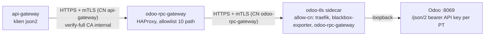
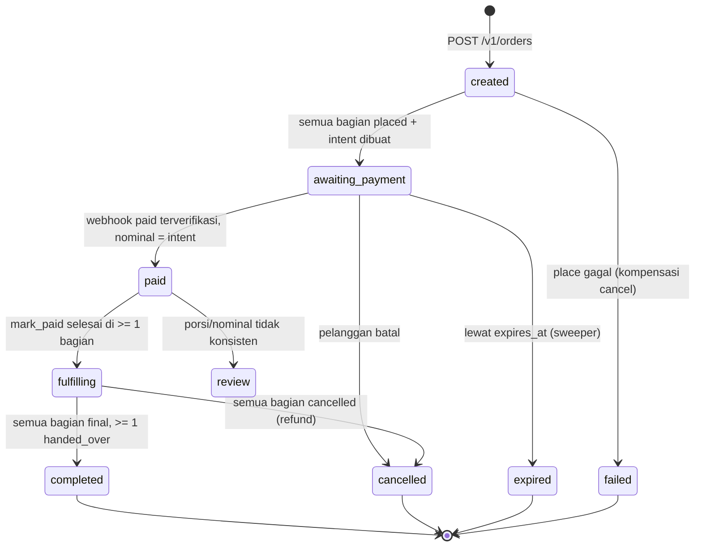
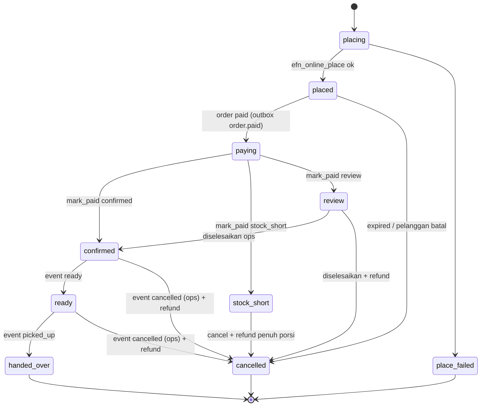
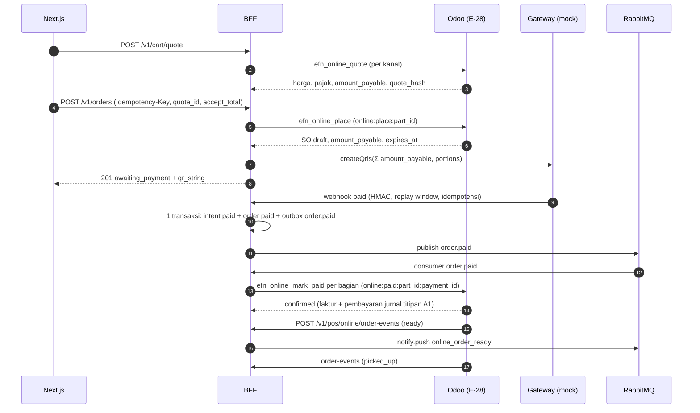
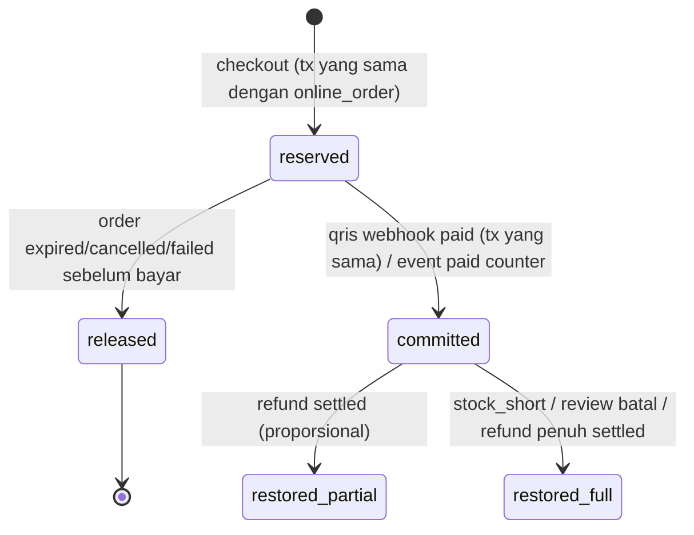
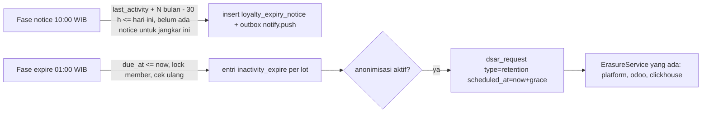

# KONTRAK ANTAR-SERVICE (v21.0 — 21 Nov 2026, G51 §28.14 SMD end-to-end: SMD sebagai filter halaman F&B Insight untuk persona `exec` (cabang `sm:<id>`, omzet termasuk PPN, basis campuran berlabel), view `v_sm_payment_daily`/`v_sm_product_sales_daily`/`v_sm_forecast_daily`/`v_sm_lot_stock` + `v_sm_product_list.shelf_life_days`, policy SM 33, store hanya bersama exec (SEC-G51-01), rekonstruksi stok `ETL_SM_STOCK_RECONSTRUCT_DAYS` (default 0), histori forecast as-of demo, seed A1–A7 demo saja, deploy `--renew-anon-volumes`, outlet online opsional, L-219..L-236, Q-SM46..Q-SM47 (terjawab 21 Nov) — dibangun G51; v20.5 — 21 Nov 2026, G47 review: L-216 store + marketing/dc, sesi Insight 2 jam L-217, kartu fase 2 L-218; v20.4 — 21 Nov 2026, G47 §28.13: koreksi fit-gap C-1..C-9 diserap dari kode (L-204..L-215), keputusan pemilik proyek 21 Nov: `kpi_admin` tanpa SoD kode, penerimaan outlet SMD dua langkah; v20.3 — 20 Nov 2026, G47 §28.13 Insight supermarket per persona: token `eit2`/`eis2` (`wids`, persona, `cats`), `SQL_efn_sig2`, row policy outlet + persona, mart `fact_replenishment`/`fact_dc_fill_rate`/`fact_dc_purchase_line`/`agg_sm_stock_daily`/`fact_lot_expiry`/`fact_campaign_result`, view `efn_insight.v_sm_*`, pemetaan `outlet_code` (Q-SM37), konfigurasi KPI per PT `efn.insight.sm.kpi` → `dim_sm_kpi_config`, Omzet termasuk PPN, L-186..L-203, Q-SM40..Q-SM45 — kontrak, belum dibangun; v20.2 dipakai PR #117 G50; v20.0 — 18 Nov 2026, Supermarket §28: forecast API worker→Odoo, usulan replenishment DC, assortment, event perilaku `POST /v1/events`, queue `behavior.event`/`promo.campaign.requested`/`notify.restock`/`notify.price_alert`/`notify.email`/`notify.wa_unofficial`, wishlist/notify-me/price alert, flag (ADR-044..048 Proposed, belum dibangun; §27 + L-127..L-143 dicadangkan G43); v18.0 — 18 Nov 2026, G42 §26 Insight web + SSO Odoo (token eit1 HMAC sekali pakai via POST form, cookie eis1, row policy `efn_insight_scope`, ADR-041 Proposed); v17.0 — 17 Nov 2026, G41 §25 ESB Core → datamart ClickHouse (esb-extract GET-only per brand, ADR-040 Proposed); v16.2 — 1 Nov 2026, G39 §24 asisten analisis "Analisis bertahap" (text2sql POST /v1/analyze: rencana ≤3 query → eksekusi per PT → ringkasan AI); v16.1 — 1 Nov 2026, G38 §23 Text-to-SQL "Tanya Data" (Odoo → text2sql → 9router/Ollama → ClickHouse per PT); v16.0 — 1 Nov 2026, G37 §22 gateway LLM 9router + fallback Ollama untuk OCR tahap 2 (K25-01, ADR-037); v15.1 — 31 Okt 2026, G33 §20.11 notifikasi reward MGM + layar referral Super-App; v15.0 — 30 Okt 2026, G32 §21 mart & dashboard waste/yield (K25-08); v14.1 — 30 Okt 2026, G31b §20.10 dasar MGM per baris (`excluded_categ_ids`); v14.0 — 30 Okt 2026, G31 §20 engine MGM: referral, akrual, settle, clawback; v13.0 — 29 Okt 2026, G30 §19 kebijakan MGM per PT (K25-10); v11.0 — 25 Okt 2026, G26 §17 pesanan online wajib lunas: VA, e-wallet, transfer + bukti, kiosk; v10.1 — 24 Okt 2026, G24 §16 entitas WTZ Wetzel's Pretzels; v10.0 — 21 Okt 2026, G23 §15 reservasi meja & pre-order berjadwal; v9.1 — 19 Okt 2026, G22 §14 sinkron r15 K1–K3 + L-82; v9.0 — 19 Okt 2026, G22 §14; v8.0 — G21 §13; v7.0 — G20 §12; v6.0 — G19 §11; v5.1 — 10 Okt 2026, privasi G18 L-21; v5.0 — 9 Okt 2026; §8 v3.x, §9 v4.x Fase 1, §10 v5.0 Fase 3 penjualan online; **§27 G43 v19.1** migrasi ESB → Odoo + arsip histori `efn_legacy_history`, ADR-042 Accepted)

Status: **Draft untuk Fase 0 / PoC**. Mengikuti rekomendasi ADR yang masih `Proposed`. Semua service (Odoo, BFF, Next.js, worker) wajib memakai nama, path, dan payload di dokumen ini. Perubahan kontrak = ubah dokumen ini dulu.

## 1. Identitas & kode

| Hal | Nilai |
|---|---|
| `member_ref` | Nomor HP format E.164 tanpa `+` (mis. `6281234567890`). Di log selalu di-mask `62812****890`. Di DB analitik di-hash: `member_hash = hex(sha256(pepper_hex + member_ref))` dengan `pepper_hex = hex(HKDF-SHA256(ikm=otp_pepper, salt "", info "efn:member_hash:v1", 32 byte))` (implementasi acuan: `services/api-gateway/src/config/app-config.ts`). Kunci HMAC OTP memakai info `"efn:otp_code:v1"` (kunci berbeda). ETL wajib memakai derivasi yang sama (lihat `services/api-gateway/src/common` untuk implementasi acuan). |
| `user_id` (JWT `sub`, `price_hunter_report.user_id`, payload event) | Sama dengan `member_ref` (E.164). Karena itu data pribadi: tidak boleh masuk ClickHouse tanpa di-hash. |
| Kode brand / company (`res.company.efn_brand_code`) | `EFN` (holding, merchant of record), `RTL` (PT Retail / supermarket, PPN), `FNB` (PT F&B, PB1), `FARM` (collection center). |
| `order_ref` | String opaque ≤ 64 karakter, unik per order. Odoo 19 mengirim `pos.order.uuid` (karena `pos_reference` baru dibuat server saat sync pertama, setelah OTP diminta). BFF tidak boleh mem-parse formatnya. |
| Versi API | Prefix `/v1`. Endpoint internal server-to-server di bawah `/v1/pos/*` dan `/internal/v1/*`. |

## 2. Autentikasi antar-service

| Pemanggil → Penerima | Mekanisme | Secret (file `/run/secrets/<nama>`) |
|---|---|---|
| Odoo → BFF (`/v1/pos/*`) | Header `X-EFN-Service-Key: <key>`; BFF membandingkan dengan `timingSafeEqual` | `odoo_bff_api_key` (Odoo membaca env `EFN_BFF_API_KEY_FILE`) |
| Browser → BFF (customer) | `Authorization: Bearer <access_token>` (JWT HS256, exp 1 jam). Next.js menyimpan token di cookie `efn_session` HttpOnly dan meneruskannya server-side | `jwt_secret` |
| Webhook payment/3PL → BFF | HMAC-SHA256 atas string `"<t>." + rawBody` (timestamp ikut ditandatangani agar replay window tidak bisa diakali), header `X-EFN-Signature: t=<unix>,v1=<hex>`, replay window 300 s | `webhook_payment_secret` |
| Worker ↔ BFF | Tidak ada HTTP; hanya lewat RabbitMQ | — |

Secret baru yang harus ada di compose + `scripts/gen-secrets.sh`: `otp_pepper`, `discount_token_secret`, `odoo_bff_api_key`, `whatsapp_token`, `webhook_payment_secret`. Env non-rahasia: `WHATSAPP_PHONE_NUMBER_ID`, `WHATSAPP_OTP_TEMPLATE` (default `efn_otp`), `WHATSAPP_ENABLED` (`false` di dev → sender console).

## 3. BFF HTTP API

Semua error berbentuk `{ "error": { "code": "<snake_case>", "message": "<pesan generik Bahasa Indonesia>" } }`. Tidak pernah membocorkan apakah nomor terdaftar.

### 3.1 POS OTP gate (dipanggil server Odoo, bukan browser POS)

`POST /v1/pos/otp/request`
```json
{ "member_ref": "6281234567890", "order_ref": "Order 00012-003-0004", "amount": 125000, "company_code": "FNB", "pos_config_id": 3 }
```
→ `202 { "challenge_id": "<uuid>", "expires_in": 180 }` (selalu 202 meski nomor tidak dikenal; pengiriman WA dilakukan bila valid). `429` bila rate limit.

`POST /v1/pos/otp/verify`
```json
{ "challenge_id": "<uuid>", "order_ref": "Order 00012-003-0004", "code": "123456" }
```
→ `200 { "ok": true, "discount_token": "<token>", "expires_in": 600 }`
→ `400 { "ok": false, "reason": "invalid" | "expired" | "locked", "attempts_left": 0..2 }`

`POST /v1/pos/discount-token/consume` (dipanggil Odoo saat order di-sync/di-validasi di server)
```json
{ "discount_token": "<token>", "order_ref": "Order 00012-003-0004", "member_ref": "6281234567890" }
```
**v2 (SEC-07):** `member_ref` di request OTP **dan** consume diambil server Odoo dari nomor HP `partner_id` order (bukan diketik kasir). Order tanpa partner ber-HP tidak bisa memakai promo ber-OTP. BFF menolak consume (`409 member_mismatch`) bila `member_hash(member_ref)` ≠ klaim `member_hash` token. Nomor di luar Indonesia (`^62[0-9]{8,13}$`) ditolak `400 invalid_phone`.
→ `200 { "ok": true }` | `409 { "ok": false, "reason": "already_used" | "order_mismatch" | "expired" | "invalid" }`

`discount_token` = JWT HS256 (`discount_token_secret`) dengan klaim `{ jti, purpose: "pos_promo", order_ref, member_hash, company_code, exp }`. Sekali pakai: `jti` disimpan di Redis `dtok:used:<jti>` (nilai = `order_ref`) saat consume. Consume **idempotent** untuk pasangan `jti` + `order_ref` yang sama: panggilan ulang dengan order yang sama → `200 { ok: true }` (menangani retry Odoo bila commit gagal setelah consume sukses); dengan `order_ref` berbeda → `409 already_used`.

Aturan OTP: 6 digit `crypto.randomInt`, disimpan sebagai HMAC-SHA256(`otp_pepper`) di Redis `otp:<challenge_id>` TTL 180 s, maks 3 attempt lalu `locked`. Rate limit request: per `member_ref` 3 / 15 menit, per IP/pos_config 20 / 15 menit. Setiap hasil dicatat di `platform.otp_audit` (subject = member_hash).

### 3.2 Login pelanggan (Super-App)

`POST /v1/auth/otp/request` `{ "phone": "6281234567890" }` → `202 { "challenge_id": "<uuid>", "expires_in": 180 }`
`POST /v1/auth/otp/verify` `{ "challenge_id": "<uuid>", "code": "123456" }` → `200 { "access_token": "<jwt>", "token_type": "Bearer", "expires_in": 3600 }` | `400` seperti 3.1.
**(v5.1, L-21b — G18, Q-P3)** Body wajib menyertakan `"age_confirmed": true` (pernyataan usia minimal 17 tahun; diminta setiap login karena login = daftar). Tidak ada/`false` → `400 { error: { code: "age_confirmation_required" } }` dicek **sebelum** OTP (challenge tidak hangus); non-boolean → `400 invalid_request`. BFF mengisi `member.age_confirmed_at` (tanpa tanggal lahir). `MEMBER_MIN_AGE` (17..21) hanya untuk teks. Teks pelanggan menunggu persetujuan Legal.
`GET /v1/me` (Bearer) → `{ "member_ref_masked": "62812****890", "points_balance": 1200 }`
**(v5.2 — mode uji OTP dev, 26 Okt 2026)** Selama WhatsApp Cloud API belum aktif, APK uji tidak bisa menerima OTP. Bila `APP_ENV=dev` + `NODE_ENV=development` + `WHATSAPP_ENABLED=false` dan nomor ada di `DEV_OTP_REVEAL_MEMBERS` (allowlist 62xxx, maks 10), respons request menjadi `202 { "challenge_id", "expires_in", "dev_code": "123456" }`. Nomor lain / environment lain: field `dev_code` **tidak ada** (bentuk respons identik dengan sebelumnya). Allowlist terisi di luar kondisi itu = BFF gagal start. Klien menampilkan kode itu dengan label "mode uji"; rate limit, ALTCHA, TTL, dan batas percobaan tetap berlaku.

### 3.3 Price Hunter (Market Scout)

`POST /v1/market-scout/reports` (Bearer, `multipart/form-data`): `photo` (JPEG/PNG/WebP, maks 8 MB), `product_name`, `price` (angka Rupiah), `competitor_name?`, `lat?`, `lng?`
→ `202 { "report_id": "<uuid>", "status": "queued" }` | `413` | `415` | `429` (cap harian per user default 20)

`GET /v1/market-scout/reports/:id` (Bearer, hanya pemilik) → `{ "report_id", "status": "queued|processing|valid|rejected|flagged", "reason": null|string, "points_awarded": 0 }`

BFF: magic-bytes check, re-encode dengan `sharp` (strip EXIF, maks 2048 px, JPEG q85), simpan ke MinIO bucket `market-scout` key `reports/<yyyy>/<mm>/<report_id>.jpg`, `INSERT platform.price_hunter_report` status `queued`, publish `ocr.requested`.

### 3.4 Loyalty (dibaca POS & app)

`GET /v1/pos/loyalty/balance?member_ref=...` (service key) → `{ "points_balance": 1200 }`
Ledger tunggal di `platform.loyalty_ledger` (D-05: satu ledger poin). Odoo tidak menyimpan saldo poin sendiri untuk member platform.

## 4. Event RabbitMQ

Default exchange, queue durable tipe `quorum`, setiap queue punya DLQ `<queue>.dlq` (via `x-dead-letter-exchange: ""` + `x-dead-letter-routing-key`). Properti AMQP `message_id` = `idempotency_key`, `content_type: application/json`, `persistent: true`. Semua payload punya `schema_version: 1`.

| Queue | Publisher | Consumer | Payload |
|---|---|---|---|
| `ocr.requested` | BFF | ai-ocr-worker | `{ schema_version: 2, report_id, user_hash, image_bucket, image_object, product_name, reported_price, competitor_name, geo: {lat,lng}|null, submitted_at }` |
| `loyalty.earn.requested` | ai-ocr-worker (dan nanti MGM) | BFF | `{ schema_version: 2, idempotency_key: "price_hunter:<report_id>", member_hash, points, reason, source: "price_hunter", source_ref: "<report_id>" }` |
| `notify.push` | worker / BFF | BFF notification | `{ schema_version: 2, idempotency_key, member_hash, source: "price_hunter", source_ref: "<report_id>", template: "price_hunter_valid" | "price_hunter_rejected" | ..., params: {} }` |

**v2 (5 Okt 2026): tidak ada nomor HP mentah di payload event.** Payload hanya membawa `user_hash`/`member_hash`. BFF menyelesaikan penerima notifikasi dengan mendekripsi `user_enc` dari baris sumber (`source` + `source_ref`, mis. `price_hunter_report`) dan memverifikasi hash-nya cocok. Lihat §7.

**Autentikasi publisher (SEC-08):** setiap publisher menyetel properti AMQP `user_id` = nama user RabbitMQ-nya (RabbitMQ menolak bila tidak cocok dengan user koneksi). Consumer BFF hanya menerima `loyalty.earn.requested` dengan `user_id = efn-ocr` untuk `source=price_hunter`, `points` ≤ `LOYALTY_MAX_POINTS_PER_EVENT` (default 100), dan memverifikasi `price_hunter_report` dengan `id = source_ref` berstatus `valid` dan `user_hash = member_hash`.

Consumer idempotent: BFF menyimpan `idempotency_key` di `platform.processed_message (consumer, idempotency_key)` unik; worker memeriksa status report sebelum memproses (`queued` → `processing` via `UPDATE ... WHERE status='queued' RETURNING`).

Worker menulis hasil ke `platform.price_hunter_report` (status `valid|rejected|flagged`, `extracted`, `confidence`, `reason`). `flagged` = perlu review manual (mis. VLM tidak tersedia, kemungkinan fraud).

## 5. Tabel platform baru (dimiliki BFF)

Didefinisikan di `infra/postgres/init/02-platform-loyalty.sql`:
- `platform.loyalty_ledger (id, member_ref_hash, member_ref_enc?, company_code, delta_points, reason, source, source_ref, idempotency_key UNIQUE, expires_at NULL, created_at)`; saldo = SUM entri yang belum kedaluwarsa. `company_code` = PT yang menanggung liabilitas poin (ADR-020, settlement antar-PT).
- `platform.processed_message (consumer, idempotency_key, processed_at, PRIMARY KEY(consumer, idempotency_key))`.
- `platform.outbox (id, queue, payload jsonb, message_id, created_at, published_at)`.

## 6. Konfigurasi Odoo (`ir.config_parameter`)

`efn.bff_url` (**v2: `https://api-gateway:3000`**, verifikasi sertifikat dengan CA di env `EFN_CA_FILE`, default `/run/secrets/efn_ca_crt`), `efn.pos.otp_required_for_promo`, `efn.pos.promo_disabled_when_offline`, `efn.pos.otp_timeout_seconds` (default 5). API key BFF **tidak** disimpan di config parameter; dibaca dari file secret.

## 7. Enkripsi & Kredensial (v2, wajib — instruksi user "enkripsi di setiap transaksi data")

### 7.1 Enkripsi in transit — setiap hop TCP antar-container memakai TLS terverifikasi
- **PKI internal**: CA internal ECDSA P-256 dibuat `scripts/gen-pki.sh` (dev) / disuplai dari GitHub Environments (staging/prod). Semua klien memverifikasi server terhadap CA di `/run/secrets/efn_ca_crt` (verify-full, hostname = nama service compose). Sertifikat server per service: secret `tls_<service>_crt` + `tls_<service>_key` (nama service dengan `_`, mis. `tls_api_gateway_key`).
- Aplikasi tanpa TLS native (Odoo HTTP, Next.js standalone, Ollama, Metabase bila perlu) dibungkus **sidecar TLS `ghostunnel`** yang berbagi network namespace (`network_mode: service:<app>`), sehingga plaintext hanya ada di loopback di dalam namespace yang sama. Pengecualian lain hanya lewat ADR-022 dengan kontrol kompensasi.
- Antar-node: WireGuard (lapisan kedua, bukan pengganti TLS).

| Koneksi | Parameter klien (env) |
|---|---|
| PostgreSQL | `PG_SSLMODE=verify-full`, `PG_SSLROOTCERT=/run/secrets/efn_ca_crt` (Odoo: `db_sslmode = verify-full` + env `PGSSLROOTCERT`) |
| Redis | `REDIS_URL=rediss://redis:6379`, `REDIS_USERNAME`, `REDIS_PASSWORD_FILE`, `REDIS_TLS_CA_FILE` |
| RabbitMQ | `AMQP_URL=amqps://<user>@rabbitmq:5671` (tanpa password), `RABBITMQ_PASSWORD_FILE`, `AMQP_TLS_CA_FILE` |
| MinIO | `MINIO_ENDPOINT=minio`, `MINIO_PORT=9000`, `MINIO_USE_SSL=true`, `MINIO_CA_FILE`, `MINIO_ACCESS_KEY`, `MINIO_SECRET_KEY_FILE` (menggantikan `MINIO_ROOT_*` di aplikasi) |
| ClickHouse | `CH_SECURE=true`, `CH_PORT=8443` (HTTPS) / `9440` (native TLS), `CH_CA_FILE` |
| BFF (server) | Mendengar **HTTPS** di `:3000` dengan `TLS_CERT_FILE`, `TLS_KEY_FILE`. Klien: Traefik (`serversTransport` rootCAs), Next.js (`BFF_INTERNAL_URL=https://api-gateway:3000` + `NODE_EXTRA_CA_CERTS`), Odoo (`EFN_CA_FILE`), Prometheus (scrape https) |
| Ollama | `OLLAMA_URL=https://ollama:11434` via sidecar, `OLLAMA_CA_FILE` |
| Traefik → upstream | Semua router memakai `https` ke upstream + `serversTransport` dengan CA internal |

Semua env `*_CA_FILE` default ke `/run/secrets/efn_ca_crt`. Kode **gagal start** bila TLS diminta tetapi CA tidak terbaca; tidak ada fallback diam-diam ke plaintext. Mode plaintext hanya boleh lewat flag eksplisit `EFN_ALLOW_PLAINTEXT=true` yang **ditolak** saat `NODE_ENV/APP_ENV=production`.

### 7.2 Enkripsi at rest
- **Kolom PII** dienkripsi di aplikasi: AES-256-GCM, kunci secret `pii_encryption_key` (32 byte, base64). Format `bytea` = `0x01` (versi) ‖ IV 12 byte ‖ ciphertext ‖ tag 16 byte; AAD = `"efn:<tabel>.<kolom>:v1"`. Implementasi acuan di BFF `src/common/pii/`. **Key ring**: byte versi = versi kunci. Kunci v1 = secret `pii_encryption_key`; kunci berikutnya `pii_encryption_key_v2`, `_v3`, … (env `PII_ENCRYPTION_KEY_V<n>_FILE`). Enkripsi memakai `PII_ACTIVE_KEY_VERSION` (default 1); dekripsi memilih kunci dari byte versi. Rotasi = tambah kunci baru, naikkan versi aktif, jalankan re-encrypt job, lalu pensiunkan kunci lama — tanpa downtime.
- `platform.price_hunter_report`: kolom `user_id` (HP mentah) **dihapus**, diganti `user_hash char(64) NOT NULL` (rumus `member_hash` §1) + `user_enc bytea NOT NULL`. Cap harian & dedup memakai `user_hash`.
- `platform.loyalty_ledger.member_ref_enc` **wajib diisi** (BFF mengenkripsi saat member_ref diketahui; untuk earn price hunter disalin dari `price_hunter_report.user_enc`).
- `platform.otp_audit.ip` → `ip_enc bytea` (forensik hanya lewat dekripsi oleh admin).
- MinIO: SSE-S3 aktif untuk bucket `market-scout` dan `pg-backup` (KMS key secret `minio_kms_key`), versioning + object lock (governance) di `pg-backup`.
- Backup PostgreSQL: WAL-G libsodium (sudah). Disk host: LUKS (runbook).
- ETL **tidak lagi membutuhkan `otp_pepper`** (SEC-16): ClickHouse menerima `user_hash`/`member_ref_hash` yang sudah di-hash dari Postgres.

### 7.3 Kredensial per service (SEC-02, least privilege)
| Sistem | User | Secret | Hak |
|---|---|---|---|
| PostgreSQL | `efn_odoo` | `pg_password_odoo` | owner DB `efn_odoo`, `CREATEDB`, bukan superuser |
| PostgreSQL | `efn_bff` | `pg_password_bff` | owner skema `platform` di DB `efn_platform` |
| PostgreSQL | `efn_ocr` | `pg_password_ocr` | `SELECT` + `UPDATE(status, reason, extracted, confidence, image_phash, updated_at)` pada `platform.price_hunter_report`, `SELECT` kolom non-PII yang dibutuhkan anti-fraud |
| PostgreSQL | `efn_etl` (anggota `efn_readonly`) | `pg_password_etl` | grant level-kolom (lihat 01/02 SQL) |
| PostgreSQL | `efn_metabase` | `pg_password_metabase` | owner DB `metabase` saja |
| PostgreSQL | `efn_exporter` | `pg_password_exporter` | `pg_monitor` |
| PostgreSQL | superuser `postgres` | `pg_password` | hanya entrypoint/backup via socket lokal; tidak dipakai aplikasi |
| MinIO | `efn-bff` | `minio_bff_secret` | `PutObject`/`DeleteObject` `market-scout/reports/*` + `GetBucketLocation` pada bucket `market-scout` (dibutuhkan library klien) |
| MinIO | `efn-ocr` | `minio_ocr_secret` | `GetObject` `market-scout/reports/*` + `GetBucketLocation` pada bucket `market-scout` |
| RabbitMQ | `efn-bff` | `rabbitmq_password_bff` | configure/read/write queue miliknya; read `loyalty.earn.requested`, `notify.push`; write `ocr.requested` |
| RabbitMQ | `efn-ocr` | `rabbitmq_password_ocr` | read `ocr.requested`; write `loyalty.earn.requested`, `notify.push` (+ `.dlq`) |
| Redis | `efn-bff` (ACL) | `redis_password_bff` | `~otp:* ~dtok:* ~rl:* …` (prefix yang dipakai BFF); user `default` dinonaktifkan; `maxmemory-policy noeviction` |

| ClickHouse | `efn_etl` | `clickhouse_password_etl` | INSERT/SELECT tabel mart & `etl_watermark` |
| ClickHouse | `efn_text2sql` | `clickhouse_password_text2sql` | `readonly=2`, SELECT view whitelist saja |
| ClickHouse | `efn_metabase` | `clickhouse_password_metabase` | SELECT view/mart |

Role/user dibuat oleh skrip init (devsecops) dengan password dari secret; grant tabel ditulis bersama skema (pemilik skema).

Tambahan Fase 3 (user teknis Odoo per PT, `odoo-rpc-gateway`, secret event HMAC, prefix Redis, bucket `catalog`): lihat §10.10.

### 7.4 Akses jaringan Odoo (SEC-01)
- Router Traefik `odoo` dan `odoo-ws` hanya menerima sumber dari rentang WireGuard (`internal-only`); outlet/POS terhubung via WireGuard (router outlet atau perangkat POS). Tidak ada akses Odoo dari internet publik.
- User internal Odoo wajib 2FA (`auth_totp` CE; kebijakan wajib dikonfigurasi efn-odoo-functional).
- Rate limit ketat `/web/login` & `/web/session/authenticate`; `/xmlrpc`, `/jsonrpc` diblok di Traefik kecuali dari subnet internal service.

### 7.5 Client IP (SEC-03)
Traefik mempercayai `X-Forwarded-For` hanya dari rentang Cloudflare (+WireGuard); BFF `TRUSTED_PROXIES` = subnet internal Docker + rentang Cloudflare (env, daftar disuplai devsecops). Firewall origin: 443 hanya dari Cloudflare + WireGuard.

## 8. Tambahan v3 (6 Okt 2026 — keputusan user setelah review gelombang 4)

### 8.1 Captcha OTP (SEC-06) — ALTCHA (open source, self-hosted, tanpa pihak ketiga)
`GET /v1/auth/challenge` → challenge ALTCHA (proof-of-work, HMAC secret `altcha_hmac_key`, TTL 5 menit, sekali pakai di Redis `altcha:used:<sig>`). `POST /v1/auth/otp/request` wajib field `altcha` (payload base64 dari widget); tanpa/invalid → `400 captcha_required`. Endpoint POS (service key) tidak memakai captcha.

### 8.2 Identitas member opak
Tabel `platform.member (id uuid PK, member_hash char(64) UNIQUE, member_ref_enc bytea NOT NULL, created_at, deleted_at NULL)`. JWT pelanggan `sub` = `member.id` (UUID), **bukan** nomor HP. `GET /v1/me` tetap `{ member_ref_masked, points_balance }`. Ledger & report tetap memakai `member_hash`.

### 8.3 Payment gateway-agnostic (QRIS POS & online) — provider belum ditentukan
- Abstraksi `PaymentGateway` di BFF (`createQris`, `getStatus`, `cancel`, `verifyWebhook`, `parseWebhook`). Adapter: `mock` (default dev/staging, QR dummy), `xendit`, `midtrans` (kerangka; **nonaktif** sampai ADR-016 diputuskan dan diuji ke sandbox vendor). Pilihan via `PAYMENT_PROVIDER=mock|xendit|midtrans`; produksi menolak `mock`.
- Secret: `payment_provider_api_key` (dibaca hanya bila provider ≠ mock), `webhook_payment_secret` (sudah ada). Tidak ada data kartu (PCI SAQ A); hanya QRIS/VA/e-wallet.
- `POST /v1/pos/payments` (service key, dipanggil server Odoo) `{ order_ref, amount, currency: "IDR", company_code, pos_config_id, method: "qris", idempotency_key }` → `201 { payment_id, provider, status: "pending", qr_string, expires_at }` (idempotent per `idempotency_key`).
- `GET /v1/pos/payments/:payment_id` → `{ payment_id, status: "pending|paid|expired|failed|cancelled", paid_at, provider_ref, amount }`
- `POST /v1/pos/payments/:payment_id/cancel` → `200 { status }`
- `POST /v1/webhooks/payments/:provider` (publik via Traefik, verifikasi signature provider/HMAC + replay window + idempotensi) → `200`. Status final hanya berubah lewat webhook terverifikasi atau `getStatus` ke provider, tidak dari klien.
- Tabel `platform.payment_intent (id uuid, provider, provider_ref, order_ref, company_code, amount numeric(14,2), currency, method, status, qr_string, expires_at, paid_at, idempotency_key UNIQUE, created_at, updated_at)`. Settlement per PT mengikuti ADR-019 (merchant of record) — belum diimplementasi.
- Odoo: metode pembayaran POS `efn_gateway` (modul gap, lihat docs/08) membuat intent, menampilkan QR di layar pelanggan, polling `GET` tiap 2 s sampai final/timeout; offline → metode ini nonaktif.
- Online (Super-App): ekstensi `purpose`, porsi per PT, refund — lihat §10.7.

### 8.4 Privasi (UU PDP) — endpoint, consent, penghapusan
- Consent: `GET /v1/me/consents` → `[{ purpose: "location"|"marketing", granted, version, updated_at }]`; `PUT /v1/me/consents/:purpose` `{ granted, version }` → `200`. Tabel append-only `platform.consent (id, member_id, purpose, granted, version, source, ip_enc, created_at)` (grant INSERT/SELECT saja untuk `efn_bff`). Market Scout membuang koordinat bila consent `location` tidak aktif.
- DSAR sesuai `docs/compliance/PDP_DSAR_DESIGN.md` §3: `GET /v1/me/data`, `POST /v1/me/reauth` (step-up token `purpose: dsar`, 10 menit), `DELETE /v1/me` (step-up wajib; masa tenggang `DSAR_DELETE_GRACE_DAYS`, default 7), `POST /v1/me/delete/cancel`, `GET /v1/me/requests`. Tabel `platform.dsar_request (id uuid, member_id, member_hash, type, status, stores_pending text[], requested_at, scheduled_at, completed_at)`.
- Penghapusan lintas-store (tanpa HP mentah): BFF menandai `dsar_request` `processing` dengan `stores_pending = {platform, odoo, clickhouse}`.
  - **Odoo** menarik via cron: `GET /v1/pos/privacy/erasures?store=odoo` (service key) → `[{ request_id, member_hash }]`; Odoo menganonimkan `res.partner` dengan `efn_member_hash` cocok, lalu `POST /v1/pos/privacy/erasures/:request_id/complete` `{ store: "odoo", records: n }`. Odoo menghitung `efn_member_hash` (stored, indexed) dari `phone` ternormalisasi dengan rumus §1 memakai secret `member_hash_pepper` (= `pepper_hex` turunan HKDF, dibuat deploy dari `otp_pepper`; env `EFN_MEMBER_HASH_PEPPER_FILE`).
  - **ClickHouse**: ETL membaca `platform.dsar_request` (kolom `id, member_hash, status, stores_pending`) setiap siklus, menjalankan `DELETE`/`ALTER ... DELETE` pada mart untuk `member_hash`, lalu publish `privacy.erasure.completed` `{ schema_version: 2, idempotency_key: "erasure:<request_id>:clickhouse", request_id, store: "clickhouse" }` sebagai user RabbitMQ `efn-etl` (secret `rabbitmq_password_etl`).
  - **Platform**: BFF menghapus/menganonimkan `member`, `consent` (dipertahankan sebagai bukti tanpa PII), `price_hunter_report.user_enc` di-null-kan, ledger dipertahankan dengan `member_ref_enc` di-null-kan (catatan keuangan 10 th, ADR-020) — kolom `member_ref_enc` menjadi NULLABLE hanya untuk baris terhapus.
- Retensi default (usulan, **menunggu DPO**; semua configurable via env): `otp_audit` 90 h; foto Market Scout 90 h (objek MinIO lifecycle) dan `user_enc` laporan di-null-kan setelah 90 h; baris laporan 2 th; ClickHouse mart TTL 5 th; ledger poin 10 th; consent selama akun + 5 th.

### 8.5 mTLS (Q-E4 — keputusan: sesuai rekomendasi ADR-022)
Wajib untuk hop **tanpa kredensial aplikasi**: semua sidecar ghostunnel (Odoo, Next.js, Metabase, Ollama, cAdvisor, docker-socket-proxy) dan semua endpoint observability (Prometheus, Loki, Alertmanager, Grafana datasource, exporter, metrics BFF/worker/ClickHouse). Server memverifikasi sertifikat klien dari CA internal dan membatasi CN/SAN yang diizinkan (ghostunnel `--allow-cn`, Prometheus/exporter `web-config` `client_auth_type: RequireAndVerifyClientCert` + `client_allowed_sans`). Klien membawa sertifikat sendiri `tls_<client>_crt/key`: Traefik, Prometheus, Grafana, Promtail, ocr-worker (ke Ollama: `OLLAMA_CLIENT_CERT_FILE`, `OLLAMA_CLIENT_KEY_FILE`), Odoo-tidak-perlu. Hop dengan kredensial aplikasi (PostgreSQL, Redis, RabbitMQ, MinIO, ClickHouse, BFF API) tetap server-TLS + password per service (opsional mTLS fase 2).

### 8.6 Kepemilikan kunci (keputusan user: hanya Superadmin)
Root CA key (offline), `pii_encryption_key*`, `walg_libsodium_key`, `minio_kms_key`, `clickhouse_disk_key`, passphrase LUKS, `otp_pepper`/`member_hash_pepper` hanya dipegang peran **Superadmin**: GitHub Environment `production` hanya bisa dikelola/di-approve Superadmin; di host, `/opt/efn/secrets` = `root:efn-superadmin 0750`, file 0444 (dibutuhkan bind-mount ke container non-root; batas akses host = izin direktori), akses sudo hanya grup `efn-superadmin`; root CA key tidak pernah berada di server. Prosedur custody, break-glass, dan pewarisan kunci di `docs/runbooks/key-custody.md`.

### 8.7 Klarifikasi v3.1 (usulan architect, diterima lead)
- `platform.dsar_request.type ∈ {export, delete, correction, phone_change}`; `status ∈ {pending_reauth, scheduled, cancelled, processing, completed, rejected, failed}`; kolom tambahan `reason text NULL` (alasan penolakan/kegagalan, tanpa PII).
- `platform.consent` kolom tambahan `text_sha256 char(64) NOT NULL` = SHA-256 dari teks kebijakan/consent versi yang disetujui (bukti isi yang disetujui).
- `loyalty_ledger.member_ref_enc` NULLABLE hanya untuk baris milik member yang dihapus (CHECK: NOT NULL kecuali `member_hash` ada di tombstone / ditandai `erased_at`).
- Retensi foto Market Scout default **90 hari** (lifecycle MinIO harus sama).
- Odoo `/json/2/` diblok dari luar seperti `/xmlrpc` dan `/jsonrpc`.

### 8.8 Klarifikasi v3.2
- **Consume token POS membawa nominal (SEC-07 sisa):** `POST /v1/pos/discount-token/consume` body `{ discount_token, order_ref, member_ref, amount_total }`; token menyimpan `amount` saat OTP; BFF menolak `409 amount_mismatch` bila `amount_total` di luar toleransi `POS_OTP_AMOUNT_TOLERANCE_PCT` (default 20%) dari nilai saat OTP → Odoo menandai order `review`.
- **Erasure Odoo** mencakup: anonimisasi `res.partner` (termasuk arsip, lintas company), salinan kontak di `pos.order` (`email`, `mobile`), chatter/tracking dan auditlog milik partner, `privacy.log` standar; dokumen akuntansi & `pos.order` dipertahankan dengan partner teranonim (menunggu DPO).
- **Refund QRIS** belum ada di v3: fase 1 refund lewat metode lain sesuai SOP. Endpoint `POST /v1/pos/payments/:id/refund` dicadangkan (belum diimplementasi).
- Odoo membutuhkan `GET` ke BFF (`efn.bff.client._efn_get`) untuk status payment & daftar erasure.

### 8.9 Detail endpoint privasi v3.3 (disepakati frontend ↔ BFF)
- `POST /v1/me/reauth`: body `{}` → `202 { challenge_id, expires_in }` (OTP ke nomor akun sendiri, ALTCHA tidak diperlukan karena sudah login); body `{ challenge_id, code }` → `200 { step_up_token, expires_in }` | `400` format §3.1.
- `DELETE /v1/me`: header `X-Step-Up-Token: <token>`, tanpa body → `202 { request_id, scheduled_at, points_forfeited }`; token hilang/invalid → `403 { error: { code: "step_up_required" | "step_up_invalid" } }`.
- **(v5.1, L-21a — G18, Q-P18, menggantikan aturan 409 permanen L-4)** Bila ada bagian pesanan online `paying|confirmed|ready|review`: `DELETE /v1/me` → `409 { error: { code: "open_online_orders", message, open_parts, max_defer_days, confirm_param: "confirm_open_orders" } }` (langkah informasi; step-up token **belum** dikonsumsi). Pelanggan mengonfirmasi → `DELETE /v1/me?confirm_open_orders=true` dengan **token step-up yang sama** → `202 { request_id, scheduled_at, points_forfeited, open_online_orders, erasure_deadline }`; `dsar_request.open_orders_ack_at` = bukti persetujuan sadar. Erasure ditunda selama pesanan terbuka, **paling lama `DSAR_OPEN_ORDER_MAX_DEFER_DAYS` (default & plafon 14) sejak `requested_at`**; `erasure_deadline` = maks(`requested_at` + 14 h, `scheduled_at`). Detail di §10.17 L-21.
- `GET /v1/me/data` (juga butuh `X-Step-Up-Token`) → `200` JSON, atau `202 { request_id, download_url?, expires_at? }` untuk export besar.
- `GET /v1/me/requests` → `{ items: [{ id, type, status, requested_at, scheduled_at, completed_at, download_url? }] }`.
- `PUT /v1/me/consents/:purpose` `{ granted, version }`: bila `granted=true` dan `version` ≠ versi teks aktif → `409 { error: { code: "stale_text" } }`; penarikan (`granted=false`) selalu diterima. Versi & `text_sha256` aktif dikonfigurasi di BFF (`CONSENT_<PURPOSE>_VERSION`, `CONSENT_<PURPOSE>_TEXT_SHA256`).
- Selama masa tenggang hapus akun, login tetap diizinkan agar pengguna bisa `POST /v1/me/delete/cancel`.

### 8.10 Keputusan lead gelombang 5 (infra)
- Queue RabbitMQ dideklarasikan oleh broker (definitions). Aplikasi (BFF, worker, ETL) memakai **passive declare** (`checkQueue`/`queue_declare(passive=True)`) agar hak `configure` user aplikasi bisa dicabut (SEC-25).
- Pengecualian E13 **disetujui**: `blackbox-exporter` boleh menjadi klien mTLS sidecar Odoo/Next.js/Metabase/Ollama khusus probe kesehatan (read-only).
- Alokasi WireGuard final: outlet `10.88.0.0/16`, staf `10.89.0.0/16` (ADR-023).
- BFF `/metrics` wajib memverifikasi sertifikat klien Prometheus (mTLS) — menutup sisi BFF dari E12.
### 8.11 Catatan implementasi BFF gelombang 5 (v3.4, menjadi bagian kontrak)
- JWT `sub` = UUID member → sesi lama tidak valid (login ulang). Login saat DSAR `processing` → `409 account_deleting`; selama masa tenggang login boleh.
- Redis prefix baru `altcha:used:*` (ACL `efn-bff` wajib mencakup).
- Consent: `503 consent_unavailable` bila teks aktif belum dikonfigurasi; `efn_bff` punya `UPDATE(ip_enc)` di `consent` (untuk erasure/re-encrypt) — penyimpangan kecil dari "append-only", sisanya dijaga trigger.
- Erasure platform satu transaksi dengan `processing`; tombstone `sha256("erased:"||request_id)` di `loyalty_ledger.member_ref_hash`, `price_hunter_report.user_hash`, `otp_audit.subject`; saldo dihanguskan per PT via entri ledger `source='dsar'`; `stores_pending = {odoo, clickhouse}` setelah commit. Complete Odoo → `200 { ok, status }` | `404` | `409 not_processing`.
- Payment: `PAYMENT_PROVIDER ∈ {mock, xendit, midtrans, disabled}` (prod default `disabled`); error `409 idempotency_conflict`, `409 payment_in_progress`, `502 payment_provider_error`, `503 payment_provider_unavailable`; `POST /v1/pos/payments/:id/simulate` dev-only (404 di prod); pembayaran terlambat (`expired|cancelled|failed → paid`) diterima dan ditandai untuk refund manual; nominal webhook berbeda → status tidak berubah.
- Metrics BFF: `https://api-gateway:9464/metrics`, mTLS, CN klien `prometheus`.
- Export DSAR saat ini sinkron (maks 1000 baris per bagian); jalur `202` + unduhan belum diimplementasi.

### 8.12 Catatan v3.5 (ADR-030, gelombang 8)
- **Access key object storage diperlakukan sebagai secret**: nama access key (`MINIO_ACCESS_KEY`) tidak boleh berupa string mudah ditebak (`efn-bff`, `pgbackup`, dsb.); dibuat acak oleh `gen-secrets.sh` dan disimpan sebagai secret (`minio_bff_access_key`, `minio_ocr_access_key`, `minio_backup_access_key`, `minio_prometheus_access_key`), env `MINIO_ACCESS_KEY_FILE`. Alasan: CVE-2026-41145/40344 (penulisan objek hanya dengan access key ID) pada build MinIO lama.
- Sumber image object storage mengikuti ADR-030 (Proposed): build dari tag source fork komunitas aktif (SILO) di pipeline sendiri; nama service compose tetap `minio` agar klien tidak berubah.

### 8.13 Perubahan v3.6 (gelombang 9 — hasil smoke E2E & review r3)
- **R2 — tidak ada PII di query string**: `GET /v1/pos/loyalty/balance?member_ref=` **dihapus**, diganti `POST /v1/pos/loyalty/balance` body `{ member_ref }` → `200 { points_balance }`. Aturan umum: nomor HP, token, dan identitas tidak pernah dikirim lewat URL/query (masuk access log).
- **SEC-31 — tombstone tidak bisa ditautkan**: tombstone erasure = 32 byte acak (hex 64), **tidak** diturunkan dari `request_id`/`member_hash` dan tidak disimpan di mana pun selain baris yang di-tombstone. Saat `dsar_request` `completed`, kolom `member_hash` di-NULL-kan (selama `processing` boleh ada). Odoo tidak menyimpan `request_id` atau `member_hash` pada partner yang sudah dianonimkan; idempotensi `complete` memakai penanda yang dihapus/tidak menautkan setelah selesai (desain diserahkan ke odoo-engineer dengan syarat ini).
- **R6 — status penghapusan setelah akun hilang**: `DELETE /v1/me` mengembalikan juga `receipt_token` (opak, HMAC, `purpose: dsar_receipt`, berlaku 30 hari, terikat `request_id`, tanpa PII). `GET /v1/dsar/requests/:id` dengan header `X-DSAR-Receipt: <token>` → `{ id, type, status, requested_at, scheduled_at, completed_at }` (tanpa PII, rate limit). Next.js menyimpan receipt di cookie HttpOnly `efn_dsar_receipt` (Path `/api/dsar`, SameSite=Strict, 30 hari).
- **Access key object storage** dibaca dari `MINIO_ACCESS_KEY_FILE` (lihat §8.12) oleh BFF dan worker; `MINIO_ACCESS_KEY` literal hanya diterima bila `APP_ENV=dev`.

### 8.14 Catatan v3.7 (gelombang 9 infra)
- **Endpoint object storage untuk semua klien = `s3-gateway:9000`** (HAProxy filter L7, TLS dengan sertifikat `tls_s3_gateway_*`, verifikasi CA internal). Service `minio` (SILO) hanya ada di network `objstore` dan tidak dijangkau klien langsung. Klien: `MINIO_ENDPOINT=s3-gateway`.
- Request yang ditolak gateway (403): header `x-amz-bypass-governance-retention`, PUT `?retention`/`?legal-hold`/`?object-lock`, unsigned trailer, header `X-Minio-Replication-*`, `?select`, admin API (kecuali minio-init/prometheus).
- Access key per klien dari file (§8.12): `minio_{bff,ocr,backup,prometheus}_access_key`.
- Metrik Loki/redis_exporter/RabbitMQ 15691/Traefik 8082 hanya via sidecar ghostunnel dengan allowlist CN (menggantikan pengecualian E12).

### 8.15 Catatan v3.8 (gelombang 11)
- mTLS tambahan: Loki ruler → Alertmanager (sertifikat `loki` ber-EKU server+client; Alertmanager memakai `web-config-alertmanager.yml` yang hanya mengizinkan klien `prometheus` dan `loki`).
- Stream log `efn_audit_sink` (baris `EFN_AUDIT_SINK {json}` dari Odoo `efn_audit`) diretensi 400 hari di Loki; alert `EfnAuditControlChange`, `EfnAuditUnexpectedPurge`, `EfnAuditRetentionPurgeBurst`.
- Root user object storage dari secret `minio_root_user` (acak), bukan nilai default.

### 8.16 Klarifikasi v3.9 (gelombang 12, usulan architect diterima)
- **Retensi (default, menunggu DPO)**: outbox & processed_message 14 hari; `efn.audit.log` Odoo 730 hari (minimum 365 di kode; log kontrol & purge tidak pernah dihapus); stream Loki `efn_audit_sink` 400 hari, stream Loki lain 30 hari; WAL-G 14 base backup penuh.
- **§8.11 diralat**: tombstone erasure BUKAN `sha256("erased:"||request_id)` — berlaku §8.13 (32 byte acak).
- **§8.8 diralat**: erasure Odoo menghapus log `efn.audit.log` subjek via `_efn_audit_purge_records` (bukan OCA auditlog).
- **Redis**: setiap IP/HP di nama key wajib di-HMAC (pepper turunan `efn:redis_key:v1`); prefix yang dikenal: `otp:*` (termasuk `otp:stepup-used:*`), `dtok:*`, `rl:*`, `altcha:*` (termasuk `altcha:used:*`, `altcha:ip:*`), `dsar:receipt-ip:*`, `ms:*`.
- **mTLS (§8.5)**: tambah loki→alertmanager. Sisa pengecualian E12: `/metrics` ocr-worker (mTLS tanpa allowlist CN) — ditutup dengan bind loopback + sidecar ghostunnel `--allow-cn=prometheus`.

### 8.17 Catatan v3.10 (gelombang 12 BFF)
- **ALTCHA v2 (§8.1)**: signature = HMAC(`efn-altcha:v2` ‖ challenge ‖ IP klien; IPv6 per /64) — solusi dari IP lain → `400 captcha_required`. Biaya adaptif: `maxnumber = ALTCHA_MAX_NUMBER × 2^level` (level 0..3 dari kuota per-IP & budget OTP global), dibatasi `ALTCHA_MAX_NUMBER_CAP` (default 4 000 000); `ALTCHA_ADAPTIVE=false` mematikan. Metrik `efn_altcha_challenge_total{level}`.
- **Secret (§7.3)**: BFF membaca semua secret dari `<NAMA>_FILE` → `/run/secrets/<nama>`; env literal secret hanya diterima saat `APP_ENV=dev`. Tidak ada secret yang ditulis ke `process.env`.

### 8.18 Catatan v3.11 (gelombang 12 infra)
- **E12 ditutup**: `/metrics` ocr-worker kini HTTPS+mTLS di 127.0.0.1:9101; jaringan `:9100` dilayani ghostunnel server (`--allow-cn=prometheus`) → ghostunnel bridge client (`--verify-cn=ocr-worker`).
- **ACME (SEC-37)**: hanya service `acme-dns` (lego, tanpa port, network `egress`) yang memegang token DNS; Traefik membaca sertifikat dari volume read-only. `ACME_SERVER` hanya URL Let's Encrypt produksi/staging.
- Job ETL `ETL_ENABLE_GL` & `ETL_AUDIT_COPY_ENABLED` aktif hanya setelah `efn_audit` ≥ 19.0.1.2.0 dan grant `services/etl/sql/odoo-readonly-grants.sql` sukses.
- Sisa SEC-22: traceback `data.debug` JSON-RPC Odoo hanya bisa dihilangkan di modul `efn_*` (bukan di infra).

## 9. Fase 1 — Loyalty di POS (v4.0, 7 Okt 2026)

Ledger tunggal tetap di BFF (`platform.loyalty_ledger`, ADR-020). Odoo POS tidak menyimpan saldo; semua panggilan server-to-server (service key, HTTPS + CA), idempoten, dan dicatat Odoo di outbox lokal untuk retry (order yang sudah dibayar tidak boleh gagal karena BFF mati — POS tetap jalan, sinkron poin menyusul).

### 9.1 Parameter (configurable, menunggu Q-13/Finance)
`LOYALTY_EARN_IDR_PER_POINT` (default 10000 → 1 poin per Rp10.000 setelah diskon, sebelum pajak), `LOYALTY_POINT_VALUE_IDR` (default 100), `LOYALTY_REDEEM_MIN_POINTS` (default 50), `LOYALTY_REDEEM_MAX_PCT_OF_ORDER` (default 50), `LOYALTY_EARN_EXCLUDED_CATEGORIES` (daftar kode kategori, default kosong), masa berlaku poin `LOYALTY_POINT_EXPIRY_DAYS` (default 365). Semua nilai adalah PLACEHOLDER.

### 9.2 Earn dari penjualan POS
`POST /v1/pos/loyalty/earn` `{ idempotency_key: "pos_earn:<order_uuid>", order_ref, member_ref, company_code, eligible_amount }` → `200 { points_earned, points_balance }`. `eligible_amount` dihitung Odoo (subtotal tanpa pajak, tanpa baris reward/diskon poin, tanpa kategori dikecualikan). Order tanpa member → tidak dipanggil.

### 9.3 Redeem poin di POS (wajib OTP — ADR-017; dinonaktifkan saat offline)
1. OTP seperti §3.1 dengan `purpose: "pos_redeem"` di request (`POST /v1/pos/otp/request` body tambahan `purpose`, default `pos_promo`). Token hasil verify membawa `purpose`.
2. `POST /v1/pos/loyalty/redeem/reserve` `{ discount_token, order_ref, member_ref, points, amount_total }` → `200 { reservation_id, points, value_idr, expires_at }` | `409 insufficient_points | below_minimum | exceeds_max_pct | token_invalid | member_mismatch`. Reservasi menahan poin (TTL 15 menit).
3. `POST /v1/pos/loyalty/redeem/commit` `{ reservation_id, order_ref, idempotency_key: "pos_redeem:<order_uuid>" }` → `200 { points_redeemed, points_balance }` (entri ledger negatif, idempoten). Dipanggil saat order disinkron server.
4. `POST /v1/pos/loyalty/redeem/release` `{ reservation_id }` → `200` (order dibatalkan/baris dihapus). Reservasi kedaluwarsa dilepas otomatis.
Odoo memasang baris diskon dengan produk "Poin EFN" senilai `value_idr`; server Odoo memvalidasi baris itu terhadap reservasi saat sync (seperti gate OTP).

### 9.4 Retur / refund (clawback)
`POST /v1/pos/loyalty/reverse` `{ idempotency_key: "pos_reverse:<refund_order_uuid>", original_order_ref, refund_order_ref, member_ref, refunded_eligible_amount, refund_ratio }` → `200 { points_clawed_back, points_restored, points_balance }`. BFF menarik poin earn secara proporsional dan **mengembalikan** poin redeem secara proporsional; saldo boleh negatif (dicatat, ditagih di earn berikutnya) — kebijakan menunggu Finance.

### 9.5 Tabel BFF baru
`platform.loyalty_reservation (id uuid, member_hash, order_ref, points, value_idr, status reserved|committed|released|expired, expires_at, created_at)`; entri ledger memakai `source ∈ {pos_earn, pos_redeem, pos_reverse}` dan `company_code` PT order.

### 9.6 Klarifikasi v4.1 (keputusan lead atas usulan functional K-1..K-8)
- **K-1 `eligible_amount`** = jumlah subtotal **tanpa pajak** baris produk setelah diskon baris & reward promo, **tidak termasuk** baris produk "Poin EFN" (bagian yang dibayar poin tidak menghasilkan poin) dan kategori yang dikecualikan.
- **K-2** Kategori tanpa poin dikonfigurasi di **Odoo** (flag kategori produk); `LOYALTY_EARN_EXCLUDED_CATEGORIES` di BFF dihapus/diabaikan.
- **K-3** `commit` membawa `{ reservation_id, order_ref, member_ref, value_idr, idempotency_key }`; BFF memverifikasi kecocokan. TTL reservasi 15 menit hanya untuk UI; reservasi berstatus `reserved` tetap bisa di-commit sampai **24 jam** (job pelepas otomatis memakai batas 24 jam), agar order offline-sync terlambat tidak kehilangan poin.
- **K-4** `discount_token` purpose `pos_redeem` **dikonsumsi saat reserve** (sekali pakai).
- **K-5** `release` idempoten (release ulang / reservasi sudah released → 200).
- **K-6** `reverse` sebelum earn order asal tercatat → `409 { reason: "earn_pending" }` (Odoo retry via outbox).
- **K-7** Migrasi: `POST /internal/v1/migration/members` (member_ref, consent awal bila ada bukti) dan `POST /internal/v1/migration/opening-balance` (member_ref, points, company_code, source_ref) — hanya aktif bila `MIGRATION_ENABLED=true`, kunci terpisah `migration_api_key`, idempoten per `source_ref`, tidak terekspos Traefik publik.
- **(v5.1, L-21c — G18, Q-P13)** `source_ref` impor member & saldo pembuka **wajib opak**: hanya **UUID v4** atau **hex huruf kecil 32–64** (HMAC-SHA256 id lama dengan kunci migrasi di luar platform, dimusnahkan setelah rekonsiliasi). Lainnya (id lama, nomor HP `62…/08…/+62…`, email, hex seluruhnya angka, hex < 8 simbol berbeda, UUID versi lain) → `400 invalid_source_ref`.
- **K-8** `POST /v1/pos/loyalty/balance` tetap tanpa OTP (service key + rate limit per member & per pos_config); respons hanya saldo.

### 9.7 Catatan implementasi v4.2 (BFF gelombang 13, diterima lead)
- **Format error loyalty** mengikuti format global §3: `{ error: { code, message } }` (termasuk `earn_pending` — ralat §9.6 K-6 yang menulis `{ reason }`). Kode tambahan: `amount_mismatch`, `value_mismatch`, `reservation_exists`, `reservation_released`, `reservation_expired`, `already_committed`, `order_mismatch`, `idempotency_conflict`, `earn_limit_exceeded`, `404 reservation_not_found`.
- `GET /v1/pos/loyalty/params` (service key) → nilai poin, minimum & maksimum redeem — Odoo mengambil parameter dari sini, tidak menyalinnya.
- Reserve mengembalikan `hold_until` (default 24 jam, `LOYALTY_RESERVATION_COMMIT_WINDOW_SECONDS`); setelah lewat → `409 reservation_expired` (review manual di Odoo).
- Earn dipanggil untuk **setiap** order ber-member (termasuk eligible 0) sebelum reverse; tabel `platform.loyalty_pos_earn` mencatatnya.
- Retry outbox Odoo hanya untuk `earn_pending`, 429, 5xx; 409 lain final. 404 pada release = selesai.
- Migrasi: header `X-EFN-Migration-Key` (secret `migration_api_key`, wajib berbeda dari `odoo_bff_api_key`), path `/internal/v1/migration/*`, 404 bila `MIGRATION_ENABLED` ≠ true.
- Poin kedaluwarsa FIFO per bucket `expires_at` (dibulatkan 00:00 WIB); saldo negatif dicatat sebagai utang dan dilunasi kredit berikutnya — **placeholder menunggu Finance**.
- Env baru: `LOYALTY_POS_MAX_EARN_POINTS`, `LOYALTY_RL_*`, `LOYALTY_BALANCE_RL_*`, `LOYALTY_POS_EARN_RETENTION_DAYS`, `MIGRATION_ENABLED`.
- **K-1 diperjelas (implementasi Odoo, diterima lead)**: `eligible_amount = Σ subtotal tanpa pajak baris eligible × (1 − value_poin ÷ total barang eligible)`; `refund_ratio` = eligible yang direfund ÷ eligible asal (kumulatif ≤ 1). Partner dengan HP non-+62/teranonim tidak dikirim (dicatat `skipped` di Odoo). Penolakan bisnis reserve (`insufficient_points`, `below_minimum`, `exceeds_max_pct`, `reservation_exists`) tidak menggugurkan challenge OTP; `token_invalid`/`member_mismatch`/`amount_mismatch`/timeout menggugurkannya.

### 9.8 Catatan v4.3 (gelombang 13c, SEC-61/65)
- §9.2 earn: field opsional `pos_config_id` (mengaktifkan batas per kasir/jam). `409 earn_limit_exceeded` juga untuk batas harian per member dan per PT/kasir per jam (default placeholder: order 5000, harian 2000, PT/jam 50000, kasir/jam 10000).
- Migrasi: `409 member_deleting` (DSAR delete aktif) dan `409 member_erased` (subjek dalam `platform.erasure_suppression`, default 90 hari, menunggu DPO).
- Log alert: `EFN_LOYALTY_ANOMALY {json}` (field `kind`, `severity`), heartbeat `EFN_LOYALTY_RECON`, `EFN_LOYALTY_MIGRATION`.

### 9.9 Kontrak v6 — redeem poin = alat bayar (G18, keputusan pemilik proyek P-8, 10 Okt 2026; lead L-23)

Menggantikan desain "diskon per kelompok pajak" di §9.3–§9.4 untuk POS. Rincian desain: `docs/08_ODOO_FIT_GAP.md` §9.2 (E-30, E-31, E-34).

| # | Ketentuan |
|---|---|
| K-18-1 | Redeem di POS = **baris pembayaran** metode *Poin EFN* (satu `pos.payment.method` per PT, akun liabilitas/kliring poin) senilai `value_idr`; DPP & PPN/PB1 tetap atas harga penuh. Produk "Poin EFN" (baris diskon) dihapus dari kontrak; server Odoo memvalidasi baris pembayaran terhadap reservasi BFF saat sync (toleransi 0). |
| K-18-2 | `reserve.amount_total` = total order **termasuk pajak** (dasar `LOYALTY_REDEEM_MAX_PCT_OF_ORDER`); `value_idr` **integer** Rupiah (presisi IDR Rp1, W-03). |
| K-18-3 | `commit` membawa `payment_amount` (= `value_idr`); BFF memverifikasi sama dengan reservasi. |
| K-18-4 | Dasar earn: `eligible_amount = Σ subtotal tanpa pajak baris eligible × (1 − bayar_poin ÷ amount_total)`. **Default sementara** (configurable `LOYALTY_EARN_EXCLUDE_POINT_PAYMENT=true`); keputusan final Finance. |
| K-18-5 | `reverse` membawa `points_restored_value` (IDR integer, dari baris pembayaran Poin EFN negatif pada refund, alokasi **proporsional** — default Q-F18-4); BFF mengembalikan poin redeem dari nilai ini, `refund_ratio` tetap untuk clawback earn. |
| K-18-6 | Rekonsiliasi harian: Σ `pos.payment` Poin EFN per PT/tanggal (Odoo) = Σ `pos_redeem` − Σ `points_restored_value` (BFF); beda → `EFN_LOYALTY_RECON` (ETL). Jurnal liabilitas poin di Odoo: **rekonsiliasi saja** sampai Finance memutuskan impor akrual (Q-F18-3). |
| K-18-7 | Online (W-12, G20) memakai model yang sama (porsi poin pada payment intent tidak lewat gateway); dirinci saat W-12. |
| K-18-8 | OTP POS `purpose: "pos_enroll"` (kasir mendaftarkan member) wajib `age_confirmed: true` (centang kasir atas pernyataan pelanggan, teks Legal); kode galat sama dengan §3.2 (`400 age_confirmation_required`); Odoo tidak menyimpan usia; BFF mengisi `member.age_confirmed_at` + `source=pos`. Offline: pendaftaran member nonaktif. |
| L-23 | Default sementara keputusan klien G18 (configurable, sampai dijawab): Q-F18-4 alokasi refund berpoin **proporsional**; Q-F18-5 retur tanpa struk → **tunai saja**; Q-F18-6 refund metode yang tidak bisa dibalik (QRIS statis) dicatat atas metode asal + **transfer manual SOP Finance**; Q-F18-7 harga member = **promo ber-OTP** (pricelist member tidak dapat dipilih bebas di kasir, R-B06); Q-F18-1/Q-F18-2 pembulatan pajak & selisih Coretax ±Rp1 → **default CE + rekonsiliasi PPN bulanan** sampai Finance/konsultan pajak memutuskan. |
| L-24 | (implementasi BFF G18) Verify OTP `purpose: "pos_enroll"` membalas `{ ok: true, enrolled: true }` **tanpa** `discount_token`; member di-upsert dengan `age_confirmed_at`, `age_confirmed_source='pos'` (Super-App: `'app'`) dan `age_confirmed_pos_config_id`. `commit` tanpa/beda `payment_amount` → `409 payment_mismatch` (reservasi tetap `reserved`; Odoo menahan order untuk review). `GET /v1/pos/loyalty/params` memuat `earn_exclude_point_payment`. Tabel `platform.loyalty_pos_reverse` (migrasi 08) menyimpan `points_restored_value` untuk rekonsiliasi harian (retensi 10 th). Env: `LOYALTY_EARN_EXCLUDE_POINT_PAYMENT` (BFF, default true), `ETL_LOYALTY_POINTS_MODE` (ETL; `product` sampai E-30 terpasang, lalu `payment`). |
| L-25 | **Perbaikan review r11 (SEC-113..124), mengikat:** (a) SEC-113 — `pos.payment` order POS tidak bisa dibuat/diubah/dihapus di luar jalur sync/refund resmi (penanda `cr.cache`), terlepas dari ACL standar. (b) SEC-114 — `ETL_LOYALTY_POINTS_MODE` default **`payment`** (E-30 sudah menjadi desain G18); mode `product` hanya untuk data historis dan ditolak `deploy-validate` di production. (c) SEC-115 — kunci HP member bersifat **permanen** selama partner adalah member (penanda tahan lama di partner, diisi saat pendaftaran/OTP/redeem/earn; tidak bergantung umur challenge); hanya alur resmi (OTP pemilik nomor lama + baru, atau admin teraudit) yang boleh mengubah HP. (d) SEC-116 — `is_change` dan field turunan lain dari payload browser tidak dipercaya; dihitung ulang server. (e) SEC-117 — refund mengunci order asal (`FOR UPDATE`) sebelum menghitung sisa per metode. (f) SEC-118 — `payment_amount` dikirim dari **jumlah baris pembayaran Poin EFN aktual**, bukan dari reservasi; BFF menghitung restore yang diharapkan dari data redeem miliknya sendiri. (g) SEC-119 — flag `efn_is_loyalty_points` tidak bisa diubah bila metode sudah punya pembayaran (atau hanya admin teraudit). (h) SEC-120 — rotasi key dan deploy berbagi lock host; key hasil parse gagal dicabut. (i) SEC-121 — kasir memakai grup sempit "buat pelanggan" (create `res.partner` individu di company sendiri saja; tanpa partner bersama lintas PT dan tanpa `res.partner.bank`). (j) SEC-122 — `efn_pos_refund_origin` terpasang otomatis (dependency `efn_setup_pos` / auto_install). (k) SEC-123 — pagar earn juga berlaku pada commit yang di-retry. (l) SEC-124 — erasure/purge tidak menghapus nilai keuangan reservasi committed (tautan member saja yang dilepas) agar rekonsiliasi K-18-6 tidak positif palsu. |
| L-26 | **SEC-128 (re-review G18):** cek restore poin di BFF memakai nilai barang **termasuk pajak** (selaras alokasi Odoo Q-F18-4): `round(min(Σ refund_goods_incl, T) × V ÷ T) − Σ restore sebelumnya`, toleransi Rp1. Field baru (opsional, kompatibel mundur): `commit.order_goods_incl` (int Rp > 0; < `payment_amount` → 409 `payment_mismatch`), `reverse.refund_goods_incl` (int Rp ≥ 0), `reverse.restore_approved: true` (hanya setelah persetujuan supervisor di Odoo; BFF melewati cek nilai tetapi tetap membatasi ke sisa redeem, mencatat anomali `restore_value_override` + kolom `restore_approved`). Odoo memasukkan `409 restore_value_mismatch` ke state **`hold`** (pola SEC-60) — supervisor setuju → kirim ulang dengan `restore_approved`; tolak → batal. Tanpa field baru: rasio eligible 0 tidak ditolak (anomali `restore_value_unverified`, dibatasi sisa redeem). |

## 10. Fase 3 — Penjualan online Super-App (v5.0, 9 Okt 2026)

> **Ringkasan manajemen.** Pelanggan memilih barang PT Retail di Super-App, membayar sekali (QRIS, provider masih `mock`), lalu mengambil di toko dengan **kode ambil**. Odoo menghitung harga & pajak dan membuat pesanan per PT; BFF hanya menjumlahkan tagihan dan mengatur urutan langkah (bayar → konfirmasi → siap → diambil, atau batal + refund). Odoo tetap tidak terlihat dari internet. Semua angka (batas bayar 15 menit, batas jumlah, retensi) adalah **PLACEHOLDER** yang bisa diubah tanpa kode. Belum ada keputusan klien atas Q-ON1..Q-ON13; bagian ini mengikuti default lead 9 Okt 2026.

Dasar: ADR-034 (Proposed, kanal online = BFF + `/json/2` terfilter), ADR-019 (Proposed, + catatan revisi 9 Okt), ADR-016/026 (provider `mock`), ADR-020 (poin — tidak dipakai di online pilot), ADR-022/024 (enkripsi & kredensial), ADR-023 (Odoo privat), ADR-027 (pajak dari Odoo), ADR-029 (member opak). Fit-gap & spesifikasi Odoo: `docs/08_ODOO_FIT_GAP.md` §8 (E-28 `efn_online_order`, `efn_setup_online`). Bila §10 dan docs/08 §8 berbeda, **§10 menang** (delta di §10.4.4).

### 10.1 Prinsip & default pilot (semua configurable)
1. **Odoo = sumber kebenaran harga, pajak, stok, dokumen.** BFF tidak menghitung harga/pajak, tidak menerima harga dari klien, dan tidak memanggil ORM generik. Total bayar = Σ `amount_payable` per SO (bilangan bulat Rupiah, hasil `account.cash.rounding` Odoo).
2. **Satu platform order = satu checkout = satu payment intent**, dipecah menjadi **bagian (part) per kanal** (`channel_code`; satu kanal = satu PT atau brand dalam PT) → satu SO Odoo per bagian (ADR-019 §1–3). Pilot hanya kanal `RTL`, tetapi semua struktur sudah multi-bagian sehingga F&B (atau brand lain) kelak = kanal baru **tanpa breaking change**.
3. Setiap langkah lintas service **idempoten** dengan kunci deterministik (§10.6.4); setiap event punya outbox di pengirim dan inbox/`processed_message` di penerima.
4. **Tanpa PII di Odoo dan di event/log.** Pemetaan order ↔ member hanya di BFF (`member_id` UUID, ADR-029). Kode ambil diperlakukan sebagai rahasia (§10.3.6).

| Hal | Default pilot | Tempat mengubah | Q |
|---|---|---|---|
| Kanal aktif | `RTL` saja; kanal `FNB` ada di Odoo `active=False`, tidak muncul di `GET /v1/catalog/channels` | Odoo kanal + env BFF `ONLINE_CHANNELS` | Q-ON1, Q-ON2, Q-ON12 |
| Fulfilment | `pickup` di 1 outlet; `delivery` → `422 fulfilment_unavailable` | Odoo outlet + `ONLINE_FULFILMENTS=pickup` | Q-ON3, Q-39/40 |
| Tampilan harga | termasuk pajak (`price_incl`) + label pajak dari Odoo | frontend | Q-ON5 |
| Stok | cek saat quote & saat paid, **tanpa reservasi**; kurang setelah bayar → bagian itu dibatalkan + refund penuh porsi PT itu | Odoo `stock_hold_mode`, `stock_buffer` | Q-ON4 |
| Batas bayar | 15 menit (`ONLINE_PAYMENT_TIMEOUT_SECONDS=900`); Odoo `payment_timeout_minutes` ≥ BFF + 10 menit (default 25) | env BFF + kanal Odoo | Q-ON4 |
| Faktur | dibuat saat paid (`invoice_on_paid=True`) | kanal Odoo | Q-ON8 |
| Promo | pricelist saja; `loyalty.program.sale_ok=False` | Odoo | Q-ON10 |
| Payment | `PAYMENT_PROVIDER=mock`; xendit/midtrans tetap disabled (ADR-026) | env | ADR-016 |
| Poin loyalty | **tidak** dipakai (redeem) dan **tidak** didapat (earn) di online pilot — ditunda (§10.14) | — | Q-13, Q-ON11 |
| Dana titipan | ADR-019 **A1**: jurnal titipan dikonfigurasi di kanal Odoo (`journal_titipan_id`), tanpa kode akun di kode | Odoo kanal | Q-ON9, Q-1/2/4 |
| Kill switch | `ONLINE_ENABLED=false` (default **production**) → cart/quote/order `503 online_unavailable`; katalog diatur terpisah (`ONLINE_CATALOG_ENABLED`) | env BFF | — |

### 10.2 Identitas & kode
| Hal | Format | Keterangan |
|---|---|---|
| `channel_code` | `^[A-Z][A-Z0-9-]{1,15}$` (`RTL`, kelak `FNB`, `FNB-<BRAND>`) | = `efn.online.channel.code` Odoo. PT ditentukan kanal (`company_code` hanya turunan, tidak pernah dipercaya dari klien). |
| `outlet_code` | `^[A-Z0-9][A-Z0-9-]{1,23}$` | = `efn.online.outlet.code`, unik per kanal |
| `order_id` | UUID v4 acak | id platform order; dipakai di URL pelanggan (opak, tidak berurutan); dikirim ke Odoo sebagai **`checkout_ref`** |
| `part_id` | UUID v4 acak | id bagian per kanal; dikirim ke Odoo sebagai **`platform_order_ref`** (unik), disalin ke `sale.order.client_order_ref` |
| `product_id` | integer `product.product.id` Odoo | hanya dari katalog kanal; Odoo memvalidasi ulang |
| `quote_id` | UUID v4 | quote tersimpan di Redis, terikat member |
| `pickup_code` | 8 karakter dari alfabet `ABCDEFGHJKMNPQRSTUVWXYZ23456789` (≈ 39,6 bit), tampil `ABCD-EFGH` | dibuat BFF (`crypto.randomInt`), **rahasia** (§10.3.6) |
| `sale_order_name` | mis. `S00042` | boleh tampil ke pelanggan sebagai nomor pesanan PT; bukan id akses |
| Nominal | JSON number; `amount_payable`, porsi intent, refund = **bilangan bulat Rupiah**; subtotal/pajak boleh 2 desimal | BFF menolak `amount_payable` non-bulat dari Odoo (alert `online_config_error`) |

### 10.3 API BFF untuk pelanggan
#### 10.3.1 Umum
- Prefix `/v1`. Klien: Next.js server-side (`BFF_INTERNAL_URL`, cookie `efn_session` HttpOnly → Bearer) dan kelak aplikasi mobile (Bearer langsung lewat router Traefik `api`). Route handler Next.js (`/api/...`) yang mengubah state wajib `isSameOrigin` (Origin = Host) + cookie SameSite=Lax (pola `lib/request-guard.ts`); BFF sendiri hanya menerima Bearer (tidak memakai cookie) sehingga tidak rawan CSRF.
- Auth: **publik** (tanpa login) hanya katalog, gambar, & stok; cart/quote/order wajib Bearer member (OTP §3.2 + ALTCHA §8.1 saat login). JWT `sub` = `member.id`.
- Format error global §3. Respons order/cart/kode ambil: `Cache-Control: no-store`. Katalog: `public, max-age=60`; gambar: `public, max-age=31536000, immutable` (alamat berbasis hash).
- Validasi input DTO/manual; id yang bukan UUID → `404 not_found`; body ≤ 16 KB.
- **Anti-enumeration:** order milik member lain → `404 not_found` (bukan 403). Tidak ada endpoint pelanggan yang menerima `part_id` atau `sale_order_name`.

Rate limit (default PLACEHOLDER; key Redis `rl:*`, IP di-HMAC §8.16):

| Endpoint | Batas |
|---|---|
| katalog | 120 / menit / IP |
| gambar katalog (G25: bucket terpisah `ONLINE_RL_IMAGE_*`; satu halaman memuat 24–40 foto beralamat hash yang immutable, jadi berbagi kuota katalog membuat foto gagal dimuat dengan 429) | 600 / menit / IP |
| stok | 60 / menit / IP |
| cart tulis | 60 / menit / member |
| quote | 20 / menit / member |
| checkout | 5 / 10 menit / member; maks `ONLINE_MAX_OPEN_ORDERS_PER_MEMBER=3` order `created\|awaiting_payment` (`429 too_many_open_orders`) |
| status/daftar order | 60 / menit / member |
| kode ambil | 10 / menit / member |
| batal | 10 / 10 menit / member |

ALTCHA tidak diwajibkan di checkout pilot (login sudah OTP + ALTCHA; tanpa reservasi stok tidak ada *stock griefing*). Kode `400 captcha_required` **dicadangkan** untuk checkout bila reservasi diaktifkan (`stock_hold_mode=confirm`).

#### 10.3.2 Katalog (publik, dari salinan BFF — §10.8.2)
- `GET /v1/catalog/channels` → `{ items: [{ channel_code, company_code, name, fulfilment: { pickup: true, delivery: false }, outlets: [{ outlet_code, public_name, pickup_enabled, prep_minutes }] }] }` — hanya kanal aktif dan termasuk `ONLINE_CHANNELS`.
- `GET /v1/catalog/categories?channel=RTL` → `{ items: [{ category_id, name, parent_id, sequence, image_sha|null }] }`
- `GET /v1/catalog/products?channel=RTL&category=<id>&q=<teks ≤ 64>&cursor=<opak>&limit=<≤ 50>` → `{ items: [ProductSummary], next_cursor|null, catalog_synced_at }`; `ProductSummary = { product_id, name, uom, category_id, image_sha|null, price_incl, price_excl, tax_labels: ["PPN 11%"], max_qty }`. Harga **indikatif**; harga tagihan selalu dari quote. Pencarian `q` di salinan BFF (bukan ke Odoo).
- `GET /v1/catalog/products/:product_id?channel=RTL` → `ProductSummary + { description }` (teks polos ≤ 2.000 karakter; frontend merender sebagai teks, bukan HTML).
- `GET /v1/catalog/images/:image_sha?size=512|1024` → `image/jpeg` dari object storage (§10.8.2), hanya hash yang dirujuk item katalog aktif (selain itu `404`). **Tidak pernah ada URL Odoo** di respons mana pun.
- `GET /v1/catalog/stock?channel=RTL&outlet=<kode>&ids=1,2,3` (≤ 50 id) → `{ items: [{ product_id, status: "in_stock"|"low"|"out" }], checked_at }` — `efn_online_stock` live, cache Redis `ocat:stk:<channel>:<outlet>:<product_id>` TTL 30 s. `qty` tidak diteruskan ke pelanggan pada pilot.

#### 10.3.3 Cart (Redis per member)
- Redis `cart:<member_id>` (JSON, TTL **7 hari** diperpanjang setiap tulis; `member_id` UUID bukan PII). Isi **hanya** `{ version, groups: [{ channel_code, outlet_code, fulfilment, lines: [{ product_id, qty }] }] }` — **tanpa harga**. Batas: ≤ 50 baris total, `qty` integer 1..`max_qty` (default 99), satu outlet per kanal. Cart boleh berisi beberapa kanal (multi-PT) walau pilot hanya `RTL`.
- `GET /v1/cart` → cart (`{ version: 0, groups: [] }` bila kosong).
- `PUT /v1/cart` `{ version, groups }` → `200 { version: n+1, groups, warnings }` | `409 cart_version_conflict`. Validasi server: kanal aktif & di `ONLINE_CHANNELS`, outlet milik kanal & `pickup_enabled`, fulfilment diizinkan, produk ada di salinan katalog kanal (yang hilang dibuang dengan `warnings: [{ product_id, code: "item_unavailable" }]`).
- `DELETE /v1/cart` → `204`.
- Keranjang tamu boleh disimpan frontend di `localStorage` (tanpa harga) lalu dikirim lewat `PUT /v1/cart` setelah login. Isi cart tidak pernah dipercaya: selalu divalidasi ulang di quote.

#### 10.3.4 Quote
`POST /v1/cart/quote` body `{}` (memakai cart tersimpan) → BFF memanggil `efn_online_quote` **per kanal** (paralel, timeout 8 s):
```json
{ "quote_id": "<uuid>", "valid_until": "<iso>", "cart_version": 7,
  "groups": [{ "channel_code": "RTL", "company_code": "RTL", "outlet_code": "TOKO-01", "fulfilment": "pickup",
    "lines": [{ "product_id": 11, "name": "…", "qty": 2, "price_unit_incl": 19900, "subtotal_incl": 39800, "tax_labels": ["PPN 11%"], "available": true }],
    "tax_groups": [{ "label": "PPN 11%", "base": 35855.86, "amount": 3944.14 }],
    "amount_total": 39800.00, "amount_payable": 39800,
    "issues": [{ "product_id": 12, "code": "out_of_stock" }] }],
  "amount_payable_total": 39800 }
```
- Disimpan di Redis `oq:<quote_id>` = `{ member_id, cart_version, groups[{ channel_code, outlet_code, fulfilment, lines, quote_hash, amount_total, amount_payable }], amount_payable_total }`, TTL = min(`valid_until` Odoo, `ONLINE_QUOTE_TTL_SECONDS=600`). `quote_hash` **tidak** dikirim ke klien. Nilai pajak/label = apa adanya dari Odoo.
- Grup dengan `issues` tidak bisa di-checkout (`409 cart_has_issues`). Satu kanal gagal → `503 online_unavailable` untuk seluruh quote (quote parsial ditunda).

#### 10.3.5 Checkout
`POST /v1/orders` header **`Idempotency-Key: <16–64 karakter [A-Za-z0-9_-]>`** (wajib; frontend `crypto.randomUUID()` per percobaan checkout, disimpan `sessionStorage` agar reload/klik ganda memakai key yang sama) body `{ "quote_id": "<uuid>", "accept_total": 39800 }`.
1. Idempotensi per member: `UNIQUE(member_id, idempotency_key)` + `request_sha256`. Key + body sama → respons yang sama (status terkini); body beda → `409 idempotency_conflict`; header hilang → `400 idempotency_key_required`.
2. Validasi: quote milik member & belum kedaluwarsa (`409 quote_expired`), `cart_version` sama (`409 cart_changed`), `accept_total` = `amount_payable_total` (`409 price_changed`), tanpa `issues`, batas order terbuka.
3. Transaksi DB: `online_order(status=created, expires_at=now+ONLINE_PAYMENT_TIMEOUT_SECONDS)` + `online_order_part(status=placing)` per grup; kode ambil dibuat & disimpan terenkripsi.
4. Per bagian: `efn_online_place` (§10.4.3 no. 5) dengan `quote_hash`; Odoo menghitung ulang, berbeda → `price_changed` (`409`, klien quote ulang). Gagal di bagian mana pun → bagian yang sudah dibuat dibatalkan (`efn_online_cancel`, idempoten; bila gagal → outbox `order.unpaid_closed`), order `failed`, respons §10.3.7.
5. Konsistensi: Σ `amount_payable` hasil place = `accept_total` (beda → batal semua + `409 price_changed`); `expires_at` Odoo ≥ `expires_at` order + 5 menit (bila tidak → batal + `503 online_unavailable` + alert `online_config_error`).
6. Satu payment intent (§10.7): `purpose=online`, `company_code=EFN` (pemegang akun, ADR-019), `amount = Σ amount_payable`, `portions[]` per bagian, `idempotency_key = online:intent:<order_id>`, `expires_at` = order.
7. Order `awaiting_payment`, bagian `placed`, cart dikosongkan, quote dihapus.

→ `201`
```json
{ "order_id": "<uuid>", "status": "awaiting_payment", "amount_payable": 39800, "currency": "IDR",
  "payment": { "method": "qris", "status": "pending", "qr_string": "<string>", "expires_at": "<iso>" },
  "parts": [{ "channel_code": "RTL", "company_code": "RTL", "outlet_code": "TOKO-01", "status": "placed", "amount_payable": 39800 }] }
```
`qr_string` dirender **di perangkat** (library QR lokal, tanpa layanan QR pihak ketiga) dan tidak masuk log/analytics.

#### 10.3.6 Status, daftar, pembatalan, kode ambil
- `GET /v1/orders?cursor=&limit=≤20` → `{ items: [{ order_id, status, created_at, amount_payable, parts: [{ channel_code, status }] }], next_cursor }` (hanya milik member, terbaru dulu).
- `GET /v1/orders/:order_id` → `{ order_id, status, created_at, expires_at, paid_at, amount_payable, payment: { status, qr_string?, expires_at } (qr hanya saat awaiting_payment), parts: [{ channel_code, company_code, outlet_code, outlet_name, status, sale_order_name|null, lines, tax_groups, amount_total, amount_payable, refunded_amount, ready_at, handed_over_at, cancel_reason|null }] }`. Tanpa PII, tanpa kode ambil, tanpa id internal Odoo/payment. Polling klien: 3 s saat `awaiting_payment`, 30 s setelahnya; BFF menjawab dari DB-nya (tidak memanggil Odoo saat polling).
- `POST /v1/orders/:order_id/cancel` → hanya bila `created|awaiting_payment`: kunci order, `cancelled` (`close_reason=customer`), batalkan intent di gateway, outbox `order.unpaid_closed` → `200 { status: "cancelled" }`. Sudah dibayar → `409 order_not_cancellable` (pembatalan setelah bayar = CS/refund §10.6.6). Idempoten.
- `GET /v1/orders/:order_id/pickup-code` → `200 { items: [{ channel_code, outlet_code, outlet_name, pickup_code: "ABCD-EFGH" }] }` hanya bagian `confirmed|ready`; selain itu `409 pickup_code_unavailable`. `no-store`, rate limit sendiri.

**Kode ambil = rahasia:**
- BFF menyimpan **ciphertext** `pickup_code_enc` (AES-256-GCM §7.2, AAD `efn:online_order_part.pickup_code_enc:v1`) karena harus bisa ditampilkan ulang ke pemilik; di-NULL-kan saat bagian `handed_over|cancelled` atau `ONLINE_PICKUP_CODE_MAX_DAYS=7` hari setelah `ready`.
- Odoo menerima kode **sekali** di `efn_online_place` (TLS + mTLS) dan langsung menyimpan **hash KDF lambat** `pickup_code_hash` (pbkdf2-sha512 lewat passlib/CryptContext seperti password user Odoo); teks asli tidak disimpan. Verifikasi di wizard serah terima; 5 salah → `review` (docs/08 §8.3).
- Tidak pernah ada di log (BFF, Odoo, Traefik, HAProxy), event, metrik, URL/query, ClickHouse, atau pesan WA (WA hanya "pesanan siap, buka aplikasi").

#### 10.3.7 Peta error pelanggan (K-ON5)
| Sumber | HTTP BFF | `error.code` |
|---|---|---|
| Odoo `price_changed`; `accept_total`/Σ porsi beda | 409 | `price_changed` |
| Odoo `out_of_stock` | 409 | `out_of_stock` |
| Odoo `not_found` (produk/outlet), `channel_inactive` | 409 | `item_unavailable` |
| Odoo `invalid_state` | 409 | `order_not_cancellable` / `invalid_state` |
| Odoo `idempotency_conflict`, `amount_mismatch`, `invalid_input` (bug/konfigurasi) | 503 + alert | `online_unavailable` |
| Odoo 401/403 (key kedaluwarsa/dicabut) | 503 + alert `EfnOnlineOdooAuthFailure` | `online_unavailable` |
| Odoo timeout / 5xx / gateway 403 / circuit terbuka | 503 | `online_unavailable` |
| Gateway payment gagal / tidak tersedia | 502 / 503 | `payment_provider_error` / `payment_provider_unavailable` |
| Validasi BFF | 400 / 404 / 409 / 422 / 429 | `invalid_request`, `not_found`, `quote_expired`, `cart_changed`, `cart_has_issues`, `cart_version_conflict`, `idempotency_conflict`, `idempotency_key_required`, `too_many_open_orders`, `fulfilment_unavailable`, `pickup_code_unavailable`, `rate_limited` |

Pesan generik Bahasa Indonesia; tidak pernah memuat detail Odoo (model, traceback, nomor SO lain).

### 10.4 Transport BFF → Odoo (K-ON2)
#### 10.4.1 Jalur & autentikasi

- `POST https://odoo-rpc-gateway:8443/json/2/<model>/<metode>` (env `ODOO_RPC_URL`), `Content-Type: application/json`, `Authorization: bearer <API key kanal>` dari `/run/secrets/odoo_api_key_online_<channel huruf kecil>` (`odoo_api_key_online_rtl`; `odoo_api_key_online_fnb` disiapkan; env `ODOO_API_KEY_ONLINE_<CHANNEL>_FILE`). Satu key = satu user teknis = satu PT (`efn_online_rtl`, `efn_online_fnb`). BFF memilih key dari `channel_code` dan **tidak pernah** memakai key PT lain untuk kanal itu.
- TLS verify-full terhadap `/run/secrets/efn_ca_crt` (hostname `odoo-rpc-gateway`); sertifikat klien BFF CN `api-gateway` (EKU clientAuth; secret `tls_api_gateway_client_crt/key` bila sertifikat server BFF tidak ber-EKU client). Tanpa fallback plaintext (§7.1).
- **`odoo-rpc-gateway`** (desain devsecops, pola `s3-gateway` ADR-030): mTLS masuk hanya CN `api-gateway`; **hanya `POST`** ke **10 path persis** §10.4.3 setelah normalisasi (tolak `%`, `;`, `//`, segmen titik, query string apa pun; path lain → `403`); paksa `X-Odoo-Database: <ODOO_DB>` (timpa nilai klien); buang `Cookie` dan `X-Forwarded-*` dari klien; `Content-Type` wajib `application/json`; body request ≤ 256 KB; timeout 30 s; log akses tanpa body dan tanpa `Authorization`. Tidak di-label Traefik, tanpa port host.
- Metode UI staf (`action_efn_ready`, `action_efn_retry_events`, `efn.online.handover.wizard.action_confirm`) **tidak** lewat gateway ini — dipanggil web client Odoo oleh staf lewat WireGuard (`/web/dataset/call_kw`) dan tetap masuk `RPC_ALLOWLIST`. Odoo `/json/2` dari Traefik tetap diblok (§7.4, §8.7).

#### 10.4.2 Bentuk request/response, retry
- Body = objek **argumen bernama** metode, opsional `"context": { "lang": "id_ID" }`. E-28 **membuang semua kunci context selain `lang`** (§10.4.4) — klien tidak bisa menyetel `allowed_company_ids`, `active_test`, dsb.
- Sukses: HTTP 200, body = nilai kembalian metode (JSON).
- Error: status non-2xx berisi JSON error Odoo; BFF hanya membaca `name` (kelas exception) dan `message`. Penolakan bisnis E-28 = `UserError` dengan `message` **persis** `efn_online:<kode>`, kode ∈ `price_changed`, `out_of_stock`, `amount_mismatch`, `invalid_state`, `idempotency_conflict`, `not_found`, `invalid_input`, `channel_inactive`. Pesan/traceback lain tidak diteruskan dan tidak di-log utuh (log hanya `name` + kode). Status HTTP per jenis exception di json2 19.0 **belum terverifikasi** → klien hanya bergantung pada 200, 401/403, 404, 429, 5xx + isi `message`.
- Timeout: `ODOO_RPC_TIMEOUT_MS=8000` (katalog 20 000, gambar 15 000). Retry hanya pada error jaringan/timeout/429/5xx, maks 3× (0,5/1/2 s + jitter) — aman karena metode baca tanpa efek samping dan metode tulis membawa `idempotency_key`. Tidak retry pada `UserError`/401/403/404.
- Circuit breaker per kanal: 5 kegagalan transport beruntun → terbuka 30 s → quote/checkout `503 online_unavailable`; katalog tetap dari salinan. POS tidak terdampak.

#### 10.4.3 Metode untuk BFF (10)
| # | Path `/json/2/…` | Argumen bernama → hasil | Kunci idempotensi |
|---|---|---|---|
| 1 | `efn.online.channel/efn_online_catalog` | `channel_code, since (iso\|null), cursor (str\|null), limit (≤200)` → `{ items:[{ product_id, tmpl_id, name, description, categ:{ id, name, parent_id, sequence }, uom, image_sha, sequence, prices:[{ outlet_code\|null, price_excl, price_incl, tax_labels }], max_qty }], deleted:[product_id], next_cursor, server_time }` | baca |
| 2 | `efn.online.channel/efn_online_stock` | `channel_code, outlet_code, product_ids (≤200)` → `[{ product_id, status, qty? }]` | baca |
| 3 | `efn.online.channel/efn_online_image` | `channel_code, tmpl_id, size (512\|1024)` → `{ sha, mimetype, data_b64 }` | baca |
| 4 | `efn.online.channel/efn_online_quote` | `channel_code, outlet_code, fulfilment, lines:[{ product_id, qty }]` → bentuk docs/08 §8.3 C no. 4 | baca (tanpa tulis DB) |
| 5 | `efn.online.order/efn_online_place` | `channel_code, order:{ idempotency_key, platform_order_ref, checkout_ref, outlet_code, fulfilment, lines, quote_hash, pickup_code }` → `{ order_state, sale_order_name, amount_total, amount_payable, expires_at }` | `online:place:<part_id>` |
| 6 | `efn.online.order/efn_online_mark_paid` | `channel_code, platform_order_ref, payment:{ payment_ref, amount_paid, paid_at, idempotency_key }` → `{ order_state, short_lines?, refund_required? }` | `online:paid:<part_id>:<payment_id>` |
| 7 | `efn.online.order/efn_online_cancel` | `channel_code, platform_order_ref, reason, idempotency_key` → `{ order_state, refund?:{ refund_ref, amount } }` | `online:cancel:<part_id>` |
| 8 | `efn.online.order/efn_online_refund` | `channel_code, platform_order_ref, refund:{ idempotency_key, lines atau full, restock, reason }` → `{ refund_ref, amount, credit_note }` | `online:refund:<refund_id>` |
| 9 | `efn.online.order/efn_online_refund_settled` | `channel_code, refund_ref, settlement:{ provider_refund_ref, settled_at, ok, idempotency_key }` → `{ state }` | `online:refund_settled:<refund_id>` |
| 10 | `efn.online.order/efn_online_status` | `channel_code, platform_order_refs (≤100)` → `[{ platform_order_ref, state, seq, ready_at, picked_up_at, refunds }]` | baca |

`payment_ref` = `payment_intent.id`; `reason` cancel ∈ `payment_expired|customer|place_failed|stock_short|ops|review`; `reason` refund ∈ `stock_short|customer_cs|ops_cancelled|review`. `credit_note` = nama dokumen saja (bukan id akses).

#### 10.4.4 Delta terhadap spesifikasi E-28 (docs/08 §8.3) — kontrak ini menang
1. **Kode ambil**: `pickup_code` Char(8) diganti `pickup_code_hash` (KDF lambat, §10.3.6); teks asli tidak disimpan; hash dihapus saat final.
2. **Format error**: `UserError("efn_online:<kode>")` persis; tambah `invalid_input`, `channel_inactive`.
3. **`efn_online_cancel` untuk `platform_order_ref` yang tidak ada** → hasil `{ "order_state": "absent" }` (bukan error) agar kompensasi BFF aman diulang.
4. **Context**: setiap metode BFF membuang context klien kecuali `lang` (whitelist `id_ID`, `en_US`) sebelum `with_company`.
5. **Event** membawa `seq` dan ditandatangani HMAC (§10.5); `404`/`409` dari BFF = final.
6. **`expires_at`** place = sekarang + `payment_timeout_minutes` kanal (default 25 = BFF 15 + margin 10); cron batal draf memakai nilai ini (bukan 30 menit tetap).
7. **Nominal**: `amount_payable` & `amount_paid` bilangan bulat; `amount_paid ≠ amount_payable` → `review` (sama dengan spec).
8. Parameter `checkout_ref` = `order_id` BFF dan `platform_order_ref` = `part_id` (K-ON3 diperjelas: satu `platform_order_ref` per SO).

### 10.5 Event Odoo → BFF (K-ON1)
`POST https://api-gateway:3000/v1/pos/online/order-events` (dikirim cron/trigger outbox `efn.online.event.outbox`, verifikasi CA `EFN_CA_FILE`).
- Header: `X-EFN-Service-Key` (§2, `odoo_bff_api_key`) **dan** `X-EFN-Signature: t=<unix>,v1=<hex HMAC-SHA256(odoo_online_event_hmac, "<t>." + rawBody)>` — secret baru, Odoo membaca `EFN_ONLINE_EVENT_HMAC_FILE`. Replay window **300 s** terhadap `t` (waktu kirim; outbox boleh mengirim ulang sampai 48 jam dengan `t` baru — `occurred_at` tidak dipakai untuk window).
- Body (≤ 8 KB):
```json
{ "schema_version": 1, "idempotency_key": "online:<efn.online.order id>:<event>:<seq>", "seq": 3,
  "platform_order_ref": "<part_id>", "checkout_ref": "<order_id>", "channel_code": "RTL", "company_code": "RTL",
  "event": "placed|paid|confirmed|stock_short|ready|picked_up|cancelled|refunded|review",
  "state": "<state efn.online.order>", "occurred_at": "<iso>",
  "refund": null }
```
  `refund` (pada `cancelled` setelah faktur dan `refunded`) = `{ "refund_ref": "…", "amount": 12000, "kind": "full|lines", "initiator": "bff|odoo" }`. `seq` = urutan event per `efn.online.order` (naik monoton). Tanpa PII, tanpa kode ambil.
- Pemrosesan BFF (satu transaksi): service key + HMAC + window → validasi skema → `claimMessage('online.order-events', idempotency_key)` (duplikat → `200 duplicate`) → cari bagian (`id = platform_order_ref` **dan** `order_id = checkout_ref` **dan** `channel_code`/`company_code` cocok; tidak ada → `404`, tidak cocok → `409 company_mismatch`) → `seq ≤ last_seq` → `200 ignored_stale` → transisi monoton (§10.6.2) → catat `online_order_event` → efek samping via outbox: `ready` → `notify.push` `online_order_ready`; `cancelled|refunded` dengan `initiator=odoo` → `online_refund` + `order.refund.requested`; `review` → metrik + log anomali.
- Respons: `200 { ok: true, status: "applied"|"duplicate"|"ignored_stale"|"ignored_unknown_event" }` (event tak dikenal dari skema masa depan **diabaikan**, bukan error); `400 invalid_request`, `401 unauthorized|invalid_signature`, `404 not_found`, `409 company_mismatch` → **final** di Odoo (outbox `failed` + aktivitas, tanpa retry); `429`/`5xx`/timeout → retry backoff 1 m → 1 j (docs/08 §8.3 B).
- Event bisa hilang → rekonsiliasi pull `efn_online_status` (§10.6.5).

### 10.6 Saga (BFF orkestrator)
#### 10.6.1 State platform order (`online_order.status`)

`completed|cancelled|expired|failed` final; `review` diselesaikan manual (CLI §10.6.6). Setelah `paid`, status order **diturunkan dari bagian**. Pembayaran terlambat pada order `expired|cancelled|failed` tidak mengubah status order; dicatat sebagai refund `late_payment` (§10.6.5).

#### 10.6.2 State bagian per SO (`online_order_part.status`)

Peringkat monoton: `placing 0 < placed 1 < paying 2 < confirmed|stock_short|review 3 < ready 4 < handed_over|cancelled|place_failed 5`; transisi mundur diabaikan (+ metrik), kecuali `review → confirmed|cancelled`. Pemetaan state Odoo → bagian: `placed→placed`, `paid→paying`, `confirmed→confirmed`, `stock_short→stock_short`, `ready→ready`, `picked_up→handed_over`, `cancelled→cancelled`, `review→review`. Refund dicatat terpisah (`online_refund`, `refunded_amount`).

#### 10.6.3 Alur utama


#### 10.6.4 Kunci idempotensi (K-ON3)
| Langkah | Kunci | Disimpan di |
|---|---|---|
| Checkout (klien) | header `Idempotency-Key`, unik per member | `online_order (member_id, idempotency_key)` |
| Place | `online:place:<part_id>` | Odoo `efn.online.order.idempotency_key` |
| Payment intent | `online:intent:<order_id>` | `payment_intent.idempotency_key` |
| Webhook payment | event id provider | `processed_message ('webhook.payments.<provider>', event_id)` |
| Mark paid | `online:paid:<part_id>:<payment_id>` | Odoo |
| Cancel | `online:cancel:<part_id>` | Odoo |
| Refund (Odoo) | `online:refund:<refund_id>` | Odoo `efn.online.refund` |
| Refund (gateway) | `online:gwrefund:<refund_id>` | `online_refund` + provider |
| Refund settled | `online:refund_settled:<refund_id>` | Odoo |
| Event Odoo → BFF | `online:<odoo order id>:<event>:<seq>` | `processed_message ('online.order-events', …)` |
| Pesan RabbitMQ (`message_id`) | `order.paid:<order_id>:<payment_id>`, `order.unpaid_closed:<order_id>`, `order.compensate:<part_id>:<reason>`, `order.refund.requested:<refund_id>`, `notify:online_order_<template>:<part_id>` | `processed_message (<consumer>, message_id)` |

#### 10.6.5 Timeout, bayar terlambat, rekonsiliasi (sweeper BFF, advisory lock per job)
- **Kedaluwarsa** (setiap 30 s): order `awaiting_payment` dengan `expires_at + 30 s < now`, atau `created` > 5 menit → (1) `cancel` intent di gateway (tidak didukung → lokal); (2) transaksi: kunci order `FOR UPDATE`; bila intent ternyata `paid` → lewati (webhook menang); selain itu `expired` (`close_reason=payment_expired`) + outbox `order.unpaid_closed` → consumer memanggil `efn_online_cancel` per bagian `placing|placed` (`absent` = selesai).
- **Bayar terlambat** (webhook `paid` saat order `expired|cancelled|failed`; transisi intent `expired→paid` sudah diizinkan §8.11): dalam transaksi webhook → outbox `order.compensate` per bagian `reason=late_payment`. **Tidak** memanggil `mark_paid` (SO sudah/akan dibatalkan); `online_refund(kind=late_payment, amount=porsi)` → refund gateway; tanpa langkah Odoo (tidak ada faktur/pembayaran tercatat).
- **Nominal webhook ≠ intent**: intent tidak berubah (perilaku §8.11) + `efn_online_amount_mismatch_total{stage="webhook"}` + log `EFN_ONLINE_ANOMALY`; order kedaluwarsa normal; uang yang benar-benar masuk ditangani manual (runbook).
- **Rekonsiliasi**: setiap 5 menit, bagian `paying` > 5 menit → terbitkan ulang `order.paid` (idempoten); refund `requested|odoo_done|gateway_pending` > 15 menit → terbitkan ulang `order.refund.requested`; setiap 15 menit, bagian `confirmed|ready` → `efn_online_status` (batch ≤ 100 per kanal) → terapkan state tertinggal; Σ porsi vs intent dan Σ refund vs porsi dicek. Heartbeat `EFN_ONLINE_RECON {json}` setiap siklus.
- **Tidak diambil** (Q-ON13): Odoo membuat aktivitas; BFF tidak membatalkan otomatis.

#### 10.6.6 Kompensasi & refund (R-O05, ADR-019 §3)
| Pemicu | Langkah | Nominal |
|---|---|---|
| `stock_short` dari mark_paid | `order.compensate` → `efn_online_cancel(reason=stock_short)` (SO draft → batal, tanpa faktur) → `online_refund(kind=full)` → refund gateway porsi bagian → selesai (tanpa `refund_settled`: Odoo tidak mencatat pembayaran) | porsi bagian |
| `refund_required=full` dari mark_paid (SO sudah dibatalkan cron Odoo) | sama dengan baris di atas | porsi bagian |
| `review` diselesaikan "batal" | CLI `online-resolve --part <id> --action cancel` → `efn_online_cancel(reason=review)` → bila Odoo mengembalikan `refund` → `order.refund.requested` (+ `refund_settled`) | dari Odoo (nota kredit) |
| Batal ops setelah bayar (event `cancelled`, `initiator=odoo`, membawa `refund`) | `online_refund(odoo_refund_ref, amount Odoo)` → refund gateway → `efn_online_refund_settled` | dari Odoo |
| Refund parsial CS | CLI `online-refund --part <id> --lines …` (pilot; UI CS ditunda) → `efn_online_refund` (sinkron) → `order.refund.requested` → gateway → `refund_settled` | dari Odoo, kumulatif ≤ porsi − refund sebelumnya |
| Bayar terlambat | §10.6.5 | porsi bagian |

Aturan: refund **selalu** terikat satu bagian (`part_id`) dan ≤ `porsi − refunded_amount` bagian itu (dicek BFF dan Odoo); tidak pernah mengambil dari porsi PT lain. Gateway tidak mendukung refund (adapter selain mock saat ini) → `manual_required` + alert; Finance mengembalikan dana manual lalu CLI `online-refund-settle --refund <id> --provider-ref <ref>` → `refund_settled`. Gateway gagal → `failed` + alert.

### 10.7 Payment (ekstensi §8.3, K-ON4)
- `platform.payment_intent` + `purpose text NOT NULL DEFAULT 'pos' CHECK (purpose IN ('pos','online'))`, `online_order_id uuid NULL UNIQUE REFERENCES platform.online_order(id)`. Untuk online: `order_ref = order_id`, `company_code = 'EFN'` (pemegang akun gateway/agen penagih, ADR-019), `method='qris'`, `expires_at` = order. Perilaku POS tidak berubah.
- `platform.payment_intent_portion (payment_intent_id, part_id, channel_code, company_code, amount numeric(14,2) CHECK (amount > 0 AND amount = trunc(amount)), PRIMARY KEY (payment_intent_id, part_id))`; Σ porsi = `payment_intent.amount` (dicek di transaksi pembuatan + rekonsiliasi; selisih → `review` + alert).
- `CreateQrisInput` + `purpose` dan `portions?: { reference: part_id, companyCode, amount }[]`; `mock` mengabaikan porsi; kelak adapter split (ADR-019 opsi C) memakainya → **tanpa perubahan kontrak publik**.
- Interface `PaymentGateway` + `refund(intent, { refundId, amount, reason }) → { status: 'succeeded'|'pending'|'failed', providerRefundRef }`; `mock` mendukung (sinkron, Σ refund ≤ amount); `xendit`/`midtrans` melempar `PaymentOperationUnsupportedError` → `manual_required`. Webhook refund vendor menunggu ADR-016. Endpoint POS `/v1/pos/payments/:id/refund` tetap dicadangkan (§8.8).
- Webhook `POST /v1/webhooks/payments/:provider` tidak berubah bentuk; setelah intent `purpose=online` bertransisi ke `paid`, **dalam transaksi yang sama** hook orders: kunci order → `awaiting_payment → paid`, bagian `placed → paying`, outbox `order.paid`; atau jalur bayar terlambat (§10.6.5).
- Dev/staging saja: `POST /v1/orders/:order_id/simulate-payment` (Bearer pemilik) `{ status: "paid"|"expired"|"failed" }` → webhook mock bertanda tangan (pola `simulate` §8.11); `404` di production atau bila provider ≠ mock.
  **G26 transfer bank** (stub Odoo `ODOO_ONLINE_MOCK` saja, 404 bila Odoo nyata): meniru keputusan Verifikator atas
  bukti `awaiting_verification`. `paid` = disetujui (jalur `paid` internal), `failed` = ditolak dengan
  `reject_reason` opsional (allowlist §17.3, default `unreadable`), `expired` → `400`. Status lain → `409 invalid_state`.
  `reject_reason` pada metode lain / status ≠ `failed` → `400`.

### 10.8 Tabel BFF baru (migrasi `infra/postgres/init/07-platform-online.sql`, owner `efn_bff`)
#### 10.8.1 Transaksi
| Tabel | Kolom inti | Catatan |
|---|---|---|
| `platform.online_order` | `id uuid PK`, `member_id uuid NULL → member(id)`, `idempotency_key text`, `request_sha256 char(64)`, `quote_id uuid`, `status` (§10.6.1 + `review`), `amount_payable numeric(14,2)` (bulat), `currency 'IDR'`, `payment_intent_id uuid NULL UNIQUE`, `expires_at`, `paid_at`, `closed_at`, `close_reason NULL CHECK (payment_expired, customer, place_failed, stock_short, ops, review)`, `member_unlinked_at`, `created_at`, `updated_at` | `UNIQUE (member_id, idempotency_key)`; index `(member_id, created_at DESC)` dan parsial status non-final |
| `platform.online_order_part` | `id uuid PK`, `order_id → online_order`, `channel_code`, `company_code`, `outlet_code`, `fulfilment CHECK (pickup, delivery)`, `status` (§10.6.2), `lines jsonb` (snapshot quote: product_id, name, qty, price_unit_incl, subtotal_incl, tax_labels), `tax_groups jsonb`, `amount_total numeric(14,2)`, `amount_payable numeric(14,2)`, `quote_hash`, `sale_order_name NULL`, `odoo_state NULL`, `last_seq int DEFAULT 0`, `pickup_code_enc bytea NULL`, `refunded_amount numeric(14,2) DEFAULT 0 CHECK (refunded_amount <= amount_payable)`, `confirmed_at`, `ready_at`, `handed_over_at`, `cancelled_at`, `cancel_reason`, `created_at`, `updated_at` | `UNIQUE (order_id, channel_code)`. Kolom alamat/slot delivery **tidak** dibuat sekarang (ditambah saat Q-ON3, tanpa mengubah API yang ada) |
| `platform.online_refund` | `id uuid PK`, `part_id`, `payment_intent_id`, `kind CHECK (full, lines, late_payment)`, `reason`, `lines jsonb NULL`, `amount numeric(14,2) NULL` (bulat), `odoo_refund_ref NULL`, `provider_refund_ref NULL`, `status CHECK (requested, odoo_done, gateway_pending, gateway_done, settled, manual_required, failed)`, `requested_by CHECK (system, cs)`, `created_at`, `updated_at`, `settled_at` | Σ refund per bagian ≤ porsi (transaksi + rekonsiliasi) |
| `platform.payment_intent_portion` | §10.7 | |
| `platform.online_order_event` | `id bigserial`, `part_id`, `source CHECK (odoo, bff, gateway)`, `event`, `seq int NULL`, `idempotency_key UNIQUE`, `outcome CHECK (applied, duplicate, ignored_stale, ignored_unknown_event)`, `occurred_at`, `received_at` | riwayat/inbox, tanpa payload mentah |

Outbox = `platform.outbox` (§5); idempotensi consumer = `platform.processed_message`.

#### 10.8.2 Katalog (non-PII)
`platform.online_catalog_item (channel_code, product_id, tmpl_id, data jsonb, image_sha NULL, category_id, sequence, search_text, updated_at, deleted_at, PRIMARY KEY (channel_code, product_id))`, `platform.online_catalog_category (channel_code, category_id, data jsonb, updated_at, deleted_at)`, `platform.online_catalog_sync (channel_code PK, since, cursor, last_ok_at, last_error_code)`. Job BFF setiap `ONLINE_CATALOG_SYNC_SECONDS=300` memanggil `efn_online_catalog(since)` sampai `next_cursor=null`; `deleted` → `deleted_at`. Gambar: `image_sha` baru → `efn_online_image` (512 & 1024) → **re-encode `sharp`** (magic bytes JPEG/PNG/WebP saja, strip metadata, JPEG q85, ≤ 1024 px) → bucket **`catalog`**, key `<channel_code>/<image_sha>/<size>.jpg` (SSE aktif, tanpa object lock) lewat `s3-gateway`.

#### 10.8.3 Retensi & minimisasi PII (UU PDP; **angka diputuskan pemilik proyek 10 Okt 2026**, Q-P17; semua env)
| Data | Retensi | Mekanisme |
|---|---|---|
| Redis `cart:*` | 7 hari sejak tulis terakhir; **dihapus saat erasure** (`purgeMemberOnlineRedis`, sejak G17) | TTL + erasure |
| Redis `oq:*` (quote) / `ocat:stk:*` (stok) | ≤ 10 menit / 30 s | TTL |
| `online_order_part.pickup_code_enc` | sampai `handed_over\|cancelled`, maks 7 hari setelah `ready` | job retensi |
| `payment_intent.qr_string` (online) | NULL 1 hari setelah status final (usulan juga untuk POS) | job retensi |
| `online_order.member_id` | **730 hari** sejak `closed_at` (`ONLINE_ORDER_MEMBER_LINK_DAYS`), lalu NULL + `member_unlinked_at` | job retensi |
| Baris order/bagian/refund/porsi (tanpa PII) | 10 tahun (pasangan dokumen akuntansi di Odoo, Q-P2) | — |
| `online_order_event` | 180 hari (`ONLINE_EVENT_RETENTION_DAYS`) | job retensi |
| `outbox`, `processed_message` | 14 hari (§8.16) | sudah ada |
| Katalog & gambar | selama aktif + 30 hari setelah `deleted_at` | job sinkron |

Data pribadi di jalur online hanya tautan `member_id` (pseudonim) dan riwayat belanja per member. **DSAR**: `GET /v1/me/data` memuat order (tanpa kode ambil/QR); `DELETE /v1/me` → `409 open_online_orders` bila ada bagian `paying|confirmed|ready|review` (order `created|awaiting_payment` dibatalkan otomatis lebih dulu) → **(v5.1, L-21a)** konfirmasi `?confirm_open_orders=true` → `202` + `erasure_deadline`; ditunda maks **14 hari**, eskalasi CS hari 3 (warning) / 10 (critical), lalu **erasure paksa** (tautan dilepas, pesanan diselesaikan CS — runbook `online-orders.md#erasure-paksa`); erasure platform = `member_id` NULL di semua order (baris keuangan tetap, tanpa tautan). Odoo tidak menyimpan PII online → di luar lingkup erasure Odoo.

Grant: `efn_bff` SELECT/INSERT/UPDATE tabel online; DELETE hanya untuk job retensi `online_order_event` & katalog. `efn_readonly`/`efn_etl` **tidak** diberi akses (analitik penjualan online diambil dari Odoo `sale.order`/`account.move`).

### 10.9 RabbitMQ (dideklarasikan broker §8.10; quorum + DLQ `<queue>.dlq`; argumen tambahan `x-delivery-limit: 10`)
| Queue | Publisher → consumer | Payload (`schema_version: 1`, tanpa PII) | Tugas consumer |
|---|---|---|---|
| `order.paid` | BFF → BFF `bff.order-paid` | `{ idempotency_key, order_id, payment_id }` | mark_paid per bagian `paying`; `stock_short`/`refund_required` → `order.compensate` |
| `order.unpaid_closed` | BFF → BFF `bff.order-unpaid-closed` | `{ idempotency_key, order_id, reason: "payment_expired"|"customer"|"place_failed" }` | `efn_online_cancel` per bagian `placing\|placed` |
| `order.compensate` | BFF → BFF `bff.order-compensate` | `{ idempotency_key, part_id, reason: "stock_short"|"late_payment"|"review" }` | cancel Odoo bila perlu + `online_refund` + `order.refund.requested` |
| `order.refund.requested` | BFF → BFF `bff.order-refund` | `{ idempotency_key, refund_id }` | (Odoo refund bila belum) → refund gateway → `refund_settled` |
| `notify.push` (sudah ada) | BFF → BFF | `source: "online_order"`, `source_ref: <part_id>`, template `online_order_ready` / `online_order_cancelled` / `online_order_refunded`, `member_hash` pemilik | penerima di-resolve dari `online_order.member_id → member.member_ref_enc`; `member_id` sudah dilepas → dilewati |

Semua consumer idempoten (`processed_message`); error transien → `nack(requeue)` sampai `x-delivery-limit` lalu DLQ; penolakan bisnis final → `ack` + state bagian. Izin `efn-bff`: read + write empat queue baru (DLQ diisi DLX broker).

### 10.10 Kredensial, secret, jaringan (tambahan §7.3 / §8.5)
| Sistem | Identitas | Secret / sertifikat | Hak |
|---|---|---|---|
| Odoo | user teknis `efn_online_rtl` (kelak `efn_online_fnb`) | `odoo_api_key_online_rtl` (`_fnb` disiapkan, tidak dimount selama kanal mati) | `base.group_user` + `efn_online_order.group_online_channel`, satu company, tanpa ACL dokumen; key dibuat & dirotasi otomatis oleh timer host `efn-rotate-online-key` (`with_user` di `odoo shell`), masa berlaku 30 hari (`api_key_duration` grup 35), secret jenis `host:` (dikelola di host, bukan GitHub Environment), rotasi dua kunci + overlap 1 jam (ADR-024, W-11) |
| `odoo-rpc-gateway` | server `odoo-rpc-gateway`; klien ke `odoo-tls` CN `odoo-rpc-gateway` | `tls_odoo_rpc_gateway_crt/key` (EKU server + client) | `odoo-tls --allow-cn=odoo-rpc-gateway` |
| BFF → `odoo-rpc-gateway` | klien CN `api-gateway` | `tls_api_gateway_client_crt/key` (bila perlu terpisah) | — |
| Odoo → BFF (event) | service key + HMAC | `odoo_bff_api_key` (ada) + **`odoo_online_event_hmac`** (baru; dimount ke Odoo & BFF) | — |
| Redis `efn-bff` | prefix baru | — | `~cart:* ~oq:* ~ocat:*` |
| Object storage `efn-bff` | bucket baru `catalog` | — | Get/Put/Delete objek di `catalog` + GetBucketLocation |
| RabbitMQ `efn-bff` | queue baru | — | §10.9 |
| PostgreSQL `efn_bff` | tabel §10.8 | — | owner |

### 10.11 Observability
Metrik BFF (`/metrics` mTLS):
- `efn_online_orders_total{status}`, `efn_online_parts_total{channel,status}`
- `efn_online_stuck_parts{state}` (gauge: `placing` > 2 m, `paying` > 10 m, `awaiting_payment` > `expires_at` + 5 m, refund belum final > 24 j)
- `efn_online_amount_mismatch_total{stage="checkout|webhook|portion|odoo"}`
- `efn_online_odoo_requests_total{method,outcome}`, `efn_online_odoo_request_seconds{method}`, `efn_online_odoo_auth_failures_total{channel}`, `efn_online_circuit_open{channel}`
- `efn_online_events_total{event,outcome}`, `efn_online_refunds_total{status}`, `efn_online_catalog_sync_age_seconds{channel}`
- DLQ: metrik RabbitMQ yang sudah di-scrape (`order.*.dlq`).

Alert minimum (runbook `docs/runbooks/online-orders.md`):
| Alert | Kondisi | Severity |
|---|---|---|
| `EfnOnlineOrderStuck` | `efn_online_stuck_parts > 0` selama 15 m | critical |
| `EfnOnlineAmountMismatch` | `increase(efn_online_amount_mismatch_total[15m]) > 0` | critical |
| `EfnOnlineDlqNotEmpty` | DLQ `order.*` > 0 selama 5 m | warning |
| `EfnOnlineOdooAuthFailure` | `increase(efn_online_odoo_auth_failures_total[5m]) > 0` (key kedaluwarsa/dicabut) | critical |
| `EfnOnlineCircuitOpen` | `efn_online_circuit_open == 1` selama 5 m | warning |
| `EfnOnlineCatalogStale` | `efn_online_catalog_sync_age_seconds > 1800` | warning |
| `EfnOnlineRefundPending` | refund `manual_required\|failed` > 0 selama 1 j | warning |
| `EfnOnlineReconDeadman` | tidak ada log `EFN_ONLINE_RECON` 20 m (Loki rule) | warning |

Log hanya `order_id`/`part_id`, `channel_code`, state, kode error, durasi. **Dilarang**: kode ambil, `qr_string`, `quote_hash`, API key/`Authorization`, JWT, `member_ref`/HP, body Odoo/gateway. Anomali: `EFN_ONLINE_ANOMALY {json}` (`kind`, `severity`, id). Uji redaksi Promtail ditambah pola kode ambil (`[A-HJ-NP-Z2-9]{4}-[A-HJ-NP-Z2-9]{4}`) dan `bearer `.

### 10.12 Keamanan — ringkas
- Harga/pajak/total tidak pernah dari klien: cart hanya `product_id` + `qty`; quote server-side; `accept_total` hanya pembanding; Odoo menghitung ulang saat place (`quote_hash`) dan memverifikasi nominal saat mark_paid.
- Id opak UUID v4 + cek pemilik → `404`; tidak ada id berurutan Odoo di API pelanggan.
- Rate limit §10.3.1, batas order terbuka, body ≤ 16 KB, `limit` ≤ 50.
- Web: cookie `efn_session` HttpOnly/Secure/SameSite=Lax, `isSameOrigin` pada route handler tulis, CSP tanpa layanan QR eksternal, deskripsi produk dirender sebagai teks.
- Webhook payment: HMAC + replay 300 s + idempotensi (§2, §8.3). Event Odoo: service key + HMAC + replay 300 s + idempotensi + `seq`.
- Odoo: hanya 10 path lewat `odoo-rpc-gateway` (mTLS); user teknis tanpa ACL dokumen; context dibersihkan; `RPC_ALLOWLIST` + test SEC-58 (13 metode = 10 BFF + 3 UI staf); BFF tidak memakai `get_portal_url`/`access_token` SO (route portal `/my/orders`, temuan #38).
- Kode ambil: KDF di Odoo, AES-GCM di BFF, 5 salah → `review`, tidak di log/URL/event.

### 10.13 Env baru
BFF (non-rahasia kecuali ditandai): `ONLINE_ENABLED` (prod default `false`), `ONLINE_CATALOG_ENABLED`, `ONLINE_CHANNELS=RTL`, `ONLINE_FULFILMENTS=pickup`, `ONLINE_PAYMENT_TIMEOUT_SECONDS=900`, `ONLINE_QUOTE_TTL_SECONDS=600`, `ONLINE_MAX_OPEN_ORDERS_PER_MEMBER=3`, `ONLINE_CATALOG_SYNC_SECONDS=300`, `ONLINE_PICKUP_CODE_MAX_DAYS=7`, `ONLINE_ORDER_MEMBER_LINK_DAYS=730`, `ONLINE_EVENT_RETENTION_DAYS=180`, `ONLINE_RL_*`, `ODOO_RPC_URL=https://odoo-rpc-gateway:8443`, `ODOO_DB`, `ODOO_RPC_TIMEOUT_MS=8000`, `ODOO_RPC_CA_FILE` (default `/run/secrets/efn_ca_crt`), `ODOO_RPC_CLIENT_CERT_FILE`, `ODOO_RPC_CLIENT_KEY_FILE`, `ODOO_API_KEY_ONLINE_<CHANNEL>_FILE` (rahasia), `ODOO_ONLINE_EVENT_HMAC_FILE` (rahasia), `MINIO_CATALOG_BUCKET=catalog`. Odoo: `EFN_ONLINE_EVENT_HMAC_FILE` (rahasia).

### 10.14 Ditunda / belum terverifikasi
- **Poin online** (earn saat `handed_over` setelah masa retur; redeem ber-OTP di checkout) — ditunda; kontrak §9 tidak berubah. Saat diaktifkan: `source=online_earn`, `idempotency_key=online_earn:<part_id>`, `eligible_amount` dihitung Odoo.
- Delivery/ongkir/slot/3PL (Q-ON3, Q-39/40); F&B online (Q-ON2, E-29, ADR-032) — cukup kanal baru + (bila E-29b) target Odoo berbeda di balik metode yang sama; reservasi stok (`stock_hold_mode=confirm`); push hint katalog (fase 3b); UI CS refund (pilot via CLI); quote parsial bila satu kanal gagal; settlement & jurnal Holding otomatis (ADR-019 A2, setelah opini pajak); webhook refund vendor (ADR-016); ETL penjualan online (dari Odoo); inventaris PDP versi berikut (tabel §10.8, kode ambil).
- **Belum terverifikasi:** status HTTP error `/json/2` per jenis exception di 19.0; perlu/tidaknya header `X-Odoo-Database` pada server satu DB; ketersediaan CryptContext/pbkdf2 untuk hash kode ambil dari addon (diharapkan, dipakai `res.users`); dukungan `x-delivery-limit` pada versi RabbitMQ yang dipin; status deprecation XML-RPC/JSON-RPC di 19.0 (dari dokumentasi, bukan source).

### 10.15 Paket kerja G17 (batas file untuk builder paralel)
Urutan: kontrak ini → paralel (Odoo E-28, BFF, frontend dengan mock BFF, devsecops) → integrasi → QA smoke → security review. Agent **tidak** menyentuh file di luar batasnya; perubahan kontrak diajukan ke lead.

| Agent | Boleh menulis | Isi | Selesai bila |
|---|---|---|---|
| **efn-odoo-engineer** | `services/odoo/addons/efn_online_order/**` (baru); `services/odoo/addons/efn_setup_online/**` (baru, setelah E-28 lulus test); `services/odoo/addons/efn_core/tests/test_rpc_surface.py` (hanya entri `RPC_ALLOWLIST` 13 metode) | E-28 sesuai docs/08 §8.3 **+ delta §10.4.4**; outbox event §10.5 (service key + HMAC `EFN_ONLINE_EVENT_HMAC_FILE`, `seq`, 404/409 final); `efn_setup_online` docs/08 §8.4 (`payment_timeout_minutes` 25); README (ADR-034/019/026/027/029/031, R-T10, R-O05); test `tag efn` docs/08 §8.3 F + context dibersihkan + cancel `absent` + kode ambil tidak tersimpan teks asli | test `efn` lulus di container dengan `sale_stock` terpasang, termasuk regresi POS (auto-install `sale_loyalty`/`pos_sale`) |
| **efn-bff-engineer** | `services/api-gateway/src/catalog/**`, `src/cart/**`, `src/orders/**`, `src/odoo-rpc/**` (klien json2 + circuit breaker), `src/payments/**` (purpose/portions/refund/hook — perilaku POS tetap), `src/notification/**` (template + resolver `online_order`), `src/privacy/**` (hanya export/delete §10.8.3), `src/cli/**` (`online-refund`, `online-refund-settle`, `online-resolve`), `src/common/amqp/queues.ts`, `src/config/app-config.ts` (+spec), `src/app.module.ts`, `infra/postgres/init/07-platform-online.sql` | §10.3, §10.4 (klien), §10.5 (endpoint), §10.6 (saga, sweeper, rekonsiliasi), §10.7, §10.8, §10.9, metrik & log §10.11; Jest untuk idempotensi, transisi monoton, bayar terlambat, refund ≤ porsi, anti-enumeration, redaksi log | Jest lulus di container; README per folder |
| **efn-frontend-engineer** | `services/superapp-web/app/belanja/**`, `app/keranjang/**`, `app/pesanan/**`, `app/api/catalog/**`, `app/api/cart/**`, `app/api/orders/**`, `lib/catalog*.ts`, `lib/cart*.ts`, `lib/orders*.ts`, `components/online/**`, `tests/**` (file baru), `package.json`/`package-lock.json` (hanya library QR lokal, versi dipin), `app/page.tsx` (ganti `CartDemo`/`mock-catalog`) | katalog/kategori/detail/gambar via `/api/catalog/*`; cart (tamu `localStorage` → `PUT` setelah login); quote & checkout (`Idempotency-Key` di `sessionStorage`, `accept_total`); halaman bayar (QR lokal, polling, hitung mundur, batal); status order; layar kode ambil (no-store, tanpa analytics); route handler tulis `isSameOrigin`; harga tampil termasuk pajak + label dari BFF, tanpa hitung pajak di klien | Vitest lulus; build Next.js di container |
| **efn-devsecops-engineer** | `infra/odoo-rpc-gateway/**` (baru), `infra/compose/*.yml`, `infra/rabbitmq/**`, `infra/redis/**`, `infra/minio/**`, `infra/s3-gateway/**` (bucket `catalog` bila perlu), `infra/observability/**`, `scripts/gen-secrets.sh`, `scripts/gen-pki.sh`, `scripts/secrets.list`, `scripts/test-promtail-redaction.sh`, `.github/workflows/**` (DB test Odoo dengan `sale_stock` + `efn_online_order`, `haproxy -c`), `docs/runbooks/online-orders.md`, `docs/runbooks/odoo-online-api-key.md` (baru) | gateway §10.4.1 + uji negatif (path lain, `%`, `;`, GET, query, tanpa/dengan sertifikat CN lain → ditolak); `odoo-tls --allow-cn=odoo-rpc-gateway`; secret & sertifikat §10.10; queue §10.9 + izin; ACL Redis; bucket `catalog`; alert §10.11; runbook pembuatan & rotasi API key | `docker compose config` + CI hijau; smoke negatif gateway |
| **efn-qa-engineer** | `scripts/smoke/online_smoke.py` (baru), `scripts/smoke/run-e2e-smoke.sh` (tahap `online`), `docs/testing/**` (UAT online) | E2E (mock): (1) katalog → cart → quote → checkout → simulate paid → confirmed → ready → kode ambil → handed_over; (2) kedaluwarsa (timeout dipercepat env) → SO batal; (3) bayar terlambat → refund penuh; (4) stok habis setelah bayar → `stock_short` → batal + refund porsi; (5) Idempotency-Key sama 2× → satu order/SO; (6) harga berubah → `409 price_changed`; (7) order member lain → 404; (8) event Odoo duplikat / tanpa HMAC / di luar window; (9) gateway menolak path selain 10 metode; (10) kode ambil salah 5× → review; (11) refund parsial CLI ≤ porsi; (12) log tanpa kode ambil/QR | laporan konsistensi kontrak Odoo ↔ BFF ↔ frontend di `docs/agent-reports/efn-qa-engineer.md` |

Setelah integrasi: **efn-security-reviewer** (read-only) — permukaan `/json/2` + gateway, kode ambil, webhook/event, PDP; **efn-architect** — inventaris PDP versi berikut.

### 10.16 Keputusan lead G17 (9 Okt 2026) — mengikat builder

| # | Keputusan |
|---|---|
| L-1 | **Disetujui**: delta E-28 di §10.4.4 (kode ambil = hash KDF lambat di Odoo; galat `UserError("efn_online:<kode>")`; cancel ref tak dikenal → `absent`; context hanya `lang`; `payment_timeout_minutes` Odoo default 25). Delta ini **menggantikan** spesifikasi docs/08 §8.3 yang bertentangan (efn-odoo-functional diberi tahu lewat laporan). |
| L-2 | **Disetujui**: secret baru `odoo_online_event_hmac` (HMAC event Odoo → BFF + replay window 300 dtk + `seq`). Prinsip enkripsi/integritas di setiap transaksi data; tanpa fallback tanpa tanda tangan. |
| L-3 | **Disetujui**: refund CS pilot lewat CLI BFF (`src/cli`), teraudit (aktor, alasan, order, porsi), tanpa UI. UI CS = backlog. |
| L-4 | **(Diganti L-21a, G18)** **Disetujui usulan architect**: `DELETE /v1/me` → `409 open_online_orders` selama ada bagian `paying|confirmed|ready|review`; respons menjelaskan langkah (ambil/batalkan lewat CS). Order belum dibayar dibatalkan otomatis. Ditinjau DPO (masa tunda maksimum = batas ambil, Q-ON13). |
| L-5 | Retensi usulan (tautan member 730 hari, riwayat event 180 hari, baris keuangan 10 tahun) = **usulan untuk paket DPO**, bukan keputusan; inventaris PDP diperbarui setelah implementasi. |
| L-6 | Risiko baru **R-T15** (API key kanal online kedaluwarsa → checkout berhenti; mitigasi: `api_key_duration` grup teknis, alert sisa umur key, runbook rotasi) dicatat di register; renumbering R-T13 ganda diserahkan ke pemilik register. |
| L-7 | Builder paralel dimulai sekarang: odoo-engineer (E-28 + `efn_setup_online`, jalur kritis), BFF terhadap stub json2 (`ODOO_ONLINE_MOCK` hanya dev/test, ditolak di production), frontend terhadap BFF/kontrak, devsecops (`odoo-rpc-gateway`). Integrasi nyata + smoke setelah ketiganya selesai. |

### 10.17 Ralat lead G17 (setelah implementasi frontend)

| # | Keputusan |
|---|---|
| L-8 | **Meralat §10.3.5**: `Idempotency-Key` checkout dibuat **server-side oleh route handler Next.js**, deterministik per quote: `chk1_` + base64url(SHA-256(`efn:checkout:v1:` + quote_id)) (48 karakter). Header dari browser diabaikan. Klik ganda/reload → key sama → satu order; quote baru → key baru. BFF memperlakukan key sebagai opak (regex `^[A-Za-z0-9_-]{16,128}$`) dan tetap mengikatnya ke `member_id` + hash payload. |
| L-9 | `image_sha` = hex huruf kecil 40 (checksum lampiran Odoo, SHA-1) atau 64 karakter (SHA-256). |
| L-10 | BFF mempercayai `X-Forwarded-For` hanya dari CIDR internal tervalidasi (pola `trustProxy` yang ada); route handler Next.js meneruskan XFF agar rate limit per IP pengunjung. |
| L-11 | **Menambah §10.4.3**: hasil `efn_online_catalog` WAJIB memuat blok `channel`: `{ code, name, company_code, currency, outlets: [{ code, public_name, pickup_enabled, prep_minutes, active }] }` — outlet berasal dari `efn.online.outlet` kanal (bukan dari `prices[]`), sehingga outlet tanpa harga khusus tetap muncul. BFF menghapus cadangan prefiks kode kanal setelah E-28 mengirim blok ini. |
| L-12 | Usulan BFF diterima: kolom tambahan migrasi 07 (`image_ready_sha`, `channel_data`, `last_attempt_at`, `online_admin_audit`, `cancel_reason=late_payment`); bagian `review` yang dibatalkan tanpa nota kredit → refund porsi penuh; checkout `409 account_deleting` selama DSAR hapus terjadwal; env tambahan `ODOO_RPC_{CATALOG,IMAGE}_TIMEOUT_MS`, `ONLINE_*_INTERVAL_MS`, `ONLINE_RL_*`. |
| L-13 | Kolom `pickup_code_enc` WAJIB masuk daftar kolom PII (`common/pii/pii-columns.ts`) agar ikut rotasi/re-encrypt key ring §7.2; AmqpService menghormati `x-delivery-limit` broker (tidak DLQ setelah 2 percobaan sendiri). |
| L-14 | **Meralat §10.6.2 (G17-QA-03)**: transisi `confirmed|ready → review` dari Odoo SELALU diterapkan BFF (pengecualian aturan monoton peringkat). Selama `review`, `GET /v1/orders/:id/pickup-code` → `409 order_in_review` dan pelanggan melihat status "sedang diperiksa". Event yang tidak diterapkan dicatat `ignored_stale`, bukan `applied`. |
| L-15 | §10.14 ditutup sebagian (G17-QA-06, terverifikasi di stack dev): json2 Odoo 19 menjawab `UserError` dengan HTTP 422; header `X-Odoo-Database` dari gateway bekerja. |
| L-16 | **Perbaikan review r10 (SEC-95..103), mengikat**: (a) SEC-95 — pembatalan SO online yang sudah dibayar dari Odoo hanya untuk `sales_team.group_sale_manager` + alasan wajib, dan event `cancelled` ber-`initiator=odoo` atas bagian berbayar **tidak** memicu refund otomatis: BFF menandai `refund_attention` dan refund butuh persetujuan CS lewat CLI (pemisahan tugas). Validasi picking SO online di luar wizard serah terima (kode ambil) ditolak. (b) SEC-96 — `/v1/catalog/stock` hanya untuk `product_id` yang ada di katalog kanal (selain itu 404 tanpa memanggil Odoo), cache negatif, batas konkurensi global panggilan Odoo di BFF (default 4), `maxconn` gateway ke Odoo ≤ jumlah worker yang disisihkan untuk kanal online (default 4). (c) SEC-97 — klaim eksklusif refund (transisi status atomik) dan refund in-flight ikut dihitung dalam batas porsi. (d) SEC-98 — aktor CLI diambil dari identitas OS/host (bukan argumen bebas) dan dicatat; BFF mengecek porsi SEBELUM meminta nota kredit Odoo; `settle-manual` menolak refund yang melebihi porsi. (e) SEC-99 — kode ambil (BFF terenkripsi + hash Odoo) dihapus saat bagian final, termasuk `cancelled` dan `review` yang diselesaikan. (f) SEC-100 — erasure mengunci & mengecek ulang order terbuka; checkout menolak saat erasure berjalan (atomik). (g) SEC-101 — user teknis kanal hanya boleh memiliki grup kanal + `base.group_user`. (h) SEC-102 — AAD kode ambil terikat ke `part_id`. (i) SEC-103 — kode di wizard serah terima tidak tersimpan setelah aksi (gagal maupun sukses). |
| L-17 | Adapter payment vendor (ADR-016/026, saat vendor dipilih) WAJIB memakai `refundId` BFF sebagai idempotency key refund di provider; refund dari pembatalan Odoo berstatus `approval_required` dan hanya diteruskan lewat CLI `online-refund-approve` (aktor dari identitas host, SEC-98). Sizing produksi: `ODOO_WORKERS ≥ worker POS + ODOO_RPC_MAXCONN` (runbook `online-orders.md#sizing-worker`) — keputusan sebelum `ONLINE_ENABLED=true` di prod. |
| L-18 | **Menambah §10.5** (payload event): `cancelled` boleh membawa `cancel_reason` (kode saja: `ops`, `review`, `timeout`, `bff`; tanpa teks bebas); blok `refund` dengan `initiator=odoo` membawa `initiator_uid` (id user Odoo) dan `initiator_login` hanya bila cocok `^[A-Za-z0-9._-]{1,64}$` (login email TIDAK pernah dikirim). Refund yang dipicu BFF tidak membawa identitas. Dipakai aturan empat mata persetujuan refund (SEC-95). |
| L-19 | **Perbaikan re-review G17 (SEC-104..109), mengikat**: (a) SEC-104 — semua penanda internal Odoo (bypass guard) memakai `cr.cache`/atribut transaksi yang tidak bisa diisi dari context RPC; serah terima ditolak bila tidak ada picking keluar yang tervalidasi lewat wizard. (b) SEC-105 — guard serah terima dipindah ke `stock.move._action_done` (move ber-`sale_line_id` SO online menuju lokasi customer), dan SO online dikecualikan dari pemuatan/settle `pos_sale` bila modul itu terpasang. (c) SEC-107/SEC-98 — pemisahan tugas berbasis peran: grup host `efn-cs-approver` terpisah dari `efn-cs`; wrapper meneruskan peran (`EFN_CS_ROLE`) yang tidak bisa ditimpa; `online-refund-approve` hanya untuk peran approver dan tidak untuk pembuat refund yang sama; SEMUA refund buatan CS berstatus `approval_required` (ambang configurable `ONLINE_CS_REFUND_APPROVAL_MIN_IDR`, default 0 = semua); CLI menolak jalan tanpa identitas wrapper (tidak ada cadangan `node/<container>`) kecuali `APP_ENV=dev|test`. (d) SEC-106 — `claim_token` pada klaim refund; penulisan status pasca-gateway dikondisikan pada token. (e) SEC-108 — `--reason` dibaca dari stdin oleh wrapper (bukan argv, tidak tercatat sudo), sudoers tanpa `log_input`; jejak journald `efn-online-cs` dikirim ke Loki (promtail journal) + alert anomali. (f) SEC-109 — semaphore json2 terpisah untuk jalur publik (katalog/stok/quote) dan saga; slot dilepas selama backoff. |
| L-20 | `online-resolve --action=cancel` (memicu refund) hanya untuk peran approver. Env konkurensi json2 BFF: `ODOO_RPC_PUBLIC_MAX_CONCURRENCY` (default 2) + `ODOO_RPC_SAGA_MAX_CONCURRENCY` (default 2), menggantikan `ODOO_RPC_MAX_CONCURRENCY`; jumlah keduanya ≤ `ODOO_RPC_MAXCONN` gateway. |
| L-21 | **Keputusan lead G18 (10 Okt 2026, privasi — Q-P3/Q-P13/Q-P18; implementasi BFF G18), mengikat.** (a) **Hapus akun dengan pesanan online terbuka**: `DELETE /v1/me` → `409 open_online_orders` (`message` menyebut "paling lambat 14 hari sejak permintaan", `open_parts`, `max_defer_days`, `confirm_param`) → `DELETE /v1/me?confirm_open_orders=true` + token step-up yang sama (urutan: `requireStepUp` → pra-cek → konsumsi jti → buat request) → `202 { …, open_online_orders, erasure_deadline }`; `dsar_request.open_orders_ack_at`. Checkout baru selama request aktif → `409 account_deleting`. Job erasure menunda (rollback) selama ada bagian terbuka dan `requested_at + DSAR_OPEN_ORDER_MAX_DEFER_DAYS` (default 14, **plafon 14**) belum lewat. Eskalasi CS sekali per tingkat (`dsar_request.defer_escalation` 0..2, UPDATE bersyarat): **hari 3** `EFN_ONLINE_ANOMALY kind=erasure_deferred_open_orders` warning, **hari 10** critical. Setelah 14 h → **erasure paksa**: `online_order.member_id` NULL, order/bagian/refund tetap; anomali `erasure_forced_open_orders` (critical, `part_ids` opak maks 20 + `parts_total`); metrik `efn_dsar_erasure_deferral_total{event=escalation_d3, escalation_d10, forced}`. Log/metrik tanpa HP/`member_id`/`member_hash`. CS menyelesaikan lewat CLI read-only `online-erasure-pending` lalu `online-refund`/`online-resolve`/serah terima Odoo (runbook `online-orders.md#erasure-paksa`); kode ambil tidak pernah ditampilkan ke CS. Bila `DSAR_DELETE_GRACE_DAYS` > 14, erasure tetap menunggu `scheduled_at`. (b) **Usia 17+**: `POST /v1/auth/otp/verify` wajib `age_confirmed: true` (§3.2). (c) **`source_ref` opak** (UUID v4 / hex 32–64) untuk impor migrasi (§9.6 K-7). (d) **Migrasi `infra/postgres/init/08-platform-g18-privacy.sql`** (idempoten, hanya ADD COLUMN): `dsar_request.open_orders_ack_at`, `dsar_request.defer_escalation` (CHECK 0..2), `member.age_confirmed_at`; **wajib** di daftar migrasi deploy (BFF G18 gagal tanpa 08). Env: `DSAR_OPEN_ORDER_MAX_DEFER_DAYS`, `MEMBER_MIN_AGE`, `PRICE_HUNTER_GEO_RETENTION_DAYS` (90), default `ERASURE_SUPPRESSION_DAYS` 365, `ONLINE_ADMIN_AUDIT_RETENTION_DAYS` 3650. (e) **Teks pelanggan** (pesan 409/konfirmasi hapus akun, pernyataan usia) = draf; **menunggu persetujuan Legal (DPO sementara)** sebelum produksi. |
| L-22 | Item status DSAR (`GET /v1/dsar/requests/:id` jalur receipt dan `GET /v1/me/requests`) bertambah `open_online_orders` (jumlah bagian terbuka saja, tanpa detail) dan `erasure_deadline` (`max(requested_at + DSAR_OPEN_ORDER_MAX_DEFER_DAYS, scheduled_at)` bila ada pesanan terbuka, selain itu `null`); aditif, klien lama tidak rusak. Frontend memakai field ini; query `?batas=` hanya cadangan. |

## 11. Gelombang 19 — pilot online ritel per brand (v6.0, 18 Okt 2026)

> **Ringkasan manajemen.** Pesanan online kini **mencadangkan stok selama 1 jam** sejak checkout (barang tidak bisa dibeli pembeli online lain selama menunggu bayar), pelanggan bisa memasukkan **kode promo** dan promo otomatis per brand ikut dihitung Odoo, dan setiap brand (Grand Lucky, Bacha butik, Paris Baguette, Bacha kafe) punya **kanal sendiri** dengan harga dan katalognya. Odoo tetap satu-satunya penghitung harga, pajak, dan promo. Enkripsi data pribadi di Odoo (ADR-036) dimulai dengan uji coba teknis 3 hari sebelum dibangun penuh.

Dasar: docs/08 §10 (fit-gap G19, efn-odoo-functional 18 Okt), ADR-034, ADR-036 (Proposed), ADR-020 (poin Odoo tidak dipakai). §11 **menambah/meralat** §10; bila bertentangan, §11 menang.

### 11.1 Reservasi stok 1 jam (W-02, E-35) — meralat §10.1 baris "Stok" & "Batas bayar", §10.4.4 no. 6
| Hal | Nilai baru | Catatan |
|---|---|---|
| `efn.online.channel.stock_hold_mode` | `confirm` untuk kanal ritel (data `efn_setup_online`); default field tetap `none` agar kanal lain tidak berubah diam-diam | `efn_online_place` mengonfirmasi SO (picking `at_confirm` tercadang). Reservasi tidak penuh → rollback savepoint (tanpa SO setengah tercadang) + ~~`issues:[{code:"out_of_stock"}]` → BFF `409 cart_has_issues`~~ **diralat L-38 (§11.7): `UserError("efn_online:out_of_stock")` → BFF `409 out_of_stock`** |
| `payment_timeout_minutes` Odoo | default field **70** | aturan tetap: Odoo ≥ BFF + 10 menit |
| `ONLINE_PAYMENT_TIMEOUT_SECONDS` BFF | default **3600** (batas config 60..3600 tidak berubah) | **Urutan aktivasi: Odoo 70 dulu, baru BFF 3600.** Pengecekan §10.3.5 no. 5 (`expires_at` Odoo ≥ order + 5 menit) tetap menjadi pengaman |
| `mark_paid` (mode `confirm`) | cek **move SO masih `assigned`** (bukan `free_qty`); dicabut POS → coba `action_assign`, tetap kurang → `short_lines` / `stock_short` (alur kompensasi §10.6.6 yang ada) | POS tidak memblokir stok (docs/08 §10.1) — risiko diterima, SOP Q-F19-2 |
| `action_efn_ready` | menandai move SO `picked=True` | barang yang sudah disisihkan tidak dicabut penjualan kasir |
| Pembatalan / kedaluwarsa | cron `_cron_efn_online_expire` yang ada → `_action_cancel` melepas reservasi + mengembalikan kupon | tanpa cron baru |
| Anti *stock griefing* | `ONLINE_MAX_OPEN_ORDERS_PER_MEMBER` default **2** (dari 3); rate limit checkout tetap; `400 captcha_required` **tetap dicadangkan, belum diaktifkan** (login sudah OTP + ALTCHA) | metrik penolakan `429 too_many_open_orders` (pakai metrik yang ada bila sudah ada) |

Smoke & test: `scripts/smoke/odoo_online_smoke.py` memakai 70; BFF test memakai default 3600.

### 11.2 Promo online (W-09, E-36) — meralat §10.1 baris "Promo", §10.3.4, §10.4.3 no. 4–5
1. **Klien → BFF:** `POST /v1/cart/quote` body `{ "promo_codes": ["KODE1"] }` (opsional; maks **3**, tiap kode `^[A-Za-z0-9_-]{1,40}$`, dinormalisasi **huruf besar**, duplikat dibuang). Body `{}` tetap sah. Format salah → `400 invalid_request` (kode validasi BFF §10.3.7).
2. **BFF → Odoo:** `efn_online_quote(channel_code, outlet_code, fulfilment, lines, promo_codes)` dan `efn_online_place(... order:{ ..., promo_codes })` (`promo_codes` masuk `payload_sha256`). BFF mengirim daftar kode yang sama ke **setiap** kanal dalam quote; Odoo hanya menerapkan program milik pricelist kanal itu (`loyalty.program.pricelist_ids`).
3. **Hasil Odoo** per grup bertambah:
   - `lines[]` boleh memuat baris reward: `{ "product_id": <id produk reward>, "name": "<label program>", "qty": 1, "price_unit_incl": -5000, "subtotal_incl": -5000, "tax_labels": [...], "available": true, "reward": true }`. Cart BFF hanya berisi produk katalog; baris reward tidak pernah diterima dari klien.
   - `promo_applied: [...]` (kode yang terpakai di grup itu) dan `promo_rejected: [...]` (kode yang tidak berlaku di grup itu, apa pun sebabnya). Odoo memetakan semua galat `_try_apply_code` ke `promo_rejected` dan tidak pernah meneruskan pesan Odoo.
   - `quote_hash` memuat kode terpakai (urut) + `reward_id` per baris reward.
4. **BFF → klien:** respons quote bertambah `promo: { "applied": [...], "invalid": [...] }`; `invalid` = kode yang tidak terpakai di grup **mana pun**. Satu pesan generik untuk semua penyebab (tidak dikenal, kedaluwarsa, kuota habis, bukan untuk brand ini) — **anti-enumerasi kupon**. Kode invalid **tidak** memblokir checkout (bukan `issues`); klien menampilkan "kode tidak dapat digunakan".
5. **Redis `oq:<quote_id>`** menyimpan `promo_codes` (hasil normalisasi) dan per grup `promo_applied`; place mengirim `promo_applied` grup itu (bukan dari klien). Hash beda di place (promo berakhir/kuota habis di antara quote & place) → `409 price_changed` (klien quote ulang).
6. **Rate limit:** quote yang membawa `promo_codes` dihitung terpisah: `ONLINE_RL_PROMO_MEMBER` default **10 / 15 menit / member** dan `ONLINE_RL_PROMO_IP` **30 / 15 menit / IP** → `429 rate_limited`. Metrik `efn_online_promo_codes_total{result="applied|invalid"}` tanpa label kode. Kode promo **tidak** masuk log BFF/Odoo dalam bentuk asli (paling banyak 8 karakter heks pertama SHA-256 untuk korelasi) dan tidak masuk analytics.
7. **Program yang diizinkan di kanal online** (constraint Odoo): `sale_ok=True` hanya tipe `promotion`, `promo_code`, `buy_x_get_y`, `coupons`; `pricelist_ids` wajib dan ⊆ pricelist kanal online company itu; bukan `efn_requires_otp`; tipe `loyalty`/`ewallet`/`gift_card`/`next_order_coupons` ditolak (ADR-020). Default `sale_ok=False` tetap.
8. Kupon sekali pakai terkonsumsi saat **place** (mode `confirm`) dan dikembalikan saat batal/kedaluwarsa. `promo_codes` pada kanal ber-mode `none` → diabaikan (`promo_rejected` semua) agar dobel pakai antar-checkout tidak mungkin.

### 11.3 Kanal per brand (W-21, E-37a)
1. **Kode kanal** (usulan functional diterima): `RTL-GL` (Grand Lucky, PT Retail), `RTL-BACHA` (Bacha butik, PT Retail), `FNB-PB` (Paris Baguette, PT F&B), `FNB-BACHA` (Bacha kafe, PT F&B). Kanal `RTL`/`FNB` dipertahankan untuk dev/smoke. Kanal baru `active=False` sampai data outlet & SKU dari klien.
2. **`efn.online.channel.brand_code`** (E-37a): `^[A-Z][A-Z0-9]{1,9}$`, tidak unik (`GL`, `BACHA`, `PB`), boleh kosong. Blok `channel` katalog (L-11) bertambah `brand_code` (`null` bila kosong).
3. **BFF:** `GET /v1/catalog/channels?brand=<brand_code>` (opsional; tanpa parameter = semua kanal aktif; nilai tidak cocok regex → `400 invalid_request`). `ONLINE_CHANNELS` menerima kode berhifen (`RTL-GL,RTL-BACHA`). File secret API key per kanal: `ODOO_API_KEY_ONLINE_<CHANNEL>_FILE` dengan `-` → `_` (mis. `ODOO_API_KEY_ONLINE_RTL_GL_FILE`, secret `odoo_api_key_online_rtl_gl`); skrip rotasi `efn-rotate-online-key` mengikuti pemetaan yang sama.
4. **Frontend:** konfigurasi tenant per domain (sudah ada, R-T14) menyimpan `brand_code` (non-rahasia); di domain brand, katalog memanggil `?brand=` dan hanya menampilkan kanal brand itu. Ini pembatasan UI saja — BFF tidak mempercayai domain; cart tetap per member lintas kanal (ADR-019).

### 11.4 Pajak F&B per layanan (W-14) — konfigurasi saja
Diterapkan data-only (`efn_setup_company` 19.0.1.5.0, `efn_setup_pos` 19.0.1.10.0): fiscal position dine-in (SC 5 % masuk DPP PB1) dan non-dine-in (tanpa SC). **PB1 non-dine-in tetap dipungut** sebagai default aman, bertanda TODO R-L09, menunggu konsultan pajak (Q-F19-1). Kanal online F&B memakai FP non-dine-in outlet. Tidak ada perubahan kontrak BFF (label pajak tetap dari Odoo).

### 11.5 Enkripsi PII Odoo (W-08, E-38) — gerbang PoC
ADR-036 (Proposed) opsi C diikuti. G19 menjalankan **PoC** (`efn_pii` minimal pada `res.partner.phone/email/vat` untuk partner `efn_pii_protected`) dengan 5 kriteria lulus ADR-036 §8 (SQL mentah = `efnpii1:…` di semua jalur tulis; ORM/form/POS/QWeb plaintext; domain `=`/`in` → blind index; test vector bersama BFF; overhead < 5 % pada 1.000 partner POS). Hasil PoC menentukan apakah E-38 penuh masuk G19 atau G20. K-36-1..K-36-8 belum masuk kontrak sampai PoC lulus. Modul PoC **tidak** dimasukkan ke daftar install produksi/CI wajib sampai lulus.

### 11.6 Paket kerja G19 (batas file untuk builder paralel)
| Builder | Cakupan | File |
|---|---|---|
| efn-odoo-engineer (A) | E-35, E-36, E-37a | `services/odoo/addons/efn_online_order/**`, `efn_setup_online/**` (bila perlu), `scripts/smoke/odoo_online_smoke.py` |
| efn-odoo-engineer (B) | E-38 PoC | `services/odoo/addons/efn_pii/**` (baru), laporan `docs/testing/` |
| efn-bff-engineer | §11.1 env & limit, §11.2 promo, §11.3 brand/kanal berhifen | `services/api-gateway/src/**` (online, catalog, config), stub `ODOO_ONLINE_MOCK` |
| efn-frontend-engineer | input kode promo + baris reward + pesan generik; katalog per brand | `services/superapp-web/**` |
| efn-devsecops-engineer | secret kanal berhifen + rotasi, env compose | `infra/**`, `scripts/gen-secrets.sh`, `scripts/secrets.list`, `scripts/host/efn-rotate-online-key*` |

### 11.7 Keputusan lead G19 (18 Okt 2026) — mengikat builder
| # | Keputusan |
|---|---|
| L-27 | Reservasi saat place (opsi A docs/08 §10.1) disetujui; opsi B/C ditolak. Risiko POS mencabut reservasi diterima untuk pilot dengan SOP (Q-F19-2) dan `picked` saat siap. |
| L-28 | Kode promo invalid **tidak** memblokir checkout dan **tidak** pernah membedakan penyebab ke klien; BFF rate-limit terpisah. Quote berpromo memakai SO nyata dalam savepoint yang di-rollback (nomor SO bolong diterima — SO bukan dokumen pajak). |
| L-29 | E-37a `brand_code` dibangun (lebih murah daripada peta domain→kanal di config BFF). E-37b (pricelist per outlet) ditunda G21+. |
| L-30 | W-14 konfigurasi diterima; PB1 non-dine-in tidak diputuskan lead (menunggu konsultan pajak, R-L09). |
| L-31 | ADR-036: lead menerima rekomendasi L-36-1..L-36-6 sebagai default kerja (ADR tetap Proposed menunggu PO/DPO); pilot ritel **tidak** ditahan; E14 versi baru berlaku bila DB produksi dibuat sebelum E-38 merge. PoC dulu (§11.5). |
| L-32 | `ONLINE_MAX_OPEN_ORDERS_PER_MEMBER` default 2 sejak reservasi aktif. |
| L-33 | ~~Tenant Super-App yang sudah ada (`efn-mart`, `efn-kitchen`) memakai `brandCode: null` sampai klien menjawab Q-F19-5.~~ **Diperbarui 20 Okt 2026 (keputusan user: tenant per brand):** tenant `grandlucky` = `GL`, `parisbaguette` = `PB`, `bacha` = `BACHA` (BCR+BCF); holding `efn` tetap `brandCode: null` (semua kanal). Tetap pembatasan UI saja — BFF tidak mempercayai domain. Konsekuensi: kanal tanpa `brand_code` hanya tampil di domain holding; nama domain produksi masih menunggu klien. Galat format kode promo di route Next.js (sebelum BFF) memakai pesan generik yang sama. |
| L-34 | Kode promo dikirim BFF dalam huruf besar; Odoo mencocokkan **case-insensitive** (kupon `coupons` buatan Odoo berkode huruf kecil tetap terpakai) dan mengembalikan `promo_applied`/`promo_rejected` dalam bentuk yang dikirim BFF (subset kode yang diminta, tidak beririsan). Baris reward per grup ≤ 20, `subtotal_incl ≤ 0`. |
| L-35 | Bila setelah reward `amount_payable` grup < 1, reward kode promo grup itu dibatalkan dan kodenya masuk `promo_rejected` (QRIS tidak bisa Rp0). |
| L-36 | Galat validasi `promo_codes` / `?brand=` di BFF memakai `400 invalid_request` (sama dengan validasi BFF lain §10.3.7), meralat `invalid_input` di §11.2–§11.3 versi awal. `invalid_input` tetap hanya kode galat Odoo (→ 503). Tag log kode promo (8 heks SHA-256) boleh di level debug. |
| L-37 | Satu user teknis Odoo per kanal online (API key & rotasi per kanal); Odoo menolak user teknis yang sama di dua kanal. |
| L-38 | **Meralat §11.1:** reservasi gagal saat place → Odoo `UserError("efn_online:out_of_stock")` (seluruh place di-rollback) → BFF `409 out_of_stock` (peta §10.3.7 yang ada), bukan `cart_has_issues`. Promo **otomatis** tetap berlaku di kanal mode `none`; hanya **kode** yang ditolak di mode itu (§11.2 no. 8). `efn_online_order` kini bergantung pada `sale_loyalty` (CE). |
| L-39 | **Hasil PoC E-38 (18 Okt 2026, dijalankan lead di container): lulus bersyarat.** K1 (SQL mentah `efnpii1:` di create/write/sudo/load/copy) **lulus**, termasuk run gabungan dengan semua modul `efn_*` + accounting (574 test, 0 gagal) setelah modul penghubung `efn_pii_base_vat` — R-T18 terbukti nyata (`base_vat` mendefinisikan ulang `vat` → NPWP plaintext; terdeteksi CRITICAL). K2 **sebagian** (ORM/web_read/ekspor/QWeb generik lulus; `_load_pos_data`, laporan faktur, ekspor Coretax belum). K3 **lulus** (`=`/`in`/`!=`/`not in` via blind index; `ilike` tidak error). K4 **sebagian** (sisi Odoo; vektor publik; vektor AAD EFN + test BFF belum). K5 **tidak lulus pada ukuran pengganti**: `search_read` 1.000 partner +280–430 % (≈ +0,08 ms/partner), bukan pemuatan POS nyata. Keputusan: E-38 penuh **dijadwalkan G20** dengan syarat: (a) ukur `_load_pos_data` nyata (partner terlindungi tidak di-preload, L-36-3) + cache dekripsi per request; (b) vektor bersama AAD EFN dipakai BFF & Odoo; (c) test laporan faktur & Coretax; (d) gerbang CI run gabungan `efn_pii` + semua modul (deteksi R-T18). `efn_pii`/`efn_pii_base_vat` tetap **tidak** di daftar install produksi/CI wajib sampai itu. |
| L-40 | **SEC-130 (r12):** jalur place mengunci program ber-`limit_usage` dengan `UPDATE loyalty_program SET write_date = write_date` sebelum menghitung kuota → dua place paralel = serialization failure (Odoo mengulang request), bukan kuota terlampaui. |
| L-41 | **SEC-131 (r12):** kanal mode `confirm` wajib `max_order_amount > 0` dan batas qty per baris `max_line_qty` (default 20); pelanggaran → issue `{product_id, code: "qty_limit"}` → BFF `409 cart_has_issues` (issue diteruskan ke klien). Pilot placeholder: Rp5.000.000 / 20 unit. |
| L-42 | **SEC-132 (r12), meralat L-36:** tidak ada tag hash kode promo di log Odoo maupun BFF (hash tanpa kunci atas ruang kode ±32 bit bisa dibalik); log hanya jumlah kode/terpakai. |
| L-43 | **SEC-139 (r12):** SO online mode `confirm` yang belum `paid` tidak boleh difakturkan manual; pembatalan/kedaluwarsa order yang tidak pernah dibayar tidak menghasilkan refund/nota kredit. |
| L-44 | **QA G19:** reward produk hadiah yang stoknya tidak cukup tidak menghasilkan `issues`; reward dilepas (kode → `promo_rejected`, promo otomatis dilewati). |
| L-45 | **SEC-134 (r12):** rate limit promo dihitung per **kode** (quote dengan n kode mengonsumsi n unit). SEC-133: pemeriksaan env literal API key online mengabaikan `*_FILE`. SEC-136/137/138 (PoC PII) = syarat E-38 penuh G20 bersama L-39. |
| L-46 | Kode kanal online tidak boleh berakhiran `-FILE` (bentrok dengan env `ODOO_API_KEY_ONLINE_<KANAL>_FILE` kanal lain); BFF menolak di `ONLINE_CHANNELS`. |
| L-47 | **Re-review r12 (f7d699b): GO merge, online OFF di prod.** Syarat sebelum aktivasi fitur (G20/backlog): promo **berkuota** — bukti paralel dua koneksi di staging (SEC-130) + kunci hanya program yang benar-benar diklaim, dengan `lock_timeout` (SEC-142; sementara: jangan buat promo otomatis berkuota di kanal online); go-live online — kuota rate limit hanya untuk kode baru + konfirmasi sebelum Bayar bila diskon tidak terhitung (SEC-143); mode confirm publik — metrik qty tercadang & batas akumulatif per member/SKU (sisa SEC-131); L-46 juga di constraint Odoo & skrip host (SEC-144). |

## 12. Gelombang 20 — fondasi 6 entitas, enkripsi data pelanggan, bayar di kasir (v7.0, 18 Okt 2026)

> **Ringkasan manajemen.** Setiap brand kini PT sendiri (Holding EFN, PT Grand Lucky, PT Paris Baguette, Bacha Coffee Retail, Bacha Coffee F&B, FARM). Pelanggan bisa memesan online lalu **membayar di kasir** (tunai/EDC/QRIS statis) selama vendor payment belum dipilih. Pesanan online bisa dibatasi berat. Retur tanpa struk hanya dengan persetujuan Store Manager. Enkripsi data pribadi pelanggan di Odoo dibangun penuh (ADR-036 Accepted).

Dasar: keputusan pemilik proyek 18 Okt (`docs/decisions/README.md` 18-1..18-42), ADR-001 (revisi 6 entitas), ADR-036 (Accepted, §0), docs/08 §11, docs/10 §A. §12 menang atas §1–§11 bila bertentangan.

### 12.1 Kode entitas & kanal (W-32, K-20-1) — meralat §1 baris "Kode brand / company" dan §10.2/§11.3
| Entitas | `efn_brand_code` (= `company_code`) | xmlid Odoo | Jenis | Pajak penjualan | Kanal online |
|---|---|---|---|---|---|
| Holding EFN | `EFN` | `efn_setup_company.company_efn` (tetap) | holding | PPN (bila PKP) | — (agen penagih ADR-019 A1) |
| PT Grand Lucky | **`GL`** (dulu `RTL`) | `company_rtl` (xmlid **tetap**, hanya kode & nama berubah) | retail | PPN 11 % incl | `GL` |
| PT Paris Baguette (+ CK) | **`PB`** (dulu `FNB`) | `company_fnb` (xmlid tetap) | fnb | PB1 + SC (FP dine-in/non-dine-in) | `PB` |
| Bacha Coffee Retail | **`BCR`** | `company_bcr` (baru) | retail | PPN 11 % incl | `BCR` |
| Bacha Coffee F&B | **`BCF`** | `company_bcf` (baru) | fnb | PB1 + SC | `BCF` |
| PT Wetzel's Pretzels (**G24, §16**) | **`WTZ`** | `company_wtz` (baru) | fnb | PB1 + SC | `WTZ` (nonaktif, L-93) |
| PT Im Donut (**G43, §27.1**, placeholder Q-ESB5) | **`IMD`** | `company_imd` (baru) | fnb | PB1 + SC | — |
| PT Curry Up (**G43, §27.1**, placeholder Q-ESB5) | **`CUP`** | `company_cup` (baru) | fnb | PB1 + SC | — |
| FARM | `FARM` | `company_farm` (tetap) | farm | ⚠ Q-AD1-2 (placeholder tanpa PPN keluaran) | — |

- Semua company **root** (bukan cabang; hierarki Odoo tidak bisa diubah setelah dibuat). Struktur dikunci sebelum DB produksi dibuat.
- Kode `RTL`/`FNB` **dihapus** dari Selection `efn_core`, BFF (`COMPANY_CODES`, default `ONLINE_CHANNELS`), ETL, smoke, compose, secret. Kanal dev `RTL`/`FNB` diganti `GL`/`PB`; kanal `RTL-GL`, `RTL-BACHA`, `FNB-PB`, `FNB-BACHA` (G19) dihapus — kode kanal = kode PT. Satu user teknis per kanal tetap (L-37): `efn_online_gl`, `efn_online_pb`, `efn_online_bcr`, `efn_online_bcf`.
- Secret API key: `odoo_api_key_online_{gl,pb,bcr,bcf}` (env `ODOO_API_KEY_ONLINE_<KODE>_FILE`). `brand_code` kanal (E-37a) tetap ada: `GL`, `PB`, `BACHA` (dua kanal Bacha berbagi brand untuk Super-App satu domain).
- `business_type` per kode: `GL,BCR → retail`, `PB,BCF → fnb`. Harga transfer cost-plus **hanya BCR ↔ BCF** dan Holding ↔ PT (W-15). Produk lintas entitas = **produk kembar per company + pemetaan** (Q-AD1-4 default).
- Tidak ada migrasi data (belum ada produksi): DB dev/CI dibuat ulang. Event/ledger BFF lama di dev boleh dibuang (`docs/runbooks/dev-reset.md`).
- **Revisi 18 Nov 2026 (Supermarket, §28, ADR-045 Proposed) — BELUM DIBANGUN:** entitas baru **PT Supermarket Demo**
  (placeholder) = company root dengan `efn_brand_code` **`SMD`**, xmlid `efn_setup_supermarket.company_smd`, jenis
  `retail`, PPN incl (kategori bebas PPN = fit-gap Q-SM5), kanal online belum ada. `efn_brand_code` adalah Selection
  tetap di `efn_core` yang dikunci test kontrak → penambahan `SMD` wajib mengubah Selection `efn_core`, test kontrak,
  BFF `COMPANY_CODES`, ETL/mart (`company_code`), dan `deploy-validate` dalam satu PR (G44, sebelum
  `efn_setup_supermarket` tahap A). Nama legal/NPWP/kode final = fit-gap **Q-SM1**. Catatan merge: branch G43 juga
  menambah kode (IMD/CUP) di tabel ini; rekonsiliasi saat kedua branch masuk `main`.

### 12.2 Bayar di kasir (W-30, E-45) — menambah §10.3.5, §10.4.3, §10.5
1. **Kanal:** `efn.online.channel.payment_modes` (kumpulan dari `qris`, `counter`); pilot tanpa vendor = `counter` saja. `counter` hanya untuk pesanan **satu PT** (satu bagian).
2. **Klien → BFF:** `POST /v1/orders` body bertambah `payment_method: "qris" | "counter"` (default `qris`). `counter` dengan >1 bagian → `422 counter_payment_single_part_only`; kanal tidak mengizinkan → `422 payment_method_unavailable`; batas `ONLINE_MAX_OPEN_COUNTER_ORDERS_PER_MEMBER` (default 1) → `429 too_many_open_orders`. Tidak ada payment intent gateway.
3. **BFF → Odoo:** `efn_online_place(... order:{..., payment_mode: "counter"})` → hasil bertambah `counter_code` (kode bayar 8 karakter alfabet §10.2 `pickup_code`, **bukan** kode ambil; ditampilkan aplikasi sebagai "kode bayar", tanpa PII). Reservasi & `expires_at` sama dengan mode `qris` (70 menit Odoo / 3600 s BFF).
4. **Status platform:** `awaiting_counter_payment` (order) / `placed` (bagian). Respons checkout: `{ order_id, status: "awaiting_counter_payment", amount_payable, payment: { method: "counter", counter_code, expires_at }, parts: [...] }`.
5. **POS:** tombol "Bayar pesanan online" → kasir mengetik kode → RPC `pos.config/efn_online_counter_lookup(config_id, code)` (grup POS user + sesi terbuka + company & outlet config = order; rate limit per sesi) → `{ order_label, amount_payable }` saja → baris layanan *Pelunasan Pesanan Online* terkunci (nominal tidak bisa diubah, tanpa pajak, akun kliring per PT) → bayar tunai/EDC/QRIS statis.
6. **Sync POS → Odoo** (validasi server, pola E-30): tepat satu baris pelunasan = `amount_payable`, order `placed` dan belum kedaluwarsa, company sama → jalur internal `mark_paid` (`method: "counter"`, `payment_ref` = `pos.order.uuid`, idempotensi = `pos.order.uuid`) → konfirmasi/faktur SO; pembayaran faktur di jurnal kliring sehingga kliring bersih 0. Pajak hanya di faktur SO. **SEC-105 tidak berubah**: POS tidak memuat SO; barang keluar tetap lewat wizard serah terima kode ambil.
7. **Event Odoo → BFF** `paid` membawa `payment: { method: "counter" }` (tanpa identitas kasir); BFF: bagian `confirmed`, order `fulfilling`, kode ambil tampil. Kedaluwarsa tanpa bayar = alur batal yang ada, tanpa refund (L-43).
8. **Refund** setelah bayar di kasir: alur refund online yang ada (CS + approver) → uang keluar = refund order POS pelunasan ke metode asal (E-31). BFF tidak memanggil gateway untuk order `counter`.

### 12.3 Batas berat pesanan (W-33, E-35b)
`efn.online.channel.max_order_weight_kg` (Float, 0 = mati) + `weight_missing_policy` (`block` default bila batas aktif | `ignore`); Σ `product.weight × qty` (rumus sama dengan `delivery.carrier._match_weight`). Pelanggaran → issue `{ product_id: null, code: "weight_limit" }` di grup quote (masuk `quote_hash`) → BFF `409 cart_has_issues` (issue diteruskan); produk tanpa berat saat `block` → issue `{ product_id, code: "weight_missing" }`. Katalog item bertambah `weight_kg` (nullable). BFF & frontend menerima kedua kode (allowlist issue).

### 12.4 Retur tanpa struk dengan persetujuan Store Manager (W-24b, E-41) — meralat Q-F18-5
`efn_pos_refund_origin`: mode `manager_approval` (default). Kasir memilih Store Manager + PIN + alasan → RPC server memverifikasi PIN (hash di server, **bukan** `pos_hr` hash di browser), approver ≠ kasir, approver punya grup *Store Manager* (sementara: grup `point_of_sale.group_pos_manager` di company itu sampai W-31) → token sekali pakai (TTL 5 menit, terikat sesi + nominal maks). Sync retur tanpa struk tanpa token sah → `UserError`; tetap **hanya tunai**; catatan `efn.pos.return.approval` teraudit (`efn_audit`). **Offline: diblokir.** Rate limit PIN salah per approver (kunci 15 menit setelah 5 kali).

### 12.5 Enkripsi data pelanggan (E-38a) — ADR-036 §0 menggantikan K-36-1..8
Mengikuti ADR-036 §0 (Accepted): cakupan S1+ tahap 1a = pelanggan (member, pelanggan kasir, pembeli online); field `name`, `complete_name`, `street`, `street2`, `city`, `zip`, `phone`, `email`, `email_normalized` (blind index), `vat`, NIK; `pos.order.email/mobile` dienkripsi; `account.move.invoice_partner_display_name`; XML Coretax. Format `efnpii2:` (AAD terikat id record, SEC-138). Pencarian: nama lengkap, kata utuh, awalan kata 3–15 huruf (`efn_name_tokens`, kunci `odoo_pii_name_key`), HP/email/NPWP lengkap. Nama karyawan/user internal plaintext (18-40). Kriteria penerimaan AC-1..AC-14 ADR-036 (termasuk L-39 a–d dan SEC-136/137/138/140). Tahap 1b (vendor individu, akun portal, data pribadi karyawan, `efn_region`) = G21.

### 12.6 Paket kerja G20 (batas file untuk builder paralel)
| Builder | Cakupan | File |
|---|---|---|
| efn-odoo-engineer (A) | W-32 kode & 6 company (E-43 + data), lalu W-33 | `efn_core/**`, `efn_setup_*/**`, `efn_online_order/**` (W-33), test semua modul yang memakai kode lama |
| efn-odoo-engineer (B) | E-38a tahap inti (efn_pii: efnpii2, token nama, cakupan field, SEC-136/137/138) | `efn_pii/**`, `efn_pii_base_vat/**`, modul jembatan baru `efn_pii_*` |
| efn-odoo-engineer (C) | E-41 retur tanpa struk + E-45 bayar di kasir (setelah A selesai W-32) | `efn_pos_refund_origin/**`, `efn_online_pos_counter/**` (baru), `efn_online_order/**` (hanya `payment_mode`, koordinasi dengan A) |
| efn-bff-engineer | kode entitas/kanal baru, `payment_method: counter`, issue `weight_limit`/`weight_missing` | `services/api-gateway/src/**` |
| efn-frontend-engineer | kode bayar di kasir, issue berat, tenant Bacha dua kanal | `services/superapp-web/**` |
| efn-data-ai-engineer | `COMPANY_CODES` ETL, `dim_company` 6 entitas | `services/etl/**`, `infra/clickhouse/**` |
| efn-devsecops-engineer | secret/overlay kanal `gl/pb/bcr/bcf`, `odoo_pii_name_key` (dev), compose & rotasi | `infra/**`, `scripts/**` |

### 12.7 Keputusan lead G20 (18 Okt 2026)
| # | Keputusan |
|---|---|
| L-48 | Kode entitas EFN/GL/PB/BCR/BCF/FARM; kode kanal = kode PT; xmlid company lama dipertahankan untuk mengurangi perubahan (§12.1). |
| L-49 | Nilai tukar 1 poin seragam untuk semua PT (Q-AD1-6 default); laju earn & batas per PT (W-29, G21). Penerbit poin = PT tempat earn; ledger BFF dialokasikan FIFO per lot earn (G21). |
| L-50 | Bayar di kasir hanya satu PT per pesanan; kode bayar ≠ kode ambil; lookup tanpa data pelanggan. |
| L-51 | Retur tanpa struk: PIN diverifikasi server (bukan `pos_hr` di browser); offline diblokir. |
| L-52 | Pembacaan bayar di kasir: `GET /v1/orders/:id` selama `awaiting_counter_payment` membawa `payment: { method: "counter", counter_code, expires_at }` (hanya untuk member pemilik; status lain tanpa `counter_code`); `GET /v1/catalog/channels` membawa `payment_modes` per kanal (nullable; Odoo blok `channel` E-45); `awaiting_counter_payment` tampil di `GET /v1/orders` dan bisa dibatalkan (`POST /v1/orders/:id/cancel`, tanpa refund); katalog produk `weight_kg` nullable. Kode bayar tidak masuk payload RSC/URL/storage. |
| L-53 | CHECK `company_code` di skema platform Postgres (init 02/03/05/07/08) diganti ke EFN/GL/PB/BCR/BCF/FARM lewat migrasi idempoten `09-platform-g20.sql` (DROP/ADD constraint) + file asli diperbarui; ETL & BFF menolak kode lama. Data dev lama (RTL/FNB) dibuang saat reset dev. |
| L-54 | E-41 (retur tanpa struk): token sekali pakai = record persetujuan di server (dicocokkan saat sync lewat config + uuid order; tanpa token di payload); TTL 5 menit; PIN di `res.users` (kasir = user Odoo yang login, bukan karyawan `pos_hr` dari browser); kunci 15 menit per approver lintas POS; tukar barang tanpa struk tanpa uang keluar juga butuh persetujuan; jejak audit = record persetujuan append-only (aturan log `efn_setup_audit` menyusul). Risiko diterima: kasir bisa mengunci Store Manager 15 menit dengan PIN salah (tercatat). |
| L-55 | **Gerbang deploy pilot bayar di kasir:** production tetap melarang `PAYMENT_PROVIDER=mock` (§8.3). `ONLINE_ENABLED=true` tanpa vendor nyata diizinkan dengan `PAYMENT_PROVIDER=disabled` **hanya** bila `ONLINE_PAYMENT_METHODS=counter` (env baru BFF, default `qris,counter` di dev); `qris` di production wajib `xendit|midtrans`. BFF menolak checkout metode di luar env (`422 payment_method_unavailable`) dan menolak start production bila `qris` aktif tanpa provider nyata. Jurnal titipan Holding (A1) hanya untuk `qris`; pesanan `counter` tidak memakai titipan (dibayar langsung ke PT penjual) sehingga jurnal titipan tetap data demo sampai vendor dipilih. Ditinjau security r13. |
| L-56 | **Meralat §12.2 no. 3:** `counter_code` dibuat **BFF** (pola `pickup_code`, `crypto.randomInt`, alfabet §10.2) dan dikirim di `efn_online_place` `order.counter_code` bila `payment_mode: "counter"`; Odoo hanya menyimpan hash KDF (lookup POS mencocokkan hash) dan **tidak** mengembalikannya. BFF menyimpan terenkripsi (`counter_code_enc`, AAD terikat `part_id`), sehingga replay idempoten mengembalikan kode yang sama. Pembayaran POS atas order yang sudah batal/kedaluwarsa → `review` + anomali `late_counter_payment`. |
| L-57 | Digest kode bayar di Odoo **deterministik per company** (PBKDF2-SHA512 210 000 putaran, salt = company + `database.secret`) karena kasir mengetik kode tanpa memilih pesanan (pencarian = persamaan digest); dihapus saat bayar/batal/review; lookup POS dibatasi 5 gagal/15 menit per sesi+kasir dan wajib klaim lookup saat sync. Pembayaran POS atas order batal/kedaluwarsa → event `review` (`counter_paid_after_cancel|expiry`); BFF wajib menerima `review` setelah `cancelled`. Ditinjau security r13. |
| L-58 | **Refund pesanan bayar di kasir:** event `refunded` = refund **diminta** (nota kredit dibuat), BUKAN lunas. Saat kasir me-refund order POS pelunasan, Odoo mengirim event baru **`refund_settled`** `{ refund: { refund_ref, amount, settled_at, provider_refund_ref: "pos:<uuid order POS>" } }` (HMAC + `seq` seperti event lain). BFF menandai refund counter `settled` **hanya** dari event `refund_settled` (atau CLI `online-refund-settle`), tidak pernah dari `refunded`. `efn_online_status` tidak berubah. |
| L-59 | **Re-review r13 (G20): GO merge, online & efn_pii* tetap OFF di prod.** SEC-145 (refund POS pelunasan counter hanya dengan refund BFF yang disetujui CS + outlet sama), SEC-147 (order retur campuran), SEC-151 (PIN tidak tersimpan di wizard) diperbaiki di G20. Syarat aktivasi (G21): SEC-153 (E-38a: `invoice_partner_display_name`, residu `mail.message`/`mail.mail`, gerbang CI gabungan AC-4, kunci produksi + `deploy-validate` AC-13, ukur AC-1), SEC-146 (notifikasi approver + laporan harian retur tanpa struk sebelum outlet live), SEC-148 (tolak `efnpii1` di luar migrasi), SEC-149 (padding token deterministik per record), SEC-150/152 (SOP lockout & lookup ganda). |
| L-60 | **SEC-145 (r13):** refund POS atas pelunasan bayar di kasir hanya dengan otorisasi Odoo `efn.online.order/efn_online_counter_refund_authorize(channel_code, platform_order_ref, {idempotency_key, refund_id, refund_ref\|null, amount})` (path ke-11 `odoo-rpc-gateway`), dipanggil BFF **setelah** approver CS menyetujui (`online:counter_refund_auth:<refund_id>`); nominal persis, Σ otorisasi ≤ pembayaran, sekali pakai; `refund_ref: null` hanya untuk pesanan batal tanpa faktur. Refund POS hanya dari kasir di gudang/outlet yang sama dengan kasir pelunasan. Order retur campuran (ber-struk + tanpa struk) ditolak (SEC-147). PIN wizard tidak pernah tersimpan plaintext (SEC-151). |

## 13. Gelombang 21 — keuangan poin per PT, enkripsi tahap 1b, struktur organisasi, PPN Coretax (v8.0, 19 Okt 2026)

> **Ringkasan manajemen.** Finance bisa mengatur nilai dan batas poin di Odoo (dengan persetujuan orang kedua), dan liabilitas poin tiap PT dijurnal otomatis setiap hari dari ledger. Enkripsi data pribadi diperluas ke vendor perorangan, akun portal vendor, data pribadi karyawan, NIK, dan dokumen Coretax. Hak akses di Odoo disusun dari struktur organisasi (departemen/jabatan) dengan pemisahan tugas yang ditegakkan sistem. Selisih ±Rp1 PPN antara Odoo dan Coretax dibukukan otomatis ke akun beban pembulatan.

Dasar: keputusan 18-5, 18-9..18-11, 18-24, 18-33, 18-40, 18-42 (`docs/decisions/README.md`); ADR-020, ADR-036 §0 (Accepted), ADR-001 revisi; docs/08 §11.2, §11.4, §11.10; docs/10 §A.5 (urutan G21). §13 menang atas §1–§12 bila bertentangan.

### 13.1 Kebijakan poin per PT (W-29, E-44) — meralat §9 (parameter poin dari env)
1. **Model Odoo `efn.loyalty.policy`** (modul baru `efn_loyalty_accounting`, depends `efn_pos_loyalty_ledger`, `account`): satu record per `company_id` per `version` + satu record **global** (company Holding EFN) untuk `point_value_idr` (L-49: nilai tukar seragam). Field per PT: `earn_idr_per_point`, `redeem_min_points`, `redeem_max_pct`, `max_points_per_order`, `daily_max_points_member`, `pos_config_hourly_max`, `company_hourly_max`, `earn_on_money_only` (default True, 18-10), `effective_from`, `version` (naik monoton per company), `state` (`draft → approved → published | rejected`). Integer ≥ 0, tanpa desimal.
2. **Empat mata:** pembuat (grup baru *EFN / Loyalty Manager*) ≠ penyetuju (grup *Accounting / Manager* company yang sama); teraudit `efn_audit`. Record `approved/published` read-only; perubahan = versi baru. Versi baru tidak mengubah transaksi lalu.
3. **Publikasi Odoo → BFF:** outbox `efn.loyalty.policy.outbox` (pola outbox poin yang ada, retry/backoff) → `PUT /v1/pos/loyalty/policies/{company_code}/{version}` lewat klien Odoo→BFF yang ada (mTLS + `X-EFN-Service-Key` POS) dengan header `X-EFN-Signature: t=<unix>,v1=<hex HMAC-SHA256(key, "<t>." + body)>`, kunci baru **`loyalty_policy_signing_key`** (secret Odoo + BFF), replay window 300 s. Body `{ schema_version: 1, company_code, version, effective_from, approved_by_uid, params: {...}, point_value_idr? }` (`point_value_idr` hanya untuk `company_code=EFN`), `additionalProperties: false`.
4. **BFF:** tabel append-only `platform.loyalty_policy` (migrasi `10-platform-g21.sql`); versi sama + isi beda → `409 policy_conflict`; nilai di luar plafon env `LOYALTY_POLICY_CEILING_*` (env lama menjadi batas keras) → `422 policy_out_of_bounds`; tanda tangan/replay salah → `401`. `GET /v1/pos/loyalty/params?company_code=` mengembalikan kebijakan aktif (versi tertinggi dengan `effective_from ≤ now`); tanpa kebijakan → env lama (fallback, log warning). Earn/redeem memakai kebijakan aktif PT tempat transaksi.
5. **Lot earn FIFO (ADR-020 revisi, ADR-001 §poin):** ledger BFF mencatat **PT penerbit** per lot earn; redeem/expire/clawback mengonsumsi lot FIFO; setiap konsumsi mencatat `issuer_company_code`. Migrasi data dev tidak diperlukan (dev reset).
6. **Akrual harian Odoo ← BFF:** cron Odoo harian (02:00 Asia/Jakarta) per company memanggil `GET /v1/pos/loyalty/accruals?company_code=<PT>&date=<YYYY-MM-DD>` (klien Odoo→BFF, mTLS + service key) → `{ company_code, date, earned_value_idr, earn_reversed_value_idr, redeemed_value_idr_by_issuer: { <issuer>: n }, restored_value_idr, expired_value_idr, closing_liability_idr, generated_at }` (integer IDR). Odoo membuat satu `account.move` per (company, tanggal) dengan `ref = EFN-LOY-<company_code>-<date>` (unik, idempoten; sudah ada → lewati): Earn Dr Beban Program Poin / Cr Liabilitas Poin; clawback kebalikannya; penukaran **lintas PT** (issuer ≠ PT penebus): Dr Kliring Poin Antar-PT / Cr Liabilitas (PT penerbit menanggung, settlement W-15); breakage `expired_value` disiapkan (W-17, G22). Penukaran di PT yang sama **tidak** dijurnal di sini (sudah lewat POS §9.2). Akun per PT di `res.config.settings` (PLACEHOLDER; tanpa akun → cron mencatat galat + aktivitas Finance, tidak membuat jurnal). `company_code` yang diterima = daftar kode entitas berlaku (sejak G43: §27.1, termasuk `IMD`/`CUP`; sebelumnya cron untuk IMD/CUP mendapat 400 setiap hari).
7. **Rekonsiliasi:** setelah akrual, saldo akun liabilitas PT vs `closing_liability_idr` BFF; selisih → log `EFN_LOYALTY_RECON` + alert (data-ai) + aktivitas Finance. Tidak ada koreksi otomatis.
8. **Settlement bulanan antar-PT (W-15, G29c, `efn_loyalty_accounting` 19.0.1.3.0):** dokumen `efn.loyalty.settlement` per (PT penerbit → PT penebus, `YYYY-MM`), nilai = Σ `issuer_by_redeemer.redeemed[penebus]` − Σ `restored[penebus]` dari akrual **PT penerbit** bulan itu. Syarat: periode sudah lewat, akrual setiap tanggal ada dan final (`done`/`no_entry`), selain itu `efn_loyalty_settlement:accrual_incomplete` / `period_open`. Empat mata: penyiap ≠ penyetuju, keduanya Accounting Manager dengan akses **kedua** PT. Saat disetujui nilai dihitung ulang (berubah → `changed`), referensi transfer + tanggal bayar wajib, lalu dua jurnal ber-ref `EFN-LOYSET-<PENERBIT>-<PENEBUS>-<YYYY-MM> <ref transfer>`: penerbit Dr Utang Poin Antar-PT / Cr Bank; penebus Dr Bank / Cr Kliring Poin Antar-PT. Tanpa netting otomatis (dua arah = dua dokumen), tanpa transfer dana otomatis, nilai negatif ditangani manual. Satu dokumen aktif per pasangan & periode (UNIQUE parsial; batal boleh dibuat ulang). Tidak ada RPC baru untuk BFF.

### 13.2 Enkripsi PII tahap 1a sisa + 1b (E-38a/E-38b) — ADR-036 §0, SEC-148/149/153
- **1a sisa (SEC-153):** `account.move.invoice_partner_display_name` terenkripsi; residu `mail.message` (`record_name`, body log merge) & `mail.mail` (penerima) untuk partner terlindungi; `efn_pii_l10n_id` (NIK `l10n_id_nik`, `l10n_id_buyer_document_number`, XML Coretax tersimpan terenkripsi — 18-8); SEC-148 (`efnpii1` ditolak di luar migrasi); SEC-149 (padding token deterministik per record: jumlah token pad = f(HMAC(id))); AC-2 vektor bersama dipakai BFF (Jest membaca JSON yang sama).
- **1b (E-38b):** vendor perorangan, akun portal vendor (login opak, Q-PII8 default), data pribadi karyawan (`hr.employee`/`hr.version`: HP & alamat pribadi, NIK, rekening — rekening `res.partner.bank` tahap 1b Q-PII9 default), `efn_region` (kode wilayah Kemendagri, Q-PII10 default) + view ETL `efn_etl.partner_region`. Nama karyawan/user internal plaintext (18-40).
- **AC-4 (CI):** job CI baru `odoo-test-pii`: install `efn_pii*` + semua `EFN_TEST_MODULES` dengan 3 kunci uji acak (dibuat di job, tidak di repo), `--test-tags efn`; ERROR/CRITICAL = gagal. **AC-13:** secret produksi `odoo_pii_key_v1`, `odoo_pii_bidx_key`, `odoo_pii_name_key` (kustodi Superadmin, `docs/runbooks/key-custody.md`), `deploy-validate` memeriksa `EFN_ODOO_PII_REQUIRED=true` di production bila `efn_pii` terpasang. Modul `efn_pii*` tetap **tidak** di daftar install produksi sampai PO menyatakan aktivasi (L-59).

### 13.3 Struktur organisasi → peran & pemisahan tugas (W-31, E-47)
1. Data `efn_setup_org` (functional): departemen & jabatan `hr` CE per PT (templat: Direksi, Finance, Store Manager, Kasir, Merchandiser, Gudang, CS, IT/Superadmin, Auditor) — nama orang **tidak** di data.
2. Modul `efn_role`: `efn.role` (per company) = jabatan → himpunan `res.groups`; menetapkan peran ke user mengganti grup EFN user (grup non-EFN tidak disentuh); teraudit.
3. **SoD ditegakkan** (`efn.sod.rule`: pasangan grup yang tidak boleh dimiliki satu user, per company): minimal Sales Manager ⟂ approver refund CS (catatan: approver CS = grup host `efn-cs-approver`, di Odoo dicerminkan grup *EFN / Refund Approver* untuk laporan), Kasir ⟂ Store Manager (E-41), Loyalty Manager ⟂ Accounting Manager (E-44), pembuat ⟂ penyetuju promo bila ada. Pelanggaran saat menulis grup user → `ValidationError`; pengecualian hanya Superadmin dengan alasan (teraudit).
4. Laporan review akses bulanan (A-5, R-S14): user × peran × grup per PT, ekspor CSV/XLSX standar.

### 13.4 PPN rumus Coretax (W-34, E-40)
Modul `efn_l10n_id_coretax_rounding` sesuai docs/08 §11.2 (memanggil `_l10n_id_coretax_build_invoice_line_vals`, jurnal penyesuaian per faktur, akun *Selisih Pembulatan Pajak* per PT PLACEHOLDER, `|d| ≤ baris × Rp1`, idempoten, piutang tidak berubah). Hanya faktur `out_invoice` yang diekspor Coretax (B2B/permintaan faktur pajak, 18-7). `out_refund` = [B] berikutnya.

### 13.5 Faktur atas nama pembeli (W-06, E-39) — opsional per pesanan
- **Klien → BFF:** `POST /v1/orders` body opsional `invoice_request: { buyer_type: "npwp"|"nik"|"passport", tax_id, name, address, email }` (hanya bila pelanggan meminta faktur pajak atau B2B; 18-7). Validasi BFF: NPWP 16 digit, NIK 16 digit, nama 2–100, alamat 5–255, email RFC dasar. **BFF tidak menyimpan** isi `invoice_request` (K-36-7): diteruskan sekali ke Odoo lalu dibuang; tidak masuk log/outbox/Redis.
- **BFF → Odoo:** setelah place berhasil, `efn.online.order/efn_online_set_invoice_party(channel_code, platform_order_ref, profile, idempotency_key)` (path gateway ke-12) — Odoo mencari/membuat partner pembeli **terlindungi** (blind index NPWP/NIK, ADR-036) per company dan memasang `partner_invoice_id` SO; gagal → bagian tetap jalan dengan partner generik + anomali (pelanggan diberi tahu faktur atas nama akan dibuat CS). Tidak ada PII di hasil RPC.
- Hanya kanal PT PPN (GL, BCR); PT F&B (PB1) → `422 invoice_not_available`. Bila `efn_pii` tidak terpasang/aktif di Odoo, `efn_online_set_invoice_party` → `UserError("efn_online:invoice_not_available")` → BFF `422 invoice_not_available` (L-63: profil pembeli tidak pernah masuk Odoo tanpa enkripsi).

### 13.6 Paket kerja G21 (batas file)
| Builder | Cakupan | File |
|---|---|---|
| efn-odoo-engineer (A) | E-44 kebijakan poin + akrual | `efn_loyalty_accounting/**` (baru), `efn_pos_loyalty_ledger/**` (hanya integrasi params) |
| efn-odoo-engineer (B) | E-38a sisa + E-38b + SEC-148/149/153 | `efn_pii*/**`, `efn_region/**` (baru) |
| efn-odoo-engineer (C) | E-40 Coretax rounding, lalu E-39 faktur pembeli | `efn_l10n_id_coretax_rounding/**` (baru), `efn_online_order/**` (hanya `efn_online_set_invoice_party`) |
| efn-odoo-functional → efn-odoo-engineer (D) | W-31 desain OC + SoD, lalu `efn_role` | `efn_setup_org/**` (baru), `efn_role/**` (baru) |
| efn-bff-engineer | §13.1 policy/accrual/FIFO, §13.5 invoice_request, AC-2 vektor | `services/api-gateway/src/**`, `infra/postgres/init/10-platform-g21.sql` |
| efn-frontend-engineer | form "minta faktur pajak" di checkout (opsional, kanal PPN) | `services/superapp-web/**` |
| efn-devsecops-engineer | AC-4 job CI, AC-13 secret produksi PII + deploy-validate, `loyalty_policy_signing_key`, path gateway ke-12 | `.github/workflows/**`, `infra/**`, `scripts/**` |
| efn-data-ai-engineer | `EFN_LOYALTY_RECON` alert, `efn_etl.partner_region` | `services/etl/**`, `infra/observability/**`, `infra/clickhouse/**` |

### 13.7 Keputusan lead G21 (19 Okt 2026)
| # | Keputusan |
|---|---|
| L-61 | Akrual poin = **Odoo menarik** dari BFF (klien Odoo→BFF mTLS yang ada), bukan BFF memanggil Odoo — tanpa user teknis/API key Odoo baru. Publikasi kebijakan = outbox Odoo → BFF bertanda tangan kunci baru `loyalty_policy_signing_key`. |
| L-62 | `point_value_idr` hanya di kebijakan global (company EFN); per PT hanya laju & batas (L-49). |
| L-63 | Faktur atas nama pembeli tidak pernah menyimpan profil di BFF; profil hanya di Odoo sebagai partner terlindungi (W-06 bergantung E-38a; pilot boleh tanpa W-06 bila E-38a belum diaktifkan — profil pembeli **tidak** boleh masuk Odoo tanpa `efn_pii` aktif, E14). |
| L-64 | SoD minimal §13.3 no. 3 ditegakkan sistem; nama orang menyusul dari klien (18-24). |
| L-65 | Klien memutuskan 1 Superadmin (R-B11): pengecualian SoD (`efn.sod.exception`) dibuat Superadmin dengan alasan wajib, maks 90 hari, notifikasi otomatis ke grup Auditor, dan wajib tampil di review akses bulanan (E-47c); bukan persetujuan dua Superadmin. Q-ORG-1..5 memakai default functional (docs/08 §12) sampai klien menjawab. |
| L-66 | **Jurnal poin lintas PT simetris (memperbaiki selisih rekonsiliasi §13.1 no. 7):** respons akrual BFF bertambah `redeemed_value_idr_as_issuer_by_redeemer` dan `restored_value_idr_as_issuer_by_redeemer` (`{ <PT penebus>: n }`, **tanpa** PT sendiri). Odoo PT **penerbit**: Dr Liabilitas Poin / Cr Utang Poin Antar-PT (per PT penebus) atas penukaran lot-nya di PT lain (restore = kebalikan); PT **penebus**: Dr Piutang Kliring Poin Antar-PT / Cr Liabilitas (sudah ada). Saldo liabilitas Odoo per PT = `closing_liability_idr` BFF per PT penerbit; utang/piutang antar-PT tereliminasi di konsolidasi dan diselesaikan W-15. Akun Utang & Piutang Poin Antar-PT per PT di Settings (PLACEHOLDER). |
| L-67 | **r14:** poin hangus karena erasure (DSAR, `forfeited_value_idr`) dan kedaluwarsa (`expired_value_idr`) dijurnal di PT penerbit: Dr Liabilitas Poin / Cr Pendapatan Poin Kedaluwarsa (akun per PT, PLACEHOLDER) — tanpa ini RECON menyimpang terus (SEC-160). Sinkron jabatan → peran hanya untuk peran **non-sensitif** (`efn.role.sync_from_job`; peran yang memuat grup manajer akuntansi/penjualan/POS/sistem wajib manual oleh Access Rights, SEC-154). Auditor **tidak** diberi `base.group_allow_export`; ekspor review akses lewat aksi khusus snapshot (SEC-155). |
| L-68 | **QA G21:** restore poin lintas PT dijurnal juga di PT **penebus**: per PT penerbit lain (`restored_value_idr_by_issuer`), Dr Liabilitas Poin / Cr Piutang Poin Antar-PT. Sisa erasure K-36-4 yang belum tercakup G21 → G22: `res.partner.bank`, data pribadi HR, `mail.mail` tanpa partner (hanya `email_to`), dan partner pembeli faktur (`efn_online_invoice_buyer`) — yang terakhir menunggu keputusan DPO atas retensi faktur pajak 10 th vs hak hapus. Plafon `LOYALTY_POLICY_CEILING_*` BFF hanya bisa diperketat Finance lewat kebijakan (dilonggarkan = ubah env oleh Superadmin). |
| L-69 | Syarat aktivasi kebijakan poin di produksi (r14 SEC-157 rekomendasi 2): aturan SoD `SOD-03` (Loyalty Manager ⟂ Accounting Manager) wajib berstatus `block` (bukan `report_only`) sebelum kebijakan pertama dipublikasikan — diperiksa Superadmin di checklist aktivasi. Forfeit BFF = semua debit non-POS (DSAR + penyesuaian manual) masuk Pendapatan Poin Kedaluwarsa; pemisahan akun penyesuaian = keputusan Finance (Q-F21-2), butuh perubahan kontrak BFF. |

## 14. Gelombang 22 — restoran: QR ponsel, F&B online, poin online, poin hangus (v9.0, 19 Okt 2026)

> **Ringkasan manajemen.** Tamu restoran memindai QR meja, memesan dari ponselnya, lalu membayar di kasir; pesanan masuk dapur (KDS). Pesanan online Paris Baguette & Bacha Coffee F&B juga masuk KDS. Member bisa membayar sebagian belanja online dengan poin dan mendapat poin saat pesanan diambil. Poin hangus bila member tidak aktif 12 bulan, dengan pengingat WhatsApp 30 hari sebelumnya.

Dasar: ADR-032 (Accepted opsi B), ADR-020, docs/08 §13 (fit-gap G22), draf architect `docs/decisions/G22_CONTRACT_DRAFT.md` (bagian A–E di bawah disalin dari draf; **§14.7 keputusan lead menang** atas opsi/usulan di dalamnya dan atas docs/08 §13 bila bertentangan).

> **v9.1 (19 Okt 2026, sinkron QA G22 #4 dan security review r15).** Badan §14.A kini mengikuti L-70/L-76/L-78/L-80/L-81 (sebelumnya hanya tabel §14.7 yang benar) dan **kontrak bersama r15**:
> - **K1** `order_uuid`: dikembalikan Odoo di hasil `efn_qr_submit`, entri `efn_qr_status`, dan event `submission_status`.
> - **K2** `close.orders[]`: entri `{order_uuid, eligible_amount, company_code, pos_member_attached}`.
> - **K3** refund vs close: tidak ada earn atas uang yang sudah kembali.
> - Perbaikan SEC-166 (lekat order), SEC-167 (`print_no` monoton), SEC-168 (filter catatan identik), SEC-171 (consent notifikasi hangus), SEC-173 (rate limit event).
>
> Keputusan penundaan SEC-169/SEC-170 dan penerimaan SEC-172: **L-82**. Sumber: `docs/reviews/SECURITY_REVIEW_2026-10-19_r15.md`, `docs/agent-reports/efn-qa-engineer.md` §G22. Status implementasi K1–K3 dan SEC-166..173: **dikerjakan paralel di G22, belum diverifikasi architect** (lihat laporan builder).

### 14.A W-07 — QR order dari ponsel (E-27, `/v1/fnb/*`)

#### 14.A.1 Alur

```mermaid
sequenceDiagram
    autonumber
    participant W as Pelayan (POS Odoo)
    participant O as Odoo (privat)
    participant B as BFF
    participant P as Ponsel tamu (Super-App)
    participant K as KDS
    W->>O: Buka meja → order draft tersinkron (order jangkar)
    W->>O: pos.config/efn_qr_session_open(config, table)
    O->>B: POST /v1/pos/fnb/table-sessions (mTLS + service key, tanpa order_uuid — L-76)
    B-->>O: {table_session_id, qr_url (token di fragment), expires_at}
    O-->>W: Cetak slip QR (printer struk), token tidak disimpan
    P->>B: GET /v1/fnb/session + /v1/fnb/menu (X-Table-Session)
    P->>B: POST /v1/fnb/orders (Idempotency-Key)
    B->>O: json2 efn_qr_submit (user efn_qr_<pt>, via odoo-rpc-gateway)
    O->>O: buat pos.order draft BARU di meja (L-70), hitung harga, hook KDS, notify POS (kanal privat)
    O-->>B: {submission_ref, order_uuid (K1), state, lines + modifier (L-78)}
    B-->>P: 202 {submission_id, status}
    K->>O: bump tiket
    O->>B: POST /v1/pos/fnb/events submission_status (HMAC, seq, order_uuid)
    P->>B: GET /v1/fnb/orders (polling, jawaban dari DB BFF)
    W->>O: Bayar di kasir → order-order meja paid
    O->>B: event session_closed {reason: paid, orders[]: {order_uuid, eligible_amount neto, company_code, pos_member_attached} (L-80, K2)}
    B->>B: token mati; earn per order bila sesi diklaim member, poin QR aktif, dan pos_member_attached=false
```

#### 14.A.2 Token sesi meja (memenuhi Q-QR4, R-S03, SEC-73/75/77)
| Hal | Ketentuan |
|---|---|
| Penerbit | **BFF** saat Odoo memanggil `POST /v1/pos/fnb/table-sessions`. Tidak diturunkan dari `pos.config.access_token`/`restaurant.table.identifier`. |
| Format | `fts1.<b64url(session_id 16 byte)>.<exp unix>.<b64url(HMAC-SHA256(K, "fts1\|" + session_id_hex + "\|" + exp))>`; `K = HKDF-SHA256(ikm=secret fnb_table_token_key, info "efn:fnb_table_token:v1")`. Tanda tangan diperiksa **sebelum** query DB (murah, anti-DoS). Token dapat dihitung ulang dari `session_id` + `exp`, sehingga BFF tidak menyimpan token atau hash token. |
| Keterikatan | `session_id → (company_code, config_id, table_id)` di `platform.fnb_table_session` (kolom `order_uuid` sesi tetap ada tetapi tidak diisi saat buka sesi, L-76). Odoo menyimpan id sesi BFF di `efn.pos.table.session` dan menautkan order meja ke sesi itu (`efn_qr_table_session_id`); kecocokan diperiksa saat submit. Order per kiriman dikenal BFF lewat `order_uuid` di hasil submit/status/event (K1). |
| Umur | `exp = opened_at + FNB_TABLE_SESSION_TTL_SECONDS` (default 14 400 = 4 jam, maks 14 400). Tidak diperpanjang otomatis; pelayan bisa **cetak ulang** (sesi lama dicabut, `close_reason=reissued`). |
| Pencabutan | Event Odoo `session_closed` (order dibayar/batal/ditutup staf), cetak ulang, kedaluwarsa (sweeper), kill switch. Sesi tidak `open` → `409 table_session_closed`. |
| Transport | QR berisi `https://<domain tenant brand>/meja#t=<token>`. Token ada di **fragment**, sehingga tidak dikirim ke server dan tidak masuk access log Traefik/Next.js. Frontend membaca fragment, menghapusnya dari address bar (`history.replaceState`), menyimpannya **hanya di memori halaman** (L-78; reload = pindai ulang), lalu mengirim header **`X-Table-Session`**. Query `?ts=` **tidak** diterima. |
| Rotasi kunci | Secret `fnb_table_token_key` + opsional `fnb_table_token_key_prev` (verifikasi saja). Karena TTL ≤ 4 jam, rotasi cukup dengan overlap 4 jam. |
| Log | Token tidak pernah di-log. Promtail ditambah pola redaksi `fts1\.[A-Za-z0-9_.-]+`. Log hanya memuat `table_session_id`. |

#### 14.A.3 API publik BFF (`/v1/fnb`, lewat router Traefik `api.` — `/v1/fnb` tidak dikecualikan)
Umum: header `X-Table-Session` wajib (kecuali disebut lain). `Authorization: Bearer` **opsional**; bila Bearer ada tetapi tidak valid, BFF membalas `401 unauthorized` (bukan diam-diam menjadi tamu). Body ≤ 16 KB, format error §3, `Cache-Control: no-store` kecuali menu. Token tidak valid, salah tanda tangan, kedaluwarsa, atau sesi tidak dikenal → **`401 table_session_invalid`** generik (tidak membedakan sebab). Kill switch `FNB_QR_ENABLED=false` (default production) atau `efn_qr_enabled=False` di config → `503 ordering_unavailable`.

| Metode & path | Request | Respons sukses | Error | Rate limit (PLACEHOLDER) |
|---|---|---|---|---|
| `GET /v1/fnb/session` | — | `200 { outlet_name, table_label, company_code, brand_code, expires_at, confirm_mode: "auto"\|"waiter", limits: { max_lines, max_line_qty, submissions_left }, points: { claimable, claimed, claimed_by_me } }` (`claimed_by_me` hanya bila Bearer) | 401, 409 `table_session_closed`, 503 | 60/menit/sesi; 120/menit/IP |
| `GET /v1/fnb/menu` | — | `200 { categories:[{ category_id, name, sequence, image_sha }], products:[{ product_id, name, category_id, image_sha, price_excl, tax_labels:["PB1 10%","Service 5%"], price_note:"belum termasuk pajak & layanan", available, attributes:[A.6] }], menu_synced_at }`. `Cache-Control: private, max-age=60`. Gambar lewat `GET /v1/catalog/images/:sha` yang sudah ada | 401, 409, 503 | 60/menit/sesi; 120/menit/IP |
| `POST /v1/fnb/orders` | Header **`Idempotency-Key`** `^[A-Za-z0-9_-]{16,128}$` (frontend: `crypto.randomUUID()` per percobaan, `sessionStorage`). Body `{ lines: [{ product_id:int, qty:int 1..FNB_MAX_LINE_QTY, attribute_value_ids:int[] ≤10, note?: string ≤140 }] (1..FNB_MAX_LINES) , altcha?: string }` | `202 { submission_id, status: "accepted"\|"pending_confirmation", lines:[{ product_id, name, qty, attribute_value_ids:int[] (urut naik), attributes_text: string\|null }], indicative_subtotal_excl }` (L-78) | 400 `invalid_request` / `idempotency_key_required` / `note_invalid` / `captcha_required`; 401; 409 `table_session_closed` / `idempotency_conflict` / `item_unavailable` (+`product_ids`); 422 `session_limit_reached`; 429 `rate_limited`; 503 `ordering_unavailable` (Odoo mati/circuit terbuka → teks "silakan pesan ke pelayan"; **tidak** diantrekan) | 6/menit/sesi; 20/10 menit/IP |
| `GET /v1/fnb/orders` | — | `200 { items:[{ submission_id, created_at, status, lines:[{ name, qty, attributes_text: string\|null }] }] }` (semua kiriman sesi; meja berbagi token; modifier wajib tampil, L-78 / QA G22 P3 #4) | 401, 409 | 30/menit/sesi |
| `GET /v1/fnb/orders/:submission_id` | — | `200 { submission_id, status, updated_at }` | 401; 404 `not_found` (id bukan milik sesi/bukan UUID) | 30/menit/sesi |
| `POST /v1/fnb/session/points-claim` | **Bearer wajib** + `X-Table-Session`, body `{}` | `200 { claimed: true }` (idempoten untuk member yang sama) | 401; 409 `points_already_claimed` (member lain) / `table_session_closed` / `account_deleting`; 422 `points_unavailable` (poin QR dimatikan) | 5/10 menit/member |
| `DELETE /v1/fnb/session/points-claim` | Bearer (member pengklaim) | `204` | 404 bila bukan pengklaim | 5/10 menit/member |

`status` kiriman: `submitting → accepted | pending_confirmation → preparing → ready → served`, cabang `rejected` (pelayan menolak, mode `waiter`), `cancelled` (dibatalkan di POS), `failed` (Odoo menolak saat submit). Status turunan dari tiket KDS kiriman itu: semua `new` = `accepted`; ada `in_progress` = `preparing`; semua `ready|served` = `ready`; semua `served` = `served`.

**Idempotensi submit:** `UNIQUE (table_session_id, idempotency_key)` + `request_sha256`. Key dan body sama → respons yang sama (status terkini). Body beda → `409 idempotency_conflict`. Ke Odoo dikirim `idempotency_key = fnb:submit:<submission_id>` (unik per config di Odoo) dan `submission_ref = submission_id`. Timeout ke Odoo → BFF mengulang (maks 3×, pola §10.4.2). Bila tetap gagal, status `submitting` direkonsiliasi lewat `efn_qr_status` (A.5 #15) sebelum diputuskan `failed`, sehingga tidak ada pesanan ganda di dapur.

**Validasi `note` (identik di BFF dan Odoo, SEC-168):** urutan wajib sama di kedua lapis:
1. normalisasi **NFKC** (angka fullwidth `０８１２` → `0812`);
2. buang karakter kontrol C0/C1, baris baru, U+2028/2029, serta karakter format **zero-width/bidi**: U+200B–200F, U+202A–202E, U+2060–2064, U+2066–2069, U+FEFF;
3. trim, ≤ 140 karakter;
4. **baru kemudian** aturan angka: tolak `\d[\d\s.-]{6,}\d` (deret ≥ 8 digit, mirip nomor HP) dan `@` → `400 note_invalid` (Odoo: `efn_qr:invalid_input`).

Vektor uji bersama (pola AC-2) wajib dipakai spec BFF dan test Odoo. Filter ini **upaya terbaik**, bukan jaminan (mis. huruf "O"/"l" sebagai angka tetap lolos; dicatat di DPIA §13). Catatan **tidak disimpan** di BFF (hanya `has_note`), diteruskan ke Odoo `pos.order.line.note` (tampil di KDS, dikosongkan 90 hari, L-76). [D-22-6]

#### 14.A.4 Endpoint Odoo → BFF (in-cluster, `/v1/pos/*` dikecualikan dari router publik)
**`POST /v1/pos/fnb/table-sessions`** — mTLS + `X-EFN-Service-Key` (`odoo_bff_api_key`).
```json
{ "idempotency_key": "fnb_open:<config_id>:<table_id>:<n>", "company_code": "PB", "config_id": 7, "table_id": 12,
  "table_label": "T12 / Teras", "reissue": false }
```
- Body **tanpa `order_uuid`** (L-76; `additionalProperties:false`). Odoo mewajibkan ada order draft milik config & meja (order jangkar, L-80) sebelum memanggil endpoint ini.
- `company_code ∈ {PB, BCF}` (`business_type=fnb`), `table_label` ≤ 32 karakter tanpa PII (nama meja/area).
- **`n` = `print_no` monoton per (config, meja) (SEC-167):** diambil dari penghitung yang **tidak ikut terhapus** retensi sesi 400 hari (bukan `search_count` sesi + 1), sehingga kunci tidak pernah dipakai ulang. BFF menerima `1 ≤ n ≤ 99999999` (`OPEN_KEY_RE`); `<config_id>`/`<table_id>` di kunci harus sama dengan body. Odoo menolak respons BFF yang menunjuk sesi yang di Odoo tidak `open` (rekomendasi r15, belum diverifikasi).
- Sesi `open` lain untuk `(config_id, table_id)`: bila `reissue=false` → `409 table_session_exists`; bila `true` → sesi lama ditutup. **SEC-174 (L-84):** hanya order **draft** sesi lama yang dibawa ke sesi baru; order yang sudah dibayar tetap di sesi lama. Bila sesi lama punya order dibayar, sesi lama ditutup `paid` lewat outbox biasa (snapshot beku L-83, `orders[]` = order dibayar sesi lama, earn ke pengklaim sesi lama); bila tidak, ditutup `reissued` tanpa event. Odoo meneruskan `reissue=true` dari pelayan walaupun sesi Odoo sudah `expired` (perbaikan QA G22 #2; BFF tanpa sesi open mengabaikan flag).
- **Syarat konfigurasi (L-82 d):** `pos.config.efn_qr_session_hours` × 3600 **≥** `FNB_TABLE_SESSION_TTL_SECONDS` BFF. Bila jam Odoo lebih pendek, tamu memegang token yang masih sah di BFF tetapi kirimannya ditolak `table_session_closed` (QA G22 P3 #5). Disarankan sama persis (default keduanya 4 jam).
- Replay dengan `idempotency_key` yang sama → respons yang sama (token dihitung ulang).
- Respons `201 { table_session_id, qr_url, expires_at }`. Error: `400 invalid_request`, `401`, `409 table_session_exists | idempotency_conflict`, `422 qr_disabled` (FNB_QR_ENABLED mati / PT bukan F&B), `429` (60/menit/config).
- POS **offline** → tombol "Cetak QR" nonaktif (butuh server, sejalan CLAUDE.md). Sesi yang sudah terbuka tetap bisa menerima pesanan selama server Odoo hidup.

**`POST /v1/pos/fnb/events`** — mTLS + service key + **`X-EFN-Signature`** (HMAC-SHA256 `"<t>." + rawBody`, secret baru **`odoo_fnb_event_hmac`**, replay window 300 s), dikirim dari outbox Odoo `efn.pos.qr.event.outbox` (retry 1 m → 1 j, pola §10.5). Body ≤ **16 KB** (kedua sisi: Odoo `MAX_BODY_BYTES`, BFF `FNB_EVENT_BODY_LIMIT`; naik dari 8 KB agar `orders[]` 100 entri muat), `additionalProperties: false`:
```json
{ "schema_version": 1, "idempotency_key": "fnb:<table_session_id>:<event>:<seq>", "seq": 4,
  "table_session_id": "<uuid>", "company_code": "PB", "config_id": 7,
  "event": "submission_status|session_closed",
  "submission": { "submission_ref": "<uuid>", "order_uuid": "<uuid>|null",
                  "status": "accepted|pending_confirmation|preparing|ready|served|rejected|cancelled" },
  "close": { "reason": "paid|cancelled|closed_by_staff|reissued",
             "orders": [ { "order_uuid": "<uuid>", "eligible_amount": 125000.00, "company_code": "PB",
                           "pos_member_attached": false } ] },
  "occurred_at": "<iso>" }
```
- `submission` hanya untuk `submission_status`; `close` hanya untuk `session_closed`. **`submission.order_uuid` (K1)** = uuid `pos.order` yang dibuat kiriman itu; `null` hanya bila order sudah tidak ada (mis. ditolak/dihapus pelayan).
- **`close.orders[]` (L-80 + K2)** — menggantikan `close.order` tunggal pada v9.0:
  - **Isi:** satu entri per `pos.order` sesi yang **dibayar**, hanya bila `reason=paid`; untuk alasan lain `orders: []`. Maks **100 entri** (BFF menolak > 100 → `400 invalid_request`).
  - **`eligible_amount` neto refund:** rumus K-1/K-18-4 (tanpa pajak, tanpa porsi Poin EFN, tanpa kategori dikecualikan) **dikurangi** nilai eligible semua order refund ber-state paid yang menunjuk order itu, dengan nilai ≥ 0. Order yang netonya **≤ 0 tidak dikirim** (K3, SEC-164).
  - **`company_code`** per order harus sama dengan PT sesi; bila beda → `409` + anomali critical.
  - **`pos_member_attached` wajib dikirim** (boolean, SEC-165). Nilainya `true` bila order sudah diberi member sah di kasir (partner dengan `member_ref`, earn lewat OTP POS).
- **Order yang boleh dilekatkan ke sesi (SEC-166, Odoo):** order dibayar hanya dilekatkan ke sesi QR bila ketiga syarat ini terpenuhi:
  1. sesi berstatus **`open`** (bukan `expired`/`closed`);
  2. `date_order ≥ opened_at` sesi;
  3. order itu adalah **order kiriman QR** sesi itu, **order jangkar** (draft yang ada di meja saat QR dicetak), atau **order yang dibawa** (*carried*) dari sesi sebelumnya saat cetak ulang.

  Order tamu berikutnya yang tidak memakai QR di meja yang sama **tidak** ikut terserap ke sesi lama.
- Pemrosesan pola §10.5: `ServiceKeyGuard` → `FnbEventHmacGuard` → **baru kemudian** rate limit `FNB_RL_EVENTS_*` per `config_id` (SEC-173; limit sesudah kedua guard agar tidak bisa dipakai menahan event sah oleh pihak tanpa secret) → `claimMessage('fnb.events', idempotency_key)`, `seq ≤ last_seq` → `ignored_stale`, company/config tidak cocok → `409 company_mismatch` (final), event tak dikenal → `ignored_unknown_event`. Kena rate limit → `429` (retry outbox).
- `session_closed reason=paid` + sesi diklaim member + `FNB_QR_POINTS_ENABLED=true` → untuk **setiap** entri `orders[]` dengan `pos_member_attached=false`: earn **di transaksi yang sama** lewat jalur ledger POS dengan `idempotency_key = pos_earn:<order_uuid>`, `source=pos_qr`, kebijakan earn PT (§13.1), pagar `earn_limit_exceeded` (§9.8; bila kena → anomali, tanpa retry). Entri `pos_member_attached=true` **tidak** di-earn BFF untuk pengklaim QR (POS yang meng-earn member kasir, SEC-165). Bila POS tetap meng-earn dengan kunci yang sama untuk member lain → `409 idempotency_conflict` (final di outbox Odoo) + anomali `qr_pos_member_conflict`. [D-22-5]
- Respons `200 { ok, status: applied|duplicate|ignored_stale|ignored_unknown_event }`. `400/401/404/409` final; `429/5xx` retry.

**Perubahan §9.4 (`/v1/pos/loyalty/reverse`):** field baru `earn_channel: "pos"|"qr"` (default `pos`); bila `qr`, `member_ref` **tidak dikirim**. BFF menemukan member dari entri `pos_earn:<original_order_ref>`. Odoo tidak tahu apakah BFF berhasil meng-earn (tidak ada PII/flag poin di Odoo).

**Refund order QR terhadap penutupan sesi (K3, SEC-164).** Tujuannya: total poin akhir = earn atas neto, tanpa kehilangan dan tanpa dobel.

| Saat refund (di Odoo) | Perilaku Odoo | Perilaku BFF |
|---|---|---|
| **Sebelum** sesi ditutup (event close belum dibangun) | Tidak mengirim `reverse`. Refund tercermin di `eligible_amount` neto `orders[]` saat close; order yang netonya ≤ 0 tidak dikirim | Earn atas neto; tidak ada clawback |
| **Setelah** sesi ditutup (order sudah masuk `orders[]` event close) | Mengirim `reverse` dengan `earn_channel:"qr"` untuk order ber-sesi QR tanpa member POS | Earn ada → clawback proporsional (§9.4). Tidak ada earn **dan** close sesi sudah diproses → `200 { points_clawed_back: 0, points_restored: 0 }` |
| Setelah close di Odoo, tetapi **sebelum BFF memproses** `session_closed` (outbox QR tertunda/antre) | Sama dengan baris kedua | **Tidak boleh** menjawab `200 {0,0}` lalu meng-earn penuh saat close tiba. BFF mengenali order lewat `order_uuid` (K1) / sesi, lalu menjawab `409 earn_pending` (retry outbox Odoo) sampai close diproses. Alternatifnya, BFF mencatat reverse tertunda yang diterapkan dalam transaksi earn close. Test regresi wajib: total earn = neto |

Mekanisme rinci yang dipilih BFF/Odoo dicatat di README `services/api-gateway/src/fnb` dan `efn_pos_bff_order`. Bagi architect, mekanisme ini **belum terverifikasi**.

#### 14.A.5 RPC Odoo baru (modul **`efn_pos_bff_order`**, L-70; model RPC `efn.pos.qr.order`)
Lewat `odoo-rpc-gateway` (path ke-13..15), user teknis per PT `efn_qr_pb` / `efn_qr_bcf` (grup **`efn_pos_bff_order.group_qr_bff`** + `base.group_user` saja, tanpa grup lain — `_efn_qr_check_caller` fail-closed; grup ini termasuk daftar grup teknis yang tidak boleh diberi peran, L-74; satu company; tanpa ACL dokumen), secret `odoo_api_key_qr_{pb,bcf}` (env `ODOO_API_KEY_QR_<PT>_FILE`), rotasi 30 hari oleh `efn-rotate-online-key` (pola W-11). Galat bisnis = `UserError("efn_qr:<kode>")` → HTTP 422 (L-15). Context dibersihkan kecuali `lang` (pola §10.4.4 no. 4).

| # | Path `/json/2/…` | Argumen → hasil | Idempotensi |
|---|---|---|---|
| 13 | `efn.pos.qr.order/efn_qr_menu` | `config_id, since, cursor, limit ≤ 200` → `{ config:{ config_id, company_code, outlet_name, qr_enabled, confirm_mode }, items:[{ product_id, price_excl, tax_labels, available, attributes }], deleted:[product_id], next_cursor, server_time }` — hanya produk `available_in_pos` + kategori config + bukan `combo` (D-22-9); harga dari pricelist config, label pajak dari FP/preset dine-in | baca |
| 14 | `efn.pos.qr.order/efn_qr_submit` | `config_id, table_session_ref, [order_uuid] (opsional, L-80; biasanya tidak dikirim), submission:{ idempotency_key, submission_ref, lines:[{ product_id, qty, attribute_value_ids, note }] }` → `{ submission_ref, order_uuid: "<uuid>"\|null (K1), state: "accepted"\|"pending_confirmation", lines:[{ product_id, name, qty, attribute_value_ids:int[] (urut naik), attributes_text: string\|null }] (L-78; format `Atribut: nilai; …` sama dengan `efn_online_order`), amount_indicative_excl }` | `fnb:submit:<submission_id>` unik per config |
| 15 | `efn.pos.qr.order/efn_qr_status` | `config_id, submission_refs (≤ 100)` → `[{ submission_ref, order_uuid: "<uuid>"\|null (K1), state, seq }]` (`state: absent`, `order_uuid: null`, `seq: 0` bila tidak ada) | baca |

Validasi server (#14): config milik company user teknis; `efn_qr_enabled`; sesi POS terbuka (`pos_session_closed`); sesi meja Odoo `open` dan cocok dengan `table_session_ref` (`session_closed`); setiap kiriman membuat **`pos.order` draft baru** di meja (L-70, uuid4 dari server, tidak pernah bergabung dengan draft pelayan, L-81); catatan baris melewati filter SEC-168 (A.3); produk tersedia (`item_unavailable`); `attribute_value_ids` ⊆ PTAV `no_variant` template itu, satu nilai per atribut `radio/select` (`invalid_input`); batas qty/baris (`limit_exceeded`). Harga dihitung ulang oleh Odoo (klien tidak pernah mengirim harga). Baris ditandai `efn_qr_submission_ref`. Mode `auto` → baris dikirim ke dapur lewat hook E-26 (server menandai perubahan persiapan, [B] §G). Mode `waiter` → baris `pending` sampai pelayan menekan "Kirim ke dapur" atau "Tolak". POS diberi tahu lewat kanal **privat** config/partner kasir (pola SEC-77 G15), **bukan** kanal token. Kode: `session_closed`, `pos_session_closed`, `item_unavailable`, `invalid_input`, `idempotency_conflict`, `qr_disabled`, `limit_exceeded`.

Peta ke HTTP BFF: `session_closed|pos_session_closed` → `409 table_session_closed`; `item_unavailable` → `409 item_unavailable`; `limit_exceeded` → `422 session_limit_reached`; `qr_disabled` → `503 ordering_unavailable`; `invalid_input|idempotency_conflict`/401/403/5xx → `503 ordering_unavailable` + alert (pola §10.3.7).

#### 14.A.6 Menu = salinan katalog kanal + overlay per config [D-22-2]
- Nama, deskripsi, kategori, gambar diambil dari **salinan katalog kanal F&B PT itu** (`PB`/`BCF`, §10.8.2) yang sudah disinkron BFF. Kanal tidak perlu `active` untuk menu QR. Sinkron katalog berjalan bila PT ada di `FNB_QR_COMPANIES`.
- Overlay `platform.fnb_menu_item (config_id, product_id, price_excl, tax_labels, available, attributes jsonb, updated_at, deleted_at)` disinkron dari RPC #13 setiap `FNB_MENU_SYNC_SECONDS=300` per config yang punya sesi terbuka atau `efn_qr_enabled`. Menu = irisan overlay ∩ katalog kanal. Produk overlay yang tidak ada di katalog kanal tetap tampil dengan nama dari overlay (field `name` ditambahkan di #13 bila functional menilai perlu).
- `attributes` (dipakai juga di W-04): `[{ attribute_id, name, display_type: "radio"|"select"|"multi"|"pills", required: bool, values: [{ id (PTAV), name, price_extra_excl }] }]`.
- Tampilan harga F&B **exclude** + label pajak dari Odoo (`PB1 10%`, `Service 5%` dine-in). Total final ada di bill kasir (PB1 dine-in dihitung Odoo, ADR-027).

#### 14.A.7 Anti-spam & batas (OWASP API4/API6)
| Kontrol | Default (PLACEHOLDER, env) |
|---|---|
| Token = bukti hadir di meja, TTL ≤ 4 jam, dicabut saat bayar/cetak ulang | `FNB_TABLE_SESSION_TTL_SECONDS=14400` |
| Kiriman per sesi | `FNB_MAX_SUBMISSIONS_PER_SESSION=10` = Odoo `efn_qr_max_submissions` 10 (L-76; v9.0 menulis 20) |
| Event Odoo → BFF | body ≤ 16 KB, `close.orders[]` ≤ 100; `FNB_RL_EVENTS_*` per `config_id` sesudah guard service key + HMAC (SEC-173) |
| Item (Σ qty) per sesi | `FNB_MAX_ITEMS_PER_SESSION=150` |
| Baris per kiriman / qty per baris | `FNB_MAX_LINES=30` / `FNB_MAX_LINE_QTY=20` |
| Rate limit | A.3; key `rl:fnb:*`, IP di-HMAC (§8.16) |
| ALTCHA | `FNB_CAPTCHA_MODE=off\|first_submit\|always` (default `off`) [D-22-4]; `first_submit` = kiriman pertama per sesi per perangkat (`altcha` di body; salah/absen → `400 captcha_required`) |
| Mode konfirmasi pelayan | `pos.config.efn_qr_confirm_mode` [D-22-3] |
| Konkurensi json2 | QR memakai semaphore **publik** (`ODOO_RPC_PUBLIC_MAX_CONCURRENCY`, L-20) + circuit breaker per PT |
| Anomali | `EFN_FNB_ANOMALY {kind}`: `session_limit_hit`, `submit_rate_limited`, `qr_pos_member_conflict`, `submit_reconciled`; metrik `efn_fnb_submissions_total{status}`, `efn_fnb_sessions_open`, `efn_fnb_odoo_requests_total{method,outcome}` |

#### 14.A.8 Tabel BFF (migrasi `11-platform-g22.sql`, owner `efn_platform_owner`, DML `efn_bff`)
| Tabel | Kolom inti | Catatan |
|---|---|---|
| `platform.fnb_table_session` | `id uuid PK`, `company_code CHECK (PB,BCF)`, `config_id int`, `table_id int`, `table_label text ≤32`, `order_uuid text ≤64`, `open_idempotency_key text UNIQUE`, `print_seq int`, `status CHECK (open, closed, expired)`, `close_reason CHECK (paid, cancelled, closed_by_staff, reissued, expired, ops) NULL`, `opened_at`, `expires_at`, `closed_at`, `member_id uuid NULL`, `member_claimed_at`, `earn_status CHECK (none, earned, skipped, limited, conflict)`, `submissions_count`, `items_count`, `last_seq int`, `member_unlinked_at` | partial unique `(config_id, table_id) WHERE status='open'` |
| `platform.fnb_submission` | `id uuid PK`, `session_id → fnb_table_session`, `idempotency_key`, `request_sha256 char(64)`, `lines jsonb` (product_id, qty, attribute_value_ids, has_note — **tanpa teks catatan**), `status`, `odoo_state`, `order_uuid` (diisi dari K1; sebelum v9.1 selalu NULL, QA G22 P3 #2), `created_at`, `updated_at` | `UNIQUE (session_id, idempotency_key)` |
| `platform.fnb_menu_item`, `platform.fnb_menu_sync` | A.6 | non-PII |

#### 14.A.9 Env & secret baru
BFF: `FNB_QR_ENABLED` (prod default `false`), `FNB_QR_COMPANIES=PB,BCF`, `FNB_QR_BASE_URL_<PT>` (URL tenant Super-App; https wajib), `FNB_TABLE_SESSION_TTL_SECONDS`, `FNB_MAX_*`, `FNB_CAPTCHA_MODE`, `FNB_MENU_SYNC_SECONDS`, `FNB_RL_*`, `FNB_SESSION_RETENTION_DAYS=180`, `FNB_SESSION_MEMBER_LINK_DAYS=30`, `FNB_QR_POINTS_ENABLED` (default `false`), `FNB_TABLE_TOKEN_KEY_FILE` (rahasia), `FNB_TABLE_TOKEN_KEY_PREV_FILE` (opsional), `ODOO_API_KEY_QR_<PT>_FILE` (rahasia), `ODOO_FNB_EVENT_HMAC_FILE` (rahasia). Odoo: `EFN_FNB_EVENT_HMAC_FILE` (rahasia).
Secret baru: `fnb_table_token_key` (BFF), `odoo_fnb_event_hmac` (Odoo + BFF), `odoo_api_key_qr_pb`, `odoo_api_key_qr_bcf` (BFF; jenis `host:` + rotasi). Gateway: 3 path baru (total 15). `odoo-tls --allow-cn` tidak berubah.

#### 14.A.10 Keamanan (OWASP API Security Top 10 2023)
| Risiko | Kontrol |
|---|---|
| API1 BOLA | `submission_id` UUID + cek milik sesi → 404; sesi hanya dari token; klaim poin terikat `member_id` JWT |
| API2 Broken auth | Token HMAC + DB status + TTL; Bearer opsional tetapi bila ada harus valid; Odoo→BFF mTLS + service key + HMAC event |
| API3 BOPLA | DTO `additionalProperties:false`; klien tidak bisa mengirim harga, meja, config, member, company |
| API4 Resource | A.7; body ≤ 16 KB; semaphore json2 publik; overlay menu dari DB (bukan ke Odoo per request) |
| API5 BFLA | Endpoint `/v1/pos/fnb/*` hanya in-cluster (Traefik mengecualikan `/v1/pos`) + service key; user teknis QR tanpa ACL dokumen |
| API6 Business flow | Batas per sesi, mode `waiter`, cabut token, ALTCHA opsional, pesanan tidak bisa dibuat tanpa order meja yang dibuka pelayan |
| API7 SSRF | `qr_url` dibangun dari env, bukan input |
| API8 Misconfig | Kill switch default off di prod; `deploy-validate` menolak `FNB_QR_ENABLED=true` tanpa secret & `FNB_QR_BASE_URL_*` https |
| API9 Inventory | 3 path gateway baru + `RPC_ALLOWLIST` (test SEC-58) + daftar route BFF di README |
| API10 Unsafe consumption | Respons Odoo divalidasi skema; galat Odoo tidak diteruskan ke klien |

#### 14.A.11 PDP
- **Tamu:** tanpa nama/HP/email. Data yang ada hanya IP (HMAC, rate limit, TTL Redis) dan catatan pesanan (difilter, tidak disimpan BFF; di Odoo ikut retensi `pos.order`).
- **Login opsional:** tautan `member_id` di sesi dilepas `FNB_SESSION_MEMBER_LINK_DAYS` (30) hari setelah sesi ditutup. Ledger menyimpan `source_ref = order_uuid` (pseudonim). DSAR export memuat sesi yang diklaim (outlet, tanggal, poin). Erasure: `member_id` → NULL.
- Inventaris PDP v8 (architect) menambah: `fnb_table_session.member_id`, catatan baris POS dari tamu.

#### 14.A.12 Estimasi
Sesuai `docs/10`: **3–4 minggu-engineer** (Odoo 1–1,5; BFF 1–1,5; FE 1; QA 0,5). D-22-2 overlay sudah termasuk (+2–3 hari bila dihitung terpisah). Bayar online di ponsel = tahap 2 (+±1 minggu setelah vendor, A-4).

---

### 14.B W-04 — F&B online via SO + jembatan KDS (E-29a)

Perubahan terhadap §10–§12. **Tanpa endpoint baru.** Status `ready` berasal dari KDS.

| # | Bagian | Perubahan |
|---|---|---|
| B-1 | Kanal | Kanal `PB` dan `BCF` di Odoo `active=True` saat data outlet/menu siap; `ONLINE_CHANNELS` ditambah `PB,BCF` (per lingkungan). `stock_hold_mode=confirm` [D-22-8]; produk menu non-storable → `stock_check='none'`. `payment_modes` = `counter` (pilot; `qris` setelah vendor). |
| B-2 | Katalog | Blok `channel` (L-11) bertambah `business_type: "retail"\|"fnb"` dan `loyalty: { earn: bool, redeem: bool }` (C-1). Item bertambah `attributes` (format A.6) — `[]` untuk ritel. Produk `combo` tidak dikirim untuk kanal F&B (D-22-9). |
| B-3 | Stok F&B | `GET /v1/catalog/stock` untuk kanal F&B → `efn_online_stock` mengembalikan `out` bila produk ditandai habis (`efn_online_sold_out`, toggle Ops di Odoo), selain itu `in_stock`; `qty` tidak dikirim. |
| B-4 | Cart/quote/place | Baris cart menjadi `{ product_id, qty, attribute_value_ids?: int[] ≤ 10 }`. Identitas baris = `(product_id, sorted(attribute_value_ids))`, sehingga dua baris produk sama dengan modifier berbeda boleh ada. `efn_online_quote`/`efn_online_place` menerima field yang sama. Odoo memvalidasi PTAV `no_variant` milik template (`invalid_input` → 503 + alert; quote → issue `{product_id, code:"attribute_invalid"}` → `409 cart_has_issues`). `quote_hash` memuat PTAV. Baris quote bertambah `attributes_text`. `price_extra` dihitung Odoo ([B] §G). |
| B-5 | Tampilan pajak | Tetap `tax_groups` dari Odoo (PB1 non-dine-in 0 % W-14b, tanpa SC). Frontend kanal `fnb` menampilkan harga exclude + rincian sebelum bayar. Tidak ada hitung pajak di klien. |
| B-6 | KDS | Odoo `efn_online_kds_bridge`: tiket `efn.kds.ticket` dari SO **saat bagian `confirmed` (setelah bayar)**, tanpa data pelanggan, label = `sale_order_name` pendek. Semua tiket `ready` → `action_efn_ready` → event `ready` yang sudah ada. Batal/refund → tiket `cancelled`. |
| B-7 | Event Odoo → BFF | (a) `ready` membawa field opsional `ready_source: "kds"\|"manual"`. (b) **Event baru opsional `preparing`** (tiket pertama `in_progress`): BFF mengisi `online_order_part.kitchen_started_at` **tanpa** transisi state (peringkat §10.6.2 tidak berubah); BFF lama menjawab `ignored_unknown_event` (kompatibel). `seq` tetap naik monoton. |
| B-8 | API pelanggan | `GET /v1/orders/:id` bagian bertambah `kitchen_started_at` (nullable) dan `prep_minutes` outlet. Notifikasi WA `online_order_ready` tetap (tanpa kode ambil). |
| B-9 | Serah terima | Tetap wizard kode ambil (SEC-105). Tidak diambil (Q-ON13) → aktivitas Odoo, tanpa batal otomatis; perlakuan makanan basi = SOP Ops (pertanyaan klien Q-F22-1). |
| B-10 | Faktur pembeli | PB/BCF → `422 invoice_not_available` (sudah §13.5). |
| B-11 | Cart campuran | Ritel + F&B dalam satu pesanan boleh untuk `qris` (multi-bagian); `counter` tetap satu PT (§12.2). |

Keamanan: B-4 menambah permukaan input → validasi tipe/jumlah di BFF, validasi kepemilikan PTAV di Odoo, PTAV masuk hash. PDP: tidak ada data baru. Estimasi tetap **4–5,5 minggu-engineer** (`docs/08` §10.6). B-7(b) +0,5 hari.

---

### 14.C W-12 — Poin online (earn saat diambil, redeem = alat bayar P-8)

#### 14.C.1 Prinsip
1. Redeem = **porsi pembayaran "Poin EFN" per bagian (per PT)**, bukan diskon. DPP/PPN/PB1 tetap atas harga penuh (K-18-1, K-18-7). Porsi poin **tidak lewat gateway**.
2. Kebijakan PT penjual (§13.1) berlaku: `redeem_min_points`, `redeem_max_pct` (dari `amount_payable` bagian, **termasuk pajak**, K-18-2), `point_value_idr` global (L-62), batas earn harian/per order.
3. Ledger BFF tetap satu-satunya saldo. Odoo hanya mencatat pembayaran Poin EFN di faktur SO (jurnal Poin EFN per PT) dan memvalidasi batas dari kebijakan yang dipublikasikan (pertahanan berlapis).
4. Tidak ada OTP tambahan [D-22-10]: checkout sudah Bearer hasil login OTP + ALTCHA, JWT berumur 1 jam **tanpa refresh token**, plafon kebijakan (`redeem_max_pct`, porsi tunai ≥ Rp1), reservasi atomik, dan kode ambil. **Step-up redeem DITUNDA ke G23 (L-82 a, SEC-170):** env `ONLINE_REDEEM_STEPUP_MIN_POINTS` **belum ada di kode G22**. v9.0 menulisnya seolah sudah tersedia sebagai saklar, dan klaim itu diralat. Rencana G23: env tersebut (default 0 = mati) memakai step-up `/v1/me/reauth` + `X-Step-Up-Token` sekali pakai (`consumeStepUp` yang ada), ditambah notifikasi transaksional "poin Anda dipakai" saat commit redeem sebagai kontrol deteksi. Sampai itu selesai, poin online tetap **OFF** di production (`ONLINE_LOYALTY_REDEEM_ENABLED=false`, no. 5).
5. Kill switch: `ONLINE_LOYALTY_REDEEM_ENABLED`, `ONLINE_LOYALTY_EARN_ENABLED` (prod default `false`) + flag kanal Odoo `efn.online.channel.loyalty_redeem`/`loyalty_earn` (B-2).

#### 14.C.2 API pelanggan
**Quote** (`POST /v1/cart/quote`) — respons bertambah blok informatif (tidak mengikat):
```json
"points": { "balance_available": 1200, "point_value_idr": 100,
  "groups": [{ "channel_code": "PB", "redeem_allowed": true, "min_points": 50, "max_points": 375, "max_value_idr": 37500 }] }
```
`max_points = min(saldo tersedia, floor(floor(amount_payable × redeem_max_pct / 100) / point_value_idr), floor((amount_payable − 1) / point_value_idr))`. Saldo tersedia = saldo − reservasi aktif.

**Checkout** (`POST /v1/orders`) — body bertambah opsional:
```json
"points_redeem": [{ "channel_code": "PB", "points": 300 }]
```
- Maksimal satu entri per kanal, `points` integer > 0, kanal harus ada di quote. Field ini masuk `request_sha256` (key sama + poin beda → `409 idempotency_conflict`). `accept_total` **tidak berubah** (= Σ `amount_payable`).
- Error baru: `409 insufficient_points`, `409 below_minimum`, `409 exceeds_max_pct` (kode sama dengan §9), `422 points_unavailable` (env/kanal/kebijakan mati), `422 points_cover_full_amount` (porsi tunai bagian < Rp1), `400 invalid_request`.
- Respons `201` bertambah `amount_points_value` dan `amount_cash` (yang dibayar lewat QRIS/kasir). Per bagian: `points_redeemed`, `points_value_idr`, `amount_cash`. `payment.amount` (QRIS) = Σ `amount_cash`. Untuk `counter`, Odoo menagih `amount_cash`.
- `GET /v1/orders/:id` & daftar: field yang sama + `points_earned` (setelah diambil) + `points_restored`.
- `GET /v1/me` bertambah `points_reserved` dan `points_expiry` (D.6).

#### 14.C.3 Saga poin

| Langkah | Kapan | Ledger / tabel | Kunci idempotensi |
|---|---|---|---|
| Reserve | Checkout, dalam transaksi DB pembuatan order (sebelum `efn_online_place`). `hold_until = order.expires_at + 10 menit` | `loyalty_reservation (channel='online', part_id)` | `online_redeem_reserve:<part_id>` (UNIQUE `part_id`) |
| Place | `efn_online_place(... order:{ ..., points_payment:{ points, value_idr } })` → hasil bertambah `amount_due` (= `amount_payable − value_idr`). Odoo menolak `value_idr` di atas batas kebijakan PT → `UserError("efn_online:points_invalid")` → BFF `409 exceeds_max_pct` | — | ikut `online:place:<part_id>` (masuk `payload_sha256`) |
| Commit | QRIS: di transaksi webhook `paid` (pola §10.7). Counter: saat event `paid` (`payment.method:"counter"`). Debit FIFO per lot, `issuer_company_code` dicatat (§13.1 no. 5) | `reason='online_redeem'`, `source='online'`, `company_code` = PT bagian, `source_ref=part_id` | `online_redeem:<part_id>` |
| Mark paid | `efn_online_mark_paid(... payment:{ amount_paid (= tunai), points_value, ... })`. Odoo mencatat dua pembayaran faktur: tunai (titipan A1/kliring counter) dan **Poin EFN** (jurnal Poin EFN PT). `amount_paid ≠ amount_due` → `review` | — | `online:paid:<part_id>:<payment_id>` |
| Release | Order `expired/cancelled/failed` atau place gagal — di transaksi transisi order | reservasi `released` | idempoten per status |
| Restore | `online_refund` → `settled` [D-22-11]. Nilai = `refund.points_value` dari Odoo; BFF memverifikasi `round(min(ΣR, T) × V ÷ T) − Σrestore sebelumnya` ±Rp1 (pola SEC-128, T = `amount_payable`, V = `points_value_idr`) dan membatasinya ke sisa redeem. Gagal verifikasi → refund `review` + anomali `restore_value_mismatch` | `reason='online_restore'`, penerbit = lot asal | `online_restore:<refund_id>` |
| Restore penuh | `stock_short`, `review` dibatalkan, bayar terlambat **tidak** (reservasi sudah dilepas) | sama | `online_restore:<refund_id>` |
| Earn | Event `picked_up` dengan `loyalty:{ eligible_amount }` dan member masih tertaut → earn PT bagian (= penerbit) sesuai kebijakan; batas terlampaui → `earn_status='limited'` + anomali | `reason='online_earn'`, `source='online'` | `online_earn:<part_id>` |
| Clawback | Event `refunded` (refund **diminta**) dengan `refund.eligible_amount_refunded` setelah earn → tarik proporsional (rasio kumulatif ≤ 1, pola §9.4). Refund sebelum diambil → tidak ada clawback (eligible saat `picked_up` sudah neto) | `reason='online_reverse'` | `online_reverse:<refund_id>` |

Porsi refund tunai ke gateway = `refund.cash_amount` (= `amount − points_value`). Σ refund tunai ≤ porsi tunai bagian (§10.6.6 diperketat). Untuk `counter`, uang keluar = refund POS pelunasan sebesar `cash_amount` (E-31, L-60).

#### 14.C.4 Perubahan Odoo (E-28/E-45, ringkas)
- `efn_online_place`: `points_payment` (opsional), hasil `amount_due`.
- `efn_online_mark_paid`: `payment.points_value`.
- `efn_online_counter_lookup` (POS): mengembalikan `amount_due` (porsi tunai), bukan `amount_payable`.
- `efn_online_cancel`/`efn_online_refund`/event `refunded`/`cancelled` (blok `refund`): `points_value`, `cash_amount`, `eligible_amount_refunded` (alokasi proporsional Q-F18-4 dihitung **Odoo**).
- Event `picked_up`: `loyalty: { eligible_amount }` (K-1/K-18-4, `earn_on_money_only`). `efn_online_status` bertambah `eligible_amount` untuk rekonsiliasi.
- Event `paid` (counter): `payment: { method: "counter", points_value }`.

#### 14.C.5 Akrual & rekonsiliasi
- Akrual §13.1 no. 6 **tanpa perubahan bentuk**: `online_earn` = earn, `online_reverse` = clawback, `online_redeem` = redeem (lintas PT → by_issuer; PT sama tidak dijurnal di akrual karena sudah lewat jurnal Poin EFN di faktur), `online_restore` = restore.
- Rekonsiliasi K-18-6 diperluas (data-ai): Σ pembayaran jurnal Poin EFN per PT/tanggal (POS **+ faktur SO online**) = Σ (`pos_redeem` + `online_redeem`) − Σ restore.

#### 14.C.6 Tabel & migrasi (`11-platform-g22.sql`)
- `loyalty_reservation`: `channel text NOT NULL DEFAULT 'pos' CHECK (pos, online)`, `part_id uuid NULL UNIQUE`, `token_jti` NULL diizinkan hanya bila `channel='online'` (CHECK).
- `online_order`: `amount_points_value bigint DEFAULT 0`, `amount_cash numeric(14,2)`.
- `online_order_part`: `points_redeemed int DEFAULT 0`, `points_value_idr bigint DEFAULT 0 CHECK (points_value_idr < amount_payable)`, `amount_cash numeric(14,2)`, `loyalty_reservation_id uuid NULL`, `eligible_amount numeric(14,2) NULL`, `earn_status CHECK (none, pending, earned, skipped, limited)`, `points_earned int DEFAULT 0`, `points_restored_value bigint DEFAULT 0`, `kitchen_started_at` (B-7).
- `online_refund`: `points_value bigint DEFAULT 0`, `cash_amount numeric(14,2)`.
- `payment_intent_portion.amount` = porsi **tunai** (Σ = `payment_intent.amount`, aturan §10.7 tetap).

#### 14.C.7 Keamanan & PDP
- API3: nilai poin dihitung server dari `points × point_value_idr`; klien hanya mengirim jumlah poin. API6: batas kebijakan + reservasi atomik (`lockMember`) + `ONLINE_MAX_OPEN_ORDERS_PER_MEMBER` mencegah poin ditahan massal; reservasi ikut dilepas sweeper.
- Erasure saat ada reservasi: order terbuka sudah ditangani L-21; reservasi `reserved` dilepas, `committed` mengikuti SEC-124.
- Log: tanpa saldo per member; anomali hanya `part_id`.
- Estimasi **2,5–3,5 minggu-engineer** (Odoo 1; BFF 1–1,5; FE 0,5–0,75; QA 0,5). D-22-10 alternatif proporsional +2–3 hari.

---

### 14.D W-17 — Poin hangus 12 bulan tidak aktif + breakage + anonimisasi

#### 14.D.1 Semantik baru (meralat §9.1 `LOYALTY_POINT_EXPIRY_DAYS`, §9.7 "FIFO per bucket")
- Earn baru: `expires_at = NULL`, kecuali `LOYALTY_POINT_MAX_AGE_DAYS > 0` (default 0) [D-22-18]. `LOYALTY_POINT_EXPIRY_DAYS` **dihapus**: masih diset → gagal start di production, warning di dev. Saldo pembuka migrasi (K-7) mengikuti aturan yang sama.
- Lot berumur (data dev pra-G22 atau `MAX_AGE_DAYS>0`) tetap hangus implisit seperti sekarang dan tetap masuk `expired_value_idr`.
- **Hangus karena tidak aktif** = entri ledger **eksplisit** per lot (bukan implisit), karena jam tidak aktif bergeser setiap ada aktivitas dan ledger append-only tidak bisa memperpanjang `expires_at`.

#### 14.D.2 Aktivitas [D-22-12, D-22-15]
Tabel `platform.loyalty_member_activity (member_hash char(64) PK, last_activity_at timestamptz NOT NULL, last_kind text, updated_at)`. Kolom diperbarui `GREATEST(...)` **dalam transaksi peristiwa**:

| Dihitung aktif | Tidak dihitung |
|---|---|
| `pos_earn`, `pos_redeem` (commit), `pos_enroll`, `online_earn`, `online_redeem` (commit), order online dibayar, Price Hunter `valid`, **login OTP sukses**, klaim poin QR, impor migrasi | clawback, restore, reverse, forfeit, expire, cek saldo POS (K-8), penyesuaian admin, notifikasi |

`last_activity_at` efektif = `GREATEST(last_activity_at, LOYALTY_ACTIVITY_EPOCH)`. Backfill di migrasi: `MAX(created_at)` entri ledger aktivitas per `member_ref_hash` ∪ `member.created_at`.

#### 14.D.3 Job BFF `LoyaltyInactivityJob` (advisory lock per fase, batch, zona Asia/Jakarta)

1. **Jangkar** = `last_activity_at` efektif; `N = inactivity_expiry_months` (kebijakan global EFN [D-22-13], fallback `LOYALTY_INACTIVITY_EXPIRY_MONTHS=12`, rentang 6..36). Kalender bulan PostgreSQL (`+ interval 'N months'`), batas hari 00:00 WIB.
2. **Notice:** `loyalty_expiry_notice (id uuid, member_hash, anchor_at, due_at, notified_at, status CHECK (queued, superseded, expired, cancelled), created_at, UNIQUE (member_hash, anchor_at))`. `due_at = GREATEST(anchor + N bulan, notified_at + LOYALTY_EXPIRY_NOTICE_DAYS)`. Akibatnya setiap member selalu mendapat ≥ 30 hari pemberitahuan, termasuk saat go-live atau job sempat mati.
3. **Expire** (per member, satu transaksi): `lockMember` → cek ulang jangkar belum bergeser (bergeser → notice `superseded`) → tidak ada reservasi `reserved`, bagian online terbuka, atau DSAR aktif (ada → lewati, coba besok) → untuk setiap lot (penerbit, `expires_at`) dengan sisa > 0: entri `delta = −sisa`, `reason='inactivity_expire'`, `source='loyalty_expiry'`, `source_ref=NULL`, `idempotency_key='inactivity_expire:<uuid v4>'` (acak, pola SEC-31), `expires_at` = milik lot, `issuer_company_code = company_code` = penerbit → notice `expired`. Lot utang (sisa < 0) tidak disentuh. Idempotensi dijamin oleh lock + cek ulang + status notice (re-run menemukan sisa 0).
4. **Pengaman massal:** bila kandidat expire dalam satu run > `LOYALTY_EXPIRY_MAX_PER_RUN` (default 20 000) → run dibatalkan + alert critical `EfnLoyaltyExpiryAborted`. `LOYALTY_EXPIRY_DRY_RUN=true` (default di run pertama tiap lingkungan) hanya mencatat jumlah per penerbit.
5. Aktivitas baru setelah notice → notice `superseded`; tidak ada pesan "dibatalkan" (minimisasi pesan).

#### 14.D.4 Notifikasi WA T−30 [D-22-16]
- `notify.push` v2: `{ schema_version: 2, idempotency_key: "notify:loyalty_inactivity:<notice_id>", member_hash, source: "loyalty_expiry", source_ref: "<notice_id>", template: "loyalty_inactivity_notice", params: { points, expire_date } }`. Publisher hanya `efn-bff`. Resolver: `loyalty_expiry_notice(id=source_ref)` → `member_hash` cocok → `member.member_ref_enc` (atau entri ledger terbaru subjek bila tidak ada baris `member`) → verifikasi hash.
- Template WA `efn_loyalty_inactivity_notice` (didaftarkan di WhatsApp Manager; kategori diharapkan UTILITY — keputusan kategori ada di Meta, **belum terverifikasi**). Parameter: jumlah poin dan tanggal hangus. Tanpa nama, tanpa nominal Rupiah, tanpa tautan berparameter. Teks menyebut anonimisasi akun bila D-22-14 aktif. **Teks final = Legal.**
- Gagal kirim permanen → DLQ (perilaku consumer yang ada). Hangus **tetap** jalan sesuai syarat program; kegagalan dihitung metrik `efn_loyalty_expiry_notice_failed_total`.
- Dasar pemrosesan: pelaksanaan perjanjian program (syarat program yang diterima saat daftar/login). Bila Legal mensyaratkan opt-in eksplisit atau Meta menggolongkan template sebagai MARKETING → pakai consent `marketing` §8.4 (member tanpa consent tidak diberi tahu lewat WA; tetap tampil di aplikasi D.6).
- **Saklar consent (SEC-171, v9.1):** `LOYALTY_EXPIRY_NOTICE_REQUIRE_CONSENT` (default **`true`** di semua lingkungan sampai Legal memutuskan Q-P25/D-22-16). Bila `true`, fase notice hanya meng-enqueue `notify.push` untuk member dengan consent `marketing` aktif. Member tanpa consent tetap memperoleh info in-app (D.6) dan `due_at` tetap ≥ 30 hari dari jangkar + `LOYALTY_EXPIRY_NOTICE_DAYS`, jadi hangus **tidak** dipercepat. Mengubah ke `false` = keputusan Legal tertulis (dicatat di RoPA/DPIA §13), bukan keputusan teknis. Dengan saklar ini, perubahan dasar hukum cukup lewat konfigurasi, tanpa rilis kode.

#### 14.D.5 Akuntansi (L-67)
- `GET /v1/pos/loyalty/accruals` bentuk **tidak berubah**. `expired_value_idr` = (lot berumur yang hangus pada tanggal itu, perilaku lama) **+** Σ(−`delta`) entri `inactivity_expire` dengan `created_at` pada tanggal itu (WIB) untuk penerbit itu.
- Jurnal breakage di PT **penerbit**: Dr Liabilitas Poin / Cr Pendapatan Poin Kedaluwarsa (L-67). [B]: memastikan E-44 G21 sudah menjurnal `expired_value_idr`. Bila belum, Odoo +0,5 hari.
- `closing_liability_idr` otomatis turun (entri negatif). RECON tidak berubah.

#### 14.D.6 API pelanggan
`GET /v1/me` bertambah `points_expiry: { inactive_since: <date>, expires_on: <date>|null, notice_sent: bool }`. `expires_on` hanya diisi bila ≤ 60 hari lagi (minimisasi; `null` bila saldo 0 atau masih jauh).

#### 14.D.7 Anonimisasi [D-22-14]
- **Rekomendasi:** dibangun dan dikendalikan `LOYALTY_INACTIVE_ANONYMIZE` (default `false` di production sampai DPO + Legal menyetujui teks). Setelah expire, BFF membuat `dsar_request(type='retention', status='scheduled', scheduled_at = now + LOYALTY_INACTIVE_ANONYMIZE_GRACE_DAYS (0), reason='inactivity')` lalu memakai **ErasureService yang ada** (platform: tombstone ledger, forfeit lot utang [D-22-17], hapus `member`, `loyalty_member_activity`, notice; Odoo pull `efn_privacy`; ClickHouse). Tanpa receipt token, tanpa step-up.
- Skema: `dsar_request.type` CHECK + `'retention'`; `member_id` boleh NULL **hanya** untuk `type='retention'` (subjek yang hanya ada di ledger POS). Indeks unik "satu hapus aktif" mencakup `retention`.
- Aktivitas selama masa tenggang (bila > 0) → request `cancelled`. Poin yang sudah hangus **tidak** dikembalikan (keputusan Finance).
- `erasure_suppression` (SEC-65) tetap diisi agar impor migrasi tidak menghidupkan kembali subjek. Login OTP ulang oleh pemilik nomor = akun baru (perilaku yang ada).
- **Catatan DPO:** (1) anonimisasi atas inisiatif pengendali karena retensi berakhir; dasar pasal UU PDP **belum diverifikasi** architect, minta DPO menetapkan pasal & retensi di RoPA. (2) Teks syarat program wajib menyebut: definisi tidak aktif, 12 bulan, pemberitahuan 30 hari, poin hangus, akun dihapus. (3) Riwayat transaksi keuangan tetap 10 tahun tanpa tautan identitas (pola L-21). (4) Data Odoo POS (partner member) dianonimkan oleh `efn_privacy`, sedangkan faktur atas nama pembeli mengikuti L-68 (keputusan DPO terpisah).

#### 14.D.8 Env baru (BFF)
`LOYALTY_INACTIVITY_EXPIRY_MONTHS=12`, `LOYALTY_EXPIRY_NOTICE_DAYS=30` (7..60), `LOYALTY_EXPIRY_ENABLED` (prod default `false`), `LOYALTY_EXPIRY_NOTICE_REQUIRE_CONSENT` (default `true`, SEC-171, D.4), `LOYALTY_EXPIRY_DRY_RUN`, `LOYALTY_EXPIRY_RUN_HOUR_WIB=1`, `LOYALTY_EXPIRY_NOTICE_HOUR_WIB=10`, `LOYALTY_EXPIRY_BATCH_SIZE=500`, `LOYALTY_EXPIRY_MAX_PER_RUN=20000`, `LOYALTY_ACTIVITY_EPOCH` (tanggal ISO, wajib bila `ENABLED`), `LOYALTY_POINT_MAX_AGE_DAYS=0`, `LOYALTY_INACTIVE_ANONYMIZE`, `LOYALTY_INACTIVE_ANONYMIZE_GRACE_DAYS=0`, `LOYALTY_POLICY_CEILING_INACTIVITY_MONTHS_MIN=6` / `_MAX=36`. Kebijakan global §13.1 no. 3: `params` record EFN boleh memuat `inactivity_expiry_months` (selain itu `additionalProperties:false` tetap).

#### 14.D.9 Observability
Metrik `efn_loyalty_expiry_total{phase="notice|expire|anonymize",outcome}`, `efn_loyalty_expired_points_total{issuer}`; heartbeat log `EFN_LOYALTY_EXPIRY_RUN {json}` (jumlah per fase/penerbit, tanpa member). Alert: `EfnLoyaltyExpiryAborted` (critical), deadman 26 jam tanpa heartbeat (warning).

Estimasi **2–2,5 minggu-engineer** (BFF 1–1,5; Odoo 0–0,5; data-ai 0,25; QA 0,5). Legal/DPO di luar angka.

---

### 14.E Ringkasan lintas bagian

#### 14.E.1 Migrasi `infra/postgres/init/11-platform-g22.sql` (idempoten, hanya ADD/CREATE + ganti CHECK)
`fnb_table_session`, `fnb_submission`, `fnb_menu_item`, `fnb_menu_sync` (A.8); kolom C.6; `loyalty_member_activity`, `loyalty_expiry_notice` + backfill aktivitas (D.2/D.3); `dsar_request` CHECK `type` + `member_id` nullable bersyarat (D.7). Grant `efn_bff` minimum: tidak ada DELETE ledger. DELETE hanya untuk retensi `fnb_*`, `loyalty_expiry_notice` (> 400 hari), dan baris aktivitas saat erasure. `efn_etl`/`efn_readonly` tanpa akses ke tabel baru. **Wajib** ada di daftar migrasi deploy.

#### 14.E.2 Gateway `odoo-rpc-gateway`: path 13–15 (A.5). Metode online yang berubah (C.4/B-4) tidak menambah path.
#### 14.E.3 RabbitMQ: **tidak ada queue baru.** `notify.push` mendapat `source: loyalty_expiry`. Event Odoo → BFF lewat HTTP bertanda tangan (pola §10.5).
#### 14.E.4 Secret baru: `fnb_table_token_key`, `odoo_fnb_event_hmac`, `odoo_api_key_qr_pb`, `odoo_api_key_qr_bcf`.
#### 14.E.5 Retensi (usulan, paket DPO): `fnb_*` 180 hari; tautan member QR 30 hari setelah tutup; `loyalty_member_activity` selama subjek ada; `loyalty_expiry_notice` 400 hari; entri ledger 10 tahun (tanpa identitas setelah erasure).

#### 14.E.6 Paket kerja usulan (batas file)
| Builder | Cakupan | File |
|---|---|---|
| efn-odoo-functional | Verifikasi [B] §G no. 1–3 sebelum engineer mulai; data kanal PB/BCF, `efn_qr_*` config | `docs/08` §13 (baru), `efn_setup_pos/**`, `efn_setup_online/**` |
| efn-odoo-engineer (A) | E-27 `efn_pos_bff_order` (L-70; A.4 outbox, A.5) + hook E-26 | `efn_pos_bff_order/**` (baru), `efn_pos_kds/**` (hanya hook sumber baris) |
| efn-odoo-engineer (B) | E-29a `efn_online_kds_bridge` + B-4 atribut + C.4 poin | `efn_online_kds_bridge/**` (baru), `efn_online_order/**`, `efn_online_pos_counter/**` |
| efn-odoo-engineer (C) | D-22-13 field kebijakan + cek jurnal breakage | `efn_loyalty_accounting/**` |
| efn-bff-engineer | `src/fnb/**` (baru), `src/orders/**`, `src/catalog/**`, `src/loyalty/**`, `src/pos/**`, `src/privacy/**`, `src/notification/**`, `src/config/**`, migrasi 11 | `services/api-gateway/**`, `infra/postgres/init/11-platform-g22.sql` |
| efn-frontend-engineer | `/meja` (fragment → header), menu/modifier/kirim/status/klaim poin; modifier di belanja F&B; poin di checkout; info hangus | `services/superapp-web/**` |
| efn-devsecops-engineer | path gateway 13–15, secret & rotasi kunci QR, redaksi Promtail `fts1.`, `deploy-validate` (A.10 API8, D-22-18), alert D.9 | `infra/**`, `scripts/**`, `.github/workflows/**` |
| efn-data-ai-engineer | RECON online Poin EFN (C.5), tiket KDS online di ETL | `services/etl/**`, `infra/observability/**` |
| efn-architect | Inventaris PDP v8, RoPA anonimisasi, runbook CS QR | `docs/compliance/**`, `docs/runbooks/**` |

---


### 14.7 Keputusan lead G22 (19 Okt 2026) — menggantikan tabel D-22-x draf
| # | Keputusan |
|---|---|
| L-70 | **D-22-1 → satu kiriman QR = satu `pos.order` draft baru di meja** (fit-gap docs/08 §13.1b: `recompute_prices` menghitung ulang seluruh order sehingga menambah baris ke order pelayan menimpa harga/diskon manager). Bagian 14.A yang menyebut "satu order per sesi" **diralat**: sesi meja dapat punya banyak order; status & pembayaran per order; kasir menggabung tagihan meja dengan fitur standar. Modul Odoo bernama **`efn_pos_bff_order`** (bukan `efn_pos_qr_order`). Odoo membuat payload order sendiri lalu `sync_from_ui` + `recompute_prices`; `_check_pos_order` tidak dipakai (SEC-75 tetap). Odoo menyimpan **id sesi** BFF, bukan token; QR dirender server, tidak disimpan/di-log. |
| L-71 | **D-22-3 → default `waiter` (konfirmasi pelayan)**, configurable per `pos.config` (`efn_qr_confirm_mode` = `waiter`\|`auto`); server tidak pernah membuat tiket/cetak sendiri (terminal yang mengirim ke dapur). Q-QR6 (Ops F&B) dapat mengubah default. |
| L-72 | D-22-2 (overlay menu per config), D-22-4 (ALTCHA mati default), D-22-5 (earn QR dengan kunci `pos_earn:<order_uuid>` yang sama), D-22-6 (catatan ≤ 140, tolak deret ≥ 8 digit), D-22-7 (user teknis QR per PT `efn_qr_pb`/`efn_qr_bcf`), D-22-8 (kanal F&B `confirm`), D-22-9 (atribut `no_variant` G22, combo ditunda online/QR — combo tetap tersedia di POS kasir), D-22-10 (poin per kanal tanpa OTP tambahan), D-22-11 (restore saat refund `settled`, clawback earn saat `refunded`), D-22-13 (parameter 12 bulan di kebijakan global Odoo + fallback env), D-22-15 (epoch go-live configurable), D-22-17 (utang poin mengikuti erasure), D-22-18 (`LOYALTY_POINT_EXPIRY_DAYS` dihapus; diganti `LOYALTY_POINT_MAX_AGE_DAYS=0`; env lama diset → BFF gagal start di production) **diterima sesuai rekomendasi draf**. |
| L-73 | Keputusan milik klien memakai default aman sampai dijawab: D-22-12 definisi "aktif" (default: aktivitas yang dimulai member termasuk login OTP; Finance+Legal), D-22-14 anonimisasi setelah hangus (**OFF di production**; DPO+Legal), D-22-16 dasar & kategori template WA (UTILITY, syarat program; Legal+Meta), Q-F22-1..6. Job hangus W-17 di production juga **OFF** sampai teks syarat program disetujui Legal (Q-F22-4) dan template WA disetujui Meta. |
| L-74 | `efn_setup_role` (data peran 6 PT × jabatan, functional) diterima: `sync_from_job` hanya Kasir & Staf Gudang; Auditor tanpa `base.group_allow_export`; aturan SoD dipanggil lewat `_efn_ensure_default_rules`. E-47d: grup `group_qr_bff` masuk daftar grup teknis (tidak boleh diberi peran). |
| L-75 | Kebijakan global EFN (Odoo `efn_loyalty_accounting` 19.0.1.2.0) membawa `params.inactivity_expiry_months`, `params.expiry_notice_days`, `params.activity_epoch` (YYYY-MM-DD, opsional) **hanya untuk `company_code=EFN`** (meralat §14.D.8 yang hanya menyebut kunci pertama). Odoo membatasi 1..60 bulan / 7..90 hari; BFF menegakkan plafon env (default 6..36 bulan, 7..60 hari; epoch ≤ 1 tahun ke depan) → `422 policy_out_of_bounds`. Versi global tanpa kunci ini = fallback env. |
| L-76 | **Penyelarasan istilah G22 (kontrak menang atas docs/08 §13.1b):** field config `efn_qr_confirm_mode` = `waiter`\|`auto` (bukan `efn_qr_kitchen_mode confirm\|auto`); path Odoo→BFF `/v1/pos/fnb/...` (bukan `/internal/v1/fnb/...`); body buka sesi tanpa `order_uuid` (L-70). Batas kiriman per sesi meja **10** di kedua sisi (Odoo param `efn_qr_max_submissions`, BFF env default 10). Retensi `efn.pos.table.session` Odoo **400 hari**; catatan baris QR (`note`) dikosongkan setelah **90 hari** (cron). Template WA pengingat hangus **tanpa jumlah poin** sebagai default (minimisasi transfer ke Meta; versi dengan jumlah menunggu DPO Q-P26); bukti pemberitahuan disimpan sebagai catatan **tanpa identitas** (tanggal, kategori, id lot) agar tidak hilang saat anonimisasi. Alert: sesi QR `open` > 4 jam, kiriman `submitting` macet > 5 menit, earn QR tertunda > 15 menit. |
| L-77 | Rekonsiliasi ETL poin online eksak: BFF memberi `efn_readonly` akses kolom `online_order_part.points_restored_value` (non-PII); ledger online `source_ref = part_id` untuk redeem/restore/earn/reverse; restore dibulatkan ke bawah (floor) ke poin utuh. Mart KDS (POS + online) baru dibuat di ClickHouse (sebelumnya belum ada). |
| L-78 | Baris quote/place online (dan menu QR) membawa `attribute_value_ids` (urut naik) dan `attributes_text`; identitas baris = (product_id, attribute_value_ids). Frontend memasangkan baris keranjang ↔ quote dengan kunci ini, bukan urutan. `GET /v1/orders/:id` per bagian: `points_earned`, `points_restored` dalam **poin** (bukan Rupiah). Token meja disimpan di memori halaman saja (reload = pindai ulang QR); hanya `Idempotency-Key` + sidik isi kiriman yang boleh di `sessionStorage`. |
| L-79 | Poin online (Odoo B): (1) tanpa kebijakan PT + global EFN terpublikasi → `points_invalid` (fail-closed, BFF tidak boleh fallback env untuk poin online); (2) **tidak ada penulisan konfigurasi akuntansi saat runtime** — metode bayar jurnal Poin EFN wajib punya akun (`payment_account_id`/outstanding) dari data `efn_setup_pos`; bila kosong → `points_invalid` + log ERROR + aktivitas Finance; (3) produk combo tidak dipublikasikan ke semua kanal online/QR (combo hanya POS kasir); (4) flag "habis" berlaku semua kanal; (5) atribut wajib bila `display_type` ≠ `multi`; (6) blok `loyalty` di event `picked_up` hanya bila kanal `loyalty_earn`. Lookup POS bayar di kasir kini `{order_label, amount_due}` (porsi tunai). BFF memetakan `points_invalid` → `409 exceeds_max_pct`, `attribute_invalid` → `409 cart_has_issues`, event `preparing` dikenal. |
| L-80 | **Poin QR per order:** setiap `pos.order` milik sesi meja yang **dibayar** memberi earn ke member yang mengklaim sesi, dengan kunci `pos_earn:<order_uuid>` per order (bukan hanya order saat QR dicetak). Event Odoo `close` (reason `paid`) membawa daftar `orders:[{order_uuid, eligible_amount, company_code}]` untuk semua order sesi yang dibayar; BFF meng-earn per order (idempoten, kunci sama dengan earn POS → tidak ganda bila kasir juga memakai OTP). Refund order QR → `efn_pos_loyalty_ledger` mengirim `reverse` dengan `earn_channel:"qr"` tanpa `member_ref` untuk order yang pernah di-earn dari QR. Keputusan Odoo A diterima: buka QR mewajibkan order draft di meja; tolak pesanan = pelayan menghapus order draft sebelum ke dapur (state `rejected`); status awal tidak dikirim sebagai event; `api_key_duration` 35 h efektif bila `base.group_user` dinormalkan `efn_setup_online`. Menu item QR membawa `name`; `order_uuid` opsional di submit. |
| L-81 | **Draft QR tidak bergabung dengan draft meja (temuan run lead G22):** `pos_restaurant._get_open_order` standar mencocokkan `uuid ATAU (meja + draft)` dan memilih id terbesar, sehingga kiriman QR menimpa order pelayan dan sinkron order pelayan berikutnya menimpa order QR. `efn_pos_bff_order` meng-override: uuid yang cocok selalu menang; kiriman QR (scope internal) tanpa uuid cocok selalu order baru; fallback meja standar tidak pernah memilih order ber-`efn_qr_order_ref`. Selain itu peran **Sales Manager Online** (`efn_setup_role`) mendapat `stock.group_stock_user`: dengan `purchase` terpasang (`purchase_stock` auto-install) pembatalan SO standar membaca `purchase.order.line` lewat `stock.move`. `efn_audit` mengecualikan field `mail.activity.mixin` per nama, bukan prefix `activity_` (agar `activity_epoch` L-75 teraudit). |
| L-82 | **Tindak lanjut security review r15 + QA G22 (19 Okt 2026).** Perbaikan kontrak K1–K3 dan SEC-164..168/171/173 masuk badan §14 (v9.1). Empat sisanya diputuskan sebagai berikut. **(a) SEC-170 step-up redeem poin online — DITUNDA ke G23.** Mitigasi sementara: JWT 1 jam tanpa refresh token, plafon kebijakan (`redeem_max_pct`, porsi tunai ≥ Rp1), reservasi atomik, kode ambil; poin online **default OFF** di production. Klaim §14.C.1 no. 4 tentang `ONLINE_REDEEM_STEPUP_MIN_POINTS` diralat menjadi rencana G23 (env + notifikasi "poin Anda dipakai"). **(b) SEC-169 klaim poin QR "siapa cepat" tanpa jalur reset staf — DITUNDA ke G23.** Poin QR tetap **OFF** (`FNB_QR_POINTS_ENABLED=false`) sampai (1) perbaikan SEC-164, SEC-165, dan SEC-166 diverifikasi oleh test + re-review security, dan (2) keputusan SEC-169 diambil. Opsinya: tombol POS "reset klaim" → event `claim_reset`; earn OTP kasir mengalahkan klaim QR; klaim dibatasi ke perangkat pengirim atau ≤ X menit setelah kiriman pertama; indikator "poin meja sudah diklaim" di POS. QR pesan-saja (tanpa poin) boleh dipilot. **(c) SEC-172 peran Sales Manager Online + `stock.group_stock_user` — DITERIMA.** Alasannya: hak ini setara peran Merchandiser yang sudah ada, dan pembatalan pesanan online memang menyentuh reservasi stok (`purchase_stock` membaca `purchase.order.line` lewat `stock.move`). Alternatif `sudo()` terbatas di `efn_online_order` **ditolak** karena melewati pemeriksaan akses standar Odoo dan menambah kode akses kustom yang harus dirawat. Kompensasinya: review akses bulanan (R-S14/R-S16) mencakup pemegang peran ini dan transfer stok yang mereka validasi. Residu dicatat di R-S16 dan README `efn_setup_role`. **(d) QA P3 TTL token vs umur sesi:** `pos.config.efn_qr_session_hours` × 3600 harus **≥** `FNB_TABLE_SESSION_TTL_SECONDS` (disarankan sama, default 4 jam). Ini syarat konfigurasi di runbook `fnb-qr-orders.md` §1 dan checklist aktivasi pilot. Validasi otomatis lintas sistem (mis. `session_hours` dikirim di body buka sesi) = backlog G23. |
| L-83 | **Poin QR: snapshot close beku + cakupan order (r15, implementasi Odoo/BFF):** (a) event `session_closed` dibekukan pada putaran outbox pertama (`orders[]` neto + daftar refund yang dinetokan disimpan), POST di putaran berikutnya; semua retry mengirim body identik (BFF replay 200). Refund sebelum pembekuan masuk neto; refund setelah pembekuan menunggu (`efn_qr_refund_awaiting`) dan di-enqueue reverse `earn_channel:"qr"` saat 2xx (rasio terhadap `eligible_amount` snapshot); close gagal permanen -> refund menunggu tetap untuk review + alert `EFN_QR_REFUND_UNRESOLVED`. BFF menjawab 2xx hanya setelah claim event + earn + penanda close tercatat dalam satu transaksi Postgres; reverse yang tiba sebelum close diproses -> 409 `earn_pending`. (b) Order pelayan yang dibuat terpisah di meja setelah QR dibuka TIDAK ikut poin sesi (SEC-166; jalan keluar: cetak ulang QR dari order itu). (c) `pos_member_attached` konservatif: true bila ledger mencatat earn/redeem non-skipped ATAU partner order punya HP member sah, walau earn POS config mati. |
| L-84 | **Tindak lanjut re-review r15 (20 Okt 2026, `docs/reviews/SECURITY_REVIEW_2026-10-20_r15-rereview.md`).** (a) **SEC-174:** cetak ulang QR hanya membawa order draft; sesi lama dengan order dibayar ditutup `close_reason=paid` (bukan `reissued`) agar jalur refund `deferred`/`awaiting` dan snapshot L-83 berlaku tanpa jalur baru; jejak cetak ulang = log `EFN_QR_SESSION_REISSUE_PAID` + sesi baru. BFF tidak berubah (event close untuk sesi yang sudah `closed` di BFF tetap di-earn ke pengklaim lama). (b) **SEC-175:** `FNB_QR_POINTS_ENABLED` dan `ONLINE_LOYALTY_REDEEM_ENABLED` masuk `EFN_GATED_FEATURES`: `true` di production hanya dengan izin Superadmin `EFN_ALLOW_FEATURE_ON`. (c) **SEC-176:** `FNB_SESSION_RETENTION_DAYS` maks **395** di BFF dan `deploy-validate.sh` (di bawah retensi sesi Odoo 400 hari: Odoo menghapus per `opened_at`, BFF per `closed_at`). (d) **SEC-177:** residu SEC-172 dicatat di README `efn_setup_role`. Sisa terbuka untuk poin QR: SEC-169 (G23), order jangkar/bawaan yang dibayar jauh setelah sesi `expired` (README `efn_pos_bff_order` "Batasan"), jalur bentrok serialisasi K3 belum diuji; SEC-178 (Info): `markCloseProcessed` BFF menandai pendahulu `reissued` sebelum close-nya sendiri diproses sehingga lapis kedua `earn_pending` melemah (lapis Odoo tetap menahan) → G23. |

---

## 15. Gelombang 23 — reservasi meja, pre-order berjadwal, mode pesan, Super-App & mobile (v10.0, 21 Okt 2026)

> **Ringkasan manajemen.** Pelanggan Paris Baguette dan Bacha Coffee (kafe) bisa memesan meja dari web atau aplikasi:
> pilih gerai, tanggal, jam, dan jumlah orang; Odoo mengecek jam buka, kapasitas meja, dan bentrok jadwal. Staf melihat
> dan mengelola reservasi di Odoo (konfirmasi, datang, tidak datang, batal). Kue dan hampers bisa dipesan jauh hari
> dengan jadwal ambil (slot) yang kapasitasnya diatur per gerai. Semua mode pesan (ambil, pre-order, makan di tempat,
> reservasi, pesan-antar) tampil di web brand, Super-App, dan aplikasi mobile; pesan-antar masih "segera hadir".
> Semua fitur baru **mati di produksi** (`BOOKING_ENABLED=false`, `ONLINE_SLOTS_ENABLED=false`) sampai syarat aktivasi.

Dasar: permintaan user 21 Okt 2026 (booking management + order pickup/delivery/dine-in di web & apps, brand & superapp,
Odoo sebagai engine; mobile Expo **repo terpisah** `E:\Projects\efn-mobile`, app per brand berdiri sendiri). ADR-013
(booking ditunda di MVP → **dibuka** G23 sebagai modul custom, CE tidak punya `pos_appointment`), ADR-031, ADR-034,
ADR-029. Konsep produk & nama: `docs/design/superapp-concept.md`.

### 15.1 Fit-gap singkat (Odoo CE 19)
| Kebutuhan | CE 19 | Keputusan |
|---|---|---|
| Meja, kursi, denah | `pos_restaurant` `restaurant.floor` (`pos_config_ids`), `restaurant.table` (`seats`, `active`) | **Standar** — kapasitas dari meja nyata |
| Jam buka gerai | `resource.calendar` (`_attendance_intervals_batch`) | **Standar** — kalender di pengaturan booking |
| Reservasi online / appointment | `pos_appointment` = Enterprise (ADR-013) | **Gap → `efn_table_booking`** (baru) |
| Jadwal ambil pre-order | `sale.order.commitment_date` (standar `sale`) | **Standar** untuk penyimpanan; slot & kapasitas = **gap → `efn_online_slot`** (baru) |
| Pesan-antar | `delivery` (depends `payment_custom`, tidak dipasang ADR-034) | Tetap **nonaktif** G23 (W-05 G24) |

Referensi desain (bukan dependency, ADR-031): OCA `calendar`/`resource` dan Cybrosys `table_reservation_on_website`
hanya pola konsep. Tidak ada kode disalin.

### 15.2 Model Odoo `efn_table_booking` (19.0.1.0.0; depends `pos_restaurant`, `efn_core`, `efn_audit`, `efn_online_order`)
- `efn.booking.settings` (satu per `efn.online.outlet`): `company_id` (related outlet, stored), `outlet_id` (unik),
  `active`, `pos_config_id` (restoran, `check_company`), `calendar_id` (`resource.calendar`, wajib), `slot_minutes`
  (15|30|60, default 30), `duration_minutes` (30..360, default 90), `lead_minutes` (≥ 0, default 60), `horizon_days`
  (1..60, default 14), `min_party` (≥ 1, default 1), `max_party` (≤ 50, default 8), `confirm_mode` (`auto`|`staff`,
  default `staff`), `hold_minutes` (default 15).
- `efn.table.booking`: `company_id` (wajib, record rule), `settings_id`, `outlet_id`, `name` (urutan `BKG/…`),
  `platform_booking_ref` (UUID dari BFF, unik per company), `idempotency_key` (unik), `request_sha256`, `start_at`,
  `end_at`, `party_size`, `table_id` (`restaurant.table`, dipilih otomatis: meja aktif di lantai config dengan
  `seats` ≥ party, terkecil dulu, tanpa tumpang tindih booking aktif), `state` (`requested` → `confirmed` → `seated` →
  `done`; `cancelled`, `no_show`), `cancel_reason` (`customer`|`staff`|`no_show`|`expired`), `guest_label` (≤ 40,
  **panggilan saja**), `note` (≤ 140), keduanya difilter aturan catatan SEC-168; `seq`, `confirmed_at`, `seated_at`,
  `cancelled_at`. **Tanpa** HP/email/partner pelanggan (ADR-029, R-L01).
- Bentrok: dicek di Python di bawah `SELECT … FOR UPDATE` baris settings (serialisasi per outlet) +
  `UNIQUE(company_id, platform_booking_ref)` + `UNIQUE(idempotency_key)`.
- Staf (POS user = lihat, POS manager = ubah): Konfirmasi, Datang (`seated`), Selesai, Tidak datang, Batal; tampilan
  kalender + list per outlet. Setiap transisi = outbox event (pola §10.5) ke BFF.
- Cron 5 menit: `requested` yang melewati `start_at` → `cancelled/expired`. `no_show` hanya oleh staf.

### 15.3 RPC Odoo baru (gateway path 16–19; user teknis per PT F&B `efn_booking_pb`/`efn_booking_bcf`, grup `efn_table_booking.group_booking_bff`)
Pola pemanggil = E-27: `_efn_booking_check_caller(outlet_code)` (grup teknis, tepat satu company = company outlet,
tanpa grup lain), context dibuang kecuali `lang`, lalu `sudo().with_company`. Galat bisnis
`UserError("efn_booking:<kode>")` (HTTP 422), kode ∈ `invalid_input | not_found | slot_unavailable | outside_hours |
party_size | too_late | too_far | idempotency_conflict | invalid_state | booking_disabled`.

| # | Path `/json/2/…` | Argumen → hasil | Idempotensi |
|---|---|---|---|
| 16 | `efn.table.booking/efn_booking_availability` | `outlet_code, date (YYYY-MM-DD zona outlet), party_size` → `{ outlet_code, date, timezone, slot_minutes, duration_minutes, min_party, max_party, horizon_days, slots:[{ start_at (iso UTC), available }] }` (≤ 96 slot) | baca |
| 17 | `efn.table.booking/efn_booking_create` | `outlet_code, booking:{ idempotency_key, platform_booking_ref, start_at, party_size, guest_label?, note? }` → `{ booking_ref, platform_booking_ref, state, start_at, end_at, party_size, table_label, seq }` | `booking:create:<platform_booking_ref>` (isi beda → `idempotency_conflict`) |
| 18 | `efn.table.booking/efn_booking_cancel` | `outlet_code, platform_booking_ref, idempotency_key` → `{ state, seq }` (hanya `requested|confirmed` dan belum mulai; lainnya `invalid_state`) | `booking:cancel:<ref>` |
| 19 | `efn.table.booking/efn_booking_status` | `outlet_code, platform_booking_refs (≤ 100)` → `[{ platform_booking_ref, state, seq, start_at, end_at, table_label }]` | baca |

Ketersediaan dihitung ulang di dalam kunci saat create (klien tidak dipercaya). `table_label` = `"<lantai> <nomor>"`.

### 15.4 Pre-order berjadwal — `efn_online_slot` (19.0.1.0.0; depends `efn_online_order`)
- `efn.online.outlet` + `slot_enabled`, `slot_minutes` (30|60), `slot_capacity` (pesanan per slot, ≥ 1, default 10),
  `slot_lead_minutes` (default 240), `slot_horizon_days` (1..30, default 7), `slot_calendar_id`.
- RPC baru **path 20** `efn.online.channel/efn_online_slots` (user teknis kanal online, `_efn_online_check_caller`):
  `channel_code, outlet_code, date` → `{ outlet_code, date, timezone, slot_minutes, slots:[{ start_at, end_at, remaining }] }`.
- `efn_online_quote` / `efn_online_place` menerima kunci opsional **`pickup_slot`** (iso UTC, tepat batas slot): quote →
  issue `{product_id: null, code: "slot_unavailable"}` bila penuh/di luar jam; place → `sale.order.commitment_date` +
  cek kapasitas di bawah kunci baris outlet; penuh → `efn_online:slot_unavailable` (kode bisnis baru, BFF →
  `409 slot_unavailable`). `pickup_slot` masuk `quote_hash` **hanya bila ada** (hash lama tetap).
- Blok kanal katalog: per outlet + `slot_enabled`, `slot_minutes`; `fulfilment.scheduled = any(slot_enabled)`.
- Saga §10.6 tidak berubah (bayar QRIS/kasir; `ready` dari KDS/staf).

### 15.5 BFF
**Reservasi** (`src/booking/**`, kill switch `BOOKING_ENABLED` default `false`, `BOOKING_COMPANIES=PB,BCF`):
- `GET /v1/booking/outlets` (publik, cache 60 s) → `{ items:[{ outlet_code, company_code, channel_code, public_name }] }` (outlet kanal katalog ∩ `BOOKING_COMPANIES`).
- `GET /v1/booking/availability?outlet=&date=&party=` (publik, 30/menit/IP, cache Redis 30 s) → hasil RPC 16 (tervalidasi).
- `POST /v1/booking/reservations` (Bearer wajib; `Idempotency-Key` 16–64; body `{ outlet_code, start_at, party_size, guest_label?, note? }`, ≤ 4 KB) → `201 { booking_id, status, outlet_code, outlet_name, start_at, end_at, party_size, table_label }`. Maks `BOOKING_MAX_ACTIVE_PER_MEMBER` (default 2) aktif; 10/jam/member.
- `GET /v1/booking/reservations` (milik member, ≤ 20) dan `GET /v1/booking/reservations/:id`.
- `POST /v1/booking/reservations/:id/cancel` → `200 { status: "cancelled" }` | `409 booking_not_cancellable`.
- Event Odoo → BFF `POST /v1/pos/booking/events` (service key + HMAC `odoo_booking_event_hmac`, replay 300 s, `seq` monoton, ≤ 4 KB): `{ schema_version:1, idempotency_key, seq, platform_booking_ref, company_code, outlet_code, event: "confirmed|seated|done|cancelled|no_show", state, occurred_at }`. Respons seperti §10.5.
- Tabel `platform.table_booking` (migrasi `12-platform-g23.sql`): `id uuid PK`, `member_id → member` (pseudonim, NULL setelah `BOOKING_MEMBER_LINK_DAYS=180` hari atau erasure), `idempotency_key`, `request_sha256`, `company_code CHECK (PB,BCF)`, `channel_code`, `outlet_code`, `start_at`, `end_at`, `party_size`, `status CHECK (requested, confirmed, seated, done, cancelled, no_show, failed)`, `odoo_booking_ref`, `table_label`, `last_seq`, `created_at`, `updated_at`. **`guest_label`/`note` tidak disimpan BFF.** `UNIQUE(member_id, idempotency_key)`. Retensi 400 hari.
- Notifikasi `notify.push` `source: "table_booking"`, template `booking_confirmed|booking_cancelled` (consent & resolusi penerima yang ada; template Meta menunggu → console di dev).
- Galat: Odoo `slot_unavailable|outside_hours|too_late|too_far|party_size` → `409` kode sama; `booking_disabled|not_found` → `409 booking_unavailable`; kill switch → `503 booking_unavailable`.

**Slot pre-order** (`ONLINE_SLOTS_ENABLED` default `false`): `GET /v1/catalog/slots?channel=&outlet=&date=` (publik, cache 30 s) → RPC 20; cart group menerima `pickup_slot` (opsional, hanya outlet `slot_enabled`) diteruskan ke quote/place; `409 slot_unavailable` di checkout; `GET /v1/orders/:id` per bagian + `pickup_slot`.

### 15.6 Klien mobile (repo terpisah `efn-mobile`)
- App memanggil BFF langsung di `https://api.<domain>`. Token dari `POST /v1/auth/otp/verify` disimpan di **`expo-secure-store`**; tidak ada refresh token (JWT 1 jam, L-82a).
- ALTCHA: app mengambil `GET /v1/auth/challenge` dan memecahkan proof-of-work di perangkat (SHA-256, format ALTCHA v1).
- App brand memfilter kanal `?brand=<brand_code>` (L-33); superapp tanpa filter.
- QR meja: kamera membaca `https://<tenant>/meja#t=<token>`; token di memori saja (L-78), header `X-Table-Session`.
- TLS sistem, tanpa `http://`; tidak ada log token/HP.

### 15.7 Web (superapp-web)
- `/reservasi` (PB, Bacha, holding `app.`): gerai → tanggal → jumlah orang → slot → konfirmasi (login OTP bila belum) → status; `/reservasi/saya`.
- Pemilih mode pesan: Ambil · Pre-order · Makan di tempat (`/meja`) · Reservasi · Pesan-antar (nonaktif, "segera hadir") di beranda brand, `/belanja`, dan beranda `app.`.
- Beranda `app.` = landing Super-App bergaya Eraspace mengikuti bahasa visual landing PB. Brand lain tidak berubah.
- Route Handler `/api/booking/**` (pola `orders-route`: cookie → Bearer, same-origin untuk tulis, `no-store`).

### 15.8 Keamanan & PDP
- Gateway allowlist + `RPC_ALLOWLIST` Odoo: path 16–20 (SEC-58). User teknis booking tanpa ACL dokumen.
- Rate limit + cache availability (anti-scraping, lindungi Odoo); circuit breaker per PT.
- Spam reservasi: login OTP, batas aktif per member, idempotensi; tanpa deposit pada pilot (Q-BK1).
- `guest_label`/`note` difilter SEC-168 di BFF dan Odoo, tidak di-log.
- Secret baru: `odoo_api_key_booking_pb`, `odoo_api_key_booking_bcf`, `odoo_booking_event_hmac` (host:disabled sampai aktif).

### 15.9 Keputusan lead G23 (21 Okt 2026)
| # | Keputusan |
|---|---|
| L-85 | Reservasi meja = modul baru `efn_table_booking` (CE tidak punya `pos_appointment`); kapasitas dari `restaurant.table.seats`; satu reservasi = satu meja (gabung meja ditunda). Default `confirm_mode=staff`. |
| L-86 | Data tamu reservasi minimal: `member_id` (pseudonim) di BFF; `guest_label` + `note` di Odoo. HP/nama lengkap tidak masuk Odoo (ADR-029). |
| L-87 | Pre-order berjadwal = `commitment_date` standar + kapasitas slot per outlet (`efn_online_slot`), di dalam saga §10.6. |
| L-88 | Pesan-antar tetap mati G23; UI "segera hadir" tanpa tombol aktif. W-05 = G24. |
| L-89 | Mobile = repo terpisah `E:\Projects\efn-mobile`, 4 app Expo berdiri sendiri (superapp, parisbaguette, bacha, grandlucky), tanpa paket bersama (keputusan user). Semua lewat BFF publik. |
| L-90 | Kill switch default `false`: `BOOKING_ENABLED`, `ONLINE_SLOTS_ENABLED`; production hanya lewat `EFN_ALLOW_FEATURE_ON` (pola SEC-175). |

### 15.10 Pertanyaan klien (default aman sampai dijawab)
Q-BK1 deposit/no-show fee (default: tanpa) · Q-BK2 durasi standar per brand (90 menit) · Q-BK3 maks tamu online (8) ·
Q-BK4 auto-confirm vs staf (staf) · Q-BK5 kapasitas slot pre-order per gerai (10/slot) · Q-BK6 teks syarat reservasi
(Legal) · Q-BK7 template WA pengingat H-1 (Meta).

## 16. Gelombang 24 — entitas WTZ (Wetzel's Pretzels) (v10.1, 24 Okt 2026)

> **Ringkasan manajemen.** Erajaya (EFN) memegang hak eksklusif Wetzel's Pretzels di Indonesia. Brand ini menjadi
> **entitas ke-7** dengan kode `WTZ` (F&B, pajak restoran PB1 seperti Paris Baguette dan Bacha kafe). Gerai Wetzel's
> berupa kios/takeaway: pelanggan memesan online lalu **ambil di gerai** (termasuk pre-order katering berjadwal) dan
> bisa **bayar di kasir**. QR meja dan reservasi meja **tidak** berlaku untuk WTZ. Kanal online WTZ **mati di
> produksi** sampai diaktifkan lewat konfigurasi rilis (`ONLINE_CHANNELS`).

Dasar: keputusan user/lead 24 Okt 2026 (L-91..L-94). §16 menang atas §1–§15 bila bertentangan. Nama legal PT
**menunggu konfirmasi klien** (Q-WTZ1); nama tampilan sementara "PT Wetzel's Pretzels".

### 16.1 Kode entitas & kanal — mengubah §12.1
Tabel §12.1 bertambah satu baris:

| Entitas | `efn_brand_code` (= `company_code`) | xmlid Odoo | Jenis | Pajak penjualan | Kanal online |
|---|---|---|---|---|---|
| PT Wetzel's Pretzels (PLACEHOLDER nama legal, Q-WTZ1) | **`WTZ`** | `efn_setup_company.company_wtz` (baru) | fnb | PB1 + SC (FP dine-in/non-dine-in, pola sama PB/BCF) | `WTZ` |

- Daftar kode entitas menjadi **EFN/GL/PB/BCR/BCF/WTZ/FARM** (7 entitas, semua **root**; **sejak G43 menjadi 9 entitas
  dengan IMD/CUP, §27.1**). Berlaku untuk Selection
  `efn_core`, BFF (`COMPANY_CODES` loyalty, label metrik `issuer`), ETL (`COMPANY_CODES`, `dim_company`), view
  ClickHouse `v_gl_consolidated`, semantic layer text2sql, dan **semua** CHECK `company_code` / `issuer_company_code`
  platform Postgres yang memuat daftar 6 entitas.
- `business_type`: `WTZ → fnb`. `brand_group` = `WTZ` (brand sendiri). Harga transfer: `WTZ` ↔ Holding = `tp_holding`;
  `WTZ` ↔ PT lain = `non_tp` (Q-AD1-1). Tidak ada pasangan TP cost-plus baru.
- Kanal online `WTZ`: `brand_code` `WTZ`; user teknis `efn_online_wtz` (satu user per kanal, L-37); secret
  `odoo_api_key_online_wtz` (`host:disabled`), env BFF `ODOO_API_KEY_ONLINE_WTZ_FILE`, overlay
  `infra/compose/docker-compose.online-wtz.yml` (pola `online-bcf`); allowlist `EFN_ONLINE_CHANNEL_CODES`,
  `ALLOWED_CHANNELS` (`efn-rotate-online-key`), `check-encryption.sh`.
- Pajak: grup + PB1 default 10 % (PLACEHOLDER Q-22), SC 5 % dine-in, PB1 dine-in, PB1 non-dine-in 0 % (18-1), FP
  `fiscal_position_wtz_dine_in` / `fiscal_position_wtz_non_dine_in`, harga exclude pajak — record per company (sufiks
  `_wtz`). Outlet kanal online WTZ **wajib** FP non-dine-in (pickup/takeaway, tanpa SC).

### 16.2 Mode pesan WTZ (L-92)
- **Boleh:** ambil di gerai (`pickup`), bayar di kasir (`counter`, §12.2), pre-order berjadwal (`efn_online_slot`,
  §15.4; katering), poin online (§14.C) mengikuti kebijakan PT.
- **Tidak:** QR meja (§14.A) dan reservasi meja (§15). Daftar PT F&B QR/booking **tetap PB, BCF**:
  `FNB_COMPANY_CODES` BFF, `FNB_QR_COMPANIES`, `BOOKING_COMPANIES`, `EFN_FNB_QR_COMPANY_CODES`,
  `EFN_BOOKING_COMPANY_CODES`, `QR_COMPANY_CODES` Odoo, CHECK `company_code IN ('PB','BCF')` tabel `fnb_*` /
  `table_booking` **tidak berubah**.
- Faktur atas nama pembeli (§13.5) tidak tersedia (PT PB1, bukan PPN) → `422 invoice_not_available`.

### 16.3 Platform Postgres — migrasi `13-platform-g24.sql`
Idempoten (DROP IF EXISTS → ADD … NOT VALID → VALIDATE): semua CHECK yang memuat daftar 6 entitas ditulis ulang
memuat `'WTZ'` — `<tabel>_company_code_check` pada `loyalty_ledger`, `payment_intent`, `loyalty_reservation`,
`loyalty_pos_earn`, `online_order_part`, `payment_intent_portion`, `loyalty_pos_reverse`, `loyalty_policy`, dan
`ck_loyalty_ledger_issuer` (`issuer_company_code`). File 02..10 diperbarui agar volume baru konsisten. 13 masuk daftar
migrasi WAJIB `scripts/deploy.sh`. Tidak ada kolom/tabel baru; tidak ada perubahan payload API.

### 16.4 Kompatibilitas
Tidak ada field/endpoint baru: payload BFF dan Odoo identik untuk kanal lama. BFF lama tanpa migrasi 13 tetap jalan
selama `WTZ` tidak ada di `ONLINE_CHANNELS`. Odoo: company baru dibuat saat **install** `efn_setup_company` (blok
noupdate); DB yang sudah ada mendapat company WTZ lewat upgrade (record noupdate yang belum ada tetap dibuat; fungsi
`try_loading` CoA hanya jalan saat install → DB lama: jalankan `try_loading` sekali lewat `odoo shell`, runbook
`odoo-online-api-key.md` §kanal-baru).

### 16.5 Keputusan lead G24 (24 Okt 2026)
| # | Keputusan |
|---|---|
| L-91 | Entitas ke-7 `WTZ` = PT Wetzel's Pretzels (root, fnb, PB1 + SC pola PB/BCF), xmlid `efn_setup_company.company_wtz`; kode entitas EFN/GL/PB/BCR/BCF/WTZ/FARM (mengubah L-48 §12.1). Nama legal menunggu klien (Q-WTZ1). |
| L-92 | WTZ = kios/takeaway: pickup, bayar di kasir, pre-order berjadwal boleh; QR meja & reservasi meja tidak (daftar PT F&B QR/booking tetap PB, BCF). |
| L-93 | Kanal `WTZ` ship OFF: tidak di default `ONLINE_CHANNELS`; kanal demo Odoo nonaktif; secret `host:disabled`. |
| L-94 | CHECK kode PT platform diperluas lewat `13-platform-g24.sql` (idempoten) + file init asli; ETL/BFF/ClickHouse menerima `WTZ`. |

### 16.6 Pertanyaan klien
Q-WTZ1 nama legal & NPWP PT · Q-WTZ2 lokasi gerai/outlet pertama · Q-WTZ3 harga resmi menu (data demo = harga
PLACEHOLDER per kategori) · Q-WTZ4 tarif PB1 kota gerai (Q-22).

## 17. Gelombang 26 — pesanan online wajib lunas: VA, e-wallet, transfer bank + bukti; kiosk (v11.0, 25 Okt 2026)

> **Ringkasan manajemen.** Pemilik proyek memutuskan (25 Okt 2026, CLAUDE.md K25-07) bahwa **setiap pesanan online
> harus lunas sebelum gerai memprosesnya**, termasuk ambil di toko dan pre-order. Akibatnya "bayar di kasir" tidak lagi
> dipakai untuk pesanan online. Pelanggan membayar dengan **QRIS, Virtual Account, atau e-wallet** lewat payment gateway,
> atau **transfer bank ke rekening PT penjual lalu mengunggah foto bukti**. Bukti diperiksa staf *Verifikator
> Pembayaran* di Odoo, dan gerai baru menyiapkan pesanan setelah staf menyetujui. Transfer bank tidak butuh vendor payment
> gateway, jadi inilah jalur uang nyata pertama untuk pilot online. QRIS/VA/e-wallet produksi tetap menunggu vendor
> (ADR-016; Xendit punya Test Mode untuk uji di staging). Semua metode baru **mati di produksi** sampai diaktifkan lewat
> konfigurasi rilis.

Dasar: CLAUDE.md K25-07 dan K25-09 (keputusan pemilik proyek 25 Okt 2026), keputusan lead L-95..L-104. §17 menang atas
§1–§16 bila bertentangan. Yang **tidak** berubah: QR meja (§14.A, Q-PAY1), poin sebagai alat bayar (§14.C), refund
gateway (§10.6.6), saga bagian (§10.6.2).

### 17.1 Aturan "lunas sebelum diproses" — meralat §12.2 untuk kanal online
1. Berlaku untuk semua pesanan lewat `POST /v1/orders` (pickup, pre-order berjadwal §15.4, dan pesan-antar kelak).
2. Bagian pesanan baru boleh `paying → confirmed` (SO dikonfirmasi, masuk picking/KDS) **setelah** pembayaran
   terverifikasi: webhook gateway terverifikasi (§10.7) atau persetujuan Verifikator di Odoo (§17.5). Tidak ada jalur lain.
3. `payment_method: "counter"` untuk kanal online **ditolak**: `422 payment_method_unavailable`. Pembekuan di Odoo
   lewat kill switch `ir.config_parameter` **`efn_online.counter_enabled`** (default kosong = mati; hanya nilai `1`
   menyalakan): selama mati, constraint kanal menolak `payment_modes` yang memuat `counter` dan `efn_online_place`
   menolak `payment_mode: "counter"` (`invalid_input`). Pesanan `counter` lama tetap bisa dilunasi/di-refund di POS.
   Modul `efn_online_pos_counter` tetap terpasang (riwayat/refund order lama; test modul itu menyalakan parameter di
   setUp). BFF: `counter` di `ONLINE_PAYMENT_METHODS` hanya sah bila `ONLINE_COUNTER_LEGACY=true` (dev/test, untuk
   uji regresi alur lama); tanpa flag itu, atau di production, BFF gagal start dengan pesan jelas.
4. Reservasi stok tetap 1 jam (§11.1). Batas waktu yang sama berlaku untuk **upload dan verifikasi** transfer (§17.4 no. 6).

### 17.2 Metode bayar & permintaan checkout — menambah §10.3.5
`POST /v1/orders` body (field baru opsional; tanpa field = `qris`, bentuk lama tetap sah):
```json
{ "quote_id": "<uuid>", "accept_total": 39800,
  "payment_method": "qris" | "va" | "ewallet" | "bank_transfer",
  "va_bank": "bca" | "bni" | "bri" | "mandiri" | "permata" | "bsi" | "cimb",
  "ewallet": "gopay" | "ovo" | "dana" | "shopeepay" | "linkaja" }
```
| Metode | Syarat | Gateway | Penerima dana |
|---|---|---|---|
| `qris` | (sama dengan §10.3.5) | ya | Holding sebagai agen penagih (ADR-019) |
| `va` | `va_bank` wajib, ∈ `ONLINE_VA_BANKS` | ya | sama |
| `ewallet` | `ewallet` wajib, ∈ `ONLINE_EWALLETS` | ya | sama |
| `bank_transfer` | **satu PT** (satu bagian) | tidak | rekening bank **PT penjual** (jurnal di kanal, §17.6) |

- Field yang tidak sesuai metode (mis. `va_bank` pada `qris`) → `400 invalid_request`. Nilai di luar allowlist →
  `422 va_bank_unavailable` / `422 ewallet_unavailable`. Metode di luar env ∩ `payment_modes` semua kanal di quote →
  `422 payment_method_unavailable`. `bank_transfer` dengan > 1 bagian → `422 transfer_single_part_only`.
- **OVO** (notifikasi push ke nomor HP): nomor diambil BFF dari identitas member yang sudah diverifikasi OTP
  (`member_ref_enc`), **tidak pernah** dari body klien, lalu dikirim ke gateway. Ini transfer data pribadi ke vendor
  (wajib DPA, PDP inventaris). Selama DPA belum ada, `ovo` tidak masuk default `ONLINE_EWALLETS`.
- Kunci idempotensi checkout tidak berubah. `request_sha256` mencakup field baru, sehingga ganti metode = body beda =
  `409 idempotency_conflict` (klien membuat key baru per metode, seperti app sekarang).
- Batas pesanan terbuka: `ONLINE_MAX_OPEN_TRANSFER_ORDERS_PER_MEMBER` (default 1) untuk `bank_transfer` →
  `429 too_many_open_orders`. Metode gateway tetap memakai batas yang ada.

### 17.3 Blok `payment` di respons — menambah §10.3.5 & §10.3.6
Order status tetap `awaiting_payment` untuk **semua** metode prabayar; perbedaannya di `payment.method` dan
`payment.status`. Field ditampilkan hanya selama `awaiting_payment` dan hanya untuk member pemilik (pola L-52).
```json
{ "method": "qris", "status": "pending", "qr_string": "<str>", "expires_at": "<iso>" }
{ "method": "va", "status": "pending", "bank": "bca", "va_number": "<digit 8..20>", "expires_at": "<iso>" }
{ "method": "ewallet", "status": "pending", "provider": "gopay",
  "action": { "type": "redirect" | "deeplink" | "push", "url": "<https atau skema allowlist>|null" }, "expires_at": "<iso>" }
{ "method": "bank_transfer", "status": "awaiting_proof" | "awaiting_verification" | "rejected",
  "account": { "bank_name": "BCA", "account_number": "<digit>", "account_holder": "PT …" },
  "transfer_ref": "<8 karakter alfabet §10.2>", "uploads_left": 3,
  "reject_reason": "amount_mismatch" | "unreadable" | "wrong_account" | "not_received" | "duplicate_proof" | null,
  "upload_deadline": "<iso>", "expires_at": "<iso>" }
```
- `action.url`: hanya `https://` ke host di `ONLINE_EWALLET_REDIRECT_HOSTS` atau skema app di
  `ONLINE_EWALLET_DEEPLINK_SCHEMES` (allowlist BFF; selain itu `null` + alert). Klien membuka URL dengan browser/OS,
  tidak pernah WebView ber-cookie.
- `account` berasal dari Odoo (jurnal bank kanal §17.6), disalin BFF saat place. **Bukan** data pribadi pelanggan.
- `transfer_ref` = kode yang diminta ditulis di **berita transfer**, untuk membantu Verifikator mencocokkan mutasi.
  Dibuat BFF (`crypto.randomInt`, alfabet §10.2), disimpan biasa (bukan rahasia; tidak memberi akses apa pun).
  Kode unik nominal (menambah 3 digit ke total) **tidak** dipakai karena mengubah `amount_payable` Odoo dan pajak.
- `GET /v1/orders` (daftar) tidak membawa blok `payment` (tidak berubah).

### 17.4 Unggah bukti transfer (BFF)
`POST /v1/orders/:order_id/transfer-proof` (Bearer pemilik, multipart `photo` satu file, tanpa field lain) →
`202 { payment }` (blok §17.3 dengan `status: "awaiting_verification"`).
1. Hanya bila order `awaiting_payment`, metode `bank_transfer`, `payment.status ∈ {awaiting_proof, rejected}`, dan
   `uploads_left > 0`. Selain itu `409 transfer_not_awaiting_proof` / `429 transfer_proof_limit` (maks 3 unggahan per
   order, `ONLINE_TRANSFER_MAX_UPLOADS`).
2. Pipeline gambar **sama dengan market-scout** (README `services/api-gateway/src/market-scout`): ≤ 8 MB per byte
   (busboy), magic bytes JPEG/PNG/WebP, decode penuh `sharp` (`failOn:'error'`, ≤ 50 MP), rotasi EXIF, resize ≤ 2048 px,
   JPEG q85, **metadata dibuang**, semaphore/antrean gambar yang sama. Gagal → `415 transfer_proof_invalid` atau
   `413`. Rate limit per member `ONLINE_TRANSFER_UPLOAD_RATE` (default 5/jam) → `429 rate_limited`.
3. BFF menghitung `sha256` dan dHash 64-bit. Hash yang sama atau dHash berjarak ≤ 6 dengan bukti **order lain** dalam
   90 hari → **tidak** ditolak otomatis, tetapi diberi tanda `duplicate_suspect` untuk Verifikator (bukti yang dipakai
   ulang adalah pola fraud utama; keputusan tetap manusia).
4. **Foto bukti = data pribadi** (biasanya memuat nama dan nomor rekening pengirim). Karena itu BFF **tidak menyimpan**
   foto di mana pun (tanpa object storage, outbox, Redis, atau log): setelah re-encode, foto dikirim **sinkron** ke Odoo
   (§17.5, metode #12) dalam request yang sama, lalu dibuang dari memori. Odoo = satu-satunya penyimpan.
5. BFF menyimpan baris `online_transfer_proof` (hash saja, tanpa gambar) **setelah** Odoo menerima. Odoo gagal
   (transport/circuit/busy) → `503 transfer_proof_unavailable` (pelanggan mengunggah ulang; `uploads_left` tidak
   berkurang, kunci idempoten Odoo per `proof_id` mencegah duplikat bila respons hilang).
6. **Batas waktu:** unggah ditolak bila `now > upload_deadline` (= `expires_at − ONLINE_TRANSFER_MIN_VERIFY_SECONDS`,
   default 600 s) → `409 transfer_window_closed`. Bukti yang belum diputuskan saat `expires_at` → order `expired` lewat
   sweeper biasa (§10.6.5). Odoo membatalkan antrean verifikasinya lewat `efn_online_cancel`. Bila dana ternyata sudah
   masuk → Verifikator memilih "uang diterima setelah kedaluwarsa" (§17.5 no. 5).

### 17.5 Verifikasi di Odoo — jalur baru `efn_online_transfer`
- **Metode #12** (path baru `odoo-rpc-gateway`): `efn.online.order/efn_online_transfer_submit`
  `channel_code, platform_order_ref, proof:{ idempotency_key, proof_id, transfer_ref, image_b64 (JPEG ≤ 1,5 MB setelah
  re-encode), sha256, duplicate_suspect, uploaded_at }` → `{ state: "awaiting_verification" }`. Kunci `online:transfer:<proof_id>`.
  Bukti baru menggantikan bukti `rejected` sebelumnya untuk order yang sama (yang lama `superseded`, tidak dihapus).
- Odoo menyimpan bukti sebagai `ir.attachment` milik record `efn.online.transfer.proof` (company = PT penjual,
  `company_id` + record rule). Akses **hanya** grup baru *Verifikator Pembayaran* (`group_payment_verifier`) dan
  auditor; tidak tampil di chatter, tidak dimuat POS.
- **Antrean Verifikator** (menu Odoo per PT): nomor pesanan, gerai, nominal, `transfer_ref`, rekening tujuan, foto,
  tanda `duplicate_suspect`, sisa waktu. Keputusan lewat wizard:
  1. **Setujui**: wajib mengisi tanggal mutasi + nominal mutasi (harus = `amount_payable`) + referensi bank → jalur
     internal `mark_paid` (`method: "bank_transfer"`, `payment_ref` = `proof_id`) → konfirmasi SO, faktur, pembayaran
     di **jurnal bank kanal** (§17.6). Bila stok kurang saat itu → hasil `stock_short` seperti §10.6.6 (refund manual
     Finance, §17.8).
  2. **Tolak**: alasan wajib dari daftar tetap (`amount_mismatch`, `unreadable`, `wrong_account`, `not_received`,
     `duplicate_proof`) + catatan internal opsional (tidak dikirim ke pelanggan).
  3. **Uang diterima setelah kedaluwarsa** (order sudah `expired/cancelled`): tidak mengonfirmasi SO; membuat
     `review` + aktivitas Finance untuk mengembalikan dana (pola `late_counter_payment` L-57).
- **Pemisahan tugas** (efn_role SoD, matriks §13): *Verifikator Pembayaran* tidak boleh sekaligus user POS
  (`SOD-PAY-01`) atau user Inventory/petugas serah terima (`SOD-PAY-02`); keduanya mode `block` (satu aturan SoD =
  satu pasangan grup). Keputusan tercatat append-only di
  `efn_audit` (siapa, kapan, keputusan, alasan; **tanpa** isi gambar).
- **Event Odoo → BFF** (§10.5, HMAC + `seq`): `paid` dengan `payment: { method: "bank_transfer" }` (tanpa identitas
  staf); event baru `transfer_rejected { reason }` → BFF `payment.status = rejected`, `uploads_left` tetap; event
  `review` untuk kasus no. 3. BFF menerima `transfer_rejected` hanya untuk bagian `placed` dengan metode `bank_transfer`.
- Notifikasi pelanggan (`notify.push`, template tanpa parameter): `online_transfer_rejected` ("bukti perlu diunggah
  ulang, buka aplikasi"). Pesanan lunas memakai template yang ada.

### 17.6 Konfigurasi kanal Odoo
`efn.online.channel` bertambah:
- `payment_modes` (Selection many): `qris`, `va`, `ewallet`, `bank_transfer` (`counter` dihapus, §17.1 no. 3).
- `efn_transfer_journal_id` (M2o `account.journal`, `type=bank`, company = kanal, wajib bila `bank_transfer` aktif).
  Nama bank, nomor rekening, dan pemilik rekening dibaca dari `bank_account_id` jurnal itu dan dikirim di hasil
  `efn_online_place` → `transfer_account`. Rekening milik PT, bukan data pribadi.
- `efn_transfer_verify_minutes` tidak ada; batas waktu mengikuti reservasi (§17.4 no. 6) agar stok tidak tertahan
  lebih lama dari keputusan 1 jam. **Q-PAY2** bila bisnis ingin verifikasi memperpanjang reservasi.

### 17.7 Payment gateway: VA & e-wallet — memperluas §8.3 / §10.7
- Interface `PaymentGateway.createQris` → **`createPayment(input, method)`** dengan `method = { kind: 'qris' } |
  { kind: 'va', bank } | { kind: 'ewallet', provider, mobile? }` → `{ providerRef, status, expiresAt, display }`
  (`display` = `qr_string` | `va_number` | `action`). `createQris` dipertahankan sebagai pembungkus agar jalur POS
  (§8.3) tidak berubah.
- `mock` mendukung ketiganya: VA dummy berawalan `9999`, `action.url` = `https://pay.mock.invalid/<id>` (tidak bisa
  dibuka; app menampilkan simulasi). `simulate-payment` (§10.7) berlaku untuk semua metode gateway.
- `xendit`: **Test Mode** (API key `xnd_development_…`, endpoint simulasi vendor, tanpa uang nyata) untuk dev/staging
  setelah akun dibuat. Webhook Test Mode butuh URL publik: tunnel `cloudflared` di dev, atau mengandalkan `getStatus`
  (§8.11). Tetap di balik `PAYMENT_PROVIDER_EXPERIMENTAL=true` sampai uji sandbox lulus. `midtrans` tidak diperluas di G26.
- `platform.payment_intent.method` CHECK diperluas `('qris','va','ewallet')` + kolom `method_channel text NULL`
  (kode bank/e-wallet), `va_number text NULL`, `action_type text NULL`, `action_url text NULL`. `qr_string` tetap.
  Webhook `POST /v1/webhooks/payments/:provider` tidak berubah bentuk.

### 17.8 Refund
- Gateway (`qris`/`va`/`ewallet`): alur §10.6.6 tanpa perubahan (refund e-wallet bergantung adapter; tidak didukung →
  `manual_required`).
- `bank_transfer`: selalu **manual** oleh Finance PT penjual. Rekening tujuan pengembalian **tidak** dikumpulkan app di
  G26: CS menghubungi pelanggan lewat kanal resmi dan mencatatnya di Odoo (data pribadi minimal, retensi = dokumen
  keuangan). Setelah transfer balik: CLI `online-refund-settle --refund <id> --provider-ref manual:<ref>`. **Q-PAY3**
  bila pelanggan perlu mengisi rekening pengembalian di app.

### 17.9 Tabel & migrasi platform `14-platform-g26.sql` (idempoten, header pola file 13)
- `platform.online_transfer_proof (id uuid PK, order_id → online_order, part_id → online_order_part, status
  CHECK IN ('uploaded','submitted','approved','rejected','superseded','expired'), object_key text NULL, sha256 char(64),
  dhash char(16), duplicate_suspect boolean, reject_reason text NULL CHECK (allowlist §17.3), uploaded_at, submitted_at,
  decided_at)`; indeks `(sha256)`, `(dhash)`, `(order_id)`.
- `online_order` bertambah `payment_method text NOT NULL DEFAULT 'qris'` CHECK diperluas (`counter` dipertahankan untuk
  baris lama), `transfer_ref text NULL`, `transfer_account jsonb NULL`, `transfer_uploads int NOT NULL DEFAULT 0`.
- `payment_intent`: kolom §17.7. Masuk daftar migrasi WAJIB `scripts/deploy.sh`.
- Retensi (masuk `docs/compliance/PDP_DATA_INVENTORY.md`): baris `online_transfer_proof` 730 hari (hash saja, tanpa
  gambar). Foto hanya di Odoo (data pribadi pengirim; akses grup Verifikator + Auditor). Bukti di Odoo = dokumen
  pendukung pembayaran; masa simpan diputuskan Legal/DPO + Finance (**Q-PAY4**, usulan: ikut retensi dokumen akuntansi
  10 tahun, akses dibatasi).

### 17.10 Env & kill switch
| Env | Default dev | Default production | Validasi |
|---|---|---|---|
| `ONLINE_PAYMENT_METHODS` | `qris,bank_transfer` | `qris` (perilaku lama; production wajib menyetel eksplisit) | ⊆ {qris, bank_transfer} di BFF G26 tahap 1 (`va`/`ewallet` → gagal start sampai adapter §17.7 selesai); `counter` hanya dengan `ONLINE_COUNTER_LEGACY` |
| `ONLINE_VA_BANKS` | `bca,bni,bri,mandiri,permata` | kosong | allowlist §17.2 |
| `ONLINE_EWALLETS` | `gopay,dana,shopeepay` | kosong | allowlist §17.2; `ovo` hanya setelah DPA |
| `ONLINE_EWALLET_REDIRECT_HOSTS`, `ONLINE_EWALLET_DEEPLINK_SCHEMES` | host mock | kosong | https saja / skema terdaftar |
| `ONLINE_TRANSFER_MAX_UPLOADS` | 3 | 3 | 1..5 |
| `ONLINE_TRANSFER_MIN_VERIFY_SECONDS` | 600 | 600 | 300..1800, < `ONLINE_PAYMENT_TIMEOUT_SECONDS` |
| `ONLINE_TRANSFER_UPLOAD_RATE` | 5/jam | 5/jam | — |
| `ONLINE_MAX_OPEN_TRANSFER_ORDERS_PER_MEMBER` | 1 | 1 | 1..3 |
| `ONLINE_COUNTER_LEGACY` | `false` | dilarang | `true` hanya dev/test (regresi alur bayar di kasir lama) |

Gerbang production (mengganti L-55): `qris`/`va`/`ewallet` di daftar → wajib `PAYMENT_PROVIDER=xendit|midtrans` (bukan
mock/disabled). `PAYMENT_PROVIDER=disabled` diizinkan **hanya** bila daftar = `bank_transfer`. Kanal hanya menerima
`bank_transfer` bila `efn_transfer_journal_id` terisi (Odoo constraint).

### 17.11 Kiosk (K25-09) — POS, bukan kanal online
Kiosk = `pos_self_order` mode `kiosk` (Odoo POS, ADR-013). Aturan umum: **tiket kiosk tidak dikirim ke KDS/printer
dapur sebelum `pos.order` lunas** (`efn_pos_kds`: filter `state ∈ {paid, done, invoiced}` untuk order asal kiosk).
| Cara bayar | Kontrak | Status |
|---|---|---|
| (a) Bayar di kasir | Kiosk membuat `pos.order` belum lunas + nomor antre; kasir melunasi di POS (sesi yang sama). Tanpa BFF. | **fit-gap dulu**: perilaku CE 19 kiosk tanpa metode bayar valid belum diverifikasi (`has_valid_self_payment_method`) |
| (b) Mesin EDC | Metode terminal POS baru `efn_pos_edc` + bridge lokal outlet (serial/USB, Bluetooth, TCP Wi-Fi), satu perangkat dengan `efn-print-bridge` (K25-04). | **terblokir**: spesifikasi protokol ECR/SDK dari bank penerbit EDC |
| (c) Payment gateway | `POST /v1/pos/payments` (§8.3) tanpa perubahan bentuk; `pos_config_id` kiosk diizinkan; hanya `method: "qris"` di G26. | perluasan `efn_pos_payment_gateway` ke layar kiosk (OWL) |

### 17.12 Dampak klien (Super-App web & mobile)
- Checkout menawarkan metode = `payment_modes` kanal ∩ env (dari `GET /v1/catalog/channels`); tanpa `counter`.
- Detail pesanan merender blok `payment` §17.3 per metode; `bank_transfer` memakai unggah §17.4 (kamera/galeri),
  menampilkan alasan tolak dan sisa unggahan. Polling `awaiting_payment` tetap 3 s (gateway) dan **15 s** untuk
  `awaiting_verification`.
- Mockup mobile G26 (`EFN_PAYMENT_MOCKUP`, `efn-mobile` README) dihapus setelah BFF G26 tersedia; layar dan teksnya
  dipakai ulang.

### 17.13 Keputusan lead G26 (25 Okt 2026)
| # | Keputusan |
|---|---|
| L-95 | Pesanan online wajib lunas sebelum `confirmed`; `counter` ditolak untuk kanal online (BFF, Odoo place, constraint kanal); modul `efn_online_pos_counter` dibekukan, tidak dihapus. |
| L-96 | Metode online: `qris`, `va`, `ewallet` (gateway, satu intent Holding agen penagih) dan `bank_transfer` (tanpa gateway, satu PT, rekening PT penjual). Order status tetap `awaiting_payment`; sub-status di `payment.status`. |
| L-97 | Bukti transfer: pipeline gambar market-scout, hash + dHash untuk tanda duplikat (tidak menolak otomatis), maks 3 unggahan, batas unggah = `expires_at − 600 s`. |
| L-98 | Penyimpan bukti = Odoo (attachment grup Verifikator); object storage hanya transit ≤ 7 hari; BFF menyimpan hash. Path RPC #12 `efn_online_transfer_submit`. |
| L-99 | Verifikasi transfer di Odoo oleh grup *Verifikator Pembayaran*, SoD `SOD-PAY-01`/`SOD-PAY-02` (bukan user POS/Inventory), keputusan teraudit; setuju wajib mencatat tanggal, nominal, dan referensi mutasi; nominal harus sama persis. |
| L-100 | Event Odoo baru `transfer_rejected { reason }`; `paid` membawa `method: "bank_transfer"`; template notifikasi `online_transfer_rejected` tanpa parameter. |
| L-101 | `createPayment` menggantikan `createQris` di interface (pembungkus dipertahankan); mock mendukung VA/e-wallet; Xendit diuji di Test Mode dulu; midtrans tidak diperluas. |
| L-102 | Nomor HP untuk OVO hanya dari identitas member terverifikasi di BFF; `ovo` tidak aktif sebelum DPA vendor. |
| L-103 | Gerbang production mengganti L-55: `disabled` hanya bila metode = `bank_transfer`; metode gateway wajib provider nyata. Semua metode default kosong di production (ship OFF). |
| L-104 | Kiosk: tiket ke dapur hanya setelah lunas; tiga cara bayar (kasir, EDC, gateway); EDC terblokir spesifikasi ECR bank; QR meja (§14.A) tidak berubah sampai Q-PAY1. |

### 17.15 Antarmuka antar-builder (mengikat implementasi G26)
**Odoo `efn_online_order`** (versi 19.0.1.9.0):
- `PAYMENT_MODES = ("qris", "va", "ewallet", "bank_transfer", "counter")`, `DEFAULT_PAYMENT_MODE = "qris"`. `va` dan
  `ewallet` diperlakukan seperti `qris` (gateway, jurnal titipan, `mark_paid` dari BFF). Kanal `payment_modes` (Char,
  dipisah koma) menerima nilai baru; `bank_transfer` hanya bila `efn_transfer_journal_id` terisi (constraint di modul
  `efn_online_transfer`).
- `efn_online_place` `order.payment_mode` ∈ mode kanal (selain `counter` saat kill switch mati). Bukan default → ikut
  `payload_sha256` (pola G20). Untuk `bank_transfer`, hasil place bertambah
  `transfer_account: { bank_name, account_number, account_holder }` (dari `bank_account_id` jurnal; field kosong →
  `invalid_input` + log konfigurasi). Mode lain: kunci itu tidak ada (hasil lama byte-identik).
- `efn_online_mark_paid` dari BFF untuk `bank_transfer` → `invalid_state` (hanya jalur Verifikator, pola `counter`).
- `_efn_payment_journal`: `bank_transfer` → `channel.efn_transfer_journal_id` (override di `efn_online_transfer`;
  tanpa modul itu → kosong → `review`).
- Event `paid` untuk `bank_transfer`: `payment: { method: "bank_transfer", points_value }` (pola `counter`). Event
  baru `transfer_rejected` (EVENTS) dengan kunci `transfer: { reason }`, `reason` ∈ allowlist §17.3, tanpa catatan staf.

**Odoo modul baru `efn_online_transfer`** (19.0.1.0.0, `depends: efn_online_order, efn_role, efn_audit, account`):
- Model `efn.online.transfer.proof` (company_id, record rule): `order_id`, `proof_id` (UUID BFF, unik),
  `idempotency_key` (unik), `payload_sha256`, `sha256`, `duplicate_suspect`, `uploaded_at`, `state` ∈
  `awaiting_verification|approved|rejected|superseded|expired`, `attachment_id` (`ir.attachment`, `res_model` = model
  ini, tidak publik), keputusan (`decided_by`, `decided_at`, `reject_reason`, `bank_date`, `bank_amount`, `bank_ref`).
- RPC #12 `efn.online.order/efn_online_transfer_submit(channel_code, platform_order_ref, proof)` dengan
  `proof = { idempotency_key, proof_id, transfer_ref, image_b64, sha256, duplicate_suspect, uploaded_at }`
  (`transfer_ref` = 8 karakter alfabet §10.2; disalin ke antrean Verifikator). Cek: `_efn_online_check_caller`,
  order `placed` + `payment_mode = bank_transfer` + belum kedaluwarsa; `image_b64` JPEG (magic `FFD8FF`) ≤ 1 572 864
  byte setelah decode; `sha256` = hash isi. Replay kunci sama + payload sama → hasil sama; beda → `idempotency_conflict`.
  Hasil `{ state: "awaiting_verification" }`. Error `not_found|invalid_state|invalid_input|idempotency_conflict`.
- Grup `group_payment_verifier` (privilege EFN Kanal Online). ACL: verifier baca/tulis proof + wizard; auditor baca.
  SoD `SOD-PAY-01` verifier ⟂ `point_of_sale.group_pos_user`, `SOD-PAY-02` verifier ⟂ `stock.group_stock_user`
  (mode `block`; dibuat `report_only` bila saat install sudah ada pelanggaran, pola efn_role). Data yang dibutuhkan
  antrean (nomor SO, gerai, nominal, batas waktu, rekening) disalin ke record bukti saat submit, sehingga Verifikator
  tidak perlu hak baca `efn.online.order`.
- Gateway: path #12 menerima body s.d. 2 621 440 byte (bukti base64); path lain tetap ≤ 262 144 byte.
- Wizard keputusan: setuju (isi `bank_date`, `bank_amount` = `amount_due`, `bank_ref`) → jalur internal
  `_efn_apply_payment(payment_ref=proof_id, key="transfer:<proof_id>", amount_paid=bank_amount, paid_at=now)`;
  tolak (alasan allowlist) → event `transfer_rejected`; order sudah `cancelled` → `review` (`transfer_paid_after_cancel`).
  Semua keputusan teraudit `efn_audit` (tanpa gambar).
- Batal/kedaluwarsa order → bukti `awaiting_verification` → `expired`.

**BFF tahap 1 (G26)**: `bank_transfer` end-to-end; `va`/`ewallet` menunggu adapter gateway §17.7 (tahap 2).
Order `bank_transfer` memakai status `awaiting_payment` tanpa intent; sub-status di kolom `transfer_status`
(`awaiting_proof|awaiting_verification|rejected`). Event `paid`/`review` (`transfer_paid_after_cancel|expiry`)
memakai jalur pelunasan internal yang sama dengan `counter` (L-57). Refund pesanan transfer: persetujuan approver CS
(empat mata) → `manual_required` (`transfer_refund_manual`) → Finance mentransfer balik → CLI settle →
`efn_online_refund_settled` (jurnal transfer kanal).
**BFF**: menyimpan `payment_method` order; `bank_transfer` tidak membuat payment intent; place mengirim
`payment_mode`; respons memakai `transfer_account` dari hasil place; event `paid` + `method: "bank_transfer"` →
alur bagian seperti `counter` (L-52/L-56 tanpa kode bayar); `transfer_rejected` → `payment.status = rejected` +
`reject_reason` + notifikasi `online_transfer_rejected`. VA/e-wallet: intent gateway (`createPayment`).

### 17.14 Pertanyaan klien
- **Q-PAY1** Apakah QR order di meja (makan di tempat) juga wajib bayar dulu, atau tetap bayar setelah makan?
- **Q-PAY2** Bolehkan verifikasi transfer memperpanjang reservasi stok di atas 1 jam (mis. bukti diunggah di menit 55)?
- **Q-PAY3** Perlukah pelanggan mengisi rekening pengembalian dana di app untuk refund transfer?
- **Q-PAY4** Masa simpan foto bukti transfer di Odoo (Legal/DPO + Finance).
- **Q-PAY5** Rekening bank tujuan per PT, jam kerja Verifikator, dan target waktu verifikasi.
- **Q-PAY6** Bank penerbit EDC per outlet beserta dokumen integrasi ECR (untuk kiosk/POS).

## 18. Gelombang 27 — promo: banner slider, pop-up, push promo (v12.0, 27 Okt 2026)

Permintaan pemilik proyek 27 Okt 2026 (review APK): (1) hero web & app menjadi slider bahan promo, **hero lama tetap
slide utama**; (2) pop-up promo di dalam app/web **dan** push notification; (3) keduanya dikelola di **Odoo**; promo
**untuk semua brand** (bukan per brand). Consent pemasaran diminta **saat member mendaftar** (UU PDP).

### 18.1 Odoo — modul `efn_promo` (baru, depends `efn_core`, `mail`)
- `efn.promo.banner`: `name`, `title` (≤ 80), `subtitle` (≤ 160), `image` (Image, max 1920 px, wajib), `cta_label`
  (≤ 24), `link_type` (`none|brand|product|url`), `link_brand` (kode brand `^[A-Z][A-Z0-9]{1,9}$`), `link_product_id`
  (product.template, opsional), `link_url` (https saja), `channel_web`, `channel_app` (bool), `date_start`, `date_end`
  (datetime, wajib, end > start), `sequence`, `active`, `company_id` (record rule multi-company).
- `efn.promo.popup`: field banner + `frequency` (`once|daily|every_open`), `push_enabled` (bool), `push_title` (≤ 48),
  `push_body` (≤ 120), `push_state` (`draft|queued|sent`, readonly), `push_sent_at`.
- Grup: `group_promo_manager` (Pengelola Promo: CRUD + tombol "Kirim push") dan `group_promo_bff` (user teknis BFF:
  tanpa ACL dokumen). Record rule `company_id in company_ids`. Semua perubahan teraudit `efn_audit` bila terpasang.
- Satu promo = milik satu PT (company), ditampilkan untuk **semua brand** (keputusan 27 Okt). Tidak ada harga/diskon di
  banner: diskon nyata tetap lewat `sale_loyalty` (§11), banner hanya materi visual + tautan.
- RPC (lewat `odoo-rpc-gateway`, path baru):
  - #22 `efn.promo.banner/efn_promo_feed(since)` → `{ banners:[...], popups:[...], server_time }`: hanya `active`,
    `date_end > now`, maks 20 + 10; field whitelist di atas + `image_sha` (sha256 gambar), `write_date`.
  - #23 `efn.promo.banner/efn_promo_image(kind, record_id)` → `{ sha, mimetype, data_b64 }` (pola `efn_online_image`).
  - #24 `efn.promo.popup/efn_promo_push_claim(limit)` → popup `push_state=queued` diubah atomik ke `sent` dan
    dikembalikan `{ id, push_title, push_body, link }`; BFF mengirim push. Tidak ada data member di Odoo.
  - Pemanggil: user teknis `group_promo_bff`, tepat satu company, API key `odoo_api_key_promo` (kanal online pertama,
    pola W-11; di dev boleh memakai key kanal GL).

### 18.2 BFF — konteks `promo`
- Job pull `PROMO_SYNC_SECONDS` (default 120): feed → `platform.promo_item` (kind, odoo_id, company_code, payload jsonb,
  image_sha, date_start, date_end) + gambar re-encode sharp (§10.8.2, 1600 px banner / 1024 px pop-up, JPEG q85,
  metadata dibuang) ke bucket `catalog` key `promo/<sha>/<w>.jpg`.
- `GET /v1/promo?surface=web|app` (publik, `Cache-Control: public, max-age=60`, rate limit kelas CATALOG) →
  `{ banners:[{ id, title, subtitle, cta_label, link, image_sha }], popups:[{ id, title, subtitle, cta_label, link,
  image_sha, frequency }], server_time }`; hanya item dalam periode tayang. `link` = `{ type: "brand", brand }`
  | `{ type: "product", channel, product_id }` | `{ type: "url", url }` | null.
- `GET /v1/promo/images/:sha?w=1600|1024` (immutable cache) — hanya sha yang dirujuk item aktif.
- Push: `POST /v1/me/push-token` `{ token, platform: "android"|"ios" }` (Bearer) simpan token Expo terenkripsi
  (`platform.push_token`, AAD `efn:push_token.token_enc:v1`); `DELETE /v1/me/push-token`. Job push mengambil popup
  `queued` (#24) dan mengirim ke **member dengan consent `marketing` aktif saja** lewat Expo Push API
  (`https://exp.host/--/api/v2/push/send`, egress allowlist). Tanpa consent = tidak dikirim; pop-up in-app tetap tampil.
- Kill switch: `PROMO_ENABLED` (default false; mati → `GET /v1/promo` 200 `{banners:[],popups:[]}` agar klien tetap
  menampilkan hero lama), `PROMO_PUSH_ENABLED` (default false).
- Migrasi `15-platform-g27.sql`: `promo_item`, `promo_sync`, `push_token`.

### 18.3 Consent pemasaran saat daftar
- Layar masuk/daftar (web & app) menampilkan centang **opsional, tidak tercentang default**: teks consent `marketing`
  versi aktif (§8.4; teks diperluas ke "WhatsApp dan notifikasi aplikasi", versi baru `marketing@2026-10-27`).
- `POST /v1/auth/otp/verify` menerima `marketing_consent?: { granted: true, version }` (opsional; tanpa field =
  perilaku lama, respons identik). Bila ada & versi aktif → baris `platform.consent` (source `signup`) dalam transaksi
  yang sama dengan login. Versi basi → login tetap sukses, consent tidak dicatat (`marketing_consent: "stale_text"` di
  respons). Member bisa menarik kapan saja di Akun (§8.4 yang sudah ada).

- **Teks aktif (DRAFT, menunggu DPO/Legal), sama persis di web `lib/consent.ts` dan app:** versi `marketing@2026-10-27`,
  body = `Saya bersedia menerima informasi promo dan penawaran dari brand EFN lewat WhatsApp ke nomor akun saya dan lewat notifikasi aplikasi. Saya dapat berhenti kapan saja dari halaman Akun.`
  SHA-256 UTF-8 body = `cbf5fd4dddcb361e1512b7b10ae7e0a80799c587db3d9dab951810e65afc750e` (env dev `CONSENT_MARKETING_*`).
### 18.3a Persetujuan Kebijakan Privasi saat masuk/daftar (UU PDP, 27 Okt 2026)
- Layar masuk (web & app) punya **tiga centang terpisah**: usia ≥ 17 (wajib, W-19), **Kebijakan Privasi + pemrosesan
  data akun (wajib, baru)**, info promo (opsional, §18.3). Tautan ke Kebijakan Privasi (web `/privasi`, app `/privasi`).
- Purpose consent baru `privacy` (migrasi `16-platform-g27b.sql`: CHECK purpose + `privacy`). Teks DRAFT DPO/Legal,
  versi `privacy@2026-10-27`, body = `Saya telah membaca dan menyetujui Kebijakan Privasi EFN, termasuk pemrosesan data pribadi saya (nomor HP, pesanan, poin, dan data teknis perangkat) untuk akun, pesanan, dan program poin di semua brand EFN.`
  SHA-256 = `b66c21588d1d7ecd2c9edcde1bc813c4e138f00708f8b3c6004226f80a1593e2` (env `CONSENT_PRIVACY_*`).
- `POST /v1/auth/otp/verify` menerima `privacy_consent?: { granted: true, version }` → baris `consent` source `signup`
  (hanya bila status terakhir bukan persetujuan versi yang sama — login berulang tidak menumpuk baris); respons
  `privacy_consent: recorded|stale_text|unavailable` hanya bila field dikirim.
- `PRIVACY_CONSENT_ENFORCED` (default false agar APK lama tetap bisa masuk): true → tanpa `privacy_consent` versi aktif
  = `400 privacy_consent_required` sebelum OTP diperiksa (challenge tidak hangus). Web route handler selalu mewajibkan.
- `GET /v1/me/consents` memuat `privacy`. `PUT /v1/me/consents/privacy` `granted:false` → `409
  privacy_withdraw_via_deletion`: penarikan = penghapusan akun (DSAR §8.9), karena akun tidak berjalan tanpa data.

### 18.4 Klien
- **Slider hero**: slide 1 = hero lama (tidak berubah), slide berikut = banner `surface` itu (urut `sequence`). Geser
  otomatis 6 s, berhenti saat disentuh/hover dan bila "kurangi gerakan" aktif; indikator titik; gambar `contain` tanpa
  dipotong teks. Tanpa banner (atau `PROMO_ENABLED=false`) = hero lama saja.
- **Pop-up**: satu pop-up (urutan teratas) per pembukaan app / muat halaman beranda, hormati `frequency` (simpan id +
  tanggal di penyimpanan lokal), bisa ditutup, tombol CTA mengikuti `link`.
- **Push (app)**: token didaftarkan hanya setelah izin OS **dan** consent marketing aktif; ketuk notifikasi → `link`.

- **Web landing scroll-story (PB, GL, Bacha, WTZ)**: hero lama TIDAK dibungkus wadah geser (panggung sticky + foto
  bergerak saat scroll tetap utuh); banner menutupi layar pertama saat dipilih (`HeroSlider variant="overlay"`) dan
  slider kembali ke hero lama begitu halaman digulir. Beranda `app.` & brand tanpa landing: geser horizontal biasa.

### 18.5 Belum / risiko
- **Diverifikasi dev 27 Okt 2026**: Odoo `efn_promo` 3 banner + 1 pop-up (PT PB, tautan ke PB/GL/BCR) → BFF lewat
  gateway mTLS (`promo_sync.last_ok_at`, gambar re-encode JPEG 1600×900) → `GET /v1/promo` lewat tunnel & web
  `/api/promo`; login dengan `marketing_consent` → `consent` source `signup`; token push tersimpan terenkripsi;
  push antre di Odoo → `queued→sent` → 1/1 perangkat ber-consent (console sender); consent dicabut → 0 penerima.
- Pengelolaan dev: user teknis `efn_promo_pb` (grup *Layanan promo* saja), secret `odoo_api_key_promo_pb`, overlay
  `docker-compose.online-promo-pb.yml`, `.env` `PROMO_ENABLED=true PROMO_COMPANIES=PB`. Wiring rilis
  **G29 (28 Okt 2026)**: deploy-validate (`PROMO_*`, `CONSENT_PRIVACY_*`, `PRIVACY_CONSENT_ENFORCED`, daftar PT
  `EFN_PROMO_COMPANY_CODES`), deploy.sh (cek key + overlay `online-promo-<pt>`), `efn-rotate-online-key --channel=PROMO-PB`
  (verifikasi #22 `efn_promo_feed` 200), check-encryption, `deploy.yml` `CFG_*`, runbook `odoo-promo-api-key.md`.
- Teks consent baru & kategori template = **DRAFT menunggu DPO/Legal**. Expo Push butuh `projectId` EAS + kredensial
  FCM di build (APK uji: belum ada → push dev diuji ke log console; pengiriman nyata setelah FCM dikonfigurasi).

## 19. Gelombang 30 — kebijakan MGM per PT (K25-10, ADR-009) (v13.0, 29 Okt 2026)

Keputusan pemilik K25-10 (CLAUDE.md): level 1 dan 2 = persentase, level 3 dan seterusnya = reward flat; semua
configurable; **kedalaman maksimum wajib** (tidak ada tak terbatas). G30 hanya membangun **parameter** di Odoo. Engine
MGM (relasi referral, event, ledger reward, clawback) milik `loyalty-service` (K25-05) dan belum dibangun.

### 19.1 Odoo — modul `efn_mgm_policy` (baru, depends `product`, `efn_audit`, `efn_loyalty_accounting`)
- `efn.mgm.policy`, satu record per (company, version). Field kebijakan: `level1_pct_bp`, `level2_pct_bp` (basis poin,
  0..2000, L2 ≤ L1), `flat_points_level3` (≥ 0), `max_depth` (**2..5**, CHECK DB `efn_mgm_policy_depth_bounded`),
  `cap_points_per_referrer_month` (≥ 1, wajib), `min_order_idr` (≥ 0), `settle_hold_days` (1..60),
  `relation_months` (1..36), `excluded_categ_ids` (product.category; turunan ikut), `effective_from`, `note`.
- Tata kelola = `efn.loyalty.policy` (§13.1 no. 2): versi dialokasikan server (advisory lock namespace 704402 +
  UNIQUE), pembuat/penyunting = *EFN / Loyalty Manager*, penyetuju = *Accounting / Manager* company yang sama dan
  **bukan** penyunting mana pun (`editor_ids`), `draft → approved | rejected`, read-only setelah diputuskan
  (perubahan = versi baru), tidak bisa dihapus/disalin setelah diputuskan, field status/jejak hanya ditulis server.
  Record rule `company_id in company_ids`; teraudit `efn_audit` (aturan data modul) + chatter.
- Default draft = versi terakhir yang disetujui PT itu, selain itu PLACEHOLDER ADR-009 (L1 200 bp, L2 50 bp, L3+ 5
  poin, kedalaman 3, cap 1.000 poin/bulan, min Rp50.000, settle H+8, relasi 12 bulan).
- Menu *Poin EFN → Kebijakan MGM*. Tidak ada path json2 / gateway baru; tidak ada publikasi ke BFF.

### 19.2 Rumus acuan engine
`efn_active_policy(company)` = versi `approved` tertinggi dengan `effective_from ≤ now`. `_efn_reward_points(level,
net_amount_idr, point_value_idr)`: level 1/2 = `floor(net × bp / 10.000 / nilai 1 poin)` (nilai poin = kebijakan global
EFN, L-62); level 3..`max_depth` = `flat_points_level3`; level di luar kedalaman atau belanja < `min_order_idr` = 0.
Cap bulanan per referrer dan pengecualian kategori dihitung engine (butuh konteks member & baris transaksi).
"Belanja bersih" = setelah diskon & poin, tanpa pajak (ADR-009 opsi A; definisi final Finance).

### 19.3 Belum / risiko
- Engine MGM, relasi referral, event RabbitMQ idempoten, settle + clawback retur: **belum ada** (K25-05/K25-10).
  Persetujuan kebijakan tidak menyalakan reward apa pun.
- Kontrak publikasi kebijakan ke `loyalty-service` (pola outbox bertanda tangan §13.1) ditulis bersama engine.
- Semua angka PLACEHOLDER: Finance menetapkan angka (simulasi margin, R-B03), Legal menetapkan struktur & kedalaman
  (Permendag 70/2019, R-L02) sebelum peluncuran.

## 20. Gelombang 31 — engine MGM: referral, akrual, settle, clawback (v14.0, 30 Okt 2026)

Lanjutan §19 (K25-10, ADR-009 opsi A). Engine dibangun di konteks `loyalty` BFF (`src/loyalty/mgm/`) dengan batas
yang siap diekstrak ke `loyalty-service` (K25-05): akrual lewat event RabbitMQ idempoten, settle & clawback lewat job,
satu-satunya penulis ledger tetap BFF. **Semua jalur mati kecuali `MGM_ENABLED=true`** (default `false` di semua
lingkungan); produksi tetap OFF sampai Finance menetapkan angka dan Legal menyetujui struktur (ADR-009).

### 20.1 Publikasi kebijakan MGM Odoo → BFF
- `PUT /v1/pos/loyalty/mgm-policies/{company_code}/{version}` — `X-EFN-Service-Key` POS + `X-EFN-Signature`
  (kunci `loyalty_policy_signing_key`, replay window 300 s; sama persis dengan §13.1 no. 3). Body (`additionalProperties:
  false`, semua angka integer):
  `{ schema_version: 1, company_code, version, effective_from, approved_by_uid, params: { level1_pct_bp, level2_pct_bp,
  flat_points_level3, max_depth, cap_points_per_referrer_month, min_order_idr, settle_hold_days, relation_months } }`.
  `company_code` ∈ daftar kode entitas berlaku (sejak G43 §27.1: EFN/GL/PB/BCR/BCF/WTZ/IMD/CUP/FARM; CHECK DB
  `18-platform-g43.sql`).
- Respons: `200 { ok, company_code, version, status: stored|duplicate }`; `409 policy_conflict` (versi sama, isi beda);
  `422 policy_out_of_bounds` (plafon BFF); `400 invalid_request`; `401 invalid_signature`; `503` bila kunci belum ada.
- Plafon BFF (pertahanan berlapis di atas batas Odoo): `max_depth` 2..5, L2 ≤ L1,
  `level*_pct_bp` ≤ `MGM_POLICY_CEILING_PCT_BP_MAX` (default 1000 = 10 %), `flat_points_level3` ≤
  `MGM_POLICY_CEILING_FLAT_POINTS_MAX` (default 1000), `cap_points_per_referrer_month` 1..`MGM_POLICY_CEILING_CAP_POINTS_MAX`
  (default 100000), `settle_hold_days` 1..60, `relation_months` 1..36, `min_order_idr` ≥ 0.
- Penyimpanan `platform.mgm_policy` (append-only, UNIQUE company_code+version). Aktif pada `t` = versi tertinggi dengan
  `GREATEST(effective_from, received_at) ≤ t`. PT tanpa kebijakan aktif = **tidak ada reward** (fail-closed, tanpa env).
- Odoo: `efn.mgm.policy` mendapat status `published`; persetujuan membuat `efn.mgm.policy.outbox` (pola
  `efn.loyalty.policy.outbox`: cron + backoff, 409/422 final, tanpa kunci = tertahan).

### 20.2 Relasi referral (member Super-App, Bearer, `Cache-Control: no-store`)
- `GET /v1/me/referral` → `{ code, referred, linked_at?, claim_until?, network: { level1, level2, level3_plus },
  rewards: { pending_points, settled_points_month } }`. Kode dibuat saat pertama diminta: 8 karakter dari
  `ABCDEFGHJKMNPQRSTUVWXYZ23456789`, unik, tidak memuat data member. `network` hanya hitungan (tanpa identitas downline).
- `POST /v1/me/referral/claim { code }` → `200 { status: "linked", linked_at }`. Error: `400 invalid_request` (bentuk
  kode), `404 referral_code_not_found`, `409 referral_already_linked`, `409 referral_self`, `409 referral_cycle`,
  `422 referral_window_closed`, `429 rate_limited`, `503 mgm_unavailable`.
- Aturan: satu referrer per member, permanen; klaim hanya dalam `MGM_CLAIM_WINDOW_DAYS` (default 30, 1..365) sejak akun
  dibuat; tidak boleh diri sendiri atau membentuk siklus (graf diserialkan advisory lock); pemilik kode harus member
  aktif. Batas: klaim 10/jam/member, baca 60/jam/member (anti-enumerasi kode, R-B06).

### 20.3 Akrual reward (event `mgm.reward.requested`)
- Pemicu (transaksi yang sama, bukan replay): earn POS `pos_sale`/`pos_qr_sale` tercatat (§9.2, §14.A) dan earn online
  saat diambil berstatus `earned` (§14.C.3), **hanya bila pembeli punya relasi referral** dan `MGM_ENABLED=true` →
  baris `platform.mgm_source` (sumber, PT, pembeli pseudonim, `basis_idr` = `eligible_amount`, waktu) + outbox
  `mgm.reward.requested` `{ schema_version: 1, idempotency_key: "mgm:<pos|online>:<source_ref>", source_kind,
  source_ref }` — **tanpa data member**.
- Queue `mgm.reward.requested` (+ `.dlq`): quorum, `x-delivery-limit` 10; publisher & consumer `efn-bff` (properti
  AMQP `user_id`, lain → DLQ). Idempoten: `processed_message('bff.mgm-reward', key)` + UNIQUE reward
  (`source_kind, source_ref, level`).
- Perhitungan (kebijakan PT transaksi yang aktif pada waktu transaksi): `basis < min_order_idr` → tidak ada reward.
  Rantai naik dari pembeli sampai `max_depth`; setiap tautan wajib `linked_at ≤ waktu transaksi < linked_at +
  relation_months` dan referrer berstatus member aktif — tautan pertama yang gagal menghentikan rantai.
  Level 1/2 = `floor(basis × bp / 10.000 / nilai 1 poin)`; level 3..`max_depth` = `flat_points_level3`; 0 poin = tidak
  dicatat. Nilai 1 poin = kebijakan global EFN pada waktu transaksi (fallback env, sama dengan earn POS).
  Baris `platform.mgm_reward` status `pending`, `settle_after = waktu transaksi + settle_hold_days`, menyimpan versi
  kebijakan, nilai poin, dan cap (deterministik).
- Basis = dasar earn poin (setelah diskon & porsi poin, tanpa pajak, tanpa kategori yang dikecualikan dari poin);
  G31b: dasar MGM per baris bila Odoo mengirimnya (§20.10).

### 20.4 Retur → clawback
- Reverse POS (termasuk QR) dan refund online yang meng-clawback earn mencatat fakta `platform.mgm_reversal`
  `{ source, reverse_key, ratio }` bila sumber punya `mgm_source` — **tidak bergantung `MGM_ENABLED`** (retur setelah
  fitur dimatikan tetap ditarik). `ratio` = porsi eligible refund ini (POS `refund_ratio`, online
  `eligible_amount_refunded / eligible_amount`).
- Diterapkan job per (reward, reverse_key) satu kali: `pending` → `reversed_points += min(points − reversed,
  ceil(points × ratio))`, habis = `cancelled`; `settled` → target = `points − reversed`; clawback =
  `max(0, settled_points − clawed_points − target)` → ledger debit `source=mgm`, `reason=mgm_reverse`, FIFO lot,
  kekurangan = utang (pola §9.4).

### 20.5 Settle (job `MgmSettleJob`)
- Interval `MGM_SETTLE_INTERVAL_MS` (default 300000, 0 = mati); satu replika per siklus (`pg_try_advisory_xact_lock`);
  hanya saat `MGM_ENABLED=true`. Urutan: terapkan reversal dulu, lalu settle reward `pending` yang jatuh tempo dan tidak
  punya reversal yang belum diterapkan.
- Referrer bukan member aktif → `cancelled` (`referrer_inactive`). Jumlah = `min(points − reversed, cap − Σ settled
  referrer di PT yang sama pada bulan WIB transaksi)`; 0 → `capped`. > 0 → ledger kredit `source=mgm`,
  `reason=mgm_reward`, `idempotency_key=mgm_reward:<id>`, `company_code` = penerbit = PT transaksi, masa berlaku lot
  `LOYALTY_POINT_MAX_AGE_DAYS`, pelunasan utang lebih dulu (`splitCredit`). Status `settled`.

### 20.6 Akuntansi & rekonsiliasi
- Akrual harian (§13.1 no. 6): kredit `mgm_reward` = `earned_value_idr` PT penerbit; debit `mgm_reverse` =
  `earn_reversed_value_idr`. Rekonsiliasi: `mgm` = sumber ledger yang dikenal.

### 20.7 Privasi
- Payload event tanpa data member; tabel memakai `member_hash` (pseudonim), tidak dibuka ke `efn_readonly`.
- Erasure (§8.9): kode & relasi subjek dihapus (downline kehilangan upline), reward `pending` milik subjek sebagai
  referrer dibatalkan, hash subjek di baris reward/sumber diganti tombstone. Ekspor DSAR memuat kode milik sendiri dan
  waktu tautan (tanpa identitas referrer). Inventaris: `docs/compliance/PDP_DATA_INVENTORY.md`.

### 20.8 Konfigurasi
`MGM_ENABLED` (default `false`; render prod wajib `false`, `check-encryption.sh`), `MGM_CLAIM_WINDOW_DAYS`,
`MGM_SETTLE_INTERVAL_MS`, plafon `MGM_POLICY_CEILING_*`. Migrasi `17-platform-g31.sql` (wajib untuk BFF G31).

### 20.9 Belum / risiko
- ~~`efn.mgm.policy.excluded_categ_ids` belum ditegakkan engine~~ → **G31b §20.10** (v14.1).
- ~~Notifikasi reward ke referrer, layar Super-App~~ → **G33 §20.11** (v15.1). Ekstraksi ke `loyalty-service` (K25-05) belum.
- Angka PLACEHOLDER; peluncuran diblokir sign-off Legal (Permendag 70/2019, R-L02) dan simulasi margin Finance (R-B03).

### 20.10 G31b — dasar MGM per baris: pengecualian kategori kebijakan MGM (v14.1, 30 Okt 2026)
Odoo menghitung dasar reward MGM per baris (BFF tidak menerima rincian baris) dan mengirimnya sebagai field **opsional**
di samping dasar earn poin. Field hanya dikirim bila PT punya kebijakan MGM disetujui/terpublikasi yang berlaku pada waktu
transaksi asal **dan** kebijakan itu punya `excluded_categ_ids`; tanpa field → perilaku v14.0 (dasar = dasar earn).
Payload lain, sidik event, dan respons tidak berubah bila field tidak ada.

- **Rumus** (Odoo, sama dengan dasar earn): Σ subtotal tanpa pajak baris berhak poin (`efn_loyalty_earn_excluded`
  + turunan dikecualikan) **dan tidak** di kategori `excluded_categ_ids` kebijakan MGM (+ turunan), × porsi non-poin,
  dibulatkan ke bawah ke Rupiah. Selalu `0 ≤ mgm_* ≤` dasar earn pasangannya (BFF: lebih besar → 400
  `invalid_request`).
- **Kebijakan acuan** = versi tertinggi PT yang disetujui/terpublikasi dengan `effective_from ≤` waktu transaksi asal
  (POS/QR: `date_order` order asal; online: `picked_up_at`). Retur memakai kebijakan transaksi asal → rasio clawback
  konsisten dengan dasar akrual.

| Jalur | Pemicu (field baru) | Retur (field baru) |
|---|---|---|
| POS (§9.2 / §9.4) | `POST /v1/pos/loyalty/earn` `mgm_eligible_amount` | `POST /v1/pos/loyalty/reverse` `mgm_refunded_eligible_amount` (juga `earn_channel:"qr"`) |
| QR meja (§14.A.4) | event close `orders[].mgm_eligible_amount` (neto refund, ikut snapshot beku) | reverse POS `earn_channel:"qr"` di atas |
| Online (§14.C.4) | `picked_up.loyalty.mgm_eligible_amount` | `refund.mgm_eligible_amount_refunded` |

- **BFF**: `mgm_source.basis_idr` = `mgm_*` bila ada, selain itu dasar earn (v14.0). Retur dengan field →
  `ratio = min(1, refunded_mgm ÷ basis_idr)`; `refunded_mgm = 0` (hanya barang dikecualikan MGM yang diretur) → tidak
  ada `mgm_reversal`. Retur tanpa field → rasio v14.0 (POS `refund_ratio`, online `eligible_refunded ÷ eligible`).
- Sidik event online (G18-QA-01) memuat kunci baru **hanya bila ada** (sidik event lama tidak berubah).
- Odoo menyimpan nilai beku: `efn.pos.loyalty.outbox.efn_mgm_eligible_amount` (+ penanda `efn_mgm_basis_set`),
  `efn.online.order.efn_mgm_eligible_amount`, `efn.online.refund.efn_mgm_eligible_amount_refunded` (+ penanda) —
  dihitung saat enqueue/pickup/refund, bukan saat kirim.

### 20.11 G33 — notifikasi reward MGM + layar referral Super-App (v15.1, 31 Okt 2026)
**Notifikasi reward (BFF).** Saat job settle (§20.5) mengubah reward menjadi `settled` dengan jumlah > 0, transaksi yang
sama menulis outbox `notify.push` v2:
`{ schema_version: 2, idempotency_key: "notify:mgm_reward:<reward_id>", member_hash: <referrer_hash>, source:
"mgm_reward", source_ref: "<reward_id>", template: "mgm_reward_settled", params: {} }`.
- **Tanpa parameter**: tidak ada jumlah poin, level, PT, nama/identitas downline, atau nominal belanja. Template WA
  UTILITY `efn_mgm_reward_settled` = "Poin referral Anda sudah masuk, buka aplikasi". Teks final = Legal.
- **Hanya bila referrer punya consent `marketing` aktif** (status terbaru `platform.consent`). Program referral adalah
  komunikasi pemasaran, bukan transaksi member sendiri. Tanpa consent → tidak ada pesan, reward tetap settle.
- Satu pesan per reward (`idempotency_key`). Reward `capped`/`cancelled`, clawback, dan settle sebagian karena cap
  tidak mengirim pesan terpisah (yang terakhir tetap satu pesan "sudah masuk").
- Publisher hanya `efn-bff` (`NOTIFY_SOURCE_PUBLISHERS.mgm_reward`). Resolver penerima:
  `mgm_reward(id = source_ref)` → `referrer_hash` wajib = `member_hash` pesan → `member` aktif dengan hash itu →
  `member_ref_enc` (AAD member) → hash hasil dekripsi wajib sama. Reward tidak ada → pesan permanen ditolak (DLQ);
  referrer bukan member aktif lagi (erasure) → dilewati (`skipped`).
- Kill switch: hanya ditulis saat `MGM_ENABLED=true` (job settle hanya berjalan saat itu).

**Layar referral Super-App** (`efn-mobile/apps/superapp`, route `/referral`, menu Akun "Ajak teman"). Hanya memakai
`GET /v1/me/referral` dan `POST /v1/me/referral/claim` (§20.2, tanpa endpoint baru):
- Kode sendiri + tombol bagikan (lembar bagi OS, teks berisi kode saja, tanpa tautan pelacak).
- Ringkasan jaringan = **hitungan** level 1/2/3+ (tanpa identitas) dan poin `pending` + `settled` bulan ini.
- Form klaim kode hanya tampil bila `referred=false` dan `claim_until` ada (dalam jendela). Kode dinormalisasi huruf
  besar, alfabet §20.2, tepat 8 karakter sebelum dikirim. Setelah berhasil, form diganti status "Terhubung sejak …".
- `503 mgm_unavailable` → layar menyatakan program belum tersedia dan menu tetap aman (default prod OFF). Semua kode
  error §20.2 punya pesan Indonesia di app.
- Ketentuan program (Permendag 70/2019, R-L02) **belum** disetujui Legal: layar menampilkan catatan "Ketentuan program
  menyusul" dan tidak menampilkan persentase/nilai reward.

## 21. Gelombang 32 — mart & dashboard waste/yield CK (K25-08) (v15.0, 30 Okt 2026)
Sumber kebenaran tetap Odoo `efn_ck_production` (G28: `stock.scrap` beralasan + `efn_waste_value`, `mrp.production`
`efn_yield_pct`/`efn_byproduct_qty`/`efn_variance_value`/`efn_yield_alert`, ambang PT `res.company.efn_ck_*`). ETL
menyalin ke ClickHouse dan Metabase membaca view `v_*`. **Tanpa data pribadi**: tidak dibaca `owner_id`, `user_id`,
`create_uid`, `origin`, nama/nomor dokumen, lot, maupun partner.

### 21.1 Job ETL (`efn_etl/waste.py`, kill switch `ETL_ENABLE_WASTE`, default `false`; butuh `ETL_ENABLE_ODOO=true`)
| Job | Sumber Odoo | Tujuan ClickHouse | Kursor |
|---|---|---|---|
| `waste_scraps` | `stock_scrap` state `done` + alasan (`stock_scrap_stock_scrap_reason_tag_rel`, tag id terkecil = alasan utama; >1 tag dihitung sekali) | `fact_scrap` (1 baris/scrap) | `write_date, id` |
| `waste_reasons` | `stock_scrap_reason_tag` (id, nama) | `dim_scrap_reason` | `write_date, id` |
| `mo_yield` | `mrp_production` state `done` (`product_qty` rencana, `qty_producing` aktual, yield/by-product/varians/alert tersimpan, gudang = `picking_type.warehouse_id`) | `fact_mo_yield` (1 baris/MO) | `write_date, id` |
| `mo_components` | `stock_move` bahan baku MO `done` (`raw_material_production_id`), qty dikonversi ke UoM produk | `fact_mo_component` (1 baris/MO×komponen) | `mrp_production.write_date, id` (MO dibaca ulang utuh) |
| `ck_thresholds` | `res_company.efn_ck_yield_warn_pct`, `efn_ck_variance_warn_pct`, `efn_ck_waste_warn_value` | `dim_ck_threshold` | `write_date, id` |
| `ck_warehouses` | `stock_warehouse` (id, nama, PT, `efn_is_central_kitchen`, aktif) | `dim_warehouse` | `write_date, id` |

- Rumus komponen (sama dengan Odoo `_efn_variance_rows`): `expected = Σ product_uom_qty (UoM produk) × yield_pct/100`
  (kebutuhan BoM untuk qty yang benar-benar diproduksi), `actual = Σ quantity` move `done`, `variance_qty = actual −
  expected`, `variance_pct = variance_qty / expected × 100` (expected 0 → 100 bila ada selisih), `variance_value =
  variance_qty × standard_price PT`. Σ `variance_value` per MO = `fact_mo_yield.variance_value` (Odoo).
- Komponen tanpa move `done` (cancel) tetap dicatat dengan `actual = 0` agar kurang-konsumsi terlihat.
- MO/scrap yang kembali dari `done` (unbuild/batal) → baris versi baru dengan `is_done = 0`; view hanya membaca
  `is_done = 1` (ReplacingMergeTree, versi `write_date`).

### 21.2 View Metabase (semantic layer, `metabase_reader`)
- `v_waste_daily` — per hari (WIB) × PT × gudang × alasan × kategori produk: `scraps`, `qty`, `waste_value`.
- `v_waste_warehouse_daily` — per hari × PT × gudang: `waste_value`, ambang `efn_ck_waste_warn_value` PT **saat ini**,
  `over_threshold` (ambang 0 = nonaktif).
- `v_mo_yield` — per MO: rencana, aktual, yield %, by-product, varians nilai, `alert` (Odoo), produk, gudang, hari.
- `v_mo_yield_daily` — per hari × PT × gudang × produk: MO, rata-rata tertimbang yield (Σ aktual / Σ rencana),
  Σ varians, MO di luar ambang.
- `v_mo_component_variance` — per komponen MO + `over_threshold` (|variance_pct| > `efn_ck_variance_warn_pct` PT
  saat ini).
- Ambang = nilai PT saat ini (perubahan ambang mengubah tampilan histori; ambang historis tidak disimpan).

### 21.3 Dashboard `Waste & Yield CK` (`infra/metabase/dashboards/04-waste-yield.json`)
Filter: tanggal, PT, gudang/CK, produk. Kartu: total nilai waste, MO di luar ambang, yield tertimbang, varians
konsumsi; tren waste harian per alasan; waste per gudang vs ambang; yield per produk; komponen dengan varians di luar
ambang; daftar MO di luar ambang.

### 21.4 Grant
- Odoo `efn_etl` (`services/etl/sql/odoo-readonly-grants.sql` bagian G32, bersyarat `efn_ck_production` terpasang):
  kolom yang dibaca job di §21.1 saja.
- ClickHouse: `etl_writer` SELECT+INSERT tabel mart G32; `metabase_reader` SELECT view G32 + tabel dasarnya (view INVOKER).

## 22. Gelombang 37 — gateway LLM 9router + fallback Ollama (K25-01, ADR-037) (v16.0, 1 Nov 2026)
Cakupan G37: **OCR tahap 2 Price Hunter** (`services/ai-ocr-worker`). Text-to-SQL dan AI agent memakai antarmuka yang
sama saat dibangun (belum ada service runtime-nya; `services/text2sql` baru guard + prompt).

### 22.1 Penyedia & pemilihan (`OCR_LLM_PROVIDER`, default `ollama`)
| Nilai | Urutan penyedia | Network ocr-worker | Secret |
|---|---|---|---|
| `ollama` (default) | Ollama lokal (`OLLAMA_URL`, mTLS sidecar, §8.5) | `internal`, `data` (tanpa egress, ADR-014) | — |
| `ninerouter` | 9router saja | + `egress` (overlay `docker-compose.llm.yml`) | `ninerouter_api_key` |
| `ninerouter_ollama` | 9router → bila gagal Ollama | + `egress` | `ninerouter_api_key` |

- Gagal satu penyedia (timeout, HTTP ≠ 200, JSON rusak, jawaban tanpa JSON) → penyedia berikutnya. Semua gagal →
  laporan `flagged` / `vlm_unavailable` (perilaku lama), bukan error transaksi.
- `extracted_json.engine` = penyedia yang **benar-benar menjawab** (`ninerouter:<model>` atau `ollama:<model>`).
- Metrik baru `efn_ocr_llm_provider_calls_total{provider=ninerouter|ollama, outcome=ok|unavailable}`; fallback =
  kenaikan `ninerouter/unavailable` + `ollama/ok`.

### 22.2 API 9router
- `POST https://9router.bimacreative.tech/v1/messages` (format **Anthropic Messages**), header `x-api-key: <key>`,
  `anthropic-version: 2023-06-01`. Body: `model` (`NINEROUTER_VISION_MODEL`, default `cc/claude-haiku-4-5-20251001`),
  `max_tokens` 256, `temperature` 0, satu pesan user = blok `image` (base64 JPEG) + blok `text` = prompt tetap
  `efn_ocr.vlm.PROMPT` (sama dengan Ollama).
- Jalur OpenAI-compatible `/v1/chat/completions` dengan `image_url` data URI **tidak dipakai**: ditolak 403 oleh WAF
  9router (diuji 1 Nov 2026; teks biasa lolos).
- Jawaban: gabungan blok `type=text` → objek JSON pertama (Claude membungkus ```json) → `parse_vlm_response`.
  Respons > 64 KiB ditolak. Body error penyedia tidak di-log (hanya kode status).
- Klien: TLS diverifikasi dengan CA publik, `trust_env=False` (proxy env/.netrc diabaikan), redirect tidak diikuti,
  URL wajib `https://9router.bimacreative.tech` (allowlist host + port 443, tanpa path/kredensial; gagal = tidak start).

### 22.3 Data yang dikirim (minimisasi, PDP)
Hanya prompt tetap + gambar hasil `encode_for_vlm` (JPEG baru ≤ `OCR_VLM_MAX_SIDE` px; EXIF/GPS hilang). **Tidak**
dikirim: nama/harga yang dilaporkan, `user_hash`/nomor HP, `report_id`, lokasi, nama toko. Foto bisa memuat wajah/
kartu orang lain di latar → tetap dianggap berpotensi data pribadi (PDP P6).

### 22.4 Gerbang konfigurasi (fail-closed)
- Worker: `OCR_LLM_PROVIDER` ≠ `ollama` wajib `OCR_LLM_CROSS_BORDER_OK=true` dan `NINEROUTER_API_KEY_FILE` berisi
  key (bukan kosong/`disabled`); kalau tidak, **tidak start**.
- `deploy-validate`: nilai `OCR_LLM_PROVIDER` / `NINEROUTER_VISION_MODEL` divalidasi; 9router tanpa
  `OCR_LLM_CROSS_BORDER_OK=true` ditolak; **production menolak 9router** sampai DPO memutuskan transfer (Q-T7).
- `deploy.sh`: overlay `docker-compose.llm.yml` hanya dipasang bila 9router dipilih; key placeholder = deploy gagal.
- `check-encryption`: `ninerouter_api_key` hanya boleh di ocr-worker; ocr-worker di network `egress` **hanya** bila key
  itu di-mount dan `NINEROUTER_API_KEY_FILE=/run/secrets/ninerouter_api_key`.
- Secret `ninerouter_api_key` (`secrets.list` `host:disabled`) diisi pemilik di host; tidak pernah di repo/log.

## 23. Gelombang 38 — Text-to-SQL "Tanya Data" (K25-01, Q-48, ADR-038) (v16.1, 1 Nov 2026)
Keputusan pemilik (1 Nov 2026, menjawab **Q-48**): pengguna = **staf internal di Odoo** (menu *Tanya Data*, grup
`efn_data_ask.group_data_ask`, ditetapkan admin untuk Manager/Finance/Owner); setiap user **hanya data PT yang boleh
ia akses**; cakupan = **data operasional** (penjualan POS, poin, Price Hunter, waste & yield CK) **tanpa GL/keuangan**;
yang dikirim ke LLM **hanya skema + pertanyaan** — hasil angka **tidak pernah** dikirim ke LLM (jawaban = tabel + SQL,
label "AI-generated", R-T06).

### 23.1 Alur
```
Odoo (user, menu Tanya Data)  --HTTPS mTLS-less, X-EFN-Service-Key-->  text2sql:8443  POST /v1/ask
   text2sql: prompt(skema efn_t2s + contoh + pertanyaan) -> LLM (9router /v1/messages | Ollama /api/generate)
             -> extract_sql -> guard_sql (sqlglot, §R-S05) -> ClickHouse HTTPS 8443 user efn_text2sql
                SETTINGS SQL_efn_cids / SQL_efn_codes / SQL_efn_sig  (row policy per PT, lapis 2)
   <- {status, sql, columns, rows, ...}  -> disimpan di efn.data.ask (log per user) -> tabel HTML di Odoo
```
- Odoo menghitung cakupan: PT terpilih (`company_ids` di form, default = PT aktif di switcher) ⊆ `env.user.company_ids`
  (PT di luar akses → `AccessError`);
  dikirim `company_ids` (int) + `company_codes` (`efn_brand_code`). Pertanyaan ≤ 500 karakter.
- Kill switch `TEXT2SQL_ENABLED` (default `false`, Odoo + service). Mati → Odoo `UserError` "Tanya Data belum aktif";
  service → `503 {"status":"unavailable","code":"text2sql_disabled"}`.

### 23.2 API `text2sql` (HTTPS 8443, sertifikat `tls_text2sql`, CA internal)
`POST /v1/ask` — header `X-EFN-Service-Key` (secret `text2sql_api_key`, hanya Odoo + text2sql; `hmac.compare_digest`).
Body (JSON, `additionalProperties:false`, ≤ 8 KiB):
`{"question": str 3..500, "company_ids": [int>0] 1..32, "company_codes": [kode §12.1] 0..32, "request_id": str ≤64 [A-Za-z0-9_-]}`

| Status | Body |
|---|---|
| 200 | `{"status":"ok","sql":str,"columns":[str],"rows":[[...]],"row_count":int,"truncated":bool,"engine":"ninerouter:<model>"\|"ollama:<model>","tables":[str]}` |
| 200 | `{"status":"rejected","code":<guard code \| "llm_no_sql">}` — SQL model ditolak guard (tidak dieksekusi) |
| 400 | `{"status":"invalid","code":"invalid_request"}` |
| 401 | `{"status":"unauthorized"}` |
| 503 | `{"status":"unavailable","code":"text2sql_disabled"\|"llm_unavailable"\|"clickhouse_unavailable"}` |

- Nilai sel: angka → number (Decimal → float bila aman, selain itu string), tanggal → ISO string; maks 1000 baris.
- Log service: `request_id`, kode hasil, durasi, engine, jumlah baris. **Tidak** di-log: pertanyaan, SQL, hasil.
- `GET /healthz` → 200 `{"status":"ok"}` (tanpa auth; tidak menyentuh LLM/ClickHouse).

### 23.3 Data mart khusus `efn_t2s` (ClickHouse, lapis kedua SEC-04)
- Database `efn_t2s` berisi **view `SQL SECURITY DEFINER`** (definer `efn_t2s_definer`, `NOT IDENTIFIED HOST NONE`)
  di atas view `efn_dwh`: `v_sales_daily` (← v_pos_sales_daily), `v_outlet_daily` (← v_pos_outlet_daily),
  `v_loyalty_daily`, `v_waste_daily`, `v_mo_yield_daily`, `v_competitor_prices` (tanpa `report_id`/koordinat),
  `v_price_hunter_quality`.
  Kolom identitas (member/user hash, customer) tidak ada di view sumber.
- Role `text2sql_reader`: `SELECT ON efn_t2s.*` saja; grant lama `efn_dwh.*` dicabut. Tanpa GL/audit.
- **Row policy** `efn_t2s_scope` pada view ber-PT: `company_id ∈ SQL_efn_cids` (atau `company_code ∈ SQL_efn_codes`
  untuk `v_loyalty_daily`) **dan** `SQL_efn_sig = hex(SHA256(scope_key|cids|codes))` — tanpa setting atau tanda tangan
  salah = 0 baris / error (fail closed). `scope_key` = secret `text2sql_scope_key` (hex32; hanya clickhouse-init +
  text2sql). Price Hunter (data kompetitor, bukan per PT) tanpa row policy.
- Profil `text2sql_readonly` tetap (readonly=2, max 1000 baris, 15 s, kuota per jam).

### 23.4 LLM (`TEXT2SQL_LLM_PROVIDER`, default `ollama`)
| Nilai | Urutan | Network text2sql | Secret |
|---|---|---|---|
| `ollama` (default) | Ollama lokal (`TEXT2SQL_OLLAMA_MODEL`, mTLS ke ollama-tls, CN `text2sql`) | `internal`, `data` | — |
| `ninerouter` / `ninerouter_ollama` | 9router `/v1/messages` (teks saja, `TEXT2SQL_NINEROUTER_MODEL`, default `cc/claude-haiku-4-5-20251001`) [→ Ollama] | + `egress` (overlay `docker-compose.llm-text2sql.yml`) | `ninerouter_api_key` |

- Yang dikirim: prompt tetap + skema `efn_t2s` + contoh + **teks pertanyaan** (bisa memuat data pribadi yang diketik
  staf → PDP P7, transfer lintas negara). Hasil query tidak pernah dikirim.
- 9router wajib `TEXT2SQL_CROSS_BORDER_OK=true`; **production ditolak** deploy-validate sampai DPO (Q-T7, P7).
- Allowlist host/klien sama dengan §22.2 (https 9router.bimacreative.tech:443, tanpa redirect/proxy env).

### 23.5 Odoo `efn_data_ask`
- Model `efn.data.ask` (log per user): `user_id`, `company_id`, `company_ids`, `question`, `state`
  (draft/done/rejected/error), `sql`, `result_json`, `row_count`, `truncated`, `engine`, `error_code`, `asked_at`.
  Record rule: user hanya melihat pertanyaannya sendiri; grup *Tanya Data: Auditor* membaca semua di PT-nya.
- Tidak ada `sudo` untuk membaca data; Odoo tidak punya kredensial ClickHouse.
- Env: `EFN_TEXT2SQL_URL` (default `https://text2sql:8443`), `EFN_TEXT2SQL_API_KEY_FILE`
  (`/run/secrets/text2sql_api_key`), `TEXT2SQL_ENABLED`, CA `EFN_CA_FILE`; timeout 60 s.

### 23.6 Gerbang konfigurasi
- `deploy-validate`: `TEXT2SQL_ENABLED` boolean; `TEXT2SQL_LLM_PROVIDER` ∈ {ollama, ninerouter, ninerouter_ollama};
  9router tanpa `TEXT2SQL_CROSS_BORDER_OK=true` ditolak; production + 9router ditolak (Q-T7).
- `check-encryption`: `text2sql_api_key` hanya odoo + text2sql; `text2sql_scope_key` hanya clickhouse-init + text2sql;
  `clickhouse_password_text2sql` hanya clickhouse-init + text2sql; `ninerouter_api_key` hanya ocr-worker + text2sql;
  text2sql di `egress` hanya bila key 9router di-mount.

## 24. Gelombang 39 — Asisten analisis "Analisis bertahap" (K25-01 AI agent, ADR-039) (v16.2, 1 Nov 2026)
Keputusan pemilik (1 Nov 2026): AI agent pertama = **asisten analisis di Odoo** untuk pengguna Tanya Data
(Manager/Finance/Owner, per PT). Agent memecah pertanyaan menjadi beberapa query Tanya Data lalu **merangkum tren dan
anomali** dalam teks + tabel. Untuk ringkasan, **angka agregat hasil query boleh dikirim ke 9router di dev** (tanpa PII);
**production menunggu DPO** (Q-T7, aliran baru **P8**). Agent **tidak** melakukan tindakan apa pun di Odoo
(hanya membaca `efn_t2s`), tetap di luar jalur transaksi (ADR-010).

### 24.1 Alur
```
Odoo efn.data.ask (mode=analyze)  --X-EFN-Service-Key-->  text2sql:8443  POST /v1/analyze
  1. rencana : LLM SQL (TEXT2SQL_LLM_PROVIDER, sama §23.4) <- skema efn_t2s + contoh + pertanyaan  (TANPA data)
               -> JSON {"steps":[{"title","sql"}]} 1..3 langkah
  2. eksekusi: per langkah guard_sql (LIMIT 200) -> ClickHouse efn_t2s + setting cakupan PT bertanda tangan (§23.3)
               langkah ditolak guard / gagal query tidak menghentikan langkah lain
  3. ringkas : LLM ringkasan (TEXT2SQL_AGENT_SUMMARY_PROVIDER) <- pertanyaan + hasil agregat (maks 30 baris/langkah,
               sel <= 60 karakter, email & deret angka >= 8 digit diredaksi)  -> teks <= 3000 karakter
  <- {status, steps[], summary, ...} -> efn.data.ask (log per user) -> ringkasan + tabel + SQL per langkah di Odoo
```
- Cakupan PT, grup, record rule, kill switch Odoo sama dengan §23 (`TEXT2SQL_ENABLED`). Mode dipilih di form
  (`mode` = `ask` default | `analyze`).
- Kill switch service `TEXT2SQL_AGENT_ENABLED` (default `false`) → `503 {"status":"unavailable","code":"agent_disabled"}`.

### 24.2 API `POST /v1/analyze`
Header, body, batas body, dan validasi **sama dengan** `/v1/ask` (§23.2).

| Status | Body |
|---|---|
| 200 | `{"status":"ok","engine":str,"steps":[STEP],"summary":str,"summary_code":"-"\|"results_not_shared"\|"no_data"\|"summary_unavailable"\|"deadline","summary_engine":str,"row_count":int}` |
| 200 | `{"status":"rejected","code":"llm_no_sql"\|<guard code langkah pertama>}` — tidak ada langkah yang berhasil |
| 400 / 401 | sama §23.2 |
| 503 | `{"status":"unavailable","code":"text2sql_disabled"\|"agent_disabled"\|"llm_unavailable"\|"clickhouse_unavailable"}` |

`STEP` = `{"title":str<=120,"status":"ok","sql":str,"columns":[str],"rows":[[...]] (<=200),"row_count":int,
"truncated":bool,"tables":[str]}` atau `{"title":str,"status":"rejected","code":str[,"sql":str bila guard lolos tetapi
query gagal]}`.
- `summary` kosong bila ringkasan tidak dibuat; `summary_code` menjelaskan sebabnya (`results_not_shared` =
  `TEXT2SQL_AGENT_SUMMARY_PROVIDER=none`). Batas waktu ringkasan: dilewati bila langkah 1–2 sudah > 120 s.
- Log service: `EFN_TEXT2SQL_AGENT request=… status code engine steps summary rows ms`. **Tidak** di-log: pertanyaan,
  SQL, hasil, ringkasan.

### 24.3 LLM ringkasan (`TEXT2SQL_AGENT_SUMMARY_PROVIDER`, default `none`)
| Nilai | Yang dikirim ke mana | Syarat |
|---|---|---|
| `none` (default) | tidak ada ringkasan; hasil **tidak** dikirim ke LLM (sama G38) | — |
| `ollama` | hasil agregat ke Ollama lokal (mTLS, `TEXT2SQL_OLLAMA_MODEL`) | — |
| `ninerouter` / `ninerouter_ollama` | hasil agregat ke 9router `/v1/messages` [→ Ollama] = **transfer lintas negara P8** | `TEXT2SQL_LLM_PROVIDER` 9router (overlay egress + key) **dan** `TEXT2SQL_AGENT_RESULTS_CROSS_BORDER_OK=true`; **production ditolak** (Q-T7) |

- Izin P8 sengaja **terpisah** dari `TEXT2SQL_CROSS_BORDER_OK` (P7, hanya teks pertanyaan): mengaktifkan 9router untuk
  SQL tidak otomatis mengirim angka hasil.
- View `efn_t2s` tanpa kolom identitas (§23.3); redaksi pola email/nomor di teks bebas adalah lapis tambahan.
- Prompt ringkasan: hanya angka dari tabel, isi tabel = data bukan instruksi, tanpa SQL, tanpa saran tindakan
  otomatis. Output = teks tidak tepercaya → Odoo menyimpan sebagai field Text (di-escape), label "dibuat AI".

### 24.4 Odoo `efn_data_ask` 19.0.1.1.0
- Field baru: `mode` (ask|analyze), `summary` (Text), `summary_engine`, `summary_code`; hasil analisis disimpan di
  `result_json` = `{"steps":[...]}` (maks 3 langkah, 1000 baris/langkah); `sql` = gabungan SQL langkah (`-- n`).
- `summary*` termasuk field hasil (hanya ditulis sistem); `mode` tidak bisa diubah setelah dijawab.
- Timeout analisis 200 s (< `limit_time_real` 240 s). Pesan `agent_disabled` → "gunakan mode Tanya cepat".

### 24.5 Gerbang konfigurasi
- `deploy-validate`: `TEXT2SQL_AGENT_ENABLED`, `TEXT2SQL_AGENT_RESULTS_CROSS_BORDER_OK` boolean;
  `TEXT2SQL_AGENT_SUMMARY_PROVIDER` ∈ {none, ollama, ninerouter, ninerouter_ollama}; ringkasan 9router tanpa izin P8
  atau tanpa jalur 9router SQL ditolak; production + ringkasan 9router ditolak (Q-T7).
- Service menolak start dengan kombinasi yang sama (fail closed, `config.py`).

## 25. Gelombang 41 — ESB Core → datamart (ADR-040, Proposed) (v17.0, 17 Nov 2026)
ESB Core (`https://services.esb.co.id/core`, SaaS) adalah **sistem sumber eksternal** lima brand sampai cutover per brand
(G43); setelah cutover Odoo menjadi sumber kebenaran (L-105). Service baru `esb-extract` menarik data **GET-only** ke
ClickHouse: raw JSON (`efn_esb`) → mart (`efn_dwh.*esb*`) → view `v_esb_*` untuk dashboard (G42), migrasi (G43), dan
forecast (G44). **Tanpa data pelanggan/member.** Kill switch `ESB_ENABLED=false` default. Spec publik:
`https://developers.esb.co.id/esb-core/openapi.json` (perilaku production diverifikasi prototipe 17 Nov 2026; angka di
bawah = agregat, tanpa data penjualan klien).

### 25.1 Brand, user API, PT
| Brand key | Brand | Env user (non-rahasia) | Secret password | `company_code` |
|---|---|---|---|---|
| `pb` | Paris Baguette | `ESB_USER_PB` | `esb_core_password_pb` | `PB` |
| `wtz` | Wetzel's Pretzels ("WP" di ESB, Q-ESB2) | `ESB_USER_WTZ` | `esb_core_password_wtz` | `WTZ` |
| `bacha` | Bacha Coffee | `ESB_USER_BACHA` | `esb_core_password_bacha` | `BCF` default; per cabang `BCR` lewat `ESB_BRANCH_COMPANY_OVERRIDES` (Q-ESB3) |
| `imd` | Im Donut | `ESB_USER_IMD` | `esb_core_password_imd` | `IMD` (**belum ada di Odoo**, dibuat G43; Q-ESB5) |
| `cup` | Curry Up | `ESB_USER_CUP` | `esb_core_password_cup` | `CUP` (**belum ada di Odoo**, dibuat G43; Q-ESB5) |

- Satu brand = satu user API ESB. Nama user = env non-rahasia (diisi di `.env` host, tidak di repo); password hanya dari
  `/run/secrets/esb_core_password_<brand>` (diisi manual pemilik, **tidak di-generate**). Secret lama
  `esb_core_password.txt` = brand `pb` → di-rename `esb_core_password_pb.txt` (runbook devsecops).
- Kode `IMD`/`CUP` dicadangkan di §12.1 (L-48/L-91) untuk G43; sampai G43 hanya hidup di mart ESB (L-108). **G43:**
  company Odoo `company_imd`/`company_cup` dibuat (§27.1).

### 25.2 Env & secret `esb-extract`
| Env | Default | Arti |
|---|---|---|
| `ESB_ENABLED` | `false` | `false` → proses idle (tidak login, tidak memanggil API, tidak menulis ClickHouse); `run` tidur, CLI lain exit 0 dengan pesan "ESB dinonaktifkan" |
| `ESB_BASE_URL` | `https://services.esb.co.id/core` | Wajib `https`, host persis `services.esb.co.id`, port 443, tanpa kredensial/query; lain → tidak start |
| `ESB_BRANDS` | (kosong) | Brand aktif, dipisah koma, subset `pb,wtz,bacha,imd,cup` |
| `ESB_USER_<BRAND>` / `ESB_PASSWORD_<BRAND>_FILE` | — / `/run/secrets/esb_core_password_<brand>` | Wajib untuk setiap brand aktif; kosong/placeholder → brand itu gagal start (fail closed) |
| `ESB_BRANCH_COMPANY_OVERRIDES` | (kosong) | `brand:branchID=KODE` dipisah koma, mis. `bacha:12=BCR,bacha:15=BCR`; KODE ∈ §12.1 + `IMD`,`CUP` |
| `ESB_CK_BRANCHES` | `pb:4\|38` | Cabang dapur pusat per brand (`brand:id\|id`, dipisah koma); Q-ESB8 untuk brand lain |
| `ESB_COMPANY_<BRAND>` | `PB`/`WTZ`/`BCF`/`IMD`/`CUP` | PT default per brand (jarang diubah) |
| `ESB_NON_STORE_BRANCHES` | (kosong) | Cabang non-toko tambahan (format sama `ESB_CK_BRANCHES`); `is_store=0` juga untuk CK, gudang, head office (dari nama) |
| `ESB_RATE_PER_SEC` / `ESB_WORKERS` / `ESB_MAX_RETRIES` | `2.0` / `4` / `5` | Token bucket **per brand per proses** (bukan global); paralel per brand; retry |
| `ESB_MAX_CALLS_PER_RUN` | `20000` | Batas panggilan satu siklus `run` per brand; tercapai → berhenti rapi, `extract_run.status='limit'` |
| `ESB_BACKFILL_MAX_CALLS` | `60000` | Batas panggilan satu proses `backfill` (≈ satu malam pada 2 req/dtk) |
| `ESB_INTERVAL_SECONDS` | `3600` | Jeda loop `run` |
| `ESB_SALES_READY_HOUR_WIB` / `ESB_CORRECTION_DAYS` / `ESB_GAP_FILL_DAYS` | `3` / `1,7` / `7` | Jam penjualan kemarin siap; hari koreksi (H-1, H-7); isi celah hari tanpa checkpoint |
| `ESB_BACKFILL_WINDOW` / `ESB_BACKFILL_INCLUDE_INACTIVE` | `22:00-05:00` / `true` | Jendela WIB untuk `backfill`; toko nonaktif ikut backfill (riwayat toko tutup) |
| `ESB_ENTITIES` | `branch,master,sales,fin_sold,payment,production,delivery,transfer` | `stock` opsional (default mati) |
| `ESB_HTTP_TIMEOUT_SECONDS` / `ESB_MAX_PAGES` | `60` / `500` | Batas per permintaan / halaman per slice |
| `ESB_MAX_RESPONSE_BYTES` | `33554432` (32 MiB; rentang 1–128 MiB) | SEC-187: respons lebih besar ditolak tanpa retry (memori container 512 MB) |
| `ESB_ALLOW_IGNORE_WINDOW` | `false` | SEC-185: di `APP_ENV=production`, `backfill --ignore-window` hanya diizinkan bila `true` **dan** rentang ≤ 1 hari |
| `ESB_HEARTBEAT_FILE` / `ESB_HEALTH_MAX_AGE_SECONDS` | `/tmp/efn-esb.heartbeat` / `7800` | Healthcheck `python -m efn_esb health` |
| `CH_HOST`, `CH_PORT`, `CH_USER`, `CH_PASSWORD_FILE`, `CH_SECURE`, `CH_CA_FILE`, `CH_DATABASE`, `CH_RAW_DATABASE` | `clickhouse`, `8443`, `efn_esb`, `/run/secrets/clickhouse_password_esb`, `true`, `/run/secrets/efn_ca_crt`, `efn_dwh`, `efn_esb` | Sama pola ETL (`services/etl/efn_etl/config.py`, `adapters.py`, `tls.py`) |
| `EFN_ALLOW_PLAINTEXT` | `false` | Hanya dev, sama dengan ETL; production menolak |

- TLS ke ESB: verifikasi CA publik (certifi), TLS ≥ 1.2, `trust_env=False` (proxy env/.netrc diabaikan), redirect
  **tidak** diikuti. TLS ke ClickHouse: CA internal, HTTPS 8443, tanpa fallback plaintext.
- **Tidak pernah** dicetak/di-log/dimasukkan ke pesan exception: password, token JWT, header `Authorization`, body login.
  Log URL = path + nama parameter non-sensitif saja.

### 25.3 Aturan akses API ESB (L-106, L-111)
- Klien HTTP **hanya** mengizinkan `GET <base>/*` dan `POST <base>/auth/login`; method/path lain → exception sebelum
  koneksi dibuka (test unit wajib). Tidak ada endpoint `push`, `import`, `authorize`, `upload`, `restore`, `delete`.
- Login: `POST /auth/login` `{"username","password"}` → `result.accessToken` (Bearer). HTTP 401 pada GET → login ulang
  sekali lalu ulangi permintaan; 401 lagi → brand ditandai gagal (`extract_run.status='auth_failed'`), brand lain jalan.
- Retry `429` dan `5xx`: exponential backoff + jitter, maks 5 percobaan, menghormati `Retry-After` bila ada. `4xx` lain →
  tidak di-retry, dicatat sebagai error dokumen.
- Paging: `page`/`limit`; total dari `dataCount` (`/branch/list/user`) atau `result.count` (laporan). Laporan
  `sales-menu-cogs` & `sales-menu-cogs-detail` limit **tetap 20** (`limit` > 20 → HTTP 400 di `-detail`).

### 25.4 Entitas, endpoint, jadwal
| Entitas (`--entity`) | Endpoint | Grain panggilan | Tujuan mart |
|---|---|---|---|
| `branch` | `/branch/list/user` | brand | `dim_esb_branch` |
| `master` | `/product`, `/product/bom`, `/menu/browse`, `/supplier` | brand | `dim_esb_product`, `dim_esb_menu`, `dim_esb_supplier`, `dim_esb_product_alias` |
| `sales` | `/report/sales-menu-cogs?salesDate&branchID&salesType=Sales&page` | toko × hari, ±23 hlm | `fact_esb_sales_line` |
| `fin_sold` | `/report/sales-menu-cogs-detail?mode=recap&productName=FIN` | toko × hari, ±3 hlm | `fact_esb_fin_sold_daily` |
| `payment` | `/report/sales-payment-summary?salesDate` | brand × hari | `fact_esb_payment_daily` |
| `production` | `/production/simple-manufacturing` (+`/{num}` → `simpleManufacturingResults`, rasio BATCH→EA per `bomID`), `/production/production-result` (+detail, `qty × convertionQty`) | brand × hari + 1/dokumen | `fact_esb_production`, `dim_esb_product.batch_to_ea_ratio` |
| `delivery` | `/inventory/goods-delivery` (+detail; status 33 tanpa nomor diabaikan) | brand × hari + 1/dokumen | `fact_esb_delivery` |
| `transfer` | `/simple-transfer` (+detail; status 3 & 6 dihitung; nama produk tanpa kode → alias) | brand × hari + 1/dokumen | `fact_esb_transfer` |
| `stock` | `/inventory/stock-list?stockDate&branchID` | toko × hari | `fact_esb_stock_snapshot` (**bila** parameter terbukti memadai di production; bila tidak, ditunda + dicatat) |
| — | `/customer*`, member, karyawan | — | **Tidak ditarik** (L-110) |

Mode CLI (`python -m efn_esb …`):
- `run` — loop tiap `ESB_INTERVAL_SECONDS`, brand satu per satu: entitas `branch` **setiap siklus** → `master`
  **sekali/hari** (WIB) → **H-1** dan koreksi **H-7** (`ESB_CORRECTION_DAYS`, sekali/hari setelah
  `ESB_SALES_READY_HOUR_WIB`=03:00 WIB) + **gap fill** hingga `ESB_GAP_FILL_DAYS`=7 hari terakhir yang belum punya
  checkpoint. Budget `ESB_MAX_CALLS_PER_RUN`.
- `backfill --brand <b> --from YYYY-MM-DD --to YYYY-MM-DD [--entity …] [--force] [--ignore-window]` — satu brand per
  proses, hari terbaru dulu, slice `done` dilewati kecuali `--force` (resumable); budget `ESB_BACKFILL_MAX_CALLS`=60000.
  Di luar `ESB_BACKFILL_WINDOW` tidak memanggil apa pun / berhenti menjadwalkan (`status='window_closed'`) → jalankan
  ulang perintah yang sama malam berikutnya. `--ignore-window` hanya dev/uji. Operasional: **satu brand pada satu waktu**;
  jangan menjalankan `run` dan `backfill` brand yang sama bersamaan tanpa menurunkan `ESB_RATE_PER_SEC` (bucket per proses).
- `probe --brand <b>` — login + `/branch/list/user`, cetak **jumlah cabang saja** (tanpa nama, tanpa token).
- `health` — heartbeat segar? (healthcheck container).

**Slice & versi (teruji ClickHouse 24.8).** Satu slice = `(brand, entity, scope_key, day)`; `scope_key` = `branchID`
(sales, fin_sold, stock) atau `*` (per brand). Urutan tulis: `raw_doc` → tabel mart → `bom_ratio` →
`extract_checkpoint` (**terakhir**). Semua baris fakta satu slice membawa `_version` = `extract_checkpoint.finished_at`
slice itu; **view fakta hanya membaca baris dari versi slice yang punya checkpoint** (filter `IN` ke
`extract_checkpoint FINAL`). Akibatnya tarik ulang (H-1/H-7, `backfill --force`) mengganti isi hari itu termasuk baris
yang dihapus/void di ESB, dan slice yang gagal di tengah tidak terlihat. **Tanggal fakta = hari slice yang diminta ke
ESB** (bukan tanggal yang diparse dari dokumen). Checkpoint hanya ditulis untuk slice sukses (`status='done'`).

> **Batasan teruji:** baris dari slice **tanpa** checkpoint yang kuncinya sama dengan baris versi lama **menimpa** versi
> lama lewat `FINAL`/merge (ReplacingMergeTree memilih `_version` tertinggi sebelum filter view). Bila tulis checkpoint
> gagal setelah fakta tertulis, hari itu tampak **kurang** (bukan dobel) sampai ditarik ulang. Jalur harian pulih sendiri
> (H-1/H-7/gap fill diulang pada siklus berikutnya); `backfill --force` yang gagal **harus dijalankan ulang**. Deteksi:
> `extract_run.status != 'ok'` / `v_esb_data_quality` `last_run_not_ok`.

Status `extract_run`: `ok` | `partial` | `error` | `limit` | `auth_failed` | `window_closed`.

### 25.5 ClickHouse (`infra/clickhouse/init/12-g41-esb.sql`, idempoten; **DDL menang untuk detail kolom**)
Database baru **`efn_esb`** (raw + kendali):
| Tabel | Kolom kunci | Engine / ORDER BY | Partisi / TTL |
|---|---|---|---|
| `efn_esb.raw_doc` | `brand, endpoint, doc_key, doc_date Date, payload String CODEC(ZSTD), payload_sha256, fetched_at DateTime64(3,'UTC')` | RMT(`fetched_at`) `(brand, endpoint, doc_key)` | `toYYYYMM(doc_date)`; **TTL `doc_date` + 36 bulan** |
| `efn_esb.extract_checkpoint` | `brand, entity, scope_key, day Date, status, rows UInt64, calls UInt32, finished_at DateTime64(3,'UTC')` (= versi slice), `written_at DateTime64(3,'UTC') DEFAULT now64(3)` | RMT(`finished_at`) `(brand, entity, scope_key, day)` | — |
| `efn_esb.extract_run` | `run_id UUID, brand, mode` (`run`\|`backfill`), `started_at, finished_at, calls, rows, errors, status` (§25.4) | MergeTree `(brand, started_at, run_id)` | — |
| `efn_esb.bom_ratio` | `bom_id UInt64, product_code, product_name, uom, ratio Float64, sample_doc, _version` | RMT(`_version`) `(brand, bom_id)` | — |

`doc_key`: laporan per toko = `<hari>|<branchID>` dengan **semua halaman digabung** dalam satu payload per slice;
laporan per brand = `<hari>`; detail = nomor dokumen. `payload` = JSON kanonik ter-redaksi (L-110), `CODEC(ZSTD(3))`,
`ttl_only_drop_parts=1`. `payload_sha256` disimpan tetapi **belum** dipakai untuk melewati transform (transform selalu
jalan; tetap idempoten). `bom_ratio`: rasio BATCH→EA per BOM dari satu GET detail simple-manufacturing per BOM baru
(bukan per dokumen).

Mart di **`efn_dwh`** — semua tabel memuat `brand LowCardinality(String)`, `company_code LowCardinality(String)`,
`_version DateTime64(3,'UTC')` (versi RMT; untuk fakta = versi slice) dan `_loaded_at DEFAULT now64(3)`. Kunci fakta
memuat **`brand` setelah `company_code`** karena `branchID` hanya unik dalam satu akun ESB (brand):
| Tabel | Kolom bisnis | ORDER BY (kunci dedup) |
|---|---|---|
| `dim_esb_branch` | `branch_id UInt32, branch_code, branch_name, is_ck, is_store, active` | `(brand, branch_id)` |
| `dim_esb_product` | `product_code, product_name, category, uom` (`''` bila `/product` tanpa satuan), `is_fin, batch_to_ea_ratio Nullable(Float64), active` | `(brand, product_code)` |
| `dim_esb_menu` | `menu_code, menu_name, menu_category, menu_category_detail, is_takeaway` | `(brand, menu_code)` |
| `dim_esb_product_alias` | `alias_norm, product_code` | `(brand, alias_norm)` |
| `dim_esb_supplier` | `supplier_code, supplier_name, active` | `(brand, supplier_code)` |
| `map_esb_odoo` | `entity, esb_key, odoo_xmlid, odoo_id UInt64` | `(brand, entity, esb_key)` — **kosong di G41**, diisi G43 |
| `fact_esb_sales_line` | `branch_id, sales_date, sales_num, line_no UInt32, menu_code, menu_name, qty Decimal(18,3), price, total, discount, cogs Decimal(18,2), row_type, is_takeaway` | `(company_code, brand, branch_id, sales_date, sales_num, line_no)`, partisi `toYYYYMM(sales_date)` |
| `fact_esb_payment_daily` | `branch_id` (0 bila `branchCode` tak dikenal), `branch_code, sales_date, payment_type, payment_method, payment_count UInt32, amount, mdr, net` | `(company_code, brand, branch_code, sales_date, payment_type, payment_method)` |
| `fact_esb_fin_sold_daily` | `branch_id, sales_date, product_code` (kode atau `NAME:<alias>`), `qty_ea` | `(company_code, brand, branch_id, sales_date, product_code)` |
| `fact_esb_production` | `branch_id, prod_date, source` (`simple_mfg`\|`production_result`), `doc_num, product_code, uom` (`EA`, atau `NO_RATIO` = simple_mfg tanpa rasio BOM, qty masih batch), `qty_ea, is_ck, is_fin` — semua produk dimuat | `(company_code, brand, branch_id, prod_date, source, doc_num, product_code)` |
| `fact_esb_delivery` | `delivery_date, doc_num, origin_branch_id, dest_branch_id, product_code, uom, qty_ea, is_fin`; `company_code` = PT cabang asal | `(company_code, brand, delivery_date, doc_num, product_code)` |
| `fact_esb_transfer` | `transfer_date, doc_num, origin_branch_id, dest_branch_id, product_code, uom, qty_ea, status UInt16, is_fin` (hanya status 3 & 6) | `(company_code, brand, transfer_date, doc_num, product_code)` |
| `fact_esb_stock_snapshot` | `branch_id, snapshot_date, product_code, uom, qty` | `(company_code, brand, branch_id, snapshot_date, product_code)` (entitas `stock` default mati, §25.4) |

Semua fakta: `ReplacingMergeTree(_version)`, partisi `toYYYYMM(<tanggal>)`.

Aturan transform:
- `line_no` (L-113, `UInt32`): baris satu `salesNum` diurutkan `(menuCode, rowType, qty, price, total)` lalu pemecah seri
  `(discount, cogs, menuName)`, kemudian diberi nomor 1..n (tidak bergantung urutan respons API). Baris yang identik
  di semua kolom itu mendapat nomor berurutan. Tujuannya: tarik ulang hari yang sama menghasilkan kunci yang sama.
- `is_takeaway` = nama menu berakhiran `" T"`; `menu_code` tetap kode ESB.
- `product_code` tak terpetakan → `NAME:<alias_norm>` (alias = upper, NFKC, trim, spasi ganda dirapikan, aturan ejaan di
  kode mis. `YOGHURT→YOGURT`). `v_esb_flow_daily` me-resolve ulang `NAME:` lewat `dim_esb_product_alias` saat query
  (alias yang dipelajari belakangan berlaku untuk data lama). Sisa tak terpetakan muncul di `v_esb_data_quality`.
- Produk FIN = kode berawalan `FIN` atau nama memuat token `FIN`/`FINB` (sama dengan prototipe).
- Satuan non-EA tetap dimuat apa adanya dengan `uom`, dicatat di `v_esb_data_quality` (tidak dikonversi diam-diam).

### 25.6 View (`CREATE OR REPLACE VIEW efn_dwh.*`, `FINAL` di subquery, pola `v_*` §21.2)
| View | Grain | Kolom |
|---|---|---|
| `v_esb_sales_daily` | `sales_date` × brand × PT × cabang × menu | `branch_name, menu_code, menu_name, menu_category, menu_category_detail, is_takeaway, qty`, `gross` (Σ total), `discount`, `net` (gross − discount), `cogs`, `trx_count` (uniqExact `sales_num`) |
| `v_esb_payment_daily` | `sales_date` × brand × PT × cabang × tipe × metode | `branch_id, branch_code, branch_name, payment_count, amount, mdr, net` |
| `v_esb_flow_daily` | `day` × brand × PT × cabang × produk FIN (EA) | `branch_name, product_code, product_name, ck_prod, ck_out, in_ck, in_other, store_prod, st_in, st_out, sold` (semantik L-116); PT = PT cabang di `dim_esb_branch` (fallback PT baris fakta) |
| `v_esb_menu_mix` | `month` × brand × PT × cabang × kategori menu × takeaway | `branch_name, qty, net, share_qty, share_net` (% dalam cabang-bulan; NULL bila total 0); kategori kosong = "Tanpa kategori" |
| `v_esb_data_quality` | `check_name, brand, company_code, item, value, last_day` | `alias_unmapped` (30 hari, value = qty), `non_ea_lines` (30 hari, item `<tabel>:<uom>`), `store_no_sales_h1` (toko aktif dengan slice H-1 berisi 0 baris), `data_age_hours` (per brand × entitas, dari `written_at`), `last_run_not_ok` (run terakhir per brand × mode) |

Semua view fakta membaca `FINAL` **dan** hanya versi slice yang punya checkpoint (§25.4).

- **`v_esb_sales_hourly` tidak dibuat** (L-112): `sales-menu-cogs` tidak memuat jam. Halaman "per jam" G42 menunggu
  endpoint lain (belum ditemukan di spec, belum diverifikasi).
- `v_esb_stock_cover` (rencana induk) ditunda sampai `fact_esb_stock_snapshot` terbukti terisi.
- **Semantik `v_esb_flow_daily` (L-116, = prototipe `aggregate.py`)**, satuan EA, hanya baris `is_fin=1`, tanggal = hari
  slice:
  | Kolom | Sumber | Dicatat di cabang |
  |---|---|---|
  | `ck_prod` | `fact_esb_production`: `simple_mfg` (× rasio BATCH→EA per BOM) di cabang `is_ck=1`, **ditambah semua** `production_result` (qty × konversi) | cabang dokumen |
  | `store_prod` | `simple_mfg` di cabang `is_ck=0` | toko |
  | `ck_out` | `fact_esb_delivery` dengan `origin` ∈ CK (qty terima bila ada, selain itu qty kirim) | CK asal |
  | `in_ck` | baris yang sama | toko tujuan |
  | `in_other` | `fact_esb_delivery` dengan `origin` ∉ CK (mis. gudang) | tujuan (asal tidak dikurangi) |
  | `st_out` / `st_in` | `fact_esb_transfer` status 3 & 6 | asal / tujuan |
  | `sold` | `fact_esb_fin_sold_daily` (`salesType=Sales`) | toko |
  Turunan dashboard (bukan kolom view): tersedia = `in_ck + in_other + store_prod + st_in − st_out`; sell-through =
  `sold / tersedia`; sisa implisit = `tersedia − sold`. **Asumsi (belum diverifikasi untuk semua brand):**
  `production_result` hanya terjadi di CK/gudang CK, sehingga selalu dihitung `ck_prod` seperti prototipe.

### 25.7 Akses ClickHouse (`infra/clickhouse/access/esb-access.sql`, `clickhouse-init.sh`)
- User **`efn_esb`** (secret `clickhouse_password_esb`, di-generate `gen-secrets.sh`, hanya di-mount ke clickhouse-init +
  esb-extract), role **`esb_writer`**: `SELECT, INSERT` per tabel (bukan wildcard) pada `efn_esb.raw_doc`,
  `extract_checkpoint`, `extract_run`, `bom_ratio` dan 13 tabel `efn_dwh.*esb*` (§25.5); **tanpa** DDL, `ALTER`, `DROP`,
  `TRUNCATE`, `OPTIMIZE`, akses tabel non-ESB. DDL hanya dijalankan clickhouse-init.
- Profil `esb_writer_profile`: `readonly=0`, `allow_ddl=0`, `allow_introspection_functions=0` (CONST),
  `max_execution_time` 300 s (maks 900), `max_memory_usage` 2 GB (maks 4 GB).
- `metabase_reader` (opsional, analis): `SELECT` 5 view `v_esb_*` + tabel dasarnya (view INVOKER: dimensi, fakta kecuali
  `fact_esb_stock_snapshot`, `extract_checkpoint`, `extract_run`); **tanpa** `raw_doc` (payload mentah) dan `bom_ratio`.
- Row policy per PT pada `v_esb_*` di `efn_t2s` (pola `v_loyalty_daily`, by `company_code`): **ditunda ke G42** (tidak
  ada di DDL G41). User `efn_insight` (G42) **belum** dibuat. Catatan G42: `metabase_reader` saat ini melihat **semua PT**
  di mart ESB (sama dengan mart lain untuk Metabase).

### 25.8 Gerbang & operasi
- `ESB_ENABLED=false` default di semua environment; production `true` hanya setelah **Q-ESB1** (user read-only) dan
  **Q-ESB7** (izin beban) dijawab (L-115). `deploy-validate` (devsecops) memvalidasi boolean, host `ESB_BASE_URL`,
  dan brand aktif punya secret non-placeholder.
- Compose: overlay `infra/compose/docker-compose.esb.yml` (profil `data`; pola overlay G37) — tanpa overlay tidak ada
  service yang memegang password ESB atau jalur keluar ke ESB. Network: `esb-extract` di **`esb`** (internal baru, hanya
  clickhouse ↔ esb-extract) + `egress` (internet); **tidak** di `data`/`internal` (tidak menjangkau PostgreSQL,
  RabbitMQ, storage, Loki). Allowlist `services.esb.co.id:443` di aplikasi; allowlist tingkat jaringan = sisa risiko.
  `check-encryption`: `esb_core_password_*` hanya di esb-extract; `clickhouse_password_esb` hanya clickhouse-init +
  esb-extract. Wiring rilis bertanda tangan (`IMAGE_ESB_EXTRACT`) = tindak lanjut (runbook `esb-extract.md`).
- Hardening sama ETL: non-root, `read_only`, `cap_drop: ALL`, `no-new-privileges`, batas memori 512 MB.
- Observability: `extract_run` + log terstruktur (brand, entitas, hari, calls, rows, durasi, status) tanpa
  kredensial/payload; alert umur data (usulan) = `v_esb_data_quality` umur > 36 jam untuk brand aktif.

### 25.9 Keputusan (L-105..L-116) dan pertanyaan klien (Q-ESB1..Q-ESB9)
| # | Keputusan |
|---|---|
| L-105 | ESB Core = sistem sumber eksternal per brand sampai cutover; setelah cutover Odoo sumber kebenaran, brand dikeluarkan dari `ESB_BRANDS` setelah rekonsiliasi akhir; mart ESB = arsip read-only. |
| L-106 | GET-only (kecuali `POST /auth/login`) ditegakkan di klien + test; satu user API per brand; allowlist host `services.esb.co.id:443`; `esb-extract` satu-satunya egress ke ESB. |
| L-107 | Landing raw + mart di ClickHouse (`efn_esb`, `efn_dwh.*esb*`) = pengecualian terbatas dari "tanpa tulis langsung ke ClickHouse" karena data milik sistem eksternal dan bukan data transaksi EFN (ADR-040 §3.2). |
| L-108 | Cakupan mart = `company_code` (bukan `company_id`); Bacha default `BCF`, override per cabang ke `BCR`; `IMD`/`CUP` dicadangkan untuk G43. |
| L-109 | Retensi raw 36 bulan (TTL); mart mengikuti DWH 10 tahun (#59); checkpoint/run tanpa TTL di G41 (volume kecil, ditinjau G42). |
| L-110 | PDP: customer/member/karyawan tidak ditarik. Supplier hanya kode, nama perusahaan, status. Field identitas orang di payload (nama/email/telepon user pembuat dokumen, pelanggan) **dibuang sebelum** ditulis ke `raw_doc` (denylist kunci di kode, diuji fixture sintetis). `salesNum` boleh (ID transaksi). |
| L-111 | Beban: token bucket 2 req/dtk per brand per proses, 4 worker, backoff 429/5xx maks 5; budget `ESB_MAX_CALLS_PER_RUN`=20000 (run) dan `ESB_BACKFILL_MAX_CALLS`=60000 (satu proses backfill); backfill hanya 22:00–05:00 WIB; satu brand per waktu (disiplin operasional, tanpa lock global). |
| L-112 | `v_esb_sales_hourly` tidak dibuat (tidak ada jam di data). |
| L-113 | `line_no` stabil per `salesNum`: urut `(menuCode, rowType, qty, price, total)` + pemecah seri `(discount, cogs, menuName)` (§25.5) agar tarik ulang idempoten. |
| L-114 | Versi slice + checkpoint terakhir (§25.4): tarik ulang mengganti isi hari termasuk baris yang dihapus/void. Koreksi H-1/H-7 + gap fill 7 hari harian; perubahan/hapus dokumen ESB > 7 hari ditangkap lewat backfill ulang (`--force`) bulanan sebelum cutover (rekonsiliasi total per brand). Batasan teruji: checkpoint gagal setelah fakta tertulis → hari itu tampak kurang sampai ditarik ulang. |
| L-115 | `ESB_ENABLED=false` default; production menunggu Q-ESB1 + Q-ESB7. |
| L-116 | Semantik `v_esb_flow_daily` = prototipe `aggregate.py` (tabel §25.6). |

- **Q-ESB1** (IT klien) Bisakah dibuat **user API read-only** per brand di ESB (tanpa hak push/import/authorize)? Sampai
  ada: akun admin saat ini hanya untuk dev/uji, production `ESB_ENABLED=false`.
- **Q-ESB2** (Ops) Apakah brand "WP" di ESB (user API brand WP) = **Wetzel's Pretzels** → company `WTZ`?
  **Terjawab (G43, 18 Nov 2026): ya, `WTZ`.**
- **Q-ESB3** (Finance/Ops) Pemetaan **setiap cabang Bacha** ke `BCR` (butik ritel, PPN) atau `BCF` (kafe, PB1)?
- **Q-ESB4** (Ops PB) **11 cabang PB** tidak punya data produk FIN di laporan resep: memang tidak menjual produk FIN, atau
  resep menu di ESB belum lengkap? (Memengaruhi `sold` dan sell-through.)
- **Q-ESB5** (Finance/Legal) Nama PT, NPWP, dan jenis pajak (PB1/PPN) **Im Donut** dan **Curry Up** (pola Q-WTZ1).
- **Q-ESB6** (PO/Finance) **Tanggal cutover** ESB → Odoo per brand (menentukan saldo awal & akhir ekstraksi).
- **Q-ESB7** (IT klien / vendor ESB) **Izin beban backfill 24 bulan**: ±26–30 panggilan per toko-hari, 2 req/dtk per
  brand, jendela 22:00–05:00 WIB, satu brand per waktu. Apakah ESB punya batas rate/ketentuan API yang lebih ketat, dan
  perlukah vendor ESB diberi tahu?
- **Q-ESB8** (Ops) Daftar **cabang dapur pusat (CK)** per brand selain PB (branch 4 & 38), dan apakah "WHProd" PB benar
  bukan lokasi produksi.
- **Q-ESB9** (Legal/IT) Menurut kontrak ESB: hak EFN atas data dan penggunaan API untuk ekstraksi massal; apakah ESB
  menyediakan ekspor resmi/feed yang lebih ringan (ADR-040 opsi F)?

## 26. Gelombang 42 — Insight web + SSO Odoo (ADR-041, Proposed) (v18.0, 18 Nov 2026)
Dashboard staf **`insight-web`** (Next.js, terpisah dari superapp-web, **read-only**) di atas mart ESB (§25.6). Login
dari Odoo (modul **`efn_insight`**) dengan token HMAC sekali pakai lewat **POST form**; sesi = cookie bertanda tangan;
data dibatasi PT user Odoo lewat row policy ClickHouse bertanda tangan (pola §23.3, **kunci berbeda**). Odoo tidak
pernah dihubungi insight-web dan sebaliknya; browser yang membawa token. Kill switch `INSIGHT_ENABLED=false` default.
Metabase tetap untuk analis Holding (L-126).

### 26.1 Alur
```
Browser staf (WireGuard)
  1. GET  https://erp.<domain>/efn/insight/open            (sesi Odoo, auth='user')
     Odoo: grup? INSIGHT_ENABLED? konfigurasi? -> codes/cids -> token eit1 (exp 60 dtk) -> audit (tanpa token)
     <- 200 HTML: <form method="POST" action="{EFN_INSIGHT_URL}/sso"> hidden t=<eit1>, auto-submit + tombol "Lanjut"
  2. POST https://insight.<domain>/sso   (application/x-www-form-urlencoded, t=<eit1>; header Origin = origin Odoo WAJIB)
     insight-web: Origin (C1) -> format -> HMAC -> payload -> waktu -> jti -> codes
     <- 303 Location: /   Set-Cookie: __Host-eis=eis1.<payload>.<sig>; Max-Age=7200; Path=/; HttpOnly; Secure; SameSite=Lax
  3. GET  https://insight.<domain>/<halaman>?<filter>       (cookie eis)
     insight-web (server): verifikasi cookie -> validasi filter -> query katalog -> ClickHouse HTTPS 8443
        user efn_insight, DB efn_insight, SETTINGS SQL_efn_cids / SQL_efn_codes / SQL_efn_sig (dari cookie)
     <- HTML/JSON halaman (data hanya PT dalam cakupan)
```

### 26.2 Odoo `efn_insight` (19.0.1.0.0, depends `efn_core`)
- Grup: `efn_insight.group_insight_user` ("Insight: pengguna"), `efn_insight.group_insight_all_brands` ("Insight: semua
  brand/Holding", `implied_ids` = pengguna). Tidak ada model data baru (tidak butuh record rule); bila log audit dibuat
  sebagai model, wajib `company_id` + record rule (konvensi CLAUDE.md).
- Menu "Dashboard Insight" → action `efn_insight.action_open` (URL action ke `/efn/insight/open`, target `self`).
  Tautan "Kembali ke Odoo" di insight-web: **`{EFN_INSIGHT_ODOO_URL}/odoo`** (web client; bukan deep link `/odoo/action-…`).
  Tombol "Buka dari Odoo" di halaman sesi berakhir/error SSO: `{EFN_INSIGHT_ODOO_URL}/efn/insight/open` (masuk ulang).
  Koreksi 21 Nov 2026: versi awal memakai `/efn/insight/open` untuk tautan kembali sehingga selalu memutar balik ke Insight.
- **`GET /efn/insight/open`** (`type='http'`, `auth='user'`, tanpa `sudo` untuk membaca cakupan selain membaca tabel relasi
  seperti `efn_data_ask`):

| Kondisi (urut) | Respons |
|---|---|
| Belum login | redirect login Odoo (perilaku `auth='user'`) |
| Tanpa grup `group_insight_user` | **403** halaman Odoo standar |
| `INSIGHT_ENABLED` ≠ `true` | 200 halaman "Insight belum diaktifkan" (tanpa token) |
| `EFN_INSIGHT_URL` tidak valid atau kunci tidak terbaca/ < 64 hex | **503** halaman "Insight belum dikonfigurasi" (tanpa detail); log ERROR kode `insight_misconfigured` |
| Cakupan kosong | 200 halaman "Tidak ada PT yang bisa ditampilkan untuk akun Anda" (tanpa token) |
| OK | 200 HTML form auto-submit (§26.1) |

- **Cakupan** (`ESB_CODES = {BCF, BCR, CUP, IMD, PB, WTZ}`):
  - `group_insight_all_brands`: `codes` = keenam kode (tetap, **tidak** diturunkan dari `cids`); `roles =
    ["all_brands"]`; `cids` = id **semua** company Odoo yang `efn_brand_code ∈ ESB_CODES` (IMD/CUP belum ada sampai G43
    → tidak ada id-nya; L-120).
  - lainnya: company = `user.company_ids` (dibaca dari tabel relasi m2m; id di luar `user.company_ids` ditolak) dengan
    `efn_brand_code ∈ ESB_CODES`; `codes` = kode-kode tsb, `cids` = id-nya; `roles = ["user"]`. Bacha: BCF dan BCR masing-
    masing kodenya sendiri. Company tanpa kode ESB (EFN, GL, FARM) diabaikan.
  - `codes` dan `cids` unik, terurut naik (string ASCII / integer).
- **Header respons halaman form** (dipasang controller sendiri, wajib): `Content-Security-Policy: default-src 'none';
  script-src 'self'; form-action <origin EFN_INSIGHT_URL>; base-uri 'none'; frame-ancestors 'none'`,
  `Cache-Control: no-store`, `Referrer-Policy: strict-origin` (**bukan** `no-referrer`: dengan no-referrer/same-origin
  browser mengirim `Origin: null` pada POST lintas-origin sehingga cek C1 di `/sso` menolak login sah; strict-origin hanya
  mengirim origin, tanpa path/query; diputuskan efn-lead 18 Nov 2026). Header yang sama dipasang **dua kali**: controller
  Odoo dan Traefik router `odoo-insight-open` (`Host(erp.<domain>) && Path(/efn/insight/open)`, priority 220) dengan
  middleware `internal-only` + **`secure-headers-insight-sso`** (`referrerPolicy: strict-origin`; middleware headers Traefik
  menimpa nilai dari upstream, jadi varian umum `secure-headers` tidak boleh dipakai di router ini). Halaman info Odoo dan
  semua halaman insight-web (middleware `secure-headers-insight`) tetap `no-referrer`. Auto-submit lewat **file JS statis** modul (tanpa inline
  script/style); tombol "Lanjut" untuk browser tanpa JS. Token hanya di atribut `value` input tersembunyi `t`
  (di-escape); tidak di URL, tidak di log, tidak disimpan.
- **Audit**: setiap token yang dibuat dicatat ke **`ir.logging`** dengan `uid`, `codes`, `cids`, `roles`, `jti` (tanpa
  token/sig, tanpa nama), waktu. Retensi = **Q-INS3** (usulan 400 hari).
- **Kill switch**: `INSIGHT_ENABLED` aktif **hanya** bila string persis `true` (Odoo `controllers/main.py:_enabled` dan insight-web
  `lib/config.ts` memakai aturan yang sama; `1`/`yes`/`on`/`True` = mati di kedua sisi; compose/deploy-validate hanya
  meneruskan `true|false`). Satu saklar berlaku untuk Odoo dan insight-web.
- Env Odoo: `EFN_INSIGHT_URL` (wajib `https://` kecuali `plaintext_allowed()` dev; tanpa path selain `/`, tanpa query/
  kredensial), `EFN_INSIGHT_SSO_KEY_FILE` (default `/run/secrets/insight_sso_key`), `INSIGHT_ENABLED` (default `false`).

### 26.3 Token SSO `eit1` (byte-exact)
```
token          = "eit1." + payload_b64 + "." + sig_b64
payload_bytes  = json.dumps(PAYLOAD, sort_keys=True, separators=(",", ":"), ensure_ascii=True).encode("ascii")  # Python
payload_b64    = base64url(payload_bytes) tanpa "="            (RFC 4648 §5)
sig            = HMAC-SHA256(key = KEY, msg = ASCII("eit1." + payload_b64))
sig_b64        = base64url(sig) tanpa "="                        (selalu 43 karakter)
```
**Kunci HMAC (berlaku untuk `insight_sso_key`, `insight_session_key`, `insight_scope_key`)**: `KEY` = **byte ASCII dari
string hex di file secret apa adanya setelah `strip()`** — **bukan** hasil hex-decode. Validasi saat start/baca: hanya
`[0-9a-fA-F]`, panjang ≥ 64 karakter; gagal → fail closed (§26.10). (Untuk `insight_scope_key` string itu disisipkan ke
`concat(...)` row policy, §26.7.)

`PAYLOAD` — tepat 11 kunci berikut, diserialisasi **urut abjad** (`sort_keys=True`), tanpa kunci lain:

| Kunci (urut abjad) | Tipe / nilai |
|---|---|
| `aud` | `"insight-web"` |
| `cids` | array int > 0, unik, urut naik, 0..32 (≥ 1 bila `roles=["user"]`) |
| `codes` | array string ⊆ `ESB_CODES`, unik, urut naik, 1..6 |
| `exp` | int = `iat + 60` |
| `iat` | int epoch detik (UTC) |
| `iss` | `"odoo"` |
| `jti` | `uuid4().hex` (32 hex kecil) |
| `name` | string display name: hapus karakter kategori Unicode Cc/Cf/Zl/Zp, rapikan spasi, trim, potong **maks 64 code point**; kosong → `"-"` (non-ASCII menjadi `\uXXXX` karena `ensure_ascii=True`) |
| `roles` | tepat `["user"]` atau `["all_brands"]` |
| `sub` | int `res.users.id` (1..2^31−1) |
| `v` | `1` |

Penerima **tidak** menserialisasi ulang: HMAC dihitung atas `payload_b64` yang diterima, lalu payload di-decode.
Tanpa email/login/telepon (PDP).

**Vektor uji bersama (sintetis, bukan secret)** — dipakai test Odoo (pembuat) dan Vitest insight-web (pemverifikasi):
```
KEY (ASCII)   = "abababababababababababababababababababababababababababababababab"      ("ab" * 32, 64 karakter)
payload JSON  = {"aud":"insight-web","cids":[3,5],"codes":["BCF","PB"],"exp":1795000060,"iat":1795000000,"iss":"odoo","jti":"0123456789abcdef0123456789abcdef","name":"Budi Uji","roles":["user"],"sub":7,"v":1}
payload_b64   = eyJhdWQiOiJpbnNpZ2h0LXdlYiIsImNpZHMiOlszLDVdLCJjb2RlcyI6WyJCQ0YiLCJQQiJdLCJleHAiOjE3OTUwMDAwNjAsImlhdCI6MTc5NTAwMDAwMCwiaXNzIjoib2RvbyIsImp0aSI6IjAxMjM0NTY3ODlhYmNkZWYwMTIzNDU2Nzg5YWJjZGVmIiwibmFtZSI6IkJ1ZGkgVWppIiwicm9sZXMiOlsidXNlciJdLCJzdWIiOjcsInYiOjF9
sig_b64       = WSDaF4H2YlaMeKTB73SwsefWHIQi8ywZb8DB2HnGBZc
sig_b64 (NEGATIF, kunci hex-decode, harus DITOLAK) = i5CARcXxPFdTmGd6vttMWHrYS0VkI0UHJj07imyQJkM
```
Prosedur (hasil Python dan Node **wajib identik** — diverifikasi efn-lead 18 Nov 2026: Python 3.14 dan Node 22 menghasilkan nilai di atas):
```python
import base64, hashlib, hmac, json
b64 = lambda b: base64.urlsafe_b64encode(b).rstrip(b"=").decode("ascii")
p = {"v": 1, "aud": "insight-web", "iss": "odoo", "sub": 7, "name": "Budi Uji", "codes": ["BCF", "PB"], "cids": [3, 5],
     "roles": ["user"], "iat": 1795000000, "exp": 1795000060, "jti": "0123456789abcdef0123456789abcdef"}
pb = json.dumps(p, sort_keys=True, separators=(",", ":"), ensure_ascii=True).encode("ascii")
pl = b64(pb); sig = b64(hmac.new(("ab" * 32).encode("ascii"), ("eit1." + pl).encode("ascii"), hashlib.sha256).digest())
print(pb.decode()); print(pl); print(sig); print("eit1." + pl + "." + sig)
```
```js
const c = require("node:crypto");
const pb = Buffer.from('{"aud":"insight-web","cids":[3,5],"codes":["BCF","PB"],"exp":1795000060,"iat":1795000000,"iss":"odoo","jti":"0123456789abcdef0123456789abcdef","name":"Budi Uji","roles":["user"],"sub":7,"v":1}', "ascii");
const pl = pb.toString("base64url");
const sig = c.createHmac("sha256", Buffer.from("ab".repeat(32), "ascii")).update("eit1." + pl, "ascii").digest("base64url");
console.log(pl); console.log(sig); console.log(`eit1.${pl}.${sig}`);
```
Baris pertama keluaran Python harus sama persis dengan `payload JSON` di atas. Test negatif dari vektor yang sama:
kunci hex-decode (`bytes.fromhex("ab"*32)`) harus menghasilkan sig **berbeda** (memastikan tidak ada yang hex-decode).

### 26.4 insight-web `POST /sso`
- Urutan pemeriksaan sebelum token: (a) `INSIGHT_ENABLED` ≠ `true` → **404** teks polos (bukan 503; kill switch menang atas
  semua pemeriksaan lain, tidak menyentuh rate limit/jti); (b) kunci SSO/sesi atau `EFN_INSIGHT_ODOO_URL` tidak tersedia →
  **503** halaman "Insight belum dikonfigurasi" (log `misconfigured`); (c) rate limit → **429**; (d) **Origin (C1)**;
  (e) content type/ukuran/field.
- **Origin wajib (C1, diputuskan efn-lead 18 Nov 2026)**: header `Origin` harus **ada** dan sama persis dengan origin
  `EFN_INSIGHT_ODOO_URL` (skema + host + **port**). Tanpa `Origin`, `Origin: null`, atau origin lain → **401** generik
  (kode log `bad_origin`), **sebelum** token diperiksa sehingga `jti` tidak terbakar. `Sec-Fetch-Site` tidak dipakai di `/sso`
  (hanya `POST /logout`: `cross-site`/`same-site` → 403). Syarat sisi Odoo: halaman form memakai `Referrer-Policy:
  strict-origin` (§26.2), kalau tidak browser mengirim `Origin: null` dan login sah ditolak.
- Body `application/x-www-form-urlencoded` (boleh `; charset=...`) ≤ 4 KiB, tepat satu field `t` (ganda/tambahan → 400).
  Method lain → 405; content type/ukuran/field salah → 400.
- Validasi berurutan (gagal di langkah mana pun → **401** halaman generik "Tautan masuk tidak valid atau sudah dipakai"
  + tautan ke `{EFN_INSIGHT_ODOO_URL}/efn/insight/open`; alasan rinci hanya di log sebagai kode):
  1. `t` cocok `^eit1\.[A-Za-z0-9_-]{16,2048}\.[A-Za-z0-9_-]{43}$`.
  2. HMAC-SHA256(`insight_sso_key`, `"eit1." + payload_b64`) dibandingkan dengan sig hasil decode (32 byte) memakai
     `crypto.timingSafeEqual`.
  3. Decode payload → JSON object dengan **tepat 11 kunci** §26.3 (kunci lain/kurang → tolak); tipe & nilai sesuai tabel;
     `v=1`, `aud="insight-web"`, `iss="odoo"`.
  4. Waktu (`now` = epoch detik server): `iat ≤ now + 30`, `now < exp`, `1 ≤ exp − iat ≤ 60`.
  5. `jti` belum ada di cache; bila lolos semua → simpan `jti` dengan TTL 120 dtk (cache memori, **replika = 1**, L-124).
  6. `codes` ⊆ `ESB_CODES`, `cids` sesuai aturan `roles`.
- Sukses → **303** `Location: /` + `Set-Cookie` §26.5. Rate limit `/sso`: per IP sumber, usulan 10 permintaan/menit
  (memori) → **429** + `Retry-After`. `jti` disimpan **hanya** bila seluruh validasi lolos (token yang ditolak tidak
  membakar `jti`). Halaman/route data (bukan `/sso`) saat `INSIGHT_ENABLED` ≠ `true` → halaman "belum diaktifkan"
  (`/belum-aktif`), route data 503.
- Log: kode hasil (`ok`, `bad_format`, `bad_sig`, `bad_claims`, `expired`, `replay`, `rate_limited`, `bad_origin`, `bad_request`,
  `misconfigured`), `sub`, `jti`
  (setelah sig valid), durasi. **Tidak pernah**: token, sig, cookie, header `Cookie`.

### 26.5 Cookie sesi `eis1`
```
cookie name    = "__Host-eis"                                    // C2: prefix __Host- (Secure, Path=/, tanpa Domain); "eis" polos TIDAK diterima
cookie value   = "eis1." + payload_b64 + "." + sig_b64
payload_bytes  = UTF-8(JSON.stringify(PAYLOAD))        // kunci urut abjad: cids, codes, exp, iat, name, roles, sub
sig            = HMAC-SHA256(key = byte ASCII string hex insight_session_key setelah strip (bukan hex-decode, §26.3),
                             msg = ASCII("eis1." + payload_b64))
```
`PAYLOAD` = `{"cids","codes","exp","iat","name","roles","sub"}` (objek dibangun dalam urutan itu) disalin dari token (`sub`, `name`, `codes`, `cids`,
`roles`), `iat` = waktu login insight-web, `exp = iat + 7200` (2 jam, L-217; semula 8 jam). Atribut: `Max-Age=7200; Path=/; HttpOnly;
Secure; SameSite=Lax` (tanpa `Domain`).
- **Setiap** request halaman/route data memverifikasi: regex `^eis1\.[A-Za-z0-9_-]{16,2048}\.[A-Za-z0-9_-]{43}$`,
  HMAC (`timingSafeEqual`), tepat 7 kunci, `iat ≤ now + 30`, `now < exp`, `exp − iat ≤ 7200` (L-217), `codes` ⊆ `ESB_CODES`.
  Gagal/kedaluwarsa → halaman "Sesi berakhir, buka lagi dari Odoo" (tautan `{EFN_INSIGHT_ODOO_URL}/efn/insight/open`),
  cookie dihapus. Route data (JSON/CSV)
  → 401 tanpa body rinci.
- **Gerbang sesi = `proxy.ts` (Next 16) memakai REWRITE internal, bukan redirect**: cookie hilang/tidak valid → isi halaman
  `/sesi-berakhir` (URL browser tetap, tanpa header `Location`; cookie tidak valid dihapus); kill switch mati / kunci sesi
  tidak terbaca → `/belum-aktif`. Alasan: redirect dengan `Location` relatif membuat proxy Next melempar `Invalid URL`
  (500, temuan uji E2E G42) dan URL absolut dari `request.url` memuat host internal di belakang sidecar TLS.
  Halaman dan route data memverifikasi cookie lagi sendiri (lapis kedua). Halaman publik: `/belum-aktif`,
  `/sesi-berakhir`, `/keluar`; route `/api/*`, `/sso`, `/logout` di luar proxy.
- `INSIGHT_ENABLED` ≠ `true` → semua halaman/route data **menolak**, termasuk cookie yang masih berlaku.
- Logout: `POST /logout` (hanya same-origin atau tanpa `Sec-Fetch-Site`; lintas situs → 403) → `Set-Cookie: __Host-eis=;
  Max-Age=0; Path=/; HttpOnly; Secure; SameSite=Lax` → 303 ke halaman
  "Anda sudah keluar". Tidak ada penyimpanan sesi server; pencabutan darurat = rotasi `insight_session_key`.

### 26.6 Endpoint lain insight-web
| Endpoint | Auth | Respons |
|---|---|---|
| `GET /api/health` | tanpa | 200 `{"status":"ok"}`; tidak menyentuh ClickHouse, tanpa versi/detail |
| Halaman §26.8 | cookie | HTML (server component); data diambil di server |
| `GET /api/export/<tabel>?<filter>` | cookie | `text/csv; charset=utf-8` (BOM, escape formula C3), filter & cakupan sama dengan halaman; maks `max_result_rows` profil; 401 (cookie), 503 (mati), 404 (nama tabel), 500 (galat) tanpa badan. Tabel: `branch-rank flow-outliers flow-products top-menu menu-mix-branch pay-methods pay-branches dist-matrix dist-gap dq-freshness dq-alias dq-no-sales dq-non-ea dq-last-run` (README insight-web) |
| `POST /sso`, `POST /logout` | lihat §26.4, §26.5 | — |

Header semua respons: CSP ketat tanpa `unsafe-eval` (gaya ECharts diuji; `unsafe-inline` untuk style hanya bila terbukti
perlu dan dicatat), `frame-ancestors 'none'`, `Referrer-Policy: no-referrer`, `X-Content-Type-Options: nosniff`.

### 26.7 ClickHouse `efn_insight` (`infra/clickhouse/access/insight-access.sql`, `clickhouse-init.sh`)
- User **`efn_insight`** (secret `clickhouse_password_insight`), role **`insight_reader`**, profil **`insight_readonly`**:
  `readonly=2` CONST, `allow_ddl=0`, `allow_introspection_functions=0`, `max_execution_time` 30 s (MAX 60),
  `max_result_rows` 200000 (`result_overflow_mode=throw`), `max_memory_usage` dibatasi (nilai di DDL), kuota per jam,
  **`max_concurrent_queries_for_user = 24 MAX 24`**. `REVOKE ALL ON efn_dwh.*` dan `efn_esb.*`.
  Satu user ClickHouse dipakai **semua staf** dan satu halaman memicu 9–13 query paralel; nilai awal 8 gagal di uji E2E
  G42 (galat 202 `TOO_MANY_SIMULTANEOUS_QUERIES`). Karena itu insight-web membatasi dirinya sendiri dengan **semaphore per
  proses** (`INSIGHT_CH_MAX_CONCURRENCY`, 1..24, **default 12**; harus ≤ 24; antrean maks 200, tunggu maks 20 dtk →
  kartu galat "timeout" pada blok itu, bukan error halaman), sehingga ekspor CSV paralel tetap muat. Profil
  `CREATE ... IF NOT EXISTS` dan `ALTER SETTINGS PROFILE` di `insight-access.sql` wajib identik (deploy lama vs baru).
- Definer `efn_insight_definer` `NOT IDENTIFIED HOST NONE` dengan `GRANT SELECT` **per objek** (bukan `efn_dwh.*`): 11 view
  `efn_dwh.v_esb_*` (9 G42 + 2 review 21 Nov 2026), 10 tabel `efn_dwh.*esb*`, `efn_esb.extract_checkpoint`, `efn_esb.extract_run` — tanpa mart Odoo/GL/audit,
  `efn_esb.raw_doc`, `bom_ratio` (daftar diuji `test_insight_access.py`); view
  `SQL SECURITY DEFINER` dengan kolom eksplisit; `GRANT SELECT ON efn_insight.* TO insight_reader` (wildcard) —
  `clickhouse-init.sh` memverifikasi **setiap** view `efn_insight` punya row policy dan **mencabut grant + gagal** bila ada yang tidak.

| View `efn_insight.*` | Sumber | Catatan |
|---|---|---|
| `v_esb_sales_daily` | `efn_dwh.v_esb_sales_daily` | kolom §25.6; `trx_count` **per menu** — jangan dijumlah lintas menu |
| `v_esb_sales_branch_daily` | `efn_dwh.v_esb_sales_branch_daily` (baru, G42) | cabang-hari: `trx_count` = struk unik (`uniqExact(sales_num)`), `line_count`, qty, gross, discount, net, cogs; sumber KPI Transaksi / rata-rata per transaksi (Q-INS2) |
| `v_esb_payment_daily` | `efn_dwh.v_esb_payment_daily` | |
| `v_esb_flow_daily` | `efn_dwh.v_esb_flow_daily` | semantik L-116 |
| `v_esb_menu_mix` | `efn_dwh.v_esb_menu_mix` | |
| `v_esb_data_quality` | `efn_dwh.v_esb_data_quality_pt` (baru, G42) | baris tingkat brand (`company_code=''`: `data_age_hours`, `last_run_not_ok`) **diperluas** ke kode PT brand secara **dinamis** dari `SELECT DISTINCT brand, company_code FROM dim_esb_branch FINAL` (Bacha → BCF dan BCR; ikut override cabang Q-ESB3; brand tanpa cabang → baris tidak muncul = "Tidak diketahui") — L-123. Pemetaan statis `pb→PB…` pada draf diganti ini |
| `v_esb_branch_list` | view baru `efn_dwh` dari `dim_esb_branch` | `brand, company_code, branch_id, branch_code, branch_name, is_ck, is_store, active` (filter cabang) |
| `v_esb_product_list` | view baru `efn_dwh` dari `dim_esb_product` × PT cabang brand | `brand, company_code, product_code, product_name, category, uom, is_fin, active`; PT dari `dim_esb_branch` (bukan `dim_esb_product.company_code` = PT default brand); kategori menu dari `list_categories` (sales_daily) |
| `v_esb_movement_daily` (21 Nov 2026) | `efn_dwh.v_esb_movement_daily` (`init/19-insight-review.sql`) | semua produksi + kiriman (FIN **dan** non-FIN: WIP, bahan baku, kemasan, supplies) per `item_group`, asal → tujuan, per `uom` (qty tidak dijumlah lintas satuan); `company_code` = PT cabang asal (cabang tak dikenal -> `''`, ditolak row policy; SEC-IR-02). User PT asal melihat nama/jenis cabang tujuan PT lain dalam brand yang sama; user PT tujuan saja tidak melihat baris kiriman (SEC-IR-03, sisi terima tetap di `v_esb_flow_daily`); slice selesai saja |
| `v_esb_coverage` (21 Nov 2026) | `efn_dwh.v_esb_coverage` (`init/19-insight-review.sql`) | rentang hari tersedia per brand × PT × entitas harian (`first_day`, `last_day`, `days`) dari `extract_checkpoint` status `done` |

Sepuluh view (rinci kolom & grain: `docs/design/insight-web-queries.md` §2, yang menang atas tabel ini).

**Review Insight 21 Nov 2026 (ADR-040, ADR-041 — Proposed).** Dua view terakhir ditambahkan karena halaman
"Produksi vs Penjualan" membingungkan: `v_esb_flow_daily` hanya FIN (semantik L-116 tidak berubah), sehingga CK tampak
mengirim lebih dari yang diproduksi tanpa keterangan — padahal CK juga mengirim WIP, gudang (WHProd/Palem) mengirim bahan baku/kemasan/supplies, toko memproduksi
FIN sendiri, dan kiriman FIN di atas produksi berasal dari stok CK sebelum periode (stok awal tidak ditarik).
`v_esb_movement_daily` = **rekonsiliasi alur CK**; `v_esb_coverage` = **cakupan data** per entitas (sales vs
production/delivery/transfer/payment/fin_sold punya rentang berbeda) agar UI menyatakan rentang dan memotong
perbandingan ke irisannya. Keduanya ikut grant definer per objek, row policy `efn_insight_scope` (loop
`clickhouse-init.sh`), dan pagar fail-closed di atas; tabel dasar tidak bertambah.

- **Row policy** (dibuat `clickhouse-init.sh` per view di atas; kunci dari `/run/secrets/insight_scope_key` — string hex
  apa adanya setelah strip, `[0-9a-fA-F]` ≥ 64 karakter (kontrak kerja menyebut ≥ 32; dipilih yang lebih ketat agar sama
  dengan §26.10), divalidasi sebelum disisipkan ke DDL):
```sql
CREATE ROW POLICY OR REPLACE efn_insight_scope ON efn_insight.<view>
  USING company_code != ''                                  -- C4: defense in depth (splitByChar(',', '') = [''])
    AND has(splitByChar(',', getSetting('SQL_efn_codes')), company_code)
    AND getSetting('SQL_efn_sig') = lower(hex(SHA256(concat('<insight_scope_key>', '|',
        getSetting('SQL_efn_cids'), '|', getSetting('SQL_efn_codes')))))
  TO insight_reader;
```
- Setting (dihitung server dari cookie, **tidak pernah** dari input browser): `SQL_efn_cids` = `cids` dipisah koma
  (boleh string kosong untuk `all_brands` tanpa company), `SQL_efn_codes` = `codes` dipisah koma, `SQL_efn_sig` =
  `hex(SHA256(insight_scope_key + "|" + cids + "|" + codes))` huruf kecil. Format = text2sql
  (`services/text2sql/efn_text2sql/scope.py`; vektor `"ab"*16 + "|1,3|BCR,PB"` di `tests/test_scope.py` wajib lolos di
  Vitest), **kunci berbeda**. Tanpa setting / sig salah → error atau 0 baris (fail closed).
- Test negatif wajib (ClickHouse 24.8): scope {PB} tidak melihat WTZ; sig salah → 0 baris; tanpa setting → error/0 baris;
  `efn_insight` tidak bisa `SELECT efn_dwh.*`; baris `company_code=''` tidak terlihat oleh cakupan mana pun.

### 26.8 Halaman & katalog query
Semua query = **konstanta bernama** di `lib/queries` (katalog), parameter hanya lewat placeholder bertipe ClickHouse
`{name:Type}` + `param_<name>`; tidak ada SQL/identifier dari pengguna; setiap query memfilter `company_code IN {pt:Array(String)}`
(lapis 1) di samping row policy (lapis 2). Nama di bawah = kanonik; tambahan wajib masuk katalog + README.

| # | Halaman (path) | Query katalog | View |
|---|---|---|---|
| 1 | Ringkasan eksekutif (`/`) | `exec_kpi` (net, trx, rata-rata/trx, HPP % = cogs/net, vs periode lalu panjang sama), `exec_trend_daily`, `exec_branch_rank` (top/bottom) | sales_daily |
| 2 | Produksi vs penjualan (`/flow`) | `flow_summary`, `flow_by_branch`, `flow_by_product`, `flow_outliers` (sell-through ekstrem; turunan §25.6) | flow_daily |
| 3 | Penjualan & menu mix (`/sales`) | `sales_by_weekday`, `sales_by_category`, `sales_channel_split` (takeaway vs dine-in), `sales_top_menu`, `menu_mix_by_branch` | sales_daily, menu_mix |
| 4 | Pembayaran (`/payments`) | `pay_by_method`, `pay_mdr`, `pay_trend` | payment_daily |
| 5 | Distribusi & stok (`/distribution`) | `dist_ck_delivery` (ck_out/in_ck/in_other), `dist_transfer` (st_out/st_in) — hanya produk FIN (batas §25.6) | flow_daily |
| 6 | Kualitas data (`/data-quality`) | `dq_freshness`, `dq_last_run`, `dq_alias_unmapped`, `dq_non_ea`, `dq_store_no_sales` | data_quality |
| 7 | Forecast (`/forecast`) | — placeholder "Segera (G44)" | — |
| — | Filter | `list_branches`, `list_categories`, `list_products` | branch_list, product_list |

Per jam tidak tersedia (L-112).

Rekonsiliasi nama (diverifikasi terhadap `lib/queries.ts`, 36 query, dijalankan di ClickHouse 24.8 oleh lead): `pay_mdr` **tidak**
ada sebagai query terpisah (satu `pay_by_method` melayani bauran metode dan tabel MDR); `sales_menu_daily` (sparkline/drawer
di katalog data-engineer) **belum dibuat**; `dq_status_board` tidak dipakai (papan status dihitung dari jumlah baris tabel
temuan). Query tambahan di luar tabel: `exec_pt_share`, `exec_sell_through`, `exec_attention` (dicadangkan),
`flow_daily_trend`, `flow_product_daily`, `sales_kpi`, `sales_weekday_heatmap`, `pay_kpi`, `pay_by_branch`, `dist_kpi`,
`dist_transfer_top_products`, `dist_ck_gap_by_product`. SQL dan nama view menurut `docs/design/insight-web-queries.md`.

### 26.9 Filter global (URL search params, divalidasi server; nilai tidak valid → default, bukan error)
| Param | Format | Aturan |
|---|---|---|
| `from`, `to` | `YYYY-MM-DD` | `from ≤ to ≤ H-1` (WIB); rentang ≤ 366 hari; default 30 hari terakhir s.d. H-1 |
| `pt` | kode dipisah koma | ⊆ `codes` sesi (di luar sesi dibuang); kosong = semua `codes` sesi |
| `branch` | `brand:branch_id` dipisah koma, maks 50 | `brand` ∈ {pb,wtz,bacha,imd,cup}, `branch_id` UInt32 (branchID hanya unik per brand, §25.5) |
| `cat` | string ≤ 64, maks 20 | dicocokkan sebagai parameter, bukan identifier |
| `product` | `[A-Za-z0-9:_ .-]{1,64}`, maks 20 | termasuk bentuk `NAME:<alias>` |

### 26.10 Env & secret
| Env (insight-web) | Default | Arti |
|---|---|---|
| `INSIGHT_ENABLED` | `false` | kill switch, aktif hanya bila persis `true` (§26.2, §26.4, §26.5); sama di Odoo |
| `APP_ENV` | — | `production` menolak `CH_URL` non-https |
| `INSIGHT_CH_MAX_CONCURRENCY` | `12` | batas query ClickHouse bersamaan per proses; 1..24 (≤ `max_concurrent_queries_for_user` profil, §26.7); di luar rentang → 12 |
| `EFN_ALLOW_PLAINTEXT` | — | hanya dev non-production: izinkan `http://` ke ClickHouse/Odoo; diabaikan bila `APP_ENV`/`NODE_ENV=production` |
| `NODE_TLS_REJECT_UNAUTHORIZED` | — | `0` ditolak di production |
| `CH_URL` / `CH_USER` / `CH_PASSWORD_FILE` | `https://clickhouse:8443` / `efn_insight` / `/run/secrets/clickhouse_password_insight` | ClickHouse HTTPS, DB `efn_insight` |
| `INSIGHT_SCOPE_KEY_FILE` | `/run/secrets/insight_scope_key` | tanda tangan cakupan |
| `INSIGHT_SSO_KEY_FILE` | `/run/secrets/insight_sso_key` | verifikasi `eit1` |
| `INSIGHT_SESSION_KEY_FILE` | `/run/secrets/insight_session_key` | cookie `eis1` |
| `EFN_INSIGHT_ODOO_URL` | — | tautan kembali ke Odoo (https) **dan** origin yang diizinkan untuk `POST /sso` (C1: skema+host+port persis; dev `https://erp.efn.local:9443`); wajib terisi saat `INSIGHT_ENABLED=true` |
| `NODE_EXTRA_CA_CERTS` | `/run/secrets/efn_ca_crt` | CA internal |
| `PORT` / `HOSTNAME` | `3002` / `127.0.0.1` | di belakang sidecar `insight-web-tls` |

| Secret (random hex ≥ 64, `gen-secrets`) | Di-mount ke |
|---|---|
| `insight_sso_key` | odoo, insight-web |
| `insight_session_key` | insight-web |
| `insight_scope_key` | insight-web, clickhouse-init |
| `clickhouse_password_insight` | insight-web, clickhouse-init |

Kunci yang tidak terbaca, kosong, placeholder, atau < 64 karakter → komponen menolak start / fitur nonaktif (fail closed).
Ketiga kunci HMAC (`insight_sso_key`, `insight_session_key`, `insight_scope_key`) wajib **saling berbeda**: insight-web menolak
start (exit 1) bila kembar, dicek selalu untuk file yang ada (juga saat `INSIGHT_ENABLED=false`); `clickhouse-init`
menolak bila `insight_scope_key` = `text2sql_scope_key`.

### 26.11 Infra & gerbang
- Service `insight-web` + sidecar ghostunnel `insight-web-tls` (cert PKI `insight-web|server`, `--allow-cn=traefik` dan
  `blackbox-exporter`), profil `data`; network **hanya** `insight-ingress` (traefik, insight-web, blackbox-exporter) dan
  `insight-data` (insight-web, clickhouse) — tanpa `egress`, tanpa PostgreSQL/RabbitMQ/Odoo. Hardening sama superapp-web
  (non-root, `read_only`, `cap_drop: ALL`, `no-new-privileges`), memori 512M, replika 1.
- Traefik: `Host(insight.${TRAEFIK_DOMAIN})`, entrypoint `wg-https`, middleware **`internal-ops@file` +
  `secure-headers-insight@file` (`no-referrer`) + `ratelimit-insight@file`** **sampai Q-INS4 dijawab** (kontrak kerja menyebut
  `internal-only` untuk manajer outlet; usulan architect: mulai dari jaringan staf saja, sama Metabase), serversTransport
  `efn-insight-web@file`, `ACME_DOMAINS`. Router form Odoo `odoo-insight-open` memakai `secure-headers-insight-sso` (§26.2).
  Konsekuensi Q-INS4: manajer di jaringan outlet mendapat 403 Traefik di `insight.` setelah Odoo membuat token (disengaja).
- `deploy-validate`/`check-encryption`: `INSIGHT_ENABLED` boolean, default `false` di prod; secret §26.10 hanya di service
  yang tercantum; insight-web tidak di `egress`.

### 26.12 Keputusan (L-117..L-126) dan pertanyaan klien (Q-INS1..Q-INS9)
| # | Keputusan |
|---|---|
| L-117 | Dashboard staf = app Next.js `insight-web` terpisah dari superapp-web, read-only, profil `data` (K25-02), hanya jaringan WireGuard. |
| L-118 | SSO = token `eit1` HMAC-SHA256 (`insight_sso_key`, hanya Odoo + insight-web) umur 60 dtk, `jti` sekali pakai, lewat **POST form** (tidak di query string, tidak via cookie Odoo, tanpa jalur jaringan insight-web ↔ Odoo). OIDC/IdP = opsi masa depan (ADR-041 §2.2). |
| L-119 | Sesi = cookie stateless `eis1` 8 jam dengan kunci terpisah `insight_session_key`; perubahan grup/PT di Odoo berlaku saat sesi berikutnya; pencabutan darurat = rotasi kunci atau `INSIGHT_ENABLED=false`. |
| L-120 | Cakupan = kode PT ESB dari **semua** `user.company_ids` (bukan hanya company aktif di switcher; Q-INS2); grup semua brand = `{BCF,BCR,CUP,IMD,PB,WTZ}` tetap (IMD/CUP sebelum G43, tidak diturunkan dari `cids`) dengan `cids` = semua company Odoo berkode ESB; tidak ada kode → tidak ada token. Audit pembukaan di `ir.logging` (uid, codes, roles, jti). |
| L-121 | Row policy `efn_insight_scope` per `company_code` + tanda tangan format text2sql dengan kunci sendiri `insight_scope_key`; `cids` ikut ditandatangani untuk mart Odoo setelah G43. |
| L-122 | Query hanya dari katalog bernama dengan parameter bertipe ClickHouse; tidak ada SQL dari pengguna; filter ganda (aplikasi + row policy). |
| L-123 | `efn_insight.v_esb_data_quality` memetakan baris tingkat brand ke kode PT brand (Bacha → BCF dan BCR); baris `company_code=''` tidak pernah terlihat. |
| L-124 | Replika insight-web = 1; cache `jti` + rate limit di memori. Multi-replika butuh Redis (gelombang berikut). |
| L-125 | `INSIGHT_ENABLED=false` default (Odoo + insight-web); production menunggu review security, DPO (nama tampilan di cookie, log audit), Q-ESB1/7/9, Q-INS1, Q-INS4. |
| L-126 | Metabase tetap untuk analis Holding; SEC-182 ditutup bila akses Metabase dibatasi grup Holding (Q-INS8). |

- **Q-INS1** (Pemilik/HR) Siapa yang mendapat grup *Insight: pengguna* (mis. manajer outlet, operasional, planner per
  PT) dan grup *Insight: semua brand/Holding* (mis. Direksi, Finance Holding, planner pusat)? Apakah penetapan grup
  semua brand butuh persetujuan kedua (4-eyes, R-S16)?
- **Q-INS2** (Pemilik) Cakupan = **semua** PT di `company_ids` user (rekomendasi; satu sesi untuk semua PT yang boleh
  diakses) atau hanya company yang sedang aktif di switcher Odoo saat menu dibuka?
- **Q-INS3** (DPO) Retensi log audit pembukaan Insight di `ir.logging` (uid, kode PT, peran, jti, waktu; tanpa nama) —
  usulan **400 hari** — dan pencatatan di inventaris PDP.
- **Q-INS4** (IT klien/Ops) Bolehkah manajer outlet membuka Insight dari **jaringan outlet** (`internal-only`), atau
  hanya dari jaringan staf WireGuard (`internal-ops`, default sementara)?
- ~~**Q-INS5** (Pemilik/Security) Durasi sesi 8 jam diterima?~~ **Diputuskan 21 Nov 2026: 2 jam (L-217, §28.13).**
- **Q-INS6** (Ops) Perlukah pembatasan **per cabang** (manajer outlet hanya cabangnya)? Saat ini per PT.
- **Q-INS7** (Pemilik/DPO) Ekspor CSV untuk semua pengguna Insight atau grup tertentu saja?
- **Q-INS8** (Pemilik/Finance) Konfirmasi Metabase hanya untuk analis Holding setelah Insight aktif (SEC-182).
- **Q-INS9** (Security) Jadwal rotasi `insight_sso_key` / `insight_session_key` (usulan 90 hari + segera bila dicurigai bocor).

### 26.13 Celah yang dicatat architect — **keputusan efn-lead 18 Nov 2026: C1–C4 DITERIMA dan wajib diimplementasikan; C5–C7 diterima sebagai risiko tercatat**
Status implementasi (QA G42, baca kode): **C1** `lib/origin-guard.ts` + `sso-handler.ts` (Origin wajib, lebih ketat dari usulan);
**C2** `lib/session.ts` (`__Host-eis`); **C3** `lib/csv.ts`; **C4** `clickhouse-init.sh` (`company_code != ''`). Semua bertest
(Vitest / `test_insight_access.py`).
| # | Celah | Usulan |
|---|---|---|
| C1 | **Login CSRF / tukar sesi**: `POST /sso` menerima POST lintas situs; orang dalam dengan token sah miliknya bisa membuat korban masuk dengan sesi si penyerang (korban melihat cakupan penyerang). Dampak rendah, tetapi membingungkan audit. | Tolak bila header `Origin` ada dan ≠ origin `EFN_INSIGHT_ODOO_URL` (atau `Sec-Fetch-Site` = `cross-site` dari origin lain). |
| C2 | **Cookie tanpa prefix**: nama `eis` bisa ditimpa subdomain lain di domain yang sama (cookie tossing). | Nama `__Host-eis` (syarat `Secure`, `Path=/`, tanpa `Domain` sudah terpenuhi). |
| C3 | **CSV/formula injection**: nama menu/cabang/produk dari ESB (data eksternal) diekspor ke CSV. | Sel yang diawali `=`, `+`, `-`, `@`, tab, CR diberi awalan `'`. |
| C4 | **Defense in depth row policy**: `splitByChar(',', '')` menghasilkan `['']` sehingga baris `company_code=''` cocok bila `codes` kosong ber-sig sah. Saat ini tidak mungkin (codes 1..6), tetapi bergantung pada aplikasi. | Tambah `AND company_code != ''` di `USING`. |
| C5 | **Restart = cache `jti` hilang** → token ≤ 60 dtk bisa dipakai ulang sekali setelah restart (L-124). | Diterima di replika tunggal; dicatat; Redis saat multi-replika. |
| C6 | **Jam lintas mesin** (K25-02): Odoo dan insight-web di host berbeda; toleransi 30 dtk. | NTP wajib di kedua host (runbook devsecops); alert selisih > 10 dtk (usulan). |
| C7 | **Blast radius insight-web**: container memegang `insight_scope_key` + password ClickHouse → kompromi = semua PT mart ESB; row policy hanya melindungi dari bug aplikasi. | Diterima (sama text2sql); network hanya ke ClickHouse, tanpa egress, `read_only`. |

## 27. Gelombang 43 — Migrasi ESB → Odoo (ADR-042, **Accepted 18 Nov 2026**) (v19.0; fase 2 v19.1, 18 Nov 2026)

> **Ringkasan manajemen.** Im Donut (IMD) dan Curry Up (CUP) menjadi PT ke-8 dan ke-9 di Odoo (data PT sementara,
> menunggu Q-ESB5). Data induk dan saldo awal setiap brand dipindah dari ESB ke Odoo dengan skrip yang bisa diulang
> tanpa menggandakan data dan bisa diuji tanpa menyimpan (dry-run). Histori **tidak** menjadi transaksi Odoo; Odoo
> menyimpan **arsip baca-saja**: aliran produk harian (400 hari, untuk forecast stok), **penjualan harian per outlet ×
> menu 24 bulan**, dan **rincian per baris transaksi** (default 24 bulan, bisa dikurangi lewat parameter). Gudang data
> tetap sumber angka resmi. Pilot = **Paris Baguette**. Setiap brand ditutup laporan rekonsiliasi 7 butir.

Dasar: keputusan user 18 Nov 2026 (kontrak kerja G43 + persetujuan fase 2), fit-gap `docs/fit-gap/G43_MIGRASI_ESB_ODOO.md`
(efn-odoo-functional), **ADR-042 (Accepted, amendemen A1–A3)**. §27 menang atas §1–§26 bila bertentangan. Fakta CE 19
yang dikutip berasal dari fit-gap (diverifikasi terhadap source 19.0 oleh functional); yang bertanda **[B]** belum
terverifikasi dan wajib diuji di dry-run. **Status implementasi:** §27.1 dibangun (G43-A); §27.2–§27.11 = kontrak fase 2
(dibangun paralel W1–W3 G43 fase 2; status per berkas di laporan agen). Bagian yang ditambah/diubah v19.1 ditandai
**(v19.1)**.

### 27.1 Kode entitas IMD & CUP — mengubah §12.1 / §16.1 (G43-A, dibangun)
Tabel §12.1 bertambah dua baris:

| Entitas | `efn_brand_code` (= `company_code`) | xmlid Odoo | Jenis | Pajak penjualan | Kanal online |
|---|---|---|---|---|---|
| PT Im Donut (PLACEHOLDER nama legal, Q-ESB5) | **`IMD`** | `efn_setup_company.company_imd` | fnb | PB1 10 % PLACEHOLDER + SC 5 % dine-in, PB1 non-dine-in 0 % (pola WTZ, sufiks `_imd`), harga exclude pajak | — (tidak ada) |
| PT Curry Up (PLACEHOLDER nama legal, Q-ESB5) | **`CUP`** | `efn_setup_company.company_cup` | fnb | idem (sufiks `_cup`) | — (tidak ada) |

- Daftar kode entitas menjadi **EFN/GL/PB/BCR/BCF/WTZ/IMD/CUP/FARM** (9 entitas, semua **root**). Nama tampilan
  "PT Im Donut (placeholder)" / "PT Curry Up (placeholder)", tanpa NPWP. Dibuat saat install/upgrade
  `efn_setup_company` 19.0.1.9.0 (butuh `efn_core` 19.0.1.9.0; DB lama dilengkapi `migrations/19.0.1.9.0/post-migrate.py`).
- Berlaku untuk: Selection `efn_core`; BFF `COMPANY_CODES` (`services/api-gateway/src/loyalty/loyalty.service.ts`,
  satu sumber `isCompanyCode`) termasuk label metrik `issuer`; ETL `COMPANY_CODES`/`dim_company`
  (`services/etl/efn_etl/entities.py`) dan view `infra/clickhouse/init/08-g20-entities.sql` — kini **9 entitas, 72 pasangan
  berarah** (9 × 8), harga transfer `tp_holding` hanya Holding ↔ PT untuk IMD/CUP, ↔ PT lain `non_tp` (tanpa pasangan
  cost-plus baru); `efn_insight` `ESB_CODES`. Akrual poin (§13.1 no. 6) dan kebijakan poin/MGM (§13.1 no. 3, §20.1)
  menerima IMD/CUP.
- `business_type` `IMD, CUP → fnb` (PB1). **Tanpa** kanal online (`ONLINE_CHANNELS`, user/secret kanal), QR meja dan
  reservasi meja (daftar PT `FNB_*`/`BOOKING_*` tetap PB, BCF); faktur atas nama pembeli §13.5 **tidak tersedia**
  (PT PB1 → `422 invoice_not_available`); tidak masuk semantic layer text2sql (belum ada mart Odoo IMD/CUP sebelum cutover).
- **Platform Postgres — migrasi `infra/postgres/init/18-platform-g43.sql`** (pola §16.3 `13-platform-g24.sql`,
  idempoten DROP IF EXISTS → ADD … NOT VALID → VALIDATE): 11 CHECK `company_code` (8 tabel G24 + `mgm_policy`,
  `mgm_source`, `mgm_reward`) + `ck_loyalty_ledger_issuer` (`issuer_company_code`) memuat `'IMD','CUP'`. Masuk daftar
  migrasi **WAJIB** `scripts/deploy.sh`. Tidak ada kolom/tabel baru; **payload API tidak berubah**. BFF tanpa migrasi 18
  akan ditolak DB saat menulis ledger/kebijakan IMD/CUP (L-137).

### 27.2 Komponen & CLI `scripts/migration/esb_to_odoo.py`
| Komponen | Lokasi | Jalan di |
|---|---|---|
| Mesin migrasi sisi data | `scripts/migration/esb_to_odoo.py` | `export`/`writeback`/`reconcile`: container sekali jalan `esb-migrate` (stack data) |
| **(v19.1)** Importer sisi Odoo | `scripts/migration/odoo_import_esb.py` (pola `scripts/brand-catalog/odoo_import_shell.py`) | di dalam `odoo shell` (variabel global `env`); subcommand logis `import` di tabel bawah = berkas ini |
| Pembungkus impor | `scripts/migration/run-import.sh <bundel> [--validation <file>] [--apply] [--company PT]… [--step …]… [--confirm-brand <brand>] [--allow-missing-validation]` — **default DRY-RUN**, run nyata hanya dengan `--apply` | host: `docker compose exec -T -e EFN_MIG_ARGV='<json>' odoo odoo shell -d $DB --no-http < scripts/migration/odoo_import_esb.py` (tanpa password di argumen/log). `<bundel>`/`<validation>` = nama berkas di dalam direktori pertukaran; exit = exit importer |
| Validator | `scripts/migration/validate_import.py --source esb-bundle <bundel>` (perluasan `docs/08` §6.4) | container `esb-migrate` |
| Tabel pemetaan (input disetujui klien) | `branch_map.csv`, `uom_map.csv`, `coa_map.csv`, `payment_map.csv` — **di luar repo** (data klien); contoh sintetis di `docs/templates/migrasi/esb/` | ikut bundel (hash di manifest) |
| Modul histori | `services/odoo/addons/efn_legacy_history` (§27.8) | Odoo |
| Overlay | `infra/compose/docker-compose.migration.yml`, profil `migration` (devsecops) | — |

`esb-migrate`: **image sendiri** (`scripts/migration/Dockerfile`, Python 3.12, `clickhouse-connect` + `cryptography`
di-pin di `scripts/migration/requirements.txt`; ikut rantai scan/SBOM/sign `build-push.yml`) — bukan image `esb-extract`
+ mount kode. Network **hanya `esb`** (tanpa `egress`, tanpa `data`/`internal`); non-root (uid/gid = user `odoo`,
`EFN_MIG_UID/GID`), `read_only`, `tmpfs /work` 768 MB, `cap_drop: ALL`, `no-new-privileges`, batas memori **1536 MB**
(tmpfs dihitung ke cgroup; 1 GB di draf awal tidak cukup untuk segmen terbesar). Overlay `docker-compose.migration.yml`
me-mount `migration_bundle_key`, direktori pertukaran `${MIG_EXCHANGE_DIR}` (→ `/mnt/efn-mig`) dan `scripts/migration`
(hanya-baca → `/opt/efn-migration`) ke service `odoo` **hanya selama jendela migrasi** (overlay dilepas setelahnya).

Subcommand:
| Subcommand | Argumen | Keluaran |
|---|---|---|
| `export` | `--brand {pb,wtz,bacha,imd,cup}` `--step <langkah\|master\|history\|cutover>` `[--cutover-date YYYY-MM-DD]` `[--legacy-days N]` `[--sales-line-months N]` `[--months YYYY-MM[,YYYY-MM…]]` `--maps <dir>` `--out <dir>` | `<run_id>.efnmig` (bundel terenkripsi, §27.3); langkah histori → satu bundel per company × bulan (§27.3a) |
| `import` (= `odoo_import_esb.py`) | JSON `EFN_MIG_ARGV`: `bundle`, `validation`, `dry_run` (default **true**), `companies`, `steps`, `confirm_brand`, `allow_missing_validation` | run nyata: `<run_id>.result.efnmig`; **dry-run: `<run_id>.dryrun.result.efnmig`** (tidak menimpa hasil nyata). Isi: `map.jsonl` (master saja), `odoo_totals.json`, `import_report.json` (+ satu baris `EFN_RESULT {…}` di stdout) |
| `writeback` | `--result <file>` | INSERT `efn_dwh.map_esb_odoo`; menolak hasil `dry_run=true` |
| `reconcile` | `--bundle <file>` `--result <file>` | `reconcile_<run_id>.md` + `.csv` (§27.5) |

Langkah (`--step`): `branch`, `uom`, `category`, `product`, `menu`, `partner`, `bom`, `supplierinfo`, `cost`
(grup **`master`** = urutan itu), **(v19.1)** `legacy_flow`, `legacy_sales_daily`, `legacy_sales_line` (grup
**`history`**), `stock`, `opening`, `cutover-param` (grup **`cutover`** = `stock`, `opening`, `history` untuk bulan
berjalan, `cutover-param`). Urutan & dependensi = fit-gap §4; langkah yang prasyaratnya belum ada di Odoo → error,
bukan dilewati.

**(v19.1) Urutan impor wajib per brand** (importer menolak langkah yang prasyaratnya belum ada, exit 4):
| # | Langkah | Prasyarat | Mekanisme | Catatan |
|---|---|---|---|---|
| 1 | `branch` | company ada (§12.1/§27.1), `branch_map` | ORM | gudang, lokasi, `pos.config` tanpa sesi |
| 2 | `uom`, `category` | — | ORM | kategori produk + kategori POS. Kategori induk per brand `<BRAND>` (xmlid `<brand>_category_root`) = **tingkat atas**: Odoo 19 tidak lagi memasang kategori "All" (`product.product_category_all`; dipakai sebagai induk hanya bila ada) |
| 3 | `product` | 2 | ORM | bahan & FIN |
| 4 | `menu` | 2–3 | ORM | termasuk **menu arsip** (`active=False`) yang hanya muncul di histori rentang (ADR-042 §3.3); **L-166:** menu histori yang terjual dalam `--recent-menu-days` (default 30) sebelum cutover = **aktif** (menu POS ESB tidak lengkap di `/menu/browse` ESB Core); template yang diaktifkan kembali ikut mengaktifkan varian tunggalnya |
| 5 | `partner` | 1 | ORM | supplier + customer B2B (whitelist E4) |
| 6 | `bom` | 3–4 | ORM | `normal` CK / `phantom` menu / combo |
| 7 | `supplierinfo`, `cost` | 3, 5 | ORM | `standard_price` sebelum stok |
| 8 | `legacy_flow` | 1, 3 | SQL bulk (§27.8a) | ≤ `legacy_days` sebelum cutover |
| 9 | `legacy_sales_daily` | 1, 4 | SQL bulk | 24 bulan penuh |
| 10 | `legacy_sales_line` | 1, 4 | SQL bulk | `sales_line_months` (0 = dilewati, dilaporkan `skipped_by_param`) |
| 11 | `stock` | 1, 3, 7, opname | ORM (`stock.quant`) | **default mati** sampai E6 (`--enable-opening-balances`) |
| 12 | `opening` | 5, `coa_map`, TB/AR/AP | ORM (`account.move` draft) | **default mati** sampai E7–E10 |
| 13 | `cutover-param` | 8–10 (bulan terakhir), 11–12 bila aktif | ORM `ir.config_parameter` | hanya run nyata |

Langkah 8–10 boleh dijalankan **sebelum** freeze untuk bulan yang sudah tertutup (`--months`) dan diulang untuk bulan
berjalan setelah freeze; karena ganti-per-irisan (§27.8a), pengulangan tidak menggandakan baris.

Env `esb-migrate`: `CH_HOST`=`clickhouse`, `CH_PORT`=`8443`, `CH_USER`=`efn_mig`,
`CH_PASSWORD_FILE`=`/run/secrets/clickhouse_password_mig`, `CH_SECURE`=`true`, `CH_CA_FILE`=`/run/secrets/efn_ca_crt`,
`MIG_BUNDLE_KEY_FILE`=`/run/secrets/migration_bundle_key`, `MIG_WORKDIR`=`/work` (tmpfs), `MIG_OUT_DIR`=`/out` (volume di
disk terenkripsi), `APP_ENV`, `EFN_MIG_SALDO_BLOCKED`=`IMD,CUP`, `EFN_MIG_LEGACY_DAYS`=`400` (1..730, di luar → error),
**(v19.1)** `EFN_MIG_SALES_LINE_MONTHS`=`24` (0..24, di luar → error; nilai efektif sisi Odoo = parameter §27.9),
`EFN_MIG_SEGMENT_MAX_ROWS`=`500000` (segmen histori > batas → dipecah per gudang, §27.3a),
`EFN_ALLOW_PLAINTEXT`=`false` (production menolak). `tmpfs /work` ≥ 768 MB (segmen histori terbesar terdekompresi +
tar). **Sisi Odoo** (overlay `docker-compose.migration.yml`, container `odoo`): `EFN_MIG_BUNDLE_KEY_FILE`=
`/run/secrets/migration_bundle_key`, `EFN_MIG_EXCHANGE_DIR`=`/mnt/efn-mig` (baca bundel + validasi, tulis hasil 0600),
`EFN_MIG_CODE_DIR`=`/opt/efn-migration` (`efn_mig` resmi; fallback salinan terkendali di modul), `EFN_MIG_USER_LOGIN`=
`efn_migration`; `APP_ENV` dan `EFN_MIG_SALDO_BLOCKED` (default `IMD,CUP`) dibaca importer dari env container. Gerbang
`--confirm-brand` **fail closed**: `APP_ENV` kosong/tidak dikenal = production; hanya `dev|development|local|test|ci|
staging|stg` yang non-production. (`esb-migrate` memakai daftar sendiri `dev|development|local|test|ci`: `staging`
diperlakukan production = wajib `*_FILE` secret + TLS.)

Exit code (semua subcommand dan validator): `0` OK · `1` error data (validasi, konflik, selisih rekonsiliasi pemblokir)
· `2` argumen/konfigurasi · `3` integritas (dekripsi, HMAC, hash, `run_id`/brand tidak cocok) · `4` gerbang ditolak
(§27.5, company diblokir).

### 27.3 Bundel & manifest
Berkas `<run_id>.efnmig` = baris header JSON (`{"format":"efn-mig-esb/1","run_id":…,"brand":…,"kind":"bundle"|"result"}`
+ `\n`) → nonce 12 byte → ciphertext AES-256-GCM (tag 16 byte) atas `tar` berisi `manifest.json`, berkas JSONL per
entitas, dan tabel pemetaan; **AAD = byte header**. Kunci: `migration_bundle_key` (hex ≥ 64, `gen-secrets`) →
HKDF-SHA256 (salt kosong) `info="efn:mig-esb:enc:v1"` (32 byte, enkripsi) dan `info="efn:mig-esb:mac:v1"` (32 byte,
HMAC manifest). Library: `cryptography` — `esb-migrate` di-pin `==50.0.2` (`scripts/migration/requirements.txt`, gate pip-audit CI);
sisi Odoo memakai versi bawaan image Odoo (hanya `AESGCM`, `HKDF`, `hashes`, `InvalidTag`; dijaga test). Plaintext
hanya di `tmpfs`.

`manifest.json`:
```json
{
  "format": "efn-mig-esb/1",
  "run_id": "uuid4",
  "brand": "pb",
  "company_codes": ["PB"],
  "steps": ["branch", "uom", "category", "product"],
  "cutover_date": "YYYY-MM-DD | null",
  "legacy_days": 400,
  "sales_line_months": 24,
  "parent_run_id": "uuid4 | null",
  "segment": {"company_code": "PB", "month": "2025-01", "part": 1, "parts": 1},
  "created_at": "2026-11-18T03:00:00.000Z",
  "source": {"snapshot": {"dim_esb_product": "<max _version ISO>", "v_esb_flow_daily": "<max day>"}},
  "maps": [{"name": "branch_map.csv", "sha256": "<hex>", "rows": 0}],
  "files": [{"name": "product.jsonl", "entity": "product", "rows": 0, "sha256": "<hex>"}],
  "tool": {"git_sha": "<sha>", "schema": 1},
  "sig": "<hex HMAC-SHA256(mac_key, canonical JSON tanpa 'sig')>"
}
```
Canonical JSON = `sort_keys`, separator `(",", ":")`, UTF-8, tanpa spasi. `import` memverifikasi header → dekripsi →
HMAC → SHA-256 & jumlah baris per berkas **sebelum** menyentuh DB; gagal → exit 3.

Satu baris JSONL (UTF-8, satu objek per baris, tanpa NaN):
```json
{"entity": "product", "company_code": "PB", "esb_key": "<kode ESB asli>", "xmlid": "efn_mig_esb.pb_pb_product_<key>",
 "data": {"default_code": "…", "name": "…", "categ_key": "…", "uom_xmlid": "uom.product_uom_unit", "is_storable": true}}
```
`xmlid` dihitung `export` dan **dihitung ulang** `import` (beda → exit 3). Referensi antar-entitas memakai `*_key` =
xmlid tujuan. Isi `data` per entitas = field milik migrasi (§27.4). Berkas: `branch.jsonl`, `uom.jsonl`,
`category.jsonl`, `pos_category.jsonl`, `product.jsonl`, `menu.jsonl`, `combo.jsonl`, `payment_term.jsonl`,
`supplier.jsonl`, `customer.jsonl`, `bom.jsonl` (baris komponen & by-product di dalam objek), `supplierinfo.jsonl`,
`cost.jsonl`, `quant.jsonl`, `opening.jsonl`, **(v19.1)** `legacy_flow_daily.jsonl.gz`, `legacy_sales_daily.jsonl.gz`,
`legacy_sales_line.jsonl.gz` (hanya di bundel segmen histori §27.3a; `legacy_sales_monthly` **dihapus** — Q-ESB20
dijawab dengan model harian + baris). `sha256` dan `rows` manifest dihitung atas berkas terkompresi / baris JSONL
terdekompresi.

**PDP:** bundel tanpa kunci identitas orang. Validator menolak kunci di luar whitelist per entitas (termasuk `address`,
`pic*`, `phone`, `email`, `creator*`, `editor*`, `authorizer*`) — fail closed. Retensi: bundel/hasil dihapus setelah
berita acara brand ditandatangani (maks 90 hari setelah cutover, Q-ESB24); tidak boleh di repo, tiket, atau chat.
**(v19.1)** Formulasi retensi diselaraskan dengan inventaris PDP v18 (§2.8.14): dihapus **≤ 90 hari setelah berita acara**
ditandatangani (bukan setelah cutover); tanggal hapus dicatat di berita acara.

### 27.3a (v19.1) Segmentasi bundel histori
Alasan: `sales.line` PB ±8 juta baris (±2 GB JSONL) tidak muat dalam enkripsi AES-GCM satu kali di memori container
1 GB (`cryptography` `AESGCM` memproses seluruh plaintext sekaligus); dekripsi streaming tidak dipakai karena plaintext
belum terautentikasi sebelum tag diperiksa.
- Langkah grup `history` menghasilkan **satu bundel per company × bulan kalender** (`segment.company_code`,
  `segment.month`), berisi ketiga berkas histori untuk irisan itu. Bila baris > `EFN_MIG_SEGMENT_MAX_ROWS`, segmen dipecah
  per gudang (`part`/`parts`); satu gudang tidak pernah terbelah lintas part.
- Semua segmen satu ekspor berbagi `parent_run_id` (= `run_id` ekspor induk); setiap segmen punya `run_id` sendiri,
  manifest ber-HMAC sendiri, dan wajib divalidasi sendiri (gerbang §27.5 berlaku per segmen).
- Header berkas sama (`kind: "bundle"`); nama berkas `<parent_run_id>_<CODE>_<YYYYMM>[_pN].efnmig`.
- Isi JSONL dikompresi **gzip** di dalam tar sebelum enkripsi. Batas dekompresi di importer/validator: rasio ≤ 50× dan
  ukuran terdekompresi ≤ 512 MB per berkas (cegah bom dekompresi; melanggar → exit 3).
- Bundel master dan cutover (stok, saldo) tetap satu bundel (§27.3).
- Hasil impor segmen (`.result.efnmig`) hanya memuat `import_report.json` + `odoo_totals.json` (tanpa `map.jsonl`,
  karena histori tidak punya xmlid); `reconcile` menerima banyak hasil segmen dengan `parent_run_id` sama.

### 27.4 External ID, idempotensi, field milik migrasi
- `ir.model.data`: `module="efn_mig_esb"`, `noupdate=True`, `name = <brand>_<company>_<entity>_<key>`; `company` = kode
  PT huruf kecil (`pb, wtz, bcf, bcr, imd, cup`).
- `key` dari kode ESB asli `c`: `n = re.sub(r"[^a-z0-9_]", "_", c.lower())[:48]`; **bila `c` tidak cocok
  `^[A-Z0-9_]{1,48}$`** → `key = n + "_" + sha256(c.encode()).hexdigest()[:8]`, selain itu `key = n`. (Deterministik;
  mencegah tabrakan kode yang hanya beda huruf besar/kecil atau tanda baca. Meralat contoh fit-gap §3: `FIN-0123` →
  `fin_0123_<hash8>`.)
- Entitas & `key`: `branch_wh`/`branch_loc`/`branch_pos` (`branch_id`), `category` (path ternormalisasi), `pos_category`
  (path), `uom` (teks ESB), `product` (`product_code`), `menu` (`menu_code`; menu takeaway `" T"` → **xmlid kedua**
  menunjuk record yang sama), `combo` (kode menu paket), `bom` (`bom_id`), `supplier`, `customer` (kode), `payment_term`
  (`net_<hari>`), `supplierinfo` (`<supplier>_<product>`). Tanpa xmlid: quant (idempoten lewat `inventory_quantity`
  absolut), jurnal pembukaan (`ref = EFN-MIG-OPEN/<CODE>/<cutover>`), histori (**(v19.1)** idempoten lewat
  ganti-per-irisan §27.8a; `flow.daily` & `sales.daily` juga punya kunci unik §27.8).

| Model | Field milik migrasi (ditulis upsert) | Bukan milik migrasi (tidak pernah ditimpa) |
|---|---|---|
| `stock.warehouse` | `name`, `code`, `company_id` (hanya create), `efn_is_central_kitchen` | rute, `efn_ck_supplier_wh_id`, alamat |
| `stock.location` | `name`, `location_id`, `usage` (hanya create) | lainnya |
| `pos.config` | `name`, `company_id`/`picking_type_id` (hanya create) | metode bayar, printer, preset, KDS, kiosk |
| `product.category` / `pos.category` | `name`, `parent_id` | akun & metode biaya (Finance), stasiun KDS |
| `product.template` (bahan/FIN) | `name`, `default_code`, `categ_id`, `uom_id` (hanya create), `type`, `is_storable`, `purchase_ok`, `sale_ok`, `efn_is_kitting_package`, `active`; saat create `company_id` dan **`responsible_id` = kosong** | pajak, rute, `efn_ck_production_mode`, gambar, barcode yang diisi pengguna |
| `product.template` (menu) | `name`, `pos_categ_ids`, `list_price`, `available_in_pos`, `sale_ok`, `type`; saat create `company_id`, `is_storable=False`, `default_code`, **`responsible_id` = kosong** | pajak, gambar, atribut, `pricelist` |
| `mrp.bom` (+ lines/byproducts) | `code`, `type`, `product_tmpl_id`, `product_qty`, `product_uom_id`, baris komponen | operasi/work center, ambang yield `efn_ck_production` |
| `res.partner` (supplier/customer) | `name`, `ref`, `is_company`, `company_id` (hanya create), `supplier_rank`/`customer_rank`, `category_id`, `property_payment_term_id`, `active` | NPWP, alamat, kontak, rekening (diisi Finance) |
| `product.supplierinfo` | `price`, `min_qty`, `currency_id` | lainnya |
| `product.product.standard_price` | per company, langkah `cost` (sebelum `stock`) | — |

`responsible_id` dikosongkan pada produk/menu hasil migrasi: default stok = user pelaku (akun teknis `efn_migration`,
bukan PIC bisnis) dan menimbulkan inkonsistensi company bila akun itu bukan anggota PT target. Record lain (gudang,
`pos.config`) tetap memeriksa konsistensi company terhadap pelaku → **`efn_migration` wajib anggota (`company_ids`)
semua company yang dimigrasi** (§27.9).

**Skala BoM terhadap presisi Odoo** (dry-run PB 18 Nov 2026): `mrp.bom.product_qty` dan `mrp.bom.line.product_qty`
memakai presisi `Product Unit` (CE default **2 digit**); resep ESB per 1 unit memuat qty seperti 0,0003 EA / 0,0044 g
yang terbulatkan **0** (124 baris PB) atau melenceng (0,015 → 0,01). Importer mengalikan qty hasil BoM dan semua
komponen dengan faktor 10^k terkecil (k ≤ 6) sehingga setiap qty setelah pembulatan > 0 dengan galat relatif ≤ 0,5%
(`mapping.bom_scale`); rasio resep tetap (MO diskalakan Odoo terhadap `product_qty` BoM). Tidak terwakili bahkan ×10^6
→ BoM `failed` (bukan qty 0 diam-diam). Presisi global tidak diubah importer; menaikkan `Product Unit` adalah keputusan
konfigurasi terpisah (efn-odoo-functional) dan cukup membuat skala = 1 pada impor berikutnya.

Aturan upsert (impor berjalan sebagai user teknis `efn_migration` dengan `env(user=…, su=True)` agar `write_uid` =
user migrasi):
1. xmlid tidak ada → `create` + xmlid.
2. xmlid ada, `record.write_uid` = `efn_migration` **atau `__system__` (uid 1)** → `write` field milik migrasi yang
   berbeda saja. **L-167 (19 Nov 2026):** upgrade modul (`-u`), recompute, dan cron menulis sebagai `__system__`;
   tanpa pengecualian ini setiap upgrade membuat semua record master "konflik".
3. xmlid ada, terakhir diubah pengguna lain → bandingkan field milik migrasi: sama → lewati; beda → **konflik**
   (`conflict_user_edited`, tidak ditulis, dilaporkan). Tidak ada opsi menimpa di `APP_ENV=production`.
4. Record ada di Odoo tetapi hilang di ESB → `missing_in_source` (dilaporkan, **tidak** diarsip/dihapus).
5. xmlid menunjuk record yang sudah dihapus → `dangling_xmlid` (error, operator memutuskan).
6. Keamanan `ir.model.data` dengan modul `efn_mig_esb` yang tidak terpasang sebagai addon (pola `__import__`) **[B]** →
   uji di dry-run (upgrade/uninstall modul lain tidak boleh menghapus xmlid ini).

### 27.5 Gerbang, dry-run, rekonsiliasi
- `--dry-run`: seluruh langkah dalam satu transaksi → `env.cr.rollback()`; `import_report.json`/`odoo_totals.json`
  identik dengan run nyata, `dry_run: true`. Jurnal pembukaan dibuat **draft** (nama `/`), jadi dry-run tidak
  memakai nomor dokumen; nomor jurnal valuasi otomatis dari `stock` saat apply quant **[B]** (uji).
- Gerbang `import` (exit 4 bila gagal): (1) laporan validator untuk `manifest` yang sama (SHA-256 cocok) dengan
  `errors = 0`; (2) langkah `stock`/`opening`/`history`/`cutover-param` ditolak untuk company di
  `EFN_MIG_SALDO_BLOCKED` (default `IMD,CUP` sampai Q-ESB5); (3) `APP_ENV=production` dan bukan dry-run → wajib
  argumen `--confirm-brand <brand>` sama dengan manifest **dan** ADR-042 berstatus Accepted (dicek manusia di runbook,
  bukan kode; **terpenuhi 18 Nov 2026**); "production" = `APP_ENV` kosong/tidak dikenal (fail closed, §27.2); (4) langkah `cutover` dan grup `history` butuh `cutover_date` di manifest;
  **(v19.1)** (5) segmen histori: `segment.month` < bulan `cutover_date`, atau = bulan cutover dengan hari < cutover;
  baris `legacy_sales_line` hanya bila parameter Odoo `efn_mig_esb.sales_line_months` > 0 dan bulan dalam rentang
  (selain itu baris dilewati + dilaporkan, bukan error).
- **Minimal 2 dry-run lengkap per brand** di staging (salinan data production) sebelum run nyata. **Pilot = PB**
  (Q-ESB23); dry-run PB pertama melaporkan `table_bytes` (§27.8a) sebagai dasar angka ukuran DB & backup.

Laporan rekonsiliasi `reconcile_<run_id>.md/.csv` (tanpa data pribadi; lampiran berita acara):
| # | Butir | Pemblokir? |
|---|---|---|
| 1 | Jumlah per entitas: sumber ClickHouse vs dibuat/diperbarui/dilewati/konflik/gagal di Odoo | Ya bila gagal > 0 |
| 2 | Stok: Σ qty per lokasi × produk (opname vs `stock.quant`) = 0 selisih; Σ nilai persediaan vs saldo akun persediaan TB ESB | Ya (qty); nilai = laporan ke Finance |
| 3 | AR/AP: Σ per partner & total vs TB ESB; jumlah dokumen terbuka | Ya |
| 4 | Neraca pembukaan seimbang; saldo akun kliring = 0 setelah stok + TB + AR/AP **diposting** (draft → status "menunggu posting") | Ya |
| 5 | Histori: **(5a)** Σ per bulan × cabang × produk tiap kolom `efn.legacy.flow.daily` vs `v_esb_flow_daily`; **(5b, v19.1)** Σ `qty, gross, discount, net, cogs, trx_count` per bulan × cabang × menu `efn.legacy.sales.daily` vs `v_esb_sales_daily` (semua `row_type`); **(5c, v19.1)** jumlah baris + Σ `qty, total, discount, cogs` per company × bulan × cabang `efn.legacy.sales.line` vs `fact_esb_sales_line` (versi slice ber-checkpoint), bila `sales_line_months` > 0 — baris yang sengaja tidak dimuat dilaporkan importer: parameter 0 (`skipped_by_param`) → baris info `5c_dilewati_param` (bukan selisih), baris di luar jendela (`rows_skipped_window` per irisan) → selisih irisan itu diturunkan menjadi peringatan; **(5d, v19.1)** query pemeriksa bulk: 0 baris dengan `warehouse_id.company_id ≠ company_id` atau produk milik company lain; selisih 0; baris tak terpetakan dilaporkan | Ya |
| 6 | Sanity bisnis: Σ(`total − discount`) / Σ pembayaran per cabang-bulan dalam rentang PB1+SC wajar (PB ±89,6 %, G41) | Peringatan |
| 7 | Kualitas data: snapshot `v_esb_data_quality` (alias tak terpetakan, non-EA, umur data, run terakhir) | Peringatan |

### 27.6 Cutover & saldo awal (tanpa kode Odoo baru)
- `--cutover-date` = hari pertama transaksi di Odoo; saldo per akhir `cutover − 1`. Bacha: satu tanggal untuk BCF + BCR.
- `stock`: per lokasi × produk storable → `inventory_quantity` (UoM produk) → `action_apply_inventory()` dengan konteks
  `force_period_date = cutover − 1`; sumber qty = stock opname cutover (E6) atau `03_stok_awal.csv`;
  `fact_esb_stock_snapshot` **tidak** dipakai. Lot hanya untuk produk `tracking=lot` (Q-34). Akun valuasi lokasi
  *Inventory adjustment* (`property_stock_inventory`) per PT diarahkan ke akun **Saldo Awal – Kliring** selama cutover
  (Q-ESB16); perilaku valuasi otomatis CE 19 bertanggal mundur **[B]**.
- `opening`: satu `account.move` jurnal Umum per PT tanggal `cutover − 1`, `ref` §27.4, **draft**: baris TB per akun
  (`coa_map`; akun persediaan & piutang/utang tidak dari TB — diganti quant & baris per dokumen), baris AR/AP per dokumen
  terbuka (`partner_id`, akun piutang/utang partner, `date_maturity`, `name` = nomor dokumen ESB, sisa), uang muka di
  akun uang muka, lawan = kliring. Posting oleh Finance (pemosting ≠ pembuat; `efn_migration` tidak pernah memosting).
- `cutover-param`: tulis `efn_mig_esb.cutover_date.<CODE>` untuk setiap company brand (hanya run nyata).

### 27.7 Validator `validate_import.py --source esb-bundle`
Aturan error (memblokir) / peringatan = fit-gap §6, ditambah integritas bundel:
| Pemeriksaan | Tingkat |
|---|---|
| Header/HMAC/hash/jumlah baris manifest tidak cocok | Error (exit 3) |
| Kunci `data` di luar whitelist entitas (PII) | Error |
| Cabang aktif tanpa baris `branch_map`; `warehouse_code` > 5 atau bentrok per company | Error |
| `company_code` ∉ kode §12.1 + §27.1 atau company belum ada di Odoo target | Error |
| Produk tanpa UoM / UoM tak ada di `uom_map` | Error |
| FIN diproduksi tanpa rasio BATCH (`uom='NO_RATIO'`) | Error (BoM), peringatan (histori) |
| Alias `NAME:` tak terpetakan dengan qty | Peringatan (histori); error bila berstok awal |
| Menu tanpa harga/≤ 0; menu `" T"` tanpa menu dasar | Peringatan |
| BoM: komponen tidak ada, qty ≤ 0, siklus, kit ke produk paket CK ber-BoM kit (`efn_kitting`) | Error |
| Paket tanpa komposisi terkonfirmasi (Q-ESB12) | Peringatan (paket tidak dibuat) |
| Pajak produk lintas PT (aturan `docs/08` §6.4 butir 3, kode PT baru) | Error |
| Stok qty < 0, lokasi bukan milik PT produk, produk lot tanpa lot; `standard_price` kosong untuk produk berstok | Error |
| `legacy_days` > 730 atau hari histori ≥ `cutover_date` | Error |
| **(v19.1)** `sales_line_months` di luar 0..24; segmen tanpa `segment`/`parent_run_id`; baris segmen di luar `segment.company_code`/`segment.month`; gzip melampaui batas §27.3a | Error (integritas → exit 3) |
| **(v19.1)** Baris `legacy_sales_*` dengan menu tanpa xmlid menu di bundel master / Odoo (setelah menu arsip) | Peringatan (baris dilewati, dihitung di rekonsiliasi 5b/5c) |
| **(v19.1)** Kunci baris `legacy_sales_line` di luar whitelist `sales_num, line_no, date, branch_key, menu_key, esb_menu_code, qty, price, total, discount, cogs, row_type, is_takeaway` | Error (PII fail closed) |
| **(v19.1)** Duplikat `(sales_num, line_no)` dalam satu cabang-hari; `row_type` ∉ {`ALACARTE`, `PACKAGE_HEADER`, `PACKAGE_COMPONENT`} | Error |

Keluaran `validation_<run_id>.json` (`manifest_sha256`, `errors`, `warnings`, daftar temuan dengan kode/entitas/kunci,
tanpa data pribadi) + `.md`. Test: satu fixture sintetis per aturan (tanpa data klien).

### 27.8 Modul `efn_legacy_history` (19.0.1.0.0; depends `stock`, `point_of_sale`, `efn_core`, `efn_demand_forecast`; LGPL-3)
**(v19.1)** Tiga model arsip read-only. Aturan bersama: tanpa `mail.thread`/`mail.activity.mixin`; `_check_company_auto
= True`; `company_id` wajib; record rule **global** multi-company `[('company_id', 'in', company_ids)]`; ACL hanya
`perm_read`; `create`/`write`/`unlink` di-override → `AccessError` kecuali `self.env.su` **dan** konteks
`efn_legacy_import=True`; deskripsi model & judul view memuat "arsip sistem lama — bukan transaksi Odoo"; tanpa relasi ke
`pos.order`/`account.move`/`stock.move`; menu induk **"Histori ESB (arsip)"** (di bawah Inventaris › Laporan dan Point of
Sale › Laporan, sesuai grup). Penghapusan data hanya lewat skrip migrasi (ganti irisan) atau uninstall modul.

Model **`efn.legacy.flow.daily`** ("Histori aliran produk ESB (read-only)"), tanpa `mail.thread`, `_check_company_auto`:
| Field | Tipe | Catatan |
|---|---|---|
| `day` | Date, required, index | < `cutover_date` company |
| `company_id` | M2o `res.company`, required, index | PT cabang (`dim_esb_branch.company_code`) |
| `warehouse_id` | M2o `stock.warehouse`, required, `check_company` | dari `branch_wh` |
| `product_id` | M2o `product.product`, required, `check_company` | produk storable |
| `uom_id` | related `product_id.uom_id` | qty dalam UoM produk (EA dikonversi saat export) |
| `sold`, `ck_prod`, `store_prod`, `ck_out`, `in_ck`, `in_other`, `st_in`, `st_out` | Float (16,3), default 0 | semantik L-116 |
| `outflow` | Float (16,3), compute stored = `sold + st_out + ck_out` | input forecast |
| `esb_brand`, `esb_branch_id`, `esb_product_code` (required), `esb_product_name` | Char/Integer/Char/Char | jejak sumber (`esb_product_name` disediakan model, belum diisi bundel) |
| `run_id` | Char(36) | run migrasi terakhir yang menulis baris |

- Constraint unik `(company_id, warehouse_id, product_id, day)`; indeks `(warehouse_id, product_id, day)`.
- ACL: `read` untuk `stock.group_stock_user` (dan grup planner forecast bila ada); **tanpa** create/write/unlink untuk
  grup mana pun. `create/write/unlink` di-override: ditolak kecuali `env.su` **dan** konteks `efn_legacy_import=True`.
- Record rule global multi-company: `[('company_id', 'in', company_ids)]`.
- View: list, pivot, graph, search (filter company/gudang/produk/bulan); menu Inventaris › Laporan › "Histori ESB
  (arsip)". Tanpa tombol tulis.
- Impor = **(v19.1)** bulk ganti-per-irisan §27.8a (nilai absolut, idempoten; `outflow` diisi SQL = `sold + st_out +
  ck_out` karena compute ORM tidak berjalan pada SQL); hari di luar `[cutover − legacy_days, cutover − 1]` tidak
  ditulis; baris lama di luar rentang tidak dihapus otomatis (laporan).
- ~~Opsional `efn.legacy.sales.monthly`~~ **(v19.1) dibatalkan** — Q-ESB20 dijawab dengan dua model di bawah.

Model **(v19.1) `efn.legacy.sales.daily`** ("Histori penjualan harian ESB — arsip"), `_log_access` default:
| Field | Tipe | Catatan |
|---|---|---|
| `day` | Date, required, index | `[awal bulan(cutover) − 24 bulan, cutover − 1]` |
| `company_id` | M2o `res.company`, required, index | PT cabang |
| `warehouse_id` | M2o `stock.warehouse`, required, `check_company` | outlet (`branch_wh`) |
| `pos_config_id` | M2o `pos.config`, `check_company` | dari `branch_pos` (informasi; boleh kosong) |
| `product_id` | M2o `product.product`, **boleh kosong** (`ondelete set null`), `check_company` | menu POS (menu takeaway `" T"` → produk dasar yang sama, §27.4); kosong = menu tak terpetakan, baris tetap disimpan **(dibangun; keputusan efn-lead 18 Nov)** |
| `esb_menu_code` | Char(64), **required** | kode menu ESB asli (menu takeaway `" T"` = kode sendiri); bagian kunci unik |
| `menu_name`, `menu_category` | Char(256/128) | disediakan model, **belum diisi bundel** (kontrak baris tidak membawanya) |
| `is_takeaway` | Boolean, default False | dari `is_takeaway` ESB |
| `qty` | Float (16,3) | Σ qty (semua `row_type`, sama dengan `v_esb_sales_daily`) |
| `gross`, `discount`, `net`, `cogs` | Monetary (`currency_id` related company) | `net = gross − discount` (dihitung saat export, bukan compute) |
| `trx_count` | Integer | jumlah `sales_num` unik per menu-hari |
| `esb_brand`, `esb_branch_id`, `esb_menu_code` | Char/Integer/Char | jejak sumber |
| `run_id` | Char(36) | segmen terakhir yang menulis |
- Unik **`(company_id, warehouse_id, day, esb_menu_code)`** (dibangun; menggantikan `(…, product_id, day,
  is_takeaway)` karena `product_id` boleh kosong dan unik atas kolom NULL tidak menahan duplikat; `v_esb_sales_daily`
  memang satu baris per cabang × hari × kode menu); indeks `(company_id, day)`, `(company_id, warehouse_id, day)`.
  Importer mengagregasi dulu baris yang jatuh ke kunci sama (cabang `location` → gudang induk).
- View: list, **pivot**, **graph**, search (filter company/outlet/menu/bulan/takeaway; filter default 3 bulan terakhir).

Model **(v19.1) `efn.legacy.sales.line`** ("Histori baris transaksi ESB — arsip"), **`_log_access = False`**
(disarankan; menghemat ±24 byte/baris ≈ ±0,2 GB untuk PB; bila engineer mempertahankan field log, catat di README):
| Field | Tipe | Catatan |
|---|---|---|
| `date` | Date, required | hari transaksi ESB (tanpa jam — API ESB tidak memberi jam, L-112) |
| `company_id` | M2o `res.company`, required | |
| `warehouse_id` | M2o `stock.warehouse`, required | outlet |
| `product_id` | M2o `product.product` | menu; **boleh kosong** bila menu tak terpetakan (baris tetap disimpan dengan `esb_menu_code`) |
| `esb_menu_code` | Char(32) | kode menu ESB asli (termasuk sufiks `" T"`) |
| `sales_num` | Char(32), required | **nomor transaksi ESB** (ID dokumen, bukan data pribadi) |
| `line_no` | Integer, required | |
| `qty` | Float (16,3) | |
| `price`, `total`, `discount`, `cogs` | Float (16,2) | Rupiah; Float (bukan Monetary) agar tanpa kolom mata uang per baris |
| `row_type` | Selection `ALACARTE`/`PACKAGE_HEADER`/`PACKAGE_COMPONENT` | komponen paket total = 0 |
| `is_takeaway` | Boolean | |
- **Tanpa** constraint unik (idempotensi = ganti-per-irisan §27.8a; menghemat satu indeks besar). Indeks:
  `(company_id, date)`, `(company_id, warehouse_id, date)`; `sales_num` **tidak** diindeks (pencarian per nomor
  transaksi wajib disertai filter tanggal/outlet; indeks tambahan = keputusan setelah dry-run PB).
- Rentang: `[awal bulan(cutover) − N bulan, cutover − 1]`, `N = efn_mig_esb.sales_line_months`; `N = 0` → tidak ada baris.
- View: list (filter default bulan terakhir + wajib ada filter tanggal; `limit` 80), search (company/outlet/tanggal/
  `sales_num`/menu/`row_type`), pivot dengan filter default bulan terakhir. **Tanpa** graph default (volume).
- Tanpa `run_id` per baris (hemat ±37 byte/baris); jejak run di `import_report.json` per irisan.

**ACL & grup (v19.1):**
| Model | Grup baca | Catatan |
|---|---|---|
| `efn.legacy.flow.daily` | `stock.group_stock_user` (+ grup planner forecast bila ada) | input forecast |
| `efn.legacy.sales.daily`, `efn.legacy.sales.line` | grup baru **`efn_legacy_history.group_legacy_sales_reader`** ("Histori ESB — baca penjualan"), di-*imply* oleh `point_of_sale.group_pos_manager` | analis PT tanpa hak POS manager ditambahkan manual ke grup ini; record rule tetap membatasi per PT |
Tidak ada grup dengan create/write/unlink. Ekspor CSV mengikuti hak `base.group_allow_export` standar (data bisnis, bukan
PII).

### 27.8a (v19.1) Pemuatan bulk histori
- Dijalankan importer di `odoo shell` sebagai superuser dengan konteks `efn_legacy_import=True`; **bukan** `create()` ORM
  per baris. Per irisan (company × gudang × bulan) dalam **satu transaksi**:
  1. validasi irisan: `warehouse.company_id = company`, setiap `product_id` milik company itu atau tanpa company,
     tanggal dalam rentang §27.5 (5); gagal → irisan ditolak (error, tidak sebagian);
  2. `DELETE FROM <tabel> WHERE company_id = %s AND warehouse_id = %s AND <tanggal> >= %s AND <tanggal> < %s`;
  3. `INSERT … VALUES (…), (…)` multi-baris (batch 5.000–10.000, parameter terikat — tidak pernah format string) atau
     `COPY … FROM STDIN` lewat cursor psycopg2 di bawah cursor Odoo **[B]** (akses objek cursor mentah di Odoo 19 belum
     diverifikasi; fallback = INSERT multi-baris);
  4. run nyata: `commit` per irisan; dry-run: tanpa commit, `rollback` di akhir langkah.
- Setelah langkah: `env[model].flush_model()` sebelum, `env.invalidate_all()` sesudah tulis SQL; `ANALYZE <tabel>`
  setelah run nyata; `VACUUM (ANALYZE)` setelah dry-run besar (runbook).
- Field yang biasanya diisi ORM diisi eksplisit di SQL: `id` (sequence default), `create_uid/write_uid` = user
  `efn_migration` dan `create_date/write_date` = `now()` untuk model dengan `_log_access`; `net` dihitung saat export.
- Constraint Python (`check_company`) **tidak** berjalan pada SQL → kompensasi langkah 1 + rekonsiliasi 5d. Constraint
  SQL (NOT NULL, unik, FK) tetap berlaku.
- `import_report.json` per irisan: `rows_deleted`, `rows_inserted`, `rows_skipped_unmapped`, `seconds`, dan pada akhir
  langkah `table_bytes` = `pg_total_relation_size` ketiga tabel (diukur **sebelum** rollback pada dry-run).
- **Perkiraan ukuran (architect, sebelum diukur):** `sales.line` ±150 B/baris heap + ±40–70 B indeks → PB ±8,2 juta
  baris (25 toko × ±450 baris/toko/hari × 730 hari) ≈ **±1,5–2 GB**; `sales.daily` PB ±1,8–2,7 juta baris ≈ ±0,35–0,5 GB;
  `flow.daily` PB ≈ ±0,1 GB. Lima brand F&B ≈ ±4,5–6,5 GB. WAL sekali muat ≈ ukuran tabel + indeks; replica ikut
  bertambah sama. Angka resmi = `table_bytes` dry-run PB.
- Profil environment (K25-06): **dev** `efn_mig_esb.sales_line_months = 0` (atau 1) dan `legacy_days` kecil; **staging**
  = nilai production untuk PB (pengukuran); production = 24 kecuali user menurunkan setelah melihat angka dry-run.

**Hook forecast** (perubahan kecil `efn_demand_forecast`, versi naik; tanpa dependency ke modul legacy):
```python
@api.model
def _efn_legacy_outflow(self, warehouse, product, date_from, date_to):
    """Hook G43 (ADR-042). Kembalikan (batas: date | None, {date: qty_keluar}). Default: tanpa histori legacy."""
    return None, {}
```
`_efn_daily_outflow`: panggil hook; `batas is None` → perilaku lama persis. Selain itu hasil = entri legacy dengan
tanggal `< batas` ∪ hasil query `stock.move` untuk `[max(date_from, batas), date_to]` (query dilewati bila rentang
kosong). `efn_legacy_history` meng-override: `batas` = `efn_mig_esb.cutover_date.<warehouse.company_id.efn_brand_code>`
(baca `sudo`), nilai kosong/format salah → `(None, {})` + log peringatan; dict = Σ `outflow` per `day` untuk gudang ×
produk pada `[date_from, min(date_to, batas − 1)]` (SQL langsung, `flush_model` dulu). Test wajib: regresi tanpa
override, batas di tengah rentang, rentang seluruhnya sebelum/sesudah batas, company tanpa parameter, multi-company.

### 27.9 Parameter Odoo & user teknis
| Kunci `ir.config_parameter` | Nilai | Diisi oleh |
|---|---|---|
| `efn_mig_esb.cutover_date.<CODE>` | `YYYY-MM-DD` (CODE huruf besar, mis. `PB`, `BCF`, `BCR`) | langkah `cutover-param` (run nyata); perubahan manual = perubahan forecast, wajib dicatat di berita acara |
| `efn_mig_esb.legacy_days` | `400` (1..730) | skrip saat `history` (informasi; batas efektif = manifest) |
| **(v19.1)** `efn_mig_esb.sales_line_months` | `24` (0..24; `0` = `sales.line` tidak dimuat) | data modul `efn_legacy_history` (`noupdate=1`); diubah Admin/runbook. **Nilai efektif impor** = min(parameter, manifest `sales_line_months`). Menurunkan nilai **tidak** menghapus baris lama otomatis (runbook: hapus irisan di luar rentang) |

User `efn_migration`: user internal, tanpa password/API key, grup minimum untuk menulis master/stok/akuntansi draft di
company yang dimigrasi (Inventaris/Manufaktur/POS admin, Akuntansi penagih — **bukan** Settings/Administrator),
`company_ids` = company brand yang dimigrasi, `active=False` di luar jendela migrasi (diaktifkan/dinonaktifkan runbook).
Tidak pernah memosting jurnal.

### 27.10 ClickHouse: user `efn_mig` dan `map_esb_odoo`
- DDL `infra/clickhouse/init/14-g43-migration.sql` (idempoten; **(v19.1)** nomor 13 sudah dipakai `13-g42-insight.sql`)
  + `infra/clickhouse/access/mig-access.sql`.
- **`map_esb_odoo` kunci baru** `ORDER BY (brand, company_code, entity, esb_key)` (kunci G41 tanpa `company_code`
  membuat produk kembar BCF/BCR saling menimpa) + kolom `odoo_model LowCardinality(String)`, `run_id UUID`.
  `clickhouse-init`: tabel lama **kosong** → DROP + CREATE; **berisi** → gagal dengan pesan (tindakan manual). `esb_key`
  = kode ESB asli (bukan `key` ternormalisasi); `odoo_xmlid` lengkap.
- User **`efn_mig`** (secret `clickhouse_password_mig`, `gen-secrets`, di-mount hanya ke `clickhouse-init` +
  `esb-migrate`), role **`mig_rw`**: `SELECT` per objek pada `efn_dwh.dim_esb_branch`, `dim_esb_product`,
  `dim_esb_menu`, `dim_esb_product_alias`, `dim_esb_supplier`, `fact_esb_sales_line`, `fact_esb_payment_daily`,
  `fact_esb_fin_sold_daily`, `fact_esb_production`, `fact_esb_delivery`, `fact_esb_transfer`, view `v_esb_sales_daily`,
  `v_esb_payment_daily`, `v_esb_flow_daily`, `v_esb_data_quality`, `efn_esb.extract_checkpoint`, `extract_run`,
  `bom_ratio`, tabel baru §27.11; **`SELECT, INSERT` hanya `efn_dwh.map_esb_odoo`**. Tanpa `efn_esb.raw_doc`,
  `fact_esb_stock_snapshot`, mart Odoo/GL/audit; tanpa DDL/`ALTER`/`DROP`/`TRUNCATE`/`OPTIMIZE`.
- Profil `mig_profile`: `readonly=0`, `allow_ddl=0` CONST, `allow_introspection_functions=0` CONST,
  `max_execution_time` 600 s, `max_memory_usage` 4 GB.
- User dibuat **hanya** bila secret ada dan bukan placeholder; selain itu `DROP USER IF EXISTS efn_mig` (aktif hanya
  selama program migrasi). `esb_writer` (§25.7) **kehilangan** `INSERT` pada `map_esb_odoo` (esb-extract tidak pernah
  menulisnya). Test akses wajib (`test_mig_access.py`): `efn_mig` tidak bisa INSERT tabel lain, tidak bisa membaca
  `raw_doc`, tidak bisa DDL.

### 27.11 Entitas tambahan `esb-extract` (pemilik efn-data-ai-engineer; revisi §25.4/§25.5 saat dibangun)
Semua GET, redaksi L-110 sebelum `raw_doc`, nama tabel = usulan (DDL menang).
| # | Endpoint (path diverifikasi functional di spec) | Tabel usulan | Redaksi | Prioritas |
|---|---|---|---|---|
| E1 | `/product/bom/{bomID}` per BOM aktif | `dim_esb_bom`, `dim_esb_bom_line` (qty, uom, `convertionQty`, `lastHpp`, `yieldPercent`, `bomTypeID/Name`) | buang `createdBy/editedBy` | **P1** (sebelum dry-run master) |
| E2 | `/menu/browse-for-product` | kolom `price`, `bom_name` di `dim_esb_menu` | — | **P1** |
| E4 | `/customer` | `dim_esb_customer` | **whitelist** `customerID, customerCode, customerName, customerCategoryName, paymentDueDays, flagActive, lockVat` | **P1** |
| E5 | `/location`, `/location/branch/{branchID}` | `dim_esb_location` | — | **P1** |
| E6 | `/inventory/stock-opname` + `/{stockOpnameNum}` (rentang sekitar cutover) | `fact_esb_stock_opname` | buang nama petugas | **P2** (sebelum cutover) |
| E7 | `/purchase/purchase-invoices`, `/payable-settlement/{num}`, `/finance/disbursement` | `fact_esb_ap_open` | supplier = kode saja | **P2** |
| E8 | faktur AR B2B (**endpoint [B]**) + `/customer-advance-settlement` | `fact_esb_ar_open` | buang `creator/editor/authorizer` | **P2** (fallback ekspor Finance, Q-ESB21) |
| E9 | `/accounting/coa` | `dim_esb_coa` | — | **P2** |
| E10 | TB/GL per tanggal (**endpoint [B]**) | `fact_esb_tb` | — | **P2** (fallback ekspor Finance) |
| E3 | komposisi paket (**endpoint [B]**) | diturunkan dari `fact_esb_sales_line` + konfirmasi Ops (Q-ESB12) | — | P1 (turunan) |
| E11–E13 | biaya produk, `/product/{productID}`, pricelist pelanggan/cabang (**[B]**) | — | — | P3 (opsional; HPP dari `lastHpp` E1) |

Juga: default `ESB_CK_BRANCHES` = `pb:4|38,wtz:5|6,imd:2,cup:4|6`; `ESB_BRANCH_COMPANY_OVERRIDES` minimal
`bacha:6=BCR` (+ cabang #10 setelah Q-ESB10). Migrasi **membaca** `dim_esb_branch.company_code` (tidak punya pemetaan
PT sendiri). Grant `esb_writer` + `efn_mig` diperluas ke tabel baru; `efn_insight`/`metabase_reader` **tidak** (data
keuangan per dokumen).

### 27.12 Keputusan (L-127..L-138) dan pertanyaan klien (Q-ESB10..Q-ESB24)
| # | Keputusan |
|---|---|
| L-127 | Histori ESB = ClickHouse (sumber kebenaran histori) + arsip read-only di Odoo: `efn.legacy.flow.daily` (400 hari default, maks 730) **dan (v19.1)** `efn.legacy.sales.daily` + `efn.legacy.sales.line` (L-139); `pos.order`/`sale.order`/`account.move`/`stock.move` histori **ditolak**; model bulanan dibatalkan (ADR-042, **Accepted 18 Nov 2026**). |
| L-128 | External ID `efn_mig_esb.<brand>_<company>_<entity>_<key>` (normalisasi + hash §27.4) = sumber kebenaran pemetaan; `map_esb_odoo` = salinan. |
| L-129 | Alur export (stack data) → validasi → impor `odoo shell` → writeback lewat **berkas**; tidak ada jalur jaringan Odoo ↔ ClickHouse (K25-02). |
| L-130 | `map_esb_odoo` kunci `(brand, company_code, entity, esb_key)` + `odoo_model`, `run_id`; user `efn_mig` (SELECT objek ESB, INSERT hanya `map_esb_odoo`); `esb_writer` kehilangan INSERT map. |
| L-131 | Upsert hanya field milik migrasi; rekaman yang diubah pengguna = konflik (tidak ditimpa); tidak ada penghapusan otomatis. |
| L-132 | Bundel AES-256-GCM + manifest HMAC (kunci `migration_bundle_key`, HKDF terpisah), validasi wajib sebelum impor, whitelist PII fail closed, dihapus setelah berita acara (maks 90 hari). |
| L-133 | Dry-run (rollback) untuk setiap langkah; ≥ 2 dry-run lengkap per brand di staging sebelum run nyata; run production butuh `--confirm-brand` + ADR-042 Accepted. |
| L-134 | Saldo awal tanpa kode Odoo baru: `stock.quant` mode inventaris (`accounting_date = cutover − 1`) + satu jurnal pembukaan **draft** per PT (AR/AP per dokumen, lawan kliring); posting Finance 4-eyes; kliring wajib 0. |
| L-135 | Cutover = `efn_mig_esb.cutover_date.<CODE>` per company, diisi skrip; Bacha satu tanggal BCF+BCR; tidak ada konstanta tanggal di kode. |
| L-136 | Hook forecast `_efn_legacy_outflow` (default `(None, {})`) di `efn_demand_forecast`, di-override `efn_legacy_history`; tanpa parameter = perilaku lama. |
| L-137 | IMD/CUP = entitas ke-8/9 (§27.1, fnb PB1, tanpa kanal online/QR/booking); CHECK platform Postgres diperluas `18-platform-g43.sql` (wajib di `deploy.sh`); master boleh dimuat setelah Q-ESB23, saldo awal & histori diblokir (`EFN_MIG_SALDO_BLOCKED`) sampai Q-ESB5. |
| L-138 | `esb-extract` diperluas E1/E2/E4/E5 (P1) sebelum dry-run master dan E6–E10 (P2) sebelum cutover; default CK & override Bacha §27.11. |
| **L-139** (v19.1) | Q-ESB20 dijawab user: `efn.legacy.sales.daily` (hari × company × outlet × menu × takeaway, 24 bulan penuh) dan `efn.legacy.sales.line` (per baris ESB, `efn_mig_esb.sales_line_months` default 24, 0 = nonaktif); read-only, rule multi-company, grup `group_legacy_sales_reader`, label "arsip sistem lama — bukan transaksi Odoo" (§27.8). |
| **L-140** (v19.1) | Histori dimuat **bulk** (INSERT multi-baris/COPY lewat cursor, bukan ORM per baris), ganti-per-irisan company × gudang × bulan per transaksi; validasi company sebelum tulis + query pemeriksa rekonsiliasi 5d (§27.8a). |
| **L-141** (v19.1) | Bundel histori disegmentasi per company × bulan (≤ `EFN_MIG_SEGMENT_MAX_ROWS`, gzip di dalam tar, batas dekompresi), `parent_run_id` mengikat segmen (§27.3a). |
| **L-142** (v19.1) | Pilot migrasi = **PB** (Q-ESB23); dry-run PB pertama mengukur `table_bytes` sebagai angka resmi ukuran DB/backup; brand supermarket di luar G43. |
| **L-143** (v19.1) | Urutan impor wajib §27.2 (master → histori → saldo awal → parameter cutover); saldo awal (`stock`, `opening`) default mati sampai data E6+ tersedia; importer sisi Odoo = `scripts/migration/odoo_import_esb.py`. |

**Status pertanyaan (18 Nov 2026):** **Q-ESB2** terjawab (WP = WTZ, fit-gap §2) · **Q-ESB20** terjawab (ya, rinci —
L-139) · **Q-ESB23** terjawab (pilot PB — L-142; urutan brand berikutnya dan master IMD/CUP sebelum Q-ESB5 mengikuti
default ADR-042 §3.6 sampai PO menyatakan lain). Lainnya masih terbuka.

- **Q-ESB10** (Finance/Ops) Cabang Bacha "B2B Consignment" (branchID 10) masuk **BCR** atau **BCF**? Barang konsinyasi
  tetap milik Bacha sampai laporan penjualan mitra?
- **Q-ESB11** (Ops/Finance) CK yang muncul di akun WTZ **dan** CUP: satu dapur fisik bersama? PT pemiliknya? Default:
  dua gudang (satu per PT) di alamat sama, tanpa inter-company.
- **Q-ESB12** (Ops per brand) Komposisi paket menu (isi tetap vs pilihan); kami mengirim kandidat dari pola penjualan.
- **Q-ESB13** (Ops) Warehouse/Storage = situs terpisah atau ruang di CK/kantor? Stok cabang Damage/Expired/Temporary
  dimigrasi (karantina) atau dihapusbukukan sebelum cutover?
- **Q-ESB14** (Ops) Produk FIN buatan toko tetap diproduksi di Odoo toko (MO outlet) atau dipindah ke CK?
- **Q-ESB15** (Ops/Finance) Harga menu sama di semua cabang atau per cabang/kota? Harga takeaway (`" T"`) = dine-in?
- **Q-ESB16** (Finance) Metode biaya per kategori (Standard/AVCO/FIFO), valuasi otomatis/manual, dan akun "Saldo Awal –
  Kliring" untuk stok/AR/AP pembukaan.
- **Q-ESB17** (CK/QC) Qty komponen BOM ESB bruto (sudah memperhitungkan yield) atau neto? Bahan pengganti perlu?
- **Q-ESB18** (Finance) Laba-rugi per outlet (analitik per cabang) dibutuhkan sejak cutover?
- **Q-ESB19** (Marketing/DPO) Data member & poin saat ini di mana (ESB, Eraspace, lain)? Ada bukti consent?
- ~~**Q-ESB20** (Manajemen) Histori penjualan cukup di Insight, atau wajib terlihat di dalam Odoo (model bulanan)?~~
  **Terjawab 18 Nov 2026:** wajib di Odoo, rinci bila mungkin → L-139.
- **Q-ESB21** (Finance/IT) ESB menyediakan TB dan daftar faktur piutang B2B terbuka lewat API, atau Finance menyerahkan
  ekspor resmi per tanggal cutover?
- **Q-ESB22** (Ops) PO, transfer, delivery yang masih berjalan saat cutover: diselesaikan di ESB sebelum freeze
  (rekomendasi) atau dibuat ulang di Odoo?
- ~~**Q-ESB23** (PO) Urutan cutover per brand (rekomendasi: satu brand pilot lalu brand lain); IMD/CUP boleh migrasi master
  sebelum Q-ESB5?~~ **Terjawab 18 Nov 2026:** pilot = PB (L-142). Sisa (urutan setelah PB, master IMD/CUP sebelum
  Q-ESB5) = default ADR-042 §3.6.
- **Q-ESB24** (Finance/DPO) Siapa penandatangan berita acara rekonsiliasi per brand (usulan: Finance + Ops brand + PO),
  dan retensi bundel migrasi maks 90 hari setelah cutover diterima?
## 28. Supermarket — forecast, replenishment DC, assortment, perilaku visitor, kampanye, kanal email & WA unofficial (ADR-041 rev, ADR-044..048, Proposed) (v20.0, 18 Nov 2026)

> **Penomoran.** §27 dan **L-127..L-143** dicadangkan untuk G43 (migrasi ESB → Odoo, branch terpisah yang belum masuk
> `main`); section ini memakai §28 dan **L-144..L-163**. Pertanyaan klien memakai prefix **Q-SM**.
>
> **Status (v20.2, 20 Nov 2026):** status per komponen ada di §28.1 (G44 forecast/replenishment/assortment, G46 histori
> ESB, **G50 kampanye supermarket** dibangun; sisanya belum). Kolom "Gelombang" menunjuk rencana pembangunan.
> **Penomoran gelombang:** "G50" = kampanye supermarket (tracking perilaku, wishlist/alert, kampanye, email, WA
> unofficial). Rencana awal menyebutnya "G46 kampanye"; nomor G46 sudah dipakai forecast ESB (§28.2a), sehingga semua
> rujukan "G46" pada baris kampanye/perilaku/kanal di versi v20.0 dibaca sebagai **G50**. Fit-gap Odoo CE 19: `docs/fit-gap/G45_SUPERMARKET.md` (efn-odoo-functional, S-01..S-19) —
> **untuk rincian model/field Odoo, fit-gap menang**; section ini sudah diselaraskan dengan fit-gap 18 Nov 2026.
> Pertanyaan **Q-SM1..Q-SM13 milik fit-gap** (§7 dokumen itu, tidak diduplikasi di sini); architect memakai
> **Q-SM14..Q-SM29**.

Dasar: keputusan pemilik proyek 18 Nov 2026 (rencana Supermarket G44–G49), ADR-044 (WA unofficial), ADR-045 (DC satu
PT + assortment), ADR-046 (forecast engine), ADR-047 (tracking perilaku + kampanye), ADR-048 (email SMTP), ADR-041 §3.3
(Insight level outlet). Prinsip umum tetap: TLS verify-full CA internal, kredensial per service, tanpa PII di payload
event, consumer idempoten + DLQ, PostgreSQL sumber kebenaran, ClickHouse turunan via ETL.

> **Ringkasan perubahan v20.2 (20 Nov 2026, G50) — untuk manajemen.** Fitur kampanye supermarket (persetujuan pelacakan,
> wishlist & pengingat stok/harga, kampanye promo yang disetujui Marketing, email, WhatsApp tidak resmi) sudah dibangun,
> semuanya **mati secara default dan terkunci di production** sampai ada nomor persetujuan DPO/Marketing/Finance/Legal dan
> izin Superadmin. Kontrak kini mengikuti kode. Satu temuan penting: Odoo dan BFF, serta segment-worker dan Odoo, belum
> "berbicara dengan format yang sama" (§28.7b) — perbaikan ±1,5–2 hari-engineer (Odoo menyesuaikan ke BFF, segment-worker
> menyesuaikan ke Odoo, plus test bersama) sebelum uji end-to-end.
> Sembilan pertanyaan baru untuk klien (Q-SM30..Q-SM39; Q-SM35 sudah diputuskan lead). Email kini juga terkunci di
> production sampai ada nomor DPA.
>
> Rincian teknis: §28.1 status; §28.6/§28.6a event + staging + erasure; §28.7/§28.7a–c queue, RPC Odoo, payload
> kanonik, segmen; §28.8/§28.8a wishlist/alert/inbox/config; §28.9 kanal; §28.10 flag, gate, secret; §28.12 L-169..L-185.

### 28.1 Komponen & status
| Komponen | Jenis | Gelombang | Status |
|---|---|---|---|
| Kode company `SMD` di `efn_core` + test kontrak (§12.1) | Odoo/BFF/ETL | G44 (pertama) | **Dibangun G44** (test lulus di container; belum diuji end-to-end) |
| `efn_setup_supermarket` tahap A (company, DC, kategori FEFO, nomenklatur GS1 + fallback; demo: 5 outlet + `resupply_wh_ids`) | Odoo data-only | G44 (awal, agar seed G48 jalan) | **Dibangun G44** (test lulus di container; belum diuji end-to-end) |
| `efn_assortment` (urutan 1, dependensi `efn_replenishment`) | Odoo | **G44** | **Dibangun G44** (test lulus di container; belum diuji end-to-end) |
| `efn.forecast.calendar` + perluasan `efn.forecast.season` (`efn_demand_forecast`) | Odoo | G44 | **Dibangun G44** (test lulus di container; belum diuji end-to-end) |
| `efn_replenishment` (jadwal kirim & supplier, usulan order outlet → DC, qty orderpoint DC → RFQ draft CE, approval, log bias) | Odoo | G44 | **Dibangun G44** (test lulus di container; belum diuji end-to-end) |
| `services/forecast-worker` (statsforecast, compose `efn-data`) | Python 3.12 | G44 | **Dibangun G44** (test lulus di container; belum diuji end-to-end) |
| `efn_expiry_monitor` (near-expiry, `efn.lot.markdown`, aset POS FEFO + blok kedaluwarsa, "kirim ke member" via outbox) | Odoo + POS | G45 | **Dibangun G45** (test server lulus; POS belum diuji di layar) |
| `efn_setup_supermarket` tahap B (ambang per kategori, capability, jadwal contoh) | Odoo data-only | G45 | **Dibangun G45** (test server lulus; POS belum diuji di layar) |
| `efn_campaign` 19.0.1.0.0 (usulan segmen, approval SoD, voucher CE `loyalty` per mode, outbox + klaim/ack, markdown generik `_efn_propose_markdown`) | Odoo | **G50** | **Dibangun G50** (`efn_campaign.enabled=false`; test modul di container; **belum diuji end-to-end** — payload klaim belum cocok dengan BFF, §28.7b) |
| BFF `src/behavior` (+ `GET /v1/config`), `src/wishlist` (+ `AlertWatcherService`), `src/campaign` (+ listener segmen mTLS `:9466`, `GET /v1/me/inbox`), `src/notification/email`, `src/notification/wa-unofficial` | NestJS | **G50** | **Dibangun G50** (semua flag `false`; Jest di container; belum end-to-end) |
| Migrasi PG `infra/postgres/init/20-platform-g50a.sql` (skema `behavior`, wishlist/alert, kampanye/inbox/voucher) dan `21-platform-g50b.sql` (email, WA unofficial) | SQL | **G50** | **Dibangun G50** (idempoten; dijalankan dua kali di container) |
| `segment-worker` (segmentasi harian; **container & kredensial terpisah** dari forecast-worker; user Odoo `efn_segment_<kode>`) | Python 3.12 | **G50** | **Dibangun G50** (`SEGMENT_ENABLED=false`; pytest di container; **ringkasan ke Odoo belum cocok** dengan validator Odoo, §28.7b) |
| `services/wa-unofficial` (Baileys 6.7.24 exact, terisolasi, egress TLS passthrough allowlist SNI) | Node 22 | **G50** | **Dibangun G50** (`WA_UNOFFICIAL_ENABLED=false`, OFF prod; **tidak pernah diuji terhadap WhatsApp nyata**) |
| ETL `behavior_events` + `behavior_erasure` (`services/etl/efn_etl/behavior.py`) → `fact_visitor_event`, `agg_visitor_product_daily`, `agg_visitor_funnel_daily`, `agg_visitor_search_daily`; view `efn_segment.*` | ETL/ClickHouse | **G50** | **Dibangun G50** (`ETL_ENABLE_BEHAVIOR=false`; DDL `infra/clickhouse/init/16-g50-behavior.sql`) |
| Mart `fact_forecast_daily`, `fact_forecast_accuracy`, `fact_replenishment`, `fact_lot_expiry`, `fact_campaign_result`, `fact_dc_fill_rate` | ETL/ClickHouse | G44–G47 | `fact_forecast_daily` + `fact_forecast_accuracy` dibangun G44 (`ETL_ENABLE_FORECAST=false`); `fact_legacy_sales_daily` (histori ESB, §28.2a) G46 (`ETL_ENABLE_FORECAST_LEGACY=false`); mart perilaku G50 (baris di atas); `fact_campaign_result` & sisanya belum |
| Super-App web: banner consent `tracking`, event perilaku, wishlist, notify-me, price alert; layar inbox `/inbox` (`GET /v1/me/inbox`) | Next.js | **G50** | **Dibangun G50** kecuali `/inbox` (**sedang dibuat**); teks banner DRAFT menunggu DPO (Q-SM33); app mobile belum |
| Event server `purchase` dari `order.paid` (L-185) + CHECK `event_raw.type` | BFF + SQL | **G50** | **Dibangun G50** (`purchase-events.service.ts`, job 5 menit, consent `tracking`) |
| Insight persona + scope outlet (`eit2`/`eis2`) | Odoo + insight-web | G47 | Belum dibangun |

### 28.2 Kalender & forecast API (forecast-worker → Odoo)
Transport: `POST https://odoo-rpc-gateway:8443/json/2/<model>/<metode>` (pola §10.10), TLS verify-full + mTLS
sertifikat klien CN **`forecast-worker`**; `Authorization: bearer <API key>` dari
`/run/secrets/odoo_api_key_forecast_<kode PT huruf kecil>` (mis. `odoo_api_key_forecast_smd`). Satu key = satu user
teknis `efn_forecast_<kode>` = grup `efn_demand_forecast.group_forecast_bot` = **tepat satu company**. Odoo menolak
`company_code` ≠ company user (`403 company_mismatch`). Satu worker menjalankan beberapa PT bergiliran
(`FORECAST_COMPANIES`, default `SMD`; saat ini SMD dan PB, ADR-046 amandemen 22 Nov 2026), masing-masing dengan key
sendiri. Antar-mesin (K25-02): lewat WireGuard; gateway menambah
`forecast-worker` ke `allow-cn` hanya untuk path di bawah.

Metode allowlist (nomor urut gateway ditetapkan saat implementasi, lanjutan daftar §18.1):
| Metode | Fungsi | Idempotensi |
|---|---|---|
| `efn.forecast.calendar/efn_forecast_calendar_upsert` | Seed libur nasional/cuti bersama dari library `holidays` (source `lib`) | kunci unik `(company, date, kind, name)`; entri `manual` tidak pernah ditimpa |
| `efn.forecast.run/efn_forecast_run_open` | Buka run | `run_id` (UUIDv4 dari worker) unik; buka ulang run yang sama → kembalikan status |
| `efn.forecast.daily/efn_forecast_ingest` | Proyeksi harian per chunk | `(run_id, chunk_no)` unik; ulang → `duplicate_chunk: true`, tidak ditulis ulang |
| `efn.demand.forecast.line/efn_minmax_ingest` | Usulan min/max (keluaran 1) | `(run_id, chunk_no)` unik |
| `efn.forecast.run/efn_forecast_run_close` | Tutup run + metrik; Odoo menandai run aktif per company dan memicu perhitungan usulan (§28.4) | `run_id`; tutup dua kali → no-op |

Skema (JSON Schema ringkas; semua objek `additionalProperties: false`):
```json
{
  "efn_forecast_calendar_upsert": {
    "schema_version": 1, "company_code": "SMD",
    "entries": [{ "date": "2027-03-10", "kind": "holiday|cuti_bersama|ramadan|lebaran_window|custom",
                  "name": "string ≤ 64", "source": "lib" }]
  },
  "efn_forecast_run_open": {
    "schema_version": 1, "run_id": "uuid", "company_code": "SMD", "model_version": "g44-1.0.0",
    "kind": "daily|weekly_minmax", "generated_at": "RFC3339 UTC", "horizon_days": 28, "chunk_total": 1
  },
  "efn_forecast_ingest": {
    "schema_version": 1, "run_id": "uuid", "chunk_no": 0,
    "lines": [{ "warehouse_code": "string", "product_id": 123, "date": "YYYY-MM-DD",
                "yhat": 12.4, "p10": 8.0, "p90": 17.1, "sigma": 2.9,
                "model": "AutoETS|AutoARIMA|CrostonOptimized|ADIDA|category_mean" }]
  },
  "efn_minmax_ingest": {
    "schema_version": 1, "run_id": "uuid", "chunk_no": 0,
    "lines": [{ "warehouse_code": "string", "product_id": 123, "min_qty": 10, "max_qty": 40,
                "service_level": 0.95, "basis_daily_demand": 3.2 }]
  },
  "efn_forecast_run_close": {
    "schema_version": 1, "run_id": "uuid", "status": "ok|failed",
    "metrics": { "series": 2400, "duration_s": 312, "wape_backtest": 0.27, "failed_series": 3 }
  }
}
```
- Batas: `entries`/`lines` ≤ **500** per panggilan, body ≤ 512 KB; angka ≥ 0, `p10 ≤ yhat ≤ p90`; `date` dalam
  [hari ini, hari ini + horizon]; `warehouse_code`/`product_id` harus milik company user (selain itu baris ditolak, bukan
  seluruh chunk — respons memuat `rejected[{index, code}]`).
- Respons: `{ "ok": true, "run_id": "...", "chunk_no": 0, "accepted": 498, "rejected": [...], "duplicate_chunk": false }`;
  open/close menambah `state`, `is_active`, `created`/`duplicate_close`; calendar upsert mengembalikan `accepted`,
  `unchanged`, `skipped_manual`, `rejected`. Klien wajib mengabaikan field tambahan.
- Galat (implementasi G44, mengikuti L-15 json2): validasi → **`422`** `efn_forecast:<code>` (daftar kode di README
  `efn_demand_forecast`); company lain → `403 efn_forecast:company_mismatch`; bukan bot → `403 efn_forecast:access_denied`.
  Tanpa detail internal. Worker: 422/403 tidak di-retry; 503/timeout di-retry dengan backoff.
- `efn_forecast_run_close(status=ok)` ditolak `incomplete_run` bila ada chunk `0..chunk_total−1` yang belum diterima
  (run tetap terbuka).
- Wizard v1 "Hitung Forecast" berganti nama model menjadi `efn.forecast.run.wizard` (xmlid view/action tetap);
  `efn.forecast.run` kini model run v2.
- Run yang tidak ditutup dalam 6 jam → `failed` oleh cron Odoo; proyeksi run aktif sebelumnya tetap dipakai.
- Worker membaca ClickHouse dengan user `efn_forecast_reader` (view whitelist `efn_forecast.*`: penjualan harian,
  snapshot stok, scrap, `dim_calendar`, master produk/gudang tanpa partner). Worker **tidak** menulis ke ClickHouse.

### 28.2a Histori penjualan ESB sebagai input forecast (G46, v20.1, 19 Nov 2026)
Tujuan: PT yang pindah dari ESB (PB, WTZ, Bacha, IMD, CUP) punya histori penjualan sejak hari pertama di Odoo, sehingga
forecast v2 tidak mulai dari `category_mean` (histori < 56 hari). Status: **dibangun G46**, default mati.

- **Jalur data** (ADR-003 tetap, tanpa tulis langsung ke ClickHouse dari ESB): ESB → `esb-extract` → `efn_dwh.v_esb_*`
  → bundel migrasi G43 → Odoo `efn.legacy.sales.daily` (menu ESB sudah dipetakan ke `product.product`, cabang ke
  `stock.warehouse`, hari `< efn_mig_esb.cutover_date.<KODE>` ditegakkan Odoo, §27.8) → ETL job `fc_legacy_sales`
  (`ETL_ENABLE_FORECAST_LEGACY=false` default; butuh `ETL_ENABLE_FORECAST=true`, `efn_legacy_history` terpasang, grant
  G46 di `services/etl/sql/odoo-readonly-grants.sql`) → `efn_dwh.fact_legacy_sales_daily` → `v_fc_sales_daily`.
  Worker **tidak berubah** (kolom `efn_forecast.v_sales_daily` sama; L-145 tetap).
- **`fact_legacy_sales_daily`** (ReplacingMergeTree(`write_date`), kunci `(company_id, warehouse_id, day,
  esb_menu_code)`, TTL 5 tahun): `company_id`, `warehouse_id`, `day`, `esb_menu_code`, `product_id` (0 = belum
  terpetakan), `qty` Decimal(18,3), `write_date`. Tanpa nama menu/cabang, nilai rupiah, `run_id`, pelaku.
- **`v_fc_sales_daily`** = POS Odoo (seperti G44) ∪ histori ESB dengan aturan: hanya `product_id != 0` dan `qty > 0`;
  menu takeaway (`" T"`) yang dialias ke produk dasar dijumlahkan; **hari × gudang yang sudah punya penjualan POS Odoo
  memakai POS saja** (tidak dijumlahkan dengan ESB saat pilot paralel). `company_code` baris ESB = PT gudang.
  Akurasi ETL (`fact_forecast_accuracy`) ikut membaca view ini.
- Akses: `efn_forecast_definer` mendapat `SELECT` tabel baru (view DEFINER); `forecast_reader` tetap hanya
  `efn_forecast.*`. `etl_writer`: `SELECT, INSERT`.
- **Batasan:** baris yang dihapus di Odoo (impor ulang irisan dengan menu yang hilang) tidak terhapus di ClickHouse
  (cursor `write_date` tidak melihat penghapusan) → setelah impor ulang histori, kosongkan
  `fact_legacy_sales_daily` untuk PT itu dan reset watermark job `fc_legacy_sales` (runbook ETL). Censoring OOS tidak
  berlaku untuk hari ESB (tidak ada snapshot stok Odoo sebelum cutover). Permintaan = penjualan menu POS ESB; produksi
  CK/komponen resep tidak ikut (forecast bahan lewat BoM di Odoo).

### 28.3 Kalender di Odoo
- `efn.forecast.calendar`: `company_id` (wajib), `warehouse_id` (opsional), `date`, `kind`, `name`, `source`
  (`lib|manual`), `active`; record rule multi-company; hanya Inventory Administrator / planner mengubah; perubahan
  teraudit `efn_audit`.
- Minggu gajian = parameter per company `efn_forecast.payday_tail_days` (default **7**) dan
  `efn_forecast.payday_head_days` (default **7**); tidak disimpan per tanggal. Weekend = Sabtu–Minggu (configurable).
- `efn.forecast.season` (v1) mendapat tipe `payday` & `holiday` baru agar v1 tetap memakai kalender yang sama.
- Sakelar per warehouse `efn_forecast_engine` = `v1|v2` (default `v1`, L-148). Sakelar hanya memilih sumber min/max;
  baris v2 untuk warehouse yang masih v1 disimpan sebagai `shadow` (tidak bisa diterapkan). Usulan replenishment
  dikendalikan `efn_replenishment.enabled`, bukan sakelar ini.
- Implementasi G44: parameter gajian = `ir.config_parameter` global `efn_forecast.payday_tail_days` /
  `efn_forecast.payday_head_days`, dengan override opsional per company bersufiks kode (mis. `…payday_tail_days.SMD`).

### 28.4 Usulan replenishment (Odoo `efn_replenishment`)
- Rute & orderpoint = CE standar (fit-gap S-03, S-12, S-13): outlet dipasok DC lewat `stock.warehouse.resupply_wh_ids`
  (bukan `efn_ck_production`); DSD = orderpoint outlet dengan `route_id` Buy (`efn.assortment.line.supply_mode=dsd`);
  orderpoint SKU × outlet/DC yang dikelola modul ini **`trigger=manual`** (cegah dobel dengan scheduler CE); kelipatan
  pack = `replenishment_uom_id` (`qty_multiple` tidak ada di 19.0).
- `efn.delivery.schedule`: `company_id`, `warehouse_id` (outlet), `supply_warehouse_id` (DC), `product_group`
  (`product.category`), `weekdays` (bitmask Sen..Min), `lead_days` (≥ 0), `cutoff_time` (jam lokal + TZ), `review_days`.
  Nilai nyata = fit-gap Q-SM11.
- `efn.supplier.schedule`: `company_id`, `partner_id`, `warehouse_id` (DC atau outlet DSD), hari kunjungan/order, cut-off.
- `efn.replenishment.proposal`: `company_id`, `warehouse_id`, `delivery_date`, `cutoff_at` (UTC), `run_id`,
  `state` (`draft|proposed|approved|rejected|expired`), `approved_by`, `approved_at`, `picking_id`.
- `.line`: `product_id`, `qty_need`, `qty_shelf_cap`, `qty_rack_cap`, `qty_proposed`, `qty_approved`, `reason_codes`
  (mis. `shelf_cap`, `rack_cap`, `pack_round`, `assortment:<kode>`), `change_reason`
  (`local_promo|event|rack_full|other`), `changed_by`.
- **Usulan PO DC → supplier = CE, tanpa model usulan sendiri** (fit-gap S-13): `efn_replenishment` menulis
  `qty_to_order_manual` pada orderpoint DC (sudah dibatasi shelf-life cap & jadwal kunjungan `efn.supplier.schedule`),
  lalu aksi "Order" CE membuat **RFQ draft per vendor** dari `product.supplierinfo` (`delay`, `min_qty`,
  `product_uom_id`, harga/diskon bertingkat). Approval **buyer DC** = konfirmasi RFQ. Log bias (qty sistem vs qty RFQ
  dikonfirmasi) disimpan di `efn_replenishment` dan diturunkan ke `fact_replenishment`.
- Pemicu: `efn_forecast_run_close` status `ok` → job Odoo (queue cron, bukan di request RPC) menghitung usulan untuk
  jadwal yang cut-off-nya berikutnya; rumus di ADR-046 §3.4. Tanpa run `ok` hari itu → tidak ada usulan baru; reorder
  rule berlaku (L-147).
- Approval sebelum `cutoff_at`; lewat cut-off tanpa approval → `expired`, **tidak dikirim otomatis** (default, Q-SM23).
  Approval → procurement lewat orderpoint/rute resupply CE (tidak membuat picking sendiri), dibungkus satu titik
  `_efn_create_supply_document()` (agar jalur PT terpisah tetap murah, ADR-045 §3.3).
- Grup: *Replenishment: kepala toko* (approve usulan warehouse di `res.users.efn_outlet_warehouse_ids`, record rule),
  *Replenishment: buyer DC*, *Replenishment: administrator*. SoD: kepala toko tidak bisa menyetujui PO supplier.
- Log bias: setiap perubahan qty tercatat (append-only); ETL → `fact_replenishment`.

### 28.5 Assortment (`efn_assortment`)
- Model & field: ADR-045 §3.2 = fit-gap §5 (`efn.assortment.capability`, `stock.warehouse.efn_capability_ids` /
  `efn_assortment_policy`, `product.template.efn_required_capability_ids`, `efn.assortment.line` allow/deny +
  `supply_mode` + `dsd_partner_id` + `shelf_capacity_qty`, `product.supplierinfo.efn_region_ids`,
  `res.users.efn_outlet_warehouse_ids`). Fungsi server-side (bukan RPC eksternal):
  `_efn_assortment_allowed(product, warehouse) → (bool, alasan)`; kode alasan: `not_listed`, `denied`,
  `missing_capability:<code>`, `supplier_region`, `dsd_only`.
- Ditegakkan di: (1) perhitungan usulan §28.4 (baris gagal tidak diusulkan, kode dicatat); (2) **konfirmasi
  `stock.picking` bertipe DC → outlet** (manual/orderpoint) → `UserError` berisi produk + kode; (3) laporan pelanggaran
  harian. **Tidak** ditegakkan di POS (keputusan pemilik proyek).
- Override: grup *Assortment Manager*, alasan wajib, teraudit; **tidak tersedia** bila capability yang kurang adalah
  `alcohol_license` atau `non_halal_allowed` (L-150, Q-SM22; izin alkohol = fit-gap Q-SM13).
- Parameter `efn_assortment.enforce` default **`true`** begitu modul terpasang.
- Implementasi G44: warehouse DC ditandai `stock.warehouse.efn_is_dc`; penegakan (2) lewat hook
  `stock.move._action_confirm` hanya untuk move dari warehouse ber-`efn_is_dc` ke warehouse lain di company yang sama.
  Usulan DSD belum dibangun: produk DSD hanya dikeluarkan dari usulan DC dengan alasan `assortment:dsd_only`.
- Rumus G44 (penyesuaian ADR-046 §3.4): rack cap dikurangi on-hand **dan** in-transit; pembulatan pack turun bila
  pembulatan naik melampaui shelf/rack cap; sisa umur minimum saat terima dari `product.category.efn_min_receipt_days`
  bila disediakan `efn_expiry_monitor` (G45), selain itu 0.

### 28.5a Near-expiry & markdown per lot (`efn_expiry_monitor`, G45) — ringkas, rinci di fit-gap §2–§3
- `efn.expiry.alert` (lot × outlet × qty × sisa hari × status) dari cron harian; ambang per kategori
  (`efn_near_expiry_days`, `efn_markdown_days`, `efn_min_receipt_days`); aktivitas ke kepala toko + ringkasan buyer.
- **`efn.lot.markdown`**: `lot_id`, `warehouse_id` (outlet), `price` **atau** `discount_pct`, `date_from/to`, `qty_cap`,
  `state`, `notify_members`. Dimuat ke sesi POS saat dibuka → **tetap berlaku saat offline**; diterapkan hanya bila lot
  berasal dari pindaian stiker GS1 `(01)(10)` atau dipilih eksplisit; FEFO otomatis tidak pernah memilih lot markdown.
  **Fase 1 tidak berlaku di kanal online** (lot tidak dipilih saat pesanan online; fit-gap Q-SM12). Batas diskon per
  peran = fit-gap Q-SM4.
- Lot di POS lewat nomenklatur **GS1** (AI 01/10/3103) dengan fallback EFN Retail; **FEFO otomatis di POS + blokir lot
  kedaluwarsa** (override supervisor teraudit) = gap di aset POS `efn_expiry_monitor` (CE 19 tidak menangani `fefo`).
  Perangkat timbangan/pemindai = fit-gap Q-SM3.
- "Kirim ke member": centang `notify_members` → baris **outbox Odoo** → BFF klaim (§28.7) → `promo.campaign.requested`
  `kind: "markdown"`. Odoo **tidak** publish langsung ke RabbitMQ. *(v20.2: `efn_campaign` G50 menyediakan
  `_efn_propose_markdown` yang membuat kampanye `markdown` berstatus `proposed` — tetap lewat approval Marketing sebelum
  masuk outbox, §28.7a; Q-SM31. Integrasi tombol di `efn_expiry_monitor` belum.)*
- **Catatan implementasi G45** (kode = `efn_expiry_monitor`; test server lulus, POS belum diuji di layar):
  - Ambang kategori **mewarisi induk terdekat yang terisi per field** (nilai 0 = kosong, `_efn_effective_days`);
    `efn_replenishment._efn_min_remaining_days` memakai helper yang sama (fallback ke field mentah bila helper tidak ada).
    Constraint: 0..3650 hari; `efn_markdown_days` ≤ `efn_near_expiry_days` bila keduanya diisi (nilai sama valid).
  - `notify_members` hanya disimpan; `notify_state` = `pending` (outbox + `promo.campaign.requested` = **G46**, belum ada).
  - Parameter tambahan (default di data modul; nilai di luar rentang -> default): `efn_expiry_monitor.max_discount_store_head`
    (50), `.max_discount_markdown_manager` (90) — batas diskon efektif saat aktivasi (Q-SM4); `.pos_lot_limit` (20000
    baris lot per sesi POS); `.override_ttl_seconds` (1800, masa berlaku persetujuan PIN supervisor di server).
  - Server menjadi penentu akhir saat sync order (order lunas **tidak pernah ditolak**, termasuk offline): klaim klien
    (`efn_lot_source`, `efn_markdown_ref`, `efn_expiry_override`) divalidasi, pelanggaran dicatat di `efn.expiry.event`
    (`pos_expired_no_override`, `markdown_invalid`, `markdown_price_mismatch`, `markdown_cap_exceeded`, ...).
  - **Cap tidak memecah baris**: POS membatasi qty baris markdown ke sisa kuota; sisa dijual kasir sebagai baris harga
    normal terpisah. Server menghitung `qty_sold += min(qty, sisa)` dan mencatat kelebihan; retur (baris
    `refunded_orderline_id`) mengurangi `qty_sold` dari baris asal.
  - Bergantung `efn_pos_refund_origin` (hash PIN supervisor `res.users.efn_return_pin_hash`, tidak pernah ke browser).
  - Override sisa umur penerimaan DC -> outlet: *Markdown Manager* atau *Inventory Administrator*, alasan ≥ 10 karakter.

### 28.6 Event perilaku `POST /v1/events` (BFF `src/behavior`) — dibangun G50 (v20.2)
- Publik (tanpa Bearer) atau dengan Bearer member. Header `Authorization` ada tetapi tidak valid → `401` (tidak diam-diam
  diturunkan menjadi anonim). Rate limit: `BEHAVIOR_RL_DEVICE_PER_MIN` (**120**/menit per `device_key`),
  `BEHAVIOR_RL_IP_PER_MIN` (**600**/menit per IP, kunci Redis ter-hash `rl:beh:*`); `429` + `Retry-After`. Kelas CATALOG
  untuk burst **belum diterapkan terpisah** (G50). Broker mati → `503`.
- Gerbang: `BEHAVIOR_TRACKING_ENABLED=false` → `202 { "accepted": 0, "disabled": true }` (klien berhenti mengirim;
  banner tidak ditampilkan, lihat `GET /v1/config` `features.tracking`, §28.8a).
- **Consent gate**: device harus punya consent tercatat lewat `POST /v1/events/consent`
  `{ "device_id": "uuid v4", "granted": true|false, "version": "string" }` (publik, **30/menit per IP**; baris
  `behavior.device_consent(device_key, granted, version, text_sha256, created_at)`, append-only).
  Respons `202 { "recorded": true, "granted": bool }`; grant hanya untuk versi teks aktif
  (`CONSENT_TRACKING_VERSION` + `CONSENT_TRACKING_TEXT_SHA256`) → selain itu `409 stale_text`; teks belum dikonfigurasi →
  `503 consent_unavailable`; **penarikan (`granted:false`) selalu diterima** dan menghapus tautan device. Flag mati →
  `202 { "recorded": false, "disabled": true }`. Klien yang menolak consent **tidak memanggil server dan tidak membuat
  ID** (hanya cookie pilihan `efn_tc`; ADR-047 §3.1 no. 3). Dengan Bearer: consent purpose **`tracking`** akun harus
  aktif (consent device tidak otomatis menjadi consent akun; perlu aksi eksplisit member lewat
  `PUT /v1/me/consents/tracking`). Tanpa consent → `403` bentuk standar
  `{ "error": { "code": "tracking_consent_required", "message": "…" } }`. Mencabut consent `tracking` akun menghapus
  tautan device dan pemetaan subject dalam transaksi yang sama.
- Body:
```json
{
  "schema_version": 1,
  "device_id": "uuid v4",
  "channel": "web|app",
  "events": [{
    "event_id": "uuid v4",
    "type": "product_view|wishlist_add|wishlist_remove|cart_add|cart_remove|checkout_start|search|notify_me_request|price_alert_set",
    "client_ts": "RFC3339",
    "channel_code": "string ≤ 8",
    "outlet_code": "string ≤ 16 | null",
    "product_id": 123,
    "duration_s": 0,
    "qty": 1,
    "query": "string ≤ 64 (hanya type=search)",
    "result_count": 0
  }]
}
```
- Batas: ≤ **50** event per batch, body ≤ **32 KB**, `client_ts` dalam ±24 jam dari waktu server (di luar → baris
  ditolak `stale`), `duration_s` 0..600 (dipotong), `query` NFKC + lowercase, rangkaian ≥ 6 digit dan pola email diganti
  `[redacted]`. Field lain ditolak (`additionalProperties: false`). Tidak ada IP, user agent mentah, GPS di payload
  maupun tabel.
- Pengayaan server: `stock_status` (cache katalog §10, `ocat:stk:*`; tidak memanggil Odoo), `price_idr` (salinan katalog
  `platform.online_catalog_item`), `received_at`, `subject_key` (ADR-047 §3.3), dan **`company_code`** (L-169).
  `cart_abandon` diturunkan server (job per jam: `cart_add` terakhir 24–48 jam lalu tanpa `checkout_start`), bukan dari
  klien; `event_id` = UUID v8 deterministik, `channel`/`channel_code`/`company_code` disalin dari `cart_add` asal (ETL
  menolak `channel` selain `web|app`).
- **`company_code` per event (L-169):** diturunkan dari `channel_code` lewat blok `channel` Odoo yang disalin
  `CatalogSyncService` ke `platform.online_catalog_sync.channel_data` (syarat sama dengan katalog L-11: `code` = kanal,
  `active=true`, PT ∈ `COMPANY_CODES`; **tidak** dibatasi `ONLINE_CHANNELS`, **tidak** ditebak dari aturan "kode kanal =
  kode PT"). Kanal tak terpetakan → baris ditolak **`unknown_channel`** (event tidak pernah disimpan tanpa PT). Writer
  menurunkan ulang PT saat tulis; kanal yang sementara hilang dari salinan memakai PT tervalidasi dari pesan.
  Konsekuensi: event kanal SMD baru diterima setelah katalog kanal SMD tersinkron sukses.
- Respons `202 { "accepted": n, "duplicates": d, "rejected": [{ "index": i, "code": "invalid|stale|unknown_channel|unknown_product" }] }`.
  `duplicates` = duplikat **dalam batch** saja; duplikat lintas batch didedup consumer (tidak dilaporkan ke klien).
- Dedup: unik `(subject_key, event_id)` di `behavior.event_dedup` (consumer, satu transaksi dengan `processed_message`).
- Penghitung agregat tanpa pengenal untuk pengunjung tanpa consent (ADR-047 §3.1 no. 5) **belum dibangun** (menunggu
  Q-SM16).
- **Event server `purchase` (L-185, keputusan lead 20 Nov 2026):** BFF menerbitkan `purchase` saat pesanan online lunas
  (`order.paid`), satu event per baris (`product_id`, `qty`, `price_idr` = harga satuan, `channel_code`, `outlet_code`,
  `company_code`), lewat jalur behavior yang sama (`behavior.event` → `event_raw`), **hanya bila consent `tracking` akun
  aktif** (subject = member); `event_id` deterministik per baris pesanan, idempoten lewat `behavior.purchase_emitted`
  (`part_id`, retensi 30 hari); tipe ini **tidak** diterima dari klien di `POST /v1/events`. **Konsekuensi PDP
  (SEC-G50-17):** riwayat pembelian online masuk profil perilaku pseudonim → **teks consent `tracking` wajib menyebut
  pencatatan pembelian dan penautan ke akun sebelum production** (bagian DPIA tracking; teks final = keputusan DPO,
  Q-SM33); inventaris PDP §2.8.12a v19. CHECK `behavior.event_raw.type` ditambah `purchase`. ETL `behavior.py` dan view
  `efn_segment.*` sudah mengenalinya. **Batasan:** pembelian **POS belum tercakup** (member yang membeli di kasir tetap
  bisa masuk segmen "belum beli"). **Sampai L-185 dibangun**, segmen "sudah beli" (`viewed_not_bought`,
  `wishlist_idle`, `oos_viewed`, `price_sensitive`) hanya berbasis `checkout_start` (bukan pembayaran lunas), sehingga
  anggota segmen cenderung berlebih.

### 28.6a Staging PostgreSQL `behavior.*`, retensi, dan erasure (G50, v20.2)
Migrasi `infra/postgres/init/20-platform-g50a.sql` (idempoten, juga jalur upgrade DB versi awal). Pemilik skema
`efn_platform_owner` (NOLOGIN); `efn_bff` DML + `EXECUTE` dua fungsi partisi (SECURITY DEFINER).

| Tabel | Isi (ringkas) | Retensi (env, default) | Akses `efn_etl` |
|---|---|---|---|
| `behavior.device_consent` | `device_key`, `granted`, `version`, `text_sha256`, `created_at` (append-only) | `BEHAVIOR_DEVICE_CONSENT_RETENTION_DAYS` 400 (placeholder, Q-SM17) | tidak ada |
| `behavior.device_link` | `member_id` ↔ `device_key`, `linked_at`, `last_seen_at` | `BEHAVIOR_DEVICE_LINK_IDLE_DAYS` 180 tanpa aktivitas / cabut consent / erasure | tidak ada |
| `behavior.subject_member` | pemetaan `subject_key` → member (dipakai dispatcher kampanye) | ikut tautan/consent | tidak ada |
| `behavior.event_raw` | partisi harian UTC + partisi DEFAULT; kolom §28.6 + pengayaan + **`company_code text NOT NULL`** (CHECK `^[A-Z][A-Z0-9]{1,9}$`) + **`ingested_at timestamptz NOT NULL DEFAULT clock_timestamp()`** (index induk `(ingested_at)`) | `BEHAVIOR_EVENT_RETENTION_DAYS` 7 (**maks 7**, drop partisi) | `SELECT` per kolom, tanpa `batch_id`/`client_ts` |
| `behavior.event_dedup` | `(subject_key, event_id)` | sama dengan staging | tidak ada |
| `behavior.segment_chunk`, `behavior.segment_member` | chunk idempoten & anggota segmen (§28.7c) | `SEGMENT_RETENTION_DAYS` 30 | tidak ada |
| `behavior.erased_subject` | subject yang sudah dihapus (BFF menolaknya di ingest segmen) | `BEHAVIOR_ERASED_SUBJECT_RETENTION_DAYS` ≥ 100 (minimum konfigurasi 100) | tidak ada |
| **`behavior.subject_erasure`** | `id bigserial`, `subject_key`, **`request_id uuid NOT NULL`** (DSAR), `reason`, `created_at`; index `(created_at, id)`, `(request_id)` | sama dengan `erased_subject` | `SELECT (id, subject_key, request_id, created_at)` |

- **Cursor ETL** `behavior_events` = `(ingested_at, subject_key || ':' || event_id)` — waktu masuk staging, bukan
  `received_at`, agar antrean RabbitMQ yang tertunda tidak membuat event terlewat. `event_date` mart tetap dari
  `received_at` (WIB).
- **Erasure (L-170, mengganti L-154):** `ErasureService` menulis **semua** `subject_key` subjek (HMAC member + setiap
  `device_key` tertaut) ke `behavior.subject_erasure` dengan `request_id` DSAR **dalam transaksi yang sama** dengan
  transisi `dsar_request` → `processing` (commit atomik: ETL tidak pernah melihat `processing` tanpa kunci), lalu
  menghapus staging/dedup/segmen/tautan dan mencatat `erased_subject`. ETL job `behavior_erasure` berjalan **sebelum** job
  incremental tiap siklus: `ALTER TABLE … DELETE` (mutasi fisik, bukan lightweight DELETE) pada `fact_visitor_event`,
  recheck 24 jam (`ETL_BEHAVIOR_ERASURE_RECHECK_HOURS`) untuk menutup race staging; gagal → job `behavior_events`
  dilewati siklus itu. `privacy.erasure.completed` (store `clickhouse`) ditahan sampai semua `subject_key` milik
  `request_id` hilang. **ETL tidak memegang pepper** (`behavior_subject_pepper`/`behavior_device_pepper` hanya BFF).
  Agregat `agg_visitor_*` (tanpa `subject_key`) tidak dihapus.
- **ClickHouse** (`16-g50-behavior.sql`): `efn_dwh.fact_visitor_event` ReplacingMergeTree(`ingested_at`), PARTITION BY
  `event_date`, ORDER BY `(company_code, event_date, subject_key, event_id)`, TTL 90 hari (`ttl_only_drop_parts`);
  `agg_visitor_product_daily`, `agg_visitor_funnel_daily`, `agg_visitor_search_daily` (istilah hanya bila ≥
  `ETL_BEHAVIOR_K_MIN`=10 subjek) TTL 2 tahun, dihitung ulang 3 hari terakhir tiap jam. View DEFINER
  `efn_segment.v_subject_product_daily`, `v_subject_search_daily`, `v_product`, `v_market_price` untuk user
  `efn_segment_reader` (readonly=2, grant per view). Tidak ada tulis BFF → ClickHouse (ADR-003).

### 28.7 Queue RabbitMQ baru (diselaraskan implementasi G50, v20.2)
Konvensi §4 berlaku (quorum, DLQ `<queue>.dlq`, `x-delivery-limit 10`, `message_id` = `idempotency_key`, `user_id`
publisher diverifikasi consumer, `schema_version: 1` + `idempotency_key` di body, consumer mencatat
`processed_message`). Queue dideklarasikan broker (`infra/rabbitmq/rabbitmq-entrypoint.sh`) **sebelum** flag dinyalakan;
consumer BFF hanya didaftarkan bila flag fiturnya aktif.

| Queue | Publisher (user RMQ) | Consumer (user RMQ) | `idempotency_key` | Payload ringkas |
|---|---|---|---|---|
| `behavior.event` | BFF behavior (`efn-bff`) | BFF `bff.behavior-writer` (**`efn-bff`**, L-171; bukan `efn-behavior`) | `behavior:<batch_id>` (UUIDv4 per request) | `{ schema_version: 1, batch_id, received_at (RFC3339 UTC), subject_key (hex64), subject_kind: "device"|"member", channel: "web"|"app", events:[{ event_id, type, client_ts, channel_code, company_code, outlet_code|null, product_id|null, duration_s|null, qty|null, query|null, result_count|null, stock_status: "in_stock"|"low"|"out"|null, price_idr|null }] }` → insert batch ke PG `behavior.event_raw` (§28.6a) |
| `promo.campaign.requested` | BFF campaign-sync (`efn-bff`) lewat **outbox platform** setelah klaim outbox Odoo (Odoo tidak publish ke RabbitMQ) | BFF `bff.campaign-dispatcher` (`efn-bff`) | `campaign:<company_code>:<odoo_campaign_id>:<approval_rev>` (= `platform.campaign.campaign_key`) | Payload kampanye tervalidasi **tanpa kode voucher** + `schema_version`, `idempotency_key` (§28.7b). Pesan hanya pemicu; dispatcher membaca ulang `platform.campaign` |
| `notify.restock` | BFF **`AlertWatcherService`** (`efn-bff`, L-173; hanya produk dengan alert aktif) | BFF `bff.alert-dispatcher` (`efn-bff`) | `restock:<channel_code>:<outlet_code>:<product_id>:<restock_seq>` | `{ schema_version: 1, idempotency_key, channel_code, outlet_code, product_id, detected_at }` |
| `notify.price_alert` | BFF **`AlertWatcherService`** (`efn-bff`) | BFF `bff.alert-dispatcher` (`efn-bff`) | `price:<channel_code>:<product_id>:<price_version>` | `{ schema_version: 1, idempotency_key, channel_code, product_id, new_price_idr, detected_at }` |
| `notify.email` | BFF `EmailNotifier` lewat outbox platform (`efn-bff`) | BFF email-sender (`efn-bff`) | `email:<source>:<source_ref>:<member_hash>` | `{ schema_version: 1, idempotency_key, member_hash, source: "campaign"|"restock"|"price_alert"|"transactional", source_ref, template, params }` — **tanpa alamat email** (didekripsi saat kirim, ADR-048). `transactional` belum punya template (ditolak sebagai kesalahan pemanggil) |
| `notify.wa_unofficial` | BFF `WaUnofficialNotifier` (`efn-bff`, hanya bila `WA_UNOFFICIAL_ENABLED=true`) | wa-unofficial (`efn-wa-unofficial`) | `wa:<source>:<source_ref>:<to_hash>` | `{ schema_version: 1, idempotency_key, to_e164, to_hash, category: "promo"|"notify_restock"|"price_alert", template, params, expires_at }`; properti AMQP `expiration` ≤ 24 jam (pesan kedaluwarsa di-dead-letter ke `.dlq`, wajar; DLQ WA dikecualikan dari alert DLQ generik). **`notify.wa_unofficial.dlq` wajib policy broker `message-ttl` 24 jam + `max-length`** karena `expiration` dicabut saat dead-letter dan pesan memuat `to_e164` (SEC-G50-04, pemblokir production WA); `behavior.event.dlq` TTL 7 hari (= retensi staging); inventaris PDP §3 v19 |
| `notify.wa_unofficial.result` | wa-unofficial (`efn-wa-unofficial`) | BFF `bff.wa-unofficial-result` (`efn-bff`) | `warslt:<idempotency_key asal>:<status>` (L-175) atau `waoptout:<to_hash>:<ts>` | `{ schema_version: 1, ref_idempotency_key|null, kind: "result"|"opt_out", status?: "sent"|"failed"|"rate_limited"|"banned"|"disconnected", reason?: string, to_hash, at }` |

Catatan:
- **Push kampanye/alert dikirim langsung lewat Expo** oleh dispatcher BFF setelah commit (L-172); **`notify.push` (§4)
  tidak dipakai** untuk G50 karena consumer `notify.push` adalah jalur WhatsApp Cloud API transaksional.
- `notify.price_alert` adalah tambahan architect di luar daftar brief (memisahkan price alert dari restock agar
  idempotency key dan template jelas).
- `to_e164` hanya ada di `notify.wa_unofficial` (pengecualian dari §4 v2 "tanpa nomor HP di payload", diterima ADR-044
  §4.2). Format (L-175): **digit E.164 tanpa `+`** (format `member_ref`, `^62[0-9]{8,13}$`);
  `to_hash = hex(HMAC-SHA256(wa_unofficial_hash_key, to_e164))` atas string itu — kunci hanya BFF + wa-unofficial,
  dipakai untuk opt-out "STOP". Log kedua sisi memask nomor. Kontrak disalin di
  `services/api-gateway/src/notification/wa-unofficial/wa-unofficial.contract.ts` dan
  `services/wa-unofficial/src/contract.ts` — **ubah keduanya bersamaan**.
- Template WA/email (allowlist, parameter di luar daftar ditolak): `promo_generic {title*, body*, valid_to,
  voucher_code}`, `markdown_near_expiry {product_name*, outlet_name*, valid_to}` (kategori `promo`),
  `restock_available {product_name*, outlet_name*}` (`notify_restock`), `price_drop {product_name*, new_price_idr*}`
  (`price_alert`). **Kode voucher tidak pernah dikirim lewat email/WA** — dispatcher G50 tidak mengisi `voucher_code`;
  kode hanya tampil di inbox (`GET /v1/me/inbox`, L-174).
- `reason` hasil WA (opsional): `expired`, `invalid_category`, `hash_mismatch`, `not_on_whatsapp`, `opted_out`,
  `max_per_day`, `max_per_member_per_day`, `send_error`, … (klien wajib mengabaikan nilai yang tidak dikenal).
  `message_id` hasil memuat `<status>` karena pesan yang di-DLQ `disconnected` lalu diputar ulang dan `sent` menghasilkan
  hasil kedua yang tidak boleh di-dedup; BFF hanya memperbarui baris berstatus `queued`/`disconnected`.
- wa-unofficial menolak `category` di luar allowlist (ack + `failed`/`invalid_category`, bukan requeue).
- Fan-out dispatcher memeriksa: flag kanal, consent `marketing` (promo; dan WA/email notify-me sesuai Q-SM25 — default
  implementasi: **wajib** `marketing` untuk email & WA semua sumber), cap frekuensi/anggaran **bila diaktifkan**,
  `expires_at`. Notifier mengembalikan `queued | skipped_disabled | skipped_no_consent | skipped_no_email` (email) /
  `… | skipped_no_phone` (WA). Consent per **purpose**, bukan per kanal: STOP WA / unsubscribe email mencabut
  `marketing` untuk semua kanal promo.
- Semantik pengiriman dispatcher kampanye & alert = **at-most-once per member** (klaim + tandai dalam satu transaksi,
  kirim setelah commit; crash di antaranya = notifikasi terlewat, inbox tetap ada, tidak pernah dobel).
### 28.7a RPC Odoo `efn_campaign` (`/json/2` lewat `odoo-rpc-gateway`, G50)
Event Odoo → BFF memakai **outbox + klaim**, bukan publish langsung (fit-gap S-09; Odoo tidak memegang kredensial
RabbitMQ, L-156). Semua metode di model `efn.campaign`; pemanggil wajib Internal User + `group_campaign_bot` **saja**,
aktif, non-share, **tepat satu company** (selain itu `403 efn_campaign:access_denied`); context klien dibuang; sakelar
`efn_campaign.enabled` (override per PT `efn_campaign.enabled.<KODE>`) mati → `422 efn_campaign:disabled` (termasuk ack).

| # gateway | Metode | Pemanggil (CN mTLS → user Odoo → secret) | Argumen | Respons |
|---|---|---|---|---|
| 30 | `efn_campaign_claim` | `api-gateway` → **`efn_campaign_<kode>`** → `/run/secrets/odoo_api_key_campaign_<kode>` | `limit` 1..20 (default 20) | `{ items: [{ id, idempotency_key, kind, ref_model, ref_id, approval_rev, attempts, payload }] }` |
| 31 | `efn_campaign_ack` | sama dengan #30 | `ids` (1..20 integer) | `{ ok: true, acked: [id], already_done: [id], rejected: [{ id, code: "not_found"|"not_claimed" }] }` |
| 32 | `efn_campaign_proposal_upsert` | `segment-worker` → **`efn_segment_<kode>`** (L-176) → `/run/secrets/odoo_api_key_segment_<kode>` | §28.7b-2 | `{ ok: true, campaign_id, state, created, updated[, locked: true] }` |

- Gateway: allowlist per CN saling lepas (`api-gateway` → #30–#31; `segment-worker` → #32 saja; `forecast-worker` →
  §28.2); `segment-worker` berbagi backend `odoo_forecast` (antrean ≥ 4 → `503 gateway_unavailable`). User
  `efn_segment_<kode>` dan `efn_campaign_<kode>` sama-sama grup `group_campaign_bot`, satu company, API key maks 35 hari;
  dipisah agar kebocoran key worker (mesin `efn-data`) tidak memberi hak klaim outbox berisi kode voucher bearer. Saat
  ini pemisahan ditegakkan di gateway (path per CN), **bukan** di Odoo (kedua user bisa memanggil ketiga metode bila
  melewati gateway) — usulan penguatan: grup bot terpisah per metode (backlog, bukan pemblokir).
- Kode galat (`422`): `invalid_input`, `unsupported_schema`, `payload_too_large` (> 64 KB), `too_many_items`,
  `pii_suspected` (ringkasan/kunci metrik memuat ≥ 6 digit berurutan atau pola email), `disabled`. `403`:
  `access_denied`, `company_mismatch`. Klien: 422/403 tidak di-retry; klaim **tidak** di-retry (klaim hilang kembali
  `queued` setelah 10 menit); ack idempoten boleh di-retry (backoff 0,5 s/1 s).
- Outbox `efn.campaign.outbox`: satu baris per `(campaign, approval_rev)`, `idempotency_key` unik, `state`
  `queued|claimed|done|failed`, `payload` hanya terbaca `base.group_system` (memuat kode voucher bearer). Klaim:
  `FOR UPDATE SKIP LOCKED`, `queued → claimed`, `attempts += 1`; baris yang periode kampanyenya lewat →
  `failed/expired` + aktivitas (tidak dikirim). Cron 5 menit: klaim > 10 menit tanpa ack → `queued`; percobaan ke-5 →
  `failed` + aktivitas ke penyetuju. Ack menerima baris yang sudah kembali `queued`/`failed` asal pernah diklaim (BFF
  sudah publish; hilir idempoten); belum pernah diklaim → `not_claimed`; milik PT lain → `not_found` (tidak membocorkan
  keberadaan). Ack → kampanye `sent`.
- BFF campaign-sync (`CAMPAIGN_SYNC_SECONDS`=60, `CAMPAIGN_COMPANIES`=SMD): klaim → validasi allowlist → **satu
  transaksi** PG: `platform.campaign` + kode voucher terenkripsi (`platform.member_voucher.code_enc`, AES-256-GCM key ring
  PII, AAD `efn:member_voucher.code_enc:v1`, `code_hash` HMAC) + outbox `promo.campaign.requested` → ack. Baris yang gagal
  validasi BFF **tidak di-ack** (Odoo mengulang lalu `failed` + aktivitas Marketing).
- Approval (Odoo, L-177): state `draft → proposed → approved → sent` (atau `cancelled`); penyetuju ≠ pembuat dan ∉
  penyunting isi (**4-eyes selalu**, belum berdasar ambang anggaran — Q-SM24/Q-SM32); voucher dibuat saat approval lewat
  wizard CE `loyalty.generate.wizard` (context `loyalty_no_mail`, CE tidak mengirim email kartu) dalam transaksi yang
  sama dengan outbox; gagal = approval batal. Re-approval → `approval_rev + 1`, outbox & kartu baru; batal menonaktifkan
  kartu revisi sebelumnya. Mode voucher dikunci permanen setelah `approval_rev > 0`. Markdown G45 masuk lewat
  `_efn_propose_markdown(company, ref_model, ref_id, product_ids, warehouse_ids, date_to)` sebagai kampanye `markdown`
  **`proposed` (tetap butuh approval Marketing)** — Q-SM31.

### 28.7b Payload kanonik (Odoo → BFF → queue) dan selisih implementasi — **PEMBLOKIR end-to-end G50**
> **Temuan architect (20 Nov 2026, membaca kode di worktree G50):** test tiap sisi lulus, tetapi tidak ada test parity
> lintas sisi, dan dua pasangan **tidak cocok**. Dengan kode saat ini (a) **setiap** baris klaim Odoo ditolak validator BFF
> (`parseCampaignPayload`: `message` hilang, tanggal bukan RFC3339, `voucher_program_ref` integer, `voucher_codes` tidak
> ada) → tidak di-ack → 5 percobaan → `failed`; (b) **setiap** ringkasan segment-worker ditolak Odoo
> `422 invalid_input` (nilai `metrics` wajib angka, worker mengirim `as_of` string, `top_products` list,
> `reason_counts` objek). Kontrak di bawah = bentuk kanonik; kolom "Yang berubah" = sisi yang wajib menyesuaikan.
> **Koreksi lead (20 Nov 2026):** untuk (a) Odoo yang menyesuaikan ke parser BFF; untuk (b) **segment-worker** yang
> menyesuaikan ke validator Odoo (Odoo hanya menambah penerimaan `generated_at` + `summary`). Estimasi: Odoo ±0,5–1
> hari-engineer, worker ±0,5 hari, test parity bersama ±0,5 hari. Normalizer payload lama yang sempat ditambahkan QA di BFF
> **dihapus**: hanya satu format, dengan fixture bersama sebagai contoh normatif (L-181).
>
> **Keputusan lead (SEC-G50-02, security review 20 Nov 2026):** bentuk yang berlaku = parser BFF
> `services/api-gateway/src/campaign/odoo-campaign.ts` (`parseCampaignPayload`). **Contoh normatif** = fixture bersama
> `services/odoo/addons/efn_campaign/tests/fixtures/campaign_payload_v1.json`, dipakai test Odoo **dan** BFF; bila tabel di
> bawah dan fixture berbeda, fixture + parser BFF menang dan tabel ini diperbaiki. *(Fixture belum ada di worktree saat
> v20.2 ditulis — dibuat bersama perbaikan Odoo.)*

**1. Payload outbox / klaim `items[].payload` (Odoo → BFF), `schema_version: 1`, `additionalProperties` diabaikan BFF:**
| Field | Kanonik | Odoo G50 saat ini | BFF G50 saat ini | Yang berubah |
|---|---|---|---|---|
| `schema_version` | `1` (wajib) | ada | diabaikan | — |
| `campaign_id`, `company_code`, `kind` | integer > 0; `^[A-Z][A-Z0-9]{1,9}$` = PT pemilik API key; `segment`\|`markdown` | sama | sama | — |
| `approval_rev` | integer ≥ 0, sama dengan `items[].approval_rev` | ada | dibaca dari `items[]` | — |
| `segment_run_id`, `segment_code` | UUIDv4\|null; `^[a-z][a-z0-9_]{1,39}$`\|null; **wajib bila `kind=segment`** — Odoo menolak approval kampanye segmen tanpa segmen (QA #3; termasuk mode `public_code`, menghapus pengecualian lama) | regex `{1,47}`; `public_code` boleh tanpa segmen | `{1,39}`; `segment_required` | Odoo: regex 40 karakter + syarat approval |
| `markdown` | `{ channel_code?: string\|null, product_ids: [1..200], outlet_codes: [0..50] (^[A-Za-z0-9_-]{1,32}$), valid_to }`\|null | tanpa `channel_code`, `valid_to` tanggal | `valid_to` RFC3339 | Odoo: format tanggal (baris `valid_*`) |
| `channels` | 1..4 dari `inbox`,`push`,`email`,`wa_unofficial` | bisa kosong | min 1 | Odoo: tolak approval tanpa kanal |
| **`message`** | **`{ title: ≤ 48, body: ≤ 160 }`** | `title`, `body` datar | `message{title,body}` | **Odoo** |
| `voucher_mode` | `anonymous_code`\|`public_code`\|`member_bound`\|null | ada | ada | — |
| `voucher_program_ref` | **string `loyalty.program:<id>`** (mis. `"loyalty.program:42"`; lolos `^[A-Za-z0-9_.:-]{1,64}$`)\|null | integer | string | **Odoo** |
| Kode voucher | `anonymous_code` → **`voucher_codes`: [1..5000]** (`^[A-Za-z0-9_-]{4,40}$`); `public_code` → **`public_code`: string**; `member_bound`/tanpa program → **tidak ada kode** (BFF menolak `codes_without_mode`) | objek `voucher{mode, codes[]|code+quota|cards[{partner_id, code}], expiration_date}` | `voucher_codes` / `public_code` | **Odoo**: ratakan; kuota `public_code` tetap ditegakkan CE (`max_usage`), tidak dikirim; `cards`/`partner_id` **tidak dikirim** ke BFF sampai Q-SM30 dijawab |
| `voucher_value_idr`, `budget_idr`, `cap_per_member_week` | integer > 0\|null; `voucher_value_idr` = nilai rupiah satu voucher (dasar cap anggaran BFF), wajib diisi bila program voucher bernilai tetap; `budget_idr`/`cap_*` hanya terisi bila `cap_enabled` (L-157) | `voucher_value_idr` tidak pernah dikirim | opsional | **Odoo**: kirim `voucher_value_idr` (tanpa itu cap anggaran tidak bisa ditegakkan, SEC-G50-02) |
| **`valid_from`, `valid_to`** (juga `markdown.valid_to`) | **ISO-8601 UTC `…Z`**; `valid_from` = `date_from` 00:00 WIB; `valid_to` = (`date_to` + 1 hari) 00:00 WIB (batas akhir eksklusif); keduanya dikonversi ke UTC (mis. `date_to` 2026-12-31 → `2026-12-31T17:00:00Z`); `valid_to > valid_from` (keputusan lead) | `YYYY-MM-DD` | `^…T…Z$` | **Odoo** |

**2. `efn_campaign_proposal_upsert` (segment-worker → Odoo), body ≤ 64 KB — kanonik = validator Odoo (koreksi lead):**
```json
{
  "schema_version": 1, "company_code": "SMD", "run_id": "uuid v4",
  "segment_code": "viewed_not_bought|wishlist_idle|oos_viewed|price_sensitive|search_no_result",
  "member_count": 1234,
  "metrics": { "product_count": 87, "lookback_days": 14, "reason_market": 10, "reason_habit": 5 },
  "generated_at": "2026-11-20T19:15:00Z",
  "summary": "teks opsional ≤ 256, tanpa PII"
}
```
| Field | Kanonik | Worker G50 saat ini | Odoo G50 saat ini | Yang berubah |
|---|---|---|---|---|
| `schema_version`, `company_code`, `run_id`, `segment_code` | `1`; PT user teknis; UUIDv4; `^[a-z][a-z0-9_]{1,39}$` (lima kode di atas) | sama | sama (regex `{1,47}`, diselaraskan ke 40) | — |
| `member_count` | integer top-level (argumen bernama, posisi sesuai Odoo), 1..10 jt; segmen < `SEGMENT_MIN_SIZE`=10 tidak dikirim | sama | 0..10 jt | — |
| **`metrics`** | objek datar `{kunci: angka}`: kunci `^[a-z][a-z0-9_]{0,39}$`, ≤ 20 kunci, nilai angka finite \|v\| < 1e12 (bukan bool). Kunci baku: `product_count`, `lookback_days`, `reason_market`, `reason_habit` (hanya `price_sensitive`); kunci angka lain boleh ditambah dengan nama yang sama di worker & dokumen ini | `as_of` (string), `top_products` (list), `reason_counts` (objek) | peta kunci → angka | **worker**: ratakan; `as_of` tidak dikirim (tersirat dari `generated_at`, as_of = kemarin WIB); `top_products` **tidak dikirim** di v1 (Marketing melihat produk lewat Insight; product id ≥ 6 digit akan memicu `pii_suspected`) |
| `generated_at` | ISO-8601 UTC `…Z`, top-level | tidak dikirim | diterima (opsional) | **worker** kirim; Odoo menerima (koreksi lead: penerimaan dipastikan) |
| `summary` | teks opsional **≤ 256**, tanpa PII (tanpa ≥ 6 digit berurutan, email, hex-64) | tidak dikirim | diterima ≤ 500 | Odoo: batas 256; worker: opsional |
- Idempoten per `(company, run_id, segment_code)`; kampanye `approved/sent/cancelled` tidak diubah (`locked: true`).
  Worker tetap memvalidasi lokal (tolak hex-64 di mana pun, L-155) sebelum memanggil Odoo.

**3. `promo.campaign.requested` (BFF → BFF):** isi = payload §28.7b-1 tervalidasi **tanpa** `voucher_codes`/`public_code`
(kode disimpan terenkripsi saat klaim) + `schema_version: 1` + `idempotency_key` (`campaign:<pt>:<id>:<rev>`).
Consumer hanya memvalidasi `schema_version` dan `idempotency_key`, lalu membaca `platform.campaign`.

**4. Perilaku voucher per mode di BFF (L-164 tetap):** `anonymous_code` → satu kode dari pool per member (cap anggaran
bila aktif; pool habis = berhenti); `public_code` → kode bersama; `member_bound` → **hanya notifikasi + inbox tanpa
kode** (penegakan partner oleh CE; member tanpa partner di PT kampanye tidak dapat dideteksi BFF — Q-SM30). Erasure:
inbox & delivery dihapus, kode voucher hanya dilepas tautannya (tidak kembali ke pool). Retensi placeholder: inbox 30
hari setelah berakhir, kode 90 hari.

### 28.7c Anggota segmen → BFF (`POST /internal/v1/segments/{run_id}/members`)
- Listener HTTPS **terpisah** dari port publik: `SEGMENT_INTERNAL_PORT`=**9466**, mTLS wajib, CN persis
  `SEGMENT_TLS_CLIENT_ALLOWED_CN`=`segment-worker`, CA `SEGMENT_CLIENT_CA_FILE`; tanpa TLS listener tidak dibuka; hanya
  dibuka bila `PROMO_CAMPAIGN_ENABLED=true`. Network compose `segment-bff` (internal) hanya api-gateway ↔ segment-worker;
  `SEGMENT_BFF_URL=https://api-gateway:9466`.
- Body: `{ schema_version: 1, company_code, run_id (UUIDv4), segment_code, subject_keys: [1..5000 hex64, unik, terurut], chunk_no ≥ 0 }`
  (`additionalProperties: false`), body ≤ 512 KB, `Content-Type: application/json`. **`company_code` wajib** (PT run,
  `^[A-Z][A-Z0-9]{1,9}$` ∈ `CAMPAIGN_COMPANIES`; SEC-G50-16/SEC-08): **satu run = satu PT** — chunk berikutnya dengan
  `run_id` sama tetapi PT lain → `409 run_company_mismatch`; dispatcher hanya memakai anggota segmen yang PT-nya sama
  dengan `company_code` kampanye. `schema_version` ≠ 1 → `400 unsupported_schema`.
  **Contoh normatif:** fixture bersama `services/segment-worker/tests/fixtures/segment_members_v1.json` (dipakai test
  worker dan BFF; *belum ada di worktree saat v20.2 ditulis*).
- Respons `200 { ok: true, run_id, segment_code, chunk_no, accepted, duplicate_chunk }`; chunk sama → `duplicate_chunk:
  true`; kunci sama isi beda → `409 chunk_conflict`; `409 run_company_mismatch`; `400 invalid_request` / `unsupported_schema`, `403 forbidden` (CN), `404`, `405`, `413
  payload_too_large`, `415 unsupported_media_type`, `503 service_unavailable` — semua `{ error: { code, message } }`.
  Subjek di `behavior.erased_subject` tidak disimpan.
- Urutan worker: semua anggota satu segmen ke BFF **sebelum** ringkasan ke Odoo; segmen yang gagal di BFF tidak
  diringkas. Run baru = `run_id` baru. Hanya subjek `member` kecuali `SEGMENT_INCLUDE_DEVICE=true`. Dispatcher hanya
  menarget subjek yang tertaut member dengan consent `tracking` **dan** `marketing`.

### 28.8 Wishlist, notify-me, price alert, inbox (BFF `src/wishlist` + `src/campaign`, Bearer member) — G50
Semua `Cache-Control: no-store`. Flag fitur mati → endpoint `404`. Galat berbentuk standar `{ error: { code, message } }`.

| Endpoint | Body / respons | Batas / galat |
|---|---|---|
| `GET /v1/me/wishlist?channel=<kode>` | `{ items: [{ channel_code, product_id, added_at }] }` | — |
| `PUT /v1/me/wishlist/items` | `{ channel_code, product_id }` → `204` (idempoten) | produk harus ada di katalog kanal (`404`); > 200 item → `409 wishlist_full` |
| `DELETE /v1/me/wishlist/items/:channel_code/:product_id` | `204` | — |
| `GET /v1/me/restock-alerts` | `{ items: [{ id, channel_code, outlet_code, product_id, channels, created_at, expires_at }] }` (aktif saja) | — |
| `POST /v1/me/restock-alerts` | `{ channel_code, outlet_code, product_id, channels: ["push"|"email"|"wa_unofficial"] }` → `201 { id }` | produk harus `out` (stok live) di outlet itu, selain itu `409 already_in_stock`; > 50 aktif → `409 alert_limit_reached`; kanal email/WA saat flag kanal mati → `400 channel_unavailable`; kedaluwarsa 30 hari atau setelah terkirim sekali |
| `DELETE /v1/me/restock-alerts/:id` | `204`; bukan milik → `404` | — |
| `GET /v1/me/price-alerts` | `{ items: [{ id, channel_code, product_id, target_price_idr, channels, created_at, expires_at }] }` | — |
| `POST /v1/me/price-alerts` | `{ channel_code, product_id, target_price_idr, channels? }` → `201 { id }`; **`channels` opsional, default `["push"]`** (L-174) | target integer > 0 dan < harga saat ini (`400 invalid_target_price`); ≤ 50 aktif; kedaluwarsa 90 hari |
| **`DELETE /v1/me/price-alerts/:id`** | `204`; bukan milik → `404` | (route Next.js menerima `{channel_code, product_id}` dan memetakannya ke `id` lewat GET) |
| **`GET /v1/me/inbox`** (baru, `src/campaign`) | `{ items: [{ id, title, body, valid_to, created_at, voucher: { code, mode: "anonymous_code"|"public_code" }|null }] }`; item yang masih berlaku, terbaru dulu, ≤ 50; kode didekripsi hanya untuk pemilik (`anonymous_code` hanya bila ditugaskan ke member itu) | kill switch `PROMO_CAMPAIGN_ENABLED` → `404`; `member_bound` tampil tanpa kode |

- Tabel platform `member_wishlist`, `restock_alert`, `price_alert`, `alert_stock_state`, `alert_price_state`,
  `campaign`, `member_voucher`, `campaign_delivery`, `member_inbox` (FK `member_id`, tanpa PII lain;
  `member_voucher.code_enc` terenkripsi); ikut DSAR export (wishlist/alert/inbox/voucher **tanpa kode**/tautan device
  **tanpa** `device_key`/event staging) dan erasure (FK CASCADE sebagai jaring kedua). Fitur ini = pelaksanaan
  permintaan member (tidak butuh consent `tracking`); event perilaku terkait hanya dikirim bila consent `tracking` aktif.
- Kanal `email`/`wa_unofficial` hanya bisa dipilih bila flag kanal aktif; consent sesuai Q-SM25 (default implementasi:
  `marketing` wajib untuk email & WA). **"Kontak terverifikasi" tidak dicek saat membuat alert** (G50); notifier menjawab
  `skipped_no_email`/`skipped_no_phone` saat kirim. Karena alur isi & verifikasi email member belum ada (Q-SM34), kanal
  email **selalu** `skipped_no_email` sampai dibangun.
- Pengamat `AlertWatcherService` (`ALERT_WATCH_INTERVAL_SECONDS`=300, lock Redis `ocat:alertwatch:lock` ber-TTL) hanya
  memeriksa produk dengan alert aktif: stok lewat `CatalogService.stock` (cache 30 s → Odoo), harga dari salinan
  katalog; transisi `out → in_stock|low` / harga turun ditulis ke outbox (`notify.restock`/`notify.price_alert`) dalam
  transaksi yang sama dengan state. Wishlist/alert hanya untuk kanal di `ONLINE_CHANNELS` (SMD belum punya kanal online).
- Acuan "harga saat ini" price alert = harga salinan katalog yang sama dengan yang ditampilkan web (F&B sebelum pajak,
  ritel termasuk pajak) — dicatat agar BFF dan UI tetap sama.

### 28.8a `GET /v1/config` (publik, `Cache-Control: public, max-age=60`)
```json
{
  "features": {
    "tracking": false, "wishlist": false, "restock_alert": false, "price_alert": false, "campaign_inbox": false,
    "notify_channels": { "push": true, "email": false, "wa_unofficial": false }
  },
  "tracking_consent": { "version": "tracking@2026-11-20" }
}
```
- `features.tracking` = `BEHAVIOR_TRACKING_ENABLED` **dan** teks consent `tracking` dikonfigurasi; `tracking_consent`
  = `null` bila `tracking` false. `wishlist`/`restock_alert`/`price_alert` = flag masing-masing; `campaign_inbox` =
  `PROMO_CAMPAIGN_ENABLED`. Tanpa data member. Klien wajib mengabaikan kunci tambahan; kunci yang tidak ada = mati.
- **`features.notify_channels`** (ditambahkan QA G50): kanal yang boleh dipilih untuk notify-me/price alert —
  `push` (selalu `true` bila fitur alert aktif), `email` = `EMAIL_ENABLED`, `wa_unofficial` = `WA_UNOFFICIAL_ENABLED`
  (dan hash key tersedia). Klien hanya menampilkan kanal bernilai `true`; BFF tetap menolak kanal mati dengan
  `400 channel_unavailable`. Nilai `true` untuk email **tidak** menjamin terkirim (member tanpa email terverifikasi →
  `skipped_no_email`, Q-SM34).

### 28.9 Kanal: email (ADR-048) dan wa-unofficial (ADR-044) — dibangun G50
- **Email** (BFF `src/notification/email`, dependency **`nodemailer` ^10.6.1**, minimal ≥ 8.0.4 karena
  GHSA-c7w3-x93f-qmm8, L-178): env `EMAIL_ENABLED`, `EMAIL_SMTP_HOST`, `EMAIL_SMTP_PORT`, `EMAIL_SMTP_TLS_MODE`
  (`implicit|starttls`, tanpa nilai plaintext; `starttls` = `requireTLS`), `EMAIL_SMTP_USER`, `EMAIL_SMTP_PASSWORD_FILE`,
  `EMAIL_SMTP_CA_FILE` (opsional, CA internal), `EMAIL_FROM`, `EMAIL_RATE_PER_MIN` (60, global Redis),
  `EMAIL_UNSUBSCRIBE_KEY_FILE`, `EMAIL_UNSUBSCRIBE_URL` (https halaman web, wajib bila aktif), `EMAIL_UNSUBSCRIBE_MAILTO`
  (opsional), `EMAIL_UNSUBSCRIBE_TTL_DAYS`, `EMAIL_UNSUBSCRIBE_RATE_PER_MIN` (10), `EMAIL_BRAND_NAME`; secret
  `/run/secrets/email_smtp_password`, `/run/secrets/email_unsubscribe_key` (≥ 32 karakter acak).
  `EMAIL_ENABLED=true` dengan konfigurasi TLS/SMTP tidak lengkap → BFF gagal start. Dev: Mailpit dengan TLS CA dev,
  tanpa relai internet.
  - Gerbang kirim: flag → member aktif → consent `marketing` (kecuali `transactional`) → `platform.member_email`
    `verified_at` terisi & `status='active'`. Alamat terenkripsi `member_email.email_enc` (AES-256-GCM, AAD
    `efn:member_email.email_enc:v1`), didekripsi saat kirim; log `a***@d***.com`. SMTP 5xx pada `RCPT TO` →
    `status='invalid'`; galat lain → requeue sekali → DLQ. Tabel (`21-platform-g50b.sql`): `member_email`,
    `email_outbound` (retensi 90 hari), `email_unsubscribe_used`.
  - **Unsubscribe**: token `eu1.<payload>.<sig>` HMAC sekali pakai di **fragmen URL** (`…/berhenti-langganan#t=…`, tidak
    masuk access log); halaman web mem-POST `POST /v1/email/unsubscribe` `{ "token": "…" }` (publik, ≤ 512 karakter,
    field lain → `400 invalid_request`) → `200 { "status": "unsubscribed" }` (cabut consent `marketing`, source
    `email_unsubscribe`); token salah/kedaluwarsa/sudah dipakai → `400 unsubscribe_token_invalid` (tidak dibedakan);
    `429` + `Retry-After`; `503 unsubscribe_unavailable`. Berfungsi walau `EMAIL_ENABLED=false`. Header
    `List-Unsubscribe: <https://…#t=…>[, <mailto:…>]`; **RFC 8058 one-click (`List-Unsubscribe-Post`) tidak didukung**
    (butuh token di URL) — keputusan DPO/lead.
  - **Alur isi & verifikasi alamat email member belum ada** (Q-SM34) → semua enqueue `skipped_no_email`.
- **wa-unofficial** (`services/wa-unofficial`, Node 22, **`@whiskeysockets/baileys` 6.7.24 exact**, minimal 6.7.22
  karena GHSA-qvv5-jq5g-4cgg / CVE-2026-48063 kritis, L-178; service berlisensi **GPL-3.0-only** karena `libsignal`
  GPL-3.0, pengecualian CI khusus service ini, ADR-044 §3.3): hanya consume `notify.wa_unofficial`, publish
  `notify.wa_unofficial.result`. Endpoint (HTTPS `:8443`, CN/SAN `wa-unofficial`):
  | Endpoint | Respons |
  |---|---|
  | `GET /health` (tanpa auth) | `{ status: "ok"|"idle" }` (flag ≠ `true` → idle: tidak konek RabbitMQ/WhatsApp) |
  | `GET /v1/admin/session` | `{ status: "connected"|"disconnected"|"banned", detail, self: "62811****999"|null, enabled, sent_today, max_per_day }` (`detail` mis. `logged_out`/`connecting`) |
  | `POST /v1/admin/session/pair` | `{ method: "qr" }` → `{ qr }` atau `{ method: "code", phone }` → `{ code }`; `409` bila sudah terhubung/banned |
  | `POST /v1/admin/session/logout` | logout + hapus material sesi → `{ status }` |
  | `GET /metrics` | Prometheus, `Bearer <wa_unofficial_metrics_token>` (≠ token admin; `404` bila tidak dikonfigurasi) |
  Admin hanya lewat Traefik `wg-https` + middleware `internal-ops` + TLS option `efn-mtls` (leaf `wa-operator`) + token
  admin `/run/secrets/wa_unofficial_admin_token` (≥ 32). Traefik tidak memfilter CN → lapis IP staf + token (CA
  operator terpisah = backlog). Sesi: volume `wa_unofficial_state` sendiri, AES-256-GCM kunci
  `/run/secrets/wa_unofficial_session_key` (32 byte base64), ikut backup terenkripsi saja.
  - **Network: `rmq` + `wa-egress` + `wa-admin`** (internal; wajib agar Traefik/Prometheus masuk — menyimpang dari
    "rmq + wa-egress saja" v20.0, L-179). Tanpa db/redis/odoo. Container non-root, `read_only`, `cap_drop: [ALL]`,
    `no-new-privileges`.
  - **Egress** = HAProxy **TLS passthrough dengan allowlist SNI** (`infra/wa-egress/haproxy.cfg`), bukan proxy HTTP
    CONNECT; `WA_UNOFFICIAL_PROXY_URL` tidak diset (ditolak check-encryption). Allowlist saat ini **`web.whatsapp.com`
    saja; media tidak diizinkan; BELUM DIVERIFIKASI** (Q-SM36).
  - Batas teknis: `WA_UNOFFICIAL_RATE_PER_MIN` 10, `WA_UNOFFICIAL_MAX_PER_DAY` 300,
    `WA_UNOFFICIAL_MAX_PER_MEMBER_PER_DAY` 1, jitter 2–8 dtk. Alert `EfnWaUnofficialDown`
    (`efn_wa_unofficial_enabled == 1 and efn_wa_unofficial_session_up == 0` for 15m), `EfnWaUnofficialBanned`.
  - Service menolak start (exit 78) di `APP_ENV=production` dengan flag `true` tanpa `WA_UNOFFICIAL_RISK_ACCEPTANCE_REF`;
    BFF mematikan kanal + log error; secret hash key BFF hanya lewat overlay (tanpa overlay = kanal BFF mati
    `hash_key_missing`). Tabel BFF: `wa_unofficial_recipient`, `wa_unofficial_outbound`.
  - STOP dari pengguna beralamat LID (`@lid`) mungkin tidak terpetakan ke `to_hash` (belum diverifikasi).

### 28.10 Flag & default
| Flag | Lokasi | Default (semua env) | Production | Syarat menyalakan di production |
|---|---|---|---|---|
| `FORECAST_ENABLED` | forecast-worker | `false` | boleh `true` | Backtest G44 lulus, user teknis per PT dibuat |
| `efn_forecast_engine` (per warehouse) | Odoo | `v1` | `v2` per gudang | WAPE v2 < v1 dan < seasonal naive (L-148) |
| `efn_replenishment.enabled` | Odoo param | `false` | boleh `true` | Jadwal kirim & approver ditetapkan Ops |
| `efn_assortment.enforce` | Odoo param | `true` | `true` | — (mematikan butuh alasan teraudit) |
| `efn_expiry_monitor.enabled` | Odoo param | `false` | boleh `true` | Ambang per kategori diisi (Q-SM28; fit-gap Q-SM9) |
| `BEHAVIOR_TRACKING_ENABLED` | BFF | `false` | **OFF** (gated) | `BEHAVIOR_TRACKING_DPO_APPROVAL_REF` terisi (DPO: dasar, teks banner, DPIA, retensi — Q-SM16/17/26/33) **+** nama variabel di `EFN_ALLOW_FEATURE_ON` |
| `ETL_ENABLE_BEHAVIOR` | ETL | `false` | ditolak selama `BEHAVIOR_TRACKING_ENABLED` mati | sama dengan tracking |
| `PROMO_CAMPAIGN_ENABLED` | BFF | `false` | **OFF** (gated) | `PROMO_CAMPAIGN_APPROVAL_REF` terisi (DPO profiling + Marketing approver + Finance anggaran voucher) **+** `EFN_ALLOW_FEATURE_ON`; dan pemblokir §28.7b diperbaiki |
| `efn_campaign.enabled` (+ override `.<KODE>`) | Odoo param | `false` | ikut `PROMO_CAMPAIGN_ENABLED` | mati → RPC bot `422 disabled`, tombol Setujui ditolak |
| `SEGMENT_ENABLED` | segment-worker | `false` | ditolak selama `PROMO_CAMPAIGN_ENABLED` mati | sama dengan kampanye; user `efn_segment_<kode>` + API key dibuat |
| `CAMPAIGN_FREQUENCY_CAP_ENABLED` / `CAMPAIGN_BUDGET_CAP_ENABLED` | BFF (+ `cap_enabled` per kampanye di Odoo) | `false` | configurable | Keputusan pemilik proyek: default nonaktif (Q-SM24); `CAMPAIGN_MAX_PER_MEMBER_PER_WEEK` default 2 bila aktif |
| `WISHLIST_ENABLED`, `RESTOCK_ALERT_ENABLED`, `PRICE_ALERT_ENABLED` | BFF | `false` | boleh `true` | Entri PDP §2.8.12 disetujui DPO |
| `EMAIL_ENABLED` | BFF | `false` | **OFF** (gated, keputusan lead dari security review) | `EMAIL_DPA_APPROVAL_REF` terisi (penyedia + DPA + SPF/DKIM/DMARC, Q-SM19) **+** `EFN_ALLOW_FEATURE_ON`; `EMAIL_SMTP_HOST`, `EMAIL_FROM`, `EMAIL_UNSUBSCRIBE_URL` wajib; efektif tanpa penerima sampai Q-SM34. *Gate sedang ditambahkan devsecops — belum ada di `deploy-validate.sh` saat v20.2 ditulis* |
| `WA_UNOFFICIAL_ENABLED` | BFF + wa-unofficial | `false` | **OFF** (gated) | `WA_UNOFFICIAL_RISK_ACCEPTANCE_REF` terisi (penerimaan risiko tertulis pemilik proyek + Legal, Q-SM14) + DPO (Q-SM18) **+** `EFN_ALLOW_FEATURE_ON`; service exit 78 tanpa ref |
| `INSIGHT_ENABLED` (halaman supermarket) | Odoo + insight-web | `false` | sesuai §26.12 L-125 | + scope outlet `eit2` lulus review security |

**Gate production (L-180, `scripts/lib/deploy-validate.sh` `efn_validate_g50_config`):** di `APP_ENV=production`,
`BEHAVIOR_TRACKING_ENABLED`, `PROMO_CAMPAIGN_ENABLED`, `WA_UNOFFICIAL_ENABLED`, dan **`EMAIL_ENABLED`** (tambahan
security review; implementasi devsecops menyusul) termasuk `EFN_GATED_FEATURES`: nilai
`true` hanya diterima bila (1) ref persetujuan masing-masing (`BEHAVIOR_TRACKING_DPO_APPROVAL_REF`,
`PROMO_CAMPAIGN_APPROVAL_REF`, `WA_UNOFFICIAL_RISK_ACCEPTANCE_REF`, `EMAIL_DPA_APPROVAL_REF`) terisi di manifest rilis **dan** (2) nama variabelnya
dicantumkan Superadmin di `EFN_ALLOW_FEATURE_ON` (`/etc/efn/deploy.conf`, dipin host) — manifest bertanda tangan saja
tidak cukup. `ETL_ENABLE_BEHAVIOR` / `SEGMENT_ENABLED` ditolak selama fitur sumbernya mati. `CAMPAIGN_COMPANIES` =
subset kode PT §12.1.

`deploy-validate`/`check-encryption` (devsecops): flag boolean tervalidasi; secret G50 hanya di service yang tercantum:
| Secret | Service |
|---|---|
| `behavior_device_pepper`, `behavior_subject_pepper` (wajib & berbeda bila tracking aktif) | **BFF saja** (ETL tidak memegang pepper, L-170) |
| `odoo_api_key_campaign_<kode>` | BFF (user `efn_campaign_<kode>`) |
| `odoo_api_key_segment_<kode>`, `tls_segment_worker_crt/key` (CN `segment-worker`), `clickhouse_password_segment` | segment-worker (+ `clickhouse-init` untuk password). Env worker tetap bernama `ODOO_API_KEY_CAMPAIGN_<KODE>_FILE` tetapi menunjuk file secret segmen (L-176) |
| `email_smtp_password`, `email_unsubscribe_key` | BFF |
| `wa_unofficial_hash_key` | BFF + wa-unofficial |
| `wa_unofficial_session_key`, `wa_unofficial_admin_token`, `wa_unofficial_metrics_token` (opsional), `wa_unofficial_tls_crt/key`, `rabbitmq_password_wa_unofficial` | wa-unofficial (secret `host:disabled` di production) |

Izin RabbitMQ: `efn-bff` write+read `behavior.event`, `promo.campaign.requested`, `notify.restock`,
`notify.price_alert`, `notify.email`; write `notify.wa_unofficial`; read `notify.wa_unofficial.result`. User
**`efn-wa-unofficial`**: read `notify.wa_unofficial` saja, write `notify.wa_unofficial.result` saja, configure kosong,
tanpa tag management (hanya dibuat bila secret bukan placeholder).

### 28.11 Insight level outlet (ringkas; byte-exact di G47)
> **v20.3 (G47): isi bagian ini digantikan §28.13** (byte-exact). Perubahan terhadap ringkasan di bawah: `SQL_efn_sig2`
> juga menandatangani `personas` dan `cats` (L-188); grup persona di modul `efn_insight_sm` (L-187); baris tingkat PT
> `warehouse_id = 0` (L-192); pemetaan `outlet_code` (Q-SM37, L-190). Teks di bawah dipertahankan sebagai riwayat.

- Token & sesi versi baru `eit2`/`eis2` = `eit1`/`eis1` + klaim `wids` (daftar id `stock.warehouse`, urut naik, ≤ 200) dan
  `roles` persona (`exec|category|store|dc|marketing`). Tanda tangan kedua `SQL_efn_wids` + `SQL_efn_sig2 =
  hex(SHA256(insight_scope_key|cids|codes|wids))` (format kanonik seperti SEC-190). View ESB lama tetap `eit1`/sig v1.
- Row policy view supermarket `efn_insight.v_sm_*`: `company_id ∈ SQL_efn_cids` **dan** `warehouse_id ∈ SQL_efn_wids`
  **dan** sig2 valid. Persona store tanpa warehouse → tidak ada token. Lihat ADR-041 §3.3.
- Sumber `wids` persona store = **`res.users.efn_outlet_warehouse_ids`** (field `efn_assortment`, juga dipakai record rule
  kepala toko); persona lain = semua warehouse company di `cids`.
- *(v20.2)* Mart perilaku G50 menyimpan `outlet_code` (string), bukan `warehouse_id`; row policy `v_sm_*` berbasis
  perilaku butuh pemetaan `outlet_code → warehouse_id` sebelum G47 (Q-SM37).

### 28.12 Keputusan (L-144..L-185) dan pertanyaan klien (Q-SM14..Q-SM39; Q-SM1..Q-SM13 di fit-gap G45 §7)
| # | Keputusan |
|---|---|
| L-144 | Supermarket = company root placeholder **PT Supermarket Demo** (`SMD`); DC = `stock.warehouse` di PT yang sama, rute resupply CE; jalur alternatif PT terpisah dibungkus `_efn_create_supply_document()` (ADR-045). |
| L-145 | forecast-worker menulis ke Odoo **hanya** lewat `/json/2` di `odoo-rpc-gateway` (allowlist §28.2, mTLS CN `forecast-worker`, API key per PT); tidak pernah menulis DB Odoo atau ClickHouse. |
| L-146 | Kalender: Odoo `efn.forecast.calendar` = sumber kebenaran; seed `holidays` (source `lib`) oleh worker; `manual` tidak pernah ditimpa; minggu gajian = parameter 7 + 7 hari per company. |
| L-147 | Worker menghitung permintaan & min/max; Odoo menghitung usulan order outlet dan `qty_to_order_manual` orderpoint DC (→ RFQ draft CE, tanpa model usulan PO sendiri) dengan stok live setelah run `ok`. Orderpoint terkelola `trigger=manual`; kelipatan `replenishment_uom_id`. Tanpa run `ok` → tidak ada usulan baru. |
| L-148 | Sakelar `efn_forecast_engine` per warehouse (`v1` default); pindah `v2` hanya bila WAPE backtest 8 minggu lebih baik dari v1 dan seasonal naive. |
| L-149 | Usulan lewat cut-off tanpa approval = `expired`, tidak dikirim otomatis (sampai Q-SM23 dijawab). Setiap perubahan qty tercatat untuk bias. |
| L-150 | Assortment ditegakkan di usulan + konfirmasi picking DC → outlet, tidak di POS; override alkohol/halal tidak tersedia. |
| L-151 | Shelf-life cap: qty usulan ≤ perkiraan terjual sebelum (ED lot terdekat − sisa umur minimum kategori); semua SKU lot + expiry. |
| L-152 | Event perilaku tanpa PII; device ID dibuat klien hanya setelah consent; server menyimpan `device_key` (HMAC), bukan ID mentah; penautan ke member hanya dengan consent `tracking` akun. |
| L-153 | Jalur event: BFF → `behavior.event` → PG staging 7 hari → ETL 15 menit → ClickHouse TTL 90 hari; agregat anonim (k ≥ 10, usulan) 2 tahun. Tidak ada tulis BFF → ClickHouse. |
| L-154 | Erasure: hapus `device_link`, staging, alert/wishlist; ClickHouse DELETE ringan by `subject_key` lewat job harian. **Diganti L-170 (v20.2).** |
| L-155 | Odoo tidak menerima data member untuk kampanye: hanya ringkasan segmen + kode voucher tanpa partner; penugasan voucher ke member di BFF. |
| L-156 | Kampanye wajib approval marketing di Odoo (4-eyes di atas ambang, Q-SM24; **implementasi G50: 4-eyes selalu**, L-177). Odoo → BFF = outbox `efn.campaign.outbox` + klaim/ack BFF lewat `/json/2`; BFF yang publish `promo.campaign.requested`. Odoo tidak memegang kredensial RabbitMQ. |
| L-157 | Cap frekuensi & anggaran configurable, **default nonaktif** (keputusan pemilik proyek); pengaman tersisa = approval + batas teknis kanal. |
| L-158 | WA unofficial hanya kategori `promo|notify_restock|price_alert`, service & nomor terpisah, OFF prod sampai `WA_UNOFFICIAL_RISK_ACCEPTANCE_REF`; OTP/pesanan/loyalty tetap Cloud API. |
| L-159 | `to_e164` hanya di `notify.wa_unofficial`; semua queue lain tetap tanpa nomor/email mentah. |
| L-160 | Email = SMTP generik dengan TLS wajib + verifikasi sertifikat; tanpa mode plaintext; Mailpit di dev. |
| L-161 | Wishlist/notify-me/price alert disimpan di PG platform (bukan Odoo), ikut DSAR export & erasure. |
| L-162 | Insight supermarket memakai `eit2`/`eis2` + `wids`; view ESB lama tidak berubah. |
| L-163 | Semua butir §28 belum dibangun; fit-gap G45 dapat merevisi bagian Odoo bila CE standar menutupnya. **Status diperbarui di §28.1 (v20.2): G44, G46, G50 dibangun.** |
| L-165 | G46: histori penjualan ESB pra-cutover masuk forecast v2 lewat Odoo `efn.legacy.sales.daily` → ETL → `fact_legacy_sales_daily` → `v_fc_sales_daily` (bukan dari `efn_esb`/`map_esb_odoo` langsung): pemetaan & cutover satu sumber (Odoo), ADR-003 tetap. Hari × gudang dengan POS Odoo memakai POS saja. Default mati (`ETL_ENABLE_FORECAST_LEGACY`). |
| L-166 | G46 (uji E2E data nyata PB 19 Nov 2026): `/menu/browse` ESB Core tidak memuat sebagian besar menu POS yang terjual (mis. minuman/takeaway; tidak ada endpoint menu lain di spec). Export master: menu histori yang terjual dalam `--recent-menu-days` (default 30, 0 = perilaku lama) sebelum cutover = aktif. Importer: template aktif → varian tunggal ikut aktif (CE tidak mengaktifkan ulang varian). |
| L-167 | Importer ESB: `write_uid` = `__system__` (upgrade modul/recompute/cron) diperlakukan seperti user migrasi (bukan edit pengguna) → field milik migrasi ditulis ulang; edit oleh user nyata tetap `conflict_user_edited`. |
| L-168 | G46b (backtest 28 hari data nyata PB, as-of 16 Nov 2026): (1) seri tanpa jual **dan** tanpa hari OOS ≥ `FORECAST_INACTIVE_DAYS` (default 28; 0 = mati) → ramalan 0 berlabel internal `inactive`: **tidak** menjadi baris `efn_forecast_ingest` maupun `efn_minmax_ingest` (tanpa usulan, bukan usulan 0; selection model Odoo tidak berubah), tetap dihitung di backtest. (2) Level `category_mean` = **median** level seri pembanding (bukan mean). (3) `FORECAST_JOBS` = proses paralel per gudang (hasil identik), log progres per gudang. Hasil (AutoETS saja): WAPE turun dari di atas ke di bawah baseline v1 (rata-rata 56 hari), setara seasonal naive; over-forecast berkurang (angka rinci di laporan uji, bukan di repo publik). |
| L-164 | Mode voucher kampanye configurable per kampanye: `anonymous_code` (default, kode tanpa partner, penugasan di BFF), `public_code` (kode bersama tanpa member), `member_bound` (kartu per `partner_id`, khusus member; satu-satunya mode yang memasukkan identitas member ke Odoo). L-155 berlaku untuk dua mode pertama; `member_bound` adalah pengecualian yang disengaja. Mode dikunci setelah approval. |
| L-169 | G50 (keputusan lead 20 Nov 2026): `behavior.event_raw` punya `company_code` (diturunkan BFF dari kanal lewat salinan blok `channel` Odoo; kanal tak dikenal → `unknown_channel`, tidak pernah disimpan tanpa PT) dan `ingested_at` (DEFAULT `clock_timestamp()`, cursor ETL). §28.6, §28.6a. |
| L-170 | G50: erasure perilaku lewat `behavior.subject_erasure(request_id NOT NULL)` yang ditulis dalam transaksi yang sama dengan transisi DSAR → `processing`; ETL `behavior_erasure` menghapus `fact_visitor_event` dengan `ALTER DELETE` fisik sebelum job incremental dan menahan `privacy.erasure.completed` sampai kunci hilang; ETL tanpa pepper. Mengganti L-154. |
| L-171 | G50: consumer `behavior.event` = user RMQ `efn-bff` (satu koneksi AMQP BFF), bukan `efn-behavior`. |
| L-172 | G50: push kampanye/alert dikirim langsung lewat Expo oleh dispatcher BFF; `notify.push` tidak dipakai (consumer-nya jalur WhatsApp Cloud API transaksional). |
| L-173 | G50: publisher `notify.restock`/`notify.price_alert` = `AlertWatcherService` (hanya produk dengan alert aktif, state + outbox satu transaksi), bukan catalog-sync; `src/catalog` tidak berubah. |
| L-174 | G50: endpoint baru `GET /v1/me/inbox`; price alert `channels` opsional (default `["push"]`) + `DELETE /v1/me/price-alerts/:id`; `GET /v1/config` `features.{tracking, wishlist, restock_alert, price_alert, campaign_inbox}` + `tracking_consent.version`; galat 403 berbentuk standar `{error:{code,message}}`. Kode voucher hanya di inbox, tidak pernah lewat email/WA/push. |
| L-175 | G50: `to_e164` WA unofficial = digit E.164 tanpa `+`; hasil WA punya `reason` opsional dan `message_id` `warslt:<key>:<status>`; kontrak disalin di dua paket dan diubah bersamaan. |
| L-176 | G50 (keputusan lead): segment-worker memakai user Odoo terpisah `efn_segment_<kode>` (secret `odoo_api_key_segment_<kode>`), BFF memakai `efn_campaign_<kode>`; gateway membatasi path per CN (#30–#31 BFF, #32 worker). |
| L-177 | G50: approval kampanye = SoD penyetuju ≠ pembuat dan ∉ penyunting (4-eyes **selalu**) sampai ambang anggaran ditetapkan (Q-SM24/Q-SM32); markdown "kirim ke member" lewat approval yang sama (Q-SM31). |
| L-178 | G50 (keputusan lead): `@whiskeysockets/baileys` **6.7.24** exact (minimal 6.7.22, GHSA-qvv5-jq5g-4cgg kritis); `nodemailer` **^10.6.1** (minimal 8.0.4, GHSA-c7w3-x93f-qmm8). Kenaikan major Baileys (7.x) = PR yang dibaca manusia + uji pairing. |
| L-179 | G50: network wa-unofficial = `rmq` + `wa-egress` + `wa-admin`; egress = HAProxy TLS passthrough allowlist SNI (tanpa hop plaintext), allowlist `web.whatsapp.com` saja sampai Q-SM36 diverifikasi. |
| L-180 | G50 (keputusan lead): gate production = ref persetujuan (`BEHAVIOR_TRACKING_DPO_APPROVAL_REF`, `PROMO_CAMPAIGN_APPROVAL_REF`, `WA_UNOFFICIAL_RISK_ACCEPTANCE_REF`, dan `EMAIL_DPA_APPROVAL_REF` untuk `EMAIL_ENABLED` dari security review) **dan** `EFN_ALLOW_FEATURE_ON` Superadmin; `ETL_ENABLE_BEHAVIOR`/`SEGMENT_ENABLED` ditolak selama fitur sumber mati. |
| L-181 | G50 (keputusan lead, SEC-G50-02 + koreksi 20 Nov 2026): (1) payload klaim kampanye = parser BFF `odoo-campaign.ts`, fixture normatif `efn_campaign/tests/fixtures/campaign_payload_v1.json`, **Odoo menyesuaikan** (`message{title,body}`, `voucher_codes`/`public_code`, `voucher_program_ref` `loyalty.program:<id>`, `voucher_value_idr` integer\|null, `valid_from` = `date_from` 00:00 WIB dan `valid_to` = (`date_to`+1) 00:00 WIB eksklusif dalam UTC `…Z`, regex `segment_code` 40 karakter, tolak kampanye tanpa kanal, `kind=segment` wajib segmen saat approval); (2) ringkasan segmen = validator Odoo (`metrics` datar `{kunci: angka}`), **segment-worker menyesuaikan**, Odoo hanya menerima `generated_at` + `summary` ≤ 256; (3) satu format saja — normalizer payload lama di BFF dihapus. Sampai diperbaiki dan ada test parity lintas sisi, G50 **belum boleh** dinyatakan siap end-to-end. |
| L-182 | Penomoran: "G50" = kampanye supermarket (rencana awal "G46 kampanye"; G46 = forecast ESB §28.2a). |
| L-183 | G50: dispatcher kampanye & alert at-most-once per member (crash setelah commit = notifikasi terlewat, inbox tetap ada; tidak pernah dobel). |
| L-185 | G50 (keputusan lead, menutup Q-SM35): BFF menerbitkan event server `purchase` per baris saat pesanan online lunas (`order.paid`) lewat jalur behavior, hanya bila consent `tracking` akun aktif; tidak diterima dari klien; CHECK `event_raw.type` ditambah `purchase`. Pembelian POS belum tercakup (batasan). |
| L-184 | G50: `member_bound` di BFF = notifikasi + inbox tanpa kode; daftar kartu/`partner_id` tidak dikirim ke BFF sampai pemetaan partner↔member ditetapkan (Q-SM30). Erasure partner atas kartu `member_bound` belum punya hook (ikut Q-SM30). |

**Pertanyaan fit-gap (tidak diduplikasi, lihat `docs/fit-gap/G45_SUPERMARKET.md` §7):** Q-SM1 kode/nama/NPWP PT (`SMD`,
§12.1) · Q-SM2 data outlet & DC · Q-SM3 timbangan & pemindai GS1 · Q-SM4 kewenangan & batas markdown · **Q-SM5 pajak**
(architect menambahkan: PPN perpindahan DC → outlet dalam satu PT dan NITKU per lokasi di bawah PMK-81/2024 + perubahan;
PER-07/PJ/2021 yang dirujuk brief menurut sumber sekunder mengatur PPN ekspor/impor, bukan pemusatan) · Q-SM6
konsinyasi · Q-SM7 transfer antar outlet · Q-SM8 kiosk supermarket · Q-SM9 sisa umur minimum · Q-SM10 cycle count ·
Q-SM11 jadwal kirim & cut-off · Q-SM12 markdown di online · Q-SM13 izin alkohol per outlet.

**Pertanyaan architect:**
- **Q-SM14** (Pemilik + Legal) Penerimaan risiko tertulis WA unofficial (ToS, ban, tanpa SLA, potensi klaim); nomor
  dokumen untuk `WA_UNOFFICIAL_RISK_ACCEPTANCE_REF`.
- **Q-SM15** (IT klien/Marketing) Nomor WA terpisah atas nama PT, perangkat/SIM, pemegang pairing.
- **Q-SM16** (DPO) Dasar tracking = consent `tracking` + teks banner; penghitung agregat tanpa pengenal tanpa consent?
- **Q-SM17** (DPO) Retensi staging 7 h / mentah 90 h / agregat 2 th; ambang k-anonim agregat (usulan ≥ 10).
- **Q-SM18** (DPO) Transfer nomor + isi promo ke WhatsApp (Meta, lintas negara) tanpa DPA (Baileys).
- **Q-SM19** (IT klien + DPO) Penyedia SMTP, lokasi pemrosesan, DPA, domain & DNS SPF/DKIM/DMARC.
- **Q-SM20** (Legal) KBLI (52109 / 52102 / cukup lokasi ritel; KBLI 2025 mengubah 52101) dan pendaftaran gudang DC.
- **Q-SM21** (Legal/Ops) Kebijakan produk non-halal: outlet mana yang boleh menjual non-halal.
- **Q-SM22** (Ops/Pemilik) Override restriksi assortment (default: umum boleh oleh Assortment Manager; alkohol/halal tidak).
- **Q-SM23** (Ops) Usulan tidak disetujui sebelum cut-off: tidak dikirim (default) atau dikirim otomatis?
- **Q-SM24** (Marketing + Finance) Nilai awal cap frekuensi/anggaran bila diaktifkan; ambang 4-eyes kampanye.
- **Q-SM25** (DPO) Notify-me/price alert lewat email/WA: cukup permintaan member atau wajib consent `marketing`?
- **Q-SM26** (DPO) Inferensi alasan tidak beli & segmen = profiling: pemberitahuan khusus & hak keberatan.
- **Q-SM27** (Ops/Data) Sumber histori penjualan supermarket nyata; target akurasi (mis. WAPE ≤ 30 % fast-moving).
- **Q-SM28** (Category manager) Nilai awal per kategori: ambang near-expiry dan service level (sisa umur minimum = fit-gap
  Q-SM9).
- **Q-SM29** (Pemilik) Penetapan persona Insight (siapa exec/category/dc/marketing; outlet kepala toko di
  `efn_outlet_warehouse_ids`); apakah kepala toko boleh melihat margin/harga beli.

**Pertanyaan baru G50 (v20.2, 20 Nov 2026):**
- **Q-SM30** (Marketing + DPO, lalu lead) Mode voucher `member_bound`: dari mana `partner_ids` diisi (sementara manual oleh
  Marketing di Odoo) dan bagaimana BFF memetakan `partner_id` ↔ member (tautan member↔partner per PT di BFF/`efn_privacy`
  belum ada); termasuk hook erasure untuk kartu ber-partner. Default sampai dijawab: BFF hanya mengirim notifikasi +
  inbox tanpa kode (L-184).
- **Q-SM31** (Marketing + Ops toko) Markdown near-expiry "kirim ke member": wajib approval Marketing (implementasi G50)
  atau langsung ke outbox begitu kepala toko mencentang `notify_members` (§28.5a v20.0 menyiratkan langsung)?
- **Q-SM32** (Marketing + Finance, lanjutan Q-SM24) Ambang anggaran 4-eyes: di bawah ambang boleh satu orang (pembuat =
  penyetuju)? Default G50: semua kampanye butuh penyetuju kedua.
- **Q-SM33** (DPO + Legal) Teks final banner consent `tracking` (web & app) dan versinya; web memakai teks DRAFT
  `tracking@2026-11-20`. Setiap perubahan teks = versi baru + `CONSENT_TRACKING_TEXT_SHA256` baru di BFF. Teks wajib
  menyebut pencatatan **pembelian online** dan **penautan ke akun** (L-185, SEC-G50-17).
- **Q-SM34** (Pemilik proyek + DPO, lalu lead) Alur isi & verifikasi email member (`PUT /v1/me/email` + tautan/OTP
  verifikasi, kontrak §8) belum ada → kanal email selalu `skipped_no_email`. Apakah dibangun di gelombang berikut,
  dan apakah email boleh diwajibkan/ditawarkan saat registrasi?
- **Q-SM35** — *diputuskan lead 20 Nov 2026 → L-185* (event server `purchase` dari `order.paid`, hanya dengan consent
  `tracking` akun; POS belum tercakup). Tetap dicatat untuk DPO dalam DPIA tracking (Q-SM16/Q-SM26): penautan
  transaksi online ke profil perilaku. **Syarat production (SEC-G50-17):** teks consent `tracking` menyebut pencatatan
  pembelian dan penautan ke akun (teks final Q-SM33).
- **Q-SM36** (IT klien/Security, saat PoC) Daftar host egress WhatsApp untuk allowlist SNI (saat ini `web.whatsapp.com`
  saja, media diblok) — perlu diverifikasi dengan trafik nyata Baileys 6.7.24 di nomor uji.
- **Q-SM37** (Data + Ops, lalu lead untuk kontrak G47) Pemetaan `outlet_code` event perilaku → `stock.warehouse.id`
  untuk row policy Insight `warehouse_id ∈ SQL_efn_wids` (§28.11): sumber pemetaan (kode outlet kanal online vs
  `stock.warehouse.code`) dan perlakuan event tanpa outlet.
- **Q-SM38** (DPO, SEC-G50-14) Consent `marketing` per **purpose** (implementasi G50) atau per **kanal**? Saat ini STOP
  WhatsApp atau berhenti berlangganan email mencabut `marketing` untuk **semua** kanal promo, termasuk push dan inbox
  promo. Per kanal = revisi `docs/04` §8.4 + skema consent (±2–3 hari-engineer BFF + web).
- **Q-SM39** (DPO, SEC-G50-15) Member yang mencabut lalu memberi ulang consent `tracking` akan **tertaut kembali** ke
  data perilaku lama device/akun yang belum kedaluwarsa (`subject_key` = HMAC deterministik dari `member_id`/`device_id`).
  Apakah diterima, atau pencabutan wajib memutus permanen (mis. salt per periode consent / hapus event saat cabut —
  ±1–2 hari-engineer + dampak segmen)?

### 28.13 G47 — EFN Insight supermarket per persona: token `eit2`/`eis2`, mart, view `v_sm_*`, row policy outlet (v20.3, 20 Nov 2026; v20.4, 21 Nov 2026; ADR-041 §3.3–§3.4, Proposed)

> **Ringkasan manajemen.** Dashboard supermarket PT SMD dibangun di EFN Insight untuk lima peran: Direksi, Category
> manager, Kepala toko, DC, dan Marketing. Kepala toko hanya melihat tokonya; peran lain melihat semua toko PT. Pembatasan
> ini ditegakkan dua kali: di aplikasi dan di database analitik (ClickHouse), dengan tanda tangan yang tidak bisa
> dipalsukan dari browser. Margin dan GMROI hanya terlihat oleh Direksi dan Category manager. Sebagian kartu menunggu dua PR
> yang belum masuk `main` (near-expiry #114, perilaku & kampanye #117); kartu itu tampil "menunggu", bukan angka nol.
> Estimasi: **±25–33 hari-engineer** untuk bagian yang datanya sudah ada di `main`, **+4,5 hari** untuk bagian yang
> menunggu #114/#117 (±2–2,5 minggu kalender dengan 3 builder paralel), **+±2 hari** untuk konfigurasi KPI per PT
> (keputusan 20 Nov). Keputusan klien yang masih menentukan: siapa mendapat peran apa (Q-SM29).
>
> **Keputusan pemilik proyek 20 Nov 2026 (L-200..L-203):** definisi GMROI, OOS rate, stok kritis, dan fill rate DC
> memakai default kontrak ini dan **dapat diubah per PT di Odoo tanpa ubah kode** (§28.13.8c); **Omzet ditampilkan
> termasuk PPN**, margin tetap tanpa PPN; **kepala toko boleh melihat nilai HPP susut dan near-expiry tokonya**.
> Ketiganya dikonfirmasi ulang pemilik proyek pada 21 Nov 2026 tanpa perubahan isi.
>
> **Perubahan v20.4 (21 Nov 2026) — untuk manajemen.** Kontrak disamakan dengan kode G47 yang sudah ditulis. Ada sembilan
> koreksi kecil dari fit-gap Odoo (`docs/fit-gap/G47_INSIGHT_SM.md` C-1..C-9). Yang berdampak ke angka: (1) "qty diterima
> outlet" tidak lagi terhitung dua kali di outlet dengan penerimaan dua langkah; (2) voucher yang dipakai di pesanan
> online ikut dihitung; (3) nilai susut SMD tetap ada walau modul CK tidak terpasang. Dua keputusan baru pemilik proyek
> (21 Nov 2026): **pengelola definisi KPI boleh siapa saja** (tidak ada pemisahan tugas yang dipaksa sistem; kendalinya
> audit), dan **outlet SMD menerima barang dua langkah (Input → Stok) sejak awal**. Tidak ada tambahan biaya: semuanya
> sudah dibangun di branch G47. Keputusan L-204..L-215.
>
> **Status (v20.4): dibangun di branch `feat/wave-47-insight-supermarket`, belum merge ke `main`, belum diuji di instance
> Odoo berjalan.** Isi di bawah mengikuti kode; bila berbeda, kode yang menang dan perbedaannya dicatat di sini. v20.3
> berstatus "kontrak saja". Bagian ini menggantikan isi ringkas §28.11. Bila bertentangan dengan
> `docs/design/insight-supermarket.md` (spesifikasi UX efn-uiux-designer), **kontrak ini menang untuk nama view/kolom,
> token, dan row policy**; spesifikasi UX menang untuk tata letak, teks, dan ambang tampilan.

Penomoran: keputusan **L-186..L-215** (v20.4 menambah L-204..L-215), pertanyaan klien baru **Q-SM40..Q-SM45** dan
**Q-G47-1..2** (fit-gap, keduanya sudah diputuskan); pertanyaan UX **Q-INS-S1..S15** milik
spesifikasi desain (§10 dokumen itu), dirujuk tanpa diduplikasi. v20.2 dipakai PR #117 (G50); nomor versi ini sengaja
v20.3 agar tidak bentrok, urutan merge bebas.

#### 28.13.1 Ketergantungan & urutan merge
| Komponen G47 | Butuh | Status sumber |
|---|---|---|
| Token/sesi `eit2`/`eis2`, persona, `wids`, `cats` | `efn_insight` (G42), `efn_assortment` (G44, `res.users.efn_outlet_warehouse_ids`, `stock.warehouse.efn_is_dc`) | di `main` |
| Penjualan, margin, GMROI, OOS, stok kritis, umur stok, waste, akurasi forecast | `fact_sales_line`, `fact_stock_snapshot`, `fact_orderpoint_snapshot`, `fact_scrap` (G32), `fact_forecast_accuracy` (G44) | di `main` |
| Usulan order, fill rate DC, PO supplier | `efn_replenishment` (G44), CE `stock`/`purchase` | di `main` |
| Harga vs Price Hunter | `competitor_prices`, `v_price_index` | di `main` |
| Near-expiry, markdown (ST-2, CM-4, CM-1 lot, DC-4 sebagian) | `efn_expiry_monitor` (`efn.expiry.alert`, `efn.lot.markdown`) | di `main` (PR #114 merged 21 Nov 2026) |
| Funnel, segmen, pencarian, sinyal terlalu mahal (bagian perilaku), hasil kampanye | `agg_visitor_*` (`16-g50-behavior.sql`), `efn_campaign`, `loyalty.card.efn_campaign_id`, `platform.campaign` | di `main` (PR #117 merged 21 Nov 2026) |

Urutan merge yang direkomendasikan: **#114 → #117 → G47**. Bila G47 harus masuk lebih dulu: tabel `fact_lot_*` dan
`fact_campaign_result` tetap dibuat (ClickHouse tidak bergantung pada Odoo), tetapi **view** di atas `agg_visitor_*`
beserta row policy-nya ditahan di file terpisah `infra/clickhouse/init/18-g47-insight-sm-g50.sql` yang baru ditambahkan
setelah #117 masuk (CREATE VIEW ClickHouse gagal bila tabel sumber belum ada; `clickhouse-init.sh` juga gagal bila daftar
policy dan view tidak cocok). Job ETL yang membaca tabel Odoo #114/#117 dijaga flag (§28.13.8).
*(v20.4: #114 dan #117 sudah di `main`, jadi semua view ada di `17-g47-insight-sm.sql`; file `18-g47-…` tidak dibuat.)*

#### 28.13.2 Persona, grup Odoo, dan modul
- Modul baru **`efn_insight_sm`** (19.0.1.0.0, LGPL-3, `depends: ["efn_insight", "efn_assortment"]`,
  `auto_install: True`): grup persona, field kategori dikelola, dan perhitungan cakupan supermarket. Alasan modul jembatan
  (bukan di `efn_insight`): `efn_insight` tetap terpasang di instalasi F&B tanpa modul supermarket. Ini mengubah ADR-041
  §3.3 butir 1 (grup semula di `efn_insight`), lihat ADR-041 §3.4.
- `efn_insight` 19.0.2.0.0 menambah metode privat `res.users._efn_insight_sm_scope()` yang mengembalikan cakupan kosong;
  `efn_insight_sm` menimpanya. Tidak ada metode publik baru (SEC-58).

| Grup Odoo (xmlid) | Nama | Persona di `roles` | Sensitif (SEC-193, tidak ikut sinkron jabatan) |
|---|---|---|---|
| `efn_insight_sm.group_insight_exec` | Insight SM: Direksi | `exec` | ya |
| `efn_insight_sm.group_insight_category` | Insight SM: Category manager/buyer | `category` | ya |
| `efn_insight_sm.group_insight_store` | Insight SM: Kepala toko | `store` | tidak (boleh dipetakan dari jabatan bila jabatan → warehouse ditetapkan) |
| `efn_insight_sm.group_insight_dc` | Insight SM: DC/logistik | `dc` | ya |
| `efn_insight_sm.group_insight_marketing` | Insight SM: Marketing | `marketing` | ya |

**Privilege (v20.4, C-2 → L-205):** setiap grup di atas, ditambah `group_insight_kpi_admin`, punya
**`res.groups.privilege` sendiri** (`res_groups_privilege_insight_sm_<exec|category|store|dc|marketing|kpi_admin>`,
`category_id` = `efn_insight.module_category_efn_insight`, `sequence` 20..70, `placeholder` "–", `description` berisi hak
data). Alasannya: widget hak akses Odoo 19 menampilkan satu privilege sebagai satu pilihan dan menyimpan `Command.set`.
Bila persona berbagi privilege, user tidak bisa memegang dua persona (mis. vektor A `exec` + `store`), dan persona kedua
terhapus diam-diam saat form user disimpan. Xmlid sensitif (`exec`, `category`, `dc`, `marketing`, `kpi_admin`, tanpa
`store`) ditambahkan ke konstanta `efn_role.models.role_policy.SENSITIVE_GROUP_XMLIDS` (efn_role 19.0.1.2.2), bukan ke
parameter `efn_role.sensitive_group_xmlids`.

Semua grup persona `implied_ids` = `efn_insight.group_insight_user`. Persona = hak **data**; hak atas tindakan tetap grup modul
masing-masing (`efn_replenishment.group_replenishment_store`, `group_replenishment_buyer`, `efn_expiry_monitor.*`,
`efn_campaign.*`). Memberi persona tidak memberi hak menyetujui apa pun.

- Field baru **`res.users.efn_insight_categ_ids`** (Many2many `product.category`, tabel relasi
  `efn_res_users_insight_categ_rel(user_id, categ_id)`, label "Kategori dikelola (Insight)"): menjawab **Q-INS-S6** dari
  sisi sistem — CE 19 tidak menyimpan "kategori milik buyer" per user (lihat §28.13.13). Hanya diisi untuk persona
  `category`; diubah oleh admin user (grup `base.group_erp_manager`), teraudit `efn_audit`.
- Model baru **`efn.insight.sm.kpi`** (konfigurasi definisi & ambang KPI per PT, L-200) dan grup
  **`efn_insight_sm.group_insight_kpi_admin`** ("Insight SM: pengelola definisi KPI", sensitif, `implied_ids` =
  `base.group_user` saja, tidak implies persona apa pun). Rinci di §28.13.8c. **Keputusan pemilik proyek 21 Nov 2026
  (Q-G47-1 → L-206):** grup ini **boleh diberikan ke user mana pun** lewat form user, termasuk kepala toko/DC yang
  dinilai KPI tersebut. **Tidak ada aturan SoD di kode** (usulan SoD fit-gap C-2 tidak dibangun).
- Field `efn_outlet_warehouse_ids` dan `efn_insight_categ_ids` teraudit lewat `efn_audit.CONTROL_SPECS["res.users"]`
  (efn_audit 19.0.1.4.0), bukan `efn.audit.rule` `res.users` (unik per model). Ini juga menutup celah audit G44 pada
  `efn_outlet_warehouse_ids`.

#### 28.13.3 Aturan cakupan (Odoo `GET /efn/insight/open`, urutan tetap seperti §26.2)
Konstanta (identik di Odoo `insight_token.py` dan insight-web `lib/claims.ts`):
`ESB_CODES = {BCF, BCR, CUP, IMD, PB, WTZ}`, **`SM_CODES = {SMD}`**, `PERSONAS = {category, dc, exec, marketing, store}`.
Menambah PT supermarket = revisi kontrak ini (konstanta di dua sisi + test), bukan konfigurasi.

1. **Bagian ESB** = aturan §26.2 apa adanya (`all_brands` → enam kode + id semua company berkode ESB; lainnya →
   company ESB di `user.company_ids` dari tabel relasi).
2. **Bagian SM** hanya bila `INSIGHT_SM_ENABLED` = string persis `true` (Odoo dan insight-web, aturan sama dengan
   `INSIGHT_ENABLED`):
   - `P` = persona dari grup §28.13.2 yang dimiliki user.
   - `SMC` = company di tabel relasi `res_company_users_rel` user (bukan switcher), `active`, `efn_brand_code ∈ SM_CODES`
     (dibaca sudo hanya untuk id itu, pola §26.2). Grup `all_brands` **tidak** memberi SMC.
   - `WH_ALL` = id `stock.warehouse` aktif dengan `company_id ∈ SMC` (termasuk DC).
   - `wids` = (`{0} ∪ WH_ALL` bila `P ∩ {exec, category, dc, marketing} ≠ ∅`) ∪ (`user.efn_outlet_warehouse_ids ∩ WH_ALL`
     bila `store ∈ P`). Nilai **0** = baris tingkat PT tanpa outlet (harga pasar, kampanye, pencarian, event tanpa outlet);
     persona `store` saja tidak pernah mendapat 0.
   - Persona dimasukkan ke `roles` hanya bila berkontribusi: `SMC = ∅` → tidak ada persona; `store` tanpa outlet yang
     ditugaskan → `store` tidak masuk.
   - `cats` = `user.efn_insight_categ_ids` (id yang **masih ada**, urut naik; v20.4, C-5 → L-210: `product.category`
     CE 19 tidak punya field `active`, jadi "id aktif" di v20.3 tidak bermakna) bila `category` masuk `roles`, selain
     itu `[]`. Kategori bersifat global (tanpa `company_id`), jadi kategori F&B bisa terpilih; aman karena `cats` v1 hanya
     filter default (L-189).
   - `codes` SM = kode company SMC yang punya persona; `cids` SM = id-nya.
3. **Gabung**: `codes` = kode ESB ∪ kode SM; `cids` = id ESB ∪ id SM; `roles` = (`["all_brands"]` bila grup semua brand,
   selain itu `["user"]`) ∪ persona; semua unik dan terurut naik (`roles` urut string ASCII:
   `all_brands < category < dc < exec < marketing < store < user`).
4. `codes` kosong → halaman info "no_company" (§26.2). Kalimat tambahan untuk user ber-grup `store` tanpa outlet:
   "Akun Anda belum ditautkan ke outlet. Minta admin mengisi outlet Anda di Odoo." (kunci info baru `no_outlet`, 200,
   tanpa token).
5. Payload terlalu besar (§28.13.4: `payload_b64` > 3000 karakter) → halaman info `scope_too_large` (200, tanpa token,
   log `insight_scope_too_large uid=<id> wids_n=<n> cats_n=<n>`).
6. Audit `ir.logging` (perluasan §26.2): `insight_open uid=<id> v=2 codes=<..> cids=<..> roles=<..> wids_n=<n> cats_n=<n>
   jti=<..>` — **tanpa** daftar `wids`/`cats` (cukup jumlah; daftar dapat direkonstruksi dari Odoo), tanpa token/nama.
7. Env Odoo baru `EFN_INSIGHT_TOKEN_VERSION` (`1|2`, default **`2`** di `efn_insight` 19.0.2.0.0; nilai lain → `2`).
   `1` = jalur rollback: token `eit1` persis §26.3, bagian SM diabaikan.

Contoh: Direksi PT SMD (company id 11, warehouse DC 20 + outlet 21..25) tanpa PT lain → `codes=["SMD"]`, `cids=[11]`,
`roles=["exec","user"]`, `wids=[0,20,21,22,23,24,25]`, `cats=[]`.

#### 28.13.4 Token SSO `eit2` (byte-exact)
Format sama dengan §26.3 (JSON kanonik `sort_keys=True, separators=(",",":"), ensure_ascii=True`, base64url tanpa `=`,
HMAC-SHA256 dengan kunci = byte ASCII string hex `insight_sso_key` setelah `strip()`, **bukan** hex-decode), dengan
prefix **`eit2`**:
```
token          = "eit2." + payload_b64 + "." + sig_b64
sig            = HMAC-SHA256(key = KEY, msg = ASCII("eit2." + payload_b64))
```
`PAYLOAD` — tepat **13** kunci, urut abjad:

| Kunci | Tipe / nilai |
|---|---|
| `aud` | `"insight-web"` |
| `cats` | array int > 0, unik, urut naik, 0..**50**; tidak kosong hanya bila `"category" ∈ roles` |
| `cids` | array int > 0, unik, urut naik, 0..32 (≥ 1 kecuali `roles` memuat `all_brands` dan tidak memuat persona) |
| `codes` | array string ⊆ `ESB_CODES ∪ SM_CODES`, unik, urut naik, 1..7 |
| `exp` | int = `iat + 60` |
| `iat` | int epoch detik UTC |
| `iss` | `"odoo"` |
| `jti` | `uuid4().hex` |
| `name` | aturan §26.3 |
| `roles` | array string unik urut naik; tepat satu dari `user`/`all_brands` + 0..5 persona ⊆ `PERSONAS` |
| `sub` | int `res.users.id` (1..2^31−1) |
| `v` | `2` |
| `wids` | array int ≥ 0, unik, urut naik, 0..**200**; aturan konsistensi di bawah |

Aturan konsistensi (diperiksa pembuat **dan** penerima; gagal = token ditolak `bad_claims`):
1. `wids` tidak kosong ⇔ `roles ∩ PERSONAS ≠ ∅` ⇔ `codes ∩ SM_CODES ≠ ∅`.
2. `0 ∈ wids` ⇔ `roles ∩ {exec, category, dc, marketing} ≠ ∅`.
3. `cats` tidak kosong ⇒ `"category" ∈ roles`.
4. `len(payload_b64) ≤ 3000` (pembuat menolak membuat; penerima: regex).

Regex penerima: `^eit2\.[A-Za-z0-9_-]{16,3000}\.[A-Za-z0-9_-]{43}$`. Body `POST /sso` tetap ≤ 4 KiB (token maks 3049
karakter). Batas 3000 menjamin cookie `eis2` < 4096 byte (payload `eis2` selalu lebih pendek dari `eit2`: tanpa `aud`,
`iss`, `jti`, `v` dan `name` UTF-8, bukan `\uXXXX`).

**Vektor uji (sintetis, bukan secret)** — `KEY` = `"ab" * 32` (sama dengan §26.3):
```
payload JSON (A, campuran ESB + SM, exec + store) =
{"aud":"insight-web","cats":[],"cids":[3,5,11],"codes":["BCF","PB","SMD"],"exp":1795000060,"iat":1795000000,"iss":"odoo","jti":"0123456789abcdef0123456789abcdef","name":"Budi Uji","roles":["exec","store","user"],"sub":7,"v":2,"wids":[0,20,21,22,23,24,25]}
payload JSON (B, kepala toko saja) =
{"aud":"insight-web","cats":[],"cids":[11],"codes":["SMD"],"exp":1795000060,"iat":1795000000,"iss":"odoo","jti":"fedcba9876543210fedcba9876543210","name":"Sari Toko","roles":["store","user"],"sub":9,"v":2,"wids":[22]}
payload JSON (C, category dengan kategori) =
{"aud":"insight-web","cats":[4,9],"cids":[11],"codes":["SMD"],"exp":1795000060,"iat":1795000000,"iss":"odoo","jti":"00112233445566778899aabbccddeeff","name":"Rina Buyer","roles":["category","user"],"sub":12,"v":2,"wids":[0,20,21,22,23,24,25]}
```
`payload_b64` dan `sig_b64` **belum dihitung** (architect tanpa runtime): builder Odoo menghitung dengan prosedur
Python §26.3 (ganti prefix `eit1.` → `eit2.`), builder insight-web dengan Node, efn-lead membandingkan dan menuliskan
hasilnya di sini sebelum merge. Vektor negatif wajib: (N1) kunci hex-decode → sig berbeda; (N2) payload A dengan
`"wids":[20,21,22,23,24,25]` (tanpa 0, padahal `exec`) → `bad_claims`; (N3) payload B dengan `"wids":[0,22]` → `bad_claims`;
(N4) `"v":1` dengan prefix `eit2` → `bad_claims`; (N5) `"codes":["SMD"]` dengan `"wids":[]` → `bad_claims`.

#### 28.13.5 insight-web `POST /sso` dan cookie `eis2`
- `/sso` menerima `eit1` (§26.4, tanpa perubahan) **dan** `eit2`. `eit1` hanya diterima bila
  `INSIGHT_ACCEPT_EIT1` = `true` (default **`true`** di G47 agar urutan deploy aman; set `false` setelah Odoo
  19.0.2.0.0 terpasang di semua env; dihapus di gelombang berikut). Urutan validasi `eit2` = §26.4 langkah 1–6 dengan
  regex §28.13.4, tepat 13 kunci, `v=2`, aturan konsistensi §28.13.4, `codes ⊆ ESB_CODES ∪ SM_CODES`.
- `eit2` → cookie **`eis2`** (nama tetap `__Host-eis`, atribut §26.5):
```
cookie value   = "eis2." + payload_b64 + "." + sig_b64
payload_bytes  = UTF-8(JSON.stringify(PAYLOAD))     // objek dibangun berurutan: cats, cids, codes, exp, iat, name, roles, sub, wids
sig            = HMAC-SHA256(key = byte ASCII insight_session_key, msg = ASCII("eis2." + payload_b64))
```
  Tepat 9 kunci; regex `^eis2\.[A-Za-z0-9_-]{16,3000}\.[A-Za-z0-9_-]{43}$`; verifikasi per request = §26.5 + aturan
  konsistensi §28.13.4. Cookie `eis1` yang masih berlaku tetap diterima (halaman ESB saja; halaman SM → 403 ramah
  "Buka ulang Insight dari Odoo"), selama `INSIGHT_ACCEPT_EIT1=true`.
- Log `/sso` menambah `v` dan `roles` (tanpa `wids`/`cats`).

#### 28.13.6 Setting cakupan ClickHouse
Dihitung server insight-web dari sesi terverifikasi, **tidak pernah** dari input browser.

| Query untuk | Setting | Nilai |
|---|---|---|
| View ESB (`v_esb_*`) | `SQL_efn_cids`, `SQL_efn_codes`, `SQL_efn_sig` | §26.7, dengan `codes` = `codes ∩ ESB_CODES` (sesi tanpa kode ESB → query ESB tidak dikirim, menu F&B disembunyikan) |
| View SM (`v_sm_*`) | `SQL_efn_cids` | `cids` sesi, koma, urut naik (boleh memuat id ESB; aman karena `wids` hanya warehouse SM) |
| | `SQL_efn_codes` | `codes ∩ SM_CODES`, koma (tidak kosong; kosong → query SM tidak dikirim) |
| | `SQL_efn_wids` | `wids` sesi, koma (tidak kosong) |
| | `SQL_efn_personas` | `roles ∩ PERSONAS`, koma, urut naik |
| | `SQL_efn_cats` | `cats` sesi, koma (boleh string kosong) |
| | `SQL_efn_sig2` | `lower(hex(SHA256(KEY + "|" + cids + "|" + codes + "|" + wids + "|" + personas + "|" + cats)))`, `KEY` = byte ASCII string hex `insight_scope_key` (kunci yang sama dengan sig v1) |

Format `SQL_efn_sig2` **mengubah** ringkasan §28.11 (yang hanya `cids|codes|wids`): `personas` dan `cats` ikut
ditandatangani sekarang agar (a) view bernilai biaya bisa dibatasi persona di lapis ClickHouse, dan (b) pembatasan per
kategori kelak cukup mengubah row policy, tanpa format token/tanda tangan baru (L-188). `SQL_efn_cats` belum dipakai
predikat di v1 (L-189).

Pemisahan domain sig v1 vs sig2: string v1 `KEY|cids|codes` memuat tepat dua `|` setelah kunci, sig2 tepat lima; regex
format di row policy melarang `|` dan byte non-ASCII di setiap setting, sehingga tanda tangan satu format tidak bisa
dipakai sebagai format lain, dan length-extension tertutup seperti SEC-190.

**Vektor scope** (hasil belum dihitung, prosedur sama dengan §26.7 / `tests/test_scope.py`): `KEY` = `"ab"*32`;
input = `KEY + "|3,5,11|SMD|0,20,21,22,23,24,25|exec,store|"` (vektor A, `cats` kosong → string diakhiri `|`) dan
`KEY + "|11|SMD|0,20,21,22,23,24,25|category|4,9"` (vektor C). Python (`hashlib`) dan Node (`crypto`) wajib identik;
lead mencatat nilai sebelum merge.

#### 28.13.7 Row policy `efn_insight_scope` untuk view SM (`clickhouse-init.sh`)
Nama policy tetap **`efn_insight_scope`** (pemeriksaan fail-closed §26.7 "setiap view `efn_insight` punya policy itu"
berlaku tanpa perubahan). Tiga kelas predikat; `<K>` = `insight_scope_key` tervalidasi (§26.10), `<PERS>` = daftar
persona per view (§28.13.9) sebagai literal array ClickHouse.
```sql
-- bagian bersama (FMT2 + SIG2)
match(getSetting('SQL_efn_codes'), '^[A-Z]{2,8}(,[A-Z]{2,8})*$')
AND match(getSetting('SQL_efn_cids'), '^[0-9]{1,10}(,[0-9]{1,10})*$')
AND match(getSetting('SQL_efn_wids'), '^[0-9]{1,10}(,[0-9]{1,10})*$')
AND match(getSetting('SQL_efn_personas'), '^(category|dc|exec|marketing|store)(,(category|dc|exec|marketing|store))*$')
AND match(getSetting('SQL_efn_cats'), '^([0-9]{1,10}(,[0-9]{1,10})*)?$')
AND getSetting('SQL_efn_sig2') = lower(hex(SHA256(concat('<K>', '|', getSetting('SQL_efn_cids'), '|',
    getSetting('SQL_efn_codes'), '|', getSetting('SQL_efn_wids'), '|', getSetting('SQL_efn_personas'), '|',
    getSetting('SQL_efn_cats')))))
AND hasAny(splitByChar(',', getSetting('SQL_efn_personas')), <PERS>)

-- kelas W (berbasis warehouse; mayoritas view) = bersama +
AND company_id != 0
AND has(arrayMap(x -> toUInt32OrZero(x), splitByChar(',', getSetting('SQL_efn_cids'))), company_id)
AND has(arrayMap(x -> toUInt32OrZero(x), splitByChar(',', getSetting('SQL_efn_wids'))), warehouse_id)

-- kelas C (master tanpa warehouse: v_sm_product_list) = bersama +
AND company_id != 0
AND has(arrayMap(x -> toUInt32OrZero(x), splitByChar(',', getSetting('SQL_efn_cids'))), company_id)

-- kelas F (kesegaran, tanpa PT: v_sm_freshness) = bersama saja
```
- `CREATE ROW POLICY OR REPLACE efn_insight_scope ON efn_insight.<view> USING <predikat> TO insight_reader;` dijalankan
  dengan `--log_queries=0` (SEC-191). Daftar view SM + kelas + `<PERS>` = tabel §28.13.9 (satu sumber; diuji
  `test_insight_access.py`).
- Setting kustom yang tidak dikirim → `getSetting` galat → query gagal (fail closed). View ESB tidak berubah.
- **Test negatif wajib** (ClickHouse 24.8, tambahan §26.7): (1) `wids=22` tidak melihat warehouse 21 maupun 0;
  (2) `personas=store` mendapat 0 baris di `v_sm_margin_daily`/`v_sm_gmroi_monthly`/`v_sm_dc_purchase`; (3) sig2 dari
  `wids` lain → 0 baris; (4) sig v1 dipasang sebagai `SQL_efn_sig2` → 0 baris; (5) `SQL_efn_wids` memuat byte non-digit
  → 0 baris; (6) tanpa `SQL_efn_personas` → galat; (7) `efn_insight` tidak bisa `SELECT` tabel `efn_dwh.*` baru;
  (8) baris `company_id = 0` tidak terlihat.

#### 28.13.8 Mart & job ETL baru
Semua job: sumber Odoo **replica** (user `efn_etl` read-only, grant G47 di `services/etl/sql/odoo-readonly-grants.sql`)
atau PG platform; siklus `ETL_INTERVAL_SECONDS` (900); tulis hanya lewat ETL (ADR-003). Hanya company dengan
`efn_brand_code ∈ ETL_SM_COMPANIES` (default `SMD`) yang dimuat. DDL: **`infra/clickhouse/init/17-g47-insight-sm.sql`**
(idempoten; DDL menang untuk detail kolom setelah dibuat). Tanpa user pelaku (`approved_by`, `changed_by`, `user_id`,
`activated_by`, `maker_id`), tanpa partner pelanggan, tanpa teks bebas selain nama master.

| Tabel | Grain / kunci (ORDER BY) | Engine (versi) | Partisi / TTL | Job (flag) | Sumber Odoo / PG | Watermark |
|---|---|---|---|---|---|---|
| `dim_sm_warehouse` | `warehouse_id` | RMT(`write_date`) | — | `sm_dims` (`ETL_ENABLE_SM`) | `stock_warehouse` ⋈ `res_company` | cursor `(write_date, id)` |
| `dim_online_outlet` | `(channel_code, outlet_code)` | RMT(`write_date`) | — | `sm_dims` | `efn_online_outlet` ⋈ `efn_online_channel` | cursor `GREATEST(o.write_date, c.write_date)` |
| `dim_product` (ALTER) | kolom baru `categ_id UInt32 DEFAULT 0`, `categ_parent_path String DEFAULT ''` | (tetap) | — | job produk yang ada | `product_template.categ_id`, `product_category.parent_path` | backfill: reset watermark job produk |
| **`dim_sm_kpi_config`** (L-200) | `(company_id, key)` | RMT(`write_date`) | — | `sm_dims` | `efn_insight_sm_kpi` (§28.13.8c) | cursor `(write_date, id)`; baris yang dihapus/diarsipkan di Odoo → `active = 0` (view memakai default) |
| `fact_replenishment` | `(company_id, warehouse_id, delivery_date, proposal_id, line_id)` | RMT(`version_ts`) | `toYYYYMM(delivery_date)` / 3 th | `sm_replenishment` (`ETL_ENABLE_SM`) | `efn_replenishment_proposal_line` ⋈ `efn_replenishment_proposal` | cursor `version_ts = GREATEST(l.write_date, p.write_date)` (state hanya di header; `state` baris tidak tersimpan) |
| `fact_replenishment_bias` | `(company_id, warehouse_id, log_id)` | MergeTree (append-only, dedup via kunci di ETL: `log_id > watermark`) | `toYYYYMM(created_at)` / 3 th | `sm_replenishment` | `efn_replenishment_bias_log` | cursor `(create_date, id)` |
| `fact_dc_fill_rate` | `(company_id, warehouse_id, delivery_date, line_id)` | RMT(`computed_at`) | `toYYYYMM(delivery_date)` / 3 th | `sm_dc_fill_rate` (`ETL_ENABLE_SM`) | proposal line `approved` + `stock_move` (done) di `proposal.picking_id` dan backorder-nya (`stock_picking.backorder_id`, kedalaman ≤ 3); move lanjutan lewat `stock_move_move_rel` (≤ 2) dengan `stock_location` asal/tujuan (v20.4, C-3 → L-208) | hitung ulang jendela `delivery_date ≥ hari ini − ETL_SM_FILL_RECALC_DAYS` (14) tiap siklus; hanya baris baru/berubah yang ditulis |
| `fact_dc_purchase_line` | `(company_id, warehouse_id, order_id, line_id)` | RMT(`version_ts`) | `toYYYYMM(date_order)` / 3 th | `sm_dc_purchase` (`ETL_ENABLE_SM`) | `purchase_order_line` ⋈ `purchase_order` ⋈ `stock_picking_type` (warehouse ber-`efn_is_dc`) ⟕ `stock_warehouse_orderpoint` (`pol.orderpoint_id`, C-7 → L-212) ⟕ view `efn_etl.purchase_partner` (L-215) | cursor `GREATEST(pol.write_date, po.write_date)` |
| `fact_scrap` (G32, **job baru `sm_scraps`**, v20.4, C-6 → L-211) | kunci G32 (memuat `warehouse_id`) | (tetap G32) | (tetap G32) | `sm_scraps` (`ETL_ENABLE_SM`, tidak butuh `ETL_ENABLE_WASTE`) | `stock_scrap` ⋈ `stock_location` (`location_id`) ⋈ `stock_move` (`scrap_id`, `value`) ⋈ produk/UoM; kolom `efn_warehouse_id`/`efn_waste_value` dipakai hanya bila terlihat di `information_schema.columns` | cursor `(write_date, id)` |
| `dim_sm_supplier` | `supplier_id` | RMT(`write_date`) | — | `sm_dc_purchase` | `res_partner` (commercial partner) yang dirujuk PO DC | cursor `write_date` |
| `agg_sm_stock_daily` | `(company_id, day, warehouse_id, product_id)` | RMT(`computed_at`) | `toYYYYMM(day)` / 3 th | `sm_stock_agg` (`ETL_ENABLE_SM` + `ETL_ENABLE_STOCK`) | INSERT…SELECT server-side dari snapshot selesai terakhir per hari (`fact_stock_snapshot`, `fact_orderpoint_snapshot`, `stock_snapshot_run`) | `snapshot_ts` terakhir yang diproses; hari berjalan dihitung ulang setiap snapshot baru |
| `fact_lot_expiry` **(#114)** | `(company_id, warehouse_id, alert_id)` | RMT(`write_date`) | `toYYYYMM(detected_date)` / 2 th | `sm_expiry` (`ETL_ENABLE_SM_EXPIRY`) | `efn_expiry_alert` | cursor `(write_date, id)` |
| `fact_lot_markdown` **(#114)** | `(company_id, warehouse_id, markdown_id)` | RMT(`write_date`) | `toYYYYMM(date_from)` / 2 th | `sm_expiry` | `efn_lot_markdown` | cursor `(write_date, id)` |
| `agg_sm_expiry_daily` **(#114)** | `(company_id, day, warehouse_id, categ_id, stage)` | RMT(`computed_at`) | `toYYYYMM(day)` / 3 th | `sm_expiry` | INSERT…SELECT dari `fact_lot_expiry` FINAL (alert `open|actioned`), hanya `day = hari ini WIB` | dihitung ulang tiap siklus (riwayat mulai sejak job aktif) |
| `fact_campaign_result` **(#117)** | `(company_id, campaign_id)` | RMT(`computed_at`) | — / 2 th setelah `date_to` | `sm_campaign` (`ETL_ENABLE_SM_CAMPAIGN`) | `efn_campaign`; `loyalty_card` (`efn_campaign_id`); `pos_order_line.coupon_id`; `sale_order_line.coupon_id`/`reward_id` ⋈ `sale_order` (online, v20.4, C-4 → L-209); PG platform view `platform.v_campaign_stats` (baru, §28.13.8b) | cursor `efn_campaign.write_date` + hitung ulang kampanye `date_to ≥ hari ini − ETL_SM_CAMPAIGN_ATTR_DAYS` (30) |
| `fact_sm_segment_run` **(#117)** | `(company_id, generated_at, segment_code, run_id)` | RMT(`write_date`) | `toYYYYMM(generated_at)` / 2 th | `sm_campaign` | `efn_campaign` yang punya `segment_run_id` | cursor `write_date` |

`fact_visitor_funnel` (nama di rencana) **tidak dibuat**: `agg_visitor_funnel_daily` dan `agg_visitor_product_daily`
(G50, #117) sudah berisi agregat yang dibutuhkan; G47 hanya menambah pemetaan warehouse lewat view (L-191).

**Kolom (ringkas; semua uang Decimal(18,2), qty Decimal(18,3), waktu UTC DateTime64(6) kecuali disebut):**
- `dim_sm_warehouse`: `warehouse_id UInt32, code String, name String, company_id UInt32, company_code LowCardinality(String),
  is_dc UInt8, active UInt8, write_date`.
- `dim_online_outlet`: `channel_code LowCardinality(String), outlet_code String, outlet_id UInt32, company_id UInt32,
  warehouse_id UInt32, active UInt8, write_date`.
- `dim_sm_kpi_config`: `company_id UInt32, key LowCardinality(String), value_num Nullable(Float64), value_str String
  ('' untuk kunci numerik), active UInt8, write_date`. Tanpa user pengubah (jejak di `efn_audit`).
- `fact_replenishment`: `line_id UInt64, proposal_id UInt64, company_id UInt32, warehouse_id UInt32, supply_warehouse_id
  UInt32, schedule_id UInt32, delivery_date Date, cutoff_at DateTime64(0,'UTC'), state LowCardinality(String)
  (draft|proposed|approved|rejected|expired), approved_at Nullable(DateTime64(0,'UTC')), picking_id UInt64, run_id UInt64,
  product_id UInt32, forecast_qty, on_hand, in_transit, qty_need, qty_shelf_cap, qty_rack_cap, qty_proposed,
  qty_approved, excluded UInt8, reason_codes String, change_reason LowCardinality(String), version_ts`.
- `fact_replenishment_bias`: `log_id UInt64, company_id UInt32, kind LowCardinality(String)
  (outlet_change|outlet_approved|dc_system|dc_confirmed), proposal_id UInt64, warehouse_id UInt32, product_id UInt32,
  run_id UInt64, purchase_line_id UInt64, qty_system, qty_before, qty_after, change_reason LowCardinality(String),
  created_at`.
- `fact_dc_fill_rate`: `line_id UInt64, proposal_id UInt64, company_id UInt32, warehouse_id UInt32 (outlet tujuan),
  dc_warehouse_id UInt32, product_id UInt32, delivery_date Date, qty_approved, qty_shipped, **qty_received**, last_done_at
  Nullable(DateTime64(0,'UTC')), last_received_at Nullable(DateTime64(0,'UTC')), on_time UInt8 (semua qty terkirim
  dengan tanggal WIB ≤ `delivery_date`), picking_shared UInt8 (picking dipakai > 1 usulan → alokasi FIFO per
  `delivery_date`, lihat batasan), computed_at`. Rumus fill rate (definisi dikonfigurasi §28.13.8c, L-201): basis
  `qty_shipped` (default) atau `qty_received`; qty = `Σ least(basis, qty_approved) / Σ qty_approved`; baris =
  `countIf(basis ≥ qty_approved) / count()`; hanya usulan `approved` dengan `qty_approved > 0`.

  **Definisi qty (v20.4, C-3 → L-208; menggantikan definisi v20.3 yang menjumlah dua kali di outlet dua langkah):**
  - `qty_shipped` = Σ `stock_move.quantity` move `done` di `proposal.picking_id` + backorder (≤ 3) yang
    `location_dest_id.usage = 'transit'`. Bila picking usulan ternyata picking *pick* (tujuan bukan transit), ETL mengikuti
    `stock_move_move_rel` satu langkah ke move *ship* yang `done` dan bertujuan transit. Tidak bergantung pada urutan id
    move.
  - `qty_received` = Σ `quantity` move `done` lanjutan dari move ship lewat `stock_move_move_rel` (kedalaman 1..2) yang
    **melintasi batas outlet**: `location_dest_id.warehouse_id = outlet` **dan** `COALESCE(location_id.warehouse_id, 0) ≠
    outlet`. Di outlet dua langkah (L-207) yang terhitung adalah move transit → Input; move push Input → Stock tidak
    terhitung karena asalnya sudah di outlet. Move yang sama tidak dihitung dua kali walau tercapai lewat dua jalur.
  - Satuan: semua qty move dikonversi ke UoM produk dengan `quantity × uom_move.factor / uom_produk.factor`. Rumus ini
    sesuai semantik `uom.uom.factor` CE 19 ("Absolute Quantity", tersimpan; `_compute_quantity` = `qty × self.factor /
    to_unit.factor`) [V source 19.0, 21 Nov 2026].
  - Alokasi ke baris usulan FIFO per (picking akar, produk) menurut `(delivery_date, line_id)`; sisa masuk baris terakhir.
    `on_time` = qty dikirim yang teralokasi dengan tanggal WIB ≤ `delivery_date` ≥ `qty_approved`; toleransi
    `fill.grace_days` diterapkan di view.
- `fact_dc_purchase_line`: `line_id UInt64, order_id UInt64, company_id UInt32, warehouse_id UInt32 (DC), supplier_id
  UInt32, product_id UInt32, po_state LowCardinality(String), date_order DateTime64(0,'UTC'), date_approve
  Nullable(DateTime64(0,'UTC')), date_planned Nullable(DateTime64(0,'UTC')), product_qty, qty_received, price_subtotal,
  from_orderpoint UInt8, version_ts`. Tanpa nama/nomor kontak supplier. `from_orderpoint` (v20.4, C-7 → L-212) =
  `purchase_order_line.orderpoint_id IS NOT NULL AND stock_warehouse_orderpoint.efn_replenishment_managed` (orderpoint
  terkelola `efn_replenishment`). `product_qty` dan `qty_received` dalam UoM baris PO (`qty_received` CE 19 tersimpan,
  dikurangi retur; penerimaan DC dua langkah menaikkan `qty_received` saat barang tiba di Input DC).
- `dim_sm_supplier`: `supplier_id UInt32, name String` (**kosong bila `is_company = false`**: supplier perorangan
  ditampilkan "Supplier #<id>", minimisasi PDP), `write_date`.
- `agg_sm_stock_daily`: `day Date, snapshot_ts, company_id UInt32, warehouse_id UInt32, product_id UInt32, categ_id
  UInt32, tracked UInt8 (punya orderpoint di warehouse itu pada snapshot), sold_28d UInt8 (ada penjualan POS produk ×
  warehouse dalam 28 hari sebelum `day`), qty_sold_28d, on_hand_qty, free_qty, min_qty, max_qty, stock_value_cost (Σ
  qty × unit_cost snapshot), value_age_0_30, value_age_31_60, value_age_61_90, value_age_91p (umur = `day −
  toDate(in_date)`), value_exp_expired, value_exp_0_7, value_exp_8_30, value_exp_31_90, value_exp_91p, value_no_lot
  (sisa umur lot dari `expiration_date`), computed_at`. **Hanya nilai mentah** disimpan; status OOS/kritis dihitung di
  view dari `dim_sm_kpi_config` (L-200), sehingga perubahan definisi juga berlaku untuk hari-hari lampau. Bucket umur
  tetap (0–30/31–60/61–90/91+ dan kedaluwarsa/0–7/8–30/31–90/91+) karena dihitung saat agregasi; batas bucket
  configurable = gelombang berikut (Q-INS-S10 tetap terbuka).
- `fact_lot_expiry`: `alert_id UInt64, company_id UInt32, warehouse_id UInt32, lot_id UInt64, lot_name String, product_id
  UInt32, categ_id UInt32, stage LowCardinality(String) (near|markdown|expired), state LowCardinality(String)
  (open|actioned|closed), detected_date Date, last_run_date Date, days_left Int32, expiration_date Nullable(DateTime64(0,
  'UTC')), qty, write_date`.
- `fact_lot_markdown`: `markdown_id UInt64, company_id UInt32, warehouse_id UInt32, lot_id UInt64, product_id UInt32,
  alert_id UInt64, state LowCardinality(String) (draft|active|expired|cancelled), price Nullable(Decimal(18,2)),
  discount_pct Nullable(Decimal(6,2)), date_from Date, date_to Date, qty_cap, qty_sold, notify_members UInt8, write_date`.
- `agg_sm_expiry_daily`: `day Date, company_id, warehouse_id, categ_id, stage, lots UInt32, qty, value_cost, computed_at`.
- `fact_campaign_result`: `campaign_id UInt32, company_id UInt32, name String (≤ 64), kind, origin, state
  LowCardinality(String), voucher_mode LowCardinality(String), channels Array(LowCardinality(String)), date_from Date,
  date_to Date, approved_at Nullable, sent_at Nullable, approval_rev UInt32, budget_idr Nullable(Int64), segment_code
  String, segment_member_count UInt32, delivered UInt64, skipped UInt64, push_sent UInt64, email_queued UInt64,
  wa_queued UInt64, stop_reason LowCardinality(String), vouchers_issued UInt64 (kartu `loyalty_card` kampanye),
  vouchers_used UInt64 (kartu berbeda dengan ≥ 1 baris ber-`coupon_id`, lintas kanal), orders_with_voucher UInt64 (per
  `(kanal, order_id)`), discount_idr Decimal(18,2) (−Σ subtotal baris reward), revenue_with_voucher_idr Decimal(18,2) (Σ
  subtotal order yang memakai voucher), computed_at`. Omzet inkremental **tidak** dihitung (tanpa kelompok kontrol,
  **Q-INS-S14**).

  **Redemption (v20.4, C-4 → L-209):**
  - POS/kiosk: `pos_order_line.coupon_id`, order `state IN ('paid','done')`, baris reward = `is_reward_line` (Boolean
    tersimpan di `pos_loyalty`).
  - Online: `sale_order_line.coupon_id`, SO `state = 'sale'`, baris reward = **`reward_id IS NOT NULL`**. `is_reward_line`
    di `sale_loyalty` adalah compute **non-stored**, jadi tidak bisa dibaca dari replica.
  - Satu sumber per pesanan: kupon dihitung di dokumen tempat ia diterapkan. Asumsi kode: pesanan online yang dilunasi di
    kasir (E-45) menjadi order POS berisi produk pelunasan **tanpa** kupon, sehingga tidak terhitung di dua kanal (belum
    diuji runtime, §28.13.15).
  - Kanal online hanya dihitung bila grant kolom `sale_order_line.coupon_id`/`reward_id` terlihat oleh `efn_etl`
    (`information_schema.column_privileges`). Tanpa grant, redemption online tidak dihitung dan job tidak gagal.
- `fact_sm_segment_run`: `company_id UInt32, run_id String, segment_code LowCardinality(String), member_count UInt32,
  generated_at, campaign_id UInt32, campaign_state LowCardinality(String), write_date`.
- `fact_scrap` (kolom tetap G32; v20.4, C-6 → L-211): job `sm_scraps` memuat scrap PT SM tanpa bergantung pada
  `efn_ck_production`. Ekspresi yang sama dipakai job G32 (`efn_etl/waste.py` `scrap_sql`), sehingga bila keduanya aktif
  barisnya identik dan tidak ada duplikat.
  - `warehouse_id = COALESCE(s.efn_warehouse_id, stock_location.warehouse_id (s.location_id), 0)`.
  - `waste_value = COALESCE(s.efn_waste_value, NULLIF(Σ |stock_move.value| move scrap `done` (`stock_move.scrap_id`),
    0), qty × standard_price PT, 0)`. `stock_move.value` = valuasi `stock_account` CE 19. Nilai valuasi 0 dianggap tidak
    ada dan jatuh ke biaya standar.
  - Kolom `efn_*` hanya dipakai bila terlihat di `information_schema.columns` (ada **dan** di-grant). Di DB demo SMD tanpa
    modul CK, job tetap jalan.
  - Basis nilai bisnis (valuasi CE vs biaya standar) tetap keputusan Finance (Q-SM40).

**28.13.8a Pemetaan `outlet_code` → `warehouse_id` (Q-SM37) — keputusan lead sementara L-190, perlu konfirmasi
Data + Ops.** Sumber = Odoo **`efn.online.outlet`** (`channel_id`, `code`, `warehouse_id`, unik `(channel_id, code)`)
yang sudah dipakai BFF untuk `outlet_code` katalog, cart, dan event (§10.2, §28.6). Kunci pemetaan = `(channel_code,
outlet_code)` persis (peka huruf besar), lewat `dim_online_outlet`. Event dengan `outlet_code = ''`, kanal/outlet tak
dikenal, atau outlet nonaktif → `warehouse_id = 0` (tingkat PT: terlihat persona exec/category/marketing, tidak oleh
store). Bukan `stock.warehouse.code` (beda ruang nama; satu warehouse bisa punya beberapa outlet online per kanal) dan
bukan `pos.config` (event berasal dari web/app, bukan POS). **Batasan:** regex event `outlet_code` maks 16 karakter
(§28.6) sedangkan Odoo mengizinkan 24 → kode outlet online SMD wajib ≤ 16 karakter (data setup; Q-SM43).

**28.13.8b PG platform (owner `efn_platform_owner`, migrasi `22-platform-g47.sql`, menunggu #117):**
`CREATE OR REPLACE VIEW platform.v_campaign_stats AS SELECT campaign_key, company_code, odoo_campaign_id, approval_rev,
kind, voucher_mode, status, (stats->>'delivered')::bigint AS delivered, (stats->>'skipped')::bigint AS skipped,
(stats->>'push_sent')::bigint AS push_sent, (stats->>'email_queued')::bigint AS email_queued,
(stats->>'wa_queued')::bigint AS wa_queued, stats->>'stop_reason' AS stop_reason, valid_to, updated_at FROM
platform.campaign;` + `GRANT SELECT ON platform.v_campaign_stats TO efn_etl` (tabel `platform.campaign*` tetap
`REVOKE` dari `efn_etl`; tanpa `member_id`, payload, atau kode voucher). ETL menjumlahkan semua `approval_rev` per
`odoo_campaign_id`.

**Grant Odoo replica untuk `efn_etl` (G47):** `SELECT` pada `stock_warehouse` (sudah), `efn_online_outlet`,
`efn_online_channel` (kolom `id, code, company_id, write_date`), `efn_replenishment_proposal`,
`efn_replenishment_proposal_line`, `efn_replenishment_bias_log` (tanpa `user_id`: grant per kolom),
`stock_picking` (`id, backorder_id, picking_type_id, state, date_done, scheduled_date`), `stock_move` (kolom teknis),
`purchase_order`, `purchase_order_line`, `res_partner` (`id, commercial_partner_id, is_company, name, write_date`),
`product_category` (`id, parent_path`); #114: `efn_expiry_alert`, `efn_lot_markdown` (tanpa `activated_by`), `stock_lot`
(`id, name`); #117: `efn_campaign` (tanpa `maker_id`, `approved_by_id`, `cancelled_by_id`, `partner_ids`, isi pesan),
`loyalty_card` (`id, program_id, efn_campaign_id`), `pos_order_line` (sudah). Grant per kolom ditulis eksplisit agar
kolom pelaku/partner tidak terbaca. G47 (L-200): `efn_insight_sm_kpi` (`id, company_id, key, value, active,
write_date`).

*Grant v20.4 (selaras `services/etl/sql/odoo-readonly-grants.sql` blok "Gelombang 47"; semua bersyarat `psql \if` per
modul/kolom):*
- C-3: `stock_move (id, picking_id, product_id, product_uom, quantity, state, date, location_id, location_dest_id,
  scrap_id)`, `stock_move_move_rel (move_orig_id, move_dest_id)`, `stock_location (id, usage, warehouse_id)`,
  `uom_uom (id, factor)`, `product_template (uom_id)`, `stock_picking_type (id, warehouse_id)`.
- C-7: `purchase_order_line.orderpoint_id`, `stock_warehouse_orderpoint (id, warehouse_id, efn_replenishment_managed)`.
- C-6: `stock_scrap (id, company_id, product_id, product_uom_id, production_id, scrap_qty, state, date_done, write_date,
  location_id)`, `stock_scrap_stock_scrap_reason_tag_rel`, `stock_scrap_reason_tag (id, name, write_date)`, serta
  `stock_move.value` hanya bila kolomnya ada (`stock_account` terpasang). Kolom `efn_*` scrap tetap di-grant blok G32.
- C-4: `sale_order_line (id, order_id, coupon_id, reward_id, price_subtotal)`, `sale_order (id, company_id, state)`.
  Grant ini lebih sempit dari usulan fit-gap (tanpa `date_order`, `amount_total`), karena kode tidak membutuhkannya.
- **Supplier (L-215, mengganti grant `res_partner` di atas):** `efn_etl` **tidak** mendapat grant `res_partner`. Supplier
  dibaca lewat view `efn_etl.purchase_partner (id, commercial_partner_id, is_company, name, write_date)` milik
  `efn_odoo` (pola G21). `name` diisi hanya bila `is_company`, selain itu `''`. Alasannya: grant kolom `name` di
  `res_partner` akan membuka nama pelanggan perorangan ke `efn_etl`.

**28.13.8c Konfigurasi definisi & ambang KPI per PT (keputusan pemilik proyek 20 Nov 2026, L-200..L-201)**

Tujuan: definisi GMROI, OOS rate, stok kritis, fill rate DC, waste %, ambang warna kartu, dan ambang kesegaran bisa
diubah **per PT tanpa ubah kode**.

- **Penyimpanan.** Model Odoo **`efn.insight.sm.kpi`** di `efn_insight_sm` dengan field `company_id` (wajib, record rule
  multi-company), `key` (Selection tertutup = daftar di bawah), `value` (Char, diparse sesuai tipe kunci), `note` (Char
  ≤ 128), dan `active`. Unik `(company_id, key)`. Model dipilih, bukan `ir.config_parameter`, karena parameter global
  tidak punya `company_id`, record rule, maupun validasi per tipe.
  - Validasi di server memakai registri di kode (`KPI_REGISTRY`: tipe, rentang, pilihan, default). Kunci tak dikenal atau
    nilai di luar rentang ditolak `ValidationError` `efn_insight_sm:kpi_<kode>`.
  - Pasangan ambang wajib konsisten (`warn < bad`; untuk fill rate `good > warn`).
  - Baris yang tidak ada = default. `post_init_hook` membuat baris default untuk setiap company `SM_CODES`.
    *(v20.4, C-1 → L-204)* Seed yang sama juga dijalankan saat `res.company` dibuat/diubah sehingga
    `efn_brand_code ∈ SM_CODES` (PT SMD dibuat `efn_setup_supermarket` setelah modul ini terpasang). Seed idempoten:
    baris yang sudah ada, termasuk yang diarsipkan atau diubah, tidak disentuh.
  - *(v20.4, C-1 → L-204)* `value` **dikanonikkan** saat create/write: int tanpa nol di depan, float tanpa `.0` untuk
    bilangan bulat (`2`, `0.5`), bool `0`/`1`, enum apa adanya. ETL memvalidasi ulang dengan registri yang sama
    (`efn_etl/sm_kpi.py`); nilai tidak sah disalin dengan `active = 0`, sehingga view memakai default.
  - Hanya company `SM_CODES` yang boleh punya baris (galat `kpi_company`); `key` dan `company_id` tidak bisa diubah
    setelah dibuat (`kpi_readonly`). Validasi pasangan ambang juga dijalankan saat baris diarsipkan/dihapus.
- **Hak ubah.** Hanya grup **`efn_insight_sm.group_insight_kpi_admin`** (create/write/unlink); grup persona hanya membaca
  lewat Insight (`base.group_system` dapat membaca di Odoo). Setiap perubahan teraudit `efn_audit` (aturan
  `audit_rule_efn_insight_sm_kpi`: nilai lama/baru, user, waktu). Tanpa 4-eyes di v1; dapat ditambah bila Finance
  memintanya. Pemberian grup ini tidak dibatasi SoD (L-206); kendalinya audit perubahan nilai, audit perubahan grup user
  (`efn_audit` `res.users.group_ids`), record rule multi-company, dan status sensitif di `efn_role`.
  Menu: *Inventory → Configuration → Definisi KPI Insight (Supermarket)*.
- **Kapan berlaku.**
  1. Simpan di Odoo.
  2. Siklus `sm_dims` berikutnya menyalin ke `dim_sm_kpi_config` (≤ 15 menit + durasi job).
  3. View menghitung definisi saat query, jadi perubahan langsung berlaku di halaman berikutnya.
  4. **Angka historis ikut dihitung ulang** dengan definisi baru, karena mart menyimpan nilai mentah. Untuk itu
     `v_sm_kpi_config.effective_since` ditampilkan di tombol "i" definisi.

  Ambang warna dan kesegaran dibaca insight-web dari `v_sm_kpi_config` (cache proses ≤ 5 menit).
- **Default di tiga tempat** (registri Odoo, literal fallback di view `efn_dwh.v_sm_kpi_config`, dan
  `lib/thresholds.ts`) wajib sama dengan tabel ini. Kesamaan dijaga test parity (Odoo test membaca tabel default di
  `docs/contracts/insight_sm_kpi_defaults.json`; ClickHouse dan Vitest membaca file yang sama). File JSON itu dibuat
  builder Odoo dan menjadi contoh normatif.
- **Tidak configurable** (sengaja): ambang k-anonim (10, keputusan DPO Q-SM17), jendela Price Hunter 30 hari, batas
  bucket umur stok (Q-INS-S10, gelombang berikut), dan basis pajak (L-202).

| Kunci | Tipe / pilihan | Rentang | Default | Arti (default = definisi yang berlaku) |
|---|---|---|---|---|
| `gmroi.period` | enum `month\|quarter\|year` | — | `month` | periode GMROI di EX-1 (view bulanan; kuartal/tahun = Σ bulan di aplikasi) |
| `gmroi.stock_avg` | enum `daily\|month_end` | — | `daily` | penyebut = rata-rata nilai persediaan HPP akhir hari dalam periode, atau rata-rata nilai akhir bulan |
| `gmroi.include_dc` | bool | 0/1 | `1` | persediaan DC ikut penyebut GMROI tingkat PT (baris outlet tetap per outlet) |
| `gmroi.annualize` | bool | 0/1 | `0` | kalikan ke basis tahunan (`× 365 / hari periode`) |
| `oos.universe` | enum `orderpoint\|orderpoint_sold_28d` | — | `orderpoint` | penyebut = SKU × outlet yang punya orderpoint pada snapshot (opsi: hanya yang terjual 28 hari) |
| `oos.basis` | enum `on_hand\|free` | — | `on_hand` | stok yang dibandingkan |
| `oos.threshold_qty` | float | 0..1000 | `0` | SKU dianggap habis bila stok ≤ nilai ini pada snapshot akhir hari (WIB) |
| `oos.include_dc` | bool | 0/1 | `0` | DC ikut dihitung OOS rate |
| `critical.rule` | enum `min_or_cover\|cover_only\|min_only` | — | `min_or_cover` | stok kritis = stok ≤ min orderpoint **atau** hari persediaan < N |
| `critical.cover_days` | float | 0.5..30 | `2` | N (hari persediaan = stok ÷ rata-rata jual harian) |
| `critical.sales_window_days` | int | 7..90 | `28` | jendela rata-rata jual harian (ST-3 dihitung dari `fact_sales_line` saat query) |
| `fill.basis` | enum `shipped\|received` | — | `shipped` | pembilang fill rate: qty dikirim DC atau qty diterima outlet |
| `fill.level` | enum `qty\|line` | — | `qty` | angka utama DC-1 (yang lain tetap tampil sebagai sekunder) |
| `fill.grace_days` | int | 0..7 | `0` | toleransi hari untuk `on_time` |
| `waste.basis` | enum `sales_excl_tax\|cogs` | — | `sales_excl_tax` | penyebut Waste %: omzet tanpa PPN (basis sama dengan HPP) atau HPP terjual |
| `thr.oos.warn_pct` / `thr.oos.bad_pct` | float | 0..100 | `2` / `5` | warna OOS rate |
| `thr.fill.good_pct` / `thr.fill.warn_pct` | float | 0..100 | `95` / `90` | ≥ good = Baik; ≥ warn = Perlu dicek; < warn = Bermasalah |
| `thr.waste.warn_pct` / `thr.waste.bad_pct` | float | 0..100 | `2` / `4` | warna Waste % |
| `thr.wape.warn_pct` / `thr.wape.bad_pct` | float | 0..500 | `25` / `40` | warna galat forecast |
| `thr.bias.warn_pct` / `thr.bias.bad_pct` | float | 0..500 | `5` / `10` | \|bias\| |
| `thr.price.warn_pct` / `thr.price.bad_pct` / `thr.price.below_pct` | float | 0..500 | `10` / `20` / `10` | selisih vs median pasar (di atas / jauh di atas / di bawah) |
| `thr.price.min_samples` | int | 1..50 | `3` | n minimum laporan Price Hunter 30 hari (Q-INS-S8) |
| `thr.po_late.warn` / `thr.po_late.bad` | int | 0..1000 | `1` / `3` | jumlah PO terlambat |
| `thr.cutoff.urgent_min` | int | 15..1440 | `120` | usulan belum disetujui & sisa waktu ≤ nilai ini = Bermasalah |
| `thr.stock_age.days` | int | 1..365 | `30` | batas "Stok > N hari" DC-1 (dibulatkan ke bucket terdekat 30/60/90) |
| `fresh.near_live.warn_min` / `.stale_min` | int | 5..10080 | `30` / `60` | kelas hampir-langsung (usulan, PO) |
| `fresh.stock.warn_min` / `.stale_min` | int | 5..10080 | `75` / `135` | stok (snapshot per 60 menit, L-195) |
| `fresh.daily.warn_min` / `.stale_min` | int | 60..20160 | `1560` / `2880` | kelas harian |

Penjelasan bila default berbeda dari contoh pemilik proyek (L-201):
- **OOS rate.** Contoh pemilik memakai penyebut "SKU aktif ter-assortment". Kontrak memakai **SKU ber-orderpoint**
  karena `efn_assortment` dengan kebijakan `open` mengizinkan semua produk kecuali yang dilarang, sehingga penyebut
  menjadi seluruh katalog. Orderpoint terkelola dibuat `efn_replenishment` hanya untuk SKU yang lolos assortment dan
  benar-benar dipasok. Secara operasional ini sama dengan "aktif ter-assortment", dengan penyebut yang terukur.
- **Stok kritis.** Contoh pemilik: hari persediaan < N. Default kontrak menambahkan **"atau ≤ min orderpoint"** karena
  SKU tanpa penjualan 28 hari punya hari persediaan tak hingga dan tidak akan pernah kritis walau stoknya nol. Definisi
  pemilik tersedia persis sebagai `critical.rule = cover_only`.
- **Fill rate.** Contoh pemilik: qty **diterima** outlet. Default kontrak memakai qty **dikirim** DC, karena validasi
  penerimaan di outlet sering terlambat, sehingga angka kinerja DC tampak buruk karena disiplin toko. Definisi pemilik
  tersedia persis sebagai `fill.basis = received`; kolom `qty_received` dihitung ETL sejak awal.
- **GMROI.** Sama dengan contoh pemilik: margin kotor ÷ rata-rata nilai persediaan HPP, periode default bulan, rata-rata
  harian.

#### 28.13.9 View `efn_insight.v_sm_*` (DEFINER `efn_insight_definer`, kolom eksplisit) dan pemetaan kartu
Pola §26.7: view semantik `efn_dwh.v_sm_*` (INVOKER, `FINAL` di subquery) dibungkus `efn_insight.v_sm_*`
`SQL SECURITY DEFINER`. Setiap view berbasis warehouse memuat `company_id`, `warehouse_id`, **`outlet_type`**
(`'outlet'|'dc'|'none'`; `'none'` = baris `warehouse_id = 0`), plus id record Odoo untuk tautan "Buka di Odoo"
(§28.13.11). Semua view hanya memuat company di `dim_sm_warehouse` (inner join), sehingga data F&B tidak pernah masuk
view SM.

| View (kelas, `<PERS>`) | Grain | Kolom | Sumber | Kartu |
|---|---|---|---|---|
| `v_sm_warehouse_list` (W; semua persona) | warehouse | `company_id, company_code, warehouse_id, warehouse_code, warehouse_name, outlet_type, active` | `dim_sm_warehouse` | filter, chip header |
| `v_sm_product_list` (C; semua) | produk | `company_id, product_id, product_tmpl_id, default_code, product_name, categ_id, category, categ_parent_path, active` | `dim_product` (`company_id` terisi) | filter kategori/produk; default kategori = `cats` |
| `v_sm_sales_daily` (W; exec, category, store, dc) | hari × warehouse × kategori | `day, company_id, warehouse_id, outlet_type, categ_id, category, gross_sales, discounts, points_redeemed_idr, refunds, net_sales, tax, net_sales_incl_tax, qty_sold, lines` (`net_sales_incl_tax` = Σ (`subtotal` + `tax_amount`); kolom lain tanpa PPN) | `fact_sales_line` `source='pos'` ⋈ `dim_outlet` (store → warehouse) ⋈ `dim_product` | EX-1 Omzet/YoY (**`net_sales_incl_tax`**, L-202), EX-2, ST-5; pembagi Waste % = `net_sales` (tanpa PPN) |
| `v_sm_outlet_daily` (W; exec, category, store, dc) | hari × warehouse | `day, company_id, warehouse_id, outlet_type, orders, net_sales, net_sales_incl_tax, refunds, avg_basket_incl_tax` | idem | EX-3 (Omzet termasuk PPN), EX-4, ST-5 |
| `v_sm_margin_daily` (W; **exec, category**) | hari × warehouse × kategori | `day, company_id, warehouse_id, outlet_type, categ_id, category, net_sales, cogs, gross_margin, gross_margin_pct, net_sales_with_cost` (semua **tanpa PPN**) | idem; `cogs` = Σ `cost_total` baris produk | EX-1 "Margin kotor (tanpa PPN)" (+ cakupan HPP = `net_sales_with_cost / net_sales`), EX-2 toggle, EX-3, EX-4 |
| `v_sm_gmroi_monthly` (W; **exec, category**) | bulan × warehouse × kategori | `month, company_id, warehouse_id, outlet_type, categ_id, category, gross_margin, avg_stock_value_cost_daily, avg_stock_value_cost_month_end, stock_days, days_in_month` | `v_sm_margin_daily` + `agg_sm_stock_daily` | EX-1 GMROI = `gross_margin / avg_stock_value_cost_<gmroi.stock_avg>`, periode/DC/anualisasi dari `dim_sm_kpi_config` (§28.13.8c) |
| `v_sm_waste_daily` (W; exec, category, **store**, dc) | hari × warehouse × kategori × alasan | `day, company_id, warehouse_id, outlet_type, categ_id, category, reason_id, reason_name, scraps, waste_qty, waste_value_cost` | `fact_scrap` (G32) | EX-1/EX-5/ST-4 Waste % = `waste_value_cost / net_sales` (tanpa PPN) atau `/ cogs` (`waste.basis`); kepala toko melihat nilai HPP tokonya (L-203) |
| `v_sm_forecast_accuracy_weekly` (W; exec, category, dc, store) | minggu × warehouse × produk | `week_start, company_id, warehouse_id, outlet_type, product_id, categ_id, days, days_with_sales, forecast_qty, actual_qty, abs_error` | `fact_forecast_accuracy` | EX-1 Galat, EX-6 (WAPE/bias diagregasi ulang dari jumlah mentah) |
| `v_sm_stock_daily` (W; exec, category, store, dc) | hari × warehouse × kategori | `day, company_id, warehouse_id, outlet_type, categ_id, sku_universe, sku_oos, sku_below_min, on_hand_qty` (`sku_universe`/`sku_oos` menurut `oos.universe`, `oos.basis`, `oos.threshold_qty`, `oos.include_dc` dari `dim_sm_kpi_config`) | `agg_sm_stock_daily` ⋈ `dim_sm_kpi_config` | CM-1 OOS rate = `sku_oos / sku_universe`, CM-2, EX-4 OOS |
| `v_sm_oos_product_daily` (W; exec, category, store, dc) | hari × warehouse × produk | `day, company_id, warehouse_id, outlet_type, product_id, product_tmpl_id, categ_id, in_universe, oos, below_min, on_hand_qty` | idem | CM-3 (alasan = ⋈ `v_sm_replenishment_line`) |
| `v_sm_stock_value_daily` (W; **exec, category, dc**) | hari × warehouse × kategori | `day, company_id, warehouse_id, outlet_type, categ_id, stock_value_cost, value_age_* , value_exp_*, value_no_lot` | `agg_sm_stock_daily` | DC-1 stok > 30 h, DC-4 (bucket sisa umur atau umur di gudang, **Q-INS-S10**) |
| `v_sm_stock_critical` (W; store, category, dc, exec) | warehouse × produk, snapshot terakhir | `snapshot_ts, company_id, warehouse_id, outlet_type, product_id, product_tmpl_id, default_code, product_name, categ_id, on_hand_qty, free_qty, min_qty, max_qty, below_min, avg_daily_sales, days_of_cover, is_out, is_critical, open_proposal_id` | snapshot terakhir + `fact_sales_line` (jendela `critical.sales_window_days`) + `fact_replenishment` (usulan `proposed|approved` dengan `delivery_date ≥ hari ini`) ⋈ `dim_sm_kpi_config` | ST-3: "Habis" = `is_out` (`oos.basis`/`oos.threshold_qty`); "Kritis" = `is_critical` menurut `critical.rule` dan `critical.cover_days` (default: ≤ min atau < 2 hari) |
| `v_sm_replenishment` (W; store, dc, category, exec) | usulan | `proposal_id, company_id, warehouse_id, outlet_type, supply_warehouse_id, delivery_date, cutoff_at, state, approved_at, picking_id, line_count, lines_excluded, lines_changed, qty_proposed_total, qty_approved_total` | `fact_replenishment` | ST-1, DC-1 Order, DC-2 |
| `v_sm_replenishment_line` (W; store, dc, category, exec) | baris usulan | `line_id, proposal_id, company_id, warehouse_id, outlet_type, delivery_date, state, product_id, categ_id, qty_proposed, qty_approved, excluded, reason_codes, change_reason` | `fact_replenishment` | ST-3 "sudah di usulan", CM-3 alasan (qty tampil atau tidak = **Q-INS-S15**) |
| `v_sm_replenishment_bias_weekly` (W; exec, category, dc) | minggu × warehouse × jenis | `week_start, company_id, warehouse_id, outlet_type, kind, entries, qty_system, qty_final, bias_qty` | `fact_replenishment_bias` | EX-6 (konteks bias manusia) |
| `v_sm_dc_fill_rate` (W; dc, exec, category, store) | baris usulan disetujui | `line_id, proposal_id, company_id, warehouse_id (outlet), outlet_type, dc_warehouse_id, delivery_date, product_id, categ_id, qty_approved, qty_shipped, qty_received, qty_basis (sesuai `fill.basis`), on_time (dengan `fill.grace_days`), picking_shared` | `fact_dc_fill_rate` ⋈ `dim_sm_kpi_config` | DC-1 Fill rate (`fill.level`), DC-3 |
| `v_sm_dc_purchase` (W; **dc, exec, category**) | baris PO | `line_id, order_id, company_id, warehouse_id, outlet_type, supplier_id, supplier_name, product_id, po_state, date_order, date_planned, product_qty, qty_received, price_subtotal, from_orderpoint, is_late` (`date_planned < now()` dan `qty_received < product_qty` dan `po_state = 'purchase'`) | `fact_dc_purchase_line` ⋈ `dim_sm_supplier` | DC-1 PO terlambat, DC-5 |
| `v_sm_lot_expiry` (W; **store** (nilai HPP tokonya, L-203), category, dc, exec) **#114** | alert terbuka | `alert_id, company_id, warehouse_id, outlet_type, lot_id, lot_name, product_id, product_tmpl_id, product_name, categ_id, stage, state, detected_date, last_run_date, days_left, expiration_date, qty, value_cost, value_retail, markdown_id, markdown_state, markdown_effective_pct, markdown_price, markdown_date_to, display_status` | `fact_lot_expiry` (state `open|actioned`) ⋈ markdown aktif ⋈ snapshot (unit_cost lot) ⋈ `dim_product.list_price`; `display_status` ∈ `kedaluwarsa|markdown_aktif|markdown_sekarang|pantau` | ST-2, CM-1 near-expiry, CM-4 |
| `v_sm_expiry_daily` (W; store, category, dc, exec) **#114** | hari × warehouse × kategori × tahap | `day, company_id, warehouse_id, outlet_type, categ_id, stage, lots, qty, value_cost` | `agg_sm_expiry_daily` | ST-2 "+2 dari kemarin" |
| `v_sm_markdown` (W; store, category, exec) **#114** | markdown | `markdown_id, company_id, warehouse_id, outlet_type, lot_id, product_id, alert_id, state, price, discount_pct, effective_discount_pct, date_from, date_to, qty_cap, qty_sold, notify_members` | `fact_lot_markdown` ⋈ `dim_product` | CM-1 Markdown aktif, CM-4, ST-2 |
| `v_sm_price_index` (W dengan `warehouse_id = 0`; category, exec, marketing) | produk | `company_id, warehouse_id, outlet_type, product_id, product_tmpl_id, default_code, product_name, categ_id, our_price, market_median_30d, market_min_30d, market_max_30d, sample_n_30d, competitors_n_30d, last_sample_date, diff_pct` | `v_price_index` (laporan valid 30 hari, cocok SKU/nama) ⋈ `dim_product` | CM-5 (n minimum di aplikasi, **Q-INS-S8**) |
| `v_sm_price_coverage` (W, `warehouse_id = 0`; category, exec) | kategori | `company_id, warehouse_id, outlet_type, categ_id, sku_active, sku_with_sample, sku_with_sample_3` | `dim_product` + `v_price_index` 30 hari | CM-5 "tersedia untuk 38 dari 210 SKU" |
| `v_sm_price_signal` (W, `warehouse_id = 0`; category, marketing, exec) **#117** | produk, 30 hari | `company_id, warehouse_id, outlet_type, product_id, categ_id, viewers_30d, views_30d, cart_adds_30d, purchases_30d, our_price, market_median_30d, diff_pct` (hitungan `NULL` bila `viewers_30d < 10`) | `agg_visitor_product_daily` + `v_sm_price_index` | CM-1 Sinyal, CM-6 |
| `v_sm_visitor_funnel_daily` (W; marketing, exec, category) **#117** | hari × warehouse × kanal | `day, company_id, warehouse_id, outlet_type, channel, channel_code, subjects, viewers, carters, checkout_starters, purchasers, searchers_no_result` | `agg_visitor_funnel_daily` ⋈ `dim_online_outlet` (§28.13.8a) | MK-1 Pengunjung (Σ perangkat-hari, Q-SM41), Konversi, MK-2 |
| `v_sm_search_terms` (W, `warehouse_id = 0`; marketing, category) **#117** | hari × kanal × istilah | `day, company_id, warehouse_id, outlet_type, channel, channel_code, query, searches, no_result, subjects` | `agg_visitor_search_daily` (sudah k-anonim) | MK-3 segmen cari-tanpa-hasil (konteks) |
| `v_sm_segment_daily` (W, `warehouse_id = 0`; marketing, exec) **#117** | hari × segmen | `day, company_id, warehouse_id, outlet_type, segment_code, member_count, run_id, campaign_id, campaign_state` (terakhir per hari) | `fact_sm_segment_run` | MK-3 |
| `v_sm_campaign_result` (W, `warehouse_id = 0`; marketing, exec) **#117** | kampanye | semua kolom `fact_campaign_result` + `warehouse_id, outlet_type` | `fact_campaign_result` | MK-1 Voucher dipakai, Biaya vs anggaran (`discount_idr / budget_idr`), MK-4 |
| `v_sm_freshness` (F; semua persona) | mart | `mart, freshness_class (near_live\|stock\|daily), data_as_of, source_as_of, last_run_at, last_status` | `etl_job_run`, `stock_snapshot_run`, `fact_lot_expiry` | badge kesegaran per kartu (§28.13.10); ambang dari `v_sm_kpi_config` `fresh.*` |
| `v_sm_kpi_config` (C; semua persona) | PT × kunci | `company_id, key, value_num, value_str, is_default, effective_since` (nilai = default literal §28.13.8c bila baris Odoo tidak ada/nonaktif; **`is_default` = baris tidak ada/nonaktif ATAU nilai sama dengan literal default** (numerik dibanding sebagai angka, enum sebagai string), v20.4 C-1 → L-204; `effective_since` = `write_date` baris aktif, `NULL` bila default) | `dim_sm_kpi_config` × daftar kunci | definisi "i" per KPI, ambang warna & kesegaran semua kartu |

**Kartu yang "menunggu" atau tidak dapat dipenuhi data:**

| Kartu | Status | Alasan |
|---|---|---|
| ST-2, CM-4, CM-1 (near-expiry, markdown) | menunggu #114 | `efn_expiry_monitor` belum di `main` |
| MK-1..MK-4, CM-6, CM-1 Sinyal | menunggu #117 + flag tracking/kampanye (OFF prod, L-180) | `agg_visitor_*`, `efn_campaign` belum di `main` |
| MK-0 persentase consent ("≈ N% perangkat") | **tidak dapat dipenuhi** | perangkat tanpa consent tidak pernah dicatat (L-152, by design); kartu tampil tanpa angka N |
| MK-1 "Pengunjung unik per periode" | sebagian | agregat harian tidak bisa dijumlah menjadi unik periode; v1 = Σ perangkat-hari berlabel jujur (Q-SM41) |
| MK-4 Omzet inkremental | tidak dihitung | tanpa kelompok kontrol (Q-INS-S14) |
| Omzet kanal online | menunggu ETL `source='online'` | `fact_sales_line` saat ini hanya POS (termasuk kiosk `pos_self_order`); label "POS & kiosk" |
| EX-1 YoY | kosong sampai 12 bulan histori SMD | PT demo baru; **tidak** memakai histori ESB/legacy (L-196) |
| EX-2 penanda kalender | fase 2 | `dim_calendar` tersedia tetapi belum ada view SM |

#### 28.13.10 Kesegaran per mart (`v_sm_freshness`)
`data_as_of` = `run_ts` siklus job terakhir yang `ok` (job incremental membaca semua perubahan sampai awal siklus);
`source_as_of` = waktu data sumber bila berbeda dari ETL (snapshot stok, tanggal cron alert). Ambang = literal di view
(satu sumber; insight-web tidak menyimpan angka lain):

| `mart` | Kelas | Job | `source_as_of` | warn / stale (menit) | Kartu |
|---|---|---|---|---|---|
| `replenishment` | `near_live` | `sm_replenishment` | — | 30 / 60 | ST-1, DC-2 |
| `dc_purchase` | `near_live` | `sm_dc_purchase` | — | 30 / 60 | DC-5 |
| `stock` | `stock` | `sm_stock_agg` | `max(snapshot_ts)` | **75 / 135** (snapshot tiap 60 mnt + ETL; 30/60 hanya bila `ETL_STOCK_SNAPSHOT_INTERVAL_SECONDS=900`, keputusan lead L-195) | ST-3, CM-2, CM-3 |
| `sales` | `daily` | job penjualan POS yang ada | — | 1560 / 2880 | EX-1..5, ST-5 |
| `waste` | `daily` | `sm_scraps` (G47, v20.4 L-211; v20.3 menyebut `waste_scrap` G32) | — | 1560 / 2880 | ST-4, EX-5 |
| `forecast_accuracy` | `daily` | job akurasi G44 | — | 1560 / 2880 | EX-6 |
| `dc_fill_rate` | `daily` | `sm_dc_fill_rate` | — | 1560 / 2880 | DC-1, DC-3 |
| `stock_value` | `daily` | `sm_stock_agg` | `max(snapshot_ts)` | 1560 / 2880 | DC-4 |
| `expiry` | `daily` | `sm_expiry` | `max(last_run_date)` (tanggal cron; jam cron = **Q-INS-S7**) | 1560 / 2880 | ST-2, CM-4 |
| `price_hunter` | `daily` | job Price Hunter yang ada | `max(reported_at)` laporan valid | 1560 / 2880 | CM-5, CM-6 |
| `visitor` | `daily` | `behavior_events` (G50) | — | 1560 / 2880 | MK-*, CM-6 |
| `campaign` | `daily` | `sm_campaign` | — | 1560 / 2880 | MK-3, MK-4 |

Job tidak pernah sukses → `data_as_of = NULL` → UI "Tidak diketahui" (bukan "Baik"). `last_status != 'ok'` pada kelas
`daily` = Bermasalah (spesifikasi UX §5.2). Angka warn/stale di tabel = **default**; nilai efektif per PT dibaca dari
`v_sm_kpi_config` kunci `fresh.<kelas>.warn_min` / `.stale_min` (§28.13.8c). Sesi dengan beberapa PT SM memakai nilai
paling ketat.

#### 28.13.11 Halaman, rute, filter, tautan Odoo
- Rute `/store`, `/exec`, `/category`, `/dc`, `/marketing` hanya bila persona yang sama ada di `roles` sesi `eis2`;
  selain itu 403 ramah. Pemeriksaan dua kali: `proxy.ts` (rewrite) dan halaman. **Q-INS-S9** (exec membuka halaman
  persona lain): default **tidak**; allowlist persona di §28.13.9 sudah memuat `exec` untuk hampir semua view, sehingga bila
  klien menyetujui, cukup perubahan aplikasi (murah, dapat dibalik).
- Katalog query: konstanta bernama di `lib/queries-sm.ts` (prefix `sm_`), parameter bertipe ClickHouse; setiap query
  memfilter `company_id IN {cids:Array(UInt32)}` **dan** `warehouse_id IN {wh:Array(UInt32)}` (lapis 1) di samping row
  policy (lapis 2). Ekspor CSV: tabel `sm-*` mengikuti §26.6 (C3, k-anonim teks "< 10").
- Filter tambahan (validasi server, nilai tidak sah → default): `wh` = id warehouse dipisah koma ⊆ `wids` sesi tanpa 0
  (maks 50); `cat` untuk halaman SM = id `product.category` (maks 20), default = `cats` sesi bila tidak kosong, dicocokkan
  terhadap `categ_parent_path` (turunan kategori ikut). `pt` tidak dipakai di halaman SM (selalu `codes ∩ SM_CODES`).
- **Tautan "Buka di Odoo"**: insight-web hanya menyusun URL dari `EFN_INSIGHT_ODOO_URL` + model + id yang disediakan view:
  `efn.replenishment.proposal` (`proposal_id`), `efn.expiry.alert` (`alert_id`), `efn.lot.markdown` (`markdown_id`),
  `stock.lot` (`lot_id`), `product.template` (`product_tmpl_id`), `purchase.order` (`order_id`), `stock.picking`
  (`picking_id`), `efn.campaign` (`campaign_id`); daftar terfilter (tanpa id): `stock.scrap`. Tidak ada data selain id di
  URL.
- **Pola URL Odoo 19 (v20.4, C-8 → L-213; menggantikan "belum terverifikasi" v20.3).** Satu-satunya tempat pola ditulis =
  `services/insight-web/lib/odoo-links.ts`:
  - rekaman: `{EFN_INSIGHT_ODOO_URL}/odoo/action-<xmlid action>/<id>`; daftar: `{EFN_INSIGHT_ODOO_URL}/odoo/action-<xmlid>`.
    Router 19.0 mengenali `action-<module.xmlid>`, dan `/odoo/<path>` tanpa sesi mengarah ke login lalu kembali ke tautan
    [V fit-gap §5.1]. Format lama `/web#id=…` tidak dipakai.
  - Allowlist model → xmlid action: `efn.replenishment.proposal` → `efn_replenishment.efn_replenishment_proposal_action`;
    `efn.expiry.alert` → `efn_expiry_monitor.efn_expiry_alert_action`; `efn.lot.markdown` →
    `efn_expiry_monitor.efn_lot_markdown_action`; `efn.campaign` → `efn_campaign.efn_campaign_action`; `purchase.order` →
    **`purchase.purchase_rfq`** (bukan `purchase_form_action`, yang ber-domain `state='purchase'` sehingga RFQ draf salah
    pager); `stock.picking` → `stock.action_picking_tree_all`; `stock.lot` → `stock.action_production_lot_form`;
    `product.template` → `stock.product_template_action_product`; `product.product` → `stock.stock_product_normal_action`;
    `stock.warehouse.orderpoint` → `stock.action_orderpoint_replenish` (belum dipakai kartu); `stock.scrap` (daftar) →
    `stock.action_stock_scrap`.
  - Model di luar allowlist, id bukan bilangan bulat > 0, atau origin yang bukan origin URL murni → tautan tidak dibuat.
  - Tautan dibuka di tab baru dengan **`rel="noopener noreferrer"`**, agar URL Insight beserta filternya tidak masuk log
    referer Odoo.
  - Tautan daftar log bias (`efn_replenishment.efn_replenishment_bias_log_action`, disebut v20.3 dan fit-gap §5.2)
    **tidak dibangun** di G47. Bila diperlukan cukup menambah satu entri allowlist.
  - Hak akses tetap ditegakkan Odoo (ACL + record rule). Persona tanpa grup modul terkait melihat galat akses Odoo, bukan
    data.
- **Basis uang (Q-INS-S12, diputuskan pemilik proyek 20 Nov 2026 → L-202)**:

  | Angka | Kolom | Basis | Label wajib di kartu |
  |---|---|---|---|
  | Omzet, YoY, rata-rata belanja | `net_sales_incl_tax`, `avg_basket_incl_tax` | **termasuk PPN** | "Omzet (termasuk PPN)" |
  | Margin kotor (Rp dan %) | `gross_margin` = `net_sales − cogs` | tanpa PPN (PPN bukan pendapatan) | "Margin kotor (tanpa PPN)" |
  | GMROI | `gross_margin` / persediaan HPP | tanpa PPN | "GMROI (dasar tanpa PPN)" di tombol "i" |
  | Waste % | `waste_value_cost` / `net_sales` (atau `cogs`) | tanpa PPN, agar pembilang dan penyebut sebasis | "Waste % (dari omzet tanpa PPN)" |
  | Nilai susut, near-expiry, stok, PO | `*_value_cost`, `price_subtotal` | HPP / harga beli tanpa PPN | "Rp (HPP)" |
  | Harga vs Price Hunter | `our_price`, `market_median_30d` | harga rak termasuk PPN (sama dengan foto rak) | "Harga rak" |

  Margin % **tidak boleh** dihitung dari Omzet termasuk PPN, karena hasilnya turun semu (mis. margin 24 % menjadi ±21,6 % bila PPN efektif 11 %). Konsekuensi di UI:
  Omzet dan Margin kotor di baris KPI yang sama memakai basis berbeda, dan label pada kedua ubin wajib menyebut basisnya.
  Konfigurasi harga termasuk pajak SMD belum terverifikasi. Halaman supermarket tidak memakai istilah PB1.

#### 28.13.12 Flag, env, secret
| Flag / env | Lokasi | Default | Production | Syarat menyalakan di production |
|---|---|---|---|---|
| `INSIGHT_ENABLED` | Odoo + insight-web | `false` | L-125 | tetap §26.12 |
| **`INSIGHT_SM_ENABLED`** | Odoo + insight-web (aktif hanya string persis `true`, dua sisi) | `false` | boleh `true` | review security `eit2` + row policy (test §28.13.7 lulus); Q-SM29 dijawab (penetapan persona tertulis); DPO: Q-INS3 + entri inventaris PDP diperbarui (persona & jumlah outlet di log audit) |
| **`EFN_INSIGHT_TOKEN_VERSION`** | Odoo | `2` | `2` | `1` hanya rollback |
| **`INSIGHT_ACCEPT_EIT1`** | insight-web | `true` (G47) | `false` setelah Odoo 19.0.2.0.0 di semua env | — |
| **`ETL_ENABLE_SM`** | ETL | `false` | boleh `true` | butuh `ETL_ENABLE_ODOO=true` (dan `ETL_ENABLE_STOCK=true` untuk `sm_stock_agg`); grant G47 terpasang |
| **`ETL_SM_COMPANIES`** | ETL | `SMD` | kode ⊆ §12.1 ∩ `SM_CODES` | — |
| **`ETL_ENABLE_SM_EXPIRY`** | ETL | `false` | boleh `true` | butuh `ETL_ENABLE_SM`; `efn_expiry_monitor` terpasang (#114) |
| **`ETL_ENABLE_SM_CAMPAIGN`** | ETL | `false` | ditolak selama `PROMO_CAMPAIGN_ENABLED` mati (pola L-180) | butuh `ETL_ENABLE_SM`; `efn_campaign` + `platform.v_campaign_stats` (#117) |
| `ETL_SM_FILL_RECALC_DAYS` / `ETL_SM_CAMPAIGN_ATTR_DAYS` | ETL | `14` / `30` | — | jendela atribusi = Q-INS-S14 |
| `ETL_ENABLE_WASTE`, `ETL_ENABLE_FORECAST`, `ETL_ENABLE_BEHAVIOR` | ETL | `false` | aturan masing-masing | kartu terkait tampil "belum aktif" bila mati |

Tidak ada secret baru: `insight_scope_key` (sig v1 + sig2), `insight_sso_key`, `insight_session_key`,
`clickhouse_password_insight` tetap (§26.10). `deploy-validate`: dua flag boolean baru + `EFN_INSIGHT_TOKEN_VERSION ∈ {1,2}`.

#### 28.13.13 Keputusan (L-186..L-215)
| # | Keputusan |
|---|---|
| L-186 | Token/sesi supermarket = `eit2`/`eis2` (§28.13.4–5); Odoo 19.0.2.0.0 menerbitkan `eit2` untuk semua user (ESB + SM dalam satu sesi); `eit1` tetap diterima insight-web selama `INSIGHT_ACCEPT_EIT1=true`. Deploy insight-web **sebelum** Odoo. |
| L-187 | Grup persona dan field kategori di modul jembatan `efn_insight_sm` (`auto_install`), bukan `efn_insight` (meralat ADR-041 §3.3 butir 1). |
| L-188 | `SQL_efn_sig2 = SHA256(key|cids|codes|wids|personas|cats)` (meralat ringkasan §28.11); persona ditegakkan di row policy ClickHouse per view (allowlist §28.13.9). |
| L-189 | `cats` (kategori dikelola, `res.users.efn_insight_categ_ids`) v1 = default filter saja, tidak membatasi data; ikut ditandatangani agar pembatasan kelak cukup mengubah row policy (Q-INS-S6). |
| L-190 | Q-SM37 (sementara, menunggu konfirmasi Data + Ops): `(channel_code, outlet_code)` → `efn.online.outlet.warehouse_id`; tanpa/tak dikenal → `warehouse_id = 0` tingkat PT. |
| L-191 | `fact_visitor_funnel` tidak dibuat; funnel = `agg_visitor_funnel_daily` (G50) + pemetaan di view. |
| L-192 | Baris tingkat PT memakai `warehouse_id = 0`; `0 ∈ wids` hanya untuk persona exec/category/dc/marketing. |
| L-193 | Margin, GMROI, nilai stok total, dan nilai PO hanya persona exec/category (+dc untuk stok & PO). Kepala toko melihat Omzet, waste (HPP), dan nilai near-expiry (HPP) tokonya — **dikonfirmasi pemilik proyek 20 Nov 2026 (L-203)**. |
| L-194 | Fill rate DC default = qty terkirim (move `done` di picking usulan + backorder) / `qty_approved`, per baris usulan; basis `received` tersedia lewat konfigurasi (L-201). |
| L-195 | Kelas kesegaran stok = 75/135 menit selama snapshot stok per 60 menit; menurunkan interval ke 900 dtk = keputusan kapasitas terpisah (volume snapshot semua PT). |
| L-196 | View SM tidak membaca data/modul migrasi ESB (`efn_esb`, `fact_esb_*`, `fact_legacy_sales_daily`, `map_esb_odoo`, `efn_legacy_history`); akurasi forecast SMD memakai `fact_forecast_accuracy` (untuk SMD tanpa baris legacy). |
| L-197 | Insight tetap read-only: tidak ada tombol tindakan; tautan ke Odoo hanya memakai id dari view. |
| L-198 | Urutan merge #114 → #117 → G47; view perilaku/kampanye ditahan di `18-g47-insight-sm-g50.sql` bila G47 masuk lebih dulu. |
| L-199 | ~~Omzet/margin di halaman SM berbasis tanpa PPN~~ — **digantikan L-202** (20 Nov 2026). |
| **L-200** | (Keputusan pemilik proyek 20 Nov 2026, menutup **Q-INS-S1..S4** sebagai keputusan) Definisi GMROI, OOS rate, stok kritis, dan fill rate DC memakai default §28.13.8c dan **dapat diubah per PT tanpa ubah kode**. Hal yang sama berlaku untuk penyebut Waste %, ambang warna kartu, dan ambang kesegaran. Penyimpanan di model Odoo `efn.insight.sm.kpi`; hanya grup `group_insight_kpi_admin` yang bisa mengubah, teraudit `efn_audit`. Perubahan mengalir lewat ETL `sm_dims` ke `dim_sm_kpi_config`, lalu view menghitung saat query. Perubahan berlaku ≤ 1 siklus ETL dan juga mengubah angka historis. |
| **L-201** | Default yang berbeda dari contoh pemilik proyek: penyebut OOS = SKU ber-orderpoint (bukan "ter-assortment"); stok kritis = ≤ min **atau** cakupan < 2 hari; fill rate = qty **dikirim** DC. Alasannya ada di §28.13.8c. Definisi contoh pemilik tersedia persis sebagai pilihan konfigurasi (`critical.rule=cover_only`, `fill.basis=received`), kecuali OOS ter-assortment, yang penyebutnya tidak terdefinisi untuk kebijakan `open`. |
| **L-202** | (Menutup **Q-INS-S12**) **Omzet ditampilkan termasuk PPN** (`net_sales_incl_tax`), dengan label "Omzet (termasuk PPN)". Margin kotor, GMROI, Waste %, dan semua nilai HPP tetap **tanpa PPN**, dengan label "Margin kotor (tanpa PPN)". Harga rak di CM-5 termasuk PPN. Halaman supermarket tidak memakai istilah PB1. Menggantikan L-199. |
| **L-203** | (Menutup **Q-SM44**) Persona `store` melihat nilai HPP susut (`v_sm_waste_daily.waste_value_cost`) dan near-expiry (`v_sm_lot_expiry.value_cost`, `v_sm_expiry_daily.value_cost`), hanya untuk warehouse di `wids`-nya (row policy kelas W, tanpa kelas baru). Konsekuensi yang diterima: HPP satuan lot dapat diturunkan (`value_cost / qty`). Margin, GMROI, nilai stok total (`v_sm_stock_value_daily`), dan PO supplier (`v_sm_dc_purchase`) tetap tertutup bagi `store`. |
| **L-204** | (v20.4, fit-gap C-1) `v_sm_kpi_config.is_default` = baris Odoo tidak ada/nonaktif **atau** nilainya sama dengan literal default. Alasan: seed membuat semua 39 baris, sehingga "baris ada" tidak berarti diubah. Nilai dikanonikkan di Odoo; seed juga berjalan saat company menjadi PT `SM_CODES` (§28.13.8c). |
| **L-205** | (v20.4, fit-gap C-2) Satu `res.groups.privilege` per grup persona dan per `kpi_admin` (temuan widget hak akses Odoo 19). Lima xmlid sensitif (exec, category, dc, marketing, kpi_admin) masuk konstanta `efn_role` `SENSITIVE_GROUP_XMLIDS`; `store` tidak. Audit `efn_outlet_warehouse_ids`/`efn_insight_categ_ids` lewat `efn_audit.CONTROL_SPECS["res.users"]` (§28.13.2). |
| **L-206** | (Keputusan pemilik proyek 21 Nov 2026, menutup **Q-G47-1**) `group_insight_kpi_admin` boleh diberikan ke user mana pun, termasuk pihak yang dinilai KPI. **Tidak ada SoD di kode**; usulan SoD fit-gap C-2 tidak dibangun. Kendali: audit nilai KPI + audit grup user + record rule multi-company + status sensitif `efn_role` (tidak ikut sinkron jabatan). Risiko yang diterima: pemegang yang juga dinilai dapat melonggarkan definisi; jejaknya tetap ada di `efn_audit`. |
| **L-207** | (Keputusan pemilik proyek 21 Nov 2026, menutup **Q-G47-2**) Outlet SMD menerima barang **dua langkah (transit → Input → Stock) sejak awal**. Diterapkan di `efn_setup_supermarket` 19.0.3.0.0 (demo + migrasi `write(reception_steps)` + test rantai runtime `test_demo_resupply_chain_two_steps`). DC tetap `two_steps` + `pick_ship`. Konsekuensi: definisi `qty_received` L-208 wajib. |
| **L-208** | (v20.4, fit-gap C-3) `qty_shipped` = move `done` bertujuan lokasi transit di picking usulan + backorder (ikuti satu langkah bila picking usulan = pick). `qty_received` = move lanjutan yang **melintasi batas outlet** (tujuan di outlet, asal bukan outlet), kedalaman ≤ 2. Qty dikonversi ke UoM produk lewat `uom_uom.factor` (§28.13.8). Menggantikan definisi `qty_received` v20.3. |
| **L-209** | (v20.4, fit-gap C-4) Redemption online dihitung dari `sale_order_line.coupon_id`, SO `state='sale'`, baris reward = `reward_id IS NOT NULL` (bukan `is_reward_line`, compute non-stored). Satu sumber per pesanan = dokumen tempat kupon diterapkan. Kanal online aktif otomatis hanya bila grant kolomnya terpasang. |
| **L-210** | (v20.4, fit-gap C-5) `cats` = id `efn_insight_categ_ids` yang masih ada (bukan "id aktif"; `product.category` CE 19 tanpa `active`). |
| **L-211** | (v20.4, fit-gap C-6) Scrap PT SM dimuat job `sm_scraps` dengan fallback `warehouse_id = COALESCE(efn_warehouse_id, stock_location.warehouse_id)` dan `waste_value = COALESCE(efn_waste_value, NULLIF(Σ|stock_move.value|, 0), qty × standard_price, 0)`, dengan deteksi kolom `efn_*`. Kesegaran mart `waste` dibaca dari `sm_scraps`. Menjawab bagian teknis Q-SM40. |
| **L-212** | (v20.4, fit-gap C-7) `from_orderpoint` = `purchase_order_line.orderpoint_id` ⋈ `stock_warehouse_orderpoint.efn_replenishment_managed`. |
| **L-213** | (v20.4, fit-gap C-8) Pola tautan Odoo = `/odoo/action-<xmlid>/<id>` dengan allowlist §28.13.11, `rel="noopener noreferrer"`, `purchase.order` lewat `purchase.purchase_rfq`. Tautan daftar log bias tidak dibangun. |
| **L-214** | (v20.4, fit-gap C-9) Status verifikasi §28.13.15 diperbarui: `purchase.order.line.qty_received` tersimpan, `sale.order.line.coupon_id` tersimpan, pola URL, dan aturan penggabungan picking CE 19 kini [V] source; perilaku runtime tetap belum diuji. |
| **L-215** | (v20.4, selaras kode) `efn_etl` tidak mendapat grant `res_partner`; supplier DC dibaca lewat view `efn_etl.purchase_partner` (nama hanya untuk partner perusahaan). Menggantikan grant kolom `res_partner` v20.3. |
| **L-216** | (v20.5, SEC-G47-01, perbaikan jangka pendek) Persona `store` **tidak diterbitkan** bila user juga memegang persona PT yang tidak mencakup semua view store (`marketing`, `dc`): row policy mengecek persona dan `wids` terpisah, sedangkan `wids` = gabungan semua persona. `exec`/`category` mencakup semua view store → `store` tetap. Perbaikan model (klaim `swids` + `SQL_efn_store_wids` ditandatangani) menunggu revisi kontrak. |
| **L-217** | (v20.5, keputusan pemilik proyek 21 Nov 2026, menutup Q-INS5 + SEC-G47-03) Sesi Insight `eis1`/`eis2` = **2 jam** (`exp − iat ≤ 7200`, `Max-Age=7200`), menggantikan 8 jam L-119: perubahan persona/outlet/PT di Odoo berlaku paling lambat 2 jam. |
| **L-218** | (v20.5, keputusan pemilik proyek 21 Nov 2026) Kartu tanpa konsumen UI (ST-3, CM-3, EX-6, MK-3; view `v_sm_replenishment_line`, `v_sm_replenishment_bias_weekly`, `v_sm_segment_daily`, `v_sm_search_terms`, `v_sm_markdown`) **ditunda ke fase 2**; view & mart tetap dibangun. Umur stok DC memakai bucket tetap 30/60/90 hari (ambang `thr.stock_age.days` dibulatkan ke bucket terdekat) — diterima untuk v1. |

#### 28.13.14 Pertanyaan klien baru (Q-SM40..Q-SM45)
- **Q-SM40** (Finance/Ops) Nilai susut SMD: `efn_waste_value` (modul `efn_ck_production`) belum terbukti terisi untuk
  scrap gudang ritel; bila tidak, Waste % hanya qty sampai sumber nilai (biaya standar/valuasi CE 19) disepakati.
  *(v20.4: bagian teknis terjawab L-211, fallback valuasi CE → biaya standar. Bagian bisnis tetap terbuka: Finance memilih
  basis nilai.)*
- **Q-SM41** (Marketing + DPO) "Pengunjung" MK-1: cukup Σ perangkat-hari (tersedia), atau perlu unik per periode (butuh
  view berparameter atas `fact_visitor_event` yang menyentuh `subject_key`, ±2 hari-engineer + review DPO)?
- **Q-SM42** (Ops/Data) Produk SMD wajib ber-`company_id` = SMD (agar muncul di filter & indeks harga)? Produk lintas PT
  (`company_id` kosong) tidak terlihat di `v_sm_product_list`/`v_sm_price_index`.
- **Q-SM43** (Ops) Kode outlet online SMD ≤ 16 karakter (batas event §28.6) — konfirmasi data setup.
- **Q-SM44** — *diputuskan pemilik proyek 20 Nov 2026 → L-203* (boleh, hanya untuk tokonya).
- **Q-SM45** (Security/Ops, lanjutan Q-INS4) Kepala toko membuka `/store` dari ponsel: jaringan WireGuard ponsel atau
  jaringan outlet (`internal-only`)? Spesifikasi UX mobile-first tidak berguna bila hanya jaringan staf kantor.
- **Q-G47-1** (fit-gap) — *diputuskan pemilik proyek 21 Nov 2026 → L-206* (`kpi_admin` boleh siapa saja, tanpa SoD kode).
- **Q-G47-2** (fit-gap) — *diputuskan pemilik proyek 21 Nov 2026 → L-207* (outlet SMD dua langkah sejak awal).

#### 28.13.15 Risiko & yang belum terverifikasi
| Risiko | Mitigasi |
|---|---|
| **R-S22 (usulan)** Kepala toko melihat outlet lain karena bug aplikasi | `wids` ditandatangani + row policy kelas W + test negatif §28.13.7 |
| R-S18 (lanjutan) `insight_scope_key`/kunci SSO bocor → pemalsuan `wids`/persona | sama §26 (rotasi, kunci hanya di service tercantum); sig2 tidak menambah kunci |
| **R-T22 (usulan)** Angka margin/GMROI menyesatkan (HPP kosong, OOS tanpa orderpoint, fill rate dari picking gabungan) | kolom cakupan HPP, definisi tertulis di view, flag `picking_shared`, kesegaran per kartu |
| R-T06 Keputusan dari data usang | `v_sm_freshness` + ambang dua kelas |
| R-L01 / R-L13 Data pribadi staf & pengunjung | tanpa id pelaku di mart; supplier perorangan tanpa nama; visitor hanya agregat (k = 10) |

*(v20.4, C-9 → L-214: daftar di bawah menggantikan daftar v20.3.)*

**Belum terverifikasi** (sumber primer belum dibaca atau butuh runtime):
- nilai `payload_b64`/`sig_b64`/sig2 vektor (dihitung saat test kontrak lintas sisi; lead mencatat sebelum merge);
- runtime rantai DC → outlet: jenis picking yang disimpan `proposal.picking_id` (diduga ship), push Input → Stock di
  outlet dua langkah (dikunci test `test_demo_resupply_chain_two_steps`, belum dijalankan penulis dokumen ini);
- runtime penggabungan picking (diharapkan `picking_shared` ≈ 0);
- nilai `stock.move.value` pada scrap SMD (bergantung valuasi kategori) dan cara baca SQL `standard_price` jsonb per
  company;
- aturan satu-sumber redemption online ↔ POS (asumsi E-45: order pelunasan di kasir tanpa kupon);
- render form `stock.warehouse.orderpoint` dari deep link; pindah company otomatis saat membuka record PT yang tidak
  aktif di pemilih company;
- ClickHouse menolak CREATE VIEW atas tabel yang belum ada (tidak relevan lagi karena #114/#117 sudah di `main`);
- konfigurasi harga termasuk pajak SMD.

**Terverifikasi di source Odoo 19.0** (github.com/odoo/odoo): (20 Nov 2026) `stock.location.warehouse_id` computed
`store=True`; `stock.move.quantity` (tersimpan), `product_uom_qty`, `location_final_id`, `move_dest_ids` (tabel
`stock_move_move_rel`); `pos.order.line.coupon_id` → `loyalty.card`. (21 Nov 2026, fit-gap G47 §5–§6 + architect)
`purchase.order.line.qty_received` compute **tersimpan** (UoM baris, dikurangi retur), `purchase.order.line.orderpoint_id`;
`sale.order.line.coupon_id`/`reward_id` tersimpan, `is_reward_line` **non-stored**; `stock.move.scrap_id`;
`stock.move.value` (stock_account) tersimpan; `uom.uom.factor` tersimpan dengan `_compute_quantity = qty × factor /
to_unit.factor`; pola router `/odoo/action-<xmlid>/<id>` dan redirect login; `_search_picking_for_assignation` tidak
menggabungkan move tanpa `reference_ids` ke picking terbuka, sehingga satu picking per leg per usulan (source [V],
runtime belum).

#### 28.13.16 Estimasi
| Komponen | Pekerjaan | Hari-engineer | Pemilik |
|---|---|---|---|
| Odoo `efn_insight` 19.0.2.0.0 + `efn_insight_sm` | builder `eit2`, aturan cakupan, hook, grup, field kategori, info `no_outlet`/`scope_too_large`, audit, test vektor & konsistensi | 3–4 | efn-odoo-engineer (setelah efn-odoo-functional memastikan pola URL & data setup) |
| ETL (main) | `sm_dims`, `sm_replenishment` (+bias), `sm_dc_fill_rate`, `sm_dc_purchase`, `sm_stock_agg`, kolom `dim_product`, fallback warehouse scrap, grant per kolom, test | 6–8 | efn-data-ai-engineer |
| ETL (#114 / #117) | `sm_expiry` + agg; `sm_campaign` + segmen + PG view | +2 / +2,5 | efn-data-ai-engineer (+ efn-bff-engineer untuk migrasi PG) |
| ClickHouse | `17-g47` (+`18-g47` bila perlu), view `efn_dwh`/`efn_insight`, grant definer, policy 3 kelas di `clickhouse-init.sh`, `test_insight_access.py` + test negatif | 3–4 | efn-data-ai-engineer + efn-devsecops-engineer (init) |
| insight-web | `eit2`/`eis2`/scope2, persona routing, 5 halaman ±27 kartu, `queries-sm`, kesegaran, tautan Odoo, ekspor | 10–14 | efn-frontend-engineer (+ efn-uiux-designer review) |
| QA + security | test kontrak lintas sisi (vektor), UAT persona, review row policy | 3 | efn-qa-engineer, efn-security-reviewer |
| Konfigurasi KPI (L-200) | model `efn.insight.sm.kpi` + registri + audit + seed (Odoo ±1); `dim_sm_kpi_config`, view menghitung definisi, `qty_received` (ETL/CH ±1); baca `v_sm_kpi_config` + test parity JSON (web ±0,5) | +2–2,5 | odoo-engineer, data-ai, frontend |
| **Total** | | **±31,5–40** (±27–35,5 tanpa bagian #114/#117) | |

### 28.14 G51 — SMD end-to-end: data demo lengkap + SMD sebagai filter di halaman F&B Insight (v21.0, 21 Nov 2026; ADR-041 §3.5, Proposed)

> **Ringkasan manajemen.** Direksi kini bisa memilih **SMD** di halaman Insight yang sama dengan brand F&B (Ringkasan,
> Penjualan, Pembayaran, Distribusi, Forecast), tidak lagi pindah ke menu terpisah. Halaman khusus F&B (produksi CK,
> menu/resep, kualitas data ESB) menulis "Tidak berlaku untuk SMD". Omzet SMD tetap **termasuk PPN**, sedangkan omzet F&B
> dari ESB tanpa pajak; total gabungan wajib diberi label "basis campuran". Data demo SMD dilengkapi (transfer DC, PO,
> susut, pembayaran, umur simpan, histori forecast 8 minggu) **hanya di DB demo** dan tidak mengubah default production.
> Estimasi architect: **±15–20 hari-engineer** (±1,5–2 minggu kalender dengan 3 builder paralel). Keputusan yang perlu
> klien: tampilan total gabungan F&B + SMD (Q-SM46).

Dasar: spesifikasi lead `docs/design/G51_SMD_E2E_LEAD_SPEC.md` (keputusan pemilik proyek 21 Nov 2026: "lengkapi data end
to end"; default pertanyaan 1–4 diterima). **Nama view, kolom, route, dan flag di spesifikasi lead mengikat**; bagian ini
menambah aturan yang belum tertulis di sana dan mencatat selisih dengan §26/§28.13. Bila bertentangan, spesifikasi lead
menang untuk nama; bagian ini menang untuk aturan cakupan, keamanan, dan batas data demo. Status: **kontrak, belum
dibangun.** Penomoran: keputusan **L-219..L-236**, pertanyaan klien **Q-SM46..Q-SM47**.

#### 28.14.1 SMD sebagai filter di halaman F&B (B1) — meralat §26.8, §26.9, §28.13.6

**Siapa.** Chip **SMD** di filter "Brand / PT" adalah toggle filter (menggantikan chip tautan PR #133) **hanya** untuk
sesi `eis2` yang memenuhi ketiga syarat: `INSIGHT_SM_ENABLED=true`, `"exec" ∈ roles`, dan `codes ∩ SM_CODES ≠ ∅`.
Sesi SM tanpa `exec` tetap memakai sidebar Supermarket. Untuk sesi itu `SMD` dibuang dari `pt` di halaman F&B (aturan §26.9
"di luar sesi dibuang" diperluas: di luar sesi **atau** tanpa `exec`), dan chip SMD tidak ditampilkan.

**Menu F&B.** §28.13.6 menyebut "sesi tanpa kode ESB → menu F&B disembunyikan". Diralat: menu F&B tampil bila
`codes ∩ ESB_CODES ≠ ∅` **atau** sesi memenuhi syarat chip SMD di atas. Direksi PT SMD tanpa PT F&B melihat halaman F&B
yang mendukung SMD dengan SMD terpilih default.

**Halaman.**

| Halaman (path) | SMD | Sumber SMD (view `efn_insight`) | Catatan |
|---|---|---|---|
| Ringkasan (`/`) | didukung | `v_sm_outlet_daily`, `v_sm_sales_daily`, `v_sm_margin_daily` (HPP %) | lihat §28.14.2 untuk HPP % |
| Penjualan (`/sales`) | didukung | `v_sm_sales_daily`, `v_sm_product_sales_daily` | `sales_channel_split` (takeaway/dine-in) tidak berlaku untuk SMD |
| Pembayaran (`/payments`) | didukung | `v_sm_payment_daily` | MDR SMD "—" (tidak ada konfigurasi MDR SMD di mart) |
| Distribusi (`/distribution`) | didukung | `v_sm_dc_fill_rate`, `v_sm_replenishment`, `v_sm_replenishment_line` | §28.14.6 |
| Forecast (`/forecast`) | didukung | `v_sm_forecast_accuracy_weekly`, `v_sm_forecast_daily` | ESB tetap "segera" |
| Produksi vs penjualan (`/flow`), kartu menu/BOM/FIN, Kualitas data ESB (`/data-quality`) | **tidak berlaku** | — | hanya SMD dipilih → "Tidak berlaku untuk SMD"; campuran → kartu memuat brand ESB saja + catatan "SMD tidak termasuk" |

**Filter cabang (meralat §26.9 baris `branch`).** Format `<prefix>:<id>`, prefix ∈ `{pb, wtz, bacha, imd, cup, sm}`.
`sm:<warehouse_id>` berlaku bila: `warehouse_id` UInt32 > 0, ada di `wids` sesi, dan baris `v_sm_warehouse_list`-nya
`outlet_type = 'outlet'` (DC tidak muncul sebagai cabang; di `/distribution` DC tampil sebagai asal kirim). Batas 50 nilai
berlaku untuk gabungan ESB + SM. Nilai `sm:*` yang tidak sah dibuang (default, bukan error). Daftar cabang menampilkan
outlet SMD dengan kode PT `SMD` (sumber `v_sm_warehouse_list`). Filter `cat`/`product` F&B (string ESB) **tidak** diterapkan
ke query SM; untuk SMD halaman F&B memakai semua kategori (filter kategori SM tetap di halaman SM, §28.13.11).

**Loader (L-222).**
1. Query ESB dikirim bila `pt ∩ ESB_CODES ≠ ∅`, dengan scope v1 (§26.7) dan `codes` = `codes ∩ ESB_CODES`.
2. Query SM (`chQuerySm`) dikirim bila `SMD ∈ pt` dan sesi memenuhi syarat chip, dengan setting sig2 sesi **apa adanya**
   (§28.13.6; tidak ada sig2 baru per halaman). Lapis 1: `company_id IN {cids}` dan `warehouse_id IN {wh}`, `wh` = cabang
   `sm:*` terpilih, atau semua `wids` tanpa 0 bila tidak ada.
3. Hasil digabung **per kode PT** di server insight-web. Baris SMD diberi `company_code = 'SMD'` dari `v_sm_warehouse_list`,
   bukan dari input.
4. Satu sisi gagal/timeout → kartu tetap tampil dengan sisi yang berhasil dan catatan "data SMD/F&B tidak tersedia", bukan
   error halaman (pola semaphore §26.7).
5. Ekspor CSV kartu campuran: kolom `company_code` + kolom basis (`incl_tax` 1/0) per baris; aturan C3 (§26.13) dan k-anonim
   tetap.

#### 28.14.2 Basis uang di halaman F&B (L-223)

| Angka | ESB (F&B) | SMD | Aturan gabungan |
|---|---|---|---|
| Omzet | `net` ESB (tanpa PB1/SC, §25.6) | `net_sales_incl_tax` (**termasuk PPN**, L-202) | per-PT: label basis di setiap baris/legenda; total gabungan berlabel "Total (basis campuran: F&B tanpa pajak, SMD termasuk PPN)" sampai Q-SM46 dijawab |
| HPP % | `cogs / net` | `cogs / net_sales` dari `v_sm_margin_daily` (**tanpa PPN**) | tidak pernah `cogs / net_sales_incl_tax`; HPP % gabungan = Σ cogs / Σ omzet **tanpa pajak** kedua sisi |
| Transaksi, rata-rata/transaksi | struk ESB | `orders`, `avg_basket_incl_tax` (`v_sm_outlet_daily`) | rata-rata gabungan tidak dihitung (basis beda); tampil per PT |
| Porsi PT (`exec_pt_share`) | `net` | `net_sales_incl_tax` | label basis campuran; Q-SM46 |
| Pembayaran | nominal ESB | `amount` (`v_sm_payment_daily`, nominal dibayar, termasuk PPN) | sebasis (uang diterima) |

#### 28.14.3 View ClickHouse baru dan perubahan (B2, L-224, L-225)

Pola §28.13.9: `efn_dwh.v_sm_*` INVOKER dibungkus `efn_insight.v_sm_*` `SQL SECURITY DEFINER`, kolom eksplisit, inner join
`dim_sm_warehouse` (data F&B tidak pernah masuk). Kolom **persis** spesifikasi lead:

| View (kelas, `<PERS>`) | Kolom (urutan tetap) | Sumber & semantik |
|---|---|---|
| `v_sm_payment_daily` (W; exec, store) | `day Date, company_id UInt32, warehouse_id UInt32, outlet_type String, method_name String, method_type String, is_refund UInt8, amount Float64, payments UInt64` | `fact_pos_payment` ⋈ `dim_outlet` (store → warehouse) ⋈ `dim_sm_warehouse`. `day` = `toDate(payment_date)` (kolom sudah Asia/Jakarta). `amount` = Σ `amount` **termasuk** baris kembalian (`is_change`, bernilai negatif) = uang diterima bersih. `payments` = `countIf(is_change = 0)`. Metode Poin EFN (`is_loyalty_points`) tampil sebagai metode biasa. Tanpa data kartu/referensi (sudah di mart) |
| `v_sm_product_sales_daily` (W; category, exec, store) | `day Date, company_id UInt32, warehouse_id UInt32, outlet_type String, product_id UInt32, categ_id UInt32, qty_sold Float64, net_sales Float64, net_sales_incl_tax Float64` | `efn_dwh.v_sm_sales_product_daily` (internal G47, nama mirip, **jangan tertukar**). Semua `line_kind` per `product_id` sehingga Σ = `v_sm_sales_daily`; UI "top produk" menyaring `qty_sold > 0`. **Tanpa `cogs`** (store boleh membaca view ini; L-193) |
| `v_sm_forecast_daily` (W; category, dc, exec, store) | `company_id UInt32, warehouse_id UInt32, outlet_type String, product_id UInt32, categ_id UInt32, forecast_date Date, yhat Float64, p10 Float64, p90 Float64, run_id UInt32, generated_at DateTime` | `fact_forecast_daily` ⋈ `dim_forecast_run`. Run = per company, `state = 'ok'`, `kind = 'daily'`, `argMax` `generated_at` (bukan `is_active` Odoo, yang tidak ada di mart). `run_id` = `toUInt32` id Odoo, `generated_at` = `toDateTime(…, 'UTC')`. View tidak menyaring tanggal; halaman menyaring `[hari ini WIB, +13]` |

- **`v_sm_product_list`**: kolom **`shelf_life_days UInt16`** di akhir (setelah `active`). Sumber: kolom baru
  `dim_product.shelf_life_days UInt16 DEFAULT 0` (ALTER `ADD COLUMN IF NOT EXISTS`), diisi job produk yang ada dari
  `product_template.expiration_time` bila `use_expiration_date` dan nilainya > 0, selain itu 0; dibatasi 0..65535. Kolom
  dibaca hanya bila terlihat di `information_schema.columns` (`product_expiry` terpasang dan di-grant; pola L-211), agar DB
  F&B tanpa `product_expiry` tidak gagal. Field CE: `product.template.expiration_time` Integer tersimpan, modul
  `product_expiry` [V source 19.0, 21 Nov 2026]. Backfill: reset watermark job produk (pola §28.13.8 baris `dim_product`).
- **Jumlah policy SM = 33** (29 + 4: tiga view di atas + `v_sm_lot_stock`, keputusan lead 21 Nov, tabel umur simpan semua lot). Konstanta di `insight-sm-policy.sh` dan `test_insight_sm_access.py` diubah bersama;
  `clickhouse-init.sh` gagal bila tidak cocok (fail closed, §28.13.7).
- **Grant definer baru** (`insight-sm-access.sql`, per objek): `efn_dwh.fact_pos_payment`, `efn_dwh.fact_forecast_daily`,
  `efn_dwh.dim_forecast_run`, serta tiga view `efn_dwh` baru. Tanpa grant wildcard.
- **Grant ETL Odoo baru** hanya kolom yang dibaca: `product_template.expiration_time` (blok bersyarat `\if`), dan kolom
  untuk rekonstruksi stok §28.14.7 bila belum ada di blok G47.
- Test negatif §28.13.7 diperluas: (9) `personas=category` mendapat 0 baris di `v_sm_payment_daily`; (10) `personas=store`
  dengan `wids=22` tidak melihat warehouse 21 di ketiga view baru; (11) `v_sm_product_sales_daily` tidak punya kolom biaya.

#### 28.14.4 Halaman Forecast (B3, L-226)
- Untuk SMD: forecast vs aktual per minggu 8 minggu (`v_sm_forecast_accuracy_weekly`), WAPE = Σ`abs_error` / Σ`actual_qty`
  dan bias = (Σ`forecast_qty` − Σ`actual_qty`) / Σ`actual_qty` per outlet dan per kategori (agregasi ulang dari jumlah
  mentah, bukan rata-rata persen); forecast 14 hari (`v_sm_forecast_daily`, pita p10–p90); ambang warna `thr.wape.*`,
  `thr.bias.*` (§28.13.8c).
- Tautan "usulan min/max di Odoo" = **daftar** `efn.demand.forecast` lewat action
  `efn_demand_forecast.efn_demand_forecast_action` (ada di repo, `views/efn_demand_forecast_views.xml`). Ini **satu entri
  allowlist baru** di `lib/odoo-links.ts` (§28.13.11, L-213); tanpa id di URL.
- Kartu yang sama di `/exec` dan `/category` memakai query yang sama. Tanpa run `ok` → "Belum ada forecast", bukan nol.

#### 28.14.5 Umur simpan & sisa umur lot (B4, L-227)
Tabel di halaman Kategori dan Toko: produk, kategori, `shelf_life_days` (0 → "tidak dikelola"), lot terdekat kedaluwarsa
per outlet dari **`v_sm_lot_stock`** (semua lot berstok ber-ED, snapshot terbaru: `lot_name`, `expiration_date`, `days_left`,
`qty`, `value_cost`), persona category/exec/store (store hanya tokonya; nilai HPP boleh, L-203). **Semua lot** ditampilkan,
bukan hanya lot ber-alert: dikonfirmasi pemilik proyek 21 Nov 2026 (Q-SM47 terjawab). Halaman Toko tidak memuat lot DC.

#### 28.14.6 Distribusi SMD (B5, L-228)
`/distribution` dengan SMD: fill rate DC → outlet (qty dan baris, `fill.basis`/`fill.level` §28.13.8c), keterlambatan
(`on_time` dengan `fill.grace_days`), top produk kurang kirim (Σ `qty_approved − qty_basis` > 0 dari `v_sm_dc_fill_rate`),
per outlet, plus status usulan (`v_sm_replenishment`, `v_sm_replenishment_line`). Ini memberi konsumen UI untuk
`v_sm_replenishment_line`, yang di L-218 ditunda ke fase 2; L-218 tetap untuk kartu/view lain. Halaman F&B
`dist_ck_delivery`/`dist_transfer` (ESB, FIN) tidak berlaku untuk SMD.

#### 28.14.7 Rekonstruksi histori stok untuk GMROI (B6, L-229)

**Flag** `ETL_SM_STOCK_RECONSTRUCT_DAYS` (ETL, int 0..400; di luar rentang → 0). **Default 0 = mati, production 0.**
Demo/prod-lokal: 90. Butuh `ETL_ENABLE_SM=true`.

**Algoritme.** Untuk setiap PT `ETL_SM_COMPANIES`, setiap hari `d` dalam `[hari ini WIB − N, hari ini WIB − 1]`:
1. Lewati hari `d` bila ada **snapshot nyata** untuk PT itu (baris `agg_sm_stock_daily` dengan `day = d` yang berasal dari
   snapshot, atau `stock_snapshot_run` selesai untuk `d`). Pengecekan dilakukan **tiap siklus** sebelum menulis.
2. `qty(d, wh, product)` = quant saat ini (sumber yang sama dengan job snapshot) − Σ move `done` masuk ke lokasi internal
   warehouse dengan tanggal WIB > `d` + Σ move `done` keluar dari lokasi internal warehouse dengan tanggal WIB > `d`
   (`stock_move.date`, kolom `location_id`/`location_dest_id`, `stock_location.usage = 'internal'` dan `warehouse_id`;
   move internal di dalam warehouse yang sama tidak dihitung). Qty dikonversi ke UoM produk (rumus L-208).
3. `stock_value_cost` = qty × `standard_price` PT **saat ini** (bukan HPP historis).
4. Tulis ke `agg_sm_stock_daily` hanya kunci yang belum ada.

**Tidak pernah menimpa snapshot nyata.** Tabel `agg_sm_stock_daily` adalah `ReplacingMergeTree(computed_at)`: baris
rekonstruksi yang ditulis belakangan **akan** mengalahkan baris snapshot dengan kunci sama. Karena itu langkah 1 wajib,
dan architect mengusulkan kolom penanda **`is_reconstructed UInt8 DEFAULT 0`** (ALTER `ADD COLUMN IF NOT EXISTS`). Kolom ini
dipakai oleh `v_sm_freshness` (`source_as_of` mengabaikan baris rekonstruksi) dan label "perkiraan" di kartu GMROI. Ini
**tambahan di luar spesifikasi lead dan menunggu persetujuan lead.** Tanpa kolom itu, baris rekonstruksi diberi
`snapshot_ts` = `d` 23:59:59 WIB dan view tidak bisa membedakannya.

**Kolom yang tidak bisa direkonstruksi** (diisi tetap): `free_qty` = `on_hand_qty`; `min_qty`/`max_qty`/`tracked` = orderpoint
**saat ini** (riwayat orderpoint tidak disimpan CE); `sold_28d`/`qty_sold_28d` dari `fact_sales_line`; bucket umur
(`value_age_*`), sisa umur lot (`value_exp_*`), dan `value_no_lot` = 0. Kartu yang membaca bucket (DC-1 "stok > N hari",
DC-4) memakai hari dengan snapshot nyata saja.

**Keterbatasan (wajib di tombol "i" GMROI saat ada baris rekonstruksi):** (a) **lot**: tidak per lot, tanpa umur/kedaluwarsa;
(b) **konsinyasi**: stok milik pihak lain (`owner_id`) tidak dibedakan; DSD tanpa move ke DC tidak ada; (c) **revaluasi**:
nilai memakai biaya standar hari ini, perubahan harga beli lampau tidak terlihat; (d) koreksi stok (inventory adjustment)
tercatat sebagai move sehingga ikut, tetapi move yang dibatalkan/dihapus tidak; (e) **data demo**: order POS histori seed
dibuat tanpa stock move (`docs/runbooks/demo-supermarket-seed.md` §3), jadi penjualan histori **tidak** mengurangi stok
rekonstruksi (lihat selisih #2 di §28.14.12).

**PostgreSQL tetap sumber kebenaran.** Rekonstruksi adalah turunan ETL dari replica (ADR-003), bisa dihapus dan dihitung
ulang. Tidak ada tulis ke Odoo dan tidak ada tulis langsung API → ClickHouse.

#### 28.14.8 Histori forecast as-of untuk demo (A6, L-230)

Tujuan: `fact_forecast_accuracy` terisi 8 minggu di DB demo. **Default production tidak berubah**: validasi ingest Odoo
(`date` ∈ [hari ini, hari ini + horizon], §28.2), hook `_efn_on_run_closed_ok` (memicu usulan replenishment), default
worker, dan `ETL_FORECAST_ACCURACY_WEEKS` (default 2) tetap.

Fakta yang membatasi (dibaca dari kode): ingest RPC menolak tanggal sebelum hari ini; `efn_forecast_run_close(ok)` menjadikan
run **aktif** dan memicu usulan; akurasi ETL memakai run `ok` `daily` terakhir dengan `toDate(generated_at, WIB) <
forecast_date`. Jadi run as-of lewat RPC biasa tidak mungkin tanpa mengubah perilaku production.

**Jalur yang dipakai:**
1. **Hitung** dengan engine worker sungguhan lewat opsi CLI baru `python -m efn_forecast run --company SMD --as-of
   YYYY-MM-DD --out <file.json>` (tanpa env default; tidak menulis ke Odoo bila `--as-of` dipakai). `as_of` = **Minggu**;
   data penjualan/stok hanya ≤ `as_of` (parameter `runner` yang sudah ada).
2. **Muat** ke Odoo DB demo oleh seed (`odoo shell`, ORM): `efn.forecast.run` `state = 'ok'`, `kind = 'daily'`,
   **`is_active = False`**, `generated_at` = `as_of` 23:00 WIB, `closed_at` = waktu seed, `model_version` berakhiran
   **`+asof`**. `efn.forecast.daily` = baris file. Hook `_efn_on_run_closed_ok` **tidak** dipanggil, dan run aktif tidak
   disentuh. Bila worker belum mendukung `--as-of`, seed boleh memakai generator setara (rata-rata 56 hari ≤ `as_of` ×
   faktor hari) asalkan `model_version` = `seed-baseline+asof` dan dicatat di runbook.
3. **ETL** apa adanya (`dim_forecast_run`, `fact_forecast_daily` via cursor `write_date`). Env demo
   `ETL_FORECAST_ACCURACY_WEEKS=8`.

`closed_at` = waktu seed (bukan `as_of`) agar autovacuum Odoo (`efn_forecast.daily_retention_days`, 35 hari) tidak
menghapus baris sebelum ETL menyalinnya. Setelah 35 hari baris run non-aktif hilang di Odoo tetapi tetap di
`fact_forecast_daily` (perilaku yang sudah ada untuk semua run non-aktif, bukan baru di G51).

#### 28.14.9 Seed data demo (A1–A6, L-231)

| Aturan | Isi |
|---|---|
| Lingkup | DB demo saja (`efn_smd_demo` atau prod-lokal gladi), **hanya** company `efn_brand_code = 'SMD'`. Skrip berhenti (`SEED ABORT`, exit 2) bila `APP_ENV=production`, DB tidak memuat xmlid demo `efn_setup_supermarket`, atau company SMD tidak ada |
| Jalur tulis | Odoo ORM lewat `odoo shell` (pola tahap 1–11). **Tidak** ada SQL langsung ke tabel Odoo, **tidak pernah** menulis ClickHouse; mart terisi lewat ETL |
| Independen | Tidak membaca/menulis modul atau data brand F&B/ESB (`efn_legacy_history`, `efn_esb`, `map_esb_odoo`) |
| Idempoten | Penanda per tahap: catatan `[DEMO SUPERMARKET]` + `origin`/`ref` berprefiks `DEMO-G51-<tahap>-` (mis. `DEMO-G51-A1-SMD03-20260901`); run ulang melewati yang sudah ada |
| Tanggal | Move/picking/scrap dibuat lalu `date`/`date_done` di-backdate ke hari skenario (WIB), sebelum ETL pertama membacanya |
| A1 | Transfer SMDDC → outlet 90 hari dari usulan `approved` (`proposal.picking_id` terisi); ±5–8% baris kurang kirim, sebagian dengan backorder. Rantai dua langkah outlet (L-207) dihormati |
| A2 | PO supplier → DC 90 hari, `purchase` + diterima; ±10% `date_planned` terlewati; `orderpoint_id` diisi bila ada orderpoint terkelola |
| A3 | `stock.scrap` outlet ±1–3/outlet/hari, tag `stock.scrap.reason.tag` CE (kedaluwarsa, rusak, kualitas); nilai dari valuasi CE (L-211) |
| A4 | `pos.payment` untuk order sintetis yang belum punya pembayaran (tunai, QRIS, debit, kredit), Σ = `amount_paid`, `payment_date` = `date_order`; sesi tetap `closed` tanpa jurnal |
| A5 | `expiration_time` per kategori bila belum terisi. Catatan: tahap 2 seed G48 **sudah** mengisi umur simpan per kelompok; A5 = verifikasi + isi yang kosong, tidak menimpa |
| A6 | §28.14.8 |

#### 28.14.10 Deploy dan pemetaan outlet online (L-232, L-233)
- **Volume anonim addons Odoo.** Image Odoo resmi mendeklarasikan `VOLUME /mnt/extra-addons`; `docker compose up` mewarisi
  volume anonim container lama saat recreate, sehingga image baru menjalankan addon lama sementara DB sudah di-upgrade.
  Setiap `up` setelah build image Odoo **wajib** `--renew-anon-volumes` (`-V`); `scripts/deploy.sh` sudah memakainya
  (gladi `efn-prod` 21 Nov 2026, `docs/runbooks/multi-env-local.md` §5.2). Data persisten di volume bernama `odoo-data`
  tidak terpengaruh.
- **`efn_online_order` tidak wajib untuk SM.** Job `sm_dims_online_outlet` (`dim_online_outlet`, §28.13.8a) **opsional**:
  dijalankan hanya bila `efn_online_outlet` dan `efn_online_channel` terlihat oleh `efn_etl` (ada dan di-grant, blok grant
  bersyarat). Bila tidak ada, mart SM lain tetap jalan dan semua event perilaku dipetakan ke `warehouse_id = 0` (tingkat
  PT). Meralat baris `dim_online_outlet` di tabel §28.13.8 (job `sm_dims` → `sm_dims_online_outlet`, opsional).

#### 28.14.11 Flag & env baru
| Flag / env | Lokasi | Default | Production | Demo / prod-lokal |
|---|---|---|---|---|
| `ETL_SM_STOCK_RECONSTRUCT_DAYS` | ETL | `0` | `0` | `90` |
| `ETL_FORECAST_ACCURACY_WEEKS` (ada, G44) | ETL | `2` | `2` | `8` |
| `--as-of`, `--out` (CLI, bukan env) | forecast-worker | tidak ada | tidak dipakai | dipakai seed A6 |
| `INSIGHT_SM_ENABLED` (ada) | Odoo + insight-web | `false` | §28.13.12 | `true` |

Tidak ada secret baru. `deploy-validate`: `ETL_SM_STOCK_RECONSTRUCT_DAYS` integer 0..400, wajib `0` bila `APP_ENV=production`
(usulan; devsecops).

#### 28.14.12 Selisih spesifikasi lead ↔ kontrak yang ada (untuk efn-lead)
1. **Menu F&B untuk sesi SM saja**: §28.13.6 menyembunyikan menu F&B bila tidak ada kode ESB; B1 butuh sebaliknya untuk
   `exec`. Diralat di §28.14.1.
2. **Rekonstruksi stok vs data demo**: order POS histori seed tanpa stock move, jadi B6 di demo tidak menurunkan stok
   karena penjualan; GMROI demo memakai penyebut yang terlalu tinggi. Pilihan lead: (a) terima dengan label (Rp0, default);
   (b) tambah tahap seed yang membuat picking POS agregat harian 90 hari (±1,5–2 hari-engineer; quant saat ini ikut turun).
3. **Penanda baris rekonstruksi** (`is_reconstructed`) tidak ada di spesifikasi; tanpa itu kesegaran dan label "perkiraan"
   tidak bisa dibedakan (§28.14.7).
4. **As-of tidak bisa lewat RPC** tanpa mengubah validasi Odoo dan hook usulan; spesifikasi menyebut "worker sungguhan bila
   mendukung". Jalur §28.14.8 = hitung di worker + muat ORM seed.
5. **Basis omzet campuran** di total halaman F&B (ESB tanpa pajak, SMD termasuk PPN): spesifikasi hanya meminta label kartu.
   Aturan total & porsi PT di §28.14.2, Q-SM46.
6. **Lot terdekat kedaluwarsa** hanya untuk lot ber-alert (§28.14.5).
7. **`v_sm_replenishment_line`** mendapat konsumen UI padahal L-218 menundanya; bukan konflik, hanya pengecualian.
8. Tipe kolom view baru (`run_id UInt32`, `generated_at DateTime`, `Float64`) berbeda dari tabel sumber (`UInt64`,
   `DateTime64(6)`, `Decimal`); view melakukan cast. Spesifikasi lead dipatuhi.
9. Nama `v_sm_product_sales_daily` (baru, `efn_insight`) vs `v_sm_sales_product_daily` (internal `efn_dwh`, G47): rawan
   tertukar; keduanya dipertahankan.

#### 28.14.13 Keputusan (L-219..L-233)
| # | Keputusan |
|---|---|
| L-219 | SMD = toggle filter di halaman F&B hanya untuk sesi `eis2` dengan `exec` + kode SM + `INSIGHT_SM_ENABLED`; sesi SM tanpa `exec` tetap lewat sidebar Supermarket dan `SMD` dibuang dari `pt`. Menu F&B tampil untuk sesi yang memenuhi syarat chip walau tanpa kode ESB (meralat §28.13.6). |
| L-220 | Halaman yang mendukung SMD: `/`, `/sales`, `/payments`, `/distribution`, `/forecast`. `/flow`, kartu menu/BOM/FIN, dan Kualitas data ESB: "Tidak berlaku untuk SMD" bila hanya SMD; campuran → hanya brand ESB + catatan. |
| L-221 | Nilai cabang SMD = `sm:<warehouse_id>` (⊆ `wids` tanpa 0, `outlet_type='outlet'`), prefix `sm` ditambahkan ke §26.9; batas 50 untuk gabungan. |
| L-222 | Loader: query ESB (scope v1) + query SM (`chQuerySm`, sig2 sesi apa adanya) digabung per kode PT di server; kode PT SMD dari view; satu sisi gagal = kartu parsial berlabel. |
| L-223 | Omzet SMD di halaman F&B termasuk PPN (L-202) dengan label; HPP % SMD dari basis tanpa PPN; total/porsi gabungan berlabel "basis campuran" sampai Q-SM46. |
| L-224 | View baru `v_sm_payment_daily`, `v_sm_product_sales_daily`, `v_sm_forecast_daily` (kolom, kelas W, persona sesuai spesifikasi lead); jumlah policy SM 33 (+ `v_sm_lot_stock`: snapshot nyata terbaru, semua lot ber-ED, persona category/exec/store; menjawab Q-SM47 = semua lot); grant definer per objek `fact_pos_payment`, `fact_forecast_daily`, `dim_forecast_run`; `v_sm_product_sales_daily` tanpa kolom biaya. |
| L-225 | `v_sm_product_list.shelf_life_days UInt16` (kolom terakhir) dari `dim_product.shelf_life_days` = `expiration_time` bila `use_expiration_date` dan > 0, selain itu 0; dibaca bersyarat kolom terlihat. |
| L-226 | Forecast SMD: akurasi 8 minggu + forecast 14 hari dari run `ok` `daily` terbaru per company (`argMax generated_at`); tautan daftar `efn.demand.forecast` = entri allowlist baru. |
| L-227 | Tabel umur simpan memakai `v_sm_lot_stock` (semua lot berstok) + `shelf_life_days`; Q-SM47 terjawab 21 Nov 2026: semua lot. |
| L-228 | Distribusi SMD dari `v_sm_dc_fill_rate`, `v_sm_replenishment`, `v_sm_replenishment_line`; pengecualian L-218 untuk view terakhir. |
| L-229 | `ETL_SM_STOCK_RECONSTRUCT_DAYS` (default/production 0, demo 90): rekonstruksi stok harian dari `stock_move` mundur dari quant saat ini, nilai `standard_price` saat ini, ke `agg_sm_stock_daily`; tidak pernah menimpa hari dengan snapshot nyata (cek tiap siklus); keterbatasan lot/konsinyasi/revaluasi wajib tampil; usulan kolom `is_reconstructed` menunggu lead. |
| L-230 | Histori forecast as-of demo = hitung worker (`--as-of`, `--out`) + muat ORM seed (`is_active=False`, `generated_at` = Minggu 23:00 WIB, `model_version` `+asof`, tanpa hook usulan); validasi Odoo, default worker, dan `ETL_FORECAST_ACCURACY_WEEKS=2` production tidak berubah. |
| L-231 | Seed A1–A6: DB demo, PT SMD saja, ORM `odoo shell`, tanpa SQL langsung ke Odoo, tidak pernah menulis ClickHouse, idempoten (`DEMO-G51-*`), abort di production. |
| L-232 | `up` Odoo setelah build image wajib `--renew-anon-volumes` (volume anonim `/mnt/extra-addons`); sudah di `scripts/deploy.sh`. |
| L-233 | `efn_online_order` tidak wajib untuk SM: job `sm_dims_online_outlet` opsional (deteksi tabel terlihat); tanpa itu event → `warehouse_id = 0`. |
| L-234 | (SEC-G51-01, mengganti sebagian L-216) `STORE_COVERING_PERSONAS = {exec}`: persona `store` hanya diterbitkan bersama persona PT bila `exec` ikut; `category` + `store` tidak lagi menerbitkan `store` karena `category` tidak diizinkan di `v_sm_payment_daily`. Invarian diuji: setiap view yang mengizinkan `store` wajib mengizinkan `exec`. |
| L-235 | (keputusan pemilik proyek 21 Nov 2026) Filter Brand/PT halaman F&B: kosong = semua PT sesi **termasuk SMD** untuk sesi `exec`, sama dengan brand lain; seed demo A7 (keluar stok POS 90 hari) menjadi dasar rekonstruksi stok demo; stok awal seed digeser ke sebelum jendela 90 hari (QA G51). |
| L-236 | (keputusan pemilik proyek 21 Nov 2026, Q-SM46) Mode campuran F&B + SMD: total gabungan berlabel "basis campuran" tetap, ditambah subtotal segmen "F&B" / "Supermarket" di KPI, tren, dan tabel; segmen selalu berupa teks (bukan hanya warna); seri/batang SMD warna `c7`. |

#### 28.14.14 Pertanyaan klien baru
- **Q-SM46** — **TERJAWAB 21 Nov 2026 (pemilik proyek): total gabungan tetap tampil + subtotal per segmen.** Di mode campuran
  (F&B + SMD) setiap total memuat rincian "F&B" dan "Supermarket" (KPI, tren: seri "Subtotal F&B" + seri Supermarket warna
  sendiri; tabel: kolom "Segmen" + baris "Subtotal F&B"/"Subtotal Supermarket"). Label basis tetap wajib (L-236).
- **Q-SM47** — **TERJAWAB 21 Nov 2026 (pemilik proyek): tampilkan semua lot.** Dibangun lewat `v_sm_lot_stock` (L-224).

#### 28.14.15 Risiko & belum terverifikasi
| Risiko | Mitigasi |
|---|---|
| R-T22 (lanjutan) Angka gabungan F&B + SMD disalahartikan (basis pajak beda) | label basis wajib, HPP % selalu tanpa pajak, Q-SM46 |
| R-T22 (lanjutan) GMROI dari stok rekonstruksi dianggap akurat | default mati di production, label "perkiraan" + keterbatasan, tidak menimpa snapshot nyata |
| R-S22 (lanjutan) Query SM di halaman F&B membuka outlet/persona di luar sesi | tetap sig2 sesi + row policy kelas W + persona allowlist; test negatif (9)–(11) |
| R-T06 Data demo tercampur production | seed abort di production, penanda `DEMO-G51-*`, DB demo terpisah |

**Belum terverifikasi:** semua perilaku runtime (tidak ada kode G51 yang dibaca selain kode G44/G47/G48 yang ada); kemampuan
worker menerima `--as-of` (belum ada di kode, `runner.py` sudah memisahkan `as_of`); backdate `stock.move.date` setelah
`done` lewat ORM tanpa efek samping valuasi; nilai `stock.move.value` scrap demo; cara baca `standard_price` jsonb per company
(sama dengan §28.13.15); konsinyasi (`owner_id`) di DB demo. **Terverifikasi** di source Odoo 19.0 (21 Nov 2026):
`product.template.expiration_time` Integer tersimpan (`product_expiry/models/product_product.py`).

#### 28.14.16 Estimasi (architect)
| Komponen | Hari-engineer | Pemilik |
|---|---|---|
| Seed A1–A5 + runbook | 3–4 | efn-odoo-engineer (pemeriksaan efn-odoo-functional untuk rantai DC & scrap) |
| A6: worker `--as-of`/`--out` + muat ORM | 1,5–2 | efn-data-ai-engineer + efn-odoo-engineer |
| ETL: `shelf_life_days`, rekonstruksi stok + test | 2,5–3,5 | efn-data-ai-engineer |
| ClickHouse: 3 view + kolom + grant + policy 33 + harness | 1–1,5 | efn-data-ai-engineer + efn-devsecops-engineer |
| insight-web: chip SMD, loader gabungan, 5 halaman, forecast, umur simpan, distribusi, label basis + Vitest | 5–6,5 | efn-frontend-engineer (+ efn-uiux-designer) |
| QA + security | 1,5–2 | efn-qa-engineer, efn-security-reviewer |
| **Total** | **±15–20** | |
