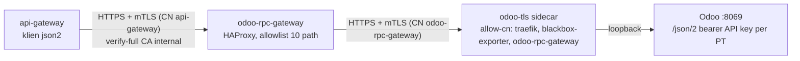
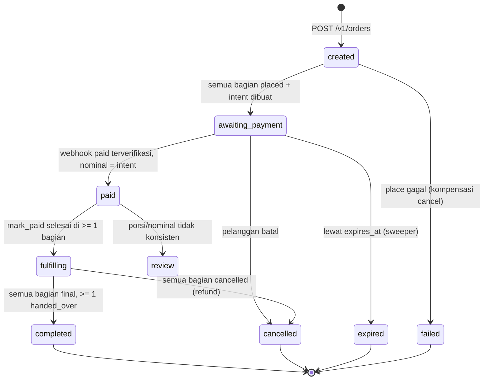
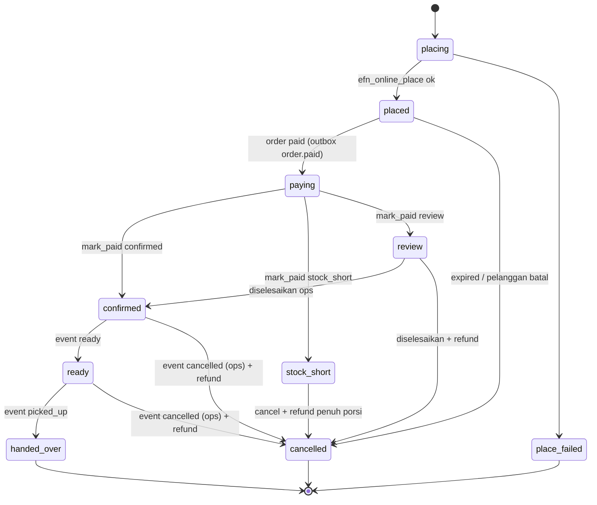
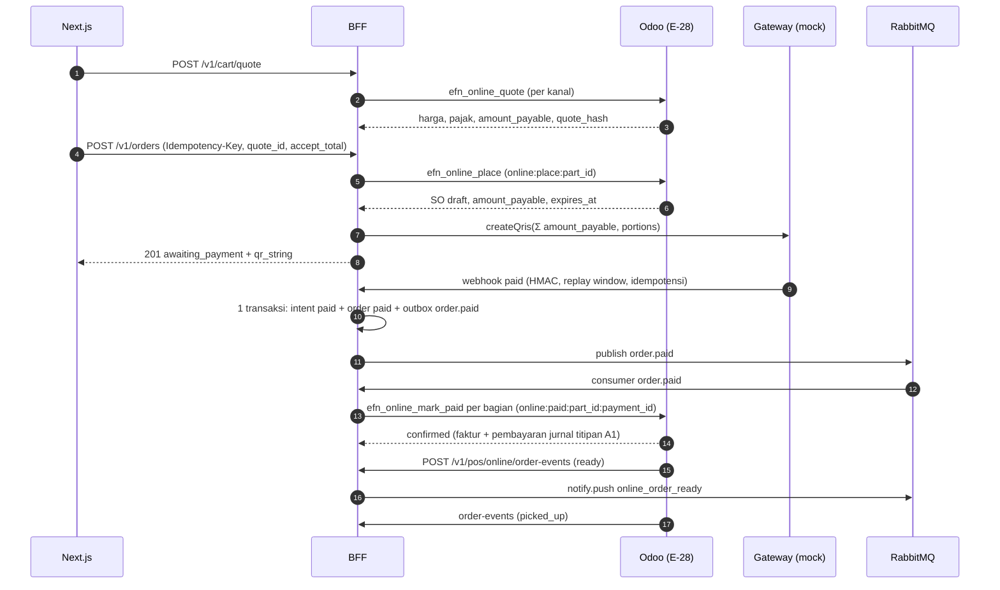

# KONTRAK ANTAR-SERVICE (v7.0 — 18 Okt 2026, G20 §12; v6.0 — G19 §11; v5.1 — 10 Okt 2026, privasi G18 L-21; v5.0 — 9 Okt 2026; §8 v3.x, §9 v4.x Fase 1, §10 v5.0 Fase 3 penjualan online)

Status: **Draft untuk Fase 0 / PoC**. Mengikuti rekomendasi ADR yang masih `Proposed`. Semua service (Odoo, BFF, Next.js, worker) wajib memakai nama, path, dan payload di dokumen ini. Perubahan kontrak = ubah dokumen ini dulu.

## 1. Identitas & kode

| Hal | Nilai |
|---|---|
| `member_ref` | Nomor HP format E.164 tanpa `+` (mis. `6281234567890`). Di log selalu di-mask `62812****890`. Di DB analitik di-hash: `member_hash = hex(sha256(pepper_hex + member_ref))` dengan `pepper_hex = hex(HKDF-SHA256(ikm=otp_pepper, salt "", info "efn:member_hash:v1", 32 byte))` (implementasi acuan: `services/api-gateway/src/config/app-config.ts`). Kunci HMAC OTP memakai info `"efn:otp_code:v1"` (kunci berbeda). ETL wajib memakai derivasi yang sama (lihat `services/api-gateway/src/common` untuk implementasi acuan). |
| `user_id` (JWT `sub`, `price_hunter_report.user_id`, payload event) | Sama dengan `member_ref` (E.164). Karena itu data pribadi: tidak boleh masuk ClickHouse tanpa di-hash. |
| Kode brand / company (`res.company.efn_brand_code`) | `EFN` (holding, merchant of record), `RTL` (PT Retail / supermarket, PPN), `FNB` (PT F&B, PB1), `FARM` (collection center). |
| `order_ref` | String opaque ≤ 64 karakter, unik per order. Odoo 19 mengirim `pos.order.uuid` (karena `pos_reference` baru dibuat server saat sync pertama, setelah OTP diminta). BFF tidak boleh mem-parse formatnya. |
| Versi API | Prefix `/v1`. Endpoint internal server-to-server di bawah `/v1/pos/*` dan `/internal/v1/*`. |

## 2. Autentikasi antar-service

| Pemanggil → Penerima | Mekanisme | Secret (file `/run/secrets/<nama>`) |
|---|---|---|
| Odoo → BFF (`/v1/pos/*`) | Header `X-EFN-Service-Key: <key>`; BFF membandingkan dengan `timingSafeEqual` | `odoo_bff_api_key` (Odoo membaca env `EFN_BFF_API_KEY_FILE`) |
| Browser → BFF (customer) | `Authorization: Bearer <access_token>` (JWT HS256, exp 1 jam). Next.js menyimpan token di cookie `efn_session` HttpOnly dan meneruskannya server-side | `jwt_secret` |
| Webhook payment/3PL → BFF | HMAC-SHA256 atas string `"<t>." + rawBody` (timestamp ikut ditandatangani agar replay window tidak bisa diakali), header `X-EFN-Signature: t=<unix>,v1=<hex>`, replay window 300 s | `webhook_payment_secret` |
| Worker ↔ BFF | Tidak ada HTTP; hanya lewat RabbitMQ | — |

Secret baru yang harus ada di compose + `scripts/gen-secrets.sh`: `otp_pepper`, `discount_token_secret`, `odoo_bff_api_key`, `whatsapp_token`, `webhook_payment_secret`. Env non-rahasia: `WHATSAPP_PHONE_NUMBER_ID`, `WHATSAPP_OTP_TEMPLATE` (default `efn_otp`), `WHATSAPP_ENABLED` (`false` di dev → sender console).

## 3. BFF HTTP API

Semua error berbentuk `{ "error": { "code": "<snake_case>", "message": "<pesan generik Bahasa Indonesia>" } }`. Tidak pernah membocorkan apakah nomor terdaftar.

### 3.1 POS OTP gate (dipanggil server Odoo, bukan browser POS)

`POST /v1/pos/otp/request`
```json
{ "member_ref": "6281234567890", "order_ref": "Order 00012-003-0004", "amount": 125000, "company_code": "FNB", "pos_config_id": 3 }
```
→ `202 { "challenge_id": "<uuid>", "expires_in": 180 }` (selalu 202 meski nomor tidak dikenal; pengiriman WA dilakukan bila valid). `429` bila rate limit.

`POST /v1/pos/otp/verify`
```json
{ "challenge_id": "<uuid>", "order_ref": "Order 00012-003-0004", "code": "123456" }
```
→ `200 { "ok": true, "discount_token": "<token>", "expires_in": 600 }`
→ `400 { "ok": false, "reason": "invalid" | "expired" | "locked", "attempts_left": 0..2 }`

`POST /v1/pos/discount-token/consume` (dipanggil Odoo saat order di-sync/di-validasi di server)
```json
{ "discount_token": "<token>", "order_ref": "Order 00012-003-0004", "member_ref": "6281234567890" }
```
**v2 (SEC-07):** `member_ref` di request OTP **dan** consume diambil server Odoo dari nomor HP `partner_id` order (bukan diketik kasir). Order tanpa partner ber-HP tidak bisa memakai promo ber-OTP. BFF menolak consume (`409 member_mismatch`) bila `member_hash(member_ref)` ≠ klaim `member_hash` token. Nomor di luar Indonesia (`^62[0-9]{8,13}$`) ditolak `400 invalid_phone`.
→ `200 { "ok": true }` | `409 { "ok": false, "reason": "already_used" | "order_mismatch" | "expired" | "invalid" }`

`discount_token` = JWT HS256 (`discount_token_secret`) dengan klaim `{ jti, purpose: "pos_promo", order_ref, member_hash, company_code, exp }`. Sekali pakai: `jti` disimpan di Redis `dtok:used:<jti>` (nilai = `order_ref`) saat consume. Consume **idempotent** untuk pasangan `jti` + `order_ref` yang sama: panggilan ulang dengan order yang sama → `200 { ok: true }` (menangani retry Odoo bila commit gagal setelah consume sukses); dengan `order_ref` berbeda → `409 already_used`.

Aturan OTP: 6 digit `crypto.randomInt`, disimpan sebagai HMAC-SHA256(`otp_pepper`) di Redis `otp:<challenge_id>` TTL 180 s, maks 3 attempt lalu `locked`. Rate limit request: per `member_ref` 3 / 15 menit, per IP/pos_config 20 / 15 menit. Setiap hasil dicatat di `platform.otp_audit` (subject = member_hash).

### 3.2 Login pelanggan (Super-App)

`POST /v1/auth/otp/request` `{ "phone": "6281234567890" }` → `202 { "challenge_id": "<uuid>", "expires_in": 180 }`
`POST /v1/auth/otp/verify` `{ "challenge_id": "<uuid>", "code": "123456" }` → `200 { "access_token": "<jwt>", "token_type": "Bearer", "expires_in": 3600 }` | `400` seperti 3.1.
**(v5.1, L-21b — G18, Q-P3)** Body wajib menyertakan `"age_confirmed": true` (pernyataan usia minimal 17 tahun; diminta setiap login karena login = daftar). Tidak ada/`false` → `400 { error: { code: "age_confirmation_required" } }` dicek **sebelum** OTP (challenge tidak hangus); non-boolean → `400 invalid_request`. BFF mengisi `member.age_confirmed_at` (tanpa tanggal lahir). `MEMBER_MIN_AGE` (17..21) hanya untuk teks. Teks pelanggan menunggu persetujuan Legal.
`GET /v1/me` (Bearer) → `{ "member_ref_masked": "62812****890", "points_balance": 1200 }`

### 3.3 Price Hunter (Market Scout)

`POST /v1/market-scout/reports` (Bearer, `multipart/form-data`): `photo` (JPEG/PNG/WebP, maks 8 MB), `product_name`, `price` (angka Rupiah), `competitor_name?`, `lat?`, `lng?`
→ `202 { "report_id": "<uuid>", "status": "queued" }` | `413` | `415` | `429` (cap harian per user default 20)

`GET /v1/market-scout/reports/:id` (Bearer, hanya pemilik) → `{ "report_id", "status": "queued|processing|valid|rejected|flagged", "reason": null|string, "points_awarded": 0 }`

BFF: magic-bytes check, re-encode dengan `sharp` (strip EXIF, maks 2048 px, JPEG q85), simpan ke MinIO bucket `market-scout` key `reports/<yyyy>/<mm>/<report_id>.jpg`, `INSERT platform.price_hunter_report` status `queued`, publish `ocr.requested`.

### 3.4 Loyalty (dibaca POS & app)

`GET /v1/pos/loyalty/balance?member_ref=...` (service key) → `{ "points_balance": 1200 }`
Ledger tunggal di `platform.loyalty_ledger` (D-05: satu ledger poin). Odoo tidak menyimpan saldo poin sendiri untuk member platform.

## 4. Event RabbitMQ

Default exchange, queue durable tipe `quorum`, setiap queue punya DLQ `<queue>.dlq` (via `x-dead-letter-exchange: ""` + `x-dead-letter-routing-key`). Properti AMQP `message_id` = `idempotency_key`, `content_type: application/json`, `persistent: true`. Semua payload punya `schema_version: 1`.

| Queue | Publisher | Consumer | Payload |
|---|---|---|---|
| `ocr.requested` | BFF | ai-ocr-worker | `{ schema_version: 2, report_id, user_hash, image_bucket, image_object, product_name, reported_price, competitor_name, geo: {lat,lng}|null, submitted_at }` |
| `loyalty.earn.requested` | ai-ocr-worker (dan nanti MGM) | BFF | `{ schema_version: 2, idempotency_key: "price_hunter:<report_id>", member_hash, points, reason, source: "price_hunter", source_ref: "<report_id>" }` |
| `notify.push` | worker / BFF | BFF notification | `{ schema_version: 2, idempotency_key, member_hash, source: "price_hunter", source_ref: "<report_id>", template: "price_hunter_valid" | "price_hunter_rejected" | ..., params: {} }` |

**v2 (5 Okt 2026): tidak ada nomor HP mentah di payload event.** Payload hanya membawa `user_hash`/`member_hash`. BFF menyelesaikan penerima notifikasi dengan mendekripsi `user_enc` dari baris sumber (`source` + `source_ref`, mis. `price_hunter_report`) dan memverifikasi hash-nya cocok. Lihat §7.

**Autentikasi publisher (SEC-08):** setiap publisher menyetel properti AMQP `user_id` = nama user RabbitMQ-nya (RabbitMQ menolak bila tidak cocok dengan user koneksi). Consumer BFF hanya menerima `loyalty.earn.requested` dengan `user_id = efn-ocr` untuk `source=price_hunter`, `points` ≤ `LOYALTY_MAX_POINTS_PER_EVENT` (default 100), dan memverifikasi `price_hunter_report` dengan `id = source_ref` berstatus `valid` dan `user_hash = member_hash`.

Consumer idempotent: BFF menyimpan `idempotency_key` di `platform.processed_message (consumer, idempotency_key)` unik; worker memeriksa status report sebelum memproses (`queued` → `processing` via `UPDATE ... WHERE status='queued' RETURNING`).

Worker menulis hasil ke `platform.price_hunter_report` (status `valid|rejected|flagged`, `extracted`, `confidence`, `reason`). `flagged` = perlu review manual (mis. VLM tidak tersedia, kemungkinan fraud).

## 5. Tabel platform baru (dimiliki BFF)

Didefinisikan di `infra/postgres/init/02-platform-loyalty.sql`:
- `platform.loyalty_ledger (id, member_ref_hash, member_ref_enc?, company_code, delta_points, reason, source, source_ref, idempotency_key UNIQUE, expires_at NULL, created_at)`; saldo = SUM entri yang belum kedaluwarsa. `company_code` = PT yang menanggung liabilitas poin (ADR-020, settlement antar-PT).
- `platform.processed_message (consumer, idempotency_key, processed_at, PRIMARY KEY(consumer, idempotency_key))`.
- `platform.outbox (id, queue, payload jsonb, message_id, created_at, published_at)`.

## 6. Konfigurasi Odoo (`ir.config_parameter`)

`efn.bff_url` (**v2: `https://api-gateway:3000`**, verifikasi sertifikat dengan CA di env `EFN_CA_FILE`, default `/run/secrets/efn_ca_crt`), `efn.pos.otp_required_for_promo`, `efn.pos.promo_disabled_when_offline`, `efn.pos.otp_timeout_seconds` (default 5). API key BFF **tidak** disimpan di config parameter; dibaca dari file secret.

## 7. Enkripsi & Kredensial (v2, wajib — instruksi user "enkripsi di setiap transaksi data")

### 7.1 Enkripsi in transit — setiap hop TCP antar-container memakai TLS terverifikasi
- **PKI internal**: CA internal ECDSA P-256 dibuat `scripts/gen-pki.sh` (dev) / disuplai dari GitHub Environments (staging/prod). Semua klien memverifikasi server terhadap CA di `/run/secrets/efn_ca_crt` (verify-full, hostname = nama service compose). Sertifikat server per service: secret `tls_<service>_crt` + `tls_<service>_key` (nama service dengan `_`, mis. `tls_api_gateway_key`).
- Aplikasi tanpa TLS native (Odoo HTTP, Next.js standalone, Ollama, Metabase bila perlu) dibungkus **sidecar TLS `ghostunnel`** yang berbagi network namespace (`network_mode: service:<app>`), sehingga plaintext hanya ada di loopback di dalam namespace yang sama. Pengecualian lain hanya lewat ADR-022 dengan kontrol kompensasi.
- Antar-node: WireGuard (lapisan kedua, bukan pengganti TLS).

| Koneksi | Parameter klien (env) |
|---|---|
| PostgreSQL | `PG_SSLMODE=verify-full`, `PG_SSLROOTCERT=/run/secrets/efn_ca_crt` (Odoo: `db_sslmode = verify-full` + env `PGSSLROOTCERT`) |
| Redis | `REDIS_URL=rediss://redis:6379`, `REDIS_USERNAME`, `REDIS_PASSWORD_FILE`, `REDIS_TLS_CA_FILE` |
| RabbitMQ | `AMQP_URL=amqps://<user>@rabbitmq:5671` (tanpa password), `RABBITMQ_PASSWORD_FILE`, `AMQP_TLS_CA_FILE` |
| MinIO | `MINIO_ENDPOINT=minio`, `MINIO_PORT=9000`, `MINIO_USE_SSL=true`, `MINIO_CA_FILE`, `MINIO_ACCESS_KEY`, `MINIO_SECRET_KEY_FILE` (menggantikan `MINIO_ROOT_*` di aplikasi) |
| ClickHouse | `CH_SECURE=true`, `CH_PORT=8443` (HTTPS) / `9440` (native TLS), `CH_CA_FILE` |
| BFF (server) | Mendengar **HTTPS** di `:3000` dengan `TLS_CERT_FILE`, `TLS_KEY_FILE`. Klien: Traefik (`serversTransport` rootCAs), Next.js (`BFF_INTERNAL_URL=https://api-gateway:3000` + `NODE_EXTRA_CA_CERTS`), Odoo (`EFN_CA_FILE`), Prometheus (scrape https) |
| Ollama | `OLLAMA_URL=https://ollama:11434` via sidecar, `OLLAMA_CA_FILE` |
| Traefik → upstream | Semua router memakai `https` ke upstream + `serversTransport` dengan CA internal |

Semua env `*_CA_FILE` default ke `/run/secrets/efn_ca_crt`. Kode **gagal start** bila TLS diminta tetapi CA tidak terbaca; tidak ada fallback diam-diam ke plaintext. Mode plaintext hanya boleh lewat flag eksplisit `EFN_ALLOW_PLAINTEXT=true` yang **ditolak** saat `NODE_ENV/APP_ENV=production`.

### 7.2 Enkripsi at rest
- **Kolom PII** dienkripsi di aplikasi: AES-256-GCM, kunci secret `pii_encryption_key` (32 byte, base64). Format `bytea` = `0x01` (versi) ‖ IV 12 byte ‖ ciphertext ‖ tag 16 byte; AAD = `"efn:<tabel>.<kolom>:v1"`. Implementasi acuan di BFF `src/common/pii/`. **Key ring**: byte versi = versi kunci. Kunci v1 = secret `pii_encryption_key`; kunci berikutnya `pii_encryption_key_v2`, `_v3`, … (env `PII_ENCRYPTION_KEY_V<n>_FILE`). Enkripsi memakai `PII_ACTIVE_KEY_VERSION` (default 1); dekripsi memilih kunci dari byte versi. Rotasi = tambah kunci baru, naikkan versi aktif, jalankan re-encrypt job, lalu pensiunkan kunci lama — tanpa downtime.
- `platform.price_hunter_report`: kolom `user_id` (HP mentah) **dihapus**, diganti `user_hash char(64) NOT NULL` (rumus `member_hash` §1) + `user_enc bytea NOT NULL`. Cap harian & dedup memakai `user_hash`.
- `platform.loyalty_ledger.member_ref_enc` **wajib diisi** (BFF mengenkripsi saat member_ref diketahui; untuk earn price hunter disalin dari `price_hunter_report.user_enc`).
- `platform.otp_audit.ip` → `ip_enc bytea` (forensik hanya lewat dekripsi oleh admin).
- MinIO: SSE-S3 aktif untuk bucket `market-scout` dan `pg-backup` (KMS key secret `minio_kms_key`), versioning + object lock (governance) di `pg-backup`.
- Backup PostgreSQL: WAL-G libsodium (sudah). Disk host: LUKS (runbook).
- ETL **tidak lagi membutuhkan `otp_pepper`** (SEC-16): ClickHouse menerima `user_hash`/`member_ref_hash` yang sudah di-hash dari Postgres.

### 7.3 Kredensial per service (SEC-02, least privilege)
| Sistem | User | Secret | Hak |
|---|---|---|---|
| PostgreSQL | `efn_odoo` | `pg_password_odoo` | owner DB `efn_odoo`, `CREATEDB`, bukan superuser |
| PostgreSQL | `efn_bff` | `pg_password_bff` | owner skema `platform` di DB `efn_platform` |
| PostgreSQL | `efn_ocr` | `pg_password_ocr` | `SELECT` + `UPDATE(status, reason, extracted, confidence, image_phash, updated_at)` pada `platform.price_hunter_report`, `SELECT` kolom non-PII yang dibutuhkan anti-fraud |
| PostgreSQL | `efn_etl` (anggota `efn_readonly`) | `pg_password_etl` | grant level-kolom (lihat 01/02 SQL) |
| PostgreSQL | `efn_metabase` | `pg_password_metabase` | owner DB `metabase` saja |
| PostgreSQL | `efn_exporter` | `pg_password_exporter` | `pg_monitor` |
| PostgreSQL | superuser `postgres` | `pg_password` | hanya entrypoint/backup via socket lokal; tidak dipakai aplikasi |
| MinIO | `efn-bff` | `minio_bff_secret` | `PutObject`/`DeleteObject` `market-scout/reports/*` + `GetBucketLocation` pada bucket `market-scout` (dibutuhkan library klien) |
| MinIO | `efn-ocr` | `minio_ocr_secret` | `GetObject` `market-scout/reports/*` + `GetBucketLocation` pada bucket `market-scout` |
| RabbitMQ | `efn-bff` | `rabbitmq_password_bff` | configure/read/write queue miliknya; read `loyalty.earn.requested`, `notify.push`; write `ocr.requested` |
| RabbitMQ | `efn-ocr` | `rabbitmq_password_ocr` | read `ocr.requested`; write `loyalty.earn.requested`, `notify.push` (+ `.dlq`) |
| Redis | `efn-bff` (ACL) | `redis_password_bff` | `~otp:* ~dtok:* ~rl:* …` (prefix yang dipakai BFF); user `default` dinonaktifkan; `maxmemory-policy noeviction` |

| ClickHouse | `efn_etl` | `clickhouse_password_etl` | INSERT/SELECT tabel mart & `etl_watermark` |
| ClickHouse | `efn_text2sql` | `clickhouse_password_text2sql` | `readonly=2`, SELECT view whitelist saja |
| ClickHouse | `efn_metabase` | `clickhouse_password_metabase` | SELECT view/mart |

Role/user dibuat oleh skrip init (devsecops) dengan password dari secret; grant tabel ditulis bersama skema (pemilik skema).

Tambahan Fase 3 (user teknis Odoo per PT, `odoo-rpc-gateway`, secret event HMAC, prefix Redis, bucket `catalog`): lihat §10.10.

### 7.4 Akses jaringan Odoo (SEC-01)
- Router Traefik `odoo` dan `odoo-ws` hanya menerima sumber dari rentang WireGuard (`internal-only`); outlet/POS terhubung via WireGuard (router outlet atau perangkat POS). Tidak ada akses Odoo dari internet publik.
- User internal Odoo wajib 2FA (`auth_totp` CE; kebijakan wajib dikonfigurasi efn-odoo-functional).
- Rate limit ketat `/web/login` & `/web/session/authenticate`; `/xmlrpc`, `/jsonrpc` diblok di Traefik kecuali dari subnet internal service.

### 7.5 Client IP (SEC-03)
Traefik mempercayai `X-Forwarded-For` hanya dari rentang Cloudflare (+WireGuard); BFF `TRUSTED_PROXIES` = subnet internal Docker + rentang Cloudflare (env, daftar disuplai devsecops). Firewall origin: 443 hanya dari Cloudflare + WireGuard.

## 8. Tambahan v3 (6 Okt 2026 — keputusan user setelah review gelombang 4)

### 8.1 Captcha OTP (SEC-06) — ALTCHA (open source, self-hosted, tanpa pihak ketiga)
`GET /v1/auth/challenge` → challenge ALTCHA (proof-of-work, HMAC secret `altcha_hmac_key`, TTL 5 menit, sekali pakai di Redis `altcha:used:<sig>`). `POST /v1/auth/otp/request` wajib field `altcha` (payload base64 dari widget); tanpa/invalid → `400 captcha_required`. Endpoint POS (service key) tidak memakai captcha.

### 8.2 Identitas member opak
Tabel `platform.member (id uuid PK, member_hash char(64) UNIQUE, member_ref_enc bytea NOT NULL, created_at, deleted_at NULL)`. JWT pelanggan `sub` = `member.id` (UUID), **bukan** nomor HP. `GET /v1/me` tetap `{ member_ref_masked, points_balance }`. Ledger & report tetap memakai `member_hash`.

### 8.3 Payment gateway-agnostic (QRIS POS & online) — provider belum ditentukan
- Abstraksi `PaymentGateway` di BFF (`createQris`, `getStatus`, `cancel`, `verifyWebhook`, `parseWebhook`). Adapter: `mock` (default dev/staging, QR dummy), `xendit`, `midtrans` (kerangka; **nonaktif** sampai ADR-016 diputuskan dan diuji ke sandbox vendor). Pilihan via `PAYMENT_PROVIDER=mock|xendit|midtrans`; produksi menolak `mock`.
- Secret: `payment_provider_api_key` (dibaca hanya bila provider ≠ mock), `webhook_payment_secret` (sudah ada). Tidak ada data kartu (PCI SAQ A); hanya QRIS/VA/e-wallet.
- `POST /v1/pos/payments` (service key, dipanggil server Odoo) `{ order_ref, amount, currency: "IDR", company_code, pos_config_id, method: "qris", idempotency_key }` → `201 { payment_id, provider, status: "pending", qr_string, expires_at }` (idempotent per `idempotency_key`).
- `GET /v1/pos/payments/:payment_id` → `{ payment_id, status: "pending|paid|expired|failed|cancelled", paid_at, provider_ref, amount }`
- `POST /v1/pos/payments/:payment_id/cancel` → `200 { status }`
- `POST /v1/webhooks/payments/:provider` (publik via Traefik, verifikasi signature provider/HMAC + replay window + idempotensi) → `200`. Status final hanya berubah lewat webhook terverifikasi atau `getStatus` ke provider, tidak dari klien.
- Tabel `platform.payment_intent (id uuid, provider, provider_ref, order_ref, company_code, amount numeric(14,2), currency, method, status, qr_string, expires_at, paid_at, idempotency_key UNIQUE, created_at, updated_at)`. Settlement per PT mengikuti ADR-019 (merchant of record) — belum diimplementasi.
- Odoo: metode pembayaran POS `efn_gateway` (modul gap, lihat docs/08) membuat intent, menampilkan QR di layar pelanggan, polling `GET` tiap 2 s sampai final/timeout; offline → metode ini nonaktif.
- Online (Super-App): ekstensi `purpose`, porsi per PT, refund — lihat §10.7.

### 8.4 Privasi (UU PDP) — endpoint, consent, penghapusan
- Consent: `GET /v1/me/consents` → `[{ purpose: "location"|"marketing", granted, version, updated_at }]`; `PUT /v1/me/consents/:purpose` `{ granted, version }` → `200`. Tabel append-only `platform.consent (id, member_id, purpose, granted, version, source, ip_enc, created_at)` (grant INSERT/SELECT saja untuk `efn_bff`). Market Scout membuang koordinat bila consent `location` tidak aktif.
- DSAR sesuai `docs/compliance/PDP_DSAR_DESIGN.md` §3: `GET /v1/me/data`, `POST /v1/me/reauth` (step-up token `purpose: dsar`, 10 menit), `DELETE /v1/me` (step-up wajib; masa tenggang `DSAR_DELETE_GRACE_DAYS`, default 7), `POST /v1/me/delete/cancel`, `GET /v1/me/requests`. Tabel `platform.dsar_request (id uuid, member_id, member_hash, type, status, stores_pending text[], requested_at, scheduled_at, completed_at)`.
- Penghapusan lintas-store (tanpa HP mentah): BFF menandai `dsar_request` `processing` dengan `stores_pending = {platform, odoo, clickhouse}`.
  - **Odoo** menarik via cron: `GET /v1/pos/privacy/erasures?store=odoo` (service key) → `[{ request_id, member_hash }]`; Odoo menganonimkan `res.partner` dengan `efn_member_hash` cocok, lalu `POST /v1/pos/privacy/erasures/:request_id/complete` `{ store: "odoo", records: n }`. Odoo menghitung `efn_member_hash` (stored, indexed) dari `phone` ternormalisasi dengan rumus §1 memakai secret `member_hash_pepper` (= `pepper_hex` turunan HKDF, dibuat deploy dari `otp_pepper`; env `EFN_MEMBER_HASH_PEPPER_FILE`).
  - **ClickHouse**: ETL membaca `platform.dsar_request` (kolom `id, member_hash, status, stores_pending`) setiap siklus, menjalankan `DELETE`/`ALTER ... DELETE` pada mart untuk `member_hash`, lalu publish `privacy.erasure.completed` `{ schema_version: 2, idempotency_key: "erasure:<request_id>:clickhouse", request_id, store: "clickhouse" }` sebagai user RabbitMQ `efn-etl` (secret `rabbitmq_password_etl`).
  - **Platform**: BFF menghapus/menganonimkan `member`, `consent` (dipertahankan sebagai bukti tanpa PII), `price_hunter_report.user_enc` di-null-kan, ledger dipertahankan dengan `member_ref_enc` di-null-kan (catatan keuangan 10 th, ADR-020) — kolom `member_ref_enc` menjadi NULLABLE hanya untuk baris terhapus.
- Retensi default (usulan, **menunggu DPO**; semua configurable via env): `otp_audit` 90 h; foto Market Scout 90 h (objek MinIO lifecycle) dan `user_enc` laporan di-null-kan setelah 90 h; baris laporan 2 th; ClickHouse mart TTL 5 th; ledger poin 10 th; consent selama akun + 5 th.

### 8.5 mTLS (Q-E4 — keputusan: sesuai rekomendasi ADR-022)
Wajib untuk hop **tanpa kredensial aplikasi**: semua sidecar ghostunnel (Odoo, Next.js, Metabase, Ollama, cAdvisor, docker-socket-proxy) dan semua endpoint observability (Prometheus, Loki, Alertmanager, Grafana datasource, exporter, metrics BFF/worker/ClickHouse). Server memverifikasi sertifikat klien dari CA internal dan membatasi CN/SAN yang diizinkan (ghostunnel `--allow-cn`, Prometheus/exporter `web-config` `client_auth_type: RequireAndVerifyClientCert` + `client_allowed_sans`). Klien membawa sertifikat sendiri `tls_<client>_crt/key`: Traefik, Prometheus, Grafana, Promtail, ocr-worker (ke Ollama: `OLLAMA_CLIENT_CERT_FILE`, `OLLAMA_CLIENT_KEY_FILE`), Odoo-tidak-perlu. Hop dengan kredensial aplikasi (PostgreSQL, Redis, RabbitMQ, MinIO, ClickHouse, BFF API) tetap server-TLS + password per service (opsional mTLS fase 2).

### 8.6 Kepemilikan kunci (keputusan user: hanya Superadmin)
Root CA key (offline), `pii_encryption_key*`, `walg_libsodium_key`, `minio_kms_key`, `clickhouse_disk_key`, passphrase LUKS, `otp_pepper`/`member_hash_pepper` hanya dipegang peran **Superadmin**: GitHub Environment `production` hanya bisa dikelola/di-approve Superadmin; di host, `/opt/efn/secrets` = `root:efn-superadmin 0750`, file 0444 (dibutuhkan bind-mount ke container non-root; batas akses host = izin direktori), akses sudo hanya grup `efn-superadmin`; root CA key tidak pernah berada di server. Prosedur custody, break-glass, dan pewarisan kunci di `docs/runbooks/key-custody.md`.

### 8.7 Klarifikasi v3.1 (usulan architect, diterima lead)
- `platform.dsar_request.type ∈ {export, delete, correction, phone_change}`; `status ∈ {pending_reauth, scheduled, cancelled, processing, completed, rejected, failed}`; kolom tambahan `reason text NULL` (alasan penolakan/kegagalan, tanpa PII).
- `platform.consent` kolom tambahan `text_sha256 char(64) NOT NULL` = SHA-256 dari teks kebijakan/consent versi yang disetujui (bukti isi yang disetujui).
- `loyalty_ledger.member_ref_enc` NULLABLE hanya untuk baris milik member yang dihapus (CHECK: NOT NULL kecuali `member_hash` ada di tombstone / ditandai `erased_at`).
- Retensi foto Market Scout default **90 hari** (lifecycle MinIO harus sama).
- Odoo `/json/2/` diblok dari luar seperti `/xmlrpc` dan `/jsonrpc`.

### 8.8 Klarifikasi v3.2
- **Consume token POS membawa nominal (SEC-07 sisa):** `POST /v1/pos/discount-token/consume` body `{ discount_token, order_ref, member_ref, amount_total }`; token menyimpan `amount` saat OTP; BFF menolak `409 amount_mismatch` bila `amount_total` di luar toleransi `POS_OTP_AMOUNT_TOLERANCE_PCT` (default 20%) dari nilai saat OTP → Odoo menandai order `review`.
- **Erasure Odoo** mencakup: anonimisasi `res.partner` (termasuk arsip, lintas company), salinan kontak di `pos.order` (`email`, `mobile`), chatter/tracking dan auditlog milik partner, `privacy.log` standar; dokumen akuntansi & `pos.order` dipertahankan dengan partner teranonim (menunggu DPO).
- **Refund QRIS** belum ada di v3: fase 1 refund lewat metode lain sesuai SOP. Endpoint `POST /v1/pos/payments/:id/refund` dicadangkan (belum diimplementasi).
- Odoo membutuhkan `GET` ke BFF (`efn.bff.client._efn_get`) untuk status payment & daftar erasure.

### 8.9 Detail endpoint privasi v3.3 (disepakati frontend ↔ BFF)
- `POST /v1/me/reauth`: body `{}` → `202 { challenge_id, expires_in }` (OTP ke nomor akun sendiri, ALTCHA tidak diperlukan karena sudah login); body `{ challenge_id, code }` → `200 { step_up_token, expires_in }` | `400` format §3.1.
- `DELETE /v1/me`: header `X-Step-Up-Token: <token>`, tanpa body → `202 { request_id, scheduled_at, points_forfeited }`; token hilang/invalid → `403 { error: { code: "step_up_required" | "step_up_invalid" } }`.
- **(v5.1, L-21a — G18, Q-P18, menggantikan aturan 409 permanen L-4)** Bila ada bagian pesanan online `paying|confirmed|ready|review`: `DELETE /v1/me` → `409 { error: { code: "open_online_orders", message, open_parts, max_defer_days, confirm_param: "confirm_open_orders" } }` (langkah informasi; step-up token **belum** dikonsumsi). Pelanggan mengonfirmasi → `DELETE /v1/me?confirm_open_orders=true` dengan **token step-up yang sama** → `202 { request_id, scheduled_at, points_forfeited, open_online_orders, erasure_deadline }`; `dsar_request.open_orders_ack_at` = bukti persetujuan sadar. Erasure ditunda selama pesanan terbuka, **paling lama `DSAR_OPEN_ORDER_MAX_DEFER_DAYS` (default & plafon 14) sejak `requested_at`**; `erasure_deadline` = maks(`requested_at` + 14 h, `scheduled_at`). Detail di §10.17 L-21.
- `GET /v1/me/data` (juga butuh `X-Step-Up-Token`) → `200` JSON, atau `202 { request_id, download_url?, expires_at? }` untuk export besar.
- `GET /v1/me/requests` → `{ items: [{ id, type, status, requested_at, scheduled_at, completed_at, download_url? }] }`.
- `PUT /v1/me/consents/:purpose` `{ granted, version }`: bila `granted=true` dan `version` ≠ versi teks aktif → `409 { error: { code: "stale_text" } }`; penarikan (`granted=false`) selalu diterima. Versi & `text_sha256` aktif dikonfigurasi di BFF (`CONSENT_<PURPOSE>_VERSION`, `CONSENT_<PURPOSE>_TEXT_SHA256`).
- Selama masa tenggang hapus akun, login tetap diizinkan agar pengguna bisa `POST /v1/me/delete/cancel`.

### 8.10 Keputusan lead gelombang 5 (infra)
- Queue RabbitMQ dideklarasikan oleh broker (definitions). Aplikasi (BFF, worker, ETL) memakai **passive declare** (`checkQueue`/`queue_declare(passive=True)`) agar hak `configure` user aplikasi bisa dicabut (SEC-25).
- Pengecualian E13 **disetujui**: `blackbox-exporter` boleh menjadi klien mTLS sidecar Odoo/Next.js/Metabase/Ollama khusus probe kesehatan (read-only).
- Alokasi WireGuard final: outlet `10.88.0.0/16`, staf `10.89.0.0/16` (ADR-023).
- BFF `/metrics` wajib memverifikasi sertifikat klien Prometheus (mTLS) — menutup sisi BFF dari E12.
### 8.11 Catatan implementasi BFF gelombang 5 (v3.4, menjadi bagian kontrak)
- JWT `sub` = UUID member → sesi lama tidak valid (login ulang). Login saat DSAR `processing` → `409 account_deleting`; selama masa tenggang login boleh.
- Redis prefix baru `altcha:used:*` (ACL `efn-bff` wajib mencakup).
- Consent: `503 consent_unavailable` bila teks aktif belum dikonfigurasi; `efn_bff` punya `UPDATE(ip_enc)` di `consent` (untuk erasure/re-encrypt) — penyimpangan kecil dari "append-only", sisanya dijaga trigger.
- Erasure platform satu transaksi dengan `processing`; tombstone `sha256("erased:"||request_id)` di `loyalty_ledger.member_ref_hash`, `price_hunter_report.user_hash`, `otp_audit.subject`; saldo dihanguskan per PT via entri ledger `source='dsar'`; `stores_pending = {odoo, clickhouse}` setelah commit. Complete Odoo → `200 { ok, status }` | `404` | `409 not_processing`.
- Payment: `PAYMENT_PROVIDER ∈ {mock, xendit, midtrans, disabled}` (prod default `disabled`); error `409 idempotency_conflict`, `409 payment_in_progress`, `502 payment_provider_error`, `503 payment_provider_unavailable`; `POST /v1/pos/payments/:id/simulate` dev-only (404 di prod); pembayaran terlambat (`expired|cancelled|failed → paid`) diterima dan ditandai untuk refund manual; nominal webhook berbeda → status tidak berubah.
- Metrics BFF: `https://api-gateway:9464/metrics`, mTLS, CN klien `prometheus`.
- Export DSAR saat ini sinkron (maks 1000 baris per bagian); jalur `202` + unduhan belum diimplementasi.

### 8.12 Catatan v3.5 (ADR-030, gelombang 8)
- **Access key object storage diperlakukan sebagai secret**: nama access key (`MINIO_ACCESS_KEY`) tidak boleh berupa string mudah ditebak (`efn-bff`, `pgbackup`, dsb.); dibuat acak oleh `gen-secrets.sh` dan disimpan sebagai secret (`minio_bff_access_key`, `minio_ocr_access_key`, `minio_backup_access_key`, `minio_prometheus_access_key`), env `MINIO_ACCESS_KEY_FILE`. Alasan: CVE-2026-41145/40344 (penulisan objek hanya dengan access key ID) pada build MinIO lama.
- Sumber image object storage mengikuti ADR-030 (Proposed): build dari tag source fork komunitas aktif (SILO) di pipeline sendiri; nama service compose tetap `minio` agar klien tidak berubah.

### 8.13 Perubahan v3.6 (gelombang 9 — hasil smoke E2E & review r3)
- **R2 — tidak ada PII di query string**: `GET /v1/pos/loyalty/balance?member_ref=` **dihapus**, diganti `POST /v1/pos/loyalty/balance` body `{ member_ref }` → `200 { points_balance }`. Aturan umum: nomor HP, token, dan identitas tidak pernah dikirim lewat URL/query (masuk access log).
- **SEC-31 — tombstone tidak bisa ditautkan**: tombstone erasure = 32 byte acak (hex 64), **tidak** diturunkan dari `request_id`/`member_hash` dan tidak disimpan di mana pun selain baris yang di-tombstone. Saat `dsar_request` `completed`, kolom `member_hash` di-NULL-kan (selama `processing` boleh ada). Odoo tidak menyimpan `request_id` atau `member_hash` pada partner yang sudah dianonimkan; idempotensi `complete` memakai penanda yang dihapus/tidak menautkan setelah selesai (desain diserahkan ke odoo-engineer dengan syarat ini).
- **R6 — status penghapusan setelah akun hilang**: `DELETE /v1/me` mengembalikan juga `receipt_token` (opak, HMAC, `purpose: dsar_receipt`, berlaku 30 hari, terikat `request_id`, tanpa PII). `GET /v1/dsar/requests/:id` dengan header `X-DSAR-Receipt: <token>` → `{ id, type, status, requested_at, scheduled_at, completed_at }` (tanpa PII, rate limit). Next.js menyimpan receipt di cookie HttpOnly `efn_dsar_receipt` (Path `/api/dsar`, SameSite=Strict, 30 hari).
- **Access key object storage** dibaca dari `MINIO_ACCESS_KEY_FILE` (lihat §8.12) oleh BFF dan worker; `MINIO_ACCESS_KEY` literal hanya diterima bila `APP_ENV=dev`.

### 8.14 Catatan v3.7 (gelombang 9 infra)
- **Endpoint object storage untuk semua klien = `s3-gateway:9000`** (HAProxy filter L7, TLS dengan sertifikat `tls_s3_gateway_*`, verifikasi CA internal). Service `minio` (SILO) hanya ada di network `objstore` dan tidak dijangkau klien langsung. Klien: `MINIO_ENDPOINT=s3-gateway`.
- Request yang ditolak gateway (403): header `x-amz-bypass-governance-retention`, PUT `?retention`/`?legal-hold`/`?object-lock`, unsigned trailer, header `X-Minio-Replication-*`, `?select`, admin API (kecuali minio-init/prometheus).
- Access key per klien dari file (§8.12): `minio_{bff,ocr,backup,prometheus}_access_key`.
- Metrik Loki/redis_exporter/RabbitMQ 15691/Traefik 8082 hanya via sidecar ghostunnel dengan allowlist CN (menggantikan pengecualian E12).

### 8.15 Catatan v3.8 (gelombang 11)
- mTLS tambahan: Loki ruler → Alertmanager (sertifikat `loki` ber-EKU server+client; Alertmanager memakai `web-config-alertmanager.yml` yang hanya mengizinkan klien `prometheus` dan `loki`).
- Stream log `efn_audit_sink` (baris `EFN_AUDIT_SINK {json}` dari Odoo `efn_audit`) diretensi 400 hari di Loki; alert `EfnAuditControlChange`, `EfnAuditUnexpectedPurge`, `EfnAuditRetentionPurgeBurst`.
- Root user object storage dari secret `minio_root_user` (acak), bukan nilai default.

### 8.16 Klarifikasi v3.9 (gelombang 12, usulan architect diterima)
- **Retensi (default, menunggu DPO)**: outbox & processed_message 14 hari; `efn.audit.log` Odoo 730 hari (minimum 365 di kode; log kontrol & purge tidak pernah dihapus); stream Loki `efn_audit_sink` 400 hari, stream Loki lain 30 hari; WAL-G 14 base backup penuh.
- **§8.11 diralat**: tombstone erasure BUKAN `sha256("erased:"||request_id)` — berlaku §8.13 (32 byte acak).
- **§8.8 diralat**: erasure Odoo menghapus log `efn.audit.log` subjek via `_efn_audit_purge_records` (bukan OCA auditlog).
- **Redis**: setiap IP/HP di nama key wajib di-HMAC (pepper turunan `efn:redis_key:v1`); prefix yang dikenal: `otp:*` (termasuk `otp:stepup-used:*`), `dtok:*`, `rl:*`, `altcha:*` (termasuk `altcha:used:*`, `altcha:ip:*`), `dsar:receipt-ip:*`, `ms:*`.
- **mTLS (§8.5)**: tambah loki→alertmanager. Sisa pengecualian E12: `/metrics` ocr-worker (mTLS tanpa allowlist CN) — ditutup dengan bind loopback + sidecar ghostunnel `--allow-cn=prometheus`.

### 8.17 Catatan v3.10 (gelombang 12 BFF)
- **ALTCHA v2 (§8.1)**: signature = HMAC(`efn-altcha:v2` ‖ challenge ‖ IP klien; IPv6 per /64) — solusi dari IP lain → `400 captcha_required`. Biaya adaptif: `maxnumber = ALTCHA_MAX_NUMBER × 2^level` (level 0..3 dari kuota per-IP & budget OTP global), dibatasi `ALTCHA_MAX_NUMBER_CAP` (default 4 000 000); `ALTCHA_ADAPTIVE=false` mematikan. Metrik `efn_altcha_challenge_total{level}`.
- **Secret (§7.3)**: BFF membaca semua secret dari `<NAMA>_FILE` → `/run/secrets/<nama>`; env literal secret hanya diterima saat `APP_ENV=dev`. Tidak ada secret yang ditulis ke `process.env`.

### 8.18 Catatan v3.11 (gelombang 12 infra)
- **E12 ditutup**: `/metrics` ocr-worker kini HTTPS+mTLS di 127.0.0.1:9101; jaringan `:9100` dilayani ghostunnel server (`--allow-cn=prometheus`) → ghostunnel bridge client (`--verify-cn=ocr-worker`).
- **ACME (SEC-37)**: hanya service `acme-dns` (lego, tanpa port, network `egress`) yang memegang token DNS; Traefik membaca sertifikat dari volume read-only. `ACME_SERVER` hanya URL Let's Encrypt produksi/staging.
- Job ETL `ETL_ENABLE_GL` & `ETL_AUDIT_COPY_ENABLED` aktif hanya setelah `efn_audit` ≥ 19.0.1.2.0 dan grant `services/etl/sql/odoo-readonly-grants.sql` sukses.
- Sisa SEC-22: traceback `data.debug` JSON-RPC Odoo hanya bisa dihilangkan di modul `efn_*` (bukan di infra).

## 9. Fase 1 — Loyalty di POS (v4.0, 7 Okt 2026)

Ledger tunggal tetap di BFF (`platform.loyalty_ledger`, ADR-020). Odoo POS tidak menyimpan saldo; semua panggilan server-to-server (service key, HTTPS + CA), idempoten, dan dicatat Odoo di outbox lokal untuk retry (order yang sudah dibayar tidak boleh gagal karena BFF mati — POS tetap jalan, sinkron poin menyusul).

### 9.1 Parameter (configurable, menunggu Q-13/Finance)
`LOYALTY_EARN_IDR_PER_POINT` (default 10000 → 1 poin per Rp10.000 setelah diskon, sebelum pajak), `LOYALTY_POINT_VALUE_IDR` (default 100), `LOYALTY_REDEEM_MIN_POINTS` (default 50), `LOYALTY_REDEEM_MAX_PCT_OF_ORDER` (default 50), `LOYALTY_EARN_EXCLUDED_CATEGORIES` (daftar kode kategori, default kosong), masa berlaku poin `LOYALTY_POINT_EXPIRY_DAYS` (default 365). Semua nilai adalah PLACEHOLDER.

### 9.2 Earn dari penjualan POS
`POST /v1/pos/loyalty/earn` `{ idempotency_key: "pos_earn:<order_uuid>", order_ref, member_ref, company_code, eligible_amount }` → `200 { points_earned, points_balance }`. `eligible_amount` dihitung Odoo (subtotal tanpa pajak, tanpa baris reward/diskon poin, tanpa kategori dikecualikan). Order tanpa member → tidak dipanggil.

### 9.3 Redeem poin di POS (wajib OTP — ADR-017; dinonaktifkan saat offline)
1. OTP seperti §3.1 dengan `purpose: "pos_redeem"` di request (`POST /v1/pos/otp/request` body tambahan `purpose`, default `pos_promo`). Token hasil verify membawa `purpose`.
2. `POST /v1/pos/loyalty/redeem/reserve` `{ discount_token, order_ref, member_ref, points, amount_total }` → `200 { reservation_id, points, value_idr, expires_at }` | `409 insufficient_points | below_minimum | exceeds_max_pct | token_invalid | member_mismatch`. Reservasi menahan poin (TTL 15 menit).
3. `POST /v1/pos/loyalty/redeem/commit` `{ reservation_id, order_ref, idempotency_key: "pos_redeem:<order_uuid>" }` → `200 { points_redeemed, points_balance }` (entri ledger negatif, idempoten). Dipanggil saat order disinkron server.
4. `POST /v1/pos/loyalty/redeem/release` `{ reservation_id }` → `200` (order dibatalkan/baris dihapus). Reservasi kedaluwarsa dilepas otomatis.
Odoo memasang baris diskon dengan produk "Poin EFN" senilai `value_idr`; server Odoo memvalidasi baris itu terhadap reservasi saat sync (seperti gate OTP).

### 9.4 Retur / refund (clawback)
`POST /v1/pos/loyalty/reverse` `{ idempotency_key: "pos_reverse:<refund_order_uuid>", original_order_ref, refund_order_ref, member_ref, refunded_eligible_amount, refund_ratio }` → `200 { points_clawed_back, points_restored, points_balance }`. BFF menarik poin earn secara proporsional dan **mengembalikan** poin redeem secara proporsional; saldo boleh negatif (dicatat, ditagih di earn berikutnya) — kebijakan menunggu Finance.

### 9.5 Tabel BFF baru
`platform.loyalty_reservation (id uuid, member_hash, order_ref, points, value_idr, status reserved|committed|released|expired, expires_at, created_at)`; entri ledger memakai `source ∈ {pos_earn, pos_redeem, pos_reverse}` dan `company_code` PT order.

### 9.6 Klarifikasi v4.1 (keputusan lead atas usulan functional K-1..K-8)
- **K-1 `eligible_amount`** = jumlah subtotal **tanpa pajak** baris produk setelah diskon baris & reward promo, **tidak termasuk** baris produk "Poin EFN" (bagian yang dibayar poin tidak menghasilkan poin) dan kategori yang dikecualikan.
- **K-2** Kategori tanpa poin dikonfigurasi di **Odoo** (flag kategori produk); `LOYALTY_EARN_EXCLUDED_CATEGORIES` di BFF dihapus/diabaikan.
- **K-3** `commit` membawa `{ reservation_id, order_ref, member_ref, value_idr, idempotency_key }`; BFF memverifikasi kecocokan. TTL reservasi 15 menit hanya untuk UI; reservasi berstatus `reserved` tetap bisa di-commit sampai **24 jam** (job pelepas otomatis memakai batas 24 jam), agar order offline-sync terlambat tidak kehilangan poin.
- **K-4** `discount_token` purpose `pos_redeem` **dikonsumsi saat reserve** (sekali pakai).
- **K-5** `release` idempoten (release ulang / reservasi sudah released → 200).
- **K-6** `reverse` sebelum earn order asal tercatat → `409 { reason: "earn_pending" }` (Odoo retry via outbox).
- **K-7** Migrasi: `POST /internal/v1/migration/members` (member_ref, consent awal bila ada bukti) dan `POST /internal/v1/migration/opening-balance` (member_ref, points, company_code, source_ref) — hanya aktif bila `MIGRATION_ENABLED=true`, kunci terpisah `migration_api_key`, idempoten per `source_ref`, tidak terekspos Traefik publik.
- **(v5.1, L-21c — G18, Q-P13)** `source_ref` impor member & saldo pembuka **wajib opak**: hanya **UUID v4** atau **hex huruf kecil 32–64** (HMAC-SHA256 id lama dengan kunci migrasi di luar platform, dimusnahkan setelah rekonsiliasi). Lainnya (id lama, nomor HP `62…/08…/+62…`, email, hex seluruhnya angka, hex < 8 simbol berbeda, UUID versi lain) → `400 invalid_source_ref`.
- **K-8** `POST /v1/pos/loyalty/balance` tetap tanpa OTP (service key + rate limit per member & per pos_config); respons hanya saldo.

### 9.7 Catatan implementasi v4.2 (BFF gelombang 13, diterima lead)
- **Format error loyalty** mengikuti format global §3: `{ error: { code, message } }` (termasuk `earn_pending` — ralat §9.6 K-6 yang menulis `{ reason }`). Kode tambahan: `amount_mismatch`, `value_mismatch`, `reservation_exists`, `reservation_released`, `reservation_expired`, `already_committed`, `order_mismatch`, `idempotency_conflict`, `earn_limit_exceeded`, `404 reservation_not_found`.
- `GET /v1/pos/loyalty/params` (service key) → nilai poin, minimum & maksimum redeem — Odoo mengambil parameter dari sini, tidak menyalinnya.
- Reserve mengembalikan `hold_until` (default 24 jam, `LOYALTY_RESERVATION_COMMIT_WINDOW_SECONDS`); setelah lewat → `409 reservation_expired` (review manual di Odoo).
- Earn dipanggil untuk **setiap** order ber-member (termasuk eligible 0) sebelum reverse; tabel `platform.loyalty_pos_earn` mencatatnya.
- Retry outbox Odoo hanya untuk `earn_pending`, 429, 5xx; 409 lain final. 404 pada release = selesai.
- Migrasi: header `X-EFN-Migration-Key` (secret `migration_api_key`, wajib berbeda dari `odoo_bff_api_key`), path `/internal/v1/migration/*`, 404 bila `MIGRATION_ENABLED` ≠ true.
- Poin kedaluwarsa FIFO per bucket `expires_at` (dibulatkan 00:00 WIB); saldo negatif dicatat sebagai utang dan dilunasi kredit berikutnya — **placeholder menunggu Finance**.
- Env baru: `LOYALTY_POS_MAX_EARN_POINTS`, `LOYALTY_RL_*`, `LOYALTY_BALANCE_RL_*`, `LOYALTY_POS_EARN_RETENTION_DAYS`, `MIGRATION_ENABLED`.
- **K-1 diperjelas (implementasi Odoo, diterima lead)**: `eligible_amount = Σ subtotal tanpa pajak baris eligible × (1 − value_poin ÷ total barang eligible)`; `refund_ratio` = eligible yang direfund ÷ eligible asal (kumulatif ≤ 1). Partner dengan HP non-+62/teranonim tidak dikirim (dicatat `skipped` di Odoo). Penolakan bisnis reserve (`insufficient_points`, `below_minimum`, `exceeds_max_pct`, `reservation_exists`) tidak menggugurkan challenge OTP; `token_invalid`/`member_mismatch`/`amount_mismatch`/timeout menggugurkannya.

### 9.8 Catatan v4.3 (gelombang 13c, SEC-61/65)
- §9.2 earn: field opsional `pos_config_id` (mengaktifkan batas per kasir/jam). `409 earn_limit_exceeded` juga untuk batas harian per member dan per PT/kasir per jam (default placeholder: order 5000, harian 2000, PT/jam 50000, kasir/jam 10000).
- Migrasi: `409 member_deleting` (DSAR delete aktif) dan `409 member_erased` (subjek dalam `platform.erasure_suppression`, default 90 hari, menunggu DPO).
- Log alert: `EFN_LOYALTY_ANOMALY {json}` (field `kind`, `severity`), heartbeat `EFN_LOYALTY_RECON`, `EFN_LOYALTY_MIGRATION`.

### 9.9 Kontrak v6 — redeem poin = alat bayar (G18, keputusan pemilik proyek P-8, 10 Okt 2026; lead L-23)

Menggantikan desain "diskon per kelompok pajak" di §9.3–§9.4 untuk POS. Rincian desain: `docs/08_ODOO_FIT_GAP.md` §9.2 (E-30, E-31, E-34).

| # | Ketentuan |
|---|---|
| K-18-1 | Redeem di POS = **baris pembayaran** metode *Poin EFN* (satu `pos.payment.method` per PT, akun liabilitas/kliring poin) senilai `value_idr`; DPP & PPN/PB1 tetap atas harga penuh. Produk "Poin EFN" (baris diskon) dihapus dari kontrak; server Odoo memvalidasi baris pembayaran terhadap reservasi BFF saat sync (toleransi 0). |
| K-18-2 | `reserve.amount_total` = total order **termasuk pajak** (dasar `LOYALTY_REDEEM_MAX_PCT_OF_ORDER`); `value_idr` **integer** Rupiah (presisi IDR Rp1, W-03). |
| K-18-3 | `commit` membawa `payment_amount` (= `value_idr`); BFF memverifikasi sama dengan reservasi. |
| K-18-4 | Dasar earn: `eligible_amount = Σ subtotal tanpa pajak baris eligible × (1 − bayar_poin ÷ amount_total)`. **Default sementara** (configurable `LOYALTY_EARN_EXCLUDE_POINT_PAYMENT=true`); keputusan final Finance. |
| K-18-5 | `reverse` membawa `points_restored_value` (IDR integer, dari baris pembayaran Poin EFN negatif pada refund, alokasi **proporsional** — default Q-F18-4); BFF mengembalikan poin redeem dari nilai ini, `refund_ratio` tetap untuk clawback earn. |
| K-18-6 | Rekonsiliasi harian: Σ `pos.payment` Poin EFN per PT/tanggal (Odoo) = Σ `pos_redeem` − Σ `points_restored_value` (BFF); beda → `EFN_LOYALTY_RECON` (ETL). Jurnal liabilitas poin di Odoo: **rekonsiliasi saja** sampai Finance memutuskan impor akrual (Q-F18-3). |
| K-18-7 | Online (W-12, G20) memakai model yang sama (porsi poin pada payment intent tidak lewat gateway); dirinci saat W-12. |
| K-18-8 | OTP POS `purpose: "pos_enroll"` (kasir mendaftarkan member) wajib `age_confirmed: true` (centang kasir atas pernyataan pelanggan, teks Legal); kode galat sama dengan §3.2 (`400 age_confirmation_required`); Odoo tidak menyimpan usia; BFF mengisi `member.age_confirmed_at` + `source=pos`. Offline: pendaftaran member nonaktif. |
| L-23 | Default sementara keputusan klien G18 (configurable, sampai dijawab): Q-F18-4 alokasi refund berpoin **proporsional**; Q-F18-5 retur tanpa struk → **tunai saja**; Q-F18-6 refund metode yang tidak bisa dibalik (QRIS statis) dicatat atas metode asal + **transfer manual SOP Finance**; Q-F18-7 harga member = **promo ber-OTP** (pricelist member tidak dapat dipilih bebas di kasir, R-B06); Q-F18-1/Q-F18-2 pembulatan pajak & selisih Coretax ±Rp1 → **default CE + rekonsiliasi PPN bulanan** sampai Finance/konsultan pajak memutuskan. |
| L-24 | (implementasi BFF G18) Verify OTP `purpose: "pos_enroll"` membalas `{ ok: true, enrolled: true }` **tanpa** `discount_token`; member di-upsert dengan `age_confirmed_at`, `age_confirmed_source='pos'` (Super-App: `'app'`) dan `age_confirmed_pos_config_id`. `commit` tanpa/beda `payment_amount` → `409 payment_mismatch` (reservasi tetap `reserved`; Odoo menahan order untuk review). `GET /v1/pos/loyalty/params` memuat `earn_exclude_point_payment`. Tabel `platform.loyalty_pos_reverse` (migrasi 08) menyimpan `points_restored_value` untuk rekonsiliasi harian (retensi 10 th). Env: `LOYALTY_EARN_EXCLUDE_POINT_PAYMENT` (BFF, default true), `ETL_LOYALTY_POINTS_MODE` (ETL; `product` sampai E-30 terpasang, lalu `payment`). |
| L-25 | **Perbaikan review r11 (SEC-113..124), mengikat:** (a) SEC-113 — `pos.payment` order POS tidak bisa dibuat/diubah/dihapus di luar jalur sync/refund resmi (penanda `cr.cache`), terlepas dari ACL standar. (b) SEC-114 — `ETL_LOYALTY_POINTS_MODE` default **`payment`** (E-30 sudah menjadi desain G18); mode `product` hanya untuk data historis dan ditolak `deploy-validate` di production. (c) SEC-115 — kunci HP member bersifat **permanen** selama partner adalah member (penanda tahan lama di partner, diisi saat pendaftaran/OTP/redeem/earn; tidak bergantung umur challenge); hanya alur resmi (OTP pemilik nomor lama + baru, atau admin teraudit) yang boleh mengubah HP. (d) SEC-116 — `is_change` dan field turunan lain dari payload browser tidak dipercaya; dihitung ulang server. (e) SEC-117 — refund mengunci order asal (`FOR UPDATE`) sebelum menghitung sisa per metode. (f) SEC-118 — `payment_amount` dikirim dari **jumlah baris pembayaran Poin EFN aktual**, bukan dari reservasi; BFF menghitung restore yang diharapkan dari data redeem miliknya sendiri. (g) SEC-119 — flag `efn_is_loyalty_points` tidak bisa diubah bila metode sudah punya pembayaran (atau hanya admin teraudit). (h) SEC-120 — rotasi key dan deploy berbagi lock host; key hasil parse gagal dicabut. (i) SEC-121 — kasir memakai grup sempit "buat pelanggan" (create `res.partner` individu di company sendiri saja; tanpa partner bersama lintas PT dan tanpa `res.partner.bank`). (j) SEC-122 — `efn_pos_refund_origin` terpasang otomatis (dependency `efn_setup_pos` / auto_install). (k) SEC-123 — pagar earn juga berlaku pada commit yang di-retry. (l) SEC-124 — erasure/purge tidak menghapus nilai keuangan reservasi committed (tautan member saja yang dilepas) agar rekonsiliasi K-18-6 tidak positif palsu. |
| L-26 | **SEC-128 (re-review G18):** cek restore poin di BFF memakai nilai barang **termasuk pajak** (selaras alokasi Odoo Q-F18-4): `round(min(Σ refund_goods_incl, T) × V ÷ T) − Σ restore sebelumnya`, toleransi Rp1. Field baru (opsional, kompatibel mundur): `commit.order_goods_incl` (int Rp > 0; < `payment_amount` → 409 `payment_mismatch`), `reverse.refund_goods_incl` (int Rp ≥ 0), `reverse.restore_approved: true` (hanya setelah persetujuan supervisor di Odoo; BFF melewati cek nilai tetapi tetap membatasi ke sisa redeem, mencatat anomali `restore_value_override` + kolom `restore_approved`). Odoo memasukkan `409 restore_value_mismatch` ke state **`hold`** (pola SEC-60) — supervisor setuju → kirim ulang dengan `restore_approved`; tolak → batal. Tanpa field baru: rasio eligible 0 tidak ditolak (anomali `restore_value_unverified`, dibatasi sisa redeem). |

## 10. Fase 3 — Penjualan online Super-App (v5.0, 9 Okt 2026)

> **Ringkasan manajemen.** Pelanggan memilih barang PT Retail di Super-App, membayar sekali (QRIS, provider masih `mock`), lalu mengambil di toko dengan **kode ambil**. Odoo menghitung harga & pajak dan membuat pesanan per PT; BFF hanya menjumlahkan tagihan dan mengatur urutan langkah (bayar → konfirmasi → siap → diambil, atau batal + refund). Odoo tetap tidak terlihat dari internet. Semua angka (batas bayar 15 menit, batas jumlah, retensi) adalah **PLACEHOLDER** yang bisa diubah tanpa kode. Belum ada keputusan klien atas Q-ON1..Q-ON13; bagian ini mengikuti default lead 9 Okt 2026.

Dasar: ADR-034 (Proposed, kanal online = BFF + `/json/2` terfilter), ADR-019 (Proposed, + catatan revisi 9 Okt), ADR-016/026 (provider `mock`), ADR-020 (poin — tidak dipakai di online pilot), ADR-022/024 (enkripsi & kredensial), ADR-023 (Odoo privat), ADR-027 (pajak dari Odoo), ADR-029 (member opak). Fit-gap & spesifikasi Odoo: `docs/08_ODOO_FIT_GAP.md` §8 (E-28 `efn_online_order`, `efn_setup_online`). Bila §10 dan docs/08 §8 berbeda, **§10 menang** (delta di §10.4.4).

### 10.1 Prinsip & default pilot (semua configurable)
1. **Odoo = sumber kebenaran harga, pajak, stok, dokumen.** BFF tidak menghitung harga/pajak, tidak menerima harga dari klien, dan tidak memanggil ORM generik. Total bayar = Σ `amount_payable` per SO (bilangan bulat Rupiah, hasil `account.cash.rounding` Odoo).
2. **Satu platform order = satu checkout = satu payment intent**, dipecah menjadi **bagian (part) per kanal** (`channel_code`; satu kanal = satu PT atau brand dalam PT) → satu SO Odoo per bagian (ADR-019 §1–3). Pilot hanya kanal `RTL`, tetapi semua struktur sudah multi-bagian sehingga F&B (atau brand lain) kelak = kanal baru **tanpa breaking change**.
3. Setiap langkah lintas service **idempoten** dengan kunci deterministik (§10.6.4); setiap event punya outbox di pengirim dan inbox/`processed_message` di penerima.
4. **Tanpa PII di Odoo dan di event/log.** Pemetaan order ↔ member hanya di BFF (`member_id` UUID, ADR-029). Kode ambil diperlakukan sebagai rahasia (§10.3.6).

| Hal | Default pilot | Tempat mengubah | Q |
|---|---|---|---|
| Kanal aktif | `RTL` saja; kanal `FNB` ada di Odoo `active=False`, tidak muncul di `GET /v1/catalog/channels` | Odoo kanal + env BFF `ONLINE_CHANNELS` | Q-ON1, Q-ON2, Q-ON12 |
| Fulfilment | `pickup` di 1 outlet; `delivery` → `422 fulfilment_unavailable` | Odoo outlet + `ONLINE_FULFILMENTS=pickup` | Q-ON3, Q-39/40 |
| Tampilan harga | termasuk pajak (`price_incl`) + label pajak dari Odoo | frontend | Q-ON5 |
| Stok | cek saat quote & saat paid, **tanpa reservasi**; kurang setelah bayar → bagian itu dibatalkan + refund penuh porsi PT itu | Odoo `stock_hold_mode`, `stock_buffer` | Q-ON4 |
| Batas bayar | 15 menit (`ONLINE_PAYMENT_TIMEOUT_SECONDS=900`); Odoo `payment_timeout_minutes` ≥ BFF + 10 menit (default 25) | env BFF + kanal Odoo | Q-ON4 |
| Faktur | dibuat saat paid (`invoice_on_paid=True`) | kanal Odoo | Q-ON8 |
| Promo | pricelist saja; `loyalty.program.sale_ok=False` | Odoo | Q-ON10 |
| Payment | `PAYMENT_PROVIDER=mock`; xendit/midtrans tetap disabled (ADR-026) | env | ADR-016 |
| Poin loyalty | **tidak** dipakai (redeem) dan **tidak** didapat (earn) di online pilot — ditunda (§10.14) | — | Q-13, Q-ON11 |
| Dana titipan | ADR-019 **A1**: jurnal titipan dikonfigurasi di kanal Odoo (`journal_titipan_id`), tanpa kode akun di kode | Odoo kanal | Q-ON9, Q-1/2/4 |
| Kill switch | `ONLINE_ENABLED=false` (default **production**) → cart/quote/order `503 online_unavailable`; katalog diatur terpisah (`ONLINE_CATALOG_ENABLED`) | env BFF | — |

### 10.2 Identitas & kode
| Hal | Format | Keterangan |
|---|---|---|
| `channel_code` | `^[A-Z][A-Z0-9-]{1,15}$` (`RTL`, kelak `FNB`, `FNB-<BRAND>`) | = `efn.online.channel.code` Odoo. PT ditentukan kanal (`company_code` hanya turunan, tidak pernah dipercaya dari klien). |
| `outlet_code` | `^[A-Z0-9][A-Z0-9-]{1,23}$` | = `efn.online.outlet.code`, unik per kanal |
| `order_id` | UUID v4 acak | id platform order; dipakai di URL pelanggan (opak, tidak berurutan); dikirim ke Odoo sebagai **`checkout_ref`** |
| `part_id` | UUID v4 acak | id bagian per kanal; dikirim ke Odoo sebagai **`platform_order_ref`** (unik), disalin ke `sale.order.client_order_ref` |
| `product_id` | integer `product.product.id` Odoo | hanya dari katalog kanal; Odoo memvalidasi ulang |
| `quote_id` | UUID v4 | quote tersimpan di Redis, terikat member |
| `pickup_code` | 8 karakter dari alfabet `ABCDEFGHJKMNPQRSTUVWXYZ23456789` (≈ 39,6 bit), tampil `ABCD-EFGH` | dibuat BFF (`crypto.randomInt`), **rahasia** (§10.3.6) |
| `sale_order_name` | mis. `S00042` | boleh tampil ke pelanggan sebagai nomor pesanan PT; bukan id akses |
| Nominal | JSON number; `amount_payable`, porsi intent, refund = **bilangan bulat Rupiah**; subtotal/pajak boleh 2 desimal | BFF menolak `amount_payable` non-bulat dari Odoo (alert `online_config_error`) |

### 10.3 API BFF untuk pelanggan
#### 10.3.1 Umum
- Prefix `/v1`. Klien: Next.js server-side (`BFF_INTERNAL_URL`, cookie `efn_session` HttpOnly → Bearer) dan kelak aplikasi mobile (Bearer langsung lewat router Traefik `api`). Route handler Next.js (`/api/...`) yang mengubah state wajib `isSameOrigin` (Origin = Host) + cookie SameSite=Lax (pola `lib/request-guard.ts`); BFF sendiri hanya menerima Bearer (tidak memakai cookie) sehingga tidak rawan CSRF.
- Auth: **publik** (tanpa login) hanya katalog, gambar, & stok; cart/quote/order wajib Bearer member (OTP §3.2 + ALTCHA §8.1 saat login). JWT `sub` = `member.id`.
- Format error global §3. Respons order/cart/kode ambil: `Cache-Control: no-store`. Katalog: `public, max-age=60`; gambar: `public, max-age=31536000, immutable` (alamat berbasis hash).
- Validasi input DTO/manual; id yang bukan UUID → `404 not_found`; body ≤ 16 KB.
- **Anti-enumeration:** order milik member lain → `404 not_found` (bukan 403). Tidak ada endpoint pelanggan yang menerima `part_id` atau `sale_order_name`.

Rate limit (default PLACEHOLDER; key Redis `rl:*`, IP di-HMAC §8.16):

| Endpoint | Batas |
|---|---|
| katalog & gambar | 120 / menit / IP |
| stok | 60 / menit / IP |
| cart tulis | 60 / menit / member |
| quote | 20 / menit / member |
| checkout | 5 / 10 menit / member; maks `ONLINE_MAX_OPEN_ORDERS_PER_MEMBER=3` order `created\|awaiting_payment` (`429 too_many_open_orders`) |
| status/daftar order | 60 / menit / member |
| kode ambil | 10 / menit / member |
| batal | 10 / 10 menit / member |

ALTCHA tidak diwajibkan di checkout pilot (login sudah OTP + ALTCHA; tanpa reservasi stok tidak ada *stock griefing*). Kode `400 captcha_required` **dicadangkan** untuk checkout bila reservasi diaktifkan (`stock_hold_mode=confirm`).

#### 10.3.2 Katalog (publik, dari salinan BFF — §10.8.2)
- `GET /v1/catalog/channels` → `{ items: [{ channel_code, company_code, name, fulfilment: { pickup: true, delivery: false }, outlets: [{ outlet_code, public_name, pickup_enabled, prep_minutes }] }] }` — hanya kanal aktif dan termasuk `ONLINE_CHANNELS`.
- `GET /v1/catalog/categories?channel=RTL` → `{ items: [{ category_id, name, parent_id, sequence, image_sha|null }] }`
- `GET /v1/catalog/products?channel=RTL&category=<id>&q=<teks ≤ 64>&cursor=<opak>&limit=<≤ 50>` → `{ items: [ProductSummary], next_cursor|null, catalog_synced_at }`; `ProductSummary = { product_id, name, uom, category_id, image_sha|null, price_incl, price_excl, tax_labels: ["PPN 11%"], max_qty }`. Harga **indikatif**; harga tagihan selalu dari quote. Pencarian `q` di salinan BFF (bukan ke Odoo).
- `GET /v1/catalog/products/:product_id?channel=RTL` → `ProductSummary + { description }` (teks polos ≤ 2.000 karakter; frontend merender sebagai teks, bukan HTML).
- `GET /v1/catalog/images/:image_sha?size=512|1024` → `image/jpeg` dari object storage (§10.8.2), hanya hash yang dirujuk item katalog aktif (selain itu `404`). **Tidak pernah ada URL Odoo** di respons mana pun.
- `GET /v1/catalog/stock?channel=RTL&outlet=<kode>&ids=1,2,3` (≤ 50 id) → `{ items: [{ product_id, status: "in_stock"|"low"|"out" }], checked_at }` — `efn_online_stock` live, cache Redis `ocat:stk:<channel>:<outlet>:<product_id>` TTL 30 s. `qty` tidak diteruskan ke pelanggan pada pilot.

#### 10.3.3 Cart (Redis per member)
- Redis `cart:<member_id>` (JSON, TTL **7 hari** diperpanjang setiap tulis; `member_id` UUID bukan PII). Isi **hanya** `{ version, groups: [{ channel_code, outlet_code, fulfilment, lines: [{ product_id, qty }] }] }` — **tanpa harga**. Batas: ≤ 50 baris total, `qty` integer 1..`max_qty` (default 99), satu outlet per kanal. Cart boleh berisi beberapa kanal (multi-PT) walau pilot hanya `RTL`.
- `GET /v1/cart` → cart (`{ version: 0, groups: [] }` bila kosong).
- `PUT /v1/cart` `{ version, groups }` → `200 { version: n+1, groups, warnings }` | `409 cart_version_conflict`. Validasi server: kanal aktif & di `ONLINE_CHANNELS`, outlet milik kanal & `pickup_enabled`, fulfilment diizinkan, produk ada di salinan katalog kanal (yang hilang dibuang dengan `warnings: [{ product_id, code: "item_unavailable" }]`).
- `DELETE /v1/cart` → `204`.
- Keranjang tamu boleh disimpan frontend di `localStorage` (tanpa harga) lalu dikirim lewat `PUT /v1/cart` setelah login. Isi cart tidak pernah dipercaya: selalu divalidasi ulang di quote.

#### 10.3.4 Quote
`POST /v1/cart/quote` body `{}` (memakai cart tersimpan) → BFF memanggil `efn_online_quote` **per kanal** (paralel, timeout 8 s):
```json
{ "quote_id": "<uuid>", "valid_until": "<iso>", "cart_version": 7,
  "groups": [{ "channel_code": "RTL", "company_code": "RTL", "outlet_code": "TOKO-01", "fulfilment": "pickup",
    "lines": [{ "product_id": 11, "name": "…", "qty": 2, "price_unit_incl": 19900, "subtotal_incl": 39800, "tax_labels": ["PPN 11%"], "available": true }],
    "tax_groups": [{ "label": "PPN 11%", "base": 35855.86, "amount": 3944.14 }],
    "amount_total": 39800.00, "amount_payable": 39800,
    "issues": [{ "product_id": 12, "code": "out_of_stock" }] }],
  "amount_payable_total": 39800 }
```
- Disimpan di Redis `oq:<quote_id>` = `{ member_id, cart_version, groups[{ channel_code, outlet_code, fulfilment, lines, quote_hash, amount_total, amount_payable }], amount_payable_total }`, TTL = min(`valid_until` Odoo, `ONLINE_QUOTE_TTL_SECONDS=600`). `quote_hash` **tidak** dikirim ke klien. Nilai pajak/label = apa adanya dari Odoo.
- Grup dengan `issues` tidak bisa di-checkout (`409 cart_has_issues`). Satu kanal gagal → `503 online_unavailable` untuk seluruh quote (quote parsial ditunda).

#### 10.3.5 Checkout
`POST /v1/orders` header **`Idempotency-Key: <16–64 karakter [A-Za-z0-9_-]>`** (wajib; frontend `crypto.randomUUID()` per percobaan checkout, disimpan `sessionStorage` agar reload/klik ganda memakai key yang sama) body `{ "quote_id": "<uuid>", "accept_total": 39800 }`.
1. Idempotensi per member: `UNIQUE(member_id, idempotency_key)` + `request_sha256`. Key + body sama → respons yang sama (status terkini); body beda → `409 idempotency_conflict`; header hilang → `400 idempotency_key_required`.
2. Validasi: quote milik member & belum kedaluwarsa (`409 quote_expired`), `cart_version` sama (`409 cart_changed`), `accept_total` = `amount_payable_total` (`409 price_changed`), tanpa `issues`, batas order terbuka.
3. Transaksi DB: `online_order(status=created, expires_at=now+ONLINE_PAYMENT_TIMEOUT_SECONDS)` + `online_order_part(status=placing)` per grup; kode ambil dibuat & disimpan terenkripsi.
4. Per bagian: `efn_online_place` (§10.4.3 no. 5) dengan `quote_hash`; Odoo menghitung ulang, berbeda → `price_changed` (`409`, klien quote ulang). Gagal di bagian mana pun → bagian yang sudah dibuat dibatalkan (`efn_online_cancel`, idempoten; bila gagal → outbox `order.unpaid_closed`), order `failed`, respons §10.3.7.
5. Konsistensi: Σ `amount_payable` hasil place = `accept_total` (beda → batal semua + `409 price_changed`); `expires_at` Odoo ≥ `expires_at` order + 5 menit (bila tidak → batal + `503 online_unavailable` + alert `online_config_error`).
6. Satu payment intent (§10.7): `purpose=online`, `company_code=EFN` (pemegang akun, ADR-019), `amount = Σ amount_payable`, `portions[]` per bagian, `idempotency_key = online:intent:<order_id>`, `expires_at` = order.
7. Order `awaiting_payment`, bagian `placed`, cart dikosongkan, quote dihapus.

→ `201`
```json
{ "order_id": "<uuid>", "status": "awaiting_payment", "amount_payable": 39800, "currency": "IDR",
  "payment": { "method": "qris", "status": "pending", "qr_string": "<string>", "expires_at": "<iso>" },
  "parts": [{ "channel_code": "RTL", "company_code": "RTL", "outlet_code": "TOKO-01", "status": "placed", "amount_payable": 39800 }] }
```
`qr_string` dirender **di perangkat** (library QR lokal, tanpa layanan QR pihak ketiga) dan tidak masuk log/analytics.

#### 10.3.6 Status, daftar, pembatalan, kode ambil
- `GET /v1/orders?cursor=&limit=≤20` → `{ items: [{ order_id, status, created_at, amount_payable, parts: [{ channel_code, status }] }], next_cursor }` (hanya milik member, terbaru dulu).
- `GET /v1/orders/:order_id` → `{ order_id, status, created_at, expires_at, paid_at, amount_payable, payment: { status, qr_string?, expires_at } (qr hanya saat awaiting_payment), parts: [{ channel_code, company_code, outlet_code, outlet_name, status, sale_order_name|null, lines, tax_groups, amount_total, amount_payable, refunded_amount, ready_at, handed_over_at, cancel_reason|null }] }`. Tanpa PII, tanpa kode ambil, tanpa id internal Odoo/payment. Polling klien: 3 s saat `awaiting_payment`, 30 s setelahnya; BFF menjawab dari DB-nya (tidak memanggil Odoo saat polling).
- `POST /v1/orders/:order_id/cancel` → hanya bila `created|awaiting_payment`: kunci order, `cancelled` (`close_reason=customer`), batalkan intent di gateway, outbox `order.unpaid_closed` → `200 { status: "cancelled" }`. Sudah dibayar → `409 order_not_cancellable` (pembatalan setelah bayar = CS/refund §10.6.6). Idempoten.
- `GET /v1/orders/:order_id/pickup-code` → `200 { items: [{ channel_code, outlet_code, outlet_name, pickup_code: "ABCD-EFGH" }] }` hanya bagian `confirmed|ready`; selain itu `409 pickup_code_unavailable`. `no-store`, rate limit sendiri.

**Kode ambil = rahasia:**
- BFF menyimpan **ciphertext** `pickup_code_enc` (AES-256-GCM §7.2, AAD `efn:online_order_part.pickup_code_enc:v1`) karena harus bisa ditampilkan ulang ke pemilik; di-NULL-kan saat bagian `handed_over|cancelled` atau `ONLINE_PICKUP_CODE_MAX_DAYS=7` hari setelah `ready`.
- Odoo menerima kode **sekali** di `efn_online_place` (TLS + mTLS) dan langsung menyimpan **hash KDF lambat** `pickup_code_hash` (pbkdf2-sha512 lewat passlib/CryptContext seperti password user Odoo); teks asli tidak disimpan. Verifikasi di wizard serah terima; 5 salah → `review` (docs/08 §8.3).
- Tidak pernah ada di log (BFF, Odoo, Traefik, HAProxy), event, metrik, URL/query, ClickHouse, atau pesan WA (WA hanya "pesanan siap, buka aplikasi").

#### 10.3.7 Peta error pelanggan (K-ON5)
| Sumber | HTTP BFF | `error.code` |
|---|---|---|
| Odoo `price_changed`; `accept_total`/Σ porsi beda | 409 | `price_changed` |
| Odoo `out_of_stock` | 409 | `out_of_stock` |
| Odoo `not_found` (produk/outlet), `channel_inactive` | 409 | `item_unavailable` |
| Odoo `invalid_state` | 409 | `order_not_cancellable` / `invalid_state` |
| Odoo `idempotency_conflict`, `amount_mismatch`, `invalid_input` (bug/konfigurasi) | 503 + alert | `online_unavailable` |
| Odoo 401/403 (key kedaluwarsa/dicabut) | 503 + alert `EfnOnlineOdooAuthFailure` | `online_unavailable` |
| Odoo timeout / 5xx / gateway 403 / circuit terbuka | 503 | `online_unavailable` |
| Gateway payment gagal / tidak tersedia | 502 / 503 | `payment_provider_error` / `payment_provider_unavailable` |
| Validasi BFF | 400 / 404 / 409 / 422 / 429 | `invalid_request`, `not_found`, `quote_expired`, `cart_changed`, `cart_has_issues`, `cart_version_conflict`, `idempotency_conflict`, `idempotency_key_required`, `too_many_open_orders`, `fulfilment_unavailable`, `pickup_code_unavailable`, `rate_limited` |

Pesan generik Bahasa Indonesia; tidak pernah memuat detail Odoo (model, traceback, nomor SO lain).

### 10.4 Transport BFF → Odoo (K-ON2)
#### 10.4.1 Jalur & autentikasi

- `POST https://odoo-rpc-gateway:8443/json/2/<model>/<metode>` (env `ODOO_RPC_URL`), `Content-Type: application/json`, `Authorization: bearer <API key kanal>` dari `/run/secrets/odoo_api_key_online_<channel huruf kecil>` (`odoo_api_key_online_rtl`; `odoo_api_key_online_fnb` disiapkan; env `ODOO_API_KEY_ONLINE_<CHANNEL>_FILE`). Satu key = satu user teknis = satu PT (`efn_online_rtl`, `efn_online_fnb`). BFF memilih key dari `channel_code` dan **tidak pernah** memakai key PT lain untuk kanal itu.
- TLS verify-full terhadap `/run/secrets/efn_ca_crt` (hostname `odoo-rpc-gateway`); sertifikat klien BFF CN `api-gateway` (EKU clientAuth; secret `tls_api_gateway_client_crt/key` bila sertifikat server BFF tidak ber-EKU client). Tanpa fallback plaintext (§7.1).
- **`odoo-rpc-gateway`** (desain devsecops, pola `s3-gateway` ADR-030): mTLS masuk hanya CN `api-gateway`; **hanya `POST`** ke **10 path persis** §10.4.3 setelah normalisasi (tolak `%`, `;`, `//`, segmen titik, query string apa pun; path lain → `403`); paksa `X-Odoo-Database: <ODOO_DB>` (timpa nilai klien); buang `Cookie` dan `X-Forwarded-*` dari klien; `Content-Type` wajib `application/json`; body request ≤ 256 KB; timeout 30 s; log akses tanpa body dan tanpa `Authorization`. Tidak di-label Traefik, tanpa port host.
- Metode UI staf (`action_efn_ready`, `action_efn_retry_events`, `efn.online.handover.wizard.action_confirm`) **tidak** lewat gateway ini — dipanggil web client Odoo oleh staf lewat WireGuard (`/web/dataset/call_kw`) dan tetap masuk `RPC_ALLOWLIST`. Odoo `/json/2` dari Traefik tetap diblok (§7.4, §8.7).

#### 10.4.2 Bentuk request/response, retry
- Body = objek **argumen bernama** metode, opsional `"context": { "lang": "id_ID" }`. E-28 **membuang semua kunci context selain `lang`** (§10.4.4) — klien tidak bisa menyetel `allowed_company_ids`, `active_test`, dsb.
- Sukses: HTTP 200, body = nilai kembalian metode (JSON).
- Error: status non-2xx berisi JSON error Odoo; BFF hanya membaca `name` (kelas exception) dan `message`. Penolakan bisnis E-28 = `UserError` dengan `message` **persis** `efn_online:<kode>`, kode ∈ `price_changed`, `out_of_stock`, `amount_mismatch`, `invalid_state`, `idempotency_conflict`, `not_found`, `invalid_input`, `channel_inactive`. Pesan/traceback lain tidak diteruskan dan tidak di-log utuh (log hanya `name` + kode). Status HTTP per jenis exception di json2 19.0 **belum terverifikasi** → klien hanya bergantung pada 200, 401/403, 404, 429, 5xx + isi `message`.
- Timeout: `ODOO_RPC_TIMEOUT_MS=8000` (katalog 20 000, gambar 15 000). Retry hanya pada error jaringan/timeout/429/5xx, maks 3× (0,5/1/2 s + jitter) — aman karena metode baca tanpa efek samping dan metode tulis membawa `idempotency_key`. Tidak retry pada `UserError`/401/403/404.
- Circuit breaker per kanal: 5 kegagalan transport beruntun → terbuka 30 s → quote/checkout `503 online_unavailable`; katalog tetap dari salinan. POS tidak terdampak.

#### 10.4.3 Metode untuk BFF (10)
| # | Path `/json/2/…` | Argumen bernama → hasil | Kunci idempotensi |
|---|---|---|---|
| 1 | `efn.online.channel/efn_online_catalog` | `channel_code, since (iso\|null), cursor (str\|null), limit (≤200)` → `{ items:[{ product_id, tmpl_id, name, description, categ:{ id, name, parent_id, sequence }, uom, image_sha, sequence, prices:[{ outlet_code\|null, price_excl, price_incl, tax_labels }], max_qty }], deleted:[product_id], next_cursor, server_time }` | baca |
| 2 | `efn.online.channel/efn_online_stock` | `channel_code, outlet_code, product_ids (≤200)` → `[{ product_id, status, qty? }]` | baca |
| 3 | `efn.online.channel/efn_online_image` | `channel_code, tmpl_id, size (512\|1024)` → `{ sha, mimetype, data_b64 }` | baca |
| 4 | `efn.online.channel/efn_online_quote` | `channel_code, outlet_code, fulfilment, lines:[{ product_id, qty }]` → bentuk docs/08 §8.3 C no. 4 | baca (tanpa tulis DB) |
| 5 | `efn.online.order/efn_online_place` | `channel_code, order:{ idempotency_key, platform_order_ref, checkout_ref, outlet_code, fulfilment, lines, quote_hash, pickup_code }` → `{ order_state, sale_order_name, amount_total, amount_payable, expires_at }` | `online:place:<part_id>` |
| 6 | `efn.online.order/efn_online_mark_paid` | `channel_code, platform_order_ref, payment:{ payment_ref, amount_paid, paid_at, idempotency_key }` → `{ order_state, short_lines?, refund_required? }` | `online:paid:<part_id>:<payment_id>` |
| 7 | `efn.online.order/efn_online_cancel` | `channel_code, platform_order_ref, reason, idempotency_key` → `{ order_state, refund?:{ refund_ref, amount } }` | `online:cancel:<part_id>` |
| 8 | `efn.online.order/efn_online_refund` | `channel_code, platform_order_ref, refund:{ idempotency_key, lines atau full, restock, reason }` → `{ refund_ref, amount, credit_note }` | `online:refund:<refund_id>` |
| 9 | `efn.online.order/efn_online_refund_settled` | `channel_code, refund_ref, settlement:{ provider_refund_ref, settled_at, ok, idempotency_key }` → `{ state }` | `online:refund_settled:<refund_id>` |
| 10 | `efn.online.order/efn_online_status` | `channel_code, platform_order_refs (≤100)` → `[{ platform_order_ref, state, seq, ready_at, picked_up_at, refunds }]` | baca |

`payment_ref` = `payment_intent.id`; `reason` cancel ∈ `payment_expired|customer|place_failed|stock_short|ops|review`; `reason` refund ∈ `stock_short|customer_cs|ops_cancelled|review`. `credit_note` = nama dokumen saja (bukan id akses).

#### 10.4.4 Delta terhadap spesifikasi E-28 (docs/08 §8.3) — kontrak ini menang
1. **Kode ambil**: `pickup_code` Char(8) diganti `pickup_code_hash` (KDF lambat, §10.3.6); teks asli tidak disimpan; hash dihapus saat final.
2. **Format error**: `UserError("efn_online:<kode>")` persis; tambah `invalid_input`, `channel_inactive`.
3. **`efn_online_cancel` untuk `platform_order_ref` yang tidak ada** → hasil `{ "order_state": "absent" }` (bukan error) agar kompensasi BFF aman diulang.
4. **Context**: setiap metode BFF membuang context klien kecuali `lang` (whitelist `id_ID`, `en_US`) sebelum `with_company`.
5. **Event** membawa `seq` dan ditandatangani HMAC (§10.5); `404`/`409` dari BFF = final.
6. **`expires_at`** place = sekarang + `payment_timeout_minutes` kanal (default 25 = BFF 15 + margin 10); cron batal draf memakai nilai ini (bukan 30 menit tetap).
7. **Nominal**: `amount_payable` & `amount_paid` bilangan bulat; `amount_paid ≠ amount_payable` → `review` (sama dengan spec).
8. Parameter `checkout_ref` = `order_id` BFF dan `platform_order_ref` = `part_id` (K-ON3 diperjelas: satu `platform_order_ref` per SO).

### 10.5 Event Odoo → BFF (K-ON1)
`POST https://api-gateway:3000/v1/pos/online/order-events` (dikirim cron/trigger outbox `efn.online.event.outbox`, verifikasi CA `EFN_CA_FILE`).
- Header: `X-EFN-Service-Key` (§2, `odoo_bff_api_key`) **dan** `X-EFN-Signature: t=<unix>,v1=<hex HMAC-SHA256(odoo_online_event_hmac, "<t>." + rawBody)>` — secret baru, Odoo membaca `EFN_ONLINE_EVENT_HMAC_FILE`. Replay window **300 s** terhadap `t` (waktu kirim; outbox boleh mengirim ulang sampai 48 jam dengan `t` baru — `occurred_at` tidak dipakai untuk window).
- Body (≤ 8 KB):
```json
{ "schema_version": 1, "idempotency_key": "online:<efn.online.order id>:<event>:<seq>", "seq": 3,
  "platform_order_ref": "<part_id>", "checkout_ref": "<order_id>", "channel_code": "RTL", "company_code": "RTL",
  "event": "placed|paid|confirmed|stock_short|ready|picked_up|cancelled|refunded|review",
  "state": "<state efn.online.order>", "occurred_at": "<iso>",
  "refund": null }
```
  `refund` (pada `cancelled` setelah faktur dan `refunded`) = `{ "refund_ref": "…", "amount": 12000, "kind": "full|lines", "initiator": "bff|odoo" }`. `seq` = urutan event per `efn.online.order` (naik monoton). Tanpa PII, tanpa kode ambil.
- Pemrosesan BFF (satu transaksi): service key + HMAC + window → validasi skema → `claimMessage('online.order-events', idempotency_key)` (duplikat → `200 duplicate`) → cari bagian (`id = platform_order_ref` **dan** `order_id = checkout_ref` **dan** `channel_code`/`company_code` cocok; tidak ada → `404`, tidak cocok → `409 company_mismatch`) → `seq ≤ last_seq` → `200 ignored_stale` → transisi monoton (§10.6.2) → catat `online_order_event` → efek samping via outbox: `ready` → `notify.push` `online_order_ready`; `cancelled|refunded` dengan `initiator=odoo` → `online_refund` + `order.refund.requested`; `review` → metrik + log anomali.
- Respons: `200 { ok: true, status: "applied"|"duplicate"|"ignored_stale"|"ignored_unknown_event" }` (event tak dikenal dari skema masa depan **diabaikan**, bukan error); `400 invalid_request`, `401 unauthorized|invalid_signature`, `404 not_found`, `409 company_mismatch` → **final** di Odoo (outbox `failed` + aktivitas, tanpa retry); `429`/`5xx`/timeout → retry backoff 1 m → 1 j (docs/08 §8.3 B).
- Event bisa hilang → rekonsiliasi pull `efn_online_status` (§10.6.5).

### 10.6 Saga (BFF orkestrator)
#### 10.6.1 State platform order (`online_order.status`)

`completed|cancelled|expired|failed` final; `review` diselesaikan manual (CLI §10.6.6). Setelah `paid`, status order **diturunkan dari bagian**. Pembayaran terlambat pada order `expired|cancelled|failed` tidak mengubah status order; dicatat sebagai refund `late_payment` (§10.6.5).

#### 10.6.2 State bagian per SO (`online_order_part.status`)

Peringkat monoton: `placing 0 < placed 1 < paying 2 < confirmed|stock_short|review 3 < ready 4 < handed_over|cancelled|place_failed 5`; transisi mundur diabaikan (+ metrik), kecuali `review → confirmed|cancelled`. Pemetaan state Odoo → bagian: `placed→placed`, `paid→paying`, `confirmed→confirmed`, `stock_short→stock_short`, `ready→ready`, `picked_up→handed_over`, `cancelled→cancelled`, `review→review`. Refund dicatat terpisah (`online_refund`, `refunded_amount`).

#### 10.6.3 Alur utama


#### 10.6.4 Kunci idempotensi (K-ON3)
| Langkah | Kunci | Disimpan di |
|---|---|---|
| Checkout (klien) | header `Idempotency-Key`, unik per member | `online_order (member_id, idempotency_key)` |
| Place | `online:place:<part_id>` | Odoo `efn.online.order.idempotency_key` |
| Payment intent | `online:intent:<order_id>` | `payment_intent.idempotency_key` |
| Webhook payment | event id provider | `processed_message ('webhook.payments.<provider>', event_id)` |
| Mark paid | `online:paid:<part_id>:<payment_id>` | Odoo |
| Cancel | `online:cancel:<part_id>` | Odoo |
| Refund (Odoo) | `online:refund:<refund_id>` | Odoo `efn.online.refund` |
| Refund (gateway) | `online:gwrefund:<refund_id>` | `online_refund` + provider |
| Refund settled | `online:refund_settled:<refund_id>` | Odoo |
| Event Odoo → BFF | `online:<odoo order id>:<event>:<seq>` | `processed_message ('online.order-events', …)` |
| Pesan RabbitMQ (`message_id`) | `order.paid:<order_id>:<payment_id>`, `order.unpaid_closed:<order_id>`, `order.compensate:<part_id>:<reason>`, `order.refund.requested:<refund_id>`, `notify:online_order_<template>:<part_id>` | `processed_message (<consumer>, message_id)` |

#### 10.6.5 Timeout, bayar terlambat, rekonsiliasi (sweeper BFF, advisory lock per job)
- **Kedaluwarsa** (setiap 30 s): order `awaiting_payment` dengan `expires_at + 30 s < now`, atau `created` > 5 menit → (1) `cancel` intent di gateway (tidak didukung → lokal); (2) transaksi: kunci order `FOR UPDATE`; bila intent ternyata `paid` → lewati (webhook menang); selain itu `expired` (`close_reason=payment_expired`) + outbox `order.unpaid_closed` → consumer memanggil `efn_online_cancel` per bagian `placing|placed` (`absent` = selesai).
- **Bayar terlambat** (webhook `paid` saat order `expired|cancelled|failed`; transisi intent `expired→paid` sudah diizinkan §8.11): dalam transaksi webhook → outbox `order.compensate` per bagian `reason=late_payment`. **Tidak** memanggil `mark_paid` (SO sudah/akan dibatalkan); `online_refund(kind=late_payment, amount=porsi)` → refund gateway; tanpa langkah Odoo (tidak ada faktur/pembayaran tercatat).
- **Nominal webhook ≠ intent**: intent tidak berubah (perilaku §8.11) + `efn_online_amount_mismatch_total{stage="webhook"}` + log `EFN_ONLINE_ANOMALY`; order kedaluwarsa normal; uang yang benar-benar masuk ditangani manual (runbook).
- **Rekonsiliasi**: setiap 5 menit, bagian `paying` > 5 menit → terbitkan ulang `order.paid` (idempoten); refund `requested|odoo_done|gateway_pending` > 15 menit → terbitkan ulang `order.refund.requested`; setiap 15 menit, bagian `confirmed|ready` → `efn_online_status` (batch ≤ 100 per kanal) → terapkan state tertinggal; Σ porsi vs intent dan Σ refund vs porsi dicek. Heartbeat `EFN_ONLINE_RECON {json}` setiap siklus.
- **Tidak diambil** (Q-ON13): Odoo membuat aktivitas; BFF tidak membatalkan otomatis.

#### 10.6.6 Kompensasi & refund (R-O05, ADR-019 §3)
| Pemicu | Langkah | Nominal |
|---|---|---|
| `stock_short` dari mark_paid | `order.compensate` → `efn_online_cancel(reason=stock_short)` (SO draft → batal, tanpa faktur) → `online_refund(kind=full)` → refund gateway porsi bagian → selesai (tanpa `refund_settled`: Odoo tidak mencatat pembayaran) | porsi bagian |
| `refund_required=full` dari mark_paid (SO sudah dibatalkan cron Odoo) | sama dengan baris di atas | porsi bagian |
| `review` diselesaikan "batal" | CLI `online-resolve --part <id> --action cancel` → `efn_online_cancel(reason=review)` → bila Odoo mengembalikan `refund` → `order.refund.requested` (+ `refund_settled`) | dari Odoo (nota kredit) |
| Batal ops setelah bayar (event `cancelled`, `initiator=odoo`, membawa `refund`) | `online_refund(odoo_refund_ref, amount Odoo)` → refund gateway → `efn_online_refund_settled` | dari Odoo |
| Refund parsial CS | CLI `online-refund --part <id> --lines …` (pilot; UI CS ditunda) → `efn_online_refund` (sinkron) → `order.refund.requested` → gateway → `refund_settled` | dari Odoo, kumulatif ≤ porsi − refund sebelumnya |
| Bayar terlambat | §10.6.5 | porsi bagian |

Aturan: refund **selalu** terikat satu bagian (`part_id`) dan ≤ `porsi − refunded_amount` bagian itu (dicek BFF dan Odoo); tidak pernah mengambil dari porsi PT lain. Gateway tidak mendukung refund (adapter selain mock saat ini) → `manual_required` + alert; Finance mengembalikan dana manual lalu CLI `online-refund-settle --refund <id> --provider-ref <ref>` → `refund_settled`. Gateway gagal → `failed` + alert.

### 10.7 Payment (ekstensi §8.3, K-ON4)
- `platform.payment_intent` + `purpose text NOT NULL DEFAULT 'pos' CHECK (purpose IN ('pos','online'))`, `online_order_id uuid NULL UNIQUE REFERENCES platform.online_order(id)`. Untuk online: `order_ref = order_id`, `company_code = 'EFN'` (pemegang akun gateway/agen penagih, ADR-019), `method='qris'`, `expires_at` = order. Perilaku POS tidak berubah.
- `platform.payment_intent_portion (payment_intent_id, part_id, channel_code, company_code, amount numeric(14,2) CHECK (amount > 0 AND amount = trunc(amount)), PRIMARY KEY (payment_intent_id, part_id))`; Σ porsi = `payment_intent.amount` (dicek di transaksi pembuatan + rekonsiliasi; selisih → `review` + alert).
- `CreateQrisInput` + `purpose` dan `portions?: { reference: part_id, companyCode, amount }[]`; `mock` mengabaikan porsi; kelak adapter split (ADR-019 opsi C) memakainya → **tanpa perubahan kontrak publik**.
- Interface `PaymentGateway` + `refund(intent, { refundId, amount, reason }) → { status: 'succeeded'|'pending'|'failed', providerRefundRef }`; `mock` mendukung (sinkron, Σ refund ≤ amount); `xendit`/`midtrans` melempar `PaymentOperationUnsupportedError` → `manual_required`. Webhook refund vendor menunggu ADR-016. Endpoint POS `/v1/pos/payments/:id/refund` tetap dicadangkan (§8.8).
- Webhook `POST /v1/webhooks/payments/:provider` tidak berubah bentuk; setelah intent `purpose=online` bertransisi ke `paid`, **dalam transaksi yang sama** hook orders: kunci order → `awaiting_payment → paid`, bagian `placed → paying`, outbox `order.paid`; atau jalur bayar terlambat (§10.6.5).
- Dev/staging saja: `POST /v1/orders/:order_id/simulate-payment` (Bearer pemilik) `{ status: "paid"|"expired"|"failed" }` → webhook mock bertanda tangan (pola `simulate` §8.11); `404` di production atau bila provider ≠ mock.

### 10.8 Tabel BFF baru (migrasi `infra/postgres/init/07-platform-online.sql`, owner `efn_bff`)
#### 10.8.1 Transaksi
| Tabel | Kolom inti | Catatan |
|---|---|---|
| `platform.online_order` | `id uuid PK`, `member_id uuid NULL → member(id)`, `idempotency_key text`, `request_sha256 char(64)`, `quote_id uuid`, `status` (§10.6.1 + `review`), `amount_payable numeric(14,2)` (bulat), `currency 'IDR'`, `payment_intent_id uuid NULL UNIQUE`, `expires_at`, `paid_at`, `closed_at`, `close_reason NULL CHECK (payment_expired, customer, place_failed, stock_short, ops, review)`, `member_unlinked_at`, `created_at`, `updated_at` | `UNIQUE (member_id, idempotency_key)`; index `(member_id, created_at DESC)` dan parsial status non-final |
| `platform.online_order_part` | `id uuid PK`, `order_id → online_order`, `channel_code`, `company_code`, `outlet_code`, `fulfilment CHECK (pickup, delivery)`, `status` (§10.6.2), `lines jsonb` (snapshot quote: product_id, name, qty, price_unit_incl, subtotal_incl, tax_labels), `tax_groups jsonb`, `amount_total numeric(14,2)`, `amount_payable numeric(14,2)`, `quote_hash`, `sale_order_name NULL`, `odoo_state NULL`, `last_seq int DEFAULT 0`, `pickup_code_enc bytea NULL`, `refunded_amount numeric(14,2) DEFAULT 0 CHECK (refunded_amount <= amount_payable)`, `confirmed_at`, `ready_at`, `handed_over_at`, `cancelled_at`, `cancel_reason`, `created_at`, `updated_at` | `UNIQUE (order_id, channel_code)`. Kolom alamat/slot delivery **tidak** dibuat sekarang (ditambah saat Q-ON3, tanpa mengubah API yang ada) |
| `platform.online_refund` | `id uuid PK`, `part_id`, `payment_intent_id`, `kind CHECK (full, lines, late_payment)`, `reason`, `lines jsonb NULL`, `amount numeric(14,2) NULL` (bulat), `odoo_refund_ref NULL`, `provider_refund_ref NULL`, `status CHECK (requested, odoo_done, gateway_pending, gateway_done, settled, manual_required, failed)`, `requested_by CHECK (system, cs)`, `created_at`, `updated_at`, `settled_at` | Σ refund per bagian ≤ porsi (transaksi + rekonsiliasi) |
| `platform.payment_intent_portion` | §10.7 | |
| `platform.online_order_event` | `id bigserial`, `part_id`, `source CHECK (odoo, bff, gateway)`, `event`, `seq int NULL`, `idempotency_key UNIQUE`, `outcome CHECK (applied, duplicate, ignored_stale, ignored_unknown_event)`, `occurred_at`, `received_at` | riwayat/inbox, tanpa payload mentah |

Outbox = `platform.outbox` (§5); idempotensi consumer = `platform.processed_message`.

#### 10.8.2 Katalog (non-PII)
`platform.online_catalog_item (channel_code, product_id, tmpl_id, data jsonb, image_sha NULL, category_id, sequence, search_text, updated_at, deleted_at, PRIMARY KEY (channel_code, product_id))`, `platform.online_catalog_category (channel_code, category_id, data jsonb, updated_at, deleted_at)`, `platform.online_catalog_sync (channel_code PK, since, cursor, last_ok_at, last_error_code)`. Job BFF setiap `ONLINE_CATALOG_SYNC_SECONDS=300` memanggil `efn_online_catalog(since)` sampai `next_cursor=null`; `deleted` → `deleted_at`. Gambar: `image_sha` baru → `efn_online_image` (512 & 1024) → **re-encode `sharp`** (magic bytes JPEG/PNG/WebP saja, strip metadata, JPEG q85, ≤ 1024 px) → bucket **`catalog`**, key `<channel_code>/<image_sha>/<size>.jpg` (SSE aktif, tanpa object lock) lewat `s3-gateway`.

#### 10.8.3 Retensi & minimisasi PII (UU PDP; **angka diputuskan pemilik proyek 10 Okt 2026**, Q-P17; semua env)
| Data | Retensi | Mekanisme |
|---|---|---|
| Redis `cart:*` | 7 hari sejak tulis terakhir; **dihapus saat erasure** (`purgeMemberOnlineRedis`, sejak G17) | TTL + erasure |
| Redis `oq:*` (quote) / `ocat:stk:*` (stok) | ≤ 10 menit / 30 s | TTL |
| `online_order_part.pickup_code_enc` | sampai `handed_over\|cancelled`, maks 7 hari setelah `ready` | job retensi |
| `payment_intent.qr_string` (online) | NULL 1 hari setelah status final (usulan juga untuk POS) | job retensi |
| `online_order.member_id` | **730 hari** sejak `closed_at` (`ONLINE_ORDER_MEMBER_LINK_DAYS`), lalu NULL + `member_unlinked_at` | job retensi |
| Baris order/bagian/refund/porsi (tanpa PII) | 10 tahun (pasangan dokumen akuntansi di Odoo, Q-P2) | — |
| `online_order_event` | 180 hari (`ONLINE_EVENT_RETENTION_DAYS`) | job retensi |
| `outbox`, `processed_message` | 14 hari (§8.16) | sudah ada |
| Katalog & gambar | selama aktif + 30 hari setelah `deleted_at` | job sinkron |

Data pribadi di jalur online hanya tautan `member_id` (pseudonim) dan riwayat belanja per member. **DSAR**: `GET /v1/me/data` memuat order (tanpa kode ambil/QR); `DELETE /v1/me` → `409 open_online_orders` bila ada bagian `paying|confirmed|ready|review` (order `created|awaiting_payment` dibatalkan otomatis lebih dulu) → **(v5.1, L-21a)** konfirmasi `?confirm_open_orders=true` → `202` + `erasure_deadline`; ditunda maks **14 hari**, eskalasi CS hari 3 (warning) / 10 (critical), lalu **erasure paksa** (tautan dilepas, pesanan diselesaikan CS — runbook `online-orders.md#erasure-paksa`); erasure platform = `member_id` NULL di semua order (baris keuangan tetap, tanpa tautan). Odoo tidak menyimpan PII online → di luar lingkup erasure Odoo.

Grant: `efn_bff` SELECT/INSERT/UPDATE tabel online; DELETE hanya untuk job retensi `online_order_event` & katalog. `efn_readonly`/`efn_etl` **tidak** diberi akses (analitik penjualan online diambil dari Odoo `sale.order`/`account.move`).

### 10.9 RabbitMQ (dideklarasikan broker §8.10; quorum + DLQ `<queue>.dlq`; argumen tambahan `x-delivery-limit: 10`)
| Queue | Publisher → consumer | Payload (`schema_version: 1`, tanpa PII) | Tugas consumer |
|---|---|---|---|
| `order.paid` | BFF → BFF `bff.order-paid` | `{ idempotency_key, order_id, payment_id }` | mark_paid per bagian `paying`; `stock_short`/`refund_required` → `order.compensate` |
| `order.unpaid_closed` | BFF → BFF `bff.order-unpaid-closed` | `{ idempotency_key, order_id, reason: "payment_expired"|"customer"|"place_failed" }` | `efn_online_cancel` per bagian `placing\|placed` |
| `order.compensate` | BFF → BFF `bff.order-compensate` | `{ idempotency_key, part_id, reason: "stock_short"|"late_payment"|"review" }` | cancel Odoo bila perlu + `online_refund` + `order.refund.requested` |
| `order.refund.requested` | BFF → BFF `bff.order-refund` | `{ idempotency_key, refund_id }` | (Odoo refund bila belum) → refund gateway → `refund_settled` |
| `notify.push` (sudah ada) | BFF → BFF | `source: "online_order"`, `source_ref: <part_id>`, template `online_order_ready` / `online_order_cancelled` / `online_order_refunded`, `member_hash` pemilik | penerima di-resolve dari `online_order.member_id → member.member_ref_enc`; `member_id` sudah dilepas → dilewati |

Semua consumer idempoten (`processed_message`); error transien → `nack(requeue)` sampai `x-delivery-limit` lalu DLQ; penolakan bisnis final → `ack` + state bagian. Izin `efn-bff`: read + write empat queue baru (DLQ diisi DLX broker).

### 10.10 Kredensial, secret, jaringan (tambahan §7.3 / §8.5)
| Sistem | Identitas | Secret / sertifikat | Hak |
|---|---|---|---|
| Odoo | user teknis `efn_online_rtl` (kelak `efn_online_fnb`) | `odoo_api_key_online_rtl` (`_fnb` disiapkan, tidak dimount selama kanal mati) | `base.group_user` + `efn_online_order.group_online_channel`, satu company, tanpa ACL dokumen; key dibuat & dirotasi otomatis oleh timer host `efn-rotate-online-key` (`with_user` di `odoo shell`), masa berlaku 30 hari (`api_key_duration` grup 35), secret jenis `host:` (dikelola di host, bukan GitHub Environment), rotasi dua kunci + overlap 1 jam (ADR-024, W-11) |
| `odoo-rpc-gateway` | server `odoo-rpc-gateway`; klien ke `odoo-tls` CN `odoo-rpc-gateway` | `tls_odoo_rpc_gateway_crt/key` (EKU server + client) | `odoo-tls --allow-cn=odoo-rpc-gateway` |
| BFF → `odoo-rpc-gateway` | klien CN `api-gateway` | `tls_api_gateway_client_crt/key` (bila perlu terpisah) | — |
| Odoo → BFF (event) | service key + HMAC | `odoo_bff_api_key` (ada) + **`odoo_online_event_hmac`** (baru; dimount ke Odoo & BFF) | — |
| Redis `efn-bff` | prefix baru | — | `~cart:* ~oq:* ~ocat:*` |
| Object storage `efn-bff` | bucket baru `catalog` | — | Get/Put/Delete objek di `catalog` + GetBucketLocation |
| RabbitMQ `efn-bff` | queue baru | — | §10.9 |
| PostgreSQL `efn_bff` | tabel §10.8 | — | owner |

### 10.11 Observability
Metrik BFF (`/metrics` mTLS):
- `efn_online_orders_total{status}`, `efn_online_parts_total{channel,status}`
- `efn_online_stuck_parts{state}` (gauge: `placing` > 2 m, `paying` > 10 m, `awaiting_payment` > `expires_at` + 5 m, refund belum final > 24 j)
- `efn_online_amount_mismatch_total{stage="checkout|webhook|portion|odoo"}`
- `efn_online_odoo_requests_total{method,outcome}`, `efn_online_odoo_request_seconds{method}`, `efn_online_odoo_auth_failures_total{channel}`, `efn_online_circuit_open{channel}`
- `efn_online_events_total{event,outcome}`, `efn_online_refunds_total{status}`, `efn_online_catalog_sync_age_seconds{channel}`
- DLQ: metrik RabbitMQ yang sudah di-scrape (`order.*.dlq`).

Alert minimum (runbook `docs/runbooks/online-orders.md`):
| Alert | Kondisi | Severity |
|---|---|---|
| `EfnOnlineOrderStuck` | `efn_online_stuck_parts > 0` selama 15 m | critical |
| `EfnOnlineAmountMismatch` | `increase(efn_online_amount_mismatch_total[15m]) > 0` | critical |
| `EfnOnlineDlqNotEmpty` | DLQ `order.*` > 0 selama 5 m | warning |
| `EfnOnlineOdooAuthFailure` | `increase(efn_online_odoo_auth_failures_total[5m]) > 0` (key kedaluwarsa/dicabut) | critical |
| `EfnOnlineCircuitOpen` | `efn_online_circuit_open == 1` selama 5 m | warning |
| `EfnOnlineCatalogStale` | `efn_online_catalog_sync_age_seconds > 1800` | warning |
| `EfnOnlineRefundPending` | refund `manual_required\|failed` > 0 selama 1 j | warning |
| `EfnOnlineReconDeadman` | tidak ada log `EFN_ONLINE_RECON` 20 m (Loki rule) | warning |

Log hanya `order_id`/`part_id`, `channel_code`, state, kode error, durasi. **Dilarang**: kode ambil, `qr_string`, `quote_hash`, API key/`Authorization`, JWT, `member_ref`/HP, body Odoo/gateway. Anomali: `EFN_ONLINE_ANOMALY {json}` (`kind`, `severity`, id). Uji redaksi Promtail ditambah pola kode ambil (`[A-HJ-NP-Z2-9]{4}-[A-HJ-NP-Z2-9]{4}`) dan `bearer `.

### 10.12 Keamanan — ringkas
- Harga/pajak/total tidak pernah dari klien: cart hanya `product_id` + `qty`; quote server-side; `accept_total` hanya pembanding; Odoo menghitung ulang saat place (`quote_hash`) dan memverifikasi nominal saat mark_paid.
- Id opak UUID v4 + cek pemilik → `404`; tidak ada id berurutan Odoo di API pelanggan.
- Rate limit §10.3.1, batas order terbuka, body ≤ 16 KB, `limit` ≤ 50.
- Web: cookie `efn_session` HttpOnly/Secure/SameSite=Lax, `isSameOrigin` pada route handler tulis, CSP tanpa layanan QR eksternal, deskripsi produk dirender sebagai teks.
- Webhook payment: HMAC + replay 300 s + idempotensi (§2, §8.3). Event Odoo: service key + HMAC + replay 300 s + idempotensi + `seq`.
- Odoo: hanya 10 path lewat `odoo-rpc-gateway` (mTLS); user teknis tanpa ACL dokumen; context dibersihkan; `RPC_ALLOWLIST` + test SEC-58 (13 metode = 10 BFF + 3 UI staf); BFF tidak memakai `get_portal_url`/`access_token` SO (route portal `/my/orders`, temuan #38).
- Kode ambil: KDF di Odoo, AES-GCM di BFF, 5 salah → `review`, tidak di log/URL/event.

### 10.13 Env baru
BFF (non-rahasia kecuali ditandai): `ONLINE_ENABLED` (prod default `false`), `ONLINE_CATALOG_ENABLED`, `ONLINE_CHANNELS=RTL`, `ONLINE_FULFILMENTS=pickup`, `ONLINE_PAYMENT_TIMEOUT_SECONDS=900`, `ONLINE_QUOTE_TTL_SECONDS=600`, `ONLINE_MAX_OPEN_ORDERS_PER_MEMBER=3`, `ONLINE_CATALOG_SYNC_SECONDS=300`, `ONLINE_PICKUP_CODE_MAX_DAYS=7`, `ONLINE_ORDER_MEMBER_LINK_DAYS=730`, `ONLINE_EVENT_RETENTION_DAYS=180`, `ONLINE_RL_*`, `ODOO_RPC_URL=https://odoo-rpc-gateway:8443`, `ODOO_DB`, `ODOO_RPC_TIMEOUT_MS=8000`, `ODOO_RPC_CA_FILE` (default `/run/secrets/efn_ca_crt`), `ODOO_RPC_CLIENT_CERT_FILE`, `ODOO_RPC_CLIENT_KEY_FILE`, `ODOO_API_KEY_ONLINE_<CHANNEL>_FILE` (rahasia), `ODOO_ONLINE_EVENT_HMAC_FILE` (rahasia), `MINIO_CATALOG_BUCKET=catalog`. Odoo: `EFN_ONLINE_EVENT_HMAC_FILE` (rahasia).

### 10.14 Ditunda / belum terverifikasi
- **Poin online** (earn saat `handed_over` setelah masa retur; redeem ber-OTP di checkout) — ditunda; kontrak §9 tidak berubah. Saat diaktifkan: `source=online_earn`, `idempotency_key=online_earn:<part_id>`, `eligible_amount` dihitung Odoo.
- Delivery/ongkir/slot/3PL (Q-ON3, Q-39/40); F&B online (Q-ON2, E-29, ADR-032) — cukup kanal baru + (bila E-29b) target Odoo berbeda di balik metode yang sama; reservasi stok (`stock_hold_mode=confirm`); push hint katalog (fase 3b); UI CS refund (pilot via CLI); quote parsial bila satu kanal gagal; settlement & jurnal Holding otomatis (ADR-019 A2, setelah opini pajak); webhook refund vendor (ADR-016); ETL penjualan online (dari Odoo); inventaris PDP versi berikut (tabel §10.8, kode ambil).
- **Belum terverifikasi:** status HTTP error `/json/2` per jenis exception di 19.0; perlu/tidaknya header `X-Odoo-Database` pada server satu DB; ketersediaan CryptContext/pbkdf2 untuk hash kode ambil dari addon (diharapkan, dipakai `res.users`); dukungan `x-delivery-limit` pada versi RabbitMQ yang dipin; status deprecation XML-RPC/JSON-RPC di 19.0 (dari dokumentasi, bukan source).

### 10.15 Paket kerja G17 (batas file untuk builder paralel)
Urutan: kontrak ini → paralel (Odoo E-28, BFF, frontend dengan mock BFF, devsecops) → integrasi → QA smoke → security review. Agent **tidak** menyentuh file di luar batasnya; perubahan kontrak diajukan ke lead.

| Agent | Boleh menulis | Isi | Selesai bila |
|---|---|---|---|
| **efn-odoo-engineer** | `services/odoo/addons/efn_online_order/**` (baru); `services/odoo/addons/efn_setup_online/**` (baru, setelah E-28 lulus test); `services/odoo/addons/efn_core/tests/test_rpc_surface.py` (hanya entri `RPC_ALLOWLIST` 13 metode) | E-28 sesuai docs/08 §8.3 **+ delta §10.4.4**; outbox event §10.5 (service key + HMAC `EFN_ONLINE_EVENT_HMAC_FILE`, `seq`, 404/409 final); `efn_setup_online` docs/08 §8.4 (`payment_timeout_minutes` 25); README (ADR-034/019/026/027/029/031, R-T10, R-O05); test `tag efn` docs/08 §8.3 F + context dibersihkan + cancel `absent` + kode ambil tidak tersimpan teks asli | test `efn` lulus di container dengan `sale_stock` terpasang, termasuk regresi POS (auto-install `sale_loyalty`/`pos_sale`) |
| **efn-bff-engineer** | `services/api-gateway/src/catalog/**`, `src/cart/**`, `src/orders/**`, `src/odoo-rpc/**` (klien json2 + circuit breaker), `src/payments/**` (purpose/portions/refund/hook — perilaku POS tetap), `src/notification/**` (template + resolver `online_order`), `src/privacy/**` (hanya export/delete §10.8.3), `src/cli/**` (`online-refund`, `online-refund-settle`, `online-resolve`), `src/common/amqp/queues.ts`, `src/config/app-config.ts` (+spec), `src/app.module.ts`, `infra/postgres/init/07-platform-online.sql` | §10.3, §10.4 (klien), §10.5 (endpoint), §10.6 (saga, sweeper, rekonsiliasi), §10.7, §10.8, §10.9, metrik & log §10.11; Jest untuk idempotensi, transisi monoton, bayar terlambat, refund ≤ porsi, anti-enumeration, redaksi log | Jest lulus di container; README per folder |
| **efn-frontend-engineer** | `services/superapp-web/app/belanja/**`, `app/keranjang/**`, `app/pesanan/**`, `app/api/catalog/**`, `app/api/cart/**`, `app/api/orders/**`, `lib/catalog*.ts`, `lib/cart*.ts`, `lib/orders*.ts`, `components/online/**`, `tests/**` (file baru), `package.json`/`package-lock.json` (hanya library QR lokal, versi dipin), `app/page.tsx` (ganti `CartDemo`/`mock-catalog`) | katalog/kategori/detail/gambar via `/api/catalog/*`; cart (tamu `localStorage` → `PUT` setelah login); quote & checkout (`Idempotency-Key` di `sessionStorage`, `accept_total`); halaman bayar (QR lokal, polling, hitung mundur, batal); status order; layar kode ambil (no-store, tanpa analytics); route handler tulis `isSameOrigin`; harga tampil termasuk pajak + label dari BFF, tanpa hitung pajak di klien | Vitest lulus; build Next.js di container |
| **efn-devsecops-engineer** | `infra/odoo-rpc-gateway/**` (baru), `infra/compose/*.yml`, `infra/rabbitmq/**`, `infra/redis/**`, `infra/minio/**`, `infra/s3-gateway/**` (bucket `catalog` bila perlu), `infra/observability/**`, `scripts/gen-secrets.sh`, `scripts/gen-pki.sh`, `scripts/secrets.list`, `scripts/test-promtail-redaction.sh`, `.github/workflows/**` (DB test Odoo dengan `sale_stock` + `efn_online_order`, `haproxy -c`), `docs/runbooks/online-orders.md`, `docs/runbooks/odoo-online-api-key.md` (baru) | gateway §10.4.1 + uji negatif (path lain, `%`, `;`, GET, query, tanpa/dengan sertifikat CN lain → ditolak); `odoo-tls --allow-cn=odoo-rpc-gateway`; secret & sertifikat §10.10; queue §10.9 + izin; ACL Redis; bucket `catalog`; alert §10.11; runbook pembuatan & rotasi API key | `docker compose config` + CI hijau; smoke negatif gateway |
| **efn-qa-engineer** | `scripts/smoke/online_smoke.py` (baru), `scripts/smoke/run-e2e-smoke.sh` (tahap `online`), `docs/testing/**` (UAT online) | E2E (mock): (1) katalog → cart → quote → checkout → simulate paid → confirmed → ready → kode ambil → handed_over; (2) kedaluwarsa (timeout dipercepat env) → SO batal; (3) bayar terlambat → refund penuh; (4) stok habis setelah bayar → `stock_short` → batal + refund porsi; (5) Idempotency-Key sama 2× → satu order/SO; (6) harga berubah → `409 price_changed`; (7) order member lain → 404; (8) event Odoo duplikat / tanpa HMAC / di luar window; (9) gateway menolak path selain 10 metode; (10) kode ambil salah 5× → review; (11) refund parsial CLI ≤ porsi; (12) log tanpa kode ambil/QR | laporan konsistensi kontrak Odoo ↔ BFF ↔ frontend di `docs/agent-reports/efn-qa-engineer.md` |

Setelah integrasi: **efn-security-reviewer** (read-only) — permukaan `/json/2` + gateway, kode ambil, webhook/event, PDP; **efn-architect** — inventaris PDP versi berikut.

### 10.16 Keputusan lead G17 (9 Okt 2026) — mengikat builder

| # | Keputusan |
|---|---|
| L-1 | **Disetujui**: delta E-28 di §10.4.4 (kode ambil = hash KDF lambat di Odoo; galat `UserError("efn_online:<kode>")`; cancel ref tak dikenal → `absent`; context hanya `lang`; `payment_timeout_minutes` Odoo default 25). Delta ini **menggantikan** spesifikasi docs/08 §8.3 yang bertentangan (efn-odoo-functional diberi tahu lewat laporan). |
| L-2 | **Disetujui**: secret baru `odoo_online_event_hmac` (HMAC event Odoo → BFF + replay window 300 dtk + `seq`). Prinsip enkripsi/integritas di setiap transaksi data; tanpa fallback tanpa tanda tangan. |
| L-3 | **Disetujui**: refund CS pilot lewat CLI BFF (`src/cli`), teraudit (aktor, alasan, order, porsi), tanpa UI. UI CS = backlog. |
| L-4 | **(Diganti L-21a, G18)** **Disetujui usulan architect**: `DELETE /v1/me` → `409 open_online_orders` selama ada bagian `paying|confirmed|ready|review`; respons menjelaskan langkah (ambil/batalkan lewat CS). Order belum dibayar dibatalkan otomatis. Ditinjau DPO (masa tunda maksimum = batas ambil, Q-ON13). |
| L-5 | Retensi usulan (tautan member 730 hari, riwayat event 180 hari, baris keuangan 10 tahun) = **usulan untuk paket DPO**, bukan keputusan; inventaris PDP diperbarui setelah implementasi. |
| L-6 | Risiko baru **R-T15** (API key kanal online kedaluwarsa → checkout berhenti; mitigasi: `api_key_duration` grup teknis, alert sisa umur key, runbook rotasi) dicatat di register; renumbering R-T13 ganda diserahkan ke pemilik register. |
| L-7 | Builder paralel dimulai sekarang: odoo-engineer (E-28 + `efn_setup_online`, jalur kritis), BFF terhadap stub json2 (`ODOO_ONLINE_MOCK` hanya dev/test, ditolak di production), frontend terhadap BFF/kontrak, devsecops (`odoo-rpc-gateway`). Integrasi nyata + smoke setelah ketiganya selesai. |

### 10.17 Ralat lead G17 (setelah implementasi frontend)

| # | Keputusan |
|---|---|
| L-8 | **Meralat §10.3.5**: `Idempotency-Key` checkout dibuat **server-side oleh route handler Next.js**, deterministik per quote: `chk1_` + base64url(SHA-256(`efn:checkout:v1:` + quote_id)) (48 karakter). Header dari browser diabaikan. Klik ganda/reload → key sama → satu order; quote baru → key baru. BFF memperlakukan key sebagai opak (regex `^[A-Za-z0-9_-]{16,128}$`) dan tetap mengikatnya ke `member_id` + hash payload. |
| L-9 | `image_sha` = hex huruf kecil 40 (checksum lampiran Odoo, SHA-1) atau 64 karakter (SHA-256). |
| L-10 | BFF mempercayai `X-Forwarded-For` hanya dari CIDR internal tervalidasi (pola `trustProxy` yang ada); route handler Next.js meneruskan XFF agar rate limit per IP pengunjung. |
| L-11 | **Menambah §10.4.3**: hasil `efn_online_catalog` WAJIB memuat blok `channel`: `{ code, name, company_code, currency, outlets: [{ code, public_name, pickup_enabled, prep_minutes, active }] }` — outlet berasal dari `efn.online.outlet` kanal (bukan dari `prices[]`), sehingga outlet tanpa harga khusus tetap muncul. BFF menghapus cadangan prefiks kode kanal setelah E-28 mengirim blok ini. |
| L-12 | Usulan BFF diterima: kolom tambahan migrasi 07 (`image_ready_sha`, `channel_data`, `last_attempt_at`, `online_admin_audit`, `cancel_reason=late_payment`); bagian `review` yang dibatalkan tanpa nota kredit → refund porsi penuh; checkout `409 account_deleting` selama DSAR hapus terjadwal; env tambahan `ODOO_RPC_{CATALOG,IMAGE}_TIMEOUT_MS`, `ONLINE_*_INTERVAL_MS`, `ONLINE_RL_*`. |
| L-13 | Kolom `pickup_code_enc` WAJIB masuk daftar kolom PII (`common/pii/pii-columns.ts`) agar ikut rotasi/re-encrypt key ring §7.2; AmqpService menghormati `x-delivery-limit` broker (tidak DLQ setelah 2 percobaan sendiri). |
| L-14 | **Meralat §10.6.2 (G17-QA-03)**: transisi `confirmed|ready → review` dari Odoo SELALU diterapkan BFF (pengecualian aturan monoton peringkat). Selama `review`, `GET /v1/orders/:id/pickup-code` → `409 order_in_review` dan pelanggan melihat status "sedang diperiksa". Event yang tidak diterapkan dicatat `ignored_stale`, bukan `applied`. |
| L-15 | §10.14 ditutup sebagian (G17-QA-06, terverifikasi di stack dev): json2 Odoo 19 menjawab `UserError` dengan HTTP 422; header `X-Odoo-Database` dari gateway bekerja. |
| L-16 | **Perbaikan review r10 (SEC-95..103), mengikat**: (a) SEC-95 — pembatalan SO online yang sudah dibayar dari Odoo hanya untuk `sales_team.group_sale_manager` + alasan wajib, dan event `cancelled` ber-`initiator=odoo` atas bagian berbayar **tidak** memicu refund otomatis: BFF menandai `refund_attention` dan refund butuh persetujuan CS lewat CLI (pemisahan tugas). Validasi picking SO online di luar wizard serah terima (kode ambil) ditolak. (b) SEC-96 — `/v1/catalog/stock` hanya untuk `product_id` yang ada di katalog kanal (selain itu 404 tanpa memanggil Odoo), cache negatif, batas konkurensi global panggilan Odoo di BFF (default 4), `maxconn` gateway ke Odoo ≤ jumlah worker yang disisihkan untuk kanal online (default 4). (c) SEC-97 — klaim eksklusif refund (transisi status atomik) dan refund in-flight ikut dihitung dalam batas porsi. (d) SEC-98 — aktor CLI diambil dari identitas OS/host (bukan argumen bebas) dan dicatat; BFF mengecek porsi SEBELUM meminta nota kredit Odoo; `settle-manual` menolak refund yang melebihi porsi. (e) SEC-99 — kode ambil (BFF terenkripsi + hash Odoo) dihapus saat bagian final, termasuk `cancelled` dan `review` yang diselesaikan. (f) SEC-100 — erasure mengunci & mengecek ulang order terbuka; checkout menolak saat erasure berjalan (atomik). (g) SEC-101 — user teknis kanal hanya boleh memiliki grup kanal + `base.group_user`. (h) SEC-102 — AAD kode ambil terikat ke `part_id`. (i) SEC-103 — kode di wizard serah terima tidak tersimpan setelah aksi (gagal maupun sukses). |
| L-17 | Adapter payment vendor (ADR-016/026, saat vendor dipilih) WAJIB memakai `refundId` BFF sebagai idempotency key refund di provider; refund dari pembatalan Odoo berstatus `approval_required` dan hanya diteruskan lewat CLI `online-refund-approve` (aktor dari identitas host, SEC-98). Sizing produksi: `ODOO_WORKERS ≥ worker POS + ODOO_RPC_MAXCONN` (runbook `online-orders.md#sizing-worker`) — keputusan sebelum `ONLINE_ENABLED=true` di prod. |
| L-18 | **Menambah §10.5** (payload event): `cancelled` boleh membawa `cancel_reason` (kode saja: `ops`, `review`, `timeout`, `bff`; tanpa teks bebas); blok `refund` dengan `initiator=odoo` membawa `initiator_uid` (id user Odoo) dan `initiator_login` hanya bila cocok `^[A-Za-z0-9._-]{1,64}$` (login email TIDAK pernah dikirim). Refund yang dipicu BFF tidak membawa identitas. Dipakai aturan empat mata persetujuan refund (SEC-95). |
| L-19 | **Perbaikan re-review G17 (SEC-104..109), mengikat**: (a) SEC-104 — semua penanda internal Odoo (bypass guard) memakai `cr.cache`/atribut transaksi yang tidak bisa diisi dari context RPC; serah terima ditolak bila tidak ada picking keluar yang tervalidasi lewat wizard. (b) SEC-105 — guard serah terima dipindah ke `stock.move._action_done` (move ber-`sale_line_id` SO online menuju lokasi customer), dan SO online dikecualikan dari pemuatan/settle `pos_sale` bila modul itu terpasang. (c) SEC-107/SEC-98 — pemisahan tugas berbasis peran: grup host `efn-cs-approver` terpisah dari `efn-cs`; wrapper meneruskan peran (`EFN_CS_ROLE`) yang tidak bisa ditimpa; `online-refund-approve` hanya untuk peran approver dan tidak untuk pembuat refund yang sama; SEMUA refund buatan CS berstatus `approval_required` (ambang configurable `ONLINE_CS_REFUND_APPROVAL_MIN_IDR`, default 0 = semua); CLI menolak jalan tanpa identitas wrapper (tidak ada cadangan `node/<container>`) kecuali `APP_ENV=dev|test`. (d) SEC-106 — `claim_token` pada klaim refund; penulisan status pasca-gateway dikondisikan pada token. (e) SEC-108 — `--reason` dibaca dari stdin oleh wrapper (bukan argv, tidak tercatat sudo), sudoers tanpa `log_input`; jejak journald `efn-online-cs` dikirim ke Loki (promtail journal) + alert anomali. (f) SEC-109 — semaphore json2 terpisah untuk jalur publik (katalog/stok/quote) dan saga; slot dilepas selama backoff. |
| L-20 | `online-resolve --action=cancel` (memicu refund) hanya untuk peran approver. Env konkurensi json2 BFF: `ODOO_RPC_PUBLIC_MAX_CONCURRENCY` (default 2) + `ODOO_RPC_SAGA_MAX_CONCURRENCY` (default 2), menggantikan `ODOO_RPC_MAX_CONCURRENCY`; jumlah keduanya ≤ `ODOO_RPC_MAXCONN` gateway. |
| L-21 | **Keputusan lead G18 (10 Okt 2026, privasi — Q-P3/Q-P13/Q-P18; implementasi BFF G18), mengikat.** (a) **Hapus akun dengan pesanan online terbuka**: `DELETE /v1/me` → `409 open_online_orders` (`message` menyebut "paling lambat 14 hari sejak permintaan", `open_parts`, `max_defer_days`, `confirm_param`) → `DELETE /v1/me?confirm_open_orders=true` + token step-up yang sama (urutan: `requireStepUp` → pra-cek → konsumsi jti → buat request) → `202 { …, open_online_orders, erasure_deadline }`; `dsar_request.open_orders_ack_at`. Checkout baru selama request aktif → `409 account_deleting`. Job erasure menunda (rollback) selama ada bagian terbuka dan `requested_at + DSAR_OPEN_ORDER_MAX_DEFER_DAYS` (default 14, **plafon 14**) belum lewat. Eskalasi CS sekali per tingkat (`dsar_request.defer_escalation` 0..2, UPDATE bersyarat): **hari 3** `EFN_ONLINE_ANOMALY kind=erasure_deferred_open_orders` warning, **hari 10** critical. Setelah 14 h → **erasure paksa**: `online_order.member_id` NULL, order/bagian/refund tetap; anomali `erasure_forced_open_orders` (critical, `part_ids` opak maks 20 + `parts_total`); metrik `efn_dsar_erasure_deferral_total{event=escalation_d3, escalation_d10, forced}`. Log/metrik tanpa HP/`member_id`/`member_hash`. CS menyelesaikan lewat CLI read-only `online-erasure-pending` lalu `online-refund`/`online-resolve`/serah terima Odoo (runbook `online-orders.md#erasure-paksa`); kode ambil tidak pernah ditampilkan ke CS. Bila `DSAR_DELETE_GRACE_DAYS` > 14, erasure tetap menunggu `scheduled_at`. (b) **Usia 17+**: `POST /v1/auth/otp/verify` wajib `age_confirmed: true` (§3.2). (c) **`source_ref` opak** (UUID v4 / hex 32–64) untuk impor migrasi (§9.6 K-7). (d) **Migrasi `infra/postgres/init/08-platform-g18-privacy.sql`** (idempoten, hanya ADD COLUMN): `dsar_request.open_orders_ack_at`, `dsar_request.defer_escalation` (CHECK 0..2), `member.age_confirmed_at`; **wajib** di daftar migrasi deploy (BFF G18 gagal tanpa 08). Env: `DSAR_OPEN_ORDER_MAX_DEFER_DAYS`, `MEMBER_MIN_AGE`, `PRICE_HUNTER_GEO_RETENTION_DAYS` (90), default `ERASURE_SUPPRESSION_DAYS` 365, `ONLINE_ADMIN_AUDIT_RETENTION_DAYS` 3650. (e) **Teks pelanggan** (pesan 409/konfirmasi hapus akun, pernyataan usia) = draf; **menunggu persetujuan Legal (DPO sementara)** sebelum produksi. |
| L-22 | Item status DSAR (`GET /v1/dsar/requests/:id` jalur receipt dan `GET /v1/me/requests`) bertambah `open_online_orders` (jumlah bagian terbuka saja, tanpa detail) dan `erasure_deadline` (`max(requested_at + DSAR_OPEN_ORDER_MAX_DEFER_DAYS, scheduled_at)` bila ada pesanan terbuka, selain itu `null`); aditif, klien lama tidak rusak. Frontend memakai field ini; query `?batas=` hanya cadangan. |

## 11. Gelombang 19 — pilot online ritel per brand (v6.0, 18 Okt 2026)

> **Ringkasan manajemen.** Pesanan online kini **mencadangkan stok selama 1 jam** sejak checkout (barang tidak bisa dibeli pembeli online lain selama menunggu bayar), pelanggan bisa memasukkan **kode promo** dan promo otomatis per brand ikut dihitung Odoo, dan setiap brand (Grand Lucky, Bacha butik, Paris Baguette, Bacha kafe) punya **kanal sendiri** dengan harga dan katalognya. Odoo tetap satu-satunya penghitung harga, pajak, dan promo. Enkripsi data pribadi di Odoo (ADR-036) dimulai dengan uji coba teknis 3 hari sebelum dibangun penuh.

Dasar: docs/08 §10 (fit-gap G19, efn-odoo-functional 18 Okt), ADR-034, ADR-036 (Proposed), ADR-020 (poin Odoo tidak dipakai). §11 **menambah/meralat** §10; bila bertentangan, §11 menang.

### 11.1 Reservasi stok 1 jam (W-02, E-35) — meralat §10.1 baris "Stok" & "Batas bayar", §10.4.4 no. 6
| Hal | Nilai baru | Catatan |
|---|---|---|
| `efn.online.channel.stock_hold_mode` | `confirm` untuk kanal ritel (data `efn_setup_online`); default field tetap `none` agar kanal lain tidak berubah diam-diam | `efn_online_place` mengonfirmasi SO (picking `at_confirm` tercadang). Reservasi tidak penuh → rollback savepoint (tanpa SO setengah tercadang) + ~~`issues:[{code:"out_of_stock"}]` → BFF `409 cart_has_issues`~~ **diralat L-38 (§11.7): `UserError("efn_online:out_of_stock")` → BFF `409 out_of_stock`** |
| `payment_timeout_minutes` Odoo | default field **70** | aturan tetap: Odoo ≥ BFF + 10 menit |
| `ONLINE_PAYMENT_TIMEOUT_SECONDS` BFF | default **3600** (batas config 60..3600 tidak berubah) | **Urutan aktivasi: Odoo 70 dulu, baru BFF 3600.** Pengecekan §10.3.5 no. 5 (`expires_at` Odoo ≥ order + 5 menit) tetap menjadi pengaman |
| `mark_paid` (mode `confirm`) | cek **move SO masih `assigned`** (bukan `free_qty`); dicabut POS → coba `action_assign`, tetap kurang → `short_lines` / `stock_short` (alur kompensasi §10.6.6 yang ada) | POS tidak memblokir stok (docs/08 §10.1) — risiko diterima, SOP Q-F19-2 |
| `action_efn_ready` | menandai move SO `picked=True` | barang yang sudah disisihkan tidak dicabut penjualan kasir |
| Pembatalan / kedaluwarsa | cron `_cron_efn_online_expire` yang ada → `_action_cancel` melepas reservasi + mengembalikan kupon | tanpa cron baru |
| Anti *stock griefing* | `ONLINE_MAX_OPEN_ORDERS_PER_MEMBER` default **2** (dari 3); rate limit checkout tetap; `400 captcha_required` **tetap dicadangkan, belum diaktifkan** (login sudah OTP + ALTCHA) | metrik penolakan `429 too_many_open_orders` (pakai metrik yang ada bila sudah ada) |

Smoke & test: `scripts/smoke/odoo_online_smoke.py` memakai 70; BFF test memakai default 3600.

### 11.2 Promo online (W-09, E-36) — meralat §10.1 baris "Promo", §10.3.4, §10.4.3 no. 4–5
1. **Klien → BFF:** `POST /v1/cart/quote` body `{ "promo_codes": ["KODE1"] }` (opsional; maks **3**, tiap kode `^[A-Za-z0-9_-]{1,40}$`, dinormalisasi **huruf besar**, duplikat dibuang). Body `{}` tetap sah. Format salah → `400 invalid_request` (kode validasi BFF §10.3.7).
2. **BFF → Odoo:** `efn_online_quote(channel_code, outlet_code, fulfilment, lines, promo_codes)` dan `efn_online_place(... order:{ ..., promo_codes })` (`promo_codes` masuk `payload_sha256`). BFF mengirim daftar kode yang sama ke **setiap** kanal dalam quote; Odoo hanya menerapkan program milik pricelist kanal itu (`loyalty.program.pricelist_ids`).
3. **Hasil Odoo** per grup bertambah:
   - `lines[]` boleh memuat baris reward: `{ "product_id": <id produk reward>, "name": "<label program>", "qty": 1, "price_unit_incl": -5000, "subtotal_incl": -5000, "tax_labels": [...], "available": true, "reward": true }`. Cart BFF hanya berisi produk katalog; baris reward tidak pernah diterima dari klien.
   - `promo_applied: [...]` (kode yang terpakai di grup itu) dan `promo_rejected: [...]` (kode yang tidak berlaku di grup itu, apa pun sebabnya). Odoo memetakan semua galat `_try_apply_code` ke `promo_rejected` dan tidak pernah meneruskan pesan Odoo.
   - `quote_hash` memuat kode terpakai (urut) + `reward_id` per baris reward.
4. **BFF → klien:** respons quote bertambah `promo: { "applied": [...], "invalid": [...] }`; `invalid` = kode yang tidak terpakai di grup **mana pun**. Satu pesan generik untuk semua penyebab (tidak dikenal, kedaluwarsa, kuota habis, bukan untuk brand ini) — **anti-enumerasi kupon**. Kode invalid **tidak** memblokir checkout (bukan `issues`); klien menampilkan "kode tidak dapat digunakan".
5. **Redis `oq:<quote_id>`** menyimpan `promo_codes` (hasil normalisasi) dan per grup `promo_applied`; place mengirim `promo_applied` grup itu (bukan dari klien). Hash beda di place (promo berakhir/kuota habis di antara quote & place) → `409 price_changed` (klien quote ulang).
6. **Rate limit:** quote yang membawa `promo_codes` dihitung terpisah: `ONLINE_RL_PROMO_MEMBER` default **10 / 15 menit / member** dan `ONLINE_RL_PROMO_IP` **30 / 15 menit / IP** → `429 rate_limited`. Metrik `efn_online_promo_codes_total{result="applied|invalid"}` tanpa label kode. Kode promo **tidak** masuk log BFF/Odoo dalam bentuk asli (paling banyak 8 karakter heks pertama SHA-256 untuk korelasi) dan tidak masuk analytics.
7. **Program yang diizinkan di kanal online** (constraint Odoo): `sale_ok=True` hanya tipe `promotion`, `promo_code`, `buy_x_get_y`, `coupons`; `pricelist_ids` wajib dan ⊆ pricelist kanal online company itu; bukan `efn_requires_otp`; tipe `loyalty`/`ewallet`/`gift_card`/`next_order_coupons` ditolak (ADR-020). Default `sale_ok=False` tetap.
8. Kupon sekali pakai terkonsumsi saat **place** (mode `confirm`) dan dikembalikan saat batal/kedaluwarsa. `promo_codes` pada kanal ber-mode `none` → diabaikan (`promo_rejected` semua) agar dobel pakai antar-checkout tidak mungkin.

### 11.3 Kanal per brand (W-21, E-37a)
1. **Kode kanal** (usulan functional diterima): `RTL-GL` (Grand Lucky, PT Retail), `RTL-BACHA` (Bacha butik, PT Retail), `FNB-PB` (Paris Baguette, PT F&B), `FNB-BACHA` (Bacha kafe, PT F&B). Kanal `RTL`/`FNB` dipertahankan untuk dev/smoke. Kanal baru `active=False` sampai data outlet & SKU dari klien.
2. **`efn.online.channel.brand_code`** (E-37a): `^[A-Z][A-Z0-9]{1,9}$`, tidak unik (`GL`, `BACHA`, `PB`), boleh kosong. Blok `channel` katalog (L-11) bertambah `brand_code` (`null` bila kosong).
3. **BFF:** `GET /v1/catalog/channels?brand=<brand_code>` (opsional; tanpa parameter = semua kanal aktif; nilai tidak cocok regex → `400 invalid_request`). `ONLINE_CHANNELS` menerima kode berhifen (`RTL-GL,RTL-BACHA`). File secret API key per kanal: `ODOO_API_KEY_ONLINE_<CHANNEL>_FILE` dengan `-` → `_` (mis. `ODOO_API_KEY_ONLINE_RTL_GL_FILE`, secret `odoo_api_key_online_rtl_gl`); skrip rotasi `efn-rotate-online-key` mengikuti pemetaan yang sama.
4. **Frontend:** konfigurasi tenant per domain (sudah ada, R-T14) menyimpan `brand_code` (non-rahasia); di domain brand, katalog memanggil `?brand=` dan hanya menampilkan kanal brand itu. Ini pembatasan UI saja — BFF tidak mempercayai domain; cart tetap per member lintas kanal (ADR-019).

### 11.4 Pajak F&B per layanan (W-14) — konfigurasi saja
Diterapkan data-only (`efn_setup_company` 19.0.1.5.0, `efn_setup_pos` 19.0.1.10.0): fiscal position dine-in (SC 5 % masuk DPP PB1) dan non-dine-in (tanpa SC). **PB1 non-dine-in tetap dipungut** sebagai default aman, bertanda TODO R-L09, menunggu konsultan pajak (Q-F19-1). Kanal online F&B memakai FP non-dine-in outlet. Tidak ada perubahan kontrak BFF (label pajak tetap dari Odoo).

### 11.5 Enkripsi PII Odoo (W-08, E-38) — gerbang PoC
ADR-036 (Proposed) opsi C diikuti. G19 menjalankan **PoC** (`efn_pii` minimal pada `res.partner.phone/email/vat` untuk partner `efn_pii_protected`) dengan 5 kriteria lulus ADR-036 §8 (SQL mentah = `efnpii1:…` di semua jalur tulis; ORM/form/POS/QWeb plaintext; domain `=`/`in` → blind index; test vector bersama BFF; overhead < 5 % pada 1.000 partner POS). Hasil PoC menentukan apakah E-38 penuh masuk G19 atau G20. K-36-1..K-36-8 belum masuk kontrak sampai PoC lulus. Modul PoC **tidak** dimasukkan ke daftar install produksi/CI wajib sampai lulus.

### 11.6 Paket kerja G19 (batas file untuk builder paralel)
| Builder | Cakupan | File |
|---|---|---|
| efn-odoo-engineer (A) | E-35, E-36, E-37a | `services/odoo/addons/efn_online_order/**`, `efn_setup_online/**` (bila perlu), `scripts/smoke/odoo_online_smoke.py` |
| efn-odoo-engineer (B) | E-38 PoC | `services/odoo/addons/efn_pii/**` (baru), laporan `docs/testing/` |
| efn-bff-engineer | §11.1 env & limit, §11.2 promo, §11.3 brand/kanal berhifen | `services/api-gateway/src/**` (online, catalog, config), stub `ODOO_ONLINE_MOCK` |
| efn-frontend-engineer | input kode promo + baris reward + pesan generik; katalog per brand | `services/superapp-web/**` |
| efn-devsecops-engineer | secret kanal berhifen + rotasi, env compose | `infra/**`, `scripts/gen-secrets.sh`, `scripts/secrets.list`, `scripts/host/efn-rotate-online-key*` |

### 11.7 Keputusan lead G19 (18 Okt 2026) — mengikat builder
| # | Keputusan |
|---|---|
| L-27 | Reservasi saat place (opsi A docs/08 §10.1) disetujui; opsi B/C ditolak. Risiko POS mencabut reservasi diterima untuk pilot dengan SOP (Q-F19-2) dan `picked` saat siap. |
| L-28 | Kode promo invalid **tidak** memblokir checkout dan **tidak** pernah membedakan penyebab ke klien; BFF rate-limit terpisah. Quote berpromo memakai SO nyata dalam savepoint yang di-rollback (nomor SO bolong diterima — SO bukan dokumen pajak). |
| L-29 | E-37a `brand_code` dibangun (lebih murah daripada peta domain→kanal di config BFF). E-37b (pricelist per outlet) ditunda G21+. |
| L-30 | W-14 konfigurasi diterima; PB1 non-dine-in tidak diputuskan lead (menunggu konsultan pajak, R-L09). |
| L-31 | ADR-036: lead menerima rekomendasi L-36-1..L-36-6 sebagai default kerja (ADR tetap Proposed menunggu PO/DPO); pilot ritel **tidak** ditahan; E14 versi baru berlaku bila DB produksi dibuat sebelum E-38 merge. PoC dulu (§11.5). |
| L-32 | `ONLINE_MAX_OPEN_ORDERS_PER_MEMBER` default 2 sejak reservasi aktif. |
| L-33 | Tenant Super-App yang sudah ada (`efn-mart`, `efn-kitchen`) memakai `brandCode: null` sampai klien menjawab Q-F19-5 (kode kanal & domain per brand) dan kanal brand diaktifkan; kanal dev `RTL`/`FNB` tanpa `brand_code` tetap tampil. Galat format kode promo di route Next.js (sebelum BFF) memakai pesan generik yang sama. |
| L-34 | Kode promo dikirim BFF dalam huruf besar; Odoo mencocokkan **case-insensitive** (kupon `coupons` buatan Odoo berkode huruf kecil tetap terpakai) dan mengembalikan `promo_applied`/`promo_rejected` dalam bentuk yang dikirim BFF (subset kode yang diminta, tidak beririsan). Baris reward per grup ≤ 20, `subtotal_incl ≤ 0`. |
| L-35 | Bila setelah reward `amount_payable` grup < 1, reward kode promo grup itu dibatalkan dan kodenya masuk `promo_rejected` (QRIS tidak bisa Rp0). |
| L-36 | Galat validasi `promo_codes` / `?brand=` di BFF memakai `400 invalid_request` (sama dengan validasi BFF lain §10.3.7), meralat `invalid_input` di §11.2–§11.3 versi awal. `invalid_input` tetap hanya kode galat Odoo (→ 503). Tag log kode promo (8 heks SHA-256) boleh di level debug. |
| L-37 | Satu user teknis Odoo per kanal online (API key & rotasi per kanal); Odoo menolak user teknis yang sama di dua kanal. |
| L-38 | **Meralat §11.1:** reservasi gagal saat place → Odoo `UserError("efn_online:out_of_stock")` (seluruh place di-rollback) → BFF `409 out_of_stock` (peta §10.3.7 yang ada), bukan `cart_has_issues`. Promo **otomatis** tetap berlaku di kanal mode `none`; hanya **kode** yang ditolak di mode itu (§11.2 no. 8). `efn_online_order` kini bergantung pada `sale_loyalty` (CE). |
| L-39 | **Hasil PoC E-38 (18 Okt 2026, dijalankan lead di container): lulus bersyarat.** K1 (SQL mentah `efnpii1:` di create/write/sudo/load/copy) **lulus**, termasuk run gabungan dengan semua modul `efn_*` + accounting (574 test, 0 gagal) setelah modul penghubung `efn_pii_base_vat` — R-T18 terbukti nyata (`base_vat` mendefinisikan ulang `vat` → NPWP plaintext; terdeteksi CRITICAL). K2 **sebagian** (ORM/web_read/ekspor/QWeb generik lulus; `_load_pos_data`, laporan faktur, ekspor Coretax belum). K3 **lulus** (`=`/`in`/`!=`/`not in` via blind index; `ilike` tidak error). K4 **sebagian** (sisi Odoo; vektor publik; vektor AAD EFN + test BFF belum). K5 **tidak lulus pada ukuran pengganti**: `search_read` 1.000 partner +280–430 % (≈ +0,08 ms/partner), bukan pemuatan POS nyata. Keputusan: E-38 penuh **dijadwalkan G20** dengan syarat: (a) ukur `_load_pos_data` nyata (partner terlindungi tidak di-preload, L-36-3) + cache dekripsi per request; (b) vektor bersama AAD EFN dipakai BFF & Odoo; (c) test laporan faktur & Coretax; (d) gerbang CI run gabungan `efn_pii` + semua modul (deteksi R-T18). `efn_pii`/`efn_pii_base_vat` tetap **tidak** di daftar install produksi/CI wajib sampai itu. |
| L-40 | **SEC-130 (r12):** jalur place mengunci program ber-`limit_usage` dengan `UPDATE loyalty_program SET write_date = write_date` sebelum menghitung kuota → dua place paralel = serialization failure (Odoo mengulang request), bukan kuota terlampaui. |
| L-41 | **SEC-131 (r12):** kanal mode `confirm` wajib `max_order_amount > 0` dan batas qty per baris `max_line_qty` (default 20); pelanggaran → issue `{product_id, code: "qty_limit"}` → BFF `409 cart_has_issues` (issue diteruskan ke klien). Pilot placeholder: Rp5.000.000 / 20 unit. |
| L-42 | **SEC-132 (r12), meralat L-36:** tidak ada tag hash kode promo di log Odoo maupun BFF (hash tanpa kunci atas ruang kode ±32 bit bisa dibalik); log hanya jumlah kode/terpakai. |
| L-43 | **SEC-139 (r12):** SO online mode `confirm` yang belum `paid` tidak boleh difakturkan manual; pembatalan/kedaluwarsa order yang tidak pernah dibayar tidak menghasilkan refund/nota kredit. |
| L-44 | **QA G19:** reward produk hadiah yang stoknya tidak cukup tidak menghasilkan `issues`; reward dilepas (kode → `promo_rejected`, promo otomatis dilewati). |
| L-45 | **SEC-134 (r12):** rate limit promo dihitung per **kode** (quote dengan n kode mengonsumsi n unit). SEC-133: pemeriksaan env literal API key online mengabaikan `*_FILE`. SEC-136/137/138 (PoC PII) = syarat E-38 penuh G20 bersama L-39. |
| L-46 | Kode kanal online tidak boleh berakhiran `-FILE` (bentrok dengan env `ODOO_API_KEY_ONLINE_<KANAL>_FILE` kanal lain); BFF menolak di `ONLINE_CHANNELS`. |
| L-47 | **Re-review r12 (f7d699b): GO merge, online OFF di prod.** Syarat sebelum aktivasi fitur (G20/backlog): promo **berkuota** — bukti paralel dua koneksi di staging (SEC-130) + kunci hanya program yang benar-benar diklaim, dengan `lock_timeout` (SEC-142; sementara: jangan buat promo otomatis berkuota di kanal online); go-live online — kuota rate limit hanya untuk kode baru + konfirmasi sebelum Bayar bila diskon tidak terhitung (SEC-143); mode confirm publik — metrik qty tercadang & batas akumulatif per member/SKU (sisa SEC-131); L-46 juga di constraint Odoo & skrip host (SEC-144). |

## 12. Gelombang 20 — fondasi 6 entitas, enkripsi data pelanggan, bayar di kasir (v7.0, 18 Okt 2026)

> **Ringkasan manajemen.** Setiap brand kini PT sendiri (Holding EFN, PT Grand Lucky, PT Paris Baguette, Bacha Coffee Retail, Bacha Coffee F&B, FARM). Pelanggan bisa memesan online lalu **membayar di kasir** (tunai/EDC/QRIS statis) selama vendor payment belum dipilih. Pesanan online bisa dibatasi berat. Retur tanpa struk hanya dengan persetujuan Store Manager. Enkripsi data pribadi pelanggan di Odoo dibangun penuh (ADR-036 Accepted).

Dasar: keputusan pemilik proyek 18 Okt (`docs/decisions/README.md` 18-1..18-42), ADR-001 (revisi 6 entitas), ADR-036 (Accepted, §0), docs/08 §11, docs/10 §A. §12 menang atas §1–§11 bila bertentangan.

### 12.1 Kode entitas & kanal (W-32, K-20-1) — meralat §1 baris "Kode brand / company" dan §10.2/§11.3
| Entitas | `efn_brand_code` (= `company_code`) | xmlid Odoo | Jenis | Pajak penjualan | Kanal online |
|---|---|---|---|---|---|
| Holding EFN | `EFN` | `efn_setup_company.company_efn` (tetap) | holding | PPN (bila PKP) | — (agen penagih ADR-019 A1) |
| PT Grand Lucky | **`GL`** (dulu `RTL`) | `company_rtl` (xmlid **tetap**, hanya kode & nama berubah) | retail | PPN 11 % incl | `GL` |
| PT Paris Baguette (+ CK) | **`PB`** (dulu `FNB`) | `company_fnb` (xmlid tetap) | fnb | PB1 + SC (FP dine-in/non-dine-in) | `PB` |
| Bacha Coffee Retail | **`BCR`** | `company_bcr` (baru) | retail | PPN 11 % incl | `BCR` |
| Bacha Coffee F&B | **`BCF`** | `company_bcf` (baru) | fnb | PB1 + SC | `BCF` |
| FARM | `FARM` | `company_farm` (tetap) | farm | ⚠ Q-AD1-2 (placeholder tanpa PPN keluaran) | — |

- Semua company **root** (bukan cabang; hierarki Odoo tidak bisa diubah setelah dibuat). Struktur dikunci sebelum DB produksi dibuat.
- Kode `RTL`/`FNB` **dihapus** dari Selection `efn_core`, BFF (`COMPANY_CODES`, default `ONLINE_CHANNELS`), ETL, smoke, compose, secret. Kanal dev `RTL`/`FNB` diganti `GL`/`PB`; kanal `RTL-GL`, `RTL-BACHA`, `FNB-PB`, `FNB-BACHA` (G19) dihapus — kode kanal = kode PT. Satu user teknis per kanal tetap (L-37): `efn_online_gl`, `efn_online_pb`, `efn_online_bcr`, `efn_online_bcf`.
- Secret API key: `odoo_api_key_online_{gl,pb,bcr,bcf}` (env `ODOO_API_KEY_ONLINE_<KODE>_FILE`). `brand_code` kanal (E-37a) tetap ada: `GL`, `PB`, `BACHA` (dua kanal Bacha berbagi brand untuk Super-App satu domain).
- `business_type` per kode: `GL,BCR → retail`, `PB,BCF → fnb`. Harga transfer cost-plus **hanya BCR ↔ BCF** dan Holding ↔ PT (W-15). Produk lintas entitas = **produk kembar per company + pemetaan** (Q-AD1-4 default).
- Tidak ada migrasi data (belum ada produksi): DB dev/CI dibuat ulang. Event/ledger BFF lama di dev boleh dibuang (`docs/runbooks/dev-reset.md`).

### 12.2 Bayar di kasir (W-30, E-45) — menambah §10.3.5, §10.4.3, §10.5
1. **Kanal:** `efn.online.channel.payment_modes` (kumpulan dari `qris`, `counter`); pilot tanpa vendor = `counter` saja. `counter` hanya untuk pesanan **satu PT** (satu bagian).
2. **Klien → BFF:** `POST /v1/orders` body bertambah `payment_method: "qris" | "counter"` (default `qris`). `counter` dengan >1 bagian → `422 counter_payment_single_part_only`; kanal tidak mengizinkan → `422 payment_method_unavailable`; batas `ONLINE_MAX_OPEN_COUNTER_ORDERS_PER_MEMBER` (default 1) → `429 too_many_open_orders`. Tidak ada payment intent gateway.
3. **BFF → Odoo:** `efn_online_place(... order:{..., payment_mode: "counter"})` → hasil bertambah `counter_code` (kode bayar 8 karakter alfabet §10.2 `pickup_code`, **bukan** kode ambil; ditampilkan aplikasi sebagai "kode bayar", tanpa PII). Reservasi & `expires_at` sama dengan mode `qris` (70 menit Odoo / 3600 s BFF).
4. **Status platform:** `awaiting_counter_payment` (order) / `placed` (bagian). Respons checkout: `{ order_id, status: "awaiting_counter_payment", amount_payable, payment: { method: "counter", counter_code, expires_at }, parts: [...] }`.
5. **POS:** tombol "Bayar pesanan online" → kasir mengetik kode → RPC `pos.config/efn_online_counter_lookup(config_id, code)` (grup POS user + sesi terbuka + company & outlet config = order; rate limit per sesi) → `{ order_label, amount_payable }` saja → baris layanan *Pelunasan Pesanan Online* terkunci (nominal tidak bisa diubah, tanpa pajak, akun kliring per PT) → bayar tunai/EDC/QRIS statis.
6. **Sync POS → Odoo** (validasi server, pola E-30): tepat satu baris pelunasan = `amount_payable`, order `placed` dan belum kedaluwarsa, company sama → jalur internal `mark_paid` (`method: "counter"`, `payment_ref` = `pos.order.uuid`, idempotensi = `pos.order.uuid`) → konfirmasi/faktur SO; pembayaran faktur di jurnal kliring sehingga kliring bersih 0. Pajak hanya di faktur SO. **SEC-105 tidak berubah**: POS tidak memuat SO; barang keluar tetap lewat wizard serah terima kode ambil.
7. **Event Odoo → BFF** `paid` membawa `payment: { method: "counter" }` (tanpa identitas kasir); BFF: bagian `confirmed`, order `fulfilling`, kode ambil tampil. Kedaluwarsa tanpa bayar = alur batal yang ada, tanpa refund (L-43).
8. **Refund** setelah bayar di kasir: alur refund online yang ada (CS + approver) → uang keluar = refund order POS pelunasan ke metode asal (E-31). BFF tidak memanggil gateway untuk order `counter`.

### 12.3 Batas berat pesanan (W-33, E-35b)
`efn.online.channel.max_order_weight_kg` (Float, 0 = mati) + `weight_missing_policy` (`block` default bila batas aktif | `ignore`); Σ `product.weight × qty` (rumus sama dengan `delivery.carrier._match_weight`). Pelanggaran → issue `{ product_id: null, code: "weight_limit" }` di grup quote (masuk `quote_hash`) → BFF `409 cart_has_issues` (issue diteruskan); produk tanpa berat saat `block` → issue `{ product_id, code: "weight_missing" }`. Katalog item bertambah `weight_kg` (nullable). BFF & frontend menerima kedua kode (allowlist issue).

### 12.4 Retur tanpa struk dengan persetujuan Store Manager (W-24b, E-41) — meralat Q-F18-5
`efn_pos_refund_origin`: mode `manager_approval` (default). Kasir memilih Store Manager + PIN + alasan → RPC server memverifikasi PIN (hash di server, **bukan** `pos_hr` hash di browser), approver ≠ kasir, approver punya grup *Store Manager* (sementara: grup `point_of_sale.group_pos_manager` di company itu sampai W-31) → token sekali pakai (TTL 5 menit, terikat sesi + nominal maks). Sync retur tanpa struk tanpa token sah → `UserError`; tetap **hanya tunai**; catatan `efn.pos.return.approval` teraudit (`efn_audit`). **Offline: diblokir.** Rate limit PIN salah per approver (kunci 15 menit setelah 5 kali).

### 12.5 Enkripsi data pelanggan (E-38a) — ADR-036 §0 menggantikan K-36-1..8
Mengikuti ADR-036 §0 (Accepted): cakupan S1+ tahap 1a = pelanggan (member, pelanggan kasir, pembeli online); field `name`, `complete_name`, `street`, `street2`, `city`, `zip`, `phone`, `email`, `email_normalized` (blind index), `vat`, NIK; `pos.order.email/mobile` dienkripsi; `account.move.invoice_partner_display_name`; XML Coretax. Format `efnpii2:` (AAD terikat id record, SEC-138). Pencarian: nama lengkap, kata utuh, awalan kata 3–15 huruf (`efn_name_tokens`, kunci `odoo_pii_name_key`), HP/email/NPWP lengkap. Nama karyawan/user internal plaintext (18-40). Kriteria penerimaan AC-1..AC-14 ADR-036 (termasuk L-39 a–d dan SEC-136/137/138/140). Tahap 1b (vendor individu, akun portal, data pribadi karyawan, `efn_region`) = G21.

### 12.6 Paket kerja G20 (batas file untuk builder paralel)
| Builder | Cakupan | File |
|---|---|---|
| efn-odoo-engineer (A) | W-32 kode & 6 company (E-43 + data), lalu W-33 | `efn_core/**`, `efn_setup_*/**`, `efn_online_order/**` (W-33), test semua modul yang memakai kode lama |
| efn-odoo-engineer (B) | E-38a tahap inti (efn_pii: efnpii2, token nama, cakupan field, SEC-136/137/138) | `efn_pii/**`, `efn_pii_base_vat/**`, modul jembatan baru `efn_pii_*` |
| efn-odoo-engineer (C) | E-41 retur tanpa struk + E-45 bayar di kasir (setelah A selesai W-32) | `efn_pos_refund_origin/**`, `efn_online_pos_counter/**` (baru), `efn_online_order/**` (hanya `payment_mode`, koordinasi dengan A) |
| efn-bff-engineer | kode entitas/kanal baru, `payment_method: counter`, issue `weight_limit`/`weight_missing` | `services/api-gateway/src/**` |
| efn-frontend-engineer | kode bayar di kasir, issue berat, tenant Bacha dua kanal | `services/superapp-web/**` |
| efn-data-ai-engineer | `COMPANY_CODES` ETL, `dim_company` 6 entitas | `services/etl/**`, `infra/clickhouse/**` |
| efn-devsecops-engineer | secret/overlay kanal `gl/pb/bcr/bcf`, `odoo_pii_name_key` (dev), compose & rotasi | `infra/**`, `scripts/**` |

### 12.7 Keputusan lead G20 (18 Okt 2026)
| # | Keputusan |
|---|---|
| L-48 | Kode entitas EFN/GL/PB/BCR/BCF/FARM; kode kanal = kode PT; xmlid company lama dipertahankan untuk mengurangi perubahan (§12.1). |
| L-49 | Nilai tukar 1 poin seragam untuk semua PT (Q-AD1-6 default); laju earn & batas per PT (W-29, G21). Penerbit poin = PT tempat earn; ledger BFF dialokasikan FIFO per lot earn (G21). |
| L-50 | Bayar di kasir hanya satu PT per pesanan; kode bayar ≠ kode ambil; lookup tanpa data pelanggan. |
| L-51 | Retur tanpa struk: PIN diverifikasi server (bukan `pos_hr` di browser); offline diblokir. |
