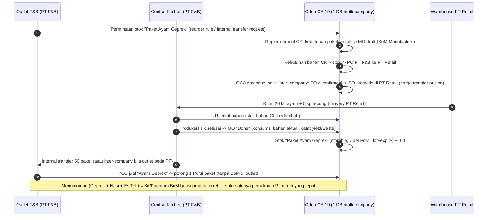
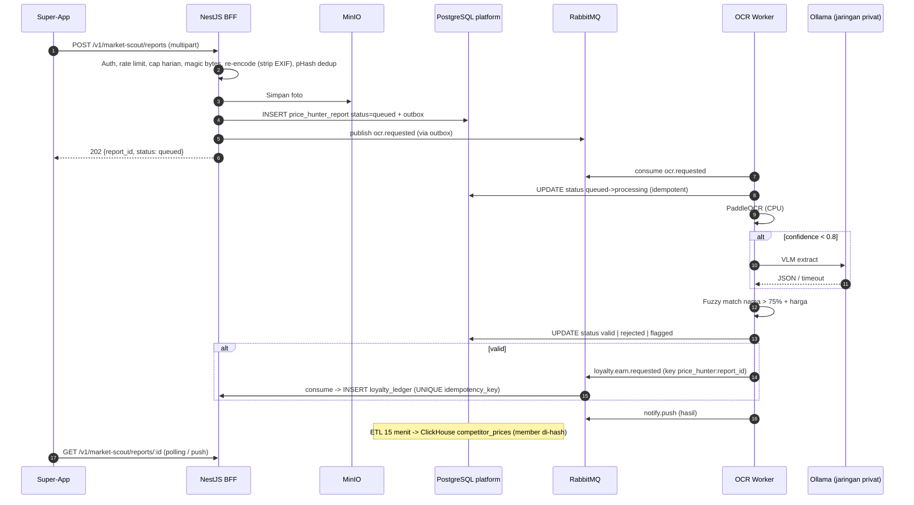
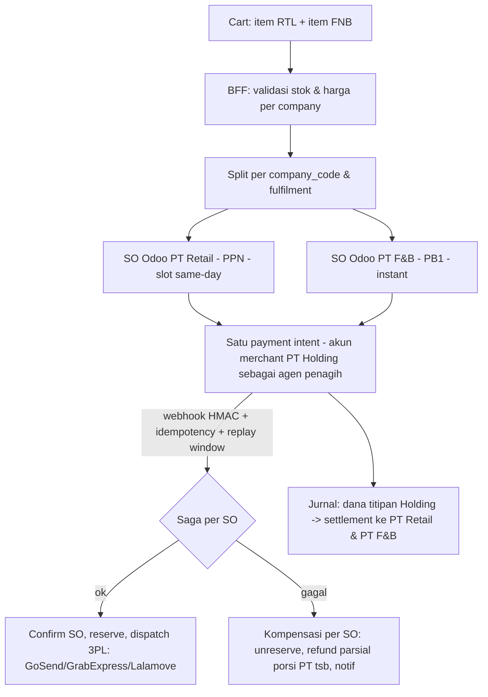
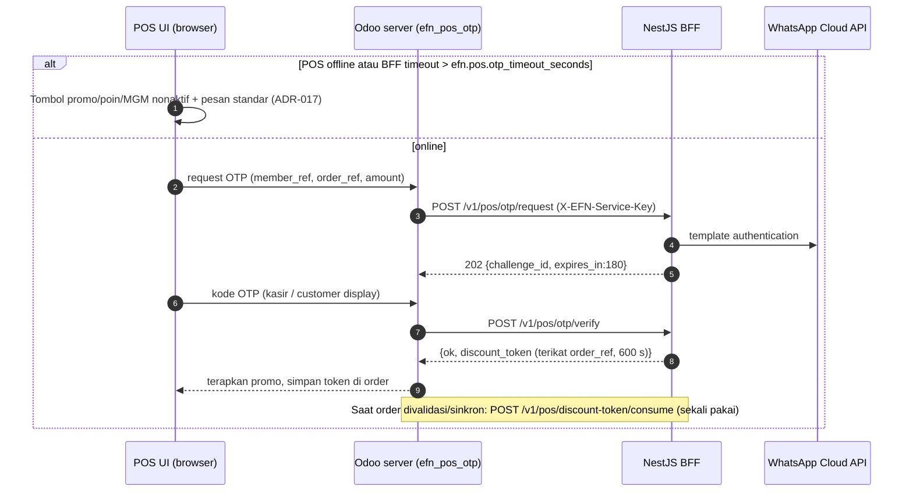
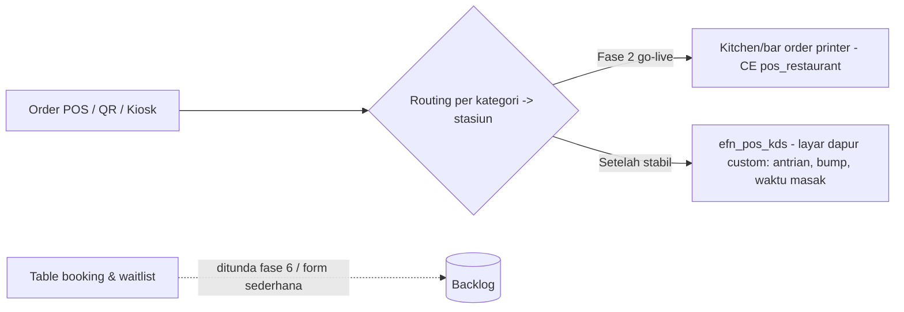
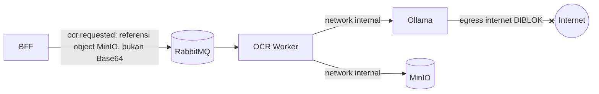
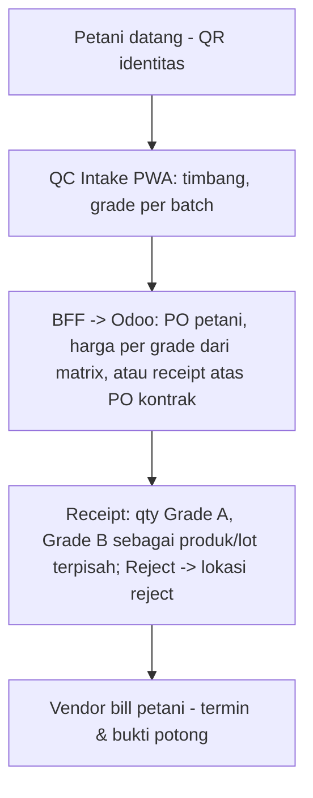

# KOREKSI FSD & ALUR YANG SALAH KONSEP

- **Status:** Draft Fase 0 — mengikuti ADR berstatus Proposed
- **Tanggal:** 2026-10-05
- **Dokumen asli tidak diedit.** Dokumen ini menunjuk bagian asli dan memberikan versi terkoreksi. Bila bertentangan, dokumen ini + `docs/02_TARGET_ARCHITECTURE.md` yang berlaku.

> **Ringkasan manajemen.** Tujuh bagian spesifikasi fungsional (FSD/TSD) ditulis dengan konsep yang akan menghasilkan sistem yang salah bila diberikan apa adanya ke developer. Dua yang paling kritis: (1) "Phantom BoM" untuk kitting justru membuat outlet menghitung gramasi bahan — kebalikan tujuan bisnis; (2) validasi foto Price Hunter dibuat menunggu AI secara langsung dan menulis langsung ke gudang data. Keduanya dikoreksi di bawah tanpa biaya lisensi tambahan. Koreksi lain menyangkut keranjang lintas PT (pajak), OTP saat offline, fitur POS yang ternyata Enterprise, dan istilah "air-gapped".

| Kode | Bagian asli | Masalah inti | ADR |
|---|---|---|---|
| K-01 | `efn_fsd_detailed_flows.md` §1; Doc Suite FSD-3.1, FSD-3.2 | Phantom BoM; "Odoo F&B" vs "Odoo Supermarket"; AI membuat PO/SO | ADR-018, ADR-001, ADR-010 |
| K-02 | `efn_fsd_detailed_flows.md` §2; TSD §4.2, endpoint `/market-scout/analyze` | OCR sinkron; insert langsung ke ClickHouse; voucher langsung | ADR-008, ADR-007, ADR-006, ADR-020 |
| K-03 | Doc Suite FSD-1.1, endpoint `/checkout/split-cart` | Satu checkout dua PT tanpa desain pajak/settlement; GoFood/Grab sebagai kurir | ADR-019, ADR-016 |
| K-04 | Doc Suite FSD-2.1, endpoint `/pos/apply-mgm-discount` | OTP tidak mendefinisikan perilaku offline & token sekali pakai | ADR-017 |
| K-05 | Doc Suite FSD-2.2 | KDS & Table Booking diasumsikan ada di CE | ADR-013 |
| K-06 | Doc Suite TSD §4.2 | "100% Offline/Air-gapped" padahal dipanggil via HTTP | ADR-014 |
| K-07 | Doc Suite FSD-4.1 | QC "otomatis men-generate GRN" tanpa PO, harga per grade, dan lot | — (R-O04) |

---

## K-01. Kitting & Inter-Company (FSD Detailed §1)

### Asli
> *"**Phantom BoM:** Di-set di Odoo bahwa 1 Porsi Item C = 0.2 Kg Item A + 0.05 Kg Item B."* (langkah 1)
> *"**[Auto-Action]** Agentic AI mendeteksi permintaan ini lintas-PT. AI men-generate Purchase Order (PO) di Odoo F&B dan Sales Order (SO) di Odoo Supermarket."* (langkah 2)
> *"Saat barang diterima (Goods Receipt) di Central Kitchen, Odoo MRP secara otomatis memicu Manufacturing Order (MO) berstatus Done. Sistem mengubah wujud 20 Kg Ayam + 5 Kg Tepung menjadi 100 'Paket Ayam Geprek' secara instan di sistem (Phantom BoM effect)."* (langkah 3)

### Masalah
1. **Phantom/Kit BoM tidak pernah membuat MO** dan produk kit tidak berstok. Saat paket dijual di POS, Odoo memotong stok komponen (ayam, tepung) — outlet justru harus mengurus gramasi.
2. **"Odoo F&B" dan "Odoo Supermarket"** menyiratkan dua instance; inter-company bawaan/OCA hanya bekerja di **satu DB multi-company** (ADR-001).
3. **AI membuat PO/SO** = dokumen pajak non-deterministik (ADR-010). OCA `purchase_sale_inter_company` (tersedia 19.0) melakukannya secara aturan.
4. **MO otomatis "Done" saat goods receipt** menghapus tahap produksi: tidak ada WIP, yield, atau waste; stok bahan "berubah" menjadi paket sebelum diolah.

### Alur terkoreksi

### Dampak ke kode
- `services/odoo/addons/efn_kitting` (opsional): hanya automasi pembuatan/penjadwalan MO dari permintaan outlet; **tidak** ada logika "MO Done saat receipt".
- Master data: produk paket bertipe barang dengan *track inventory* aktif (nama field persis di 19.0 diverifikasi saat PoC), UoM Porsi, `tracking = lot` + `product_expiry`; BoM `type = normal` (Manufacture) di company PT F&B/CK; BoM `type = phantom` hanya untuk menu combo.
- `efn_intercompany`: konfigurasi aturan OCA per pasangan company, bukan integrasi API.
- Test (`efn` tag): skenario MO → transfer → POS memotong paket, stok ayam di outlet tetap 0.
- Hapus semua referensi "Agentic AI" dari alur transaksi.

---

## K-02. Price Hunter OCR (FSD Detailed §2, TSD §4.2)

### Asli
> *"Node.js meneruskan foto ke Ollama Vision API lokal ... Ollama Vision memproses gambar (estimasi 2-4 detik)"* (langkah 2)
> *"Node.js menembak API Odoo untuk men-generate Promo Code/Voucher senilai Rp2.000"* dan *"Node.js mengirim insert query ke ClickHouse: INSERT INTO competitor_prices ..."* (langkah 4)
> TSD: `POST /api/v1/market-scout/analyze` *(Upload gambar ke Ollama Vision API)*.

### Masalah
1. **Sinkron**: VLM di CPU 30–120 detik/gambar; request HTTP timeout, lonjakan foto mematikan API, AI menjadi jalur kritis (ADR-008, ADR-010).
2. **Insert langsung ke ClickHouse**: tidak ada status/audit/clawback; data PDP sulit dihapus (ADR-007).
3. **Voucher per laporan di Odoo**: ledger kedua, sulit di-clawback (ADR-006, ADR-020).
4. Tidak ada validasi file, dedup, rate limit, atau penanganan fraud (R-B05, R-S06).

### Alur terkoreksi

### Dampak ke kode
- BFF `src/market-scout/`: endpoint sesuai `docs/04 §3.3`; tidak ada panggilan Ollama dari BFF.
- `services/ai-ocr-worker/worker.py`: consumer idempotent, DLQ `ocr.requested.dlq`, Ollama mati → `flagged`.
- `services/etl`: mart `competitor_prices` dari `platform.price_hunter_report`.
- Tidak ada credential ClickHouse tulis di BFF.
- KPI di test/monitoring: p95 waktu hasil ≤ 60 detik.

---

## K-03. Unified Cart & Split Routing (Doc Suite FSD-1.1)

### Asli
> *"Pelanggan dapat memasukkan Kopi (FnB) dan Sayur (Retail) ke satu keranjang. Saat checkout, sistem memecah pesanan secara transparan: FnB dikirim via GoFood/Grab instan, Sayur dikirim via kurir same-day internal/Lalamove."*

### Masalah
1. Dua PT penjual dengan pajak berbeda (PB1 vs PPN) — tidak dibahas faktur/struk per PT (R-L03).
2. Satu pembayaran masuk ke rekening siapa? Refund parsial dari porsi PT mana? (ADR-019).
3. **GoFood/GrabFood adalah marketplace, bukan API kurir publik** (R-B04); untuk pengiriman pesanan sendiri gunakan GoSend/GrabExpress/Lalamove.
4. Pembayaran sukses + dispatch gagal = transaksi terdistribusi tanpa kompensasi (R-T10).

### Alur terkoreksi

### Dampak ke kode
- BFF `src/checkout/`: entitas `checkout` (1) → `sub_order` (n, per company), status eksplisit (`pending_payment`, `paid`, `dispatch_pending`, `dispatch_failed`, `refunded_partial`), outbox.
- Endpoint `/checkout/split-cart` (TSD) diganti `POST /v1/checkout` yang mengembalikan pecahan per PT (kontrak ditambahkan ke `docs/04` saat fase 3).
- Odoo: SO dibuat per company dengan fiscal position/pajak company; PB1 dikonfigurasi sebagai pajak di PT F&B.
- Ditahan sampai ADR-019 mendapat opini pajak.

---

## K-04. OTP-Gated Promotion (Doc Suite FSD-2.1)

### Asli
> *"Saat kasir memilih tombol 'Gunakan Poin MGM' di POS, sistem akan mengunci transaksi. Pelanggan menerima OTP via WhatsApp. Kasir (atau pelanggan via Customer Display) wajib memasukkan OTP tersebut untuk menyelesaikan transaksi."*
> TSD: `POST /api/v1/pos/apply-mgm-discount` *(Membutuhkan validasi OTP)*.

### Masalah
1. Tidak mendefinisikan perilaku saat POS offline (R-T02).
2. "Mengunci transaksi" tanpa timeout → antrean kasir macet bila WA lambat.
3. Satu endpoint "apply discount" menggabungkan verifikasi dan penerapan; tidak ada token sekali pakai yang terikat ke order (replay).
4. Panggilan dari browser POS langsung ke BFF akan membocorkan service key.

### Alur terkoreksi

### Dampak ke kode
- `services/odoo/addons/efn_pos_otp`: OWL button + RPC ke controller Odoo (server-side) yang memanggil BFF; key dari `/run/secrets/odoo_bff_api_key`.
- BFF `src/pos-otp/`: kontrak `docs/04 §3.1`; rate limit; respons tidak membocorkan nomor terdaftar.
- Order dengan token gagal consume → flag review supervisor.

---

## K-05. Mode POS F&B: KDS & Table Booking (Doc Suite FSD-2.2)

### Asli
> *"Mode FnB mendukung Kitchen Display System (KDS) dan Table Booking."*

### Masalah
Audit CE 19.0 (`docs/06`): `pos_preparation_display` (KDS) dan `pos_appointment` (Online Booking) **tidak ada** di CE (404); OCA/pos 19.0 tidak punya KDS. Yang tersedia CE: `pos_restaurant` (meja, split bill, kitchen order printing), `pos_self_order` (QR menu, QR ordering, kiosk).

### Alur terkoreksi

### Dampak ke kode
- Modul baru `efn_pos_kds` (fase 2, 4–6 minggu); konfigurasi printer dapur dulu.
- Hapus "Table Booking" dari scope MVP (ADR-013).

---

## K-06. "100% Offline/Air-gapped" (Doc Suite TSD §4.2)

### Asli
> *"Menerima request HTTP berisi Base64 gambar Market Scout ... Keamanan: 100% Offline/Air-gapped dari internet publik."*

### Masalah
Sistem yang menerima request dari service lain tidak air-gapped. Base64 dalam JSON juga membengkakkan payload ±33%.

### Alur terkoreksi

### Dampak ke kode
- `infra/compose`: service `ollama` & `ai-ocr-worker` tanpa published port, network internal; aturan egress deny di host (tugas devsecops).
- Payload `ocr.requested` memuat `image_bucket`/`image_object` (sudah di `docs/04 §4`).

---

## K-07. Mobile QC Input → GRN (Doc Suite FSD-4.1)

### Asli
> *"Staf ... menggunakan tablet untuk memasukkan persentase hasil panen (Grade A, B, Reject). Data ini otomatis men-generate Goods Receipt Note (GRN) di Odoo CE."*

### Masalah
GRN (receipt) di Odoo memerlukan dokumen sumber (PO ke petani) atau penerimaan tanpa PO yang tetap butuh partner & harga. Persentase grade harus diterjemahkan ke **kuantitas per produk/lot per grade** dan **harga beli per grade** (R-O04, Q-10, Q-31, Q-32). Reject harus punya perlakuan (retur ke petani / waste).

### Alur terkoreksi (usulan, menunggu jawaban Q-31/Q-32)

### Dampak ke kode
- `efn_agri`: model batch QC, matrix grade × komoditas → harga; evaluasi `quality_control_oca` (OCA/manufacture 19.0) sebelum menulis dari nol.
- QC Intake PWA offline-capable dengan sinkronisasi idempotent (`batch_uuid`).
