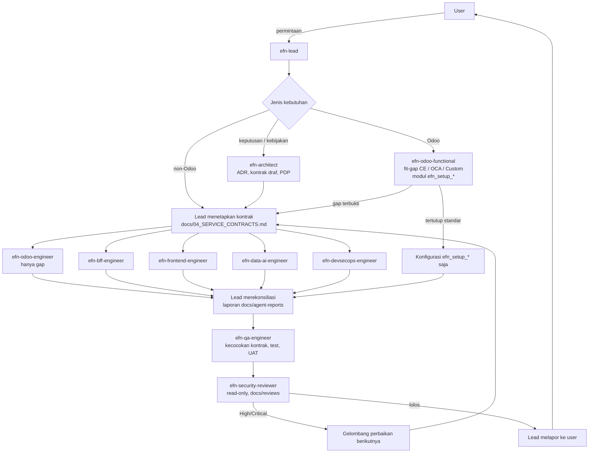

# MODEL OPERASI TIM AGENT EFN

Status: berlaku (instruksi klien 5 Okt 2026), keputusan formal di ADR-025 (Proposed). Dibaca oleh user, `efn-lead`, dan semua agent di `.claude/agents/`.

> **Ringkasan.** User hanya berbicara dengan `efn-lead`. Lead menetapkan kontrak, membagi pekerjaan ke agent spesialis dengan batas file yang jelas, dan menutup setiap gelombang dengan QA lalu security review. Kebutuhan Odoo selalu dianalisis `efn-odoo-functional` (standar CE/OCA dulu) sebelum ada kode custom.

## 1. Cara user berinteraksi
| Lingkungan | Cara |
|---|---|
| Ekstensi VS Code / sesi utama Claude Code | Sesi utama otomatis bertindak sebagai `efn-lead` (lewat `CLAUDE.md`). Tulis permintaan seperti biasa. |
| CLI | `claude --agent efn-lead` |
| Agent spesialis | **Tidak dipanggil langsung oleh user.** Bila user ingin pekerjaan spesifik (mis. "revisi ADR-022"), sampaikan ke lead; lead mendelegasikan. |

User menerima satu laporan dari lead: apa yang selesai, penyimpangan dari rencana, keputusan yang dibutuhkan (bisnis/biaya/legal), dan apa yang belum terverifikasi. Lead hanya bertanya ke user untuk keputusan yang tidak bisa dibalik dengan murah.

## 2. Alur kerja

## 3. Aturan

### 3.1 Kontrak dulu
- `docs/04_SERVICE_CONTRACTS.md` dimiliki **lead**. Sebelum dua agent atau lebih menulis kode yang saling memanggil (HTTP path, payload event, nama queue, nama secret/env, mode TLS, skema tabel bersama), kontrak diperbarui lebih dulu.
- Agent lain **tidak** mengedit kontrak; mereka menulis usulan perubahan di laporan masing-masing. Lead memutuskan dan memberi nomor versi (v1, v2…).
- Kode yang menyimpang dari kontrak = temuan QA, bukan "inisiatif".

### 3.2 Functional-first (Odoo)
1. `efn-odoo-functional` membuat fit-gap: Standar CE → OCA (status 19.0 terverifikasi) → Custom.
2. Yang tertutup standar dikonfigurasi di modul data-only `efn_setup_<domain>`.
3. Hanya baris berstatus **Custom** (dengan alasan tertulis) yang boleh menjadi tugas `efn-odoo-engineer`.
4. Modul custom yang ternyata menduplikasi fitur standar direkomendasikan untuk dihapus/disederhanakan.

### 3.3 Batas file
| Agent | Boleh menulis | Tidak boleh |
|---|---|---|
| efn-lead | `docs/04_SERVICE_CONTRACTS.md`, `CLAUDE.md`, `.claude/agents/*`, brief | Kode service (didelegasikan) |
| efn-architect | `docs/decisions/**`, `docs/02`, `docs/03` (arsitektur keamanan), `docs/compliance/**`, `docs/05–07`, `docs/09`, laporan sendiri | Kode, `docs/04` (usul saja) |
| efn-odoo-functional | `docs/08_ODOO_FIT_GAP.md`, `services/odoo/addons/efn_setup_*` | Model/field/logika Python baru |
| efn-odoo-engineer | `services/odoo/addons/efn_*` (bukan `efn_setup_*`) | Modul tanpa fit-gap |
| efn-bff-engineer | `services/api-gateway/**`, skema `platform` (`infra/postgres/init/02-*`) | Infra compose |
| efn-frontend-engineer | `services/superapp-web/**` | BFF |
| efn-data-ai-engineer | `services/ai-ocr-worker/**`, `services/etl/**`, `services/text2sql/**`, `infra/clickhouse/**` | BFF |
| efn-devsecops-engineer | `infra/**`, `scripts/**`, `.github/**`, `docs/runbooks/**`, `docs/03` (daftar secret/pipeline) | Kode aplikasi |
| efn-qa-engineer | `docs/testing/**`, test lintas service yang ditugaskan | Perbaikan fitur tanpa brief |
| efn-security-reviewer | `docs/reviews/**` | Semua kode (read-only) |

Bila satu file dibutuhkan dua agent dalam gelombang yang sama, lead menetapkan **satu pemilik**; agent lain mengirim usulan lewat laporan.

### 3.4 Laporan
Setiap agent menulis `docs/agent-reports/<agent>.md` dengan bagian per gelombang: file yang dibuat/diubah, keputusan, item untuk agent lain, **yang belum terverifikasi** (tidak ada runtime di mesin penulis — validasi di CI).

## 4. Definisi selesai (Definition of Done) per gelombang
| Gelombang | Selesai bila |
|---|---|
| **Kontrak** | Perubahan di `docs/04` diberi versi; setiap service terdampak punya paket kerja; ADR terkait ada (minimal Proposed). |
| **Fit-gap** (Odoo) | Setiap kebutuhan punya baris Standar/OCA/Custom + status verifikasi; konfigurasi standar ada di `efn_setup_*`; daftar gap disetujui lead. |
| **Implementasi** | Kode mengikuti kontrak; test unit di sebelah kode; README modul (tujuan, ADR, R-xxx, yang belum); tidak ada secret di repo; enkripsi & least privilege dipatuhi (`CLAUDE.md`); laporan agent ditulis. |
| **QA** | Matriks kecocokan kontrak lintas service hijau; CI hijau (atau gagal yang diketahui & dicatat); skenario UAT terkait diperbarui. |
| **Security** | Review di `docs/reviews/`; tidak ada temuan High/Critical terbuka tanpa rencana; pengecualian enkripsi hanya lewat tabel ADR-022. |
| **Lapor** | Lead melapor ke user: selesai, menyimpang, keputusan dibutuhkan, belum terverifikasi. |

## 5. Eskalasi ke user
Lead bertanya ke user hanya untuk: biaya/anggaran, legal/pajak/PDP, perubahan scope, keputusan yang mahal dibalik (mis. versi Odoo, topologi, payment gateway). Keputusan teknis wajar diambil lead dan dicatat (ADR atau laporan).
