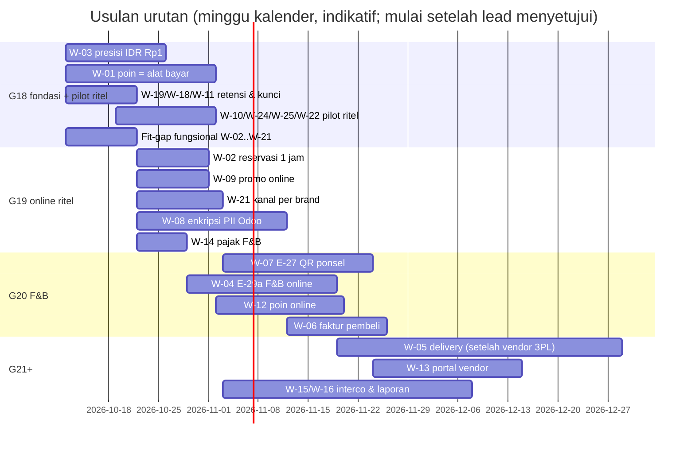

# Rencana Paket Kerja Gelombang 18+ — Turunan Keputusan Pemilik Proyek 10 Okt 2026

- **Status:** Usulan efn-architect untuk efn-lead (urutan & estimasi **belum** disetujui lead/PO). Dokumen ini tidak mengubah kontrak `docs/04`; perubahan kontrak ditulis lead per paket.
- **Tanggal:** 2026-10-10
- **Sumber:** jawaban pemilik proyek 10 Okt 2026 (60 butir) — dicatat di `docs/decisions/README.md` bagian "Keputusan pemilik proyek 10 Okt 2026 (sesi tanya-jawab)"; ADR-032 (Accepted, opsi B), ADR-035 (baru), ADR-019/020/022/027/034 (catatan 10 Okt); `docs/compliance/PDP_DATA_INVENTORY.md` v7; risiko baru R-B11, R-L09, R-L10, R-T17, R-S15 (`docs/01` §4).
- **Tarif rujukan biaya:** ±Rp5–9 jt per minggu-engineer (asumsi ADR-031, belum divalidasi). Estimasi di bawah = **perkiraan kasar arsitek** tanpa fit-gap rinci; QA ±20 % sudah termasuk bila disebut "termasuk QA".

## Ringkasan manajemen

Pemilik proyek menjawab **semua** pertanyaan terbuka pada 10 Oktober 2026. Sebagian besar jawaban **sesuai** dengan yang sudah dibangun, tetapi **±25 jawaban menambah atau mengubah pekerjaan**. Yang terbesar: **pembulatan Rupiah ke Rp1 di seluruh sistem**, **penukaran poin diperlakukan sebagai alat bayar**, **pesan makanan dari ponsel di meja (QR)**, **pesanan restoran online**, **pesan-antar (3PL + kurir sendiri)**, **data faktur pembeli di Odoo yang wajib dienkripsi**, dan **portal vendor**. Totalnya kira-kira **±52–79 minggu-engineer** (±Rp0,26–0,71 M pada tarif asumsi), sebagian paralel; **±7–10 minggu-engineer** di antaranya (antar-perusahaan dan laporan keuangan) **sudah dianggarkan** di ADR-031.

Rekomendasi urutan: **pilot ritel Grand Lucky lebih dulu** (poin di kasir + belanja online ambil di toko), karena sebagian besar sudah jadi dan hanya butuh penyesuaian. Restoran (Paris Baguette, kafe Bacha) menyusul karena **QR ponsel wajib** (±3–4 minggu) dan **pajak restoran untuk bawa pulang harus dikonfirmasi konsultan pajak**. Pesan-antar dan portal vendor dikerjakan **setelah** kedua pilot berjalan dan vendor 3PL dipilih. Pemilik proyek meminta restoran online **bersamaan** dengan pilot ritel; ini mungkin hanya bila konsultan pajak dan outlet restoran siap tepat waktu — bila tidak, restoran online menyusul paling lambat satu gelombang.

| Gelombang (usulan) | Fokus | Kira-kira | Membuka |
|---|---|---|---|
| **G18** | Fondasi murah sebelum ada data produksi (pembulatan Rp1, poin sebagai alat bayar, masa simpan data, rotasi kunci online, pemblokir pilot ritel) + fit-gap fungsional untuk semua paket Odoo | ±3–4 minggu kalender | Pilot ritel (poin di kasir) |
| **G19** | Siap pilot online ritel per brand: reservasi stok 1 jam, promo online, kanal per brand, enkripsi data pribadi di Odoo (tahap 1), pajak restoran (konfigurasi) | ±3–4 minggu | Pilot online ritel |
| **G20** | Restoran: QR ponsel (E-27), restoran online (E-29a), poin online, faktur atas nama pembeli | ±4–5 minggu | Pilot F&B + online F&B |
| **G21+** | Pesan-antar, portal vendor, antar-perusahaan + transfer pricing, laporan keuangan per PT, anonimisasi member tidak aktif | ±8–12 minggu | Produksi penuh |

**Penghambat di luar tim (tidak berubah):** server staging/produksi (ADR-004), pilihan payment gateway (A-4), opini konsultan pajak (P-8, P-12/PBJT bawa pulang, Q-3, ADR-019), dan data outlet/perangkat/promo dari klien.

## 1. Daftar paket kerja

Kolom **Blok** = pilot yang tertahan bila paket belum selesai: **R** = pilot ritel POS (Grand Lucky), **O** = pilot online ritel, **F** = pilot F&B (Paris Baguette / kafe Bacha), **FO** = F&B online, **P** = produksi penuh/go-live publik. Untuk setiap paket Odoo: **efn-odoo-functional fit-gap dulu** (CLAUDE.md, ADR-025), lalu efn-odoo-engineer hanya untuk gap.

| ID | Paket (sumber jawaban) | Agent pemilik (urutan) | Prasyarat | Dependensi | Estimasi kasar (minggu-engineer) | Blok | Gelombang |
|---|---|---|---|---|---|---|---|
| **W-01** | **Redeem poin = alat bayar POS** (P-8): `efn_pos_loyalty_ledger` diubah dari baris diskon "Poin EFN" per kelompok pajak menjadi **payment method "Poin EFN"** (jurnal liabilitas poin per PT); validasi server pada baris pembayaran vs reservasi; refund ke metode asal mengembalikan poin; earn atas porsi non-poin; kontrak §9 v6 | functional (fit-gap `pos.payment.method` non-tunai tanpa terminal, perlakuan DPP) → odoo-engineer + bff-engineer → qa | Keputusan Finance: dasar earn bila sebagian dibayar poin (usulan: `eligible_amount × (1 − bayar_poin/total)`); ⚠ konsultan pajak (disarankan) | Kontrak §9 (lead); W-24 (refund ke metode asal) | **3–4** (functional 0,5; odoo 1,5–2; BFF 0,5–1; QA 0,5) — asumsi: skema ledger BFF tidak berubah | **R** | **G18** |
| **W-02** | **Reservasi stok 1 jam** (Q-ON4): E-28 `stock_hold_mode` = reservasi saat checkout (SO dikonfirmasi/di-reserve), release otomatis bila tak dibayar; BFF `ONLINE_PAYMENT_TIMEOUT_SECONDS=3600` (batas atas config saat ini 3600 — cukup), Odoo `payment_timeout_minutes ≥ 70`; kontrak §10.6; smoke | functional (cara reserve CE 19: konfirmasi SO vs `stock.move` assign; dampak ke `free_qty` kanal lain & POS) → odoo-engineer + bff-engineer → qa | — | E-28, ADR-034 | **1–1,5** | **O** | G19 |
| **W-03** | **Presisi IDR global Rp1** (Q-ON6): `res.currency` IDR `rounding = 1` di `efn_setup_company` **sebelum DB produksi dibuat**; tinjau ulang `account.cash.rounding` kanal & POS (kemungkinan tidak perlu); pembulatan pajak (`round_globally` vs per baris) PPN/PB1/SC; `value_idr` poin, nominal BFF/ETL; regresi semua PT | functional (fit-gap + daftar dampak per modul) → odoo-engineer + bff-engineer + data-ai → qa (regresi penuh) | Dilakukan **sebelum** ada data produksi (mengubah presisi setelah ada jurnal = migrasi berisiko) | Semua modul `efn_*` bernilai uang; W-01, W-14 | **1,5–2,5** (asumsi: dev saja, belum ada data produksi) | **R, O, F** (fondasi) | **G18 (pertama)** |
| **W-04** | **F&B online via SO + jembatan KDS (E-29a)** (Q-ON2, Q-ON5 F&B): `efn_online_kds_bridge` (tiket `efn.kds.ticket` dari `sale.order`, stasiun dari kategori POS, tanpa PII); kanal FNB per brand aktif; tampilan PB1+SC exclude dengan rincian sebelum bayar; kontrak §10 | functional → odoo-engineer + bff-engineer + frontend-engineer → qa → security-reviewer | W-14 (pajak F&B), W-21 (kanal per brand); ⚠ R-L09 (pajak bawa pulang) | E-26 KDS, E-28 | **4–5** (odoo 2–2,5; BFF 1; FE 1; QA 0,5) | **FO** | G20 (pemilik proyek minta bersamaan pilot ritel — lihat §3) |
| **W-05** | **Delivery: 3PL + kurir internal** (Q-ON3): zona/radius, ongkir, slot & kapasitas, alamat pelanggan (PII baru), integrasi 3PL (webhook HMAC + idempotensi + replay window), penugasan kurir internal, saga status kirim (R-T10) | architect (kontrak + ADR adapter 3PL) → functional (CE `delivery`/`stock_delivery`) → bff + odoo + frontend → qa → security | **Vendor 3PL dipilih klien**; DPA 3PL; inventaris PDP (alamat) | ADR-019, ADR-026 pola adapter, W-21 | **6–10** (sangat bergantung vendor 3PL; asumsi satu 3PL + kurir internal sederhana) | P (online pesan-antar) | G21+ |
| **W-06** | **Faktur atas nama/NPWP pembeli + profil lengkap** (Q-ON7, Q-P21): checkout opsional (nama, NPWP, alamat, HP, email) → partner pembeli di Odoo (bukan partner generik) hanya atas permintaan; erasure menganonimkan partner pembeli kecuali data wajib faktur pajak 10 th; kontrak §10 revisi; ekspor Coretax | functional (partner per pembeli vs kontak anak partner generik; e-Faktur) → odoo-engineer + bff + frontend → qa → security; architect (PDP v7 sudah) | **W-08** (kolom terenkripsi) ; tinjauan Legal/DPO | E-28, `efn_privacy` | **2–3** | O (fitur opsional; pilot boleh mulai tanpa, bila Finance setuju) | G20 |
| **W-07** | **QR order ponsel E-27** (P-17, ADR-032 opsi B): tahap 1 bayar di kasir; tamu + login OTP opsional; QR dinamis per sesi meja; kiosk configurable > 1; tahap 2 bayar online setelah vendor payment | functional (fit-gap order ke meja `pos.order` draft) → odoo-engineer (`efn_pos_bff_order`) + bff + frontend → qa → security; lead (kontrak `fnb`) | Kontrak `docs/04` bagian `fnb` (lead) | ADR-032, ADR-020 (poin bila login), W-01 | **3–4** (+1 untuk bayar online setelah A-4) | **F** | G20 (mulai G19 bila kapasitas ada) |
| **W-08** | **Enkripsi kolom PII Odoo** (Q-E3): pola AES-GCM key ring (seperti BFF) untuk HP member, NPWP, alamat & email pembeli; *blind index* HMAC untuk pencarian (HP di POS memakai `efn_member_hash` yang sudah ada); secret `odoo_pii_key*` dikelola Superadmin; rotasi; dampak ekspor e-Faktur/Coretax & laporan | functional (daftar field & dampak pencarian/laporan standar) → architect (ADR kecil: cakupan & manajemen kunci, revisi ADR-022 Keputusan 5) → odoo-engineer → security-reviewer → qa | Keputusan cakupan tahap 1 (usulan: `res.partner.phone/email/vat/street*` pada partner ber-tanda member/pembeli) | ADR-022, ADR-024, W-06 | **3–5** (asumsi tahap 1 ≤ 6 field; pencarian bebas atas field terenkripsi **tidak** didukung) | **R** bila aturan "PII Odoo terenkripsi" diberlakukan sebelum data member nyata masuk (keputusan lead/PO: syarat pilot atau migrasi enkripsi setelahnya) | G19 |
| **W-09** | **Promo online standar** (Q-ON10): E-28 quote menerapkan program `sale_loyalty` (pricelist, kupon/kode dari BFF, promo otomatis, beli X gratis Y); hasil dibekukan di `quote_hash`; guard total tetap; tipe "poin" Odoo tidak dipakai (ADR-020) | functional (fit-gap `sale_loyalty` CE 19 di SO tanpa website) → odoo-engineer + bff + frontend (input kode) → qa | — | E-28 | **1–2** (sesuai jawaban) | O | G19 |
| **W-10** | **Promo POS standar** (P-4): `pos_loyalty` (promo, kupon, buy X get Y) + pricelist member 5 % (placeholder) + promo ber-OTP; daftar promo dari Marketing | functional (konfigurasi `efn_setup_pos`) → qa | Daftar promo Marketing (data klien) | `efn_pos_otp_gate` | **0,5–1** | R | G18 |
| **W-11** | **API key kanal online 30 hari + rotasi otomatis** (IT): timer host Superadmin (odoo shell buat key baru → tulis secret → recreate BFF → cabut key lama setelah overlap ±1 jam → journald/Loki + alert gagal); `api_key_duration` grup teknis ≥ 30 h + margin; runbook `odoo-online-api-key.md`; R-T15 | devsecops (+ functional untuk `api_key_duration` di `efn_setup_online`) → security-reviewer | — | ADR-024, ADR-034 | **0,5** (2–3 hari) | O (syarat aktivasi prod) | G18 |
| **W-12** | **Poin online earn + redeem** (Finance): earn saat diambil; redeem = alat bayar (konsisten W-01): porsi "poin" di payment intent (tidak lewat gateway), payment line poin di E-28, kontrak §9/§10, BFF checkout, frontend | lead (kontrak) → odoo-engineer + bff + frontend → qa → security | **W-01** (model akuntansi sama) | ADR-019 (porsi), ADR-020 | **2,5–3,5** | O (fitur; pilot boleh tanpa poin online bila perlu) | G20 |
| **W-13** | **Portal (ADR-035)**: vendor V1 (`portal-gateway` + WAF + rate limit + mTLS + `efn_portal_guard` + `efn_setup_portal`), pelanggan P1 (faktur PDF lewat BFF), franchisee F1 (langganan Metabase), karyawan K1 (runbook WG HP) | architect (ADR-035) → functional → devsecops + odoo-engineer + bff + frontend + data-ai → **security-reviewer + pentest pihak ketiga** | ADR-035 Accepted; Q-PT1..Q-PT6 | ADR-023 (revisi terbatas), ADR-033 | **5–6,5** (vendor 3–4; pelanggan 1–1,5; franchisee 0,5; karyawan 0,3) | P (bukan pemblokir pilot) | K1 di G18; F1 di G19; P1 di G20; V1 di G21+ |
| **W-14** | **Pajak F&B per layanan & outlet** (P-12, P-16, Q-8/Q-22): PB1 10 % + SC 5 % dine-in (SC masuk DPP PB1, harga exclude); fiscal position per layanan (takeaway/3PL/pickup tanpa SC; tanpa PB1 **⚠ menunggu konsultan pajak**); per outlet/kota; Bacha kafe vs butik | functional (`efn_setup_*`, PoC `include_base_amount` SC→PB1 di POS 19) → qa | ⚠ konsultan pajak (R-L09) untuk PB1 non-dine-in | ADR-027, W-03 | **1–1,5** | **F**, FO | G19 |
| **W-15** | **Antar-perusahaan + TP cost-plus + settlement poin bulanan** (Q-3, Q-4): `efn_intercompany` (PO→SO, faktur→bill, harga transfer = biaya + markup dari Finance pusat; CK di PT F&B → outlet F&B = transfer internal **tanpa** TP; CK → butik Bacha (PT Retail) dan Holding ↔ PT = TP); laporan BFF redeem lintas PT bulanan → jurnal inter-company (PT penerbit menanggung) | functional (spesifikasi `docs/08` §5.2 diperbarui) → odoo-engineer + bff → qa | Markup per pasangan (Finance); ⚠ opini pajak TP | ADR-001, ADR-031 | **4–5,5** (efn_intercompany 3–4 **sudah dianggarkan ADR-031**; Q-4 +1–1,5) | P (butik Bacha + CK) | G20–G21 |
| **W-16** | **Laporan keuangan resmi per PT di Odoo** (Q-V3): `efn_account_reports` (Neraca, L/R, Buku Besar, Neraca Saldo, umur piutang/utang PDF/XLSX) | functional (konfirmasi Finance: opsi a vs b) → odoo-engineer → qa | Konfirmasi Finance bahwa pivot+XLSX standar **tidak** cukup | ADR-031 butir 4 | **4–6** (opsi b, **sudah dianggarkan ADR-031**) atau ±1 (opsi a) | P (tutup buku) | G21+ |
| **W-17** | **Anonimisasi member tidak aktif 24 bulan** (Q-P11): job BFF (deteksi tidak aktif), notifikasi WA 30 h sebelumnya (template Meta baru), saldo poin hangus sesuai syarat program (**persetujuan Finance**), pemicu erasure Odoo yang sudah ada | bff-engineer + odoo-engineer (bila perlu) + architect (PDP) → qa | Syarat program poin (Finance); template WA disetujui Meta | `efn_privacy`, ADR-020 | **1,5–2** | P (wajib sebelum bulan ke-24 setelah go-live; usul ≤ 6 bulan setelah go-live) | G21+ |
| **W-18** | **Batas penundaan hapus akun 14 hari** (Q-P18): eskalasi/alert CS (mis. hari 3 dan 10), setelah 14 h erasure tetap jalan (pesanan terbuka diselesaikan CS tanpa tautan akun); teks respons pelanggan; runbook | bff-engineer → qa; architect (runbook) | — | L-4, `erasure.service.ts` | **0,5** (2–3 hari) | O (syarat A-7) | G18 |
| **W-19** | **Perubahan default retensi** (Q-P12, Q-P14, Q-P19, Q-P8, Q-P3, Q-6/Q-49, Q-P2..P8): `ERASURE_SUPPRESSION_DAYS` 90→**365**; `ONLINE_ADMIN_AUDIT_RETENTION_DAYS` 400→**3650**; GC outbox poin Odoo **10 th**; riwayat Metabase **10 th**; lokasi Price Hunter **NULL 90 h** (job baru); TTL ClickHouse: baris **10 th**, kolom pseudonim teranonim setelah **5 th** (⚠ penafsiran Q-P7 vs Q-6, §3); usia minimum **17 th** (pernyataan di pendaftaran) | bff-engineer + odoo-engineer + data-ai + frontend → qa; devsecops (env prod) | — | PDP v7 | **1–1,5** | O/P (sebagian syarat A-7) | G18 |
| **W-20** | **Lot fresh GS1 di kasir + timbangan** (P-10, P-2): fit-gap nomenklatur GS1 POS CE 19 (`barcodes_gs1_nomenclature`, lot + kedaluwarsa dari scan); tanpa GS1 → FEFO otomatis; label timbangan prepack sebaiknya GS1; cek label supplier | functional (fit-gap + PoC scan) → odoo-engineer (hanya bila gap) → qa | Merek/model timbangan & contoh label supplier (data klien) | F-33, F-37 | **0,5–2,5** (0,5 bila standar; +2 bila gap POS) | R (produk fresh) | fit-gap G18; implementasi G19 |
| **W-21** | **Kanal & katalog per brand + Bacha dua PT** (Q-ON12, Q-8, butir 7–9): kanal Grand Lucky (RTL), Paris Baguette (FNB), Bacha butik (RTL), Bacha kafe (FNB); pricelist per brand (override outlet nanti); pemilik data = merchandising tiap brand; Super-App per domain/brand (R-T14); `efn_setup_company` brand & outlet | functional → odoo-engineer (field brand di kanal bila perlu) + bff + frontend → qa | Daftar outlet & SKU per brand (data klien) | ADR-034, ADR-001 | **1,5–2,5** | R (master data), O | G18–G19 |
| **W-22** | **Konfigurasi KDS pilot** (P-13, Q-P15): stasiun Bakery/Pastry + Bar Kopi, warn 5 / late 10 menit, tanpa expo, retensi 90 h | functional (`efn_setup_pos` data demo/placeholder) → qa | — | E-26 | **0,2** | F | G18 |
| **W-23** | **Perangkat F&B** (P-18, Q-KD1/3): mini PC + monitor KDS (klien WG), Epson ePOS (sertifikat HTTPS printer, PoC), cetak cadangan; SOP supervisor 2FA & login ulang | devsecops (runbook) + functional (konfigurasi printer) → qa | Model perangkat (data klien) | ADR-023, ADR-033 | **0,5** | F | G19 |
| **W-24** | **Refund POS ke metode asal** (P-5 → G13-4) + metode bayar pilot (tunai, EDC manual, QRIS statis, split) | functional → odoo-engineer (G13-4) → qa | — | W-01 (metode "Poin EFN") | **1** | R | G18 |
| **W-25** | **Migrasi member & onboarding kasir** (P-9, Q-K1, Q-P13): consent ulang via OTP (member tanpa bukti → marketing=false); kasir boleh membuat pelanggan (grup Contact Creation) dengan HP member tetap terkunci; validator `source_ref` **wajib opak** | functional (grup kasir) + bff-engineer (validator E-25) + architect (README template) → qa | Sumber data sistem lama (data klien) | K-7, SEC-07/44 | **0,5–1** | R | G18 |
| **W-26** | **Laporan settlement harian + MDR per porsi** (Q-ON9): laporan BFF per PT (porsi, MDR proporsional, poin) untuk jurnal Holding A1 manual/impor | bff-engineer → qa; functional (format impor jurnal) | Vendor payment (format MDR) | ADR-019 A1 | **0,5–1** | O (prod) | G19–G20 |
| **W-27** | **Modifier & menu paket F&B** (P-15): atribut tanpa stok; add-on/combo berbahan memotong stok | functional (master menu) → qa | Daftar modifier Ops F&B (data klien) | ADR-018 (combo = kit) | **0,5** | F | G19 |
| **W-28** | **Kesiapan kepatuhan & infrastruktur** (Q-T1..T6, Q-P20, Q-OS2/4/5, Q-E1/E2): DPIA sebelum go-live publik; DPA vendor payment (Indonesia); PoC SeaweedFS 5 h; backup off-site terenkripsi; LUKS/AES-NI di pengadaan; runbook brankas Direksi + break-glass + uji pemulihan disaksikan | architect (DPIA draf) + DPO/Legal; devsecops | Server staging/produksi | ADR-004, ADR-022, ADR-030 | **2–3** (architect DPIA 0,5–1; devsecops 1,5–2) | P | G18 (runbook kustodi) → G20 (DPIA, off-site) |

**Tidak menambah pekerjaan (jawaban = yang sudah dibangun / konfigurasi):** P-3 (standar Odoo + SOP PIN, toleransi Rp0 — sudah default `amount_authorized_diff=0`), P-14 (standar CE), Q-ON8 (faktur saat bayar), Q-ON11 (refund CS), Q-ON13 (tahan s.d. tutup toko H+1), Q-13 (placeholder configurable), Q-KD4 (7 hari), Q-P15 (90 h + SOP), Q-P16 (biarkan kedaluwarsa ±7 Nov), PP-1/PP-2, Q-V1/V2/V5/V6.

## 2. Ringkasan estimasi

| Kelompok | Paket | Minggu-engineer (kasar) |
|---|---|---|
| Fondasi & pilot ritel | W-01, W-03, W-10, W-11, W-18, W-19, W-20, W-22, W-24, W-25, W-28 | ±11–18 |
| Online ritel | W-02, W-09, W-21, W-08, W-26 | ±7–12 |
| F&B + F&B online | W-07, W-04, W-14, W-23, W-27, W-12, W-06 | ±13,5–19 |
| Produksi penuh | W-05, W-13, W-15, W-16, W-17 | ±20,5–30 (±7–10 sudah dianggarkan ADR-031: W-15 efn_intercompany + W-16) |
| **Total** | 28 paket | **±52–79** (QA sebagian sudah di dalam; review security & pentest pihak ketiga di luar angka ini) |

Asumsi utama: (1) belum ada data produksi saat W-03 dan W-08 dikerjakan; (2) satu vendor 3PL dengan API publik terdokumentasi; (3) vendor payment dipilih sebelum G20 (bayar online E-27, aktivasi online); (4) tim paralel: 2 engineer Odoo, 1 BFF, 1 frontend, 1 devsecops, 1 data, QA bersama (sesuai pola G13–G17). Tanpa engineer Odoo kedua, G19–G21 mundur ±3–5 minggu (R-T13).

## 3. Urutan gelombang yang direkomendasikan & alasannya

1. **G18 — W-03 lebih dulu.** Mengubah presisi mata uang paling murah **sekarang**, sebelum ada jurnal produksi; setelah go-live, perubahan yang sama butuh migrasi data dan berisiko salah saldo (R-T17). Semua paket bernilai uang (W-01, W-14, W-02) diuji di atas presisi baru.
2. **G18 — W-01 sebelum pilot ritel.** Mengubah perlakuan poin setelah go-live = koreksi faktur pajak (P-8). Poin di kasir adalah fitur utama pilot ritel.
3. **G18 — fit-gap fungsional untuk semua paket Odoo sekaligus** (W-02, W-04, W-06, W-08, W-09, W-14, W-20, W-21, W-24) agar estimasi G19–G20 tervalidasi sebelum dijadwalkan (ADR-025).
4. **Pilot ritel Grand Lucky lebih dulu, F&B menyusul.** Ritel hanya butuh penyesuaian di atas Fase 1 dan Fase 3 yang sudah selesai; F&B membutuhkan E-27 (±3–4 minggu, ADR-032 Accepted = wajib sebelum pilot F&B), konfirmasi pajak restoran bawa pulang (R-L09), perangkat mini PC/printer, dan daftar modifier.
5. **F&B online "bersamaan pilot ritel" (permintaan pemilik proyek).** Secara teknis E-29a (W-04) tidak bergantung E-27, sehingga **dapat** dimajukan ke G19 bila: (a) konsultan pajak sudah menjawab PBJT bawa pulang, (b) outlet Paris Baguette/kafe Bacha punya KDS berjalan, (c) kapasitas engineer Odoo kedua tersedia. Bila salah satu tidak terpenuhi, rekomendasi: pilot online ritel jalan dulu, F&B online menyusul ≤ 1 gelombang. **Keputusan lead + PO.**
6. **W-08 (enkripsi PII Odoo) di G19, sebelum W-06.** Profil pembeli (Q-P21) tidak boleh masuk Odoo sebelum kolomnya terenkripsi (Q-E3). Untuk HP member di POS (sudah ada di desain Fase 1): lead + PO memutuskan apakah pilot ritel menunggu W-08 atau berjalan dengan pengecualian sementara tercatat (ADR-022) dan migrasi enkripsi in-place sebelum outlet ke-2.
7. **G21+ untuk delivery, portal vendor, interco/laporan.** Delivery menunggu vendor 3PL; portal vendor menambah permukaan serangan (R-S15) dan tidak memblokir pilot; `efn_intercompany`/`efn_account_reports` dibutuhkan sebelum transaksi antar-PT nyata (CK → butik Bacha) dan tutup buku bulan pertama.

**Penafsiran yang perlu dikonfirmasi lead (bukan keputusan arsitek):**
- **Q-P7 vs Q-6/Q-49**: "ClickHouse mart 5 th teranonimkan" dan "DWH 10 tahun" ditafsirkan sebagai *baris fakta disimpan 10 th, kolom pseudonim (`user_hash`, `member_hash`, `customer_id`) dikosongkan/dianonimkan setelah 5 th*. ClickHouse mendukung TTL kolom (`TTL … ` per kolom) — **[B]** perilaku pada tabel yang ada belum diuji.
- **Q-V3** ditafsirkan sebagai `efn_account_reports` (opsi b). Bila Finance menerima ekspor standar, W-16 turun ke ±1 minggu.
- **Q-P18 setelah 14 hari**: erasure tetap jalan; pesanan terbuka tetap diselesaikan CS tanpa tautan akun (pelanggan kehilangan akses kode ambil di aplikasi — CS memverifikasi lewat kanal lain). Teks pelanggan perlu Legal.

## 4. Pertanyaan/data yang masih menunggu klien (memblokir paket tertentu)
| Data / opini | Pemilik | Paket terblokir |
|---|---|---|
| Alamat, jam, kasir, SKU outlet Grand Lucky / Paris Baguette / Bacha (butik & kafe) | PO + Ops | W-21, semua pilot |
| Model perangkat: PC kasir, mini PC KDS, printer Epson, scanner 2D, timbangan, router/4G, kiosk | IT klien | W-20, W-23, ADR-023 per outlet |
| Daftar promo (Marketing) & daftar modifier (Ops F&B) | Marketing, Ops F&B | W-10, W-27 |
| Nama Sales Manager Odoo & approver refund (orang berbeda), saksi review akses | Superadmin + Finance | A-5 (aktivasi online) |
| Auditor eksternal & format konsolidasi (Q-6) | Finance | W-16 |
| Vendor payment (A-4) & vendor 3PL (Q-ON3) + DPA | Finance + Legal + IT | W-05, W-07 tahap 2, W-26, aktivasi online |
| Opini konsultan pajak: P-8 (poin alat bayar), P-12 (PBJT bawa pulang), Q-3 (TP cost-plus), ADR-019 (agen penagih) | Finance + Tax | W-01 (konfirmasi), W-14, W-04, W-15 |
| Dasar earn bila sebagian dibayar poin; syarat hangus poin saat anonimisasi | Finance | W-01, W-17 |
| Q-PT1..Q-PT6 (ADR-035) | IT + Procurement + PO | W-13 |
