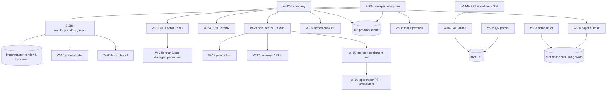
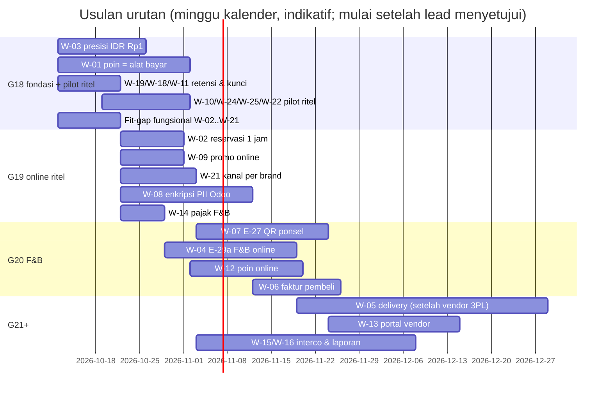

# Rencana Paket Kerja Gelombang 18+ — Turunan Keputusan Pemilik Proyek 10 & 18 Okt 2026

- **Status:** Usulan efn-architect untuk efn-lead (urutan & estimasi **belum** disetujui lead/PO). Dokumen ini tidak mengubah kontrak `docs/04`; perubahan kontrak ditulis lead per paket. **Bagian A (18 Okt) menang atas §1–§4 (10 Okt) bila bertentangan.**
- **Tanggal:** 2026-10-10 · revisi **2026-10-18** (bagian A: status G18–G19, paket W-29..W-34, urutan G20+) · revisi **2026-10-19** (A.1: G19–G21 merged, G22 berjalan)
- **Sumber:** jawaban pemilik proyek 10 Okt 2026 (60 butir) — dicatat di `docs/decisions/README.md` bagian "Keputusan pemilik proyek 10 Okt 2026 (sesi tanya-jawab)"; ADR-032 (Accepted, opsi B), ADR-035 (baru), ADR-019/020/022/027/034 (catatan 10 Okt); `docs/compliance/PDP_DATA_INVENTORY.md` v7; risiko baru R-B11, R-L09, R-L10, R-T17, R-S15 (`docs/01` §4).
- **Tarif rujukan biaya:** ±Rp5–9 jt per minggu-engineer (asumsi ADR-031, belum divalidasi). Estimasi di bawah = **perkiraan kasar arsitek** tanpa fit-gap rinci; QA ±20 % sudah termasuk bila disebut "termasuk QA".

## A. Pembaruan 18 Okt 2026 — status G18–G19, paket baru, urutan G20+

Sumber: keputusan pemilik proyek 18 Okt 2026 (butir 18-1..18-38, `docs/decisions/README.md`), ADR-036 (**Accepted** 18 Okt), ADR-001 (catatan revisi 18 Okt: 6 entitas), `docs/04 §11.7` (L-39, L-45, L-47), review r12.

### A.0 Ringkasan manajemen
- **(19 Okt) G18–G21 selesai dan sudah digabung ke `main`.**
  - G19 (PR #62): reservasi stok, kode promo, kanal per brand.
  - G20 (PR #63): 6 entitas, bayar di kasir, enkripsi data pelanggan.
  - G21 (PR #64): poin per PT, enkripsi vendor/karyawan, peran & pemisahan tugas, PPN Coretax, faktur atas nama pembeli.
  - **G22 (restoran: QR meja, restoran online, poin online, poin hangus) sedang berjalan** di branch `chore/wave-22`. Kontrak `docs/04` §14 sudah ditetapkan lead (L-70..L-74).
  - Semua fitur baru tetap **mati di produksi** sampai syarat aktivasinya dipenuhi.- **Keputusan 18 Okt mengubah rencana ke depan.**
  - Setiap brand menjadi perusahaan sendiri (6 entitas).
  - Data pribadi yang dienkripsi di Odoo jauh lebih luas: kini termasuk nama, vendor perorangan, dan karyawan.
  - Karena vendor pembayaran belum dipilih, pesanan online dibayar **di kasir** dulu.
- **Usulan urutan.**
  1. **G20** menyiapkan fondasi yang mahal bila diubah setelah ada data nyata: struktur 6 perusahaan, enkripsi data pelanggan, bayar di kasir, dan perbaikan kecil (batas berat pesanan, PB1 0 % untuk bawa pulang, retur tanpa struk dengan persetujuan Store Manager).
  2. **G21** menyiapkan poin per perusahaan, struktur organisasi & hak akses, PPN Coretax, faktur atas nama pembeli, serta enkripsi vendor/karyawan.
  3. **G22** membangun restoran (QR ponsel, restoran online, poin online).
  4. **G23+** membangun antar-perusahaan, laporan keuangan, kurir internal, dan portal vendor.
- **Sisa pekerjaan:** ±57–79 minggu-engineer (±Rp0,29–0,71 M pada tarif asumsi). Dari angka ini, ±7–10 minggu-engineer sudah dianggarkan di ADR-031.
- **Pekerjaan yang menunggu server staging.** Server staging/produksi belum ada (proyek masih tahap usulan/demo). Semua kode bisa dibangun dan diuji di lingkungan pengembangan. Yang menunggu server: uji beban, uji pemulihan bencana, uji perangkat outlet, domain & WhatsApp produksi, pentest, dan UAT dengan data klien.

### A.1 Status G18–G22 (diperbarui 19 Okt 2026)
| Gelombang | PR | Status | Paket selesai | Catatan / sisa |
|---|---|---|---|---|
| **G18** | **#60 — merged** | Selesai (smoke 305/0, re-review r11 GO) | W-01 (E-30 Poin EFN = alat bayar), W-03 (Rp1), W-10 (konfigurasi promo POS), W-11 (rotasi API key 30 h), W-18 (tunda hapus akun 14 h), W-19 (retensi; **sisa:** GC outbox poin Odoo 10 th), W-22 (KDS pilot), W-24 (E-31 refund ke metode asal), W-25 (E-34 daftar member 17+, `source_ref` opak), W-20 fit-gap (E-33 opsional, belum dibangun), W-28 kick-off (kustodi brankas) | R-L09 PB1 non-dine-in tetap dipungut (diubah 18-1 → W-14b) |
| **G19** | **#62 — merged** (re-review r12 GO, online OFF di prod, L-47) | Selesai | W-02 (E-35 reservasi 1 jam), W-09 (E-36 promo/kode), W-21 (E-37a `brand_code`, kanal per brand; E-37b ditunda), W-14 (konfigurasi PB1+SC), W-08 **PoC** (`efn_pii` + `efn_pii_base_vat`, lulus bersyarat L-39), fit-gap W-04/W-06, API key per kanal | Kode kanal `RTL-GL`… **diganti** kode per PT (W-32, G20). Syarat L-47 (promo berkuota, SEC-142/143/144) → backlog aktivasi |
| **G20** | **#63 — merged** (security r13 GO, online & `efn_pii*` OFF di prod, L-59) | Selesai | W-32 (6 entitas, kode `EFN/GL/PB/BCR/BCF/FARM`, migrasi `09-platform-g20.sql`), E-38a inti (`efn_pii` `efnpii2:`, token nama, POS tanpa preload), W-30/E-45 bayar di kasir (`efn_online_pos_counter`, kode bayar terenkripsi BFF, L-56..L-58), W-33 batas berat, W-24b/E-41 retur tanpa struk dengan persetujuan Store Manager, SEC-145/147/151 | Syarat aktivasi (L-59): SEC-146 notifikasi approver + laporan harian retur, SEC-150/152 SOP. Status W-14b (PB1 non-dine-in 0 %) dan teks pelanggan 18-36: sudah tercermin di `efn_setup_*` (docs/08 §13.2), **belum dicek terpisah** oleh architect |
| **G21** | **#64 — merged** (security r14 GO, online & `efn_pii*` OFF di prod) | Selesai | W-29/E-44 kebijakan poin per PT + akrual harian + lot FIFO (`10-platform-g21.sql`), E-38a sisa + E-38b (`efn_pii_l10n_id`, `efn_pii_account`, `efn_pii_hr`, rekening, login portal opak, SEC-148/149/153), `efn_region` + view ETL `partner_region` + mart wilayah, W-31/E-47 `efn_setup_org` + `efn_role` + SoD + review akses, W-34/E-40 pembulatan PPN Coretax, W-06/E-39 faktur atas nama pembeli, PII stage 1a/1b, alert `EFN_LOYALTY_RECON` | Syarat aktivasi: L-69 (SOD-03 `block` sebelum kebijakan poin pertama), SEC-154/155/157/158/160 (L-67). Sisa erasure K-36-4 (rekening, HR, `mail.mail` tanpa partner, partner pembeli) → G22/DPO (L-68). W-23 = README saja (tanpa data, docs/08 §12). **W-26 (settlement 4 PT) dan W-19 tambahan (off-site): status belum terlihat di laporan yang dibaca architect** |
| **G22** | **branch `chore/wave-22` — berjalan** (commit dokumen 852b5fe) | Kontrak & fit-gap selesai; build berjalan | Selesai sejauh ini: kontrak `docs/04` §14 v9.0 + L-70..L-74; fit-gap `docs/08` §13; `efn_setup_role` (data 82 peran); demo menu F&B (W-27, standar). Berjalan: W-07/E-27 QR meja (`efn_pos_bff_order`), W-04/E-29a F&B online + jembatan KDS, W-12 poin online, W-17 hangus 12 bulan + notifikasi + anonimisasi; inventaris PDP v8, RoPA/DPIA §13, runbook `fnb-qr-orders.md` | **L-73:** job hangus & anonimisasi OFF prod sampai teks Legal (Q-F22-4) & template Meta; D-22-12/14/16 + Q-F22-1..6 = keputusan klien. `FNB_QR_ENABLED`, `ONLINE_LOYALTY_*` default OFF prod |

### A.2 Paket baru (18 Okt)
| ID | Paket (butir) | Agent (urutan) | Prasyarat | Dependensi | Estimasi (minggu-engineer) | Blok | Gelombang |
|---|---|---|---|---|---|---|---|
| **W-29** | **Konfigurasi poin per PT di Odoo → BFF + jurnal akrual liabilitas harian** (18-9, 18-10, 18-11). Model `efn.loyalty.policy` per company (laju earn, batas earn per transaksi/hari, batas redeem, min redeem, maks % order, batas anti-fraud), 4-eyes (Loyalty Manager membuat, Finance menyetujui), teraudit `efn_audit`. Dikirim ke BFF lewat outbox bertanda tangan; BFF menolak nilai di luar plafon env. Jurnal akrual harian per PT (impor teraudit, idempoten) + rekonsiliasi saldo. **Alokasi FIFO per lot earn** di ledger BFF (penerbit = PT earn) untuk settlement & breakage | functional → lead (kontrak) → odoo + bff → data-ai (recon) → qa → security | W-32; keputusan Finance: nilai tukar seragam (Q-AD1-6), akun liabilitas/kliring per PT | ADR-020, W-01, K-18-6 | **3,25–4,25** (functional 0,5; odoo 1–1,5; BFF 1–1,5; data 0,25; QA 0,5) | R (parameter final), P | fit-gap G20 → G21 |
| **W-30** | **Bayar di kasir untuk pesanan online/QR** (18-18). Checkout `payment_method: "counter"`; reservasi & batas 1 jam tetap; SO online ditarik ke POS outlet dan dibayar (tunai/EDC/QRIS statis); Odoo `mark_paid` internal + event `paid` `method:"counter"`; hanya pesanan **satu PT**; maks 1 pesanan bayar-di-kasir terbuka per member | functional (pos_sale + faktur: hindari faktur ganda, pola SEC-139) → lead (kontrak) → odoo + bff + frontend → qa → security | W-32 (kanal per PT) | E-28, `efn_online_pos_sale` (mengubah aturan A-2 "POS menolak settle SO online" khusus mode counter), ADR-019 | **3,5–4** (functional 0,5; odoo 1–1,5; BFF 1; FE 0,5; QA 0,5) | **O** (satu-satunya cara menerima uang nyata sebelum vendor payment, A-4) | **G20** |
| **W-31** | **Struktur organisasi Odoo → peran/grup + pemisahan tugas** (18-24). Departemen & jabatan `hr` CE per PT → templat peran `efn_role` (jabatan → set `res.groups`), matriks SoD yang ditegakkan (mis. Sales Manager ≠ approver refund CS, kasir ≠ Store Manager untuk retur tanpa struk, pembuat ≠ penyetuju kebijakan poin), laporan review akses bulanan (A-5, R-S14). OCA `base_user_role` hanya referensi desain (ADR-031) | functional (desain OC templat + SoD bersama klien) → odoo → qa → security | W-32; nama orang (data klien, menyusul) | ADR-024, ADR-035, SEC-111/112 | **3–3,5** (functional 1; odoo 1,5–2; QA 0,5) | O (A-5), R (Store Manager) | desain G20 → G21 |
| **W-32** | **Restrukturisasi company per brand** (18-27): 6 company root (bukan cabang), COA/pajak/jurnal/metode Poin EFN per PT, kode `EFN/GL/PB/BCR/BCF/FARM`, kanal `GL/BCR/PB/BCF`, produk per company, data demo & smoke, `dim_company` | functional → odoo + bff + data-ai → qa | Kode final (Q-AD1-7) | ADR-001 (revisi), semua `efn_setup_*` | **2–3,5** | **R, O, F** (fondasi) | **G20 (pertama)** |
| **W-33** | **Batas berat pesanan online per kanal** (18-16, E-35b): `max_order_weight_kg` kanal; Σ `product.weight` × qty; produk tanpa berat → perilaku configurable (tolak/abaikan); issue `{code:"weight_limit"}` → `409 cart_has_issues` | functional → odoo + bff + FE → qa | — | E-35, L-41 | **0,5–0,75** | O | G20 |
| **W-34** | **PPN rumus Coretax + selisih pembulatan ke akun beban** (18-5, 18-6): PPN 12 % × DPP 11/12 per baris; selisih terhadap total dokumen (`round_globally`) ke akun *Selisih Pembulatan Pajak* configurable per PT; berlaku untuk PT PPN (GL, BCR, Holding; FARM ⚠) | functional (fit-gap: konfigurasi pajak CE vs gap) → odoo (bila gap) → qa | W-32; konsultan pajak (disarankan) | ADR-027, W-03 | **1,25–2,75** (0,5 bila cukup konfigurasi) | P (go-live entitas PPN) | fit-gap G20 → G21 |

**Kontrak usulan (untuk lead, belum di `docs/04`):**
- **W-29 kebijakan poin.**
  - Odoo outbox → BFF `PUT /internal/v1/loyalty/policies/{company_code}/{version}` dengan `X-EFN-Service-Key` + `X-EFN-Signature: t=<unix>,v1=<hex HMAC-SHA256("<t>." + body)>` (secret baru `loyalty_policy_signing_key`, Odoo + BFF), replay window 300 s.
  - Idempotency = `(company_code, version)`: versi sama dengan isi beda → `409 policy_conflict`; di luar plafon `LOYALTY_POLICY_CEILING_*` → `422 policy_out_of_bounds`.
  - Payload `{schema_version:1, company_code, version, effective_from, approved_by_uid, params:{earn_idr_per_point, earn_max_per_order, earn_max_per_member_day, redeem_min_points, redeem_max_pct_order, limit_company_hour, limit_cashier_hour}}` (integer ≥ 0, `additionalProperties:false`).
  - BFF menyimpan `platform.loyalty_policy` (append-only). `GET /v1/pos/loyalty/params` mengembalikan kebijakan aktif per `company_code`.
- **W-29 akrual.**
  - Cron Odoo harian menarik `GET /internal/v1/loyalty/accruals?company_code=&date=` → `{earned_value_idr, redeemed_value_idr_by_issuer:{…}, restored_value_idr, breakage_value_idr, closing_liability_idr}`.
  - Jurnal ber-`ref` `EFN-LOY-<company>-<date>` (unik, idempoten). Selisih saldo → `EFN_LOYALTY_RECON`.
- **W-30 bayar di kasir.**
  - Checkout `payment_method:"counter"` (selain itu tetap `qris`).
  - Multi-bagian → `422 counter_payment_single_part_only`. Pesanan terbuka melebihi `ONLINE_MAX_OPEN_COUNTER_ORDERS_PER_MEMBER` (default 1) → `429 too_many_open_orders`.
  - Status platform `awaiting_counter_payment`; event Odoo `paid` membawa `method:"counter"` dan `paid_idempotency_key = pos.order.uuid`.
  - Kedaluwarsa = alur pembatalan yang ada (tanpa refund, L-43).

### A.3 Paket yang berubah (18 Okt)
| ID | Perubahan | Estimasi baru | Gelombang |
|---|---|---|---|
| **W-08 → E-38 penuh** | ADR-036 **Accepted**, cakupan S1+ (pelanggan, vendor individu, portal, karyawan; nama/alamat/kota/kode pos; `pos.order.email/mobile` terenkripsi; token nama awalan ≥ 3). Dipecah **E-38a** (pelanggan + inti + POS + Coretax + akuntansi) dan **E-38b** (vendor/portal/karyawan + `efn_region`). Kriteria penerimaan AC-1..AC-14 (L-39 a–d, SEC-136/137/138/140) | **9–11,5** (a: 7,25–9,25; b: 1,75–2,25) — angka lead 7–9 hanya bila XML Coretax/karyawan/region ditunda (ADR-036 §0.12) | a: **G20**; b: **G21** |
| **W-14b** | PB1 non-dine-in **0 %** (18-1): data `efn_setup_company` (pajak *PB1 Non-Dine-in* 0 %, fiscal position tetap), test, catatan R-L09 "risiko diterima pemilik proyek" | 0,1–0,25 | G20 |
| **W-24b (E-31b)** | Retur tanpa struk **diblokir kecuali disetujui Store Manager** (18-15): persetujuan PIN/login peran Store Manager di POS, tetap tunai saja, teraudit; grup sementara sampai W-31 | 0,75–1 | G20 |
| **W-17** | Hangus/anonimisasi **12 bulan** tidak aktif (bukan 24, 18-14), configurable; notifikasi WA 30 h; **jurnal breakage** per PT penerbit (liabilitas → pendapatan poin kedaluwarsa, akun configurable); teks syarat program (Legal) | 2–2,5 | G22 |
| **W-05** | Mulai dari **kurir internal** (18-19): penugasan, status, bukti serah, zona/ongkir sederhana; alamat penerima = partner terlindungi (E-38b). 3PL menyusul setelah vendor dipilih | tahap kurir internal 4–5,5 (+2–4 adapter 3PL) | G23+ |
| **W-06** | NIK/NPWP hanya bila pembeli **meminta faktur** atau B2B (18-7); B2C langsung tanpa identitas | 2–3 (tetap) | G21 (setelah E-38a) |
| **W-13** | Portal **configurable di master vendor** (18-26): penanda & fungsi portal per vendor; login opak (Q-PII8) | 5–6,5 (tetap) | G23+ (setelah E-38b) |
| **W-15** | TP hanya **Bacha F&B ↔ Bacha Retail** dan **Holding ↔ PT** (18-3); FARM/antar-brand = Q-AD1-1; settlement poin bulanan memakai alokasi FIFO W-29 | 4–5,5 (tetap; matriks pasangan lebih banyak, cost-plus lebih sedikit) | G23+ |
| **W-16** | Ikuti rekomendasi (18-25): `efn_account_reports` per PT + mart konsolidasi & eliminasi 6 entitas | 4–6 (tetap) | G23+ |
| **W-19** | Tambah: retensi backup off-site **35 hari + base bulanan 12 bulan** (18-35); kunci pensiun ≥ 12 bln + 30 h | +0,25–0,5 (devsecops; verifikasi butuh staging) | G21 |
| **W-23** | **Profil perangkat** (18-23): PC kasir dual screen (layar pelanggan), single screen, **tablet**; profil di `efn_setup_pos` + pola WireGuard per perangkat (ADR-023). **Belum terverifikasi:** fitur layar pelanggan POS CE 19 | 0,75–1,25 | G21 (konfigurasi), uji perangkat butuh staging |
| **W-28** | Draf DPIA **selesai** (`docs/compliance/DPIA_DRAFT.md`, 18 Okt); sisa: pengisian DPO, off-site, brankas, uji pemulihan | sisa 1,5–2,5 | G21–G23 |
| **W-07, W-04, W-12, W-27** | Tidak berubah isinya; **dimundurkan ke G22** karena G20–G21 diisi fondasi baru (PP-4 "F&B online G20" tidak lagi realistis tanpa engineer Odoo ketiga) | 3–4; 4–5,5; 2,5–3,5; 0,5 | G22 |
| W-26 | Laporan settlement per **4 PT** | 0,5–1 | G21 |
| Teks pelanggan (18-36) | Draf L-21e = teks final pilot (usia 17+, hapus akun 14 h) | ±0,25 (frontend) | G20 |

### A.4 Ringkasan estimasi sisa (minggu-engineer, kasar)
| Gelombang | Paket | Estimasi | Kalender (tim pola G13–G19: 2 Odoo, 1 BFF, 1 FE, 1 devsecops, 1 data, QA) |
|---|---|---|---|
| **G20** | W-32, E-38a, W-30, W-33, W-14b, W-24b, teks pelanggan + fit-gap W-29/W-31/W-34/W-23 (±2,75–3) | **±17–22** | ±5 minggu (bottleneck: 2 engineer Odoo ±8–9 minggu-engineer kerja Odoo) |
| **G21** | E-38b, W-29, W-31, W-34, W-06, W-23, W-26, W-19 tambahan | **±10–15,5** | ±5 minggu |
| **G22** | W-07, W-04, W-27, W-12, W-17 | **±12–16** | ±5–6 minggu |
| **G23+** | W-15, W-16, W-05 (kurir internal), W-13, W-28 sisa | **±18,5–26** | ±8–10 minggu |
| **Total sisa** | | **±57–79** (±Rp0,29–0,71 M; ±7–10 sudah di ADR-031) | ±23–26 minggu kalender |

Di luar angka: adapter 3PL (+2–4), E-33 GS1 opsional (+1,5–2), nama karyawan terenkripsi K-b (+2–3), review security tiap gelombang, pentest pihak ketiga portal.

### A.5 Urutan yang direkomendasikan & dependensi

**G20 — fondasi yang mahal dibalik + jalur uang nyata online:**
1. **W-32 lebih dulu (minggu 1–2).** Hierarki company Odoo terkunci setelah dibuat, dan COA/pajak/kode kanal dipakai oleh hampir semua paket berikutnya. Biayanya kini ±2–3,5 minggu-engineer; setelah ada jurnal produksi ≥ 4–8 minggu + risiko audit.
2. **E-38a paralel (engineer Odoo A, seluruh G20).** Syarat DB produksi dibuat tanpa E14, dan syarat W-06. Tidak bergantung W-32 kecuali data demo.
3. **W-30 setelah W-32 (engineer Odoo B + BFF + FE).** Satu-satunya cara pilot online menerima uang nyata selama vendor payment (A-4) belum dipilih.
4. Paket kecil: W-33, W-14b, W-24b (grup sementara Store Manager), teks pelanggan.
5. Functional menyiapkan fit-gap G21: W-29, W-31 (desain OC + SoD bersama klien), W-34, W-23.

**G21 — keuangan, akses, dan sisa enkripsi.** E-38b (sebelum master vendor/karyawan diimpor), W-29 (poin per PT; dibutuhkan sebelum Finance mengisi parameter final G-2), W-31 (syarat A-5), W-34 (sebelum go-live entitas PPN), W-06 (setelah E-38a), W-23, W-26.

**G22 — restoran.** W-07 (E-27 QR ponsel tahap 1 bayar di kasir), W-04 (E-29a), W-27, W-12 (poin online, setelah W-29), W-17 (breakage, setelah W-29).
- **Alternatif bila PO ingin restoran lebih cepat:** tukar G21 ↔ G22. Konsekuensinya, pilot F&B memakai parameter poin global placeholder (tanpa W-29), SoD lewat SOP (tanpa W-31), dan faktur pembeli menyusul. Tambahan engineer Odoo ketiga memungkinkan W-07 mulai di G20.

**G23+ — produksi penuh.** W-15 → W-16 (sebelum transaksi antar-entitas nyata & tutup buku bulan pertama), W-05 kurir internal, W-13 portal vendor (setelah E-38b, ADR-035, pentest), W-28 sisa.

### A.6 Yang tidak bisa dimulai/diselesaikan sebelum staging (18-28: server belum ada)
| Pekerjaan | Kenapa butuh staging/produksi | Yang bisa dikerjakan sekarang |
|---|---|---|
| Uji beban POS + online (A-3), AC-1 E-38 final | butuh hardware & jaringan setara produksi | ukur di dev sebagai baseline |
| Bukti paralel promo berkuota (SEC-130/142, L-47) | dua koneksi nyata ke DB produksi-setara | test unit/integrasi dev |
| Uji pemulihan (restore + key ring Odoo + WAL-G), retensi off-site 35 h / 12 bln, object lock | butuh target off-site & host LUKS | runbook, skrip, CI |
| Timer systemd (rotasi API key W-11, sertifikat PKI), LUKS/AES-NI | butuh host nyata | kode & unit test sudah ada |
| WireGuard per outlet, profil perangkat (W-23), Epson ePOS, tablet, mini PC KDS | butuh perangkat outlet | profil konfigurasi, runbook |
| Domain per brand, Cloudflare, ACME DNS, WhatsApp Cloud API produksi (template W-17, OTP) | domain belum ada (18-29), verifikasi bisnis Meta | adapter & mode console di dev |
| Pentest pihak ketiga portal (W-13) | butuh endpoint publik staging | desain ADR-035 |
| UAT dengan master data klien (outlet, SKU, OC & nama orang, parameter Finance) | data klien belum ada | data demo per 6 entitas (W-32) |
| Rehearsal migrasi E14 | hanya perlu bila DB produksi dibuat sebelum E-38a | — (direkomendasikan tidak terjadi) |

### A.7 Keputusan yang masih dibutuhkan
| ID | Keputusan | Pemutus | Memblokir |
|---|---|---|---|
| L-G20-1 | Setujui urutan G20 (W-32 + E-38a + W-30) dan pemunduran F&B ke G22 (atau alternatif tukar G21↔G22) | lead + PO | perencanaan G20 |
| L-G20-2 | Terima estimasi E-38 ±9–11,5 (bukan 7–9) atau tunda XML/karyawan/region (butuh persetujuan pemilik proyek karena meralat 18-8/18-33) | lead + PO | anggaran |
| Q-AD1-1..7 | Struktur entitas: harga FARM/antar-brand, PPN FARM, NITKU outlet, produk lintas entitas, pengendali data member, nilai tukar poin, kode final | Finance, Tax, Legal, PO | W-32, W-15, W-29 |
| Q-PII7..12 | Interpretasi ADR-036 (nama karyawan, login portal, rekening bank, kode wilayah, sorting, XML) | DPO, Finance, PO | E-38a/b |
| 18-38 / Q-P10 | Grup auditor lintas PT | Legal | audit lintas PT |
| (tetap) | Vendor payment (A-4), vendor 3PL, opini konsultan pajak (P-8, TP, ADR-019, PB1 kota, FARM), data outlet/perangkat/promo/modifier | Finance, Legal, IT, Ops | aktivasi online, W-05, W-07 tahap 2, W-15 |

### A.8 Pembaruan 21 Okt 2026 — G23 (permintaan user: Super-App ala Eraspace, booking, mode pesan, mobile)
Kontrak: `docs/04 §15` (L-85..L-90). Konsep produk & usulan nama: `docs/design/superapp-concept.md`.

| ID | Paket | Agent | Estimasi kasar (minggu-engineer) | Status 21 Okt |
|---|---|---|---|---|
| **W-35** | Reservasi meja `efn_table_booking` (Odoo) + BFF `/v1/booking/*` + web `/reservasi` | odoo + bff + FE | 3–4 | dibangun G23 |
| **W-36** | Pre-order berjadwal `efn_online_slot` (slot & kapasitas per gerai, `commitment_date`) | odoo + bff + FE | 1,5–2 | dibangun G23 |
| **W-37** | Pemilih mode pesan (ambil · pre-order · makan di tempat · reservasi · pesan-antar "segera hadir") + landing Super-App `app.` gaya Eraspace | FE + uiux | 1–1,5 | dibangun G23 |
| **W-38** | Mobile: repo terpisah `efn-mobile`, 4 app Expo berdiri sendiri (superapp, PB, Bacha, GrandLucky) | FE mobile | 6–9 (×4 app karena tanpa kode bersama) | kerangka G23; uji perangkat & toko aplikasi menyusul |
| W-05 | Pesan-antar kurir internal | — | 4–5,5 | **G24** (L-88) |
| W-39 (usulan) | Tier member, gift card (`loyalty` CE), reorder/favorit | functional → bff + FE | 3–5 | G24, perlu fit-gap |

Keputusan klien baru: Q-BK1..Q-BK7 (`docs/04 §15.10`), nama produk (`superapp-concept.md §1`).

### A.9 Pembaruan 24 Okt 2026 — G24 entitas WTZ (Wetzel's Pretzels)
Kontrak: `docs/04 §16` (L-91..L-94). Erajaya (EFN) memegang hak eksklusif Wetzel's Pretzels di Indonesia.

| ID | Paket | Agent | Estimasi kasar (minggu-engineer) | Status 24 Okt |
|---|---|---|---|---|
| **W-40** | Entitas ke-7 `WTZ` (F&B PB1, kios/takeaway): company + pajak PB1/SC Odoo, kanal online `WTZ` (nonaktif), peran/org/POS per PT, BFF `COMPANY_CODES`, migrasi `13-platform-g24.sql`, ETL/ClickHouse/text2sql, secret & overlay `online-wtz`, katalog demo dari situs resmi (`scripts/brand-catalog/scrape_wetzels.py`) | odoo + bff + data + devsecops | 1–1,5 | dibangun G24; QR meja & reservasi sengaja tidak (L-92) |

Menunggu klien: Q-WTZ1..Q-WTZ4 (`docs/04 §16.6`).

### A.10 Pembaruan 27 Okt 2026 — G28 back-office demo berfungsi penuh
Permintaan pemilik: DB dev tetap demo, tetapi gap back-office Odoo harus berfungsi end-to-end. Semua modul memakai fitur CE 19 (tanpa Enterprise, tanpa modul pihak ketiga; OCA/Cybrosys hanya dibaca, ADR-031).

| ID | Paket | Modul | Fitur CE yang dipakai | Test | Status 27 Okt |
|---|---|---|---|---|---|
| **W-15 / F-03** | PO antar-PT → SO di PT penjual (user teknis), faktur → tagihan draft PT pembeli, harga transfer cost-plus per pasangan PT, pembatalan berantai | `efn_intercompany` | sale_stock, purchase_stock, account | 13 | dibangun, terpasang di dev |
| **K25-08 / K25-12** | Mode produksi MTO/MTS/keduanya per produk, resupply outlet ← CK, scrap wajib alasan + nilai waste, yield & varians MO + ambang per PT, disassembly by-product, analisis waste/yield | `efn_ck_production` | mrp, stock.scrap.reason.tag, rute MTO, resupply_wh_ids, mrp.bom.byproduct | 9 | dibangun, terpasang di dev |
| **K25-12 / Q-35** | Kalender musim, forecast v1 (rata-rata × faktor musim × lead time + safety stock), usulan min/max disetujui planner → reorder rule, cron mingguan | `efn_demand_forecast` | stock.warehouse.orderpoint | 6 | dibangun; v2 ML di worker belum |
| **K25-13 / BRD §5.4** | Komoditas + parameter QC (diatur user), grade → harga beli, mitra tani, prediksi panen → PO, QC gate 3 langkah, inspeksi mengunci transfer QC, reject → scrap, traceability lot + label QR | `efn_agri` | penerimaan 3 langkah, stock.lot, purchase | 8 | dibangun; PWA intake & portal petani belum |
| **W-16 / Q-V3** | Neraca, Laba Rugi, Neraca Saldo per PT + konsolidasi & eliminasi; layar, PDF, XLSX | `efn_account_reports` | account (jurnal posted) | 4 | dibangun; arus kas → G34 & format auditor belum |
| **K25-09 (a)** | Tiket KDS dari kiosk ditahan sampai `pos.order` lunas, lalu dilepas sekaligus | `efn_pos_kds` 19.0.1.2.0 | pos_self_order (source `kiosk`) | +1 | dibangun; bayar kiosk via gateway (c) & EDC (b) belum |

Seed demo (`odoo shell`, idempoten, ber-tag `[DEMO G28]`): gudang GLCC (3 langkah), PBCK (CK), PBO1 (outlet dipasok PBCK); mitra tani TANI-0001/0002; 2 inspeksi selesai (grade A/B) + 1 menunggu; antar-PT PB→GL; 4 MO (1 boros → alert, 1 disassembly); resupply CK→outlet; 21 hari penjualan; 4 scrap beralasan; usulan forecast menunggu planner; laporan konsolidasi seimbang.

Masih terbuka: markup TP & opini pajak (Finance), parameter QC nyata per komoditas, tanggal musim & faktor nyata, mart ClickHouse `fact_scrap`/`fact_mo_yield`, notifikasi WA ambang.

### A.11 Pembaruan 28 Okt 2026 — G29 (rilis promo, PII dev, settlement poin)

| Paket | Isi | Status |
|---|---|---|
| **G29a** | Wiring rilis promo G27 + persetujuan privasi: deploy-validate, deploy.sh, `efn-rotate-online-key --channel=PROMO-PB`, check-encryption, `deploy.yml`, runbook `odoo-promo-api-key.md` | #74 merged |
| **G29b** | `efn_pii*` (6 modul) dipasang di DB dev; 9 partner perorangan lama dimigrasi ke terenkripsi (0 plaintext tersisa); smoke E2E a/o/p/t dijalankan ulang; smoke diperbaiki untuk centang privasi web (G27) + gudang outlet seed demo | dev saja; produksi tetap OFF |
| **G29c** | W-15 settlement poin bulanan antar-PT (`efn.loyalty.settlement`, empat mata, dua jurnal bank) — docs/04 §13.1 no. 8 | dibangun |

### A.12 Pembaruan 29 Okt 2026 — G30 (kebijakan MGM, K25-10)

| Paket | Isi | Status |
|---|---|---|
| **G30** | `efn_mgm_policy`: parameter MGM per PT (L1/L2 persen, L3+ flat, kedalaman maksimum wajib 2..5, cap per referrer, kategori dikecualikan, settle & masa relasi), empat mata, teraudit — docs/04 §19 | dibangun (parameter saja); engine MGM di `loyalty-service` belum |

### A.13 Pembaruan 30 Okt 2026 — G31 (engine MGM, K25-10)

| Paket | Isi | Status |
|---|---|---|
| **G31** | Engine MGM di konteks loyalty BFF: publikasi kebijakan bertanda tangan Odoo→BFF, kode & klaim referral (`/v1/me/referral`), akrual lewat `mgm.reward.requested` (outbox + RabbitMQ, idempoten), settle setelah masa retur + cap bulanan, clawback retur, erasure — docs/04 §20 | dibangun, `MGM_ENABLED=false` |
| **G31b** | Dasar MGM per baris: Odoo mengirim `mgm_eligible_amount` / `mgm_refunded_eligible_amount` (POS, QR, online) tanpa kategori `excluded_categ_ids` kebijakan MGM; BFF memakai sebagai basis + rasio clawback — docs/04 §20.10 | dibangun |
| **G32** | Mart & dashboard waste/yield CK (K25-08): ETL `fact_scrap`, `fact_mo_yield`, `fact_mo_component`, ambang PT → view `v_waste_*`/`v_mo_*` → dashboard Metabase "Waste & Yield CK" — docs/04 §21 | dibangun, `ETL_ENABLE_WASTE=false` |
| **G33** | Notifikasi reward MGM ke referrer (`notify.push` `mgm_reward`, tanpa parameter, butuh consent marketing) + layar referral Super-App (kode, bagikan, klaim, hitungan jaringan) — docs/04 §20.11 | dibangun, `MGM_ENABLED=false` |
| **G34** | Laporan arus kas per PT + konsolidasi (sisa W-16, metode tidak langsung, kategori via tag CE, kas & setara kas termasuk akun outstanding) di `efn_account_reports` — layar/PDF/XLSX | dibangun, terpasang di dev |
| **G35** | Laporan keuangan: kolom pembanding (periode sebelumnya / tahun lalu) + selisih untuk Neraca/L-R/Arus Kas, dan drill-down angka akun ke Journal Items (widget layar, cek akses di server) — `efn_account_reports` 19.0.1.2.0 | dibangun, terpasang di dev |
| **G36** | Arus kas metode langsung (per jurnal kas, kelompok penerimaan/pembayaran, eliminasi antar-PT; total = metode tidak langsung) + penyesuaian konsolidasi manual `efn.consolidation.adjustment` (tingkat grup, 4-eyes, tanpa akun kas) — `efn_account_reports` 19.0.1.3.0 | dibangun, terpasang di dev |

---

## Ringkasan manajemen (10 Okt 2026)

Pemilik proyek menjawab **semua** pertanyaan terbuka pada 10 Oktober 2026. Sebagian besar jawaban **sesuai** dengan yang sudah dibangun, tetapi **±25 jawaban menambah atau mengubah pekerjaan**. Yang terbesar: **pembulatan Rupiah ke Rp1 di seluruh sistem**, **penukaran poin diperlakukan sebagai alat bayar**, **pesan makanan dari ponsel di meja (QR)**, **pesanan restoran online**, **pesan-antar (3PL + kurir sendiri)**, **data faktur pembeli di Odoo yang wajib dienkripsi**, dan **portal vendor**. Totalnya kira-kira **±52–79 minggu-engineer** (±Rp0,26–0,71 M pada tarif asumsi), sebagian paralel; **±7–10 minggu-engineer** di antaranya (antar-perusahaan dan laporan keuangan) **sudah dianggarkan** di ADR-031.

Rekomendasi urutan: **pilot ritel Grand Lucky lebih dulu** (poin di kasir + belanja online ambil di toko), karena sebagian besar sudah jadi dan hanya butuh penyesuaian. Restoran (Paris Baguette, kafe Bacha) menyusul karena **QR ponsel wajib** (±3–4 minggu) dan **pajak restoran untuk bawa pulang harus dikonfirmasi konsultan pajak**. Pesan-antar dan portal vendor dikerjakan **setelah** kedua pilot berjalan dan vendor 3PL dipilih. Pemilik proyek meminta restoran online **bersamaan** dengan pilot ritel; ini mungkin hanya bila konsultan pajak dan outlet restoran siap tepat waktu — bila tidak, restoran online menyusul paling lambat satu gelombang.

| Gelombang (usulan) | Fokus | Kira-kira | Membuka |
|---|---|---|---|
| **G18** | Fondasi murah sebelum ada data produksi (pembulatan Rp1, poin sebagai alat bayar, masa simpan data, rotasi kunci online, pemblokir pilot ritel) + fit-gap fungsional untuk semua paket Odoo | ±3–4 minggu kalender | Pilot ritel (poin di kasir) |
| **G19** | Siap pilot online ritel per brand: reservasi stok 1 jam, promo online, kanal per brand, enkripsi data pribadi di Odoo (tahap 1), pajak restoran (konfigurasi) | ±3–4 minggu | Pilot online ritel |
| **G20** | Restoran: QR ponsel (E-27), restoran online (E-29a), poin online, faktur atas nama pembeli | ±4–5 minggu | Pilot F&B + online F&B |
| **G21+** | Pesan-antar, portal vendor, antar-perusahaan + transfer pricing, laporan keuangan per PT, anonimisasi member tidak aktif | ±8–12 minggu | Produksi penuh |

**Penghambat di luar tim (tidak berubah):** server staging/produksi (ADR-004), pilihan payment gateway (A-4), opini konsultan pajak (P-8, P-12/PBJT bawa pulang, Q-3, ADR-019), dan data outlet/perangkat/promo dari klien.

## 1. Daftar paket kerja

Kolom **Blok** = pilot yang tertahan bila paket belum selesai: **R** = pilot ritel POS (Grand Lucky), **O** = pilot online ritel, **F** = pilot F&B (Paris Baguette / kafe Bacha), **FO** = F&B online, **P** = produksi penuh/go-live publik. Untuk setiap paket Odoo: **efn-odoo-functional fit-gap dulu** (CLAUDE.md, ADR-025), lalu efn-odoo-engineer hanya untuk gap.

| ID | Paket (sumber jawaban) | Agent pemilik (urutan) | Prasyarat | Dependensi | Estimasi kasar (minggu-engineer) | Blok | Gelombang |
|---|---|---|---|---|---|---|---|
| **W-01** | **Redeem poin = alat bayar POS** (P-8): `efn_pos_loyalty_ledger` diubah dari baris diskon "Poin EFN" per kelompok pajak menjadi **payment method "Poin EFN"** (jurnal liabilitas poin per PT); validasi server pada baris pembayaran vs reservasi; refund ke metode asal mengembalikan poin; earn atas porsi non-poin; kontrak §9 v6 | functional (fit-gap `pos.payment.method` non-tunai tanpa terminal, perlakuan DPP) → odoo-engineer + bff-engineer → qa | Keputusan Finance: dasar earn bila sebagian dibayar poin (usulan: `eligible_amount × (1 − bayar_poin/total)`); ⚠ konsultan pajak (disarankan) | Kontrak §9 (lead); W-24 (refund ke metode asal) | **3–4** (functional 0,5; odoo 1,5–2; BFF 0,5–1; QA 0,5) — asumsi: skema ledger BFF tidak berubah | **R** | **G18** |
| **W-02** | **Reservasi stok 1 jam** (Q-ON4): E-28 `stock_hold_mode` = reservasi saat checkout (SO dikonfirmasi/di-reserve), release otomatis bila tak dibayar; BFF `ONLINE_PAYMENT_TIMEOUT_SECONDS=3600` (batas atas config saat ini 3600 — cukup), Odoo `payment_timeout_minutes ≥ 70`; kontrak §10.6; smoke | functional (cara reserve CE 19: konfirmasi SO vs `stock.move` assign; dampak ke `free_qty` kanal lain & POS) → odoo-engineer + bff-engineer → qa | — | E-28, ADR-034 | **1–1,5** | **O** | G19 |
| **W-03** | **Presisi IDR global Rp1** (Q-ON6): `res.currency` IDR `rounding = 1` di `efn_setup_company` **sebelum DB produksi dibuat**; tinjau ulang `account.cash.rounding` kanal & POS (kemungkinan tidak perlu); pembulatan pajak (`round_globally` vs per baris) PPN/PB1/SC; `value_idr` poin, nominal BFF/ETL; regresi semua PT | functional (fit-gap + daftar dampak per modul) → odoo-engineer + bff-engineer + data-ai → qa (regresi penuh) | Dilakukan **sebelum** ada data produksi (mengubah presisi setelah ada jurnal = migrasi berisiko) | Semua modul `efn_*` bernilai uang; W-01, W-14 | **1,5–2,5** (asumsi: dev saja, belum ada data produksi) | **R, O, F** (fondasi) | **G18 (pertama)** |
| **W-04** | **F&B online via SO + jembatan KDS (E-29a)** (Q-ON2, Q-ON5 F&B): `efn_online_kds_bridge` (tiket `efn.kds.ticket` dari `sale.order`, stasiun dari kategori POS, tanpa PII); kanal FNB per brand aktif; tampilan PB1+SC exclude dengan rincian sebelum bayar; kontrak §10 | functional → odoo-engineer + bff-engineer + frontend-engineer → qa → security-reviewer | W-14 (pajak F&B), W-21 (kanal per brand); ⚠ R-L09 (pajak bawa pulang) | E-26 KDS, E-28 | **4–5** (odoo 2–2,5; BFF 1; FE 1; QA 0,5) | **FO** | G20 (pemilik proyek minta bersamaan pilot ritel — lihat §3) |
| **W-05** | **Delivery: 3PL + kurir internal** (Q-ON3): zona/radius, ongkir, slot & kapasitas, alamat pelanggan (PII baru), integrasi 3PL (webhook HMAC + idempotensi + replay window), penugasan kurir internal, saga status kirim (R-T10) | architect (kontrak + ADR adapter 3PL) → functional (CE `delivery`/`stock_delivery`) → bff + odoo + frontend → qa → security | **Vendor 3PL dipilih klien**; DPA 3PL; inventaris PDP (alamat) | ADR-019, ADR-026 pola adapter, W-21 | **6–10** (sangat bergantung vendor 3PL; asumsi satu 3PL + kurir internal sederhana) | P (online pesan-antar) | G21+ |
| **W-06** | **Faktur atas nama/NPWP pembeli + profil lengkap** (Q-ON7, Q-P21): checkout opsional (nama, NPWP, alamat, HP, email) → partner pembeli di Odoo (bukan partner generik) hanya atas permintaan; erasure menganonimkan partner pembeli kecuali data wajib faktur pajak 10 th; kontrak §10 revisi; ekspor Coretax | functional (partner per pembeli vs kontak anak partner generik; e-Faktur) → odoo-engineer + bff + frontend → qa → security; architect (PDP v7 sudah) | **W-08** (kolom terenkripsi) ; tinjauan Legal/DPO | E-28, `efn_privacy` | **2–3** | O (fitur opsional; pilot boleh mulai tanpa, bila Finance setuju) | G20 |
| **W-07** | **QR order ponsel E-27** (P-17, ADR-032 opsi B): tahap 1 bayar di kasir; tamu + login OTP opsional; QR dinamis per sesi meja; kiosk configurable > 1; tahap 2 bayar online setelah vendor payment | functional (fit-gap order ke meja `pos.order` draft) → odoo-engineer (`efn_pos_bff_order`) + bff + frontend → qa → security; lead (kontrak `fnb`) | Kontrak `docs/04` bagian `fnb` (lead) | ADR-032, ADR-020 (poin bila login), W-01 | **3–4** (+1 untuk bayar online setelah A-4) | **F** | G20 (mulai G19 bila kapasitas ada) |
| **W-08** | **Enkripsi kolom PII Odoo** (Q-E3): pola AES-GCM key ring (seperti BFF) untuk HP member, NPWP, alamat & email pembeli; *blind index* HMAC untuk pencarian (HP di POS memakai `efn_member_hash` yang sudah ada); secret `odoo_pii_key*` dikelola Superadmin; rotasi; dampak ekspor e-Faktur/Coretax & laporan | functional (daftar field & dampak pencarian/laporan standar) → architect (ADR kecil: cakupan & manajemen kunci, revisi ADR-022 Keputusan 5) → odoo-engineer → security-reviewer → qa | Keputusan cakupan tahap 1 (usulan: `res.partner.phone/email/vat/street*` pada partner ber-tanda member/pembeli) | ADR-022, ADR-024, W-06 | **3–5** (asumsi tahap 1 ≤ 6 field; pencarian bebas atas field terenkripsi **tidak** didukung) | **R** bila aturan "PII Odoo terenkripsi" diberlakukan sebelum data member nyata masuk (keputusan lead/PO: syarat pilot atau migrasi enkripsi setelahnya) | G19 |
| **W-09** | **Promo online standar** (Q-ON10): E-28 quote menerapkan program `sale_loyalty` (pricelist, kupon/kode dari BFF, promo otomatis, beli X gratis Y); hasil dibekukan di `quote_hash`; guard total tetap; tipe "poin" Odoo tidak dipakai (ADR-020) | functional (fit-gap `sale_loyalty` CE 19 di SO tanpa website) → odoo-engineer + bff + frontend (input kode) → qa | — | E-28 | **1–2** (sesuai jawaban) | O | G19 |
| **W-10** | **Promo POS standar** (P-4): `pos_loyalty` (promo, kupon, buy X get Y) + pricelist member 5 % (placeholder) + promo ber-OTP; daftar promo dari Marketing | functional (konfigurasi `efn_setup_pos`) → qa | Daftar promo Marketing (data klien) | `efn_pos_otp_gate` | **0,5–1** | R | G18 |
| **W-11** | **API key kanal online 30 hari + rotasi otomatis** (IT): timer host Superadmin (odoo shell buat key baru → tulis secret → recreate BFF → cabut key lama setelah overlap ±1 jam → journald/Loki + alert gagal); `api_key_duration` grup teknis ≥ 30 h + margin; runbook `odoo-online-api-key.md`; R-T15 | devsecops (+ functional untuk `api_key_duration` di `efn_setup_online`) → security-reviewer | — | ADR-024, ADR-034 | **0,5** (2–3 hari) | O (syarat aktivasi prod) | G18 |
| **W-12** | **Poin online earn + redeem** (Finance): earn saat diambil; redeem = alat bayar (konsisten W-01): porsi "poin" di payment intent (tidak lewat gateway), payment line poin di E-28, kontrak §9/§10, BFF checkout, frontend | lead (kontrak) → odoo-engineer + bff + frontend → qa → security | **W-01** (model akuntansi sama) | ADR-019 (porsi), ADR-020 | **2,5–3,5** | O (fitur; pilot boleh tanpa poin online bila perlu) | G20 |
| **W-13** | **Portal (ADR-035)**: vendor V1 (`portal-gateway` + WAF + rate limit + mTLS + `efn_portal_guard` + `efn_setup_portal`), pelanggan P1 (faktur PDF lewat BFF), franchisee F1 (langganan Metabase), karyawan K1 (runbook WG HP) | architect (ADR-035) → functional → devsecops + odoo-engineer + bff + frontend + data-ai → **security-reviewer + pentest pihak ketiga** | ADR-035 Accepted; Q-PT1..Q-PT6 | ADR-023 (revisi terbatas), ADR-033 | **5–6,5** (vendor 3–4; pelanggan 1–1,5; franchisee 0,5; karyawan 0,3) | P (bukan pemblokir pilot) | K1 di G18; F1 di G19; P1 di G20; V1 di G21+ |
| **W-14** | **Pajak F&B per layanan & outlet** (P-12, P-16, Q-8/Q-22): PB1 10 % + SC 5 % dine-in (SC masuk DPP PB1, harga exclude); fiscal position per layanan (takeaway/3PL/pickup tanpa SC; tanpa PB1 **⚠ menunggu konsultan pajak**); per outlet/kota; Bacha kafe vs butik | functional (`efn_setup_*`, PoC `include_base_amount` SC→PB1 di POS 19) → qa | ⚠ konsultan pajak (R-L09) untuk PB1 non-dine-in | ADR-027, W-03 | **1–1,5** | **F**, FO | G19 |
| **W-15** | **Antar-perusahaan + TP cost-plus + settlement poin bulanan** (Q-3, Q-4): `efn_intercompany` (PO→SO, faktur→bill, harga transfer = biaya + markup dari Finance pusat; CK di PT F&B → outlet F&B = transfer internal **tanpa** TP; CK → butik Bacha (PT Retail) dan Holding ↔ PT = TP); laporan BFF redeem lintas PT bulanan → jurnal inter-company (PT penerbit menanggung) | functional (spesifikasi `docs/08` §5.2 diperbarui) → odoo-engineer + bff → qa | Markup per pasangan (Finance); ⚠ opini pajak TP | ADR-001, ADR-031 | **4–5,5** (efn_intercompany 3–4 **sudah dianggarkan ADR-031**; Q-4 +1–1,5) | P (butik Bacha + CK) | G20–G21 |
| **W-16** | **Laporan keuangan resmi per PT di Odoo** (Q-V3): `efn_account_reports` (Neraca, L/R, Buku Besar, Neraca Saldo, umur piutang/utang PDF/XLSX) | functional (konfirmasi Finance: opsi a vs b) → odoo-engineer → qa | Konfirmasi Finance bahwa pivot+XLSX standar **tidak** cukup | ADR-031 butir 4 | **4–6** (opsi b, **sudah dianggarkan ADR-031**) atau ±1 (opsi a) | P (tutup buku) | G21+ |
| **W-17** | **Anonimisasi member tidak aktif 24 bulan** (Q-P11): job BFF (deteksi tidak aktif), notifikasi WA 30 h sebelumnya (template Meta baru), saldo poin hangus sesuai syarat program (**persetujuan Finance**), pemicu erasure Odoo yang sudah ada | bff-engineer + odoo-engineer (bila perlu) + architect (PDP) → qa | Syarat program poin (Finance); template WA disetujui Meta | `efn_privacy`, ADR-020 | **1,5–2** | P (wajib sebelum bulan ke-24 setelah go-live; usul ≤ 6 bulan setelah go-live) | G21+ |
| **W-18** | **Batas penundaan hapus akun 14 hari** (Q-P18): eskalasi/alert CS (mis. hari 3 dan 10), setelah 14 h erasure tetap jalan (pesanan terbuka diselesaikan CS tanpa tautan akun); teks respons pelanggan; runbook | bff-engineer → qa; architect (runbook) | — | L-4, `erasure.service.ts` | **0,5** (2–3 hari) | O (syarat A-7) | G18 |
| **W-19** | **Perubahan default retensi** (Q-P12, Q-P14, Q-P19, Q-P8, Q-P3, Q-6/Q-49, Q-P2..P8): `ERASURE_SUPPRESSION_DAYS` 90→**365**; `ONLINE_ADMIN_AUDIT_RETENTION_DAYS` 400→**3650**; GC outbox poin Odoo **10 th**; riwayat Metabase **10 th**; lokasi Price Hunter **NULL 90 h** (job baru); TTL ClickHouse: baris **10 th**, kolom pseudonim teranonim setelah **5 th** (⚠ penafsiran Q-P7 vs Q-6, §3); usia minimum **17 th** (pernyataan di pendaftaran) | bff-engineer + odoo-engineer + data-ai + frontend → qa; devsecops (env prod) | — | PDP v7 | **1–1,5** | O/P (sebagian syarat A-7) | G18 |
| **W-20** | **Lot fresh GS1 di kasir + timbangan** (P-10, P-2): fit-gap nomenklatur GS1 POS CE 19 (`barcodes_gs1_nomenclature`, lot + kedaluwarsa dari scan); tanpa GS1 → FEFO otomatis; label timbangan prepack sebaiknya GS1; cek label supplier | functional (fit-gap + PoC scan) → odoo-engineer (hanya bila gap) → qa | Merek/model timbangan & contoh label supplier (data klien) | F-33, F-37 | **0,5–2,5** (0,5 bila standar; +2 bila gap POS) | R (produk fresh) | fit-gap G18; implementasi G19 |
| **W-21** | **Kanal & katalog per brand + Bacha dua PT** (Q-ON12, Q-8, butir 7–9): kanal Grand Lucky (RTL), Paris Baguette (FNB), Bacha butik (RTL), Bacha kafe (FNB); pricelist per brand (override outlet nanti); pemilik data = merchandising tiap brand; Super-App per domain/brand (R-T14); `efn_setup_company` brand & outlet | functional → odoo-engineer (field brand di kanal bila perlu) + bff + frontend → qa | Daftar outlet & SKU per brand (data klien) | ADR-034, ADR-001 | **1,5–2,5** | R (master data), O | G18–G19 |
| **W-22** | **Konfigurasi KDS pilot** (P-13, Q-P15): stasiun Bakery/Pastry + Bar Kopi, warn 5 / late 10 menit, tanpa expo, retensi 90 h | functional (`efn_setup_pos` data demo/placeholder) → qa | — | E-26 | **0,2** | F | G18 |
| **W-23** | **Perangkat F&B** (P-18, Q-KD1/3): mini PC + monitor KDS (klien WG), Epson ePOS (sertifikat HTTPS printer, PoC), cetak cadangan; SOP supervisor 2FA & login ulang | devsecops (runbook) + functional (konfigurasi printer) → qa | Model perangkat (data klien) | ADR-023, ADR-033 | **0,5** | F | G19 |
| **W-24** | **Refund POS ke metode asal** (P-5 → G13-4) + metode bayar pilot (tunai, EDC manual, QRIS statis, split) | functional → odoo-engineer (G13-4) → qa | — | W-01 (metode "Poin EFN") | **1** | R | G18 |
| **W-25** | **Migrasi member & onboarding kasir** (P-9, Q-K1, Q-P13): consent ulang via OTP (member tanpa bukti → marketing=false); kasir boleh membuat pelanggan (grup Contact Creation) dengan HP member tetap terkunci; validator `source_ref` **wajib opak** | functional (grup kasir) + bff-engineer (validator E-25) + architect (README template) → qa | Sumber data sistem lama (data klien) | K-7, SEC-07/44 | **0,5–1** | R | G18 |
| **W-26** | **Laporan settlement harian + MDR per porsi** (Q-ON9): laporan BFF per PT (porsi, MDR proporsional, poin) untuk jurnal Holding A1 manual/impor | bff-engineer → qa; functional (format impor jurnal) | Vendor payment (format MDR) | ADR-019 A1 | **0,5–1** | O (prod) | G19–G20 |
| **W-27** | **Modifier & menu paket F&B** (P-15): atribut tanpa stok; add-on/combo berbahan memotong stok | functional (master menu) → qa | Daftar modifier Ops F&B (data klien) | ADR-018 (combo = kit) | **0,5** | F | G19 |
| **W-28** | **Kesiapan kepatuhan & infrastruktur** (Q-T1..T6, Q-P20, Q-OS2/4/5, Q-E1/E2): DPIA sebelum go-live publik; DPA vendor payment (Indonesia); PoC SeaweedFS 5 h; backup off-site terenkripsi; LUKS/AES-NI di pengadaan; runbook brankas Direksi + break-glass + uji pemulihan disaksikan | architect (DPIA draf) + DPO/Legal; devsecops | Server staging/produksi | ADR-004, ADR-022, ADR-030 | **2–3** (architect DPIA 0,5–1; devsecops 1,5–2) | P | G18 (runbook kustodi) → G20 (DPIA, off-site) |

**Tidak menambah pekerjaan (jawaban = yang sudah dibangun / konfigurasi):** P-3 (standar Odoo + SOP PIN, toleransi Rp0 — sudah default `amount_authorized_diff=0`), P-14 (standar CE), Q-ON8 (faktur saat bayar), Q-ON11 (refund CS), Q-ON13 (tahan s.d. tutup toko H+1), Q-13 (placeholder configurable), Q-KD4 (7 hari), Q-P15 (90 h + SOP), Q-P16 (biarkan kedaluwarsa ±7 Nov), PP-1/PP-2, Q-V1/V2/V5/V6.

## 2. Ringkasan estimasi

| Kelompok | Paket | Minggu-engineer (kasar) |
|---|---|---|
| Fondasi & pilot ritel | W-01, W-03, W-10, W-11, W-18, W-19, W-20, W-22, W-24, W-25, W-28 | ±11–18 |
| Online ritel | W-02, W-09, W-21, W-08, W-26 | ±7–12 |
| F&B + F&B online | W-07, W-04, W-14, W-23, W-27, W-12, W-06 | ±13,5–19 |
| Produksi penuh | W-05, W-13, W-15, W-16, W-17 | ±20,5–30 (±7–10 sudah dianggarkan ADR-031: W-15 efn_intercompany + W-16) |
| **Total** | 28 paket | **±52–79** (QA sebagian sudah di dalam; review security & pentest pihak ketiga di luar angka ini) |

Asumsi utama: (1) belum ada data produksi saat W-03 dan W-08 dikerjakan; (2) satu vendor 3PL dengan API publik terdokumentasi; (3) vendor payment dipilih sebelum G20 (bayar online E-27, aktivasi online); (4) tim paralel: 2 engineer Odoo, 1 BFF, 1 frontend, 1 devsecops, 1 data, QA bersama (sesuai pola G13–G17). Tanpa engineer Odoo kedua, G19–G21 mundur ±3–5 minggu (R-T13).

## 3. Urutan gelombang yang direkomendasikan & alasannya

1. **G18 — W-03 lebih dulu.** Mengubah presisi mata uang paling murah **sekarang**, sebelum ada jurnal produksi; setelah go-live, perubahan yang sama butuh migrasi data dan berisiko salah saldo (R-T17). Semua paket bernilai uang (W-01, W-14, W-02) diuji di atas presisi baru.
2. **G18 — W-01 sebelum pilot ritel.** Mengubah perlakuan poin setelah go-live = koreksi faktur pajak (P-8). Poin di kasir adalah fitur utama pilot ritel.
3. **G18 — fit-gap fungsional untuk semua paket Odoo sekaligus** (W-02, W-04, W-06, W-08, W-09, W-14, W-20, W-21, W-24) agar estimasi G19–G20 tervalidasi sebelum dijadwalkan (ADR-025).
4. **Pilot ritel Grand Lucky lebih dulu, F&B menyusul.** Ritel hanya butuh penyesuaian di atas Fase 1 dan Fase 3 yang sudah selesai; F&B membutuhkan E-27 (±3–4 minggu, ADR-032 Accepted = wajib sebelum pilot F&B), konfirmasi pajak restoran bawa pulang (R-L09), perangkat mini PC/printer, dan daftar modifier.
5. **F&B online "bersamaan pilot ritel" (permintaan pemilik proyek).** Secara teknis E-29a (W-04) tidak bergantung E-27, sehingga **dapat** dimajukan ke G19 bila: (a) konsultan pajak sudah menjawab PBJT bawa pulang, (b) outlet Paris Baguette/kafe Bacha punya KDS berjalan, (c) kapasitas engineer Odoo kedua tersedia. Bila salah satu tidak terpenuhi, rekomendasi: pilot online ritel jalan dulu, F&B online menyusul ≤ 1 gelombang. **Keputusan lead + PO.**
6. **W-08 (enkripsi PII Odoo) di G19, sebelum W-06.** Profil pembeli (Q-P21) tidak boleh masuk Odoo sebelum kolomnya terenkripsi (Q-E3). Untuk HP member di POS (sudah ada di desain Fase 1): lead + PO memutuskan apakah pilot ritel menunggu W-08 atau berjalan dengan pengecualian sementara tercatat (ADR-022) dan migrasi enkripsi in-place sebelum outlet ke-2.
7. **G21+ untuk delivery, portal vendor, interco/laporan.** Delivery menunggu vendor 3PL; portal vendor menambah permukaan serangan (R-S15) dan tidak memblokir pilot; `efn_intercompany`/`efn_account_reports` dibutuhkan sebelum transaksi antar-PT nyata (CK → butik Bacha) dan tutup buku bulan pertama.

**Penafsiran yang perlu dikonfirmasi lead (bukan keputusan arsitek):**
- **Q-P7 vs Q-6/Q-49**: "ClickHouse mart 5 th teranonimkan" dan "DWH 10 tahun" ditafsirkan sebagai *baris fakta disimpan 10 th, kolom pseudonim (`user_hash`, `member_hash`, `customer_id`) dikosongkan/dianonimkan setelah 5 th*. ClickHouse mendukung TTL kolom (`TTL … ` per kolom) — **[B]** perilaku pada tabel yang ada belum diuji.
- **Q-V3** ditafsirkan sebagai `efn_account_reports` (opsi b). Bila Finance menerima ekspor standar, W-16 turun ke ±1 minggu.
- **Q-P18 setelah 14 hari**: erasure tetap jalan; pesanan terbuka tetap diselesaikan CS tanpa tautan akun (pelanggan kehilangan akses kode ambil di aplikasi — CS memverifikasi lewat kanal lain). Teks pelanggan perlu Legal.

## 4. Pertanyaan/data yang masih menunggu klien (memblokir paket tertentu)
| Data / opini | Pemilik | Paket terblokir |
|---|---|---|
| Alamat, jam, kasir, SKU outlet Grand Lucky / Paris Baguette / Bacha (butik & kafe) | PO + Ops | W-21, semua pilot |
| Model perangkat: PC kasir, mini PC KDS, printer Epson, scanner 2D, timbangan, router/4G, kiosk | IT klien | W-20, W-23, ADR-023 per outlet |
| Daftar promo (Marketing) & daftar modifier (Ops F&B) | Marketing, Ops F&B | W-10, W-27 |
| Nama Sales Manager Odoo & approver refund (orang berbeda), saksi review akses | Superadmin + Finance | A-5 (aktivasi online) |
| Auditor eksternal & format konsolidasi (Q-6) | Finance | W-16 |
| Vendor payment (A-4) & vendor 3PL (Q-ON3) + DPA | Finance + Legal + IT | W-05, W-07 tahap 2, W-26, aktivasi online |
| Opini konsultan pajak: P-8 (poin alat bayar), P-12 (PBJT bawa pulang), Q-3 (TP cost-plus), ADR-019 (agen penagih) | Finance + Tax | W-01 (konfirmasi), W-14, W-04, W-15 |
| Dasar earn bila sebagian dibayar poin; syarat hangus poin saat anonimisasi | Finance | W-01, W-17 |
| Q-PT1..Q-PT6 (ADR-035) | IT + Procurement + PO | W-13 |
