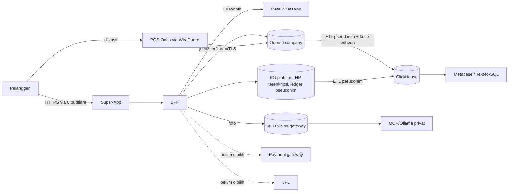

# Draf Penilaian Dampak Pelindungan Data Pribadi (DPIA) — EFN Platform

- **Status:** **DRAF architect untuk DPO (Legal, DPO sementara sejak 10 Okt 2026)**. Belum dinilai DPO dan belum ditandatangani. Bukan nasihat hukum.
- **Tanggal:** 2026-10-18 · Penyusun: efn-architect · Paket: W-28 (DPIA wajib sebelum go-live publik, keputusan pemilik proyek 10 Okt 2026 butir #56 / Q-T6; 18-37)
- **Dasar hukum penilaian:** UU No. 27 Tahun 2022 tentang Pelindungan Data Pribadi, **Pasal 34**. Teks diverifikasi dari pasal.id, 18 Okt 2026:
  - Ayat (1): "Pengendali Data Pribadi wajib melakukan penilaian dampak Pelindungan Data Pribadi dalam hal pemrosesan Data Pribadi memiliki potensi risiko tinggi terhadap Subjek Data Pribadi."
  - Ayat (2) huruf a–g: pemicu risiko tinggi (§2).
  - Ayat (3): ketentuan lebih lanjut diatur Peraturan Pemerintah. **Status PP pelaksana per Okt 2026 belum terverifikasi.** Format draf ini memakai kerangka umum (deskripsi pemrosesan, kebutuhan & proporsionalitas, risiko, mitigasi, residu) dan wajib disesuaikan bila PP/pedoman lembaga menetapkan format lain.
- **Dasar pemrosesan** mengikuti Pasal 20 ayat (2) huruf a–f (diverifikasi dari pasal.id, 18 Okt 2026): a persetujuan eksplisit; b kewajiban perjanjian; c kewajiban hukum; d kepentingan vital; e tugas kepentingan umum/kewenangan; f kepentingan sah lain. Pasal lain yang dirujuk dokumen kepatuhan EFN (hak subjek, notifikasi 3×24 jam, DPO) **belum diverifikasi nomornya** dan tetap tugas Legal.
- **Terkait:** `PDP_DATA_INVENTORY.md` v7 (RoPA; sumber rincian per kolom), `PDP_DSAR_DESIGN.md`, `PDP_CONSENT.md`, `PDP_BREACH_RESPONSE.md`, `PDP_TRANSFER_LINTAS_NEGARA.md`, ADR-014, ADR-017, ADR-020, ADR-022, ADR-023, ADR-024, ADR-028, ADR-029, ADR-031 (`efn_audit`), ADR-032, ADR-035, **ADR-036 (Accepted 18 Okt)**, ADR-001 (revisi 18 Okt: 6 entitas), `docs/runbooks/{security-incident,log-redaction,loyalty-anomaly,key-custody,retention,online-orders}.md`, risk register `docs/01` (R-L01, R-L10, R-S10, R-B11, R-T08).

> **Ringkasan manajemen.** DPIA adalah penilaian tertulis yang **wajib menurut UU PDP** sebelum EFN memproses data pribadi dalam skala besar atau dengan teknologi baru. EFN memenuhi beberapa pemicunya: program member lintas brand, aplikasi dan kasir di banyak outlet, deteksi kecurangan poin otomatis, AI untuk membaca foto label harga, dan penggabungan data dari enam perusahaan untuk analitik. Draf ini memetakan **14 kegiatan pemrosesan** dan **22 risiko** beserta pengamannya. Sebagian besar pengaman **sudah dibangun**: enkripsi di semua jalur dan penyimpanan, akses Odoo hanya lewat jaringan privat, identitas member berupa kode acak, log tanpa nomor HP, dan alur hapus akun. Sebagian lagi **dijadwalkan**: enkripsi data pribadi di Odoo (G20–G21), anonimisasi member tidak aktif 12 bulan, dan pemisahan tugas. Setelah pengaman terpasang, risiko yang tersisa paling besar ada pada: (1) **staf berhak yang menyalahgunakan akses**, (2) **satu orang Superadmin pemegang kunci**, dan (3) **vendor pembayaran/kurir yang belum dipilih**. **DPO perlu** mengisi bagian §10, menilai residu, dan menandatangani **sebelum go-live publik**.

---

## 1. Ruang lingkup & pengendali

| Hal | Isi | Status |
|---|---|---|
| Sistem | Super-App (Next.js) + BFF (NestJS) + PostgreSQL platform; Odoo CE 19 (6 company, satu DB); RabbitMQ; worker OCR/AI (Ollama, jaringan privat); ETL → ClickHouse (DWH) + Metabase; object storage (SILO); observability (Loki/Prometheus/Grafana); WhatsApp Cloud API; Cloudflare; payment gateway (**belum dipilih**); 3PL (**belum dipilih**) | Arsitektur `docs/02` |
| Entitas | Holding EFN, PT Grand Lucky, PT Paris Baguette, Bacha Coffee Retail, Bacha Coffee F&B, FARM (ADR-001 revisi 18 Okt) | Diputuskan 18 Okt |
| **Pengendali per kegiatan** | Usulan architect: **Holding EFN** = pengendali data member, Super-App, poin, analitik grup; **tiap PT** = pengendali data transaksi, faktur, pelanggan kasir, vendor, dan karyawannya sendiri; Holding sebagai **prosesor** atau **pengendali bersama** untuk layanan bersama (hosting, IT) | ⚠ **DPO menetapkan** (Q-DPIA-1, sama dengan Q-AD1-5); butuh perjanjian antar-entitas |
| Prosesor eksternal | Meta (WhatsApp), Cloudflare, penyedia VPS (ADR-004), payment gateway & 3PL (belum), GitHub (kode saja, tanpa data pelanggan) | `PDP_TRANSFER_LINTAS_NEGARA.md` |
| Di luar lingkup | Sistem lama klien sebelum migrasi; CCTV/absensi fisik; sistem pihak ketiga franchisee | DPO konfirmasi |

## 2. Pemicu risiko tinggi (Pasal 34 ayat 2)

| Huruf | Pemicu | Berlaku di EFN? | Kegiatan (§3) |
|---|---|---|---|
| a | Keputusan otomatis berakibat hukum/signifikan | **Ya, terbatas.** Penahanan poin/transaksi oleh deteksi anomali (`hold`), penolakan OTP oleh rate limit/captcha, pembatalan otomatis pesanan tak dibayar. Tidak ada penilaian kredit/penolakan layanan permanen otomatis | P2, P4, P7 |
| b | Data pribadi spesifik | **Tidak sengaja dikumpulkan.** Risiko insidental: catatan dapur "alergi …" (kesehatan), foto Price Hunter memuat wajah orang | P5, P13 |
| c | Skala besar | **Ya.** Member lintas 4 brand ritel/F&B; target ratusan ribu member (asumsi, belum ada angka klien) | P1–P4, P8 |
| d | Evaluasi, penskoran, pemantauan sistematis | **Ya.** Pemantauan anomali poin per member/kasir/PT, batas anti-fraud, riwayat belanja untuk poin & promo | P2, P7 |
| e | Pencocokan/penggabungan data | **Ya.** Satu identitas member lintas 6 entitas; DWH menggabungkan transaksi semua PT (pseudonim) | P1, P2, P8 |
| f | Teknologi baru | **Ya.** OCR + LLM lokal untuk foto label harga; Text-to-SQL atas DWH; enkripsi ORM + token pencarian (ADR-036) | P5, P8 |
| g | Membatasi hak subjek | **Ya, terbatas.** Penundaan hapus akun ≤ 14 hari selama pesanan berjalan (Q-P18); data faktur pajak disimpan 10 th setelah erasure; poin hangus saat anonimisasi | P1, P4 |

**Kesimpulan architect:** DPIA **wajib** (huruf c, d, e, f terpenuhi). DPO menilai ulang.

## 3. Deskripsi pemrosesan

Rincian kolom, lokasi, retensi, dan enkripsi ada di `PDP_DATA_INVENTORY.md` v7 (RoPA). Tabel ini merangkum per kegiatan. Kolom dasar = Pasal 20(2) huruf (usulan, ⚠ Legal).

| ID | Kegiatan | Data pribadi | Subjek | Tujuan | Dasar (usulan) | Retensi (diputuskan 10/18 Okt) | Penerima |
|---|---|---|---|---|---|---|---|
| P1 | Akun member Super-App & OTP | HP (E.164), consent, pernyataan usia 17+, IP (hash/terenkripsi), perangkat | Pelanggan | Login, identitas member, keamanan | b (akun), f (keamanan IP), a (marketing/lokasi) | akun selama aktif; anonimisasi **12 bln** tidak aktif (18-14); suppression 365 h | BFF; Meta (OTP WA) |
| P2 | Program poin lintas brand | `member_hash`, ledger earn/redeem/clawback, PT penerbit/penukar, reservasi | Pelanggan | Poin = alat bayar, settlement antar-PT, akuntansi liabilitas | b, c (akuntansi) | ledger **10 th** | BFF, Odoo (jurnal agregat), ETL (pseudonim) |
| P3 | POS: pelanggan di kasir | nama, HP, email, alamat, NPWP (opsional), riwayat order; email struk | Pelanggan | Transaksi, struk, faktur | b, c (pajak) | transaksi **10 th** | Odoo; PC kasir (tanpa preload pelanggan terlindungi, 18-30) |
| P4 | Belanja online + faktur atas nama | riwayat order (member UUID), kode ambil, profil faktur opsional (nama, NPWP/NIK hanya bila diminta, alamat, HP, email) | Pelanggan | Jual-beli, ambil di toko, faktur | b, c | tautan akun 730 h, event 180 h, keuangan 10 th, kode ambil ≤ 7 h | BFF, Odoo, payment gateway (belum) |
| P5 | Price Hunter (foto label + OCR/AI) | foto (bisa memuat orang), lokasi dibulatkan (consent), `user_hash` | Pelanggan, pihak ketiga tak sengaja | Indeks harga pasar, reward poin | b (program), a (lokasi) | lokasi NULL **90 h**; foto per ILM; mart pseudonim 5 th | Worker OCR/Ollama (privat), DWH |
| P6 | MGM / referral (rencana ADR-009) | relasi pengajak–diajak (pseudonim), reward | Pelanggan | Insentif akuisisi | b | mengikuti ledger | BFF |
| P7 | Deteksi anomali & anti-fraud | pola earn/redeem per member/kasir/PT, `order_ref` opak, uid kasir | Pelanggan, karyawan | Pencegahan kecurangan | f | 400 h (recon), audit 730 h / 10 th | Supervisor, Finance |
| P8 | Analitik DWH, Metabase, Text-to-SQL | fakta transaksi dengan pseudonim (`customer_id`, `member_hash`), **kode wilayah kab/kota** (ADR-036 §0.7) | Pelanggan (pseudonim) | Laporan grup & konsolidasi | f, c | baris 10 th; pseudonim dianonimkan **5 th** | Manajemen, Finance (view whitelist) |
| P9 | Karyawan & akun Odoo | nama kerja, email kerja, PIN POS, 2FA, log login/audit; **data pribadi HR** (alamat rumah, HP/email pribadi, NIK, paspor, kontak darurat — terenkripsi E-38b) | Karyawan | Hubungan kerja, keamanan, pengendalian internal | b, c, f | audit 730 h (min 365); HR menurut kebijakan HR (⚠ belum ditetapkan) | HR, atasan, Superadmin |
| P10 | Vendor & portal vendor | nama/kontak vendor perorangan, NPWP/NIK, login opak, 2FA, log akses | Vendor perorangan, kontak vendor | Pengadaan, tagihan | b, c, f (keamanan) | dokumen 10 th | Procurement, Finance; portal-gateway (ADR-035) |
| P11 | Pesan-antar / kurir internal (rencana W-05) | alamat, kode wilayah, nama & HP penerima, catatan kurir | Pelanggan, penerima | Pengiriman | b | ⚠ belum ditetapkan (usulan: alamat di order 10 th sebagai dokumen; titik lokasi ≤ 30 h) | Kurir internal; 3PL (belum) |
| P12 | Notifikasi WhatsApp & edge Cloudflare | HP, isi template (OTP, status pesanan, pemberitahuan anonimisasi), IP | Pelanggan | Komunikasi transaksional | b | sesuai Meta/Cloudflare + log 30 h | Meta, Cloudflare (lintas negara) |
| P13 | F&B: KDS & QR order | meja/antrean, menu, catatan dapur teks bebas; QR tamu tanpa PII; login OTP opsional | Pelanggan (tidak langsung), staf dapur | Melayani pesanan | b, f (KPI) | tiket 90 h | Staf dapur |
| P14 | Log, audit, observability, backup | uid, aksi, nilai ter-mask, IP ter-hash; backup terenkripsi berisi semua data di atas | Semua | Keamanan, forensik, pemulihan | f, c | Loki 30 h / 400 h; audit 730 h / tanpa batas (log kontrol); WAL-G lokal 14 base; off-site **35 h + bulanan 12 bln** (18-35) | Superadmin, on-call |

## 4. Kebutuhan & proporsionalitas (minimisasi)
| Prinsip | Penerapan di EFN | Rujukan |
|---|---|---|
| Identitas minimum | Member = HP saja, tanpa nama wajib; JWT `sub` = UUID opak; tanggal lahir tidak dikumpulkan (hanya pernyataan 17+) | ADR-029, docs/04 §3.2 |
| Pseudonim untuk analitik | `member_hash` berpepper, `customer_id`; nama/kontak tidak pernah ke DWH; kota hanya kode kab/kota | ADR-036 §0.7, inventaris §2.4 |
| Opsional bila bisa | NPWP/NIK hanya bila pelanggan meminta faktur/B2B (18-7); QR order sebagai tamu; lokasi hanya dengan consent | 18-7, ADR-032, PDP_CONSENT |
| Tanpa data kartu | PAN tidak pernah disimpan | CLAUDE.md, ADR-026 |
| Retensi terbatas | Angka diputuskan 10 & 18 Okt, configurable, job purge | inventaris §0a, `runbooks/retention.md` |
| Tidak memuat ke perangkat | Pelanggan terlindungi tidak di-preload ke PC kasir | 18-30, ADR-036 |

⚠ **DPO menilai:** apakah profil faktur pembeli (P4) dan alamat pengiriman (P11) proporsional terhadap tujuannya, dan apakah retensi HR (P9) sudah ditetapkan.

## 5. Penilaian risiko terhadap subjek data
Skala 1–5 sama dengan `docs/01`: **K** = kemungkinan, **D** = dampak terhadap subjek, skor = K×D. "Inheren" = tanpa kontrol EFN; "Residu" = setelah kontrol yang **sudah ada + yang dijadwalkan**. Semua angka = **usulan architect; DPO menilai ulang.**

| ID | Risiko terhadap subjek | Keg. | Inheren K×D | Kontrol (ada ✓ / dijadwalkan ◷) | Residu K×D | Pemilik |
|---|---|---|---|---|---|---|
| DR-01 | Kebocoran salinan DB/backup Odoo membuka kontak, alamat, NPWP/NIK pelanggan, vendor, karyawan | P3, P4, P9, P10 | 3×5=15 | ✓ LUKS, TLS verify-full, WAL-G libsodium, Odoo tidak publik (ADR-022/023); ◷ **enkripsi ORM E-38a/b** (ADR-036) | 2×3=6 | IT + Security |
| DR-02 | Staf berhak menyalahgunakan akses (lihat/ekspor CSV pelanggan) | P3, P4, P9, P10 | 3×4=12 | ✓ grup & record rule per company, 2FA, WireGuard, `efn_audit`; ◷ peran & SoD (W-31), review akses bulanan; tahap 2: audit ekspor | 3×3=9 | Superadmin + Internal Audit |
| DR-03 | Pengambilalihan akun member (SIM swap, tebak OTP) → poin dicuri | P1, P2 | 3×3=9 | ✓ OTP ber-rate limit, ALTCHA (ADR-028), HP terkunci (SEC-115), step-up, anomali | 2×3=6 | BFF + Ops |
| DR-04 | Nomor HP daur ulang → pemilik baru melihat/memakai akun lama | P1 | 3×3=9 | ◷ anonimisasi 12 bln tidak aktif + notifikasi 30 h (W-17); ✓ HP lock & alur ganti nomor | 2×2=4 | BFF |
| DR-05 | Keputusan otomatis (hold poin, pembatalan pesanan) merugikan subjek tanpa penjelasan | P2, P4, P7 | 3×3=9 | ✓ `hold` → tinjauan supervisor manusia; pembatalan tanpa bayar tanpa kerugian; ◷ jalur keberatan via CS dicatat di syarat program (Legal) | 2×2=4 | Ops + Legal |
| DR-06 | Lokasi Price Hunter membuka kebiasaan/tempat tinggal | P5 | 3×4=12 | ✓ consent `location`, pembulatan 4 desimal, NULL 90 h, TTL ClickHouse | 1×3=3 | BFF + data |
| DR-07 | Foto memuat wajah/data pihak ketiga; teks OCR dibaca model | P5 | 3×3=9 | ✓ strip EXIF, OCR/LLM di jaringan privat (ADR-014), ILM foto, AI di luar jalur transaksi | 2×2=4 | data-AI |
| DR-08 | Text-to-SQL/Metabase membuka data pribadi lewat kueri bebas | P8 | 3×4=12 | ✓ user ClickHouse `readonly`, view whitelist, hanya pseudonim, tanpa nama/kontak; riwayat kueri 10 th | 2×2=4 | data-AI |
| DR-09 | Transfer lintas negara (Meta, Cloudflare) tanpa perlindungan setara | P12 | 3×3=9 | ✓ payload minimum, WA Local Storage bila tersedia, Cloudflare proxy (keputusan Q-T) ; ◷ DPA/klausul | 2×3=6 | Legal |
| DR-10 | Vendor payment/3PL memproses data tanpa DPA/di luar Indonesia | P4, P11 | 3×4=12 | ◷ kriteria wajib DPA + pemrosesan di Indonesia (Q-P20), data pembayar minimum, tanpa PAN | 2×3=6 | Finance + Legal |
| DR-11 | Penggabungan data lintas 6 entitas melampaui tujuan yang diberitahukan | P1, P2, P8 | 3×3=9 | ✓ ledger & DWH pseudonim; ◷ penetapan pengendali & pemberitahuan privasi grup (Q-DPIA-1/2) | 2×3=6 | Legal |
| DR-12 | Data pribadi HR (NIK, alamat rumah, kontak darurat) bocor/terlihat luas | P9 | 3×4=12 | ✓ grup `hr.group_hr_user`; ◷ enkripsi E-38b + redaksi tracking (ADR-036 §0.2) | 2×3=6 | HR + IT |
| DR-13 | Portal vendor terekspos internet → akses tidak sah ke data vendor/PO | P10 | 3×4=12 | ◷ ADR-035: portal-gateway terpisah, allowlist route, 2FA, WAF, rate limit, mTLS, login opak, pentest pihak ketiga | 2×3=6 | IT + Security |
| DR-14 | Alamat & HP penerima di kurir internal/3PL disalahgunakan | P11 | 3×3=9 | ◷ W-05: akses kurir per penugasan, alamat terenkripsi (E-38b), retensi titik lokasi pendek, DPA 3PL | 2×2=4 | Ops |
| DR-15 | Retensi 10 th dokumen pajak mempertahankan nama/NPWP setelah hapus akun | P3, P4 | 2×3=6 | ✓ kewajiban hukum (c); erasure menganonimkan selain data wajib faktur; enkripsi ORM + XML Coretax terenkripsi | 2×2=4 | Legal + Finance |
| DR-16 | Kehilangan kunci (bus factor 1 Superadmin) → data subjek tidak dapat dipulihkan / layanan terhenti | semua | 2×4=8 | ✓ salinan tersegel brankas Direksi, uji pemulihan disaksikan (rencana), break-glass; risiko **diterima** pemilik proyek (R-B11) | 2×4=8 | Direksi + Superadmin |
| DR-17 | Data pribadi masuk log (HP, email, kode promo) | P14 | 3×3=9 | ✓ masking HP, redaksi Promtail + uji CI, larangan hash kode promo (L-42), near-miss register | 1×3=3 | devsecops |
| DR-18 | Hak hapus tertunda/terbatas | P1, P4 | 2×3=6 | ✓ tunda maks 14 h + eskalasi CS + erasure paksa; teks pelanggan (18-36) | 1×2=2 | CS + Legal |
| DR-19 | Anak di bawah 17 th mendaftar | P1 | 2×3=6 | ✓ pernyataan usia (app & kasir); tanpa verifikasi dokumen | 2×2=4 | Legal |
| DR-20 | Catatan dapur memuat data kesehatan (alergi) yang dikaitkan dengan orang | P13 | 3×3=9 | ✓ SOP "tulis menu/bahan, bukan kondisi orang", tiket tanpa nama, retensi 90 h | 2×2=4 | Ops F&B |
| DR-21 | Cache data pelanggan di PC kasir/tablet hilang/dicuri | P3 | 3×3=9 | ✓ pelanggan terlindungi tidak di-preload (18-30), perangkat via WireGuard; ⚠ enkripsi disk perangkat outlet **belum ditetapkan** (Q-DPIA-4) | 2×3=6 | IT outlet |
| DR-22 | Analisis frekuensi token nama/blind index pada dump DB menebak sebagian nama/kesamaan HP | P3, P10 | 2×2=4 | ✓ kunci terpisah, padding token, dump terenkripsi (ADR-036 §0.5, SEC-140); risiko **diterima** (R-T19 usulan) | 2×2=4 | IT + Security |

## 6. Rencana mitigasi yang belum selesai (mengikat go-live publik)
| # | Mitigasi | Risiko | Paket / gelombang | Syarat go-live? |
|---|---|---|---|---|
| M-1 | Enkripsi ORM pelanggan (E-38a) — DB produksi dibuat setelahnya | DR-01, DR-15 | W-08, G20 | **Ya** |
| M-2 | Enkripsi vendor/portal/karyawan (E-38b) sebelum impor master | DR-01, DR-12 | W-08, G21 | **Ya** (sebelum impor) |
| M-3 | Peran & SoD + review akses bulanan | DR-02 | W-31, G21 | **Ya** |
| M-4 | Anonimisasi 12 bulan + notifikasi | DR-04 | W-17, G22 | Ya, sebelum bulan ke-12 setelah go-live |
| M-5 | DPA + pemrosesan di Indonesia untuk payment & 3PL | DR-10, DR-14 | A-4, W-05 | **Ya** untuk fitur terkait |
| M-6 | Perjanjian pengendali antar-entitas + pemberitahuan privasi grup | DR-11 | Legal (Q-DPIA-1/2) | **Ya** |
| M-7 | Backup off-site terenkripsi 35 h + bulanan 12 bln; uji pemulihan disaksikan | DR-16 | W-28, W-19 (staging) | **Ya** |
| M-8 | Portal vendor: pentest pihak ketiga | DR-13 | W-13, G23+ | Ya, sebelum portal dibuka |
| M-9 | Enkripsi disk perangkat outlet (PC kasir/tablet) | DR-21 | W-23 / ADR-023 | Disarankan |
| M-10 | Audit ekspor CSV `res.partner` | DR-02 | ADR-036 tahap 2 | Disarankan |

## 7. Risiko residu
Setelah M-1..M-8, residu tertinggi (usulan architect):
1. **DR-02** penyalahgunaan oleh staf berhak (9). Enkripsi tidak dapat menutupnya; kontrolnya bersifat organisasi.
2. **DR-16** bus factor kunci (8). Risiko ini sudah diterima pemilik proyek.
3. **DR-01, DR-09, DR-10, DR-11, DR-12, DR-13, DR-21** (6).

Tidak ada residu ≥ 15. **DPO memutuskan** apakah residu diterima, perlu mitigasi tambahan, atau perlu konsultasi dengan lembaga pengawas (bila peraturan pelaksana mewajibkannya untuk residu tinggi; **belum terverifikasi**).

## 8. Hak subjek, insiden, transfer
- Hak akses/koreksi/hapus/tarik consent: `PDP_DSAR_DESIGN.md` (sudah dibangun sebagian: DSAR export, hapus akun dengan penundaan ≤ 14 h, consent).
- Insiden & notifikasi: `PDP_BREACH_RESPONSE.md`, `runbooks/security-incident.md`; register near-miss dipegang Legal (`PDP_DATA_INVENTORY.md` §6).
- Transfer lintas negara: `PDP_TRANSFER_LINTAS_NEGARA.md`.

## 9. Konsultasi
| Pihak | Peran dalam DPIA | Status |
|---|---|---|
| DPO (Legal) | Pemilik dokumen, penilai residu, penandatangan | Belum |
| IT/Security (Superadmin) | Verifikasi kontrol teknis | Belum |
| Finance + konsultan pajak | Retensi pajak, P4/P2 | Belum |
| HR | P9, kebijakan retensi HR | Belum |
| Ops Outlet / F&B | P3, P13, perangkat outlet | Belum |
| Procurement | P10 portal vendor | Belum |
| Perwakilan subjek (opsional) | Uji keterbacaan pemberitahuan privasi | Opsional |

## 10. Yang harus diisi/diputuskan DPO
| # | Isian | Catatan architect |
|---|---|---|
| D-1 | **Pengendali per kegiatan** & perjanjian antar-entitas (Q-DPIA-1) | Usulan §1 |
| D-2 | Pemberitahuan privasi grup (6 entitas) + teks consent (Q-DPIA-2) | Teks 17+ & hapus akun 14 h sudah final (18-36) |
| D-3 | **Nomor pasal** untuk setiap dasar pemrosesan §3 | Pasal 20(2) huruf sudah ditandai |
| D-4 | Penilaian kebutuhan & proporsionalitas P4, P9, P11 (§4) | — |
| D-5 | Nilai K×D residu final (§5) dan **keputusan penerimaan residu** (§7) | — |
| D-6 | Retensi data HR (P9) dan pesan-antar (P11) | Belum ada keputusan |
| D-7 | Enkripsi disk perangkat outlet (Q-DPIA-4) | Biaya/perangkat dari IT |
| D-8 | Apakah PP/pedoman lembaga PDP sudah terbit dan mengubah format (Q-DPIA-3) | Belum terverifikasi |
| D-9 | Daftar prosesor + status DPA (Meta, Cloudflare, VPS, payment, 3PL) | Payment & 3PL belum dipilih |
| D-10 | Konfirmasi interpretasi ADR-036 Q-PII7 (nama karyawan plaintext) dan Q-PII10 (kode wilayah plaintext) | — |
| D-11 | Tanda tangan, tanggal, jadwal tinjau ulang | — |

## 11. Kapan ditinjau ulang
Sebelum go-live publik (wajib), lalu tahunan. Ditinjau juga saat ada kegiatan baru: pesan-antar (W-05), portal vendor (W-13), MGM (ADR-009), vendor payment/3PL terpilih, model AI baru, perubahan pengendali/entitas, insiden data pribadi, atau terbitnya PP pelaksana Pasal 34(3).

## 12. Belum terverifikasi
- Status dan isi PP pelaksana UU PDP (format DPIA, kewajiban konsultasi lembaga).
- Nomor pasal selain Pasal 20 dan 34.
- Jumlah member/transaksi (asumsi "skala besar" belum didukung angka klien).
- Kontrol berlabel ◷ (belum dibangun) dan semua kontrol yang butuh staging (LUKS, off-site, timer, perangkat outlet).
- Kebijakan retensi HR dan pesan-antar.
- Lokasi pemrosesan vendor payment/3PL (belum dipilih).
- Sintaks Mermaid tidak dirender.
