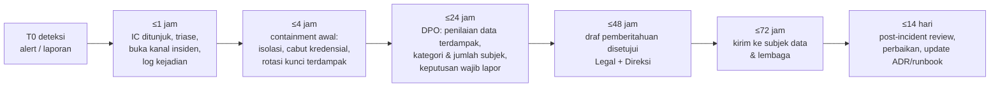

# Respons Kegagalan Pelindungan Data Pribadi (Breach) — 3×24 Jam

- **Status:** Draf kebijakan untuk DPO/Legal/Direksi. Bagian teknis (deteksi, containment, forensik) akan ditulis devsecops di `docs/runbooks/` (usulan: `docs/runbooks/security-incident.md`).
- **Tanggal:** 2026-10-05 · Penyusun: efn-architect · Menutup sebagian SEC-11 / R-L01
- **Rujukan:** UU PDP Pasal 46 (pemberitahuan tertulis paling lambat 3×24 jam kepada subjek data dan lembaga) — **verifikasi Legal**, termasuk lembaga penerima selama Lembaga PDP belum beroperasi penuh (kementerian yang membidangi komunikasi & digital).

> **Ringkasan manajemen.** Bila data pribadi bocor, diubah, atau hilang, EFN wajib memberi tahu pelanggan terdampak dan otoritas dalam 3×24 jam sejak diketahui. Dokumen ini menetapkan siapa memutuskan, langkah per jam, dan template pemberitahuan. Enkripsi (ADR-022) bisa mengurangi dampak: data terenkripsi yang kuncinya tidak bocor umumnya berisiko rendah — tetapi keputusan wajib-lapor tetap di DPO + Legal.

## 1. Peran
| Peran | Siapa (usulan) | Tugas |
|---|---|---|
| **Incident Commander (IC)** | Head IT / on-call senior | Memimpin respons teknis, menunjuk scribe, eskalasi |
| **DPO** (Pasal 53) | Ditunjuk klien (**Q-P1**) | Menilai apakah data pribadi terdampak & wajib lapor, menyusun pemberitahuan, kontak otoritas |
| Legal | Internal/eksternal | Kewajiban hukum, kontrak pemroses (Meta, VPS, gateway), komunikasi resmi |
| Security | Security officer / vendor | Forensik, containment, rotasi kunci |
| Komunikasi/CS | Marketing/CS | Pemberitahuan pelanggan, skrip CS, FAQ |
| Direksi | Sponsor | Persetujuan pemberitahuan publik |
| Pemroses (vendor) | Sesuai DPA | Wajib memberi tahu EFN tanpa penundaan (klausul DPA) |

## 2. Linimasa (T0 = saat EFN mengetahui insiden)

## 3. Penilaian wajib lapor (DPO)
Pertanyaan minimum, dicatat di log insiden:
1. Data pribadi apa (lihat `PDP_DATA_INVENTORY.md`), berapa subjek, kategori (umum/spesifik)?
2. Apakah data terenkripsi (ADR-022) **dan** kuncinya tidak ikut terkompromi? (mis. dump PG berisi `user_enc` tanpa `pii_encryption_key` → risiko lebih rendah; `member_hash` + pepper bocor → dianggap HP bocor, SEC-16)
3. Kerahasiaan, integritas, atau ketersediaan yang gagal?
4. Kemungkinan dampak ke subjek (penipuan/phishing WA, takeover akun, kerugian poin)?
5. Apakah pemroses pihak ketiga terlibat?
Default: **bila ragu, lapor.**

## 4. Isi pemberitahuan minimum (verifikasi Legal)
- Data pribadi yang terungkap; kapan dan bagaimana terungkap; upaya penanganan dan pemulihan oleh EFN; langkah yang dapat dilakukan subjek; kontak DPO.

## 5. Template
### 5.1 Ke subjek data (WhatsApp template utilitas + email/in-app)
> **[EFN] Pemberitahuan keamanan data**
> Halo, pada {tanggal} kami menemukan insiden yang memengaruhi data Anda: {jenis data, mis. nomor HP dan riwayat poin}. {Penyebab singkat}. Kami telah {langkah: menutup akses, mengganti kunci, memeriksa sistem}. Data {yang tidak terdampak, mis. kata sandi/pembayaran} tidak terdampak.
> Yang dapat Anda lakukan: waspadai pesan yang mengatasnamakan EFN dan meminta kode OTP — **EFN tidak pernah meminta kode OTP Anda**. {Langkah lain}.
> Pertanyaan: {kontak DPO / CS}, referensi {nomor insiden}.

Template WA harus **didaftarkan dan disetujui Meta sebelumnya** (kategori utilitas) agar bisa dikirim dalam 72 jam — tindakan persiapan sebelum go-live (ADR-011).

### 5.2 Ke lembaga/otoritas (surat resmi)
- Identitas pengendali (PT terkait — perhatikan multi-PT: pengendali bisa EFN holding dan/atau PT operasional), DPO & kontak.
- Kronologi (T0, deteksi, containment).
- Kategori & perkiraan jumlah subjek dan data.
- Dampak yang mungkin; langkah penanganan & pemulihan; langkah pencegahan.
- Pemroses yang terlibat.
- Lampiran: log insiden (ringkas), daftar kontrol (ADR-022, ADR-023, ADR-024).

### 5.3 Log insiden (wajib, disimpan 5 tahun)
| Waktu (WIB) | Pelaku | Aksi / temuan | Bukti (lokasi) |
|---|---|---|---|

## 6. Bagian teknis (ditulis devsecops di `docs/runbooks/`)
Usulan isi `docs/runbooks/security-incident.md`: sumber deteksi (alert Prometheus/Loki, CrowdSec, Trivy, laporan), preservasi bukti (snapshot volume, export log Loki sebelum retensi 30 hari habis), containment (cabut peer WireGuard, ganti kredensial per service via `secret-rotation.md`, cabut sesi JWT/rotasi `jwt_secret`, isolasi container), rotasi kunci (`pii_encryption_key`, intermediate CA — ADR-022), pemulihan dari backup (`backup-restore.md`), verifikasi integritas ledger poin.
Runbook terkait yang sudah ada: [secret-rotation](../runbooks/secret-rotation.md), [backup-restore](../runbooks/backup-restore.md), [tls-cert-expiry](../runbooks/tls-cert-expiry.md), [indeks runbook](../runbooks/README.md).

## 7. Latihan
Tabletop exercise sebelum go-live dan tahunan (skenario: dump `efn_platform` bocor; kunci `otp_pepper` bocor; laptop staf dengan peer WireGuard hilang; vendor WA melaporkan insiden).
