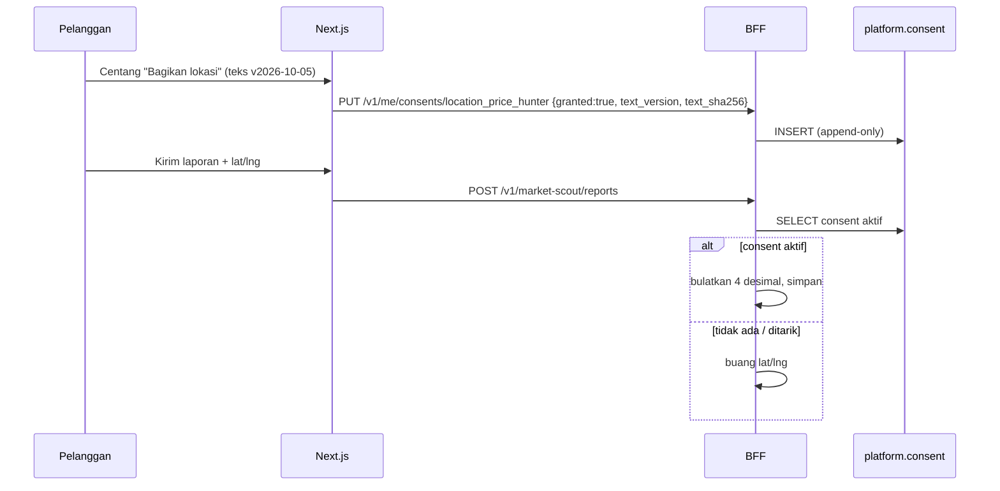

# Desain Persetujuan (Consent) — Lokasi & Marketing

- **Status:** Draf desain untuk DPO/Legal + lead (tabel & endpoint = **usulan kontrak**).
- **Catatan penyelarasan 2026-10-06:** kontrak yang mengikat kini `docs/04 §8.4` dan **menang** atas desain di bawah bila berbeda: purpose = `location` | `marketing` (bukan `location_price_hunter`/`marketing_whatsapp`/`marketing_personalization`); tabel `platform.consent (id, member_id, purpose, granted, version, source, ip_enc, created_at)` memakai `member_id` (UUID, ADR-029), bukan `member_hash`, dan field `version` (bukan `text_version` + `text_sha256`). Usulan ke lead: pertimbangkan menambah `text_sha256` sebagai bukti teks yang disetujui, dan memecah `marketing` per kanal bila DPO memintanya.
- **Tanggal:** 2026-10-05 · Penyusun: efn-architect · Menutup sebagian SEC-11, SEC-17 / R-L01
- **Terkait:** `PDP_DATA_INVENTORY.md`, `PDP_DSAR_DESIGN.md`, `services/superapp-web` (checkbox lokasi), `docs/04 §3.3`

> **Ringkasan manajemen.** Lokasi dan pesan pemasaran hanya diproses bila pelanggan setuju secara terpisah (bukan satu centang untuk semua). Setiap persetujuan dicatat di server — versi teks, waktu, dan tujuan — sehingga EFN dapat membuktikannya bila diaudit, dan pelanggan bisa menarik persetujuan kapan saja dengan efek sama mudahnya.

## 1. Tujuan (purpose) yang butuh consent
| `purpose` | Data | Default | Dampak bila ditolak/ditarik |
|---|---|---|---|
| `location_price_hunter` | `geo_lat/lng` saat kirim laporan | Tidak dicentang | Laporan tetap diterima tanpa lokasi (poin tidak dikurangi — keputusan PO) |
| `marketing_whatsapp` | Nomor HP untuk pesan promosi (template marketing WA) | Tidak dicentang | Hanya pesan transaksional (OTP, status laporan, poin) |
| `marketing_personalization` | Riwayat transaksi untuk rekomendasi | Tidak dicentang | Rekomendasi umum |

Pesan transaksional (OTP, hasil validasi) berdasar **perjanjian**, bukan consent — tidak ditawarkan sebagai checkbox, tetapi dijelaskan di kebijakan privasi.

## 2. Syarat sah (verifikasi Legal)
- Granular per tujuan; tidak dibundel dengan syarat layanan; tidak pre-checked.
- Teks consent berversi (`consent_text_version`, mis. `location_price_hunter@2026-10-05`), disimpan di repo (`services/superapp-web/content/consent/*.md`) dan di-hash; server mencatat versi + hash yang ditampilkan.
- Penarikan semudah pemberian (toggle di `/akun/privasi`).
- Bukti disimpan server-side, bukan hanya di browser.

## 3. Tabel usulan (pemilik: BFF)
```sql
CREATE TABLE platform.consent (
  id               bigserial PRIMARY KEY,
  member_hash      char(64)    NOT NULL,
  purpose          text        NOT NULL CHECK (purpose IN ('location_price_hunter','marketing_whatsapp','marketing_personalization')),
  granted          boolean     NOT NULL,          -- true = beri, false = tarik (append-only, tidak di-UPDATE)
  text_version     text        NOT NULL,
  text_sha256      char(64)    NOT NULL,
  channel          text        NOT NULL CHECK (channel IN ('web','mobile','pos','cs')),
  ip_enc           bytea,                          -- AES-256-GCM, AAD "efn:consent.ip_enc:v1" (ADR-022)
  user_agent_hash  char(64),
  created_at       timestamptz NOT NULL DEFAULT now()
);
CREATE INDEX ix_consent_member_purpose ON platform.consent (member_hash, purpose, created_at DESC);
-- Status aktif = baris terbaru per (member_hash, purpose).
```
Append-only: tidak ada UPDATE/DELETE oleh aplikasi (grant `INSERT, SELECT` saja untuk `efn_bff` pada tabel ini — pengecualian dari "owner skema"; atau trigger penolak UPDATE). Retensi: 5 tahun setelah penarikan/hapus akun (bukti), lalu purge.

## 4. Endpoint usulan
| Method & path | Fungsi |
|---|---|
| `GET /v1/me/consents` | Status aktif per purpose + versi teks terbaru yang tersedia |
| `PUT /v1/me/consents/:purpose` `{ "granted": true, "text_version": "...", "text_sha256": "..." }` | Catat beri/tarik; `409 stale_text` bila versi bukan terbaru |
| `POST /v1/market-scout/reports` (perubahan) | Bila `lat/lng` dikirim, BFF **memeriksa consent aktif `location_price_hunter`**; tanpa consent → koordinat **dibuang** (bukan ditolak) dan dicatat metrik. Koordinat dibulatkan 4 desimal di server (SEC-17) |

Pengiriman template marketing WA (fase lanjut) wajib memeriksa consent aktif `marketing_whatsapp` tepat sebelum kirim; tanpa consent → tidak dikirim, tercatat.

## 5. Alur


## 6. POS & Odoo
Consent marketing yang dikumpulkan kasir (mis. pelanggan setuju dikirimi promo) tidak dicatat di Odoo secara bebas: kasir memicu `POST /v1/pos/consents` (service key, channel `pos`) — **usulan**, setelah fit-gap efn-odoo-functional menilai field standar (`res.partner` opt-out / mailing blacklist CE).

## 7. Usulan perubahan kontrak (untuk lead)
Tabel `platform.consent`, endpoint §4, perilaku "buang koordinat tanpa consent" di `docs/04 §3.3`.
