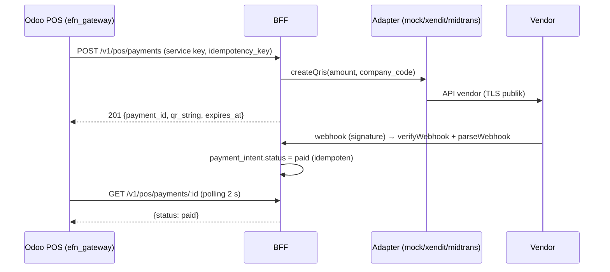

# ADR-026: Abstraksi Payment Gateway-Agnostic (QRIS POS & Online) — Vendor Belum Ditentukan

- **Status:** Proposed — fakta yang **diputuskan klien 6 Okt 2026**: *payment gateway belum ditentukan; siapkan abstraksi gateway-agnostic*. Desain abstraksi di bawah adalah rekomendasi.
- **Tanggal:** 2026-10-06
- **Pemutus (klien):** Finance (MDR, settlement) + Legal (kontrak) + IT
- **Referensi review:** D-16, R-S09 (webhook palsu), R-L05 (PCI DSS), R-T10 (saga pembayaran), R-B02 (fee)
- **Terkait:** ADR-016 (pemilihan vendor — tetap Proposed, ditunda), ADR-019 (merchant of record / settlement per PT), ADR-017 (offline), ADR-023 (split tunnel), `docs/04 §8.3` (kontrak teknis mengikat), `docs/08` F-21/F-22

> **Ringkasan manajemen.** Klien belum memilih payment gateway. Agar pengembangan tidak menunggu, platform memakai **satu lapisan abstraksi** di BFF: kasir POS dan Super-App memanggil "buat QRIS / cek status / batalkan" tanpa tahu vendornya. Di staging dipakai **gateway tiruan (mock)**; adapter Xendit dan Midtrans disiapkan sebagai kerangka tetapi **nonaktif** sampai vendor dipilih dan lulus uji sandbox. Platform **tidak pernah menyimpan data kartu**. Biaya: ±1,5–2 minggu BFF + ±1 minggu modul Odoo, Rp0 lisensi; berganti/menambah vendor kelak = ±1–2 minggu per adapter, bukan menulis ulang.

## Konteks
- ADR-016 merekomendasikan Xendit secara kondisional; klien (6 Okt 2026) menyatakan **belum menentukan**. ADR-016 tetap Proposed; keputusan vendor ditunda.
- `docs/08` F-21: QRIS CE standar = provider `qris.online` dengan API key di `res.partner.bank` (bukan `/run/secrets`), tidak ada `pos_xendit` di CE 19 (404). F-22: `payment_xendit` (CE) hanya untuk portal/online di Odoo; `payment_midtrans` 404.
- Prinsip `CLAUDE.md`: tidak menyimpan PAN; webhook wajib HMAC + idempotency + replay window; Odoo tidak diakses dari internet (webhook vendor tidak bisa langsung ke Odoo).
- Kontrak teknis sudah ditetapkan lead di `docs/04 §8.3`; ADR ini memberi alasan, opsi, kriteria vendor, dan dampak.

## Opsi yang dipertimbangkan
| Opsi | Kelebihan | Kekurangan | Biaya / waktu |
|---|---|---|---|
| **A. Abstraksi `PaymentGateway` di BFF + adapter per vendor; POS memanggil BFF** | Satu jalur webhook terverifikasi untuk POS & online; secret di `/run/secrets`; ganti vendor = adapter baru; cocok dengan Odoo tertutup dari internet | Modul gap Odoo `efn_gateway` (metode pembayaran POS) harus ditulis; polling status dari POS | BFF 1,5–2 minggu; Odoo 1 minggu; Rp0 lisensi |
| B. Konektor Odoo per vendor (`payment_xendit`, `qris.online` di `l10n_id`) | Standar CE untuk online/portal | Webhook vendor harus mencapai Odoo → bertentangan ADR-023; tidak ada konektor POS Xendit/Midtrans CE; `qris.online` menyimpan API key di DB; mengunci vendor | Rendah bila vendor = qris.online, tinggi selainnya |
| C. Tunggu vendor dipilih baru membangun | Tidak ada kerja sia-sia | Fase 3 (checkout) & QRIS POS tertunda; tidak bisa uji end-to-end | Risiko jadwal |
| D. Abstraksi pihak ketiga (orkestrator pembayaran SaaS) | Multi-vendor siap pakai | Pihak ketiga tambahan memegang data transaksi (PDP, transfer), biaya per transaksi | Biaya berulang |

## Keputusan (rekomendasi)
**Opsi A**, sesuai `docs/04 §8.3`:
1. **Antarmuka** `PaymentGateway` di BFF: `createQris`, `getStatus`, `cancel`, `verifyWebhook`, `parseWebhook`. Status kanonik: `pending | paid | expired | failed | cancelled`.
2. **Adapter**: `mock` (default dev/staging, QR dummy, dapat mensimulasikan paid/expired); `xendit`, `midtrans` = **kerangka, nonaktif** sampai ADR-016 diputuskan **dan** lulus uji sandbox vendor. Pemilihan via `PAYMENT_PROVIDER=mock|xendit|midtrans`; **produksi menolak `mock`** (gagal start).
3. **Secret**: `payment_provider_api_key` (dibaca hanya bila provider ≠ mock), `webhook_payment_secret`. Tidak ada API key di `res.partner.bank`/database Odoo.
4. **Metode**: QRIS (dinamis), VA, e-wallet. **Tidak ada data kartu** (PAN/CVV tidak pernah melewati platform; bila kartu kelak dibutuhkan, hanya halaman/hosted fields vendor → tetap SAQ A, ADR baru).
5. **POS QRIS via BFF**: modul gap Odoo `efn_gateway` (metode pembayaran POS) → server Odoo memanggil `POST /v1/pos/payments` (service key, idempotency key) → QR tampil di layar pelanggan → polling `GET /v1/pos/payments/:id` tiap 2 s sampai final/timeout → batal via `/cancel`. **Saat POS offline metode ini nonaktif** (ADR-017); kasir memakai tunai/EDC/QRIS statis bank.
6. **Webhook**: `POST /v1/webhooks/payments/:provider` publik via Traefik; verifikasi signature/HMAC vendor + replay window + idempotensi; status final hanya berubah via webhook terverifikasi atau `getStatus` ke vendor, **tidak pernah** dari klien.
7. **Penyimpanan**: `platform.payment_intent` (skema `docs/04 §8.3`); tidak memuat data pribadi pelanggan selain referensi order. Settlement per PT (ADR-019) belum diimplementasi — adapter wajib membawa `company_code` agar split/sub-akun dapat dipetakan kelak.

## Kriteria pemilihan vendor (untuk ADR-016, bobot usulan — disepakati Finance)
| Kriteria | Bobot | Cara menilai |
|---|---|---|
| Fee/MDR (QRIS, VA, e-wallet) & biaya settlement | 25% | Penawaran tertulis minimal 2 vendor; simulasi pada GMV `docs/07` §2 |
| **Split settlement multi-PT** (sub-akun per PT, refund parsial per sub-akun) — syarat opsi C ADR-019 | 25% | Demo + klausul kontrak; KYB tiap PT |
| **QRIS dinamis** untuk POS (QR per transaksi, callback per transaksi, kedaluwarsa) | 15% | Uji sandbox dari BFF |
| Sandbox & dokumentasi (webhook signature, idempotency, status API) | 10% | Uji adapter terhadap sandbox |
| SLA & dukungan (uptime, waktu settlement T+n, kontak darurat) | 10% | Kontrak |
| Kepatuhan & data: lisensi BI, lokasi data, DPA/perjanjian pemrosesan (UU PDP) | 10% | Legal |
| Kemudahan rekonsiliasi (laporan settlement API/CSV) | 5% | Uji ekspor |

## Dampak ke ADR lain
- **ADR-016**: tetap **Proposed**; rekomendasi Xendit diturunkan menjadi *salah satu kandidat*; keputusan vendor **ditunda** dan dinilai dengan tabel kriteria di atas. Abstraksi menghapus urgensi memilih sebelum Fase 3 — yang tetap mendesak: KYB tiap PT (lead time).
- **ADR-019**: tidak berubah. Opsi C (split di gateway) kini menjadi **kriteria pemilihan vendor** berbobot tinggi; default opsi A (Holding agen penagih) tetap bila vendor terpilih tidak mendukung split.
- **docs/08 F-21**: QRIS standar `qris.online` **tidak** dipakai sebagai default (API key di DB, vendor terkunci); F-21 menjadi Custom (`efn_gateway`) — catat oleh efn-odoo-functional.
- **docs/07 §E**: tarif tetap asumsi; vendor belum ditentukan.

## Konsekuensi
- **Positif:** pengembangan & uji end-to-end jalan tanpa vendor; satu jalur webhook teraudit; vendor dapat diganti; secret tidak di DB Odoo.
- **Negatif / utang:** adapter vendor nyata belum teruji (kerangka); modul gap `efn_gateway` di Odoo; polling 2 s menambah beban ringan BFF; fitur khusus vendor (mis. tokenisasi) tidak tersedia lewat antarmuka umum.

## Risiko terkait
R-S09, R-L05, R-T10, R-B02, R-T02 (offline).

## Pertanyaan terbuka untuk klien
- **Q-PG1** Siapa yang menyiapkan penawaran vendor & kapan (target sebelum akhir bulan 2 agar KYB selesai sebelum Fase 3)?
- **Q-PG2** Apakah QRIS POS harus lewat gateway (rekonsiliasi terpusat) atau cukup QRIS statis/EDC bank yang sudah ada (Q-29)?
- **Q-1** Entitas pemegang akun gateway (ADR-019).
- Apakah EFN sudah punya kontrak gateway berjalan?

## Kapan ditinjau ulang
Saat vendor dipilih (ADR-016 Accepted) — aktifkan adapter setelah uji sandbox; bila kartu kredit dibutuhkan; bila tingkat kegagalan pembayaran > 2% sebulan.
