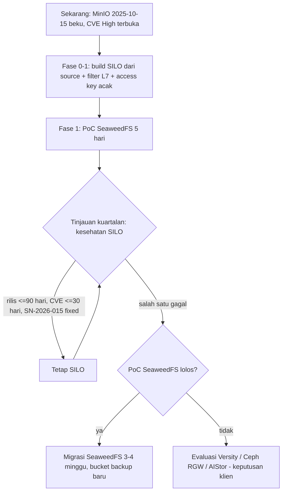

# ADR-030: Sumber Image & Masa Depan Object Storage (MinIO community ditinggalkan upstream)

- **Status:** Proposed — rekomendasi jangka pendek **sudah diterapkan di dev** (Gelombang 9–11, reversible); lihat "Status implementasi"
  - **Keputusan pemilik proyek 10 Okt 2026:** **Q-OS1** = terima SILO (fork komunitas, tanpa SLA); **Q-OS3** = object lock **GOVERNANCE** (bukan COMPLIANCE) + filter s3-gateway; **Q-OS2** = PoC SeaweedFS 5 hari **sebelum produksi**; **Q-OS4** = filestore Odoo lokal terenkripsi (LUKS); **Q-OS5** = backup off-site terenkripsi **wajib sebelum go-live**. Pemutus resmi ADR ini IT + Security: lead menentukan apakah jawaban ini cukup untuk mengubah status ke Accepted (architect tidak mengubahnya).
- **Tanggal:** 2026-10-06 (status implementasi diperbarui Gelombang 12)
- **Pemutus (klien):** IT (Head IT) + Security; Finance hanya bila memilih opsi berbayar (dukungan komersial)
- **Referensi review:** R-S02 (kerentanan dependency), R-S08 (provenance image), R-T08 (backup/DR), R-L01 (UU PDP), R-S06 (upload foto); **usulan risiko baru R-S13** (komponen inti ditinggalkan upstream, lihat bawah)
- **Terkait:** ADR-004 (topologi 4 node, WAL-G → MinIO), ADR-022 (S3 = SSE-S3 MinIO KMS, T9 TLS), ADR-024 (user/policy per service), `infra/minio/Dockerfile`, `infra/minio/minio-init.sh`, `docs/agent-reports/efn-devsecops-engineer.md` Gelombang 7 §G7.3 no. 1

> **Ringkasan manajemen.** Vendor MinIO menghentikan edisi open source-nya: image Docker sudah tidak tersedia, kode diarsipkan (read-only) sejak April 2026, dan beberapa celah keamanan **High** yang ditemukan sesudahnya hanya ditambal di produk komersial mereka. Versi yang kami bangun sekarang (Oktober 2025) masih mengandung celah itu. Rekomendasi: **segera (Fase 0–1)** pindah ke **SILO**, fork komunitas MinIO yang aktif, tetap kami bangun sendiri dari kode sumber. Format data dan konfigurasinya sama, jadi biayanya ±2–3 hari kerja dan Rp0 lisensi. Kami juga menambah filter pengaman di depan storage (±2–3 hari) dan menyiapkan **SeaweedFS** (Apache-2.0) sebagai jalur keluar lewat uji coba 1 minggu di Fase 1. Penggantian penuh (±3–4 minggu) baru dijalankan bila salah satu kriteria pemicu di bawah terpenuhi.

## Konteks

### Apa yang dipakai platform dari object storage
| Kebutuhan | Pemakai | Sumber kontrak |
|---|---|---|
| S3 API (Put/Get/Delete, GetBucketLocation, multipart) | BFF (`minio` npm ^8.0.2), OCR worker (`minio` py 7.2.12), WAL-G | docs/04 §7.3 |
| SSE-S3 dengan **kunci KMS statis** dari `/run/secrets/minio_kms_key` | bucket `market-scout`, `pg-backup` | ADR-022 S3 |
| Versioning + **object lock** (default retention GOVERNANCE 15 hari) + expiry versi lama 35 hari | `pg-backup` (WAL-G, proteksi ransomware) | ADR-022 S3, ADR-004 RPO |
| Lifecycle expiration 90 hari prefix `reports/` | foto Price Hunter (UU PDP) | docs/04 §8.4 |
| User + policy per service per prefix | pgbackup, efn-bff, efn-ocr, efn-prometheus | ADR-024 |
| TLS server dengan sertifikat CA internal | semua klien | ADR-022 T9 |
| Metrik Prometheus (bearer JWT, user `admin:Prometheus`) | Prometheus | SEC-20/SEC-30 |
| Filestore Odoo | **belum** di object storage (masih volume lokal di atas LUKS); baris tabel stack `docs/01` "MinIO → attachment Odoo (filestore)" baru rencana | docs/01 tabel stack |

Satu-satunya kode yang spesifik MinIO adalah `infra/minio/minio-init.sh` (`mc admin user/policy`, `mc encrypt`, `mc ilm`, `mc retention`). BFF dan worker hanya memakai S3 API standar lewat SDK generik.

### Dokumen yang bertentangan dengan kenyataan
- `docs/01` tabel stack: *"Data | Object storage | MinIO | Foto price hunter, backup, attachment Odoo (filestore)."* — mengasumsikan MinIO community tersedia dan dipelihara.
- ADR-022 S3: *"SSE-S3 (MinIO KMS single key `minio_kms_key`) + versioning/object lock di `pg-backup`"* — mengasumsikan implementasi object lock yang benar (lihat SN-2026-015 di bawah).
- `infra/minio/Dockerfile` (gelombang 7): build dari tag `RELEASE.2025-10-15T17-29-55Z` dengan komentar *"Keputusan final (fork komunitas vs build sendiri vs pengganti S3 lain) -> lead/architect"*.

### Status distribusi MinIO community (riset 6 Okt 2026)
| Tanggal | Peristiwa | Sumber | Verifikasi |
|---|---|---|---|
| Mei 2025 | Fitur admin di console community dihapus | blog.vonng.com (14 Feb 2026); madewithlove | sekunder |
| Okt 2025 | MinIO berhenti mempublikasi image gratis di Docker Hub/Quay | gigazine (23 Okt 2025); madewithlove | sekunder |
| 15 Okt 2025 | Tag community terakhir `RELEASE.2025-10-15T17-29-55Z` (fix CVE-2025-62506) | GitHub API `repos/minio/minio/tags` (diakses 6 Okt 2026) | **primer** |
| 3 Des 2025 | Repo masuk mode maintenance | itsfoss, bizety (6 Des 2025), stormdevelopments (11 Jun 2026) | sekunder |
| Feb–Apr 2026 | README: *"THIS REPOSITORY IS NO LONGER MAINTAINED"*, *"distributed as source code only"*; repo diarsipkan, push terakhir 2026-04-24 | github.com/minio/minio + GitHub API (`archived: true`, `pushed_at 2026-04-24T17:54:39Z`) | **primer** |
| 14 Jul 2026 | `minio/mc` diarsipkan | github.com/minio/mc (banner arsip) | **primer** |
| Sep 2026 | Repo Docker Hub `minio/minio` hilang; Quay mewajibkan login (sejak 24 Sep menurut sumber sekunder) | devsecops G7 (pull gagal di runtime); madewithlove | runtime + sekunder |
| 2026 | Penerus resmi = **AIStor** (proprietary). AIStor Free: hanya mode standalone, dilarang modifikasi/redistribusi | min.io/legal/aistor-free-agreement | primer (teks lisensi, belum dibaca utuh) |

SDK klien **tidak** ikut diarsipkan: `minio/minio-js` aktif (push 10 Sep 2026, Apache-2.0, GitHub API) dan `minio/minio-py` tidak berstatus arsip (halaman GitHub 6 Okt 2026). Keduanya klien S3 generik.

### Celah keamanan yang **tidak** ditambal di build kami (`RELEASE.2025-10-15`)
Sumber: GitHub Security Advisories `minio/minio` (API, diakses 6 Okt 2026). Semua "patched" hanya di **AIStor**.

| CVE / ID | Ringkas | Sev. | Prasyarat | Relevan untuk EFN? |
|---|---|---|---|---|
| CVE-2026-41145 (GHSA-hv4r-mvr4-25vw) | Tulis objek tanpa autentikasi via kredensial query-string + `STREAMING-UNSIGNED-PAYLOAD-TRAILER` | High 8.8 | Hanya **access key ID** yang valid (bukan secret) + nama bucket | **Ya.** Access key kita = nama yang mudah ditebak (`efn-bff`, `pgbackup`) dan tercantum di `.env.example` |
| CVE-2026-40344 (GHSA-9c4q-hq6p-c237) | Snowball auto-extract tanpa verifikasi signature | High | Sama seperti di atas | **Ya** |
| CVE-2026-34204 (GHSA-3rh2-v3gr-35p9) | Injeksi metadata SSE via header replikasi → objek tidak dapat dibaca permanen | High | Principal ber-`s3:PutObject` | **Ya** — efn-bff & pgbackup punya PutObject (backup bisa dirusak) |
| CVE-2026-39414 | DoS memori S3 Select CSV | High | PutObject + GetObject | Sebagian (tidak ada principal yang punya keduanya di satu bucket; tetap tutup) |
| CVE-2026-42600 | Path traversal storage-REST | Medium | Mode **distributed** + root JWT | Tidak (kita single node) |
| CVE-2026-33322 / -33419 | OIDC JWT confusion / LDAP brute-force | Medium | OIDC/LDAP aktif | Tidak (tidak dipakai) |
| **SN-2026-015** (advisory SILO, 26 Sep 2026) | `PutObjectRetention`: principal **mana pun** yang terautentikasi dapat menghapus retensi GOVERNANCE atau memasang COMPLIANCE | belum ada skor | Kredensial valid apa pun | **Ya — langsung melemahkan proteksi ransomware `pg-backup`**. Menurut SILO berlaku juga untuk upstream ≥ `RELEASE.2025-04-03`; **belum diverifikasi independen** di kode upstream. Belum ada fix di SILO per 6 Okt 2026 |

Mitigasi parsial yang sudah ada: MinIO tidak dipublikasi ke internet (hanya network internal Docker + TLS), sehingga penyerang butuh pijakan di container lain terlebih dahulu (model ancaman ADR-022). Itu belum cukup: ADR-022 dan ADR-024 justru dirancang untuk skenario "satu container terkompromi".

## Opsi yang dipertimbangkan

### Ringkasan kandidat (data 6 Okt 2026)
| Kandidat | Lisensi | Status | Rilis terakhir | Sumber |
|---|---|---|---|---|
| MinIO upstream (build dari source, status quo) | AGPL-3.0 | **Diarsipkan** | 2025-10-15 | GitHub API |
| **SILO** (`pgsty/silo`, dulu `pgsty/minio`; fork komunitas oleh Pigsty) | AGPL-3.0 | Aktif (push 2026-10-05), 3,9 rb star; janji rilis tiap 1–2 bulan, maks. per kuartal | `RELEASE.2026-09-16T00-00-00Z` | GitHub API, README, silo.pgsty.com, silo.pigsty.io/blog/security |
| SeaweedFS | Apache-2.0 | Aktif (push 2026-10-05), 35 rb star | 4.48 (2026-09-28) | GitHub API, wiki |
| Garage (Deuxfleurs) | AGPL-3.0 | Aktif (mirror GitHub push 2026-10-02) | v2.4.1 | GitHub API, dokumen resmi |
| Ceph RGW | LGPL-2.1/3 | Aktif, sangat matang | — | docs.ceph.com |
| Versity S3 Gateway | Apache-2.0 | Aktif | v1.8.0 (2026-09-04) | GitHub API |
| RustFS (opsional, pantau) | Apache-2.0 | GA baru: 1.0.0 (16 Sep 2026), 1.0.1 (3 Okt 2026) | 1.0.1 | GitHub API |
| AIStor Free (MinIO Inc.) | **Proprietary**, gratis, standalone saja | Aktif | — | min.io/legal |

### Kecocokan per kebutuhan
Legenda: Ya = didokumentasikan sumber resmi; **Ya\*** = didokumentasikan tetapi **belum diuji** pada stack EFN; ? = **belum terverifikasi**; Tidak = didokumentasikan tidak ada.

| Kebutuhan | MinIO 2025-10 (status quo) | SILO | SeaweedFS | Garage | Ceph RGW | Versity |
|---|---|---|---|---|---|---|
| SSE-S3 dengan kunci statis dari file secret | Ya (teruji G7) | Ya\* (sama dengan MinIO, `MINIO_*` dipertahankan) | Ya\* (KEK via `WEED_S3_SSE_KEK`/`security.toml`; tanpa KMS eksternal) | **Tidak** (SSE tidak diimplementasi; anjuran: enkripsi disk atau client-side) | Hanya via **Vault** (backend kunci statis = "diagnostic only") | ? (tampaknya bergantung pada filesystem) |
| Versioning + object lock untuk WAL-G | Ya, tetapi **terdampak SN-2026-015** | Ya, **terdampak SN-2026-015 (belum fix)** | Ya\* (wiki: retention, legal hold, lock config) | **Tidak** (versioning & object lock tidak ada) | Ya | Versioning ya; object lock ? |
| Lifecycle expiration + noncurrent expiry | Ya (teruji) | Ya\* | Ya\* (tanpa transition) | Parsial (Expiration & AbortMultipart saja, tanpa noncurrent) | Ya | ? |
| User + policy per prefix (IAM JSON) | Ya (teruji) | Ya\* | Ya\* (identities + bucket policy; sintaks policy perlu diuji) | **Tidak** (izin per key per bucket, tanpa prefix) | Ya (user + bucket policy) | Ya\* (akun IAM, bucket policy; IAM API baru di v1.8.0) |
| TLS native dengan CA internal | Ya (teruji) | Ya\* | Ya\* (opsi sertifikat; belum diuji) | **Tidak** untuk S3 API (butuh reverse proxy/ghostunnel) | Ya (beast TLS) | Ya |
| Metrik Prometheus terautentikasi | Ya (JWT, teruji) | Ya\* (nama metrik dipertahankan) | Ya\* (format & autentikasi ?) | Ya (bearer token admin API) | Ya (mgr module) | Ya\* |
| WAL-G (aws-sdk-go, S3 generik) | Ya (teruji G7) | Ya\* (wire protocol sama) | Ya\* | Ya\* (tanpa object lock) | Ya\* | ? |
| SDK `minio` js/py | Ya (teruji) | Ya\* | Ya\* (SDK generik; GetBucketLocation didukung) | Ya\* | Ya\* | ? |
| Skrip init (`mc admin …`) | Ya | Ya\* (`pgsty/mc` = `mcli`) | **Tulis ulang** (`weed shell`/IAM API) | Tulis ulang (`garage` CLI) | Tulis ulang (`radosgw-admin`) | Tulis ulang |
| Beban operasi (4 node VPS) | Rendah (1 proses) — tetapi **patch keamanan jadi tanggungan kita** | Rendah (1 proses) | Sedang (master + volume + filer + gateway S3; metadata filer di leveldb/PG) | Rendah | **Tinggi** (MON/MGR/OSD, ≥3 node OSD, RAM ±4 GB/OSD, + Vault untuk SSE-S3) | Rendah (stateless di atas filesystem) |
| Kematangan untuk fitur di atas | Matang, tetapi beku | Kode MinIO matang; tata kelola baru (±1 tahun), **bus factor tinggi** (kontributor aktif utama satu orang, Vonng) | Inti matang (sejak ±2012); SSE/object lock relatif baru, **? di produksi** | Matang untuk use case geo-distributed kecil; fitur kurang | Paling matang | Matang untuk HPC/arsip; fitur S3 lanjutan ? |

### Opsi beserta biaya dan waktu
| Opsi | Kelebihan | Kekurangan | Biaya / waktu |
|---|---|---|---|
| **A. Status quo**: MinIO upstream dari tag beku 2025-10-15 + kontrol kompensasi | Tanpa migrasi; sudah teruji G7 | ≥ 4 CVE High terbuka tanpa jalur patch; menambal sendiri = backport Go tanpa review upstream; `mc` juga beku; tidak lolos gate Trivy CRITICAL/HIGH (R-S02) tanpa pengecualian | Rp0 sekarang; backport tiap CVE ±2–5 hari engineer Go (tidak ada di tim) → **utang yang terus membesar** |
| **B. SILO** (fork komunitas), **dibangun dari tag source** di pipeline kita, di-sign cosign seperti sekarang | Drop-in: wire protocol, format disk, env `MINIO_*`, metrik, dan `mc` kompatibel (klaim proyek); 5 CVE di atas sudah difix (SILO 2026-04-17 dan 2026-06-18); advisory publik; rilis rutin (Des, Mar, Apr, Jun, Agu, Sep 2026) | Bus factor tinggi (satu maintainer utama); tanpa SLA; nama/brand berubah (`mcli`); SN-2026-015 belum difix; versi Go build mungkin harus naik (rilis Sep 2026 menyebut default Go 1.27, **?**) | **±2–3 hari** devsecops+QA (ganti repo/tag, uji `minio-init.sh`, regresi QA G4/G7, WAL-G push/fetch). Rp0 lisensi. Volume data dipakai ulang (**? perlu uji upgrade in-place di dev**) |
| C. **SeaweedFS** | Apache-2.0 (tanpa kewajiban AGPL); komunitas besar & aktif; daftar fitur S3 lengkap (SSE-S3/KMS/C, object lock, lifecycle, policy) | Lebih banyak komponen; SSE/object lock relatif baru; `minio-init.sh` ditulis ulang; KEK via env (perlu wrapper agar tetap dari `/run/secrets`); migrasi data + **bucket backup baru** (object lock tidak bisa dipindah) | PoC **5 hari**; migrasi penuh **±3–4 minggu** (init + policy 1 mgg, metrik & runbook 3 hari, salin data via rclone + base backup WAL-G baru 2–3 hari, QA & uji negatif 1 mgg). Rp0 lisensi; storage ganda sementara selama retensi backup lama (35 hari) |
| D. Garage | Ringan, AGPL, aktif | **Gagal syarat wajib**: tanpa versioning/object lock (WAL-G anti-ransomware), tanpa SSE-S3 (ADR-022 S3), tanpa policy per prefix (ADR-024), tanpa TLS native | Tidak direkomendasikan. Hanya layak bila dipisah: foto saja di Garage + backup di sistem lain → dua sistem storage = beban operasi ganda |
| E. Ceph RGW | Fitur terlengkap, tata kelola yayasan (Linux Foundation) | SSE-S3 butuh Vault/OpenBao (komponen yang ditolak di ADR-022 A3); butuh ≥ 3 node OSD khusus storage; kurva belajar tinggi; berlebihan untuk volume EFN | 4–6 minggu + ±0,5 FTE ops; RAM/disk tambahan di 3 node (biaya VPS naik, belum dihitung) |
| F. Versity S3 Gateway | Apache-2.0, stateless, sederhana di atas filesystem (LUKS) | Object lock, lifecycle, SSE **belum terverifikasi**; tanpa SSE berarti ADR-022 S3 butuh pengecualian ("LUKS + WAL-G libsodium cukup") | PoC 3 hari bila kandidat C gagal |
| G. AIStor Free / Enterprise (MinIO Inc.) | Patch resmi dari vendor | **Bukan open source**; Free dilarang modifikasi/redistribusi, tidak bisa kita bangun & sign dari source (melemahkan R-S08); syarat vendor bisa berubah lagi; Enterprise berbayar (harga tidak dipublikasi, **?**) | Free: Rp0, ±1 hari; Enterprise: biaya lisensi tahunan (minta penawaran) |
| H. RustFS | Apache-2.0, klaim kompatibel MinIO | GA baru 3 minggu; kematangan fitur lock/SSE ? | Pantau; evaluasi ulang ≥ 6 bulan setelah 1.0 |

## Keputusan (rekomendasi)

### Jangka pendek — Fase 0–1 (mulai sekarang)
1. **Opsi B: ganti sumber build ke SILO**, tetap **build dari tag source** di `infra/minio/Dockerfile` (bukan menarik image `pgsty/silo` pihak ketiga), sehingga SBOM, scan Trivy, dan cosign di pipeline kita tetap berlaku (R-S08). Pin tag server `RELEASE.2026-09-16T00-00-00Z` (atau yang lebih baru) dan `pgsty/mc` di tag rilisnya. Header Dockerfile & README menyebut ADR-030. Uji wajib sebelum merge: boot dengan volume dev lama (upgrade in-place), `minio-init.sh` idempoten 2×, uji kebijakan QA G4 (efn-bff/efn-ocr di luar prefix ditolak), SSE-S3 aktif, `wal-g backup-push` + `backup-fetch` + restore-test, metrik JWT.
2. **Kontrol kompensasi (berlaku untuk opsi apa pun, wajib sebelum staging publik):**
   - **Filter L7 di depan MinIO/SILO** (sidecar dengan pola E1 ADR-022: storage bind ke loopback, proxy TLS dengan sertifikat `minio` dari CA internal). Proxy menolak: header `x-amz-bypass-governance-retention`; `PUT ?retention`, `?legal-hold`, `?object-lock` dari semua principal aplikasi (retensi hanya lewat default bucket oleh `minio-init`); `X-Amz-Content-Sha256: STREAMING-UNSIGNED-PAYLOAD-TRAILER` (**syarat**: dipastikan dulu bahwa minio-js, minio-py, dan WAL-G tidak memakainya, **?**); header `X-Minio-Replication-*`; `POST ?select`; path `/minio/admin/` kecuali dari `minio-init`/ops. Biaya ±2–3 hari devsecops. Desain teknis milik devsecops; jenis proxy (HAProxy/nginx/Traefik internal) diputuskan di sana.
   - **Access key acak** (bukan `efn-bff`/`pgbackup`) disimpan sebagai secret, karena dua CVE di atas hanya butuh access key ID. Biaya ±0,5 hari; Rp0.
   - **Mode retensi `pg-backup`**: selama SN-2026-015 belum difix, pertimbangkan **COMPLIANCE** 15 hari (tidak bisa dihapus/diperpendek oleh siapa pun, termasuk root, sampai kedaluwarsa). Konsekuensi: kesalahan konfigurasi durasi tidak bisa dibatalkan → **butuh persetujuan klien (Q-OS3)**. Filter L7 di atas tetap wajib.
3. **Filestore Odoo tetap di volume lokal (LUKS) pada Fase 0–1**, tidak dipindah ke object storage. Ini mengurangi ketergantungan pada keputusan ini. Bila nanti dipindah, gunakan OCA `fs_attachment_s3`/`fs_storage` (ada di branch 19.0 OCA/storage per 6 Okt 2026; kualitas port & lisensi **belum terverifikasi**; wajib fit-gap `efn-odoo-functional`).
4. **Jaga portabilitas**: aplikasi hanya memakai S3 API standar lewat SDK generik (sudah). Tidak boleh ada panggilan admin API MinIO dari BFF/worker. Semua hal yang spesifik vendor dikurung di `minio-init.sh` + filter L7.
5. **Jalur keluar disiapkan**: PoC **SeaweedFS** 5 hari di Fase 1 (devsecops + QA) memakai checklist kesesuaian yang sama dengan butir 1, ditambah uji negatif object lock dan policy. Hasilnya dicatat di ADR ini sebagai lampiran, sehingga migrasi dapat dieksekusi ±3–4 minggu bila pemicu terjadi.

### Jangka menengah — Fase 2–3 (sebelum go-live publik)
- **Tetap SILO** bila semua kriteria kesehatan terpenuhi: rilis ≤ 90 hari sekali, CVE High/Critical difix ≤ 30 hari sejak advisory, SN-2026-015 difix, dan ada ≥ 2 maintainer aktif atau sponsor organisasi.
- **Pindah ke SeaweedFS** bila salah satu kriteria gagal dan PoC lolos. Bila PoC SeaweedFS gagal (mis. object lock tidak benar), evaluasi Versity (F) dengan pengecualian SSE di ADR-022, atau pertimbangkan Ceph RGW hanya bila skala storage sudah membutuhkan cluster ≥ 3 node (Fase 6).
- Opsi G (AIStor) hanya sebagai jalan darurat dengan keputusan klien eksplisit, karena bertentangan dengan arahan open source dan provenance build sendiri.

### Alur keputusan

## Status implementasi (per 6 Okt 2026, Gelombang 12)
ADR tetap **Proposed**; lead memutuskan menerapkan rekomendasi jangka pendek karena reversible (rollback: `efn-devsecops-engineer.md` G9.5).

| Butir keputusan | Status | Bukti | Sisa |
|---|---|---|---|
| 1. SILO dibangun dari tag source | **Selesai (dev)** | `infra/minio/Dockerfile`: `pgsty/silo` + `pgsty/mc` `RELEASE.2026-09-16T00-00-00Z`, commit SHA diverifikasi saat build, Go 1.27.1 (digest dipin), non-root. **Upgrade in-place volume lama berhasil** (objek lama terbaca, versioning, lock GOVERNANCE 15 h, SSE-S3, ILM 90 h) — menjawab klaim "belum diuji" di atas untuk arah lama → SILO | Arah balik (SILO → MinIO lama) belum diuji; staging belum ada |
| 2a. Filter L7 | **Selesai (dev)** — service `s3-gateway` (HAProxy 3.2 LTS, digest dipin), storage dipindah ke network internal `objstore` | Smoke `g` 19/19; WAL-G push/wal-push, upload BFF, GET worker lolos filter | Belum ada metrik HAProxy dan alert burst 403 (usulan `EfnS3GatewayDeniedBurst`, lihat `docs/runbooks/security-incident.md`); `backup-push` besar + `restore-test.sh` lewat filter belum diuji |
| SEC-41 (bypass filter lewat percent-encoding / `;`) | **Fixed + terverifikasi runtime** (G11) | Bypass sempat **terkonfirmasi** (`?rete%6Etion` dirutekan SILO ke PutObjectRetention). Perbaikan: tolak `;` dan `%` di nama kunci query, `%` di query method tulis, cocokkan `query,url_dec` dengan pemisah `[&;]`, `path,url_dec`, tolak segmen `/./ /../ //`, tolak `x-amz-content-sha256` ganda. 24 varian encoded → 403 | Bila `MINIO_DOMAIN` (virtual-host) diaktifkan, aturan `p_root` wajib ditinjau |
| 2b. Access key acak | **Selesai** | Secret `minio_{bff,ocr,backup,prometheus}_access_key` (80 bit), user lama dihapus, kredensial lama ditolak; root user acak (`minio_root_user`, SEC-48) | Staging/prod: secret baru di GitHub Environment |
| 2c. Mode retensi `pg-backup` | **Menunggu Q-OS3** — tetap GOVERNANCE + filter | `mc retention clear` oleh user backup → 403 filter | SN-2026-015 masih berlaku untuk kredensial yang langsung ke storage (root lewat `minio-init` di network `objstore`) |
| 3. Filestore Odoo lokal | Sesuai rekomendasi | — | Q-OS4 |
| 5. PoC SeaweedFS | Belum dimulai (Fase 1) | — | Q-OS2 |

## Konsekuensi
- **Positif:** menutup 5 CVE yang diketahui tanpa migrasi data; rantai pasok tetap bisa diaudit (build + sign sendiri); filter L7 menutup kelas serangan "header berbahaya" terlepas dari vendor; jalur keluar terdokumentasi.
- **Negatif / utang teknis:** bergantung pada fork dengan bus factor tinggi tanpa SLA; komponen tambahan (proxy) di jalur T9; perlu tinjauan kuartalan atas kesehatan upstream; AGPL-3.0 tetap berlaku (kita tidak memodifikasi dan tidak menyediakan layanan storage ke pihak ketiga, sehingga kewajiban sumber AGPL praktis tidak terpicu. **Bukan opini hukum**, konfirmasi Legal bila ada modifikasi).
- **Dampak dokumen (tanpa mengedit dokumen bisnis asli):**
  - `docs/01` tabel stack ("MinIO") → dibaca "object storage S3-compatible (saat ini SILO, fork MinIO)"; filestore Odoo tetap lokal Fase 0–1.
  - ADR-022 S3/T9 → nama komponen; bila filter L7 dipasang, hop proxy↔storage masuk pola E1 (loopback). Bila kelak SeaweedFS: KEK tetap dari `/run/secrets` (wrapper), tidak dari env file.
  - ADR-024 → access key menjadi secret acak (bukan nama tetap); `docs/04 §7.3` perlu kolom "access key = secret".
  - `docs/04 §7` → catatan bahwa object lock mode dapat menjadi COMPLIANCE (Q-OS3).
  - Runbook devsecops: `internal-pki.md#minio-object-lock`, `backup-restore.md` (nama image/CLI `mcli`).
- **Usulan risiko baru untuk register `docs/01` (lead):** **R-S13 — Komponen inti open source ditinggalkan atau berubah lisensi oleh upstream** (MinIO 2025–26; preseden Vault/Terraform BSL 2023, Redis 2024). Dampak 4, kemungkinan 3, skor 12. Mitigasi: build dari source, pin + sign, tinjauan kesehatan upstream kuartalan untuk komponen inti (PostgreSQL, Redis, RabbitMQ, object storage, Traefik, ClickHouse), dan jalur keluar per komponen.

## Risiko terkait
R-S02, R-S08, R-T08 (backup dapat dirusak/dikunci lewat celah object lock), R-L01 (foto PII; lifecycle 90 hari harus tetap jalan), R-S06, usulan R-S13.

## Pertanyaan terbuka untuk klien
- **Q-OS1** Apakah klien menerima komponen storage yang dipelihara **fork komunitas tanpa SLA** (SILO) untuk Fase 0–1, dengan kompensasi tinjauan kuartalan dan jalur keluar SeaweedFS? (Alternatif berbayar: AIStor Enterprise. Harga belum diketahui.)
- **Q-OS2** Setuju anggaran PoC SeaweedFS 5 hari kerja di Fase 1?
- **Q-OS3** Setuju `pg-backup` memakai object lock **COMPLIANCE** 15 hari (tidak bisa dibatalkan siapa pun, termasuk Superadmin) selama SN-2026-015 belum difix? Default bila tidak dijawab: tetap GOVERNANCE + filter L7.
- **Q-OS4** Konfirmasi filestore Odoo tetap di disk lokal terenkripsi pada Fase 0–1 (bukan object storage).
- **Q-OS5** Target backup **off-site** (ADR-022 S6, wajib sebelum go-live): penyedia S3 di Indonesia yang mendukung object lock? Jawaban ini memengaruhi apakah object lock lokal harus sekuat itu.

## Kapan ditinjau ulang
- **Kuartalan** (tinjauan kesehatan SILO): mulai Januari 2027.
- **Segera** bila: SILO tidak merilis > 90 hari; ada CVE High/Critical tanpa fix > 30 hari; SN-2026-015 belum difix saat staging publik; SILO berganti lisensi, diarsipkan, atau memutus kompatibilitas format/protokol; MinIO Inc. membuka kembali edisi community.
- **Struktural:** kebutuhan storage > 1 node atau > 2 TB, migrasi ke Swarm/k3s (Fase 6), atau filestore Odoo dipindah ke object storage.

## Sumber (diakses 6 Okt 2026 kecuali disebut lain)
- Primer: [github.com/minio/minio](https://github.com/minio/minio) (README, banner); GitHub API `repos/minio/minio` (archived, pushed_at), `/tags`, `/security-advisories`; advisory [GHSA-hv4r-mvr4-25vw](https://github.com/advisories/GHSA-hv4r-mvr4-25vw), [GHSA-9c4q-hq6p-c237](https://github.com/minio/minio/security/advisories/GHSA-9c4q-hq6p-c237), [GHSA-3rh2-v3gr-35p9](https://github.com/minio/minio/security/advisories/GHSA-3rh2-v3gr-35p9), [GHSA-h749-fxx7-pwpg](https://github.com/advisories/GHSA-h749-fxx7-pwpg), [GHSA-xh8f-g2qw-gcm7](https://github.com/advisories/GHSA-xh8f-g2qw-gcm7); [github.com/minio/mc](https://github.com/minio/mc) (arsip 14 Jul 2026); GitHub API `minio/minio-js`.
- SILO: [github.com/pgsty/minio → pgsty/silo](https://github.com/pgsty/minio) (README, rename 2026-08-06), GitHub API releases & contributors, [silo.pgsty.com](https://silo.pgsty.com), [SILO Security Chronicle](https://silo.pigsty.io/blog/security/), [SN-2026-015](https://silo.pigsty.io/blog/security/20260926-governance-retention-bypass/), [blog.vonng.com "MinIO Is Dead, Long Live MinIO"](https://blog.vonng.com/en/db/minio-resurrect/) (14 Feb 2026).
- Alternatif: [Garage S3 compatibility](https://garagehq.deuxfleurs.fr/documentation/reference-manual/s3-compatibility/), [Garage reverse proxy](https://garagehq.deuxfleurs.fr/documentation/cookbook/reverse-proxy/); [SeaweedFS wiki Amazon S3 API](https://github.com/seaweedfs/seaweedfs/wiki/Amazon-S3-API), [SeaweedFS SSE](https://github.com/seaweedfs/seaweedfs/wiki/Server-Side-Encryption); [Ceph RGW encryption](https://docs.ceph.com/en/latest/radosgw/encryption/); [versity/versitygw](https://github.com/versity/versitygw); GitHub API RustFS releases; [AIStor Free agreement](https://www.min.io/legal/aistor-free-agreement); [OCA/storage 19.0](https://github.com/OCA/storage/tree/19.0).
- Sekunder (kronologi): [stormdevelopments.ca](https://stormdevelopments.ca/blog/minio-s-community-edition-is-archived-what-still-runs-in-2026/) (11 Jun 2026), [madewithlove](https://madewithlove.com/blog/thanks-for-all-the-buckets/), [gigazine](https://gigazine.net/gsc_news/en/20251023-minio-stops-distributing-free-docker-images) (23 Okt 2025), [bizety](https://bizety.com/2025/12/06/minio-in-maintenance-mode-open-source-alternatives/) (6 Des 2025).

### Klaim yang belum terverifikasi
- SN-2026-015 juga berlaku di upstream MinIO ≥ 2025-04-03: klaim SILO, belum diverifikasi di kode upstream maupun diuji di stack EFN.
- Kompatibilitas drop-in SILO (format disk, `mc`, metrik, upgrade in-place volume lama): klaim proyek, belum diuji.
- Versi Go yang dibutuhkan untuk build SILO terbaru (indikasi Go 1.27): belum dicek di `go.mod`.
- Apakah minio-js 8.x, minio-py 7.2.x, dan WAL-G mengirim `STREAMING-UNSIGNED-PAYLOAD-TRAILER`: belum dicek. Ini menentukan apakah filter L7 bisa memblokir header tersebut tanpa efek samping.
- Fitur SeaweedFS (object lock, SSE-S3, policy, TLS, metrik) dan Versity (object lock, lifecycle, SSE): hanya berdasarkan dokumentasi, belum diuji.
- Tanggal pasti hilangnya repo Docker Hub `minio/minio` dan kewajiban login Quay: sumber sekunder + observasi runtime devsecops.
- Isi lengkap lisensi AIStor Free (mis. kewajiban registrasi atau telemetri): belum dibaca utuh.
- Sifat tata kelola SILO (jumlah maintainer aktif): disimpulkan dari daftar kontributor GitHub dan blog pendiri; bukan pernyataan resmi.
