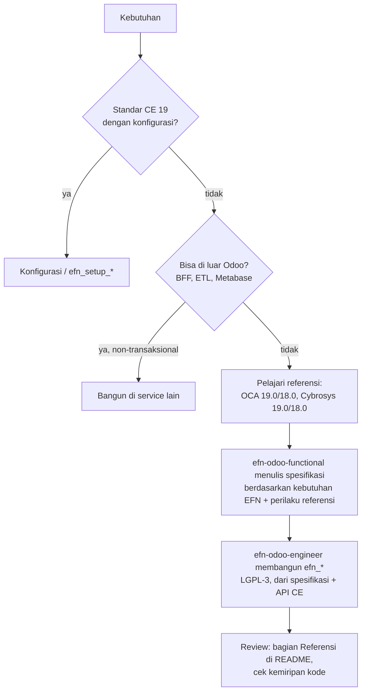

# ADR-031: Tanpa Dependency Modul Odoo Pihak Ketiga; OCA & Cybrosys Hanya sebagai Referensi Desain

- **Status:** **Diputuskan klien 6 Okt 2026** (prinsip). Rincian pelaksanaan (lisensi modul `efn_*`, anggaran tambahan, laporan keuangan statutori, studi di sandbox) masih **Proposed** sampai Q-V1..Q-V6 dijawab.
- **Tanggal:** 2026-10-06
- **Pemutus (klien):** Klien (instruksi langsung via efn-lead, 6 Okt 2026); rincian: IT Lead + Finance (anggaran, laporan) + Legal (lisensi)
- **Referensi review:** D-15, R-T03, R-T04, R-L08, R-B09, R-S10, R-S13 (usulan ADR-030)
- **Menggantikan sebagian:** ADR-015 bagian "OCA/CE dulu" dan peta modul OCA di dalamnya (*superseded-in-part*). Penamaan `efn_<domain>` di ADR-015 **tetap berlaku**.
- **Terkait:** ADR-001 (inter-company), ADR-010, ADR-013 (KDS), ADR-018 (kitting), ADR-021 (baseline 19), ADR-025 (functional-first), ADR-030 (`fs_attachment_s3`), `docs/06_ODOO_CE19_MODULE_AUDIT.md` (direvisi), `docs/08_ODOO_FIT_GAP.md`, `LICENSES.md`, `services/odoo/addons/efn_setup_audit`

> **Ringkasan manajemen.** Atas instruksi klien, platform EFN **tidak lagi memasang modul Odoo dari pihak ketiga** (OCA, Cybrosys, Apps Store). Yang dipasang hanya Odoo Community 19 dan modul buatan sendiri `efn_*`. OCA dan Cybrosys tetap dipakai sebagai **bahan referensi desain** (cara kerja, struktur data, tampilan), tetapi kodenya tidak disalin. Akibatnya ada **5 modul yang sebelumnya "gratis" dari OCA kini harus dibangun sendiri** (audit log, inter-company, laporan keuangan/konsolidasi, QC intake, dan beberapa ekstensi POS bila dibutuhkan): tambahan **±10–16 minggu-engineer (±Rp50–145 juta biaya SDM)**, atau ±13–21 minggu bila Finance meminta laporan keuangan dibuat di dalam Odoo,, dan Fase 1 berisiko mundur **2–4 minggu** bila tidak ditambah satu engineer Odoo paralel. Imbalannya: tidak ada lagi patch darurat untuk bug modul orang lain, tidak menunggu jadwal migrasi komunitas, dan semua modul Odoo bisa berlisensi LGPL-3 yang seragam.

## Konteks

### Dokumen yang digantikan
- ADR-015 Keputusan: *"Opsi A. Peta modul … Multi-Company / inter-company → OCA `purchase_sale_inter_company`, `account_invoice_inter_company` …"*; Konsekuensi: *"ketergantungan pada laju migrasi OCA (ADR-021)."*
- `docs/01` D-15: *"… petakan ke OCA dulu sebelum menulis dari nol."*; §3.4: *"modul … tersedia di OCA/multi-company … sehingga modul 'Multi-Company' tidak perlu ditulis dari nol."*; §3.6: *"Opsi open source: OCA `mis_builder` …"*
- ADR-021 Konteks: alasan memilih 19 antara lain *"modul OCA kunci sudah 19.0"*.
- `docs/08` prinsip: *"konfigurasi CE dulu → OCA → custom"*; F-03, F-17, F-19 berkategori **O** (OCA).

### Bukti risiko ketergantungan OCA (sudah terjadi di proyek ini)
| # | Bukti | Sumber | Dampak |
|---|---|---|---|
| 1 | OCA `auditlog` 19.0.2.0.0 tidak kompatibel dengan ORM Odoo 19.0 build 2026-09: `ThrowAwayCache` menukar `transaction.field_dirty` sementara `Environment._field_dirty` menyimpan referensi lama → *"AssertionError: Could not find all values … to flush them"* saat membuat produk | `services/odoo/addons/efn_setup_audit/patches.py`, README §Patch | Create produk bisa gagal di produksi; kita memelihara **monkey-patch atas kode pihak ketiga**. Per 6 Okt 2026 versi di branch 19.0 masih `19.0.2.0.0` (manifest dicek ulang) → perbaikan upstream belum terlihat |
| 2 | Kode OCA di-fetch dari GitHub saat build (`scripts/fetch-oca.sh`) | `scripts/fetch-oca.sh`, `ci.yml` (job melewati `efn_setup_audit` bila fetch gagal) | Build bergantung pada ketersediaan & isi repo eksternal; provenance (R-S08) dan reproducibility lebih lemah; CI bisa "hijau" tanpa audit log |
| 3 | Dependensi transitif tak terduga: `mis_builder` butuh `report_xlsx` + `date_range` yang awalnya tidak ikut di-fetch | `docs/06` §2 | Install gagal; tiap modul OCA menarik modul lain |
| 4 | OCA 19.0 belum lengkap: OCA/pos 4 modul (vs 28 di 18.0), OCA/l10n-indonesia 19.0 kosong, `purchase_sale_stock_inter_company` tidak ada di 19.0 | `docs/06`, ADR-021 | Sebagian kebutuhan tetap custom; "OCA-first" tidak menghapus pekerjaan, hanya menundanya |
| 5 | Siklus rilis eksternal: upgrade Odoo 19→20 menunggu migrasi tiap modul OCA yang dipakai | R-T04, ADR-021 | Jadwal upgrade EFN dikunci oleh relawan komunitas |
| 6 | Lisensi campuran: modul EFN yang bergantung modul AGPL wajib AGPL-3 (`efn_setup_audit`), lainnya LGPL-3 | `efn_setup_audit/__manifest__.py`, CLAUDE.md | Dua rezim lisensi di satu repo; `LICENSES.md` menyatakan `efn_*` = AGPL-3, CLAUDE.md menyatakan LGPL-3 (tidak konsisten) |

### Instruksi klien (6 Okt 2026)
> "pengembangan ini tidak ingin memiliki ketergantungan dengan OCA, tambahkan satu reference lagi dari Cybrosys, modul gap akan dikembangkan sendiri menyesuaikan kebutuhan, perlakukan vendor sebagai reference."

### Hasil verifikasi Cybrosys (sumber primer, 6 Okt 2026)
- Repo `github.com/CybroOdoo/CybroAddons`: branch 8.0–20.0 + `saas-19.4`; default branch **19.0**; aktif (push 2026-10-05); **tidak ada lisensi tingkat repo** (GitHub API `license: null`) → lisensi ditentukan **per modul** di `__manifest__.py`.
- Modul publik 19.0 yang dicek memakai **LGPL-3 atau AGPL-3** (lihat `docs/06` §1–2). Contoh: `pos_kitchen_screen_odoo` LGPL-3, `user_audit` LGPL-3, `inter_company_synchronization` **AGPL-3**, `pos_book_order` **AGPL-3**.
- Modul **berbayar** Cybrosys dijual di apps.odoo.com dengan **OPL-1** dan **tidak ada** di repo publik. Contoh terverifikasi: `account_reports_xlsx` 19.0, USD 22,40, OPL-1 (*"It is forbidden to publish, distribute, sublicense, or sell copies of the Software or modified copies"*); 404 di CybroAddons 19.0.
- Beberapa modul akuntansi Cybrosys 19.0 (`base_accounting_kit`, `dynamic_accounts_report`, `base_account_budget`) bergantung pada `cybrosys_support_client` ("Get Technical/Functional Assistance from Cybrosys without leaving your Database"). Apakah modul itu memanggil server eksternal **belum terverifikasi** (hanya manifest yang dibaca). Ini alasan tambahan untuk tidak memasangnya.

## Opsi yang dipertimbangkan

| Opsi | Kelebihan | Kekurangan | Biaya / waktu |
|---|---|---|---|
| A. Status quo: OCA-first (ADR-015) | Kode custom paling sedikit | **Ditolak klien**; bukti risiko #1–#6 | Baseline |
| **B. Tanpa dependency pihak ketiga; OCA & Cybrosys = referensi desain; gap dibangun sebagai `efn_*` LGPL-3 (clean implementation)** | Satu rezim lisensi; tidak ada patch atas kode orang lain; build tanpa fetch eksternal; upgrade 19→20 di bawah kendali EFN; modul dirancang tepat untuk kebutuhan EFN (mis. audit log hanya untuk model yang dibutuhkan) | Lebih banyak kode yang harus dipelihara sendiri; butuh disiplin clean implementation | **+9–16 minggu-engineer** (rincian di bawah); pemeliharaan ±20–30% usaha bangun per upgrade mayor |
| C. *Vendoring*: salin modul OCA/Cybrosys ke repo dan ganti nama `efn_*` | Cepat (hari, bukan minggu) | Bukan "milik sendiri": tetap kode pihak ketiga (lisensi AGPL/LGPL + hak cipta asli ikut), bug yang sama ikut tersalin, fork tanpa upstream | ±1–2 minggu; utang perawatan sama besar dengan A tanpa bantuan komunitas. **Bertentangan dengan maksud instruksi** |
| D. Kurangi lingkup Odoo: fungsi non-transaksional dipindah keluar Odoo (laporan → ClickHouse/Metabase) | Memanfaatkan stack yang sudah ada (ADR-003); tanpa modul Odoo baru | Tidak cocok untuk fungsi transaksional (audit log, inter-company) | Dipakai **sebagai bagian dari B** untuk laporan konsolidasi |

## Keputusan

**Opsi B (+ D untuk laporan).** Yang dipasang di image/produksi Odoo hanya: **(1) modul Odoo CE 19 standar** dan **(2) modul `efn_*` milik EFN**. Tidak ada modul OCA, Cybrosys, atau Apps Store di `addons_path`, image, CI, maupun skrip build.

### Urutan fit-gap baru (menggantikan "CE → OCA → custom")



Kategori di `docs/08` menjadi: **S** Standar CE · **E** di luar Odoo (BFF/ETL/Metabase) · **C** Custom `efn_*` (dengan kolom referensi). Kategori **O** dihapus.

### Panduan lisensi & clean implementation

**Peta lisensi referensi (ringkas):**

| Sumber | Lisensi yang ditemui | Boleh dipasang di EFN? | Boleh dibaca sebagai referensi? |
|---|---|---|---|
| Odoo CE 19 (`odoo/odoo`) | LGPL-3 | **Ya** (satu-satunya basis) | Ya; pola inherit/override adalah cara normal |
| OCA (branch 19.0/18.0) | AGPL-3 (mis. `auditlog`, `purchase_sale_inter_company`, `account_invoice_inter_company`, `mis_builder`, `report_xlsx`, `account_financial_report`, `quality_control_oca`), LGPL-3 (mis. `date_range`, `queue_job`) | **Tidak** | Ya (publik) |
| Cybrosys publik (CybroAddons) | Per modul: LGPL-3 atau AGPL-3; repo tanpa lisensi induk | **Tidak** | Ya, **cek manifest per modul** dan catat lisensinya |
| Cybrosys berbayar (apps.odoo.com) | OPL-1 | **Tidak** | **Hanya** halaman deskripsi publik & screenshot. **Dilarang** membeli/mengunduh untuk membaca kodenya |
| Vendor lain Apps Store | bervariasi (sering OPL-1) | Tidak | Hanya deskripsi publik; perluasan daftar referensi butuh persetujuan efn-lead |

**Boleh:**
1. Mempelajari **apa** yang dilakukan modul referensi: model & field yang dibutuhkan, alur state, aturan bisnis, titik hook di CE (mis. "auditlog mencegat `create/write/unlink` lewat `_register_hook`"), UX layar, kasus tepi, dan bug yang dilaporkan di issue tracker-nya.
2. Memakai **API publik Odoo CE** dan pola Odoo yang umum (inherit, `_register_hook`, `ir.cron`, record rule, OWL patch) — ini bukan milik vendor.
3. Menyalin/menyesuaikan potongan **kode Odoo CE** bila perlu, dengan tetap LGPL-3 dan mencantumkan asalnya di komentar.
4. Memasang modul referensi **hanya di sandbox studi yang terisolasi** (bukan repo, bukan image, bukan CI, bukan staging) untuk mengamati perilaku — **menunggu persetujuan Q-V1**.

**Dilarang:**
1. Menyalin kode verbatim atau "hampir verbatim" (rename variabel, ubah urutan, terjemahkan komentar) dari modul OCA/Cybrosys ke `efn_*`: Python, XML view/data, JS/OWL, SCSS, template QWeb, file `.po`, ikon/gambar, test fixture, docstring.
2. Menyalin struktur file baris-per-baris sambil membaca sumber di layar sebelah.
3. Membaca kode modul **OPL-1** (berbayar) dalam bentuk apa pun.
4. Menambahkan modul referensi sebagai `depends`, submodule, wheel, atau fetch saat build.

**Proses (dua peran, "clean-room ringan"):**
1. **efn-odoo-functional** membaca referensi dan menulis **spesifikasi fungsional** di `docs/08` §4 (model, field, aturan, alur, UX) dalam kata-kata sendiri, tanpa potongan kode.
2. **efn-odoo-engineer** membangun dari spesifikasi + source CE. Boleh membuka referensi untuk menjawab pertanyaan perilaku, tetapi tidak menulis kode sambil membuka kode referensi.
3. README modul memuat bagian **"Referensi"** (format di bawah).
4. Review: reviewer membandingkan modul baru dengan modul referensi utama (cek manual untuk modul kecil; untuk modul > 1.000 baris diusulkan cek kemiripan otomatis, mis. detektor duplikasi lintas-repo — **alat belum dievaluasi**, tugas devsecops).

**Format bagian "Referensi" di README modul `efn_*`:**
```markdown
## Referensi
| Vendor | Modul | Branch/versi | Lisensi | Yang dipelajari | Tanggal |
|---|---|---|---|---|---|
| OCA/server-tools | auditlog | 19.0 / 19.0.2.0.0 | AGPL-3 | konsep rule per model, mode full/fast, retensi via cron | 2026-10-xx |
| Cybrosys | user_audit | 19.0 / 19.0.1.0.0 | LGPL-3 | UX daftar aktivitas per user | 2026-10-xx |

Pernyataan: tidak ada kode, data XML, aset, atau teks dari modul di atas yang disalin ke modul ini.
```

**Konsekuensi bila kode vendor ternyata tersalin** (bukan opini hukum; konfirmasi Legal):
| Yang tersalin | Konsekuensi lisensi | Konsekuensi teknis | Tindakan |
|---|---|---|---|
| Kode **AGPL-3** (OCA, sebagian Cybrosys) | Modul `efn_*` menjadi karya turunan → **wajib AGPL-3**, wajib mempertahankan header hak cipta asli; bila Odoo kelak diakses pihak ketiga lewat jaringan (mis. mitra franchise), source modul wajib disediakan bagi mereka | Melanggar ADR-031 (kode pihak ketiga masuk lewat pintu belakang) | Pilih: (a) tulis ulang bagian itu dari spesifikasi oleh engineer lain, atau (b) relisensi modul ke AGPL-3 + atribusi, dicatat sebagai pengecualian ADR ini. Default: (a) |
| Kode **LGPL-3** (Cybrosys, sebagian OCA) | Lisensi tetap kompatibel, tetapi **wajib mempertahankan pemberitahuan hak cipta** pemilik asli dan menandai perubahan | Sama di atas | (a) tulis ulang atau (b) tambahkan atribusi hak cipta; catat di README |
| Kode **OPL-1** | **Pelanggaran lisensi** (redistribusi/modifikasi dilarang); risiko hukum terhadap EFN dan Athera | Harus dibuang | Hapus segera, tulis ulang oleh engineer yang tidak membaca kode tersebut, laporkan ke Legal |

**Lisensi modul `efn_*`:** semua **LGPL-3** (tidak ada lagi alasan AGPL karena tidak ada dependency OCA). `efn_setup_audit` (AGPL-3) dihapus/diganti. `LICENSES.md` diperbarui; konfirmasi Q-V2.

### Modul yang kini dibangun sendiri (sebelumnya OCA)

Asumsi tarif: Odoo engineer senior Rp25–40 jt/bulan, mid Rp15–25 jt/bulan (`docs/07` §B) → **±Rp5–9 jt per minggu-engineer** (rata-rata campuran). Estimasi belum termasuk QA (±20%).

| # | Kebutuhan | Sebelumnya | Kini | Referensi (lisensi) | Estimasi | Fase |
|---|---|---|---|---|---|---|
| 1 | Audit log perubahan data (R-S10, F-17) | OCA `auditlog` + `efn_setup_audit` (AGPL) + patch ORM | **`efn_audit`** (LGPL-3): model aturan per model (create/write/unlink, daftar field dikecualikan), log + baris old/new, retensi via `ir.cron`, grup Auditor, record rule multi-company, masking nomor HP untuk tampilan (UU PDP). Aturan EFN dipindah dari `efn_setup_audit` | OCA `auditlog` 19.0.2.0.0 (AGPL-3); Cybrosys `user_audit` 19.0.1.0.0 (LGPL-3); CE `mail` tracking (`tracking=True`) sebagai lapisan standar untuk field tertentu | **2–3 minggu** (1 engineer) | 1 (sebelum pilot, R-S10) |
| 2 | Inter-company PO→SO, invoice→bill, sinkron picking (F-03) | OCA `purchase_sale_inter_company` + `account_invoice_inter_company` + glue 1–2 mgg | **`efn_intercompany`** (LGPL-3): konfigurasi pasangan company, PO PT-A → SO PT-B (dan sebaliknya), invoice → vendor bill, sinkron picking/lot (yang tidak ada di OCA 19.0), idempotensi & rekonsiliasi, record rule | OCA keduanya 19.0 (AGPL-3); Cybrosys `inter_company_synchronization` 19.0.1.0.0 (**AGPL-3**, SO/PO saja) | **4–6 minggu** (net **+3–4 mgg** dibanding rencana glue) | 1 (memblokir alur CK, ADR-018) |
| 3 | Laporan manajemen & konsolidasi multi-company (F-19, §3.6) | OCA `mis_builder` (+ `report_xlsx`, `date_range`) | **Di luar Odoo (Opsi D)**: mart GL per company + eliminasi inter-company di ClickHouse, dashboard Metabase (near real-time 15 menit, ADR-003). Odoo hanya sumber data | OCA `mis_builder` 19.0.1.2.1 (AGPL-3) sebagai referensi konsep KPI/periode | **3–4 minggu** data engineer (sebagian sudah ada di backlog ETL) | 1–2 |
| 4 | Laporan keuangan per PT untuk akuntan (Neraca, L/R, Buku Besar, Neraca Saldo, umur piutang/utang) | OCA `account_financial_report` (tidak pernah dipasang; terkait mis_builder) | **Menunggu Q-V3**: (a) pivot/list standar `account.move.line` + export XLSX CE (`/web/export/xlsx`, terverifikasi) + Metabase — Rp0 kode; atau (b) **`efn_account_reports`** (LGPL-3) PDF/XLSX di Odoo | OCA `account_financial_report` 19.0.0.0.26 (AGPL-3); Cybrosys `base_accounting_kit` 19.0.3.3.1 & `dynamic_accounts_report` 19.0.1.1.2 (LGPL-3, keduanya depends `cybrosys_support_client`) | (a) **1 minggu** konfigurasi + Metabase; (b) **4–6 minggu** | 1–2 |
| 5 | Ekspor Excel | OCA `report_xlsx` | **Standar CE**: ekspor list view ke XLSX (`web/controllers/export.py`, route `/web/export/xlsx`); laporan khusus memakai `xlsxwriter` (dipakai CE) langsung di modul `efn_*` | OCA `report_xlsx` (AGPL-3); Cybrosys `advanced_excel_reports` (LGPL-3), `excel_report_designer` (AGPL-3) | 0; ±1–3 hari per laporan khusus | sesuai kebutuhan |
| 6 | Rentang tanggal/periode | OCA `date_range` | **Tidak dibutuhkan** (hanya dependensi mis_builder); filter tanggal standar CE + periode di Metabase | OCA `date_range` (LGPL-3) | 0 | — |
| 7 | QC intake farming (F-16) | `quality_control_oca` sebagai dasar `efn_agri` | **`efn_agri`** dari nol (titik QC di receipt, hasil uji, karantina lot) | OCA `quality_control_oca` 19.0.1.0.0 (AGPL-3); Cybrosys: **belum terverifikasi** | **+1–2 minggu** di atas estimasi `efn_agri` | 5 |
| 8 | Ekstensi POS kecil (F-04/F-07/F-10: edit baris, nomor sesi, cetak QZ Tray, tanggal lahir; serta port 18.0: refund penuh, cash control, lot barcode) | OCA/pos 19.0 (4 modul) + porting 18.0 | Hanya bila PoC membuktikan perlu: **`efn_pos_*`** kecil. Cetak dapur via QZ Tray hanya bila ePOS jaringan gagal (Q-19) | OCA/pos 19.0 & 18.0 (lisensi per modul **belum diverifikasi** di audit ini); Cybrosys `pos_auto_lot_selection` 19.0.1.0.1 (AGPL-3) | 2–5 hari per modul (+20–30% dibanding porting) | 1–2 |
| 9 | Produk/partner dibagi ke sebagian company (F-01, Q-8) | OCA `base_multi_company`, `product_multi_company` | Standar CE (`company_id` kosong = semua company) bila cukup; bila harus subset company → `efn_multi_company_share` | OCA (lisensi **belum diverifikasi** di audit ini); Cybrosys **belum terverifikasi** | 0 atau **1 minggu** (Q-8) | 1 |
| 10 | Filestore Odoo di object storage (ADR-030 butir 3) | OCA `fs_attachment_s3` / `fs_storage` | Tetap disk lokal LUKS (ADR-030); bila kelak dibutuhkan → `efn_fs_s3` | OCA/storage 19.0 (lisensi belum diverifikasi) | 0 sekarang; 2–3 minggu bila dipicu | ≥ 6 |
| 11 | Job async di Odoo | OCA `queue_job` (opsional, belum dipakai) | **Tidak dipakai**: async lewat RabbitMQ/BFF + `ir.cron` (CLAUDE.md) | OCA `queue_job` 19.0.2.1.5 (LGPL-3). Catatan: Cybrosys `odoo_queue_manager` = antrean **pelanggan/token**, bukan padanan | 0 | — |

Modul custom yang **sudah** direncanakan (tidak berubah lingkupnya, kini dengan referensi): `efn_pos_kds` (ref. Cybrosys `pos_kitchen_screen_odoo` 19.0.1.0.0 LGPL-3), `efn_kitting` (ref. Cybrosys `pos_automated_manufacturing` 19.0.1.0.0 LGPL-3 — hati-hati: ADR-018 membuat MO dari permintaan outlet, **bukan** dari penjualan POS), `efn_pos_otp_gate`, `efn_privacy`, `efn_pos_payment_gateway`, booking meja (fase 6; Cybrosys `pos_book_order` AGPL-3 adalah *pickup/delivery order*, bukan booking meja).

### Ringkasan biaya & waktu

| Komponen | Minggu-engineer | Rp juta (±Rp5–9 jt/mgg) |
|---|---|---|
| `efn_audit` | 2–3 | 10–27 |
| `efn_intercompany` (selisih vs glue) | +3–4 | 15–36 |
| Konsolidasi di ClickHouse/Metabase (bila belum di backlog ETL) | 3–4 | 15–36 |
| Laporan keuangan per PT: opsi (a) / (b) | 1 / 4–6 | 5–9 / 20–54 |
| `efn_agri` tambahan | +1–2 | 5–18 |
| Overhead clean implementation pada ekstensi POS kecil | +0–2 | 0–18 |
| **Total** | **±10–16** (opsi a) / **±13–21** (opsi b) | **±Rp50–145 jt** / **±Rp65–190 jt** |

Batas bawah mengasumsikan tanpa overhead POS dan sebagian konsolidasi sudah ada di backlog ETL. **Dampak jadwal:** item 1 + 2 jatuh di Fase 1 (bulan 2–4). Dengan 1 Odoo engineer senior + 1 mid (TCO), Fase 1 mundur **±2–4 minggu**; dengan tambahan 1 Odoo engineer kontrak selama 2 bulan (±Rp30–80 jt) jadwal dapat dipertahankan.

**Biaya berulang:** setiap upgrade mayor Odoo (19→20) perlu porting modul `efn_*` tambahan ini, ±20–30% usaha bangun (±2–4 minggu per upgrade). Sebagai pembanding, dengan OCA biaya itu "ditanggung komunitas" tetapi dengan waktu tunggu tak pasti.

## Konsekuensi

- **Positif:** satu rezim lisensi (LGPL-3) untuk semua modul EFN; tidak ada monkey-patch atas kode pihak ketiga; build Odoo tidak menarik kode dari internet (memperkuat R-S08 dan ADR-030 "build dari source"); upgrade 19→20 tidak menunggu OCA; modul dibuat seukuran kebutuhan EFN (audit log hanya model kritis, inter-company termasuk sinkron stok yang tidak ada di OCA 19.0); risiko R-S13 (komponen ditinggalkan upstream) berkurang untuk lapisan Odoo.
- **Negatif / utang teknis yang diterima:** ±10–16 minggu-engineer tambahan (±13–21 dengan opsi b); kode yang dipelihara sendiri bertambah (perkiraan +5.000–9.000 baris, asumsi); tidak mendapat perbaikan bug/keamanan dari komunitas; ketergantungan pada ketersediaan Odoo engineer senior (Q-53) meningkat; disiplin clean implementation menambah waktu review.
- **Dampak ke kode (bukan wewenang architect; ditugaskan lewat efn-lead):**
  - `efn-odoo-functional`: revisi `docs/08` (kategori O → C/E/S; F-03, F-17, F-19, F-16, F-01, F-04, F-07, F-10), spesifikasi `efn_audit` dan `efn_intercompany` di §4 dengan bagian Referensi.
  - `efn-odoo-engineer`: bangun `efn_audit` lalu hapus `efn_setup_audit` (+`patches.py`); ganti rujukan `auditlog.log` di `efn_privacy` dan test `efn_pos_otp_gate` ke `efn.audit.log`; perbarui README `efn_kitting`, `efn_setup_mrp`, `efn_setup_security` (rujukan OCA).
  - `efn-devsecops-engineer`: hapus `scripts/fetch-oca.sh`, direktori `services/odoo/oca/`, `addons_path` OCA di Dockerfile/`odoo.conf.tpl` (bila ada), langkah fetch & pengecualian `efn_setup_audit` di `.github/workflows/ci.yml`; tambah **gerbang CI**: setiap `depends` di manifest `efn_*` harus modul CE 19 atau `efn_*` (daftar putih), build gagal bila tidak.
  - `efn-data-ai-engineer`: mart konsolidasi GL per company + eliminasi inter-company (item 3).
- **Dampak dokumen:** `docs/06` direvisi (kolom referensi OCA/Cybrosys); `docs/01` D-15, §3.4, §3.6, R-T04, R-L08 diberi catatan; `LICENSES.md`; ADR-015 (*superseded-in-part*); ADR-021 (alasan "modul OCA kunci sudah 19.0" tidak lagi relevan, keputusan CE 19 tetap); ADR-001/ADR-010/ADR-018 dan `docs/02` (diagram "Inter-company OCA") serta `docs/07` (baris "Rp0 CE/OCA") perlu disesuaikan oleh pemiliknya — **belum diedit** di gelombang ini kecuali yang disebut.

## Risiko terkait
- **R-T04** (OCA 19 belum matang): dampak terhadap jadwal berubah bentuk — bukan lagi "menunggu OCA", tetapi "kapasitas engineer EFN". Lihat catatan di `docs/01`.
- **R-L08** (AGPL): risiko turun karena tidak ada modul AGPL yang dipasang; risiko baru = kode tersalin tanpa sengaja (dimitigasi panduan di atas).
- **R-B09** (kustomisasi berlebihan): naik; dimitigasi dengan urutan fit-gap (Standar CE dan "di luar Odoo" lebih dulu) dan lingkup modul seukuran kebutuhan.
- **R-T12** (kualitas kode), **R-S10** (audit log wajib ada sebelum pilot), **R-T01/ADR-018** (alur CK bergantung `efn_intercompany`).
- **Usulan risiko baru R-T13 — Kapasitas & retensi Odoo engineer** untuk modul inti yang kini milik sendiri (dampak 4, kemungkinan 3, skor 12). Mitigasi: dokumentasi spesifikasi di `docs/08`, test `tag efn` wajib, dua engineer memahami tiap modul inti.

## Pertanyaan terbuka untuk klien
- **Q-V1** Bolehkah tim memasang modul referensi (OCA/Cybrosys publik) di **sandbox studi terisolasi** (bukan repo/image/staging) untuk mengamati perilaku? Default bila tidak dijawab: **tidak**; referensi hanya dibaca.
- **Q-V2** Konfirmasi lisensi semua modul `efn_*` = **LGPL-3** (menggantikan "AGPL-3 pilihan kami" di `LICENSES.md`). Alternatif: proprietary internal (tidak disarankan; Odoo CE LGPL-3 mengizinkan addon terpisah berlisensi lain, tetapi menutup opsi berbagi ke mitra).
- **Q-V3 (Finance)** Laporan keuangan per PT untuk akuntan/auditor: cukup **(a)** pivot + ekspor XLSX standar + Metabase, atau perlu **(b)** modul `efn_account_reports` di Odoo (+4–6 minggu)? Apakah laporan statutori disusun konsultan/akuntan eksternal dari ekspor Neraca Saldo?
- **Q-V4** Setuju tambahan anggaran **±Rp50–145 jt** (opsi a) dan salah satu: Fase 1 mundur 2–4 minggu **atau** tambah 1 Odoo engineer kontrak 2 bulan?
- **Q-V5** Apakah larangan "pihak ketiga" berlaku juga untuk **pustaka Python/JS** (mis. `xlsxwriter`, `requests`) dan komponen non-Odoo (Metabase, ClickHouse)? Rekomendasi: **tidak** — ADR ini hanya untuk **addon Odoo**; pustaka di-pin dan dipindai (R-S02).
- **Q-V6** Selain OCA dan Cybrosys, apakah vendor referensi lain (mis. Apps Store) boleh dipakai sebagai referensi deskripsi publik? Default: hanya OCA + Cybrosys + dokumentasi resmi Odoo.
- Terkait yang sudah ada: **Q-49** retensi audit log (kini menjadi parameter `efn_audit`), **Q-8** katalog per PT, **Q-3/Q-4** aturan inter-company, **Q-53** ketersediaan Odoo engineer senior.

## Kapan ditinjau ulang
- Setelah `efn_audit` dan `efn_intercompany` selesai (akhir Fase 1): bandingkan realisasi minggu-engineer dengan estimasi; bila melebihi +50%, evaluasi ulang lingkup laporan (Q-V3).
- Saat perencanaan upgrade Odoo 20: ukur biaya porting modul `efn_*`.
- Bila klien mengubah arahan (mis. mengizinkan modul OCA tertentu dengan perjanjian dukungan), atau bila muncul kebutuhan regulasi yang hanya dipenuhi modul pihak ketiga (mis. e-Faktur baru) — pengecualian wajib lewat ADR baru.

## Sumber (diakses 6 Okt 2026)
- Cybrosys (primer): GitHub API `repos/CybroOdoo/CybroAddons` (license `null`, default branch 19.0, pushed 2026-10-05) dan `/branches`; manifest 19.0: [`inter_company_synchronization`](https://github.com/CybroOdoo/CybroAddons/tree/19.0/inter_company_synchronization) (+README), [`pos_kitchen_screen_odoo`](https://github.com/CybroOdoo/CybroAddons/tree/19.0/pos_kitchen_screen_odoo), [`user_audit`](https://github.com/CybroOdoo/CybroAddons/tree/19.0/user_audit) (+README), [`advanced_loyalty_management`](https://github.com/CybroOdoo/CybroAddons/tree/19.0/advanced_loyalty_management), [`base_accounting_kit`](https://github.com/CybroOdoo/CybroAddons/tree/19.0/base_accounting_kit), [`dynamic_accounts_report`](https://github.com/CybroOdoo/CybroAddons/tree/19.0/dynamic_accounts_report), [`base_account_budget`](https://github.com/CybroOdoo/CybroAddons/tree/19.0/base_account_budget), [`cybrosys_support_client`](https://github.com/CybroOdoo/CybroAddons/tree/19.0/cybrosys_support_client), [`pos_book_order`](https://github.com/CybroOdoo/CybroAddons/tree/19.0/pos_book_order), [`pos_auto_lot_selection`](https://github.com/CybroOdoo/CybroAddons/tree/19.0/pos_auto_lot_selection), [`pos_automated_manufacturing`](https://github.com/CybroOdoo/CybroAddons/tree/19.0/pos_automated_manufacturing), [`advanced_pos_reports`](https://github.com/CybroOdoo/CybroAddons/tree/19.0/advanced_pos_reports), [`pos_analysis_report`](https://github.com/CybroOdoo/CybroAddons/tree/19.0/pos_analysis_report), [`advanced_excel_reports`](https://github.com/CybroOdoo/CybroAddons/tree/19.0/advanced_excel_reports), [`excel_report_designer`](https://github.com/CybroOdoo/CybroAddons/tree/19.0/excel_report_designer), [`odoo_queue_manager`](https://github.com/CybroOdoo/CybroAddons/tree/19.0/odoo_queue_manager); 404 di 19.0: `kitchen_screen`, `pos_restaurant_table_booking`, `account_reports_xlsx`.
- Cybrosys (apps.odoo.com): [`pos_kitchen_screen_odoo` 19.0](https://apps.odoo.com/apps/modules/19.0/pos_kitchen_screen_odoo) (LGPL-3, versi 15–19), [`account_reports_xlsx` 19.0](https://apps.odoo.com/apps/modules/19.0/account_reports_xlsx) (OPL-1, USD 22,40), [daftar modul berbayar Cybrosys 19.0](https://apps.odoo.com/apps/modules/browse?author=Cybrosys%20Techno%20Solutions&price=Paid&series=19.0).
- OCA (primer, manifest 19.0): `server-tools/auditlog` 19.0.2.0.0 AGPL-3; `account-financial-reporting/account_financial_report` 19.0.0.0.26 AGPL-3 (depends `account`, `date_range`, `report_xlsx`); `queue/queue_job` 19.0.2.1.5 LGPL-3; lainnya dari `docs/06` (5 Okt 2026).
- Odoo CE (primer): `odoo/odoo` 19.0 `addons/web/controllers/export.py` (`ExcelExport`, route `/web/export/xlsx`, `xlsxwriter` lazy import).

### Belum terverifikasi
- Daftar lengkap modul CybroAddons 19.0 (tree API terpotong; hanya modul yang disebut di atas dicek manifestnya).
- Padanan Cybrosys untuk QC intake, multi-company share produk, inter-company invoice, booking meja di 19.0.
- Apakah `cybrosys_support_client` melakukan panggilan keluar (kode belum dibaca).
- Cakupan `user_audit` Cybrosys (apakah mencatat nilai field lama/baru): README tidak menyebut.
- Perilaku `inter_company_synchronization` terhadap picking/stok: README hanya menyebut SO/PO.
- Lisensi OCA `base_multi_company`, `product_multi_company`, modul OCA/pos 19.0, OCA/storage: belum dibaca manifestnya di audit ini.
- Estimasi minggu-engineer: asumsi arsitek, belum divalidasi Odoo engineer senior (Q-53).
- Alat cek kemiripan kode lintas-repo: belum dievaluasi.
