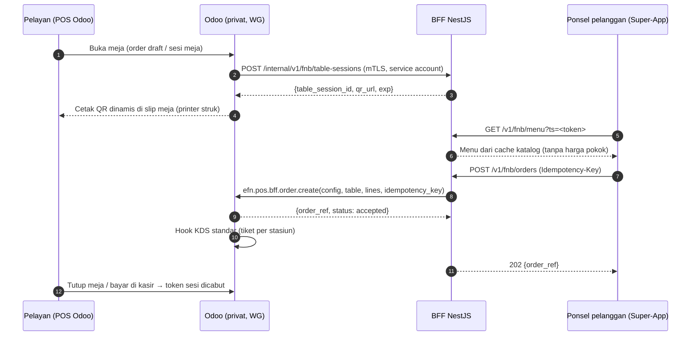

# ADR-032: QR Order dari Ponsel Pelanggan (F-49) — Kiosk Dulu, Super-App + BFF Bila Wajib Ponsel

- **Status:** Proposed — **menunggu jawaban Q-23 / P-17** (klien). Tidak ada kode E-27 yang boleh dimulai sebelum ADR ini Accepted.
- **Tanggal:** 2026-10-09
- **Pemutus (klien):** PO + Ops F&B + Finance (bila bayar online) + IT/Security
- **Referensi review:** R-S03 (skor 20), R-S01, R-B01 (skor 25), R-T03, R-L03, R-L01, R-S12; SEC-75, SEC-73, SEC-77 (`docs/reviews/SECURITY_REVIEW_2026-10-09-r8.md`); docs/01 §5.4 pertanyaan 23; `docs/08_ODOO_FIT_GAP.md` §7.1 F-49, §7.2 temuan 29–31, §7.4, §7.6 P-17
- **Terkait:** ADR-002 (Traefik + BFF), ADR-013 (scope POS F&B), ADR-017 (offline), ADR-019 (unified cart / merchant of record), ADR-023 (Odoo hanya via WireGuard), ADR-026 (payment gateway-agnostic), ADR-027 (pajak configurable), ADR-031 (tanpa modul pihak ketiga), ADR-033 (akun perangkat KDS)

> **Ringkasan manajemen.** Dokumen bisnis meminta pelanggan bisa memindai QR di meja dan memesan dari ponselnya. Fitur bawaan Odoo untuk itu membuka halaman Odoo ke internet, dan itu dilarang oleh keputusan keamanan kita (ADR-023). Rekomendasi: **pilot F&B memakai kiosk layar sentuh di outlet** (sudah didukung Odoo standar, biaya software Rp0, hanya perangkat). Bila klien mewajibkan pesan dari ponsel, jalurnya lewat **Super-App + BFF** (±3–4 minggu-engineer, ±Rp15–36 jt indikatif), bukan membuka Odoo. Yang perlu dijawab klien: **apakah kiosk cukup untuk pilot, dan bila harus ponsel, bayar di kasir atau online** (Q-23).

## Konteks

**Dokumen asli yang bertentangan:**
- `cetak_biru_arsitektur_enterprise_spesifikasi_solusi_system_era_food_and_nourishment_efn.md:135`: *"QR Order on Table (FnB): Pelanggan mendiag scan QR di meja, memilih menu, langsung membayar via QRIS/E-Wallet, dan pesanan otomatis masuk ke kitchen."*
- `docs/01_REVIEW_RISK_GAP_ANALYSIS.md:358` (roadmap Fase 2): *"POS F&B + KDS + QR order di 1 outlet"*.
- `docs/05_FSD_CORRECTIONS.md:202`: `pos_self_order` (QR menu, QR ordering, kiosk) tersedia di CE.

**Mengapa bertentangan dengan arsitektur yang berlaku:**
- `CLAUDE.md`: *"Odoo tidak pernah diakses langsung dari internet; Super-App hanya lewat NestJS BFF."* ADR-023 membatasi router `erp.` ke WireGuard.
- Mode `mobile`/`consultation` milik `pos_self_order` CE 19 melayani ponsel pelanggan lewat route Odoo `auth='public'` (`/pos-self*`, `/pos-self-order/process-order/<device_type>/`), **tanpa rate limit**, dengan otorisasi berupa token di URL QR (config 64-bit + meja 32-bit) (`docs/08` §7.2 #30, terverifikasi source 19.0 oleh efn-odoo-functional G14). Agar ponsel pelanggan bisa menjangkau, route itu + `/websocket` + aset harus dibuka ke internet.
- Token config juga nama kanal bus `pos.config` (temuan #31), sehingga pemegang QR dapat berlangganan notifikasi POS (SEC-75/SEC-77). Token di query string juga masuk access log (SEC-73, kini diredaksi Promtail G15).
- `pos_self_order` ter-auto-install bersama `pos_restaurant` (#29). Sejak Gelombang 15, `efn_setup_pos` 19.0.1.5.0 **mengunci** `self_ordering_mode` ke `nothing`/`kiosk` (`ir.default` + constraint + normalisasi; sakelar `efn.pos.self_order_mobile_allowed` hanya `base.group_system`, diaudit `efn_audit`). Image 19.0 ternyata tidak mengisi `mobile` otomatis (laporan odoo-engineer G15 §1), tetapi kunci tetap dipasang.

**Mengapa diputuskan sekarang:** syarat GO pilot KDS no. 2 (r8) menyatakan *"QR meja ponsel tidak diaktifkan sebelum ADR Q-23"*. Pilot F&B Fase 2 perlu tahu apakah kiosk perlu dibeli atau E-27 perlu dijadwalkan.

**Catatan nomor pertanyaan.** Q23 asli di docs/01 §5.4 berbunyi *"Pembayaran di meja via QRIS: siapa yang menutup bill, pelanggan atau kasir?"*. `docs/08` §7.6 (P-17) memperluasnya menjadi "kiosk cukup atau ponsel; bayar di kasir atau online". ADR ini memakai versi P-17 dan memecahnya menjadi Q-QR1..Q-QR5.

## Opsi yang dipertimbangkan

| Opsi | Ringkas | Keamanan / kepatuhan | Biaya & waktu (indikatif, belum divalidasi) | Status |
|---|---|---|---|---|
| **A. Kiosk saja (pilot)** | `self_ordering_mode='kiosk'` di perangkat layar sentuh outlet; `pay_after='meal'` (bayar di kasir) atau bayar di kiosk via gateway BFF (F-30, kiosk tidak menerima tunai). Kiosk = peer WireGuard, browser mode kiosk | Sesuai ADR-023: route publik hanya terjangkau peer WG. Sisa: semua peer WG dapat memanggil route `/pos-self*` (SEC-75 butir 5: rate limit Traefik khusus path belum ada) | Software **Rp0**, konfigurasi ±0,5 hari/outlet + ±30 menit pasang WG. Perangkat kiosk: harga **belum terverifikasi** (tablet + stand, tergantung Q-24/P-18) | **Direkomendasikan untuk pilot** |
| **B. QR via Super-App + BFF (E-27)** | QR meja → URL Super-App (bukan Odoo). BFF menyajikan menu dari cache katalog dan mengirim order ke Odoo lewat RPC service-to-service → `pos.order` draft di meja; Odoo menghitung ulang harga. Bayar di kasir (*meal*) atau online lewat gateway BFF (ADR-026) | Sesuai ADR-023 & ADR-002: Odoo tetap privat, rate limit + validasi di BFF, tanpa token Odoo di URL. Bayar online menyeret ADR-019 (penjual per PT) dan ADR-016/026 (vendor belum dipilih) | **±3–4 minggu-engineer** (BFF ±1,5, Super-App ±1–1,5, modul Odoo kecil ±0,5–1) ≈ **±Rp15–36 jt** (tarif sama dengan estimasi ADR-031). Bayar online: +±1 minggu setelah vendor dipilih | Direkomendasikan **bila** Q-QR1 = "wajib ponsel" |
| C. `pos_self_order` mode `mobile` dibuka ke internet (Traefik path allowlist + rate limit) | Fitur standar penuh | **Ditolak**: melanggar ADR-023 dan CLAUDE.md (route pra-autentikasi Odoo terekspos ke internet); token QR = kanal bus (SEC-77); QR yang difoto bisa dipakai dari luar outlet selama sesi buka (#30). Hanya mungkin lewat ADR pengecualian yang disetujui klien + review keamanan | 2–3 hari konfigurasi, tetapi biaya risiko tinggi (R-S03 skor 20) | **Ditolak** |
| D. Wi-Fi tamu outlet dirutekan ke Odoo | Ponsel tamu masuk jaringan POS | **Ditolak**: melanggar SEC-21 (tamu di jaringan POS) dan R-S12 | Rendah, tetapi tidak dapat diterima | **Ditolak** |

### Rincian opsi B (untuk developer — kontrak draf, **jangan diimplementasikan sebelum Accepted**)

- **Token meja:** dibuat BFF per sesi meja, **tidak** diturunkan dari `pos.config.access_token`/`restaurant.table.identifier`. Format: opak 128-bit acak (disimpan sebagai hash di BFF) atau HMAC bertanda tangan dengan `exp` ≤ 4 jam + `jti`; dicabut saat meja ditutup. QR statis di meja **tidak** dipakai (alternatif QR statis + PIN 4 digit dari pelayan = Q-QR4).
- **API publik BFF (ringkas OpenAPI):**

| Metode & path | Auth | Request | Respons | Rate limit | Catatan |
|---|---|---|---|---|---|
| `GET /v1/fnb/menu` | token sesi meja (`ts`, header `X-Table-Session` lebih disukai daripada query untuk mengurangi log) | — | `200 {outlet, table_label, categories[], products[{id, name, price_incl, attributes[]}]}` | 60/menit per token, 120/menit per IP | Harga = tampilan; harga final dihitung Odoo |
| `POST /v1/fnb/orders` | token sesi meja; header `Idempotency-Key` (UUID v4) wajib | `{lines:[{product_id, qty (1..20), attribute_value_ids[], note (≤140, tanpa PII)}]}` (maks 30 baris) | `202 {order_ref, status:"accepted"}`; `409 table_session_closed`; `422 product_unavailable`; `503 ordering_unavailable` (Odoo mati → "pesan ke kasir") | 6/menit per token | Idempotensi: `(table_session_id, Idempotency-Key)` disimpan 24 jam |
| `GET /v1/fnb/orders/{order_ref}` | token sesi meja | — | `200 {status: accepted\|in_kitchen\|ready\|served}` | 30/menit per token | Status dari tiket KDS (tanpa data dapur lain) |
| `POST /internal/v1/fnb/table-sessions` | mTLS + service account Odoo | `{company_code, config_id, table_id, order_uuid}` | `201 {table_session_id, qr_url, exp}` | — | Hanya dari Odoo |
| `DELETE /internal/v1/fnb/table-sessions/{id}` | mTLS | — | `204` | — | Dipanggil saat meja dibayar/ditutup |

- **RPC Odoo (modul kecil E-27, mis. `efn_pos_bff_order`):** `efn.pos.bff.order.create(config_id, table_id, lines, idempotency_key)` — hanya user service BFF (grup khusus, masuk `RPC_ALLOWLIST`), cek `available_in_pos`, sesi POS terbuka, company; harga dihitung ulang server; notifikasi ke POS lewat kanal partner kasir (pola SEC-77 G15), **bukan** kanal token config. Kunci idempotensi unik per config.
- **Event (asinkron, opsional, untuk notifikasi status ke ponsel):** queue `fnb.order.status_changed` (DLQ `fnb.order.status_changed.dlq`), payload `{"event_id":"uuid","order_ref":"uuid","table_session_id":"uuid","status":"in_kitchen|ready|served","occurred_at":"RFC3339"}`, idempotency key = `event_id`; tanpa PII. Pengiriman order ke Odoo tetap **sinkron** (pelanggan perlu konfirmasi); bila Odoo mati → 503, bukan antre diam-diam.
- **PDP:** default **tamu tanpa login** (tidak ada HP/nama). Login Super-App hanya bila klien ingin poin dari QR order (Q-QR3) — jalur loyalty POS yang ada (ADR-020) dipakai, bukan jalur baru.

## Keputusan (rekomendasi)

**Opsi A untuk pilot Fase 2**: QR order dari ponsel **tidak** diaktifkan; self-order hanya mode `kiosk` di perangkat peer WireGuard, `self_ordering_mode` tetap terkunci (`efn_setup_pos` 19.0.1.5.0), sakelar `efn.pos.self_order_mobile_allowed` tetap `False`. **Bila Q-QR1 dijawab "wajib ponsel"**, jalurnya **opsi B (E-27)** dan sakelar tetap `False` (opsi B tidak memakai mode `mobile`). Opsi C dan D ditolak; C hanya dapat dibuka lewat ADR pengecualian terpisah yang disetujui klien dan direview security. Alasan utama: A memenuhi kebutuhan "pesan sendiri tanpa antre kasir" dengan biaya software Rp0 tanpa mengubah batas keamanan; B memenuhi kebutuhan ponsel tanpa membuka Odoo.

## Konsekuensi

- **Positif:** Odoo tetap privat (R-S03); tidak ada token Odoo di URL publik (SEC-73/75/77 tidak relevan untuk ponsel); pilot tidak menunggu vendor payment; B dapat dibangun bertahap setelah pilot tanpa membongkar A.
- **Negatif / utang yang diterima:**
  - Kebutuhan bisnis "scan QR di meja dari ponsel" **tidak** terpenuhi di pilot (dengan A).
  - Kiosk menambah perangkat per outlet dan peer WG yang harus dikelola (R-S12).
  - Route `/pos-self*` tetap terjangkau semua peer WG; rate limit Traefik khusus path belum ada (SEC-75 butir 5, devsecops).
  - B menambah satu modul Odoo kecil + permukaan publik baru di BFF yang wajib di-review security.
- **Dampak ke dokumen lain:**
  - Cetak Biru §"QR Order on Table" dan roadmap docs/01 Fase 2 dibaca sebagai "kiosk di pilot; QR ponsel via Super-App (E-27) setelah Q-23". Koreksi dicatat di sini dan di `docs/08` §7.4 (tidak mengedit dokumen asli).
  - `docs/04` (kontrak BFF) mendapat bagian `fnb` hanya bila B Accepted.
  - Pembayaran online di B mengikuti ADR-019/026; pembayaran di meja via QRIS (Q23 asli) = urusan kasir di A.

## Risiko terkait
| Risiko | Hubungan |
|---|---|
| R-S03 (Odoo terekspos, 20) | C/D meningkatkan; A/B menjaga |
| R-B01 (cakupan, 25) | B menambah ±3–4 minggu-engineer di Fase 2 |
| R-T03 (fitur Enterprise) | `pay_after='each'` = Enterprise (docs/06) → kiosk bayar di muka hanya lewat gateway BFF |
| R-L03 (pajak) | Bayar online per PT (ADR-019); PB1 per kota via preset (ADR-027) |
| R-L01 (UU PDP) | B default tamu tanpa PII; login opsional |
| R-S12 (perangkat tak terkelola) | Kiosk wajib mode kiosk browser + peer WG sendiri |

## Pertanyaan terbuka untuk klien
| ID | Pertanyaan | Default bila tidak dijawab | Memblokir |
|---|---|---|---|
| **Q-QR1** (= Q-23/P-17) | Pilot F&B: kiosk cukup, atau **wajib** pesan dari ponsel pelanggan? | Kiosk saja (A) | Pengadaan kiosk; penjadwalan E-27 |
| Q-QR2 | Bila ponsel: bayar di kasir (*meal*) atau online? (online butuh vendor payment ADR-016/026 + opini ADR-019) | Bayar di kasir | E-27 tahap bayar online |
| Q-QR3 | Bila ponsel: pelanggan boleh tamu, atau wajib login Super-App (untuk poin)? | Tamu tanpa login | Desain E-27, inventaris PDP |
| Q-QR4 | QR dinamis dicetak saat meja dibuka (rekomendasi) atau QR statis di meja + PIN dari pelayan? | QR dinamis | Printer slip meja (P-18) |
| Q-QR5 | Jumlah & model kiosk di outlet pilot; kiosk menerima pembayaran non-tunai (gateway) atau hanya pesan lalu bayar di kasir? | 1 kiosk, bayar di kasir | Pengadaan perangkat (P-11, P-18) |

## Kapan ditinjau ulang
- Saat Q-QR1 dijawab (bila "wajib ponsel" → tulis rincian B dan ubah status).
- Setelah 2 minggu pilot kiosk (antrean kasir, adopsi kiosk).
- Sebelum Fase 3 (Super-App order online), karena B berbagi katalog & pembayaran dengan unified cart (ADR-019).
- Bila Odoo CE 19.x mengubah `pos_self_order` (mis. menambah rate limit/otorisasi bertanda tangan) — evaluasi ulang C.
- Bila review keamanan menemukan route `/pos-self*` disalahgunakan dari peer WG.

## Belum terverifikasi
- Apakah kiosk self-order 19.0 menulis `last_order_preparation_change` (pemicu tiket KDS) — [B] di laporan odoo-engineer G14 §5.
- Apakah kiosk 19.0 meminta nama/HP pelanggan (mis. untuk panggilan takeaway). Preset delivery sudah `available_in_self=False`.
- Harga perangkat kiosk dan estimasi Rupiah opsi B (tarif turunan estimasi ADR-031, belum divalidasi).
