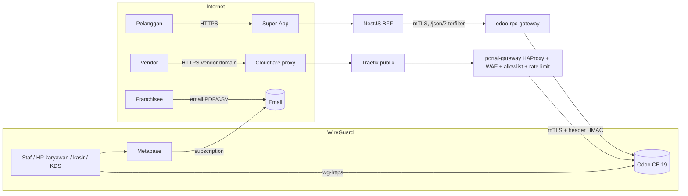

# ADR-035: Strategi Portal — Pelanggan, Vendor, Franchisee, Karyawan Luar Kantor (Odoo Tetap Privat)

- **Status:** Proposed
- **Tanggal:** 2026-10-10
- **Pemutus (klien):** IT + Security (arsitektur, permukaan serangan); PO (lingkup per audiens); Finance/Procurement (fungsi portal vendor); Legal/DPO (data vendor perorangan & franchisee, transfer Cloudflare)
- **Referensi review:** R-S03 (Odoo terekspos, skor 20), R-S11 (pentest), R-S12 (perangkat tak terkelola), R-S10 (insider), R-L01 (UU PDP), R-T11 (kapasitas worker Odoo); **risiko baru R-S15** (portal vendor, `docs/01` §4.4); SEC-01, SEC-21, SEC-28, SEC-74
- **Asal keputusan:** jawaban pemilik proyek 10 Okt 2026 atas **Q-KD2/Q-KD4** (ADR-033) dan **Q-W3** (ADR-023): *"Akan ada portal untuk pelanggan (faktur/riwayat), vendor (PO & tagihan), franchisee (laporan), karyawan luar kantor."*
- **Terkait:** ADR-002 (Traefik + BFF), ADR-022 (enkripsi, mTLS), ADR-023 (Odoo hanya via WireGuard — **direvisi terbatas** oleh ADR ini), ADR-024 (kredensial per service), ADR-031 (tanpa modul pihak ketiga), ADR-033 (akun perangkat KDS; opsi B dievaluasi di sini), ADR-034 (kanal online `/json/2` terfilter), `docs/04 §7`, `§10`

> **Ringkasan manajemen.** Klien ingin empat kelompok di luar kantor bisa melihat data: **pelanggan** (faktur & riwayat belanja), **vendor** (pesanan pembelian & tagihan), **franchisee** (laporan), dan **karyawan di luar kantor**. Rekomendasi: Odoo **tetap tidak dibuka ke internet** untuk pelanggan, franchisee, dan karyawan — pelanggan lewat **Super-App**, franchisee lewat **laporan Metabase/Super-App**, karyawan lewat **WireGuard di HP**. Satu-satunya pengecualian adalah **portal vendor**: dibuka lewat **gerbang terpisah** yang hanya meloloskan halaman portal vendor, wajib verifikasi 2 langkah, dilindungi firewall aplikasi (WAF) dan pembatas laju, dengan satu akun per vendor. Ini menambah **permukaan serangan baru** (halaman login Odoo dapat dijangkau dari internet), sehingga wajib review keamanan dan uji penetrasi sebelum dibuka. Perkiraan: **±4–6 minggu-engineer** total untuk keempat jalur (sebagian paralel), lisensi Rp0.

## Konteks

**Dokumen dan keputusan yang bertentangan / berubah:**
- `CLAUDE.md`: *"Odoo tidak pernah diakses langsung dari internet; Super-App hanya lewat NestJS BFF."*
- ADR-023 §Pertanyaan: *"Q-W3 User Odoo eksternal (akuntan, konsultan pajak, supplier)? Portal tidak dibuka ke internet di desain ini."* dan "Kapan ditinjau ulang: … bila Odoo portal publik dibutuhkan". Pemicu itu kini terjadi.
- ADR-033 opsi B (akun KDS sebagai user *share*) tertahan karena memaksa `auth_totp.policy = all_required` untuk **semua** user portal (Q-KD2). Dengan adanya portal vendor yang memang wajib 2FA, biaya itu berubah.
- Jawaban pemilik proyek 10 Okt 2026 (Q-W1..W4): **tidak ada user Odoo eksternal selain portal vendor**; klien WireGuard dipasang di perangkat termasuk **HP staf**.

**Fakta teknis Odoo CE 19 yang relevan** (dari audit sebelumnya; rincian route portal **belum terverifikasi** untuk 19.0):
- Modul `portal` + `purchase` menyediakan halaman vendor `/my/purchase`, `/my/rfq` (melihat RFQ/PO, unduh PDF); `account` menyediakan `/my/invoices`. Apakah vendor dapat **mengunggah tagihan** lewat portal CE 19 **belum terverifikasi**.
- 2FA portal: `auth_totp_portal` (TOTP untuk user portal) dan `auth_totp_mail` (`auth_totp.policy` ∈ {`employee_required`, `all_required`} — terverifikasi di ADR-033).
- Portal Odoo memakai sesi yang sama dengan backend (satu tabel sesi, satu database). Sesi yang dibuat di host portal **sah** bagi Odoo di host mana pun bila cookie dipindahkan — isolasi harus ditegakkan di gerbang **dan** di Odoo.

## Opsi yang dipertimbangkan

### 1. Pelanggan (faktur & riwayat)
| Opsi | Ringkas | Keamanan | Biaya & waktu (indikatif) |
|---|---|---|---|
| **P1. Super-App + BFF** (riwayat sudah ada di §10; faktur PDF diambil BFF dari Odoo lewat metode `/json/2` baru yang di-allowlist, akses dicek BFF: member pemilik order) | Odoo tetap privat; pelanggan tidak punya akun Odoo | Tidak ada permukaan baru di Odoo; anti-IDOR di BFF (pola §10) | **±1–1,5 minggu** (Odoo metode PDF ±2–3 hari, BFF ±3 hari, frontend ±2–3 hari) |
| P2. Portal Odoo `/my/invoices` untuk pelanggan | Standar | Membuka Odoo ke ribuan akun pelanggan; menambah `res.users` per pelanggan (PII di Odoo) — bertentangan ADR-029/minimisasi | Konfigurasi murah, risiko sangat tinggi | 

**Pilihan: P1.** Faktur atas nama/NPWP pembeli (Q-ON7/Q-P21) disajikan dari dokumen Odoo milik PT penjual; BFF tidak menyimpan PDF (stream + `Cache-Control: no-store`).

### 2. Vendor (PO & tagihan)
| Opsi | Ringkas | Kelebihan | Kekurangan | Biaya & waktu (indikatif) |
|---|---|---|---|---|
| V0. Email saja (PO PDF dikirim email; tagihan vendor dikirim ke alias email jurnal pembelian) | Standar CE, tanpa portal | Rp0, tanpa permukaan baru | Tidak ada konfirmasi PO/status mandiri; beban admin pembelian | ±1–2 hari konfigurasi |
| **V1. Portal Odoo lewat `portal-gateway` terpisah** | Host khusus `vendor.<domain>` → gerbang (HAProxy + WAF) → Odoo (mTLS, ADR-022) dengan **allowlist route portal** | Fitur portal standar CE (PO, RFQ, faktur, chatter dokumen); tidak membangun UI baru | **Permukaan serangan baru**: `/web/login`, reset password, dan route portal pra-autentikasi Odoo dapat dijangkau internet (R-S15); kapasitas worker Odoo terpakai | devsecops ±1–1,5 minggu (gerbang, WAF, rate limit, alert); functional ±3–5 hari (`efn_setup_portal`, grup, rule); odoo-engineer ±3–5 hari (`efn_portal_guard`); security review + pentest terarah |
| V2. Portal vendor dibangun di BFF/Super-App (Odoo tetap 100 % privat) | BFF memanggil metode `/json/2` baru (daftar PO, konfirmasi, unggah tagihan ke antrean review) | Konsisten dengan ADR-023/034; kontrol penuh di BFF | Membangun ulang fitur yang ada di CE; modul Odoo + BFF + UI baru | **±4–6 minggu-engineer** |

**Pilihan: V1** dengan kontrol wajib di bawah; **V0 dipakai sementara** sampai V1 lolos review security dan pentest. V2 menjadi jalur keluar bila review menolak V1 atau Odoo 19.x menambah celah pra-autentikasi pada route portal.

### 3. Franchisee (laporan)
| Opsi | Ringkas | Keamanan | Biaya & waktu (indikatif) |
|---|---|---|---|
| **F1. Langganan laporan Metabase terjadwal** (PDF/CSV via email per franchisee, collection per franchisee) | Franchisee tidak login ke sistem EFN | Tidak ada permukaan baru; data hanya agregat outlet franchisee | ±2–3 hari data-ai (view per outlet + subscription); butuh SMTP |
| **F2. Dashboard laporan di Super-App (BFF → ClickHouse view teragregasi)**, akun mitra dengan OTP + peran `franchisee` | Self-service | Endpoint BFF baru, otorisasi per outlet; tidak ada akses Metabase dari internet | ±2–3 minggu (BFF + frontend + view CH) |
| F3. Akun Metabase untuk franchisee lewat WireGuard | Penuh | Memberi pihak luar akses jaringan internal → **ditolak** | — |
| F4. Metabase *embedding* bertanda tangan lewat BFF | Interaktif | Fitur embedding Metabase OSS v0.58 **belum terverifikasi**; tetap mengekspos Metabase ke internet via proxy | Belum diestimasi |

**Pilihan: F1 untuk awal, F2 bila franchisee butuh self-service.** F3 ditolak; F4 hanya setelah verifikasi lisensi/fitur.

### 4. Karyawan luar kantor
| Opsi | Ringkas | Keputusan |
|---|---|---|
| **K1. Klien WireGuard resmi di HP/laptop** (subnet staf `10.89.0.0/16`, ADR-023 B-a) + 2FA `employee_required` | Tanpa pengecualian baru | **Dipilih** (sudah diputuskan pemilik proyek, Q-W) |
| K2. Akses backend Odoo lewat portal-gateway | Membuka backend ke internet | **Ditolak** |

## Keputusan (rekomendasi, Proposed)

1. **Pelanggan = P1, franchisee = F1 → F2, karyawan = K1.** Tidak ada pengecualian ADR-023 untuk ketiganya.
2. **Vendor = V1** dengan kontrol wajib:
   - **Host & jalur terpisah**: `vendor.<domain>` → Traefik entrypoint publik → **`portal-gateway`** (container HAProxy tersendiri, pola `odoo-rpc-gateway` ADR-034) → Odoo melalui **mTLS** (sertifikat klien CA internal, ADR-022). Router `erp.` tetap hanya WireGuard.
   - **Allowlist route (default deny)**: hanya `/my`, `/my/home`, `/my/purchase*`, `/my/rfq*`, `/my/invoices*` (bila dipakai untuk tagihan), `/my/account` (profil & 2FA), `/web/login`, `/web/session/logout`, `/web/assets/*`, route PDF portal (`report_type=pdf` dengan `access_token`), dan route chatter portal yang diperlukan. **Diblok**: `/web` (backend), `/odoo*`, `/pos*`, `/json*`, `/jsonrpc`, `/xmlrpc*`, `/web/dataset/*` (kecuali yang terbukti dipakai portal), `/web/database/*`, `/websocket`, `/web/signup`, `/shop*`, `/website/*`. **Daftar final ditetapkan lewat spike** (log semua route yang dipanggil satu sesi vendor lengkap di 19.0), lalu dikunci dan diuji di CI (pola SEC-79 `ROUTE_ALLOWLIST`).
   - **2FA wajib** untuk user portal vendor: `auth_totp_portal` + `auth_totp.policy = all_required` (TOTP atau kode email). Pendaftaran mandiri (`signup`) **mati**; akun dibuat admin pembelian lewat undangan.
   - **Satu akun portal per kontak vendor**, terikat ke partner perusahaan vendor (record rule portal standar = dokumen milik `commercial_partner_id`). Vendor yang memasok beberapa PT melihat dokumen lintas PT miliknya sendiri saja — **diuji** (multi-company + portal).
   - **WAF**: Coraza (Apache-2.0) + OWASP Core Rule Set di HAProxy (SPOA) — atau alternatif open source setara yang dipilih devsecops; mode *blocking* setelah 2 minggu *detection* di staging. Versi & kecocokan **belum terverifikasi**.
   - **Rate limit**: per IP (login ≤ 10/menit, halaman ≤ 120/menit) dan per akun (gagal login → kunci sementara, standar Odoo `base.login_cooldown_*`); ukuran body maks (unggah tagihan ≤ 10 MB, tipe PDF/JPG/PNG saja bila unggah diaktifkan).
   - **Penjaga sisi Odoo (`efn_portal_guard`, gap kecil)**: gerbang menyuntikkan header bertanda tangan (HMAC rahasia gerbang↔Odoo) `X-EFN-Entry: vendor-portal`; Odoo **menolak login** dan **menolak sesi** di jalur itu untuk user yang **bukan** anggota grup `efn_portal_guard.group_vendor_portal` (termasuk semua user internal dan akun perangkat KDS). Sebaliknya, sesi user vendor **ditolak** bila datang tanpa header itu. Ini menutup risiko "sesi lintas host".
   - **Kapasitas**: portal memakai worker Odoo yang sama → sizing PP-1 (POS 4 + online 2) ditinjau; opsi: proses Odoo HTTP terpisah untuk portal (DB sama, `max_cron_threads=0`) agar POS tetap terlindungi. Diputuskan devsecops + lead saat implementasi.
   - **Observability & audit**: log gerbang tanpa query string/body (pola §10.11), alert login gagal/WAF block/lonjakan unduhan; perubahan akun portal tercatat `efn_audit` (log kontrol).
   - **Gerbang go-live**: review security (OWASP ASVS L2 bagian autentikasi & sesi) + **pentest pihak ketiga terarah** pada host vendor (R-S11) sebelum vendor pertama diundang.
3. **Revisi terbatas ADR-023** (berlaku bila ADR ini Accepted): bagian Keputusan butir 1 ditambah *"kecuali host `vendor.<domain>` yang dilayani `portal-gateway` dengan allowlist route portal vendor, 2FA, WAF, rate limit, dan `efn_portal_guard`; backend Odoo dan semua host lain tetap hanya via WireGuard"*. Tidak ada perubahan lain pada ADR-023.
4. **Dampak ADR-033 opsi B**: dengan portal vendor, `auth_totp.policy = all_required` **tetap dibutuhkan**, sehingga biaya utama opsi B (2FA untuk semua user portal) hilang. Namun user *share* KDS akan menjadi kelas user yang secara teknis bisa login di host vendor — dicegah `efn_portal_guard` (allowlist grup, bukan `share=True`). Rekomendasi: **pilot tetap opsi A**; keputusan A→B sebelum outlet ke-2 dengan syarat `efn_portal_guard` sudah ada dan teruji. Token kanal KDS tetap 7 hari (Q-KD4).

## Konsekuensi
- **Positif:** kebutuhan empat audiens terpenuhi; pelanggan & franchisee tanpa akun Odoo (minimisasi data); karyawan tanpa pengecualian jaringan; vendor memakai fitur standar CE (Rp0 lisensi); opsi B ADR-033 tidak lagi terhalang biaya 2FA.
- **Negatif / utang yang diterima:**
  - **Permukaan serangan baru** di internet: halaman login & route portal Odoo (R-S15). Celah pra-autentikasi Odoo di masa depan langsung relevan → wajib langganan advisory Odoo, patch ≤ 7 hari untuk High/Critical, dan sakelar darurat "tutup portal" (router Traefik dimatikan, vendor kembali ke V0).
  - Modul gap kecil baru `efn_portal_guard` (dan `efn_setup_portal`) yang harus dijaga tiap upgrade.
  - Data vendor perorangan (nama, email, HP kontak) dan dokumen PO melewati Cloudflare bila proxy penuh (Q-T: proxy penuh) → transfer lintas negara dicatat di inventaris PDP v7.
  - Kapasitas worker Odoo dibagi dengan portal (R-T11).
- **Dampak ke dokumen lain:** ADR-023 (revisi terbatas butir 3), ADR-033 (evaluasi B), `docs/04` (§7.3 identitas gerbang, §7 mTLS hop baru; §10 metode PDF faktur pelanggan), `docs/02 §5` (komponen `portal-gateway`), `PDP_DATA_INVENTORY.md` v7 (§2.2d portal), runbook baru `portal-vendor.md` (onboarding/offboarding vendor, sakelar darurat).

## Risiko terkait
| Risiko | Hubungan |
|---|---|
| **R-S15 (baru)** Portal vendor = permukaan serangan baru | Dimitigasi gerbang + WAF + 2FA + guard + pentest |
| R-S03 (Odoo terekspos, 20) | Pengecualian terkendali; backend tetap tertutup |
| R-S11 (pentest) | Pentest terarah wajib sebelum vendor pertama |
| R-S10 (insider) | Akun portal dibuat/dicabut admin pembelian; tercatat `efn_audit` |
| R-L01 (UU PDP) | Kontak vendor perorangan; pelanggan tanpa akun Odoo |
| R-T11 (kapasitas) | Worker portal dipisah bila perlu |
| R-S12 (perangkat) | HP karyawan dengan WireGuard: Always-on VPN, cabut peer saat hilang |

## Pertanyaan terbuka untuk klien
| ID | Pertanyaan | Default bila tidak dijawab | Memblokir |
|---|---|---|---|
| Q-PT1 | Vendor mana yang butuh portal (jumlah vendor & kontak), mulai kapan? | V0 (email) sampai V1 lolos pentest | Jadwal V1 |
| Q-PT2 | Fungsi vendor: lihat & konfirmasi PO saja, atau juga **unggah tagihan** dan lihat status pembayaran? | Lihat + konfirmasi PO; tagihan via email | Allowlist route, unggah berkas |
| Q-PT3 | Franchisee: sudah ada? laporan apa (penjualan, royalti, stok), frekuensi, format? | F1 mingguan PDF/CSV | F1/F2 |
| Q-PT4 | HP karyawan luar kantor: **HP dinas** atau **pribadi (BYOD)**? Siapa boleh? | HP dinas saja | Onboarding peer WG staf |
| Q-PT5 | Domain portal vendor & apakah lewat Cloudflare proxy (lintas negara) | `vendor.<domain>` via Cloudflare proxy (sesuai Q-T) | DNS/TLS |
| Q-PT6 | Anggaran pentest pihak ketiga untuk host vendor | Wajib sebelum vendor pertama | Go-live V1 |

## Kapan ditinjau ulang
- Setelah spike route portal 19.0 (allowlist final) — bila portal butuh route backend yang luas, pertimbangkan V2.
- Setiap advisory keamanan Odoo yang menyentuh `portal`/`auth_signup`/`web` login.
- Sebelum outlet KDS ke-2 (keputusan ADR-033 A→B).
- Bila jumlah vendor portal > 200 atau franchisee meminta self-service (F2).

## Belum terverifikasi
- Daftar route yang dipanggil portal vendor CE 19.0 (`purchase` portal, chatter portal, unduh PDF) dan apakah vendor dapat mengunggah tagihan lewat portal CE.
- Perilaku `auth_totp.policy = all_required` untuk user portal di 19.0 (kode email vs TOTP) secara runtime.
- Coraza SPOA + OWASP CRS pada versi HAProxy yang dipakai repo; dampak false positive pada form portal Odoo.
- Fitur embedding/subscription Metabase OSS v0.58 (F1/F4).
- Estimasi biaya (turunan tarif estimasi ADR-031, belum divalidasi).
