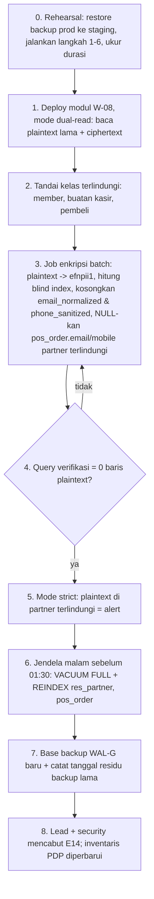

# ADR-036: Enkripsi Kolom PII di Odoo (W-08, tahap 1)

- **Status:** Proposed. Prinsipnya sudah **diputuskan pemilik proyek 10 Okt 2026** (butir #50, Q-E3: "kolom PII Odoo dienkripsi, pola AES-GCM key ring"). Yang masih perlu ditandatangani adalah **caranya**: opsi teknis, cakupan tahap 1, perilaku pencarian, manajemen kunci, dan jadwal migrasi.
- **Tanggal:** 2026-10-18 (Gelombang 19)
- **Pemutus (klien):** IT + Security (opsi & kunci), Legal/DPO (cakupan, residu), Finance + Tax (dampak e-Faktur/Coretax), PO + Ops Outlet (perilaku pencarian kasir, jadwal pilot)
- **Referensi:** Q-E3, Q-P21, Q-ON7, PP-3, pengecualian **E14** (ADR-022), paket **W-08** & **W-06** (`docs/10_RENCANA_GELOMBANG_18_PLUS.md` §1, §3 butir 6), R-L01, R-L10, R-T08, R-B11, R-S10, R-T13
- **Terkait:** ADR-022 (Keputusan 5, kustodi, E14), ADR-024 (kredensial per service), ADR-029 (identitas member opak), ADR-031 (tanpa modul pihak ketiga), ADR-034 (kanal online), ADR-035 (portal), `docs/04_SERVICE_CONTRACTS.md` §1, §7.2, §7.3, §8.4, §8.6, §10; `docs/compliance/PDP_DATA_INVENTORY.md` v7 §2.2, §2.2d; acuan BFF `services/api-gateway/src/common/pii/{crypto,reencrypt,pii-columns}.ts`; `efn_privacy/models/{member_hash,res_partner}.py`; `efn_pos_otp_gate/models/res_partner.py`

> **Ringkasan manajemen.** Nomor HP, email, NPWP/NIK, dan alamat pelanggan yang tersimpan di Odoo akan **dienkripsi oleh aplikasi Odoo sebelum masuk database**. Salinan database, backup, atau akun baca database yang bocor tidak lagi membuka data itu. Staf yang memang berhak tetap melihat data seperti biasa, dan faktur pajak tetap tercetak lengkap. Konsekuensinya: **kasir hanya bisa mencari pelanggan dengan nomor HP/email/NPWP lengkap**, tidak bisa mencari sebagian angka. Biaya **±4–6 minggu-engineer (±Rp20–54 jt)**, lisensi Rp0, muat di G19 bila uji coba teknis 3 hari pertama lolos. **Rekomendasi jadwal:** bila database produksi baru dibuat setelah W-08 selesai (kemungkinan besar, karena server staging/produksi belum ada), enkripsi langsung aktif sejak hari pertama dan pengecualian E14 tidak pernah dipakai. Bila pilot ritel terpaksa mulai lebih dulu, migrasi wajib selesai **sebelum outlet ke-2 atau sebelum data faktur pembeli online diterima, mana yang lebih dulu**, dengan batas akhir 31 Jan 2027.

---

## 1. Konteks

### 1.1 Dokumen yang bertentangan
| Sumber | Kutipan | Status |
|---|---|---|
| ADR-022 Keputusan 5 | "**Batas cakupan (bukan pengecualian):** PII di **database Odoo** (`res.partner.phone/email/street`, `pos.order.partner_id`) tidak dienkripsi per kolom karena Odoo harus mencari/menampilkannya; dilindungi oleh LUKS (S1), TLS (T6), backup terenkripsi (S4) …" | **Digantikan** oleh keputusan 10 Okt (butir #50) → ADR ini |
| `docs/decisions/README.md` butir #50 | "**LUKS + AES-NI wajib** di pengadaan; **kolom PII Odoo dienkripsi** (pola AES-GCM key ring)" — "Pekerjaan baru … revisi ADR-022 Keputusan 5" | Prinsip berlaku |
| PP-3 | "Pilot retail jalan; enkripsi kolom PII Odoo (W-08) menyusul di G19 … migrasi enkripsi in-place sebelum online/F&B memakai profil pembeli" | Berlaku; dipertajam di §7 |
| ADR-022 E14 | "Kolom PII Odoo (HP member `res.partner`) belum dienkripsi kolom selama pilot retail … Kedaluwarsa: W-08 selesai (G19)" | Direvisi di §5.2 |
| `PDP_DATA_INVENTORY.md` §2.2 | `res.partner` name, phone, email, street, vat: "L, W, T (bukan per kolom — ADR-022 Keputusan 5, Q-E3)" | Berubah menjadi **K-Odoo** setelah W-08 |
| `PDP_DATA_INVENTORY.md` §2.2d (v7) | profil pembeli online: "**K (Odoo, Q-E3 — W-08)** … pencarian lewat *blind index* HMAC, bukan teks" | Diwujudkan ADR ini |
| `docs/10` W-08 | "pola AES-GCM key ring (seperti BFF) … *blind index* HMAC … secret `odoo_pii_key*` dikelola Superadmin; rotasi; dampak ekspor e-Faktur/Coretax & laporan" | Diwujudkan; estimasi direvisi (§9) |
| `docs/04 §7.2` | "Kolom PII dienkripsi di aplikasi … Implementasi acuan di BFF `src/common/pii/`" | Diperluas ke Odoo (usulan §6) |

### 1.2 Kenapa harus diputuskan sekarang
1. **W-06 (faktur atas nama pembeli) terblokir**: profil pembeli tidak boleh masuk Odoo sebelum kolomnya terenkripsi (`docs/10` §3 butir 6, E14 kolom kontrol kompensasi).
2. **Murah sebelum ada data produksi.** Migrasi in-place setelah go-live harus menulis ulang tabel, membangun ulang indeks, dan menunggu backup lama kedaluwarsa (§4.13). Tanpa data produksi, cukup pasang modul.
3. Sampai per dokumen terakhir yang saya baca (syarat G-1, K-4, A-3 di `docs/decisions/README.md`), **server staging/produksi belum ada**. Jadi peluang "enkripsi sejak hari pertama" masih terbuka.

### 1.3 Fakta Odoo CE 19.0 yang menentukan desain (terverifikasi dari sumber primer, branch `19.0`, 18 Okt 2026)
| Fakta | Sumber | Dampak ke desain |
|---|---|---|
| `res.partner`: `phone = fields.Char()`, `email = fields.Char()`, `street`/`street2`/`city`/`zip` = `fields.Char()`; **`vat = fields.Char(index=True)`**; **field `mobile` tidak ada** di base | `odoo/addons/base/models/res_partner.py` | Cakupan HP = `phone` saja. Indeks btree `vat` memuat plaintext, sehingga wajib REINDEX setelah migrasi |
| `_rec_names_search = ['complete_name', 'email', 'ref', 'vat', 'company_registry']` | idem | `name_search` dengan `ilike` atas email/vat tidak lagi cocok untuk partner terlindungi (nama tetap cocok) |
| `_compute_same_vat_partner_id` mencari `('vat', 'in', vats)` | idem | Bisa dipertahankan lewat penulisan ulang domain ke blind index |
| `mail` menambahkan `mail.thread.blacklist` ke `res.partner`; **`email_normalized` stored** (compute, tanpa index); `find_or_create` / `_find_or_create_from_emails` mencari `email_normalized`; blacklist memakai SQL join pada `email_normalized` | `addons/mail/models/{res_partner,mail_thread_blacklist}.py` | `email_normalized` = **salinan plaintext**. Untuk partner terlindungi nilainya harus dikosongkan |
| `phone_validation`: `res.partner` mewarisi `mail.thread.phone`; **`phone_sanitized` stored** + indeks ekspresi (dibuat di `init()`); pencarian `phone_mobile_search` memakai **SQL mentah `REGEXP_REPLACE(phone …) LIKE`** | `addons/phone_validation/models/{res_partner,mail_thread_phone}.py` | `phone_sanitized` = salinan plaintext → dikosongkan. Pencarian HP sebagian tidak bisa didukung |
| POS: `_load_pos_data_fields` memuat `street, street2, city, vat, phone, zip, email, …` ke browser; preload = `get_limited_partners_loading()` + partner order terbuka; pencarian server `get_new_partner(config, domain, offset)` dengan `limit=100` | `addons/point_of_sale/models/res_partner.py` | Plaintext dikirim ke browser kasir untuk partner yang dipreload. Pencarian server lewat `get_new_partner` dapat ditulis ulang ke blind index |
| `pos.order`: `email`, `mobile` = **compute stored** (`_compute_contact_details`, salinan dari partner) | `addons/point_of_sale/models/pos_order.py` | Salinan plaintext di setiap order → untuk partner terlindungi tidak disalin |
| `l10n_id_efaktur_coretax` (LGPL-3, depends `l10n_id`) ada di 19.0; menambah ke `res.partner`: **`l10n_id_nik`**, **`l10n_id_buyer_document_number`** (Char), `l10n_id_buyer_document_type`, `l10n_id_tku`, `l10n_id_pkp` (compute stored dari `vat`), `l10n_id_kode_transaksi` | `addons/l10n_id_efaktur_coretax/{__manifest__,models/res_partner}.py` | NIK dan nomor dokumen pembeli adalah PII kelas tinggi dan **masuk cakupan tahap 1** |
| `requirements.txt` Odoo 19.0: `cryptography==42.0.8 ; python_version >= '3.12'` | `requirements.txt` | AES-GCM (`cryptography.hazmat.primitives.ciphers.aead.AESGCM`) tersedia tanpa dependency baru. **Keberadaannya di image `odoo:19.0` belum terverifikasi** (§11) |

---

## 2. Model ancaman: apa yang dilindungi dan apa yang tidak

| Skenario | Tanpa W-08 (LUKS + TLS + WAL-G) | Dengan W-08 (opsi C) |
|---|---|---|
| Disk/VPS dicuri dalam keadaan mati | Terlindungi (LUKS) | Terlindungi |
| Dump `pg_dump` / salinan DB bocor (staf ops, laptop, salah kirim) | **Bocor** | Terlindungi (ciphertext; kunci tidak ada di DB) |
| Backup WAL-G + `walg_libsodium_key` bocor bersamaan | **Bocor** | Terlindungi bila `odoo_pii_key*` tidak ikut bocor |
| Role SQL salah grant (ETL, Metabase, exporter, akun baca ad-hoc) | **Bocor** | Terlindungi |
| Log query PostgreSQL (`log_min_duration_statement`, `auto_explain`) | **Bocor** (parameter plaintext) | Terlindungi (parameter sudah ciphertext) |
| DBA/superuser PostgreSQL | **Bocor** | Terlindungi selama ia tidak punya akses ke container Odoo / `/run/secrets` |
| Container Odoo dikompromikan (RCE) | Bocor | **Tetap bocor**: kunci ada di memori/secret Odoo |
| User Odoo yang berhak (Sales, Accounting, admin) membaca/ekspor CSV | Bocor sesuai hak | **Tetap sesuai hak**: ORM mendekripsi untuk user berhak. Kontrol = grup, record rule, audit (bukan enkripsi) |
| Browser POS (IndexedDB partner preload) | Plaintext di perangkat | **Tetap** untuk partner yang dimuat. Dikurangi dengan mengecualikan partner terlindungi dari preload (§4.5) |
| Filestore (PDF faktur, file ekspor Coretax) | Plaintext di atas LUKS | **Tetap** (di luar cakupan tahap 1, §4.8) |

Kesimpulan: W-08 menutup kelas kebocoran **"data keluar dari database"**. Kelas kebocoran **"aplikasi/user berhak disalahgunakan"** tidak ditutup oleh enkripsi apa pun yang tetap memungkinkan Odoo bekerja. Kelas itu tetap ditangani ADR-023 (akses), `efn_audit` (R-S10), dan minimisasi.

---

## 3. Opsi yang dipertimbangkan

| Kriteria | **A. Disk saja** (LUKS, status quo E14) | **B. `pgcrypto` di DB** | **C. AES-256-GCM di layer ORM Odoo** (direkomendasikan) | **D. TDE** (Percona `pg_tde`) | **E. Vault/tokenisasi di BFF** |
|---|---|---|---|---|---|
| Cara kerja | Enkripsi blok di disk host | `pgp_sym_encrypt/decrypt` lewat trigger + view, kunci dikirim di SQL/GUC sesi | Odoo mengenkripsi nilai sebelum `INSERT/UPDATE` dan mendekripsi saat dibaca ORM. Kunci hanya di `/run/secrets` container Odoo | Enkripsi file data + WAL di level server PostgreSQL | Odoo hanya menyimpan token. PII disimpan di DB platform (BFF) dan diambil saat cetak faktur |
| Dump/backup/role SQL bocor | Bocor | Terlindungi sebagian (kunci terlihat di `pg_stat_activity`, log, GUC; superuser bisa membaca) | **Terlindungi** | Dump logis (`pg_dump`) **plaintext**; hanya file fisik terlindungi | Terlindungi (PII tidak ada di Odoo) |
| Kompatibilitas Odoo standar | Penuh | Rendah: ORM membaca tabel langsung → tetap butuh perubahan ORM untuk dekripsi; trigger bentrok dengan flush ORM | Sedang: pencarian sebagian/sorting/group by atas field terenkripsi hilang; field turunan perlu dikosongkan (§4.2) | Penuh | Rendah: faktur, e-Faktur, POS butuh panggilan ke BFF; Odoo tidak bisa mencetak faktur saat BFF mati |
| Memenuhi keputusan #50 (Q-E3) | **Tidak** | Secara nama ya, secara substansi lemah | **Ya** (pola sama dengan BFF) | Tidak (bukan per kolom) | Ya (lebih dari yang diminta) |
| Konsistensi platform | — | Pola baru | **Format & key ring sama dengan BFF** (`docs/04 §7.2`) → test vector bersama | Mengganti distribusi PostgreSQL 16 → fork PG17 | Pola baru lintas service |
| Ketergantungan baru | — | Ekstensi `pgcrypto` (contrib resmi) | Tidak ada (`cryptography` sudah dibawa Odoo, perlu verifikasi image) | Distribusi Percona + upgrade major PG 16→17 | BFF menjadi jalur kritis untuk dokumen pajak |
| Biaya tenaga (kasar) | Rp0 | 2,5–4 minggu-engineer (±Rp12–36 jt) | **4–6 minggu-engineer (±Rp20–54 jt)** | 2–4 minggu devsecops + uji upgrade PG (±Rp10–36 jt) + risiko migrasi DB | 6–9 minggu-engineer (±Rp30–81 jt) |
| Waktu kalender | 0 | ±3 minggu | **±3 minggu** (G19, 2 engineer paralel di sebagian pekerjaan) | ±3–4 minggu + jendela upgrade DB | ±5–6 minggu, W-06 mundur 1 gelombang |
| Mudah dibalik | — | Sedang | **Ya**: job dekripsi balik memakai kunci yang sama (§4.13) | Sulit (balik distribusi DB) | Sulit |

**Alasan menolak B:** kunci harus sampai ke server PostgreSQL. Di sana kunci terlihat oleh superuser, `pg_stat_statements`/log (pola SEC-18), dan setiap sesi yang menyetel GUC. Odoo tetap perlu diubah agar membaca hasil dekripsi. Biayanya hampir sama dengan C, tetapi perlindungannya lebih lemah.
**Alasan menolak D:** setara dengan LUKS ditambah enkripsi WAL. PostgreSQL 16 komunitas tidak punya TDE (ADR-022 opsi C3), dan dump logis tetap plaintext. Pilihan ini mengganti distribusi database tanpa memenuhi "per kolom".
**Alasan menunda E:** minimisasi terbaik, tetapi menjadikan BFF syarat untuk mencetak faktur pajak dan ekspor Coretax. Itu bertentangan dengan pola "Odoo sumber dokumen pajak" (ADR-019/034). Opsi ini ditinjau ulang untuk tahap 2 bila DPO meminta Odoo tidak menyimpan HP sama sekali.

---

## 4. Keputusan (rekomendasi): opsi C, enkripsi di layer ORM Odoo

### 4.1 Cakupan tahap 1

**Kelas partner terlindungi** (`res.partner.efn_pii_protected`, Boolean, stored, index, `groups="base.group_system"`, `copy=False`). Nilainya **satu arah**: setelah `True` tidak pernah kembali `False` secara otomatis. Penanda menjadi `True` bila salah satu kondisi berikut terpenuhi:
1. partner adalah **member** (`efn_member_locked_at` terisi, riwayat OTP, atau order ber-`efn_otp_gate_state`; logika yang sama dengan `_efn_otp_member_partners`);
2. partner **dibuat kasir** lewat grup `efn_setup_pos.group_efn_cashier_contact_creation` (W-25: pelanggan individu dari POS);
3. partner **pembeli online** yang dibuat W-06. Penanda wajib diisi **di panggilan `create` yang sama**, sehingga tidak ada jendela waktu di mana data tersimpan plaintext;
4. ditandai manual oleh Superadmin (teraudit `efn_audit`, log kontrol).

| Model.field | Perlakuan untuk partner terlindungi | Alasan |
|---|---|---|
| `res.partner.phone` | **Dienkripsi** + blind index `efn_phone_bidx` | HP = identitas member (R-L01) |
| `res.partner.email` | **Dienkripsi** + `efn_email_bidx` | Kontak pribadi |
| `res.partner.vat` (NPWP) | **Dienkripsi** + `efn_vat_bidx` | Identitas pajak (W-06) |
| `res.partner.street`, `street2` | **Dienkripsi** (tanpa blind index) | Alamat |
| `res.partner.l10n_id_nik`, `l10n_id_buyer_document_number` (bila `l10n_id_efaktur_coretax` terpasang) | **Dienkripsi** + `efn_nik_bidx` (NIK saja) | NIK = data pribadi kelas tinggi |
| `res.partner.email_normalized` (mail) | **Dikosongkan** (compute dioverride → `False`) | Salinan plaintext. Akibatnya mail gateway/blacklist Odoo tidak berlaku untuk partner ini. Notifikasi pelanggan memang lewat BFF (WA/push), bukan email Odoo |
| `res.partner.phone_sanitized` (phone_validation) | **Dikosongkan** | Salinan plaintext + indeks ekspresi |
| `pos.order.email`, `pos.order.mobile` | **Tidak disalin** (compute → `False` bila partner terlindungi) | Minimisasi. Salinan kontak tidak dibutuhkan akuntansi |
| `efn_member_hash` | **Tetap** (dihitung dari HP hasil dekripsi) | Kunci join erasure BFF (`docs/04 §8.4`) tidak berubah |
| `name`, `city`, `zip`, `state_id`, `country_id` | **Tidak** dienkripsi di tahap 1 | Nama dibutuhkan untuk pencarian kasir dan dokumen. Kota/kode pos dibutuhkan laporan penjualan per wilayah. Dilindungi L/W/T. **Perlu persetujuan DPO (Q-PII1)** |
| `comment`, `mail.message`, `mail.tracking.value`, `ir.attachment`/filestore | **Tidak** (tahap 2) | Teks bebas & dokumen. Ditangani SOP dan `efn_audit` (sudah ter-mask) |
| Partner **non-terlindungi** (perusahaan, vendor, PT sendiri, karyawan) | **Tidak berubah** | Pencarian bebas Purchase/Accounting tetap jalan. Kontak vendor individu dan portal vendor (ADR-035) = tahap 2 (Q-PII5) |

Alternatif cakupan yang ditolak: **S2** semua partner individu (`is_company=False`) memutus pencarian kontak vendor individu dan email karyawan; **S3** semua partner memutus mail gateway dan pencarian vendor. **S1 (kelas terlindungi)** paling sempit tetapi menutup seluruh data pelanggan yang dimaksud keputusan #50.

### 4.2 Format ciphertext (identik dengan BFF, dibungkus teks)
- Kolom Odoo bertipe `varchar` (Char tanpa `size`), jadi ciphertext disimpan sebagai **teks**: `efnpii1:` ‖ base64 standar dari blob `docs/04 §7.2`: `versi_kunci (1 byte) ‖ IV 12 byte acak ‖ ciphertext ‖ tag 16 byte`.
  - `efnpii1:` = penanda **format** (bukan versi kunci). Versi kunci ada di byte pertama blob, sama dengan BFF.
  - Plaintext yang diawali `efnpii1:` **ditolak** saat tulis (`ValidationError`) agar penanda tidak bisa dipalsukan.
- **AAD** = `efn:odoo:<tabel>.<kolom>:v1` (mis. `efn:odoo:res_partner.phone:v1`). Prefix `odoo:` mencegah ciphertext BFF dipindahkan ke kolom Odoo atau sebaliknya.
  - AAD **tidak** mengikat id baris di tahap 1, karena id belum diketahui saat `INSERT`.
  - Residu: penyerang dengan hak tulis DB bisa menukar ciphertext antar-partner. Dampaknya integritas, bukan kerahasiaan, dan hak tulis DB sudah berarti kompromi penuh.
  - Pengikatan per baris (pola SEC-102 BFF) dievaluasi di tahap 2.
- Panjang: plaintext *n* byte → ±`8 + ⌈(29 + n)/3⌉×4` karakter (HP 13 digit ≈ 64 karakter).
- **Test vector bersama**: modul Odoo wajib mendekripsi blob yang dibuat `PiiCipher` BFF (kunci dan AAD uji yang sama), dan sebaliknya. Ini membuktikan format identik. Kuncinya beda di produksi.

### 4.3 Key ring & secret (dikelola Superadmin)
| Secret (`/run/secrets/…`) | Env | Isi | Pemegang | Catatan |
|---|---|---|---|---|
| `odoo_pii_key_v1`, `odoo_pii_key_v2`, … | `EFN_ODOO_PII_KEY_V<n>_FILE` (default `/run/secrets/odoo_pii_key_v<n>`) | 32 byte acak, base64 | **Hanya container `odoo`** (termasuk cron/worker Odoo) | Terpisah dari `pii_encryption_key*` BFF (ADR-024): kompromi Odoo tidak membuka PII BFF dan sebaliknya |
| — | `EFN_ODOO_PII_ACTIVE_KEY_VERSION` (non-rahasia, default 1) | versi untuk enkripsi baru | Odoo | Harus ada kuncinya |
| — | `EFN_ODOO_PII_RETIRED_VERSIONS` (non-rahasia) | daftar versi pensiun | Odoo | Start check: ada ciphertext berversi pensiun → alert `CRITICAL` (bukan dekripsi diam-diam) |
| `odoo_pii_bidx_key` | `EFN_ODOO_PII_BIDX_KEY_FILE` | 32 byte acak, base64 | Hanya `odoo` | **Bukan** `member_hash_pepper`. Pepper itu juga dipegang BFF dan ETL, sehingga ETL bisa membuat kamus HP |
| — | `EFN_ODOO_PII_REQUIRED` (non-rahasia; `true` di staging/prod) | wajib-kunci | `deploy-validate` | Produksi menolak deploy tanpa kunci aktif + kunci blind index |

- Kunci **tidak pernah** masuk DB, `ir.config_parameter`, log, image, atau repo. Dev/CI membuat kunci saat runtime (`scripts/gen-secrets.sh`, fixture acak). Tidak ada kunci contoh di repo (gitleaks).
- Kustodi: masuk daftar ADR-022 "Kustodi kunci" / `docs/04 §8.6` (hanya Superadmin) + **salinan offline tersegel di brankas Direksi** (keputusan 10 Okt, R-B11). **Kehilangan `odoo_pii_key*` berarti kehilangan HP/email/NPWP/alamat partner terlindungi secara permanen**, termasuk di semua backup.
- Pembacaan kunci mengikuti pola `member_hash.py`: cache per proses dikunci `(path, mtime, size)`, error berupa **kode** (`key_missing`, `key_invalid`, `version_unknown`), isi tidak pernah dicatat.

### 4.4 Blind index untuk pencarian exact
- Subkunci per field: `k_f = HKDF-SHA256(ikm = odoo_pii_bidx_key, salt = "", info = "efn:odoo:bidx:<field>:v1", 32 byte)`.
- Nilai: `efn_<field>_bidx = hex(HMAC-SHA256(k_f, normalize_f(plaintext)))`, 64 hex, `index=True`, `groups="base.group_system"`, tidak dimuat ke POS, tidak diekspor ETL.
- Normalisasi (harus sama saat tulis dan saat cari):

| Field | `normalize_f` |
|---|---|
| `phone` | E.164 tanpa `+` lewat `efn_core.normalize_member_ref` (Indonesia `62…`). Nomor luar negeri: digit saja dengan kode negara. Gagal normalisasi → blind index kosong (hanya bisa ditemukan lewat nama) |
| `email` | `tools.email_normalize(value, strict=False)` (sama dengan `email_normalized` standar) |
| `vat` | digit saja (NPWP 15/16 digit) |
| `l10n_id_nik` | digit saja (16 digit) |

- Kebocoran yang diterima: kesetaraan nilai (dua partner dengan HP sama punya blind index sama). Ini dibutuhkan untuk deteksi duplikat.
- Rotasi `odoo_pii_bidx_key`: **hanya bila bocor**. Hitung ulang semua blind index dari plaintext hasil dekripsi (job batch). Selama job berjalan, pencarian exact bisa meleset beberapa menit, jadi dijalankan di luar jam operasional.

### 4.5 Perilaku pencarian, tampilan, dan POS
| Operasi atas field terenkripsi (partner terlindungi) | Perilaku |
|---|---|
| Baca lewat ORM (form, laporan QWeb, faktur, ekspor CSV oleh user berhak, `_load_pos_data`) | **Plaintext** (didekripsi). Hak akses tetap menurut grup/record rule standar |
| Domain `=`, `in` (termasuk `_compute_same_vat_partner_id`, deteksi duplikat) | **Ditulis ulang** ke `efn_<field>_bidx` atas nilai yang dinormalisasi. Partner non-terlindungi tetap dicocokkan pada kolom asli: `(bidx = h) OR (NOT efn_pii_protected AND kolom = nilai)` |
| `ilike`, `like`, `=like`, `not ilike`, regex (`phone_mobile_search`), pencarian sebagian | **Tidak didukung** untuk partner terlindungi: tidak cocok, **tanpa error** (UI standar tetap jalan). Partner non-terlindungi tetap cocok seperti biasa |
| `!=`, `not in` | Diterjemahkan lewat blind index (negasi) — bila PoC menunjukkan rumit, **tidak didukung** dan didokumentasikan |
| `ORDER BY`, `group by`, pivot atas field terenkripsi | **Tidak bermakna** (urut/kelompok atas ciphertext). Tidak diblokir, didokumentasikan |
| POS `get_new_partner(config, domain, offset)` | Bila istilah pencarian **berbentuk HP lengkap / email lengkap / NPWP lengkap**, tambahkan leaf `OR` blind index exact. Pencarian nama tetap `ilike` |
| POS preload (`_load_pos_data_domain` / `get_limited_partners_loading`) | **Usulan:** partner terlindungi **tidak dipreload** ke browser kasir (kecuali partner order terbuka). Kasir menemukannya lewat pencarian HP lengkap. Fitur yang butuh member sudah nonaktif saat offline (ADR-017 Accepted), jadi offline tidak kehilangan fungsi member. **Keputusan PO + Ops (Q-PII3)** |
| `name_search` (`_rec_names_search` memuat email & vat) | Untuk partner terlindungi hanya nama yang cocok. Email/NPWP lengkap ditangani rewrite `=` di atas bila PoC memungkinkan |

### 4.6 Perilaku tulis & gagal-tertutup
- **Tulis**: semua jalur ORM yang menyimpan ke kolom (create, write, flush compute) mengenkripsi untuk partner terlindungi. Plaintext tidak pernah mencapai SQL, juga lewat `sudo()`.
- **Kunci aktif tidak terbaca** → modul masuk **mode terkunci**:
  1. tulis ke field terenkripsi → `UserError` (tidak ada fallback plaintext);
  2. baca → nilai pengganti tetap `"•••• (kunci PII tidak tersedia)"`, **bukan** `False`, agar form/compute tidak menimpa ciphertext dengan kosong;
  3. `efn_member_hash` dan blind index **tidak** dihitung ulang (compute menahan nilai lama, bukan mengosongkan);
  4. log `EFN_PII_KEYRING` level `CRITICAL` + alert.

  POS dan penjualan **tetap jalan** tanpa data kontak (prinsip CLAUDE.md: POS tidak berhenti karena komponen pendukung). Odoo **tidak** menolak start, karena menolak start berarti POS mati.
- **Ciphertext gagal autentikasi** (tag salah) → nilai pengganti yang sama + log hitungan (tanpa id partner di pesan publik, id hanya di log teknis tanpa nilai).

### 4.7 Yang TIDAK didukung (dicatat agar tidak ditagih sebagai bug)
1. Pencarian bebas / sebagian (`ilike`) atas HP, email, NPWP, NIK, alamat partner terlindungi, termasuk di daftar Kontak, POS, dan Sales.
2. Sorting, group by, pivot atas field tersebut.
3. Mail gateway Odoo (cocokkan email masuk ke partner), blacklist email/SMS Odoo, dan mass mailing Odoo ke partner terlindungi.
4. Kirim struk POS otomatis ke email yang disalin dari partner (`pos.order.email` kosong). Kasir masih bisa mengetik email manual bila fitur itu dipakai. **Rekomendasi:** struk digital lewat BFF (WA) di fase berikut.
5. SQL langsung (Metabase, query ad-hoc, laporan SQL) yang membaca kolom tersebut. Hasilnya ciphertext, dan memang itu tujuannya.
6. Dekripsi oleh service lain selain Odoo (BFF, ETL, OCR, Metabase tidak memegang kunci Odoo).

### 4.8 Dampak e-Faktur / Coretax
- `l10n_id_efaktur_coretax` (CE 19.0) membaca `vat`, `l10n_id_nik`, `l10n_id_buyer_document_*`, nama, dan alamat partner. **Asumsi:** pembacaan lewat ORM/QWeb (`data/efaktur_templates.xml`), sehingga nilai sudah didekripsi dan ekspor tetap lengkap. **Belum terverifikasi** (kode generator belum dibaca). PoC wajib mengekspor satu faktur partner terlindungi dan membandingkan XML-nya dengan partner biasa.
- `l10n_id_pkp` (compute stored dari `vat`) tetap benar karena compute membaca nilai hasil dekripsi. Field ini Boolean, bukan PII.
- **File ekspor XML dan PDF faktur** disimpan di filestore sebagai **plaintext** (di atas LUKS). Ini dokumen pajak 10 tahun (Q-P2). Tahap 1: diterima dan dicatat di inventaris PDP. Usulan: file ekspor Coretax dibuat **sesuai permintaan** dan dihapus setelah diunggah ke Coretax (bila Finance tidak wajib menyimpan salinan XML; **Q-PII6**). PDF faktur tetap disimpan.
- Validasi format NPWP/NIK berjalan atas plaintext sebelum enkripsi (constraint ORM), jadi tidak terdampak.

### 4.9 Dampak laporan
- Laporan Odoo (faktur, SO, laporan akuntansi `efn_account_reports` W-16) mencetak plaintext lewat ORM. Tidak ada perubahan.
- Pivot/list yang dikelompokkan per email/HP/NPWP **tidak bermakna** untuk partner terlindungi. Belum ada laporan EFN yang memakai pengelompokan itu (berdasarkan `docs/08` §5.3, §9). Functional wajib mengonfirmasi.
- **Ekspor CSV oleh user berhak** tetap menghasilkan plaintext. Ini kanal kebocoran yang sah-tetapi-berisiko. Tahap 2: audit ekspor `res.partner` di `efn_audit` (CE tidak mencatat ekspor; ±1–2 hari).

### 4.10 ETL ke ClickHouse
- **Tidak berubah dan dikunci.** `services/etl/sql/odoo-readonly-grants.sql` sudah tidak memberi akses ke `res_partner`, dan tidak memberi akses ke `pos_order.email/mobile` (komentar G13). `customer_id` = id partner (pseudonim).
- Aturan baru (usulan kontrak K-36-5):
  1. ETL **tidak pernah** di-grant kolom terenkripsi Odoo, `efn_*_bidx`, atau `efn_pii_protected`;
  2. ETL tidak pernah memegang `odoo_pii_key*` / `odoo_pii_bidx_key`;
  3. kolom pseudonim yang boleh dibaca hanya yang sudah ada (`customer_id`, `member_hash` dari BFF).
- Guard CI (usulan untuk data-AI/devsecops, ±0,5 hari): test yang menolak grant ke `res_partner` dan ke nama kolom terenkripsi/blind index di file grant (melengkapi `test_gl.py:55`).

### 4.11 Backup & pemulihan
- WAL-G (S4) setelah W-08 berisi ciphertext. Pemulihan membutuhkan **`walg_libsodium_key` + seluruh versi `odoo_pii_key*` yang masih dipakai data di backup itu**.
- **Kunci pensiun tidak boleh dimusnahkan** sebelum backup **tertua** yang memuat ciphertext versi itu kedaluwarsa. Rentang ini mencakup retensi base backup WAL-G (14 base backup harian, `docs/04 §8.16`), object lock `pg-backup`, dan **backup off-site** (wajib sebelum go-live, retensinya belum ditetapkan, Q-PII4). Kunci pensiun disimpan di brankas Direksi bersama salinan offline lain.
- Uji pemulihan 2×/tahun (ADR-022, disaksikan) harus mencakup: restore DB → Odoo membaca partner terlindungi → ekspor e-Faktur satu faktur.
- **Residu migrasi (bila E14 terpakai):** base backup dan arsip WAL **sebelum** migrasi tetap memuat plaintext sampai kedaluwarsa (±15 hari untuk WAL-G lokal; off-site menurut Q-PII4). Mempercepat penghapusan tidak dianjurkan, karena object lock dan s3-gateway sengaja menolak bypass retensi. Residu ini **diterima dan dicatat**.

### 4.12 Rotasi kunci (re-encrypt bertahap, tanpa downtime)
```mermaid
sequenceDiagram
    participant SA as Superadmin
    participant H as Host /opt/efn/secrets
    participant O as Odoo (cron efn_pii_reencrypt)
    participant DB as PostgreSQL efn_odoo
    SA->>H: buat odoo_pii_key_v2 (32 byte acak), salinan tersegel ke brankas
    SA->>O: deploy dengan V2_FILE terpasang + ACTIVE_KEY_VERSION=2 (rolling restart)
    Note over O: tulis baru = v2; baca = v1 atau v2
    loop batch keyset 500 baris, commit per batch
        O->>DB: SELECT id, kolom WHERE versi(kolom) <> 2 AND id > last
        O->>O: dekripsi (v1) lalu enkripsi (v2), AAD sama
        O->>DB: UPDATE … WHERE id = $1 AND kolom = <ciphertext lama> (optimistik)
    end
    O-->>SA: laporan angka per kolom & versi (tanpa nilai), log EFN_PII_KEYRING
    SA->>O: RETIRED_VERSIONS=1; cabut V1_FILE dari container
    Note over SA: kunci v1 TETAP di brankas sampai backup tertua yang memuat v1 kedaluwarsa (§4.11)
```
- Versi diperiksa di SQL tanpa dekripsi: `get_byte(decode(substring(kolom from 9), 'base64'), 0)` (`efnpii1:` = 8 karakter).
- Job menulis lewat **SQL langsung** dengan nilai yang dihitung di Python. Tujuannya agar tidak menaikkan `write_date`, tidak membuat ribuan baris `efn_audit`/chatter, dan aman berjalan bersamaan dengan POS (pola `reencrypt.ts` BFF). Satu entri ringkasan dicatat di `efn_audit` (log kontrol: siapa, kapan, jumlah baris, versi).
- Idempoten: dijalankan ulang = no-op. Jadwal: tahunan, saat Superadmin berganti (ADR-022 mitigasi 4), atau saat dicurigai bocor.

### 4.13 Migrasi in-place untuk data yang sudah ada
Hanya diperlukan bila database produksi dibuat **sebelum** W-08 (pengecualian E14 terpakai). Data dev/staging cukup diinstal ulang.


- **Query verifikasi** (dijalankan role `efn_odoo` di psql; hasil angka saja):
  - `SELECT count(*) FROM res_partner WHERE efn_pii_protected AND ((phone IS NOT NULL AND phone NOT LIKE 'efnpii1:%') OR (email IS NOT NULL AND email NOT LIKE 'efnpii1:%') OR (vat IS NOT NULL AND vat NOT LIKE 'efnpii1:%') OR (street IS NOT NULL AND street NOT LIKE 'efnpii1:%') OR (street2 IS NOT NULL AND street2 NOT LIKE 'efnpii1:%') OR email_normalized IS NOT NULL OR phone_sanitized IS NOT NULL)` → **0**
  - `… OR l10n_id_nik / l10n_id_buyer_document_number …` bila Coretax terpasang → **0**
  - `SELECT count(*) FROM pos_order o JOIN res_partner p ON p.id = o.partner_id WHERE p.efn_pii_protected AND (o.email IS NOT NULL OR o.mobile IS NOT NULL)` → **0**
- **Kenapa `VACUUM FULL`/`REINDEX`:** UPDATE di PostgreSQL meninggalkan versi baris lama (plaintext) di halaman data sampai ditimpa. Indeks btree `vat` dan indeks ekspresi `phone_sanitized` juga menyimpan plaintext. `VACUUM FULL` menulis ulang tabel dan membangun ulang indeksnya, tetapi mengunci tabel (`ACCESS EXCLUSIVE`). Untuk data pilot (perkiraan ribuan partner, puluhan ribu order) diperkirakan menit. **Belum diukur**, sehingga rehearsal langkah 0 wajib. Selama kunci, POS tetap menerima order secara offline dan sinkron setelahnya. `pg_repack` tidak dipakai karena menambah ekstensi pihak ketiga.
- **Residu yang tidak bisa dihapus:** WAL/backup sebelum langkah 7 (§4.11), dan blok disk lama di bawah LUKS. Keduanya dilindungi enkripsi lapisan lain.
- **Jalan balik** (bila PoC/produksi gagal): job dekripsi balik (mode `--decrypt`) dengan kunci yang sama, lalu uninstall. ±0,5 hari. Pengecualian E14 dipakai lagi dengan tanggal baru.

### 4.14 Erasure UU PDP (`efn_privacy`)
- Tetap memakai `efn_member_hash` (tidak berubah). Anonimisasi menulis `False` ke field terenkripsi, sehingga ciphertext dan blind index ikut NULL. `efn_erased` tetap satu-satunya penanda (SEC-31).
- Blind index **wajib** ikut dikosongkan (test). Kalau tidak, partner teranonim masih bisa dicocokkan dengan HP.
- Partner pembeli W-06: nama/NPWP/alamat yang melekat di faktur 10 tahun tetap ada di dokumen (PDF/Coretax), sesuai `PDP_DATA_INVENTORY` §2.2d (menunggu Legal).

### 4.15 Kontrak observability (log, bukan event RabbitMQ)
W-08 tidak menambah queue. Status key ring dilaporkan lewat satu baris log terstruktur yang dibaca Promtail/Loki, sejajar dengan pola `EFN_AUDIT_SINK`:

```json
{
  "$schema": "https://json-schema.org/draft/2020-12/schema",
  "title": "EFN_PII_KEYRING",
  "type": "object",
  "required": ["schema_version", "event", "db", "active_version", "loaded_versions", "status"],
  "additionalProperties": false,
  "properties": {
    "schema_version": { "const": 1 },
    "event": { "enum": ["startup_check", "reencrypt_run", "migration_run", "locked", "decrypt_failure"] },
    "db": { "type": "string", "maxLength": 64 },
    "active_version": { "type": ["integer", "null"], "minimum": 1, "maximum": 255 },
    "loaded_versions": { "type": "array", "items": { "type": "integer", "minimum": 1, "maximum": 255 } },
    "status": { "enum": ["ok", "locked", "retired_in_use", "plaintext_residual", "error"] },
    "counts": {
      "type": "object",
      "description": "jumlah baris per kolom per versi, mis. {\"res_partner.phone\": {\"1\": 812, \"plain\": 0}}",
      "additionalProperties": { "type": "object", "additionalProperties": { "type": "integer", "minimum": 0 } }
    },
    "error_code": { "enum": ["key_missing", "key_invalid", "version_unknown", "auth_failed", null] }
  }
}
```
Tidak pernah memuat nilai, ciphertext, kunci, id partner, atau nama. Alert usulan (devsecops): `EfnOdooPiiLocked` (status `locked`, kritis), `EfnOdooPiiPlaintextResidual` (`counts.*.plain > 0` di mode strict), `EfnOdooPiiRetiredInUse`, `EfnOdooPiiDecryptFailure` (> 0 per 15 menit).

---

## 5. Perubahan yang diusulkan ke ADR-022 (ditulis lead/architect setelah ADR ini disetujui; ADR-022 belum diubah)

### 5.1 Keputusan 5: ganti paragraf "Batas cakupan"
> **Kolom PII Odoo (revisi 10 Okt 2026, Q-E3; rincian ADR-036):** untuk partner **terlindungi** (member, pelanggan buatan kasir, pembeli online), `res.partner.phone/email/vat/street/street2` (+ `l10n_id_nik`, `l10n_id_buyer_document_number`) dienkripsi **di ORM Odoo** dengan AES-256-GCM (format `docs/04 §7.2`, AAD `efn:odoo:<tabel>.<kolom>:v1`, key ring `odoo_pii_key_v<n>` milik Odoo saja), dengan blind index HMAC (`odoo_pii_bidx_key`) untuk pencarian exact. Salinan turunan (`email_normalized`, `phone_sanitized`, `pos.order.email/mobile`) dikosongkan. Nama, kota, dan kode pos partner, partner non-pelanggan, teks bebas, dan filestore tetap dilindungi L/W/T (tahap 2: ADR-036 §4.1).

### 5.2 Tabel "Manajemen kunci & rotasi": tambah dua baris
| Kunci | Lokasi | Pemegang | Rotasi | Cara | Bila hilang |
|---|---|---|---|---|---|
| `odoo_pii_key_v<n>` | `/run/secrets` | Odoo saja | Tahunan / bila bocor / ganti Superadmin | Key ring, cron re-encrypt (ADR-036 §4.12); kunci pensiun disimpan sampai backup tertua kedaluwarsa | **Kehilangan PII partner terlindungi permanen** → salinan tersegel di brankas wajib |
| `odoo_pii_bidx_key` | `/run/secrets` | Odoo saja | Hanya bila bocor | Hitung ulang blind index dari plaintext | Pencarian exact gagal sampai dihitung ulang (data tidak hilang) |

### 5.3 "Kustodi kunci": tambah `odoo_pii_key*` dan `odoo_pii_bidx_key` ke daftar kunci yang hanya dipegang Superadmin.

### 5.4 Pengecualian E14: revisi baris
| Kolom | Isi baru (usulan) |
|---|---|
| Hop / penyimpanan | PII partner Odoo (HP member dan pelanggan buatan kasir) belum dienkripsi kolom **selama pilot ritel satu outlet**, hanya bila DB produksi dibuat sebelum W-08 |
| Kontrol kompensasi (tambahan) | (a) **dilarang** menyimpan profil pembeli online (W-06) dan PII baru dari kanal online; (b) partner member tidak dipreload ke POS bila W-08 sudah ada di kode (§4.5); (c) rehearsal migrasi di staging sebelum tanggal kedaluwarsa; (d) tanggal mulai pilot dan tanggal migrasi dicatat untuk menghitung residu backup |
| Kedaluwarsa | **Mana yang lebih dulu:** migrasi W-08 terverifikasi di produksi (§4.13 langkah 8) · sebelum outlet ritel ke-2 go-live · sebelum W-06 aktif · **31 Jan 2027** |
| Residu setelah dicabut | Backup/WAL sebelum migrasi sampai kedaluwarsa (§4.11), diterima |

### 5.5 Q-E3: tandai "dijawab 10 Okt (dienkripsi), rincian ADR-036".

---

## 6. Usulan revisi kontrak `docs/04` (untuk lead; `docs/04` belum diubah)

| ID | Bagian | Usulan |
|---|---|---|
| K-36-1 | §7.2 | Tambah subbagian **"Kolom PII Odoo"**: teks `efnpii1:` + base64(blob §7.2), AAD `efn:odoo:<tabel>.<kolom>:v1`, key ring `odoo_pii_key_v<n>` / `EFN_ODOO_PII_KEY_V<n>_FILE`, `EFN_ODOO_PII_ACTIVE_KEY_VERSION`, `EFN_ODOO_PII_RETIRED_VERSIONS`, `EFN_ODOO_PII_REQUIRED`; plaintext berawalan `efnpii1:` ditolak; test vector bersama BFF ↔ Odoo |
| K-36-2 | §7.2 | Rumus blind index Odoo: `hex(HMAC-SHA256(HKDF(odoo_pii_bidx_key, info "efn:odoo:bidx:<field>:v1"), normalize(v)))` + tabel normalisasi §4.4; tegaskan **berbeda** dari `member_hash` (§1) yang tidak berubah |
| K-36-3 | §7.3 | Baris baru: secret `odoo_pii_key_v<n>`, `odoo_pii_bidx_key` hanya di-mount ke service `odoo`; **tidak** ke BFF, ETL, OCR, Metabase, `odoo-rpc-gateway` |
| K-36-4 | §8.4 | Erasure Odoo: anonimisasi wajib mengosongkan ciphertext **dan** semua `efn_*_bidx` partner; `efn_member_hash` tetap kunci join |
| K-36-5 | §7.3 / ETL | ETL dilarang di-grant kolom terenkripsi Odoo, `efn_*_bidx`, `efn_pii_protected`; guard CI |
| K-36-6 | §8.6 | Daftar kunci Superadmin + `odoo_pii_key*`, `odoo_pii_bidx_key` |
| K-36-7 | §10 (W-06) | Metode Odoo pembuat partner pembeli (kontrak W-06, milik lead) wajib menulis `efn_pii_protected=True` dalam **create yang sama**; BFF tidak menyimpan profil (kecuali `partner_ref` opak) dan tidak mencatatnya di log; respons tidak mengembalikan PII |
| K-36-8 | §8.15 (observability) | Baris log `EFN_PII_KEYRING` (skema §4.15) + 4 alert |

---

## 7. Keputusan yang dibutuhkan dari lead / PO

| # | Keputusan | Opsi | Rekomendasi architect | Dampak biaya/waktu |
|---|---|---|---|---|
| **L-36-1** | **Pilot ritel menunggu W-08, atau jalan dengan E14 lalu migrasi?** (melanjutkan PP-3) | (a) pilot menunggu W-08; (b) pilot jalan dengan E14, migrasi sebelum outlet ke-2; (c) pilot jalan, migrasi "kapan sempat" | **Gabungan a/b:** PP-3 tetap (pilot **tidak** ditahan). **Bila DB produksi dibuat setelah W-08 merge, pasang W-08 sejak awal** (E14 tidak terpakai). Ini kemungkinan besar karena staging/produksi belum ada dan W-08 dijadwalkan G19 (±3 minggu). Bila pilot mulai lebih dulu: (b) dengan E14 versi §5.4 (batas keras 31 Jan 2027). (c) ditolak | (a/b-awal): Rp0 tambahan. (b-migrasi): +±1–1,5 minggu-engineer (rehearsal, jendela malam, verifikasi) + residu backup ±15 hari s.d. retensi off-site |
| L-36-2 | Cakupan kelas partner | S1 terlindungi / S2 individu / S3 semua | **S1** (§4.1) | S2/S3 menambah ±1–2 minggu (vendor, mail gateway) dan merusak alur Purchase |
| L-36-3 | Partner terlindungi tidak dipreload ke POS | ya / tidak | **Ya** (minimisasi; offline tidak kehilangan fungsi member karena ADR-017) | ±1 hari; kasir wajib mengetik HP lengkap (Q-PII3) |
| L-36-4 | `pos.order.email/mobile` tidak disalin untuk partner terlindungi | tidak disalin / dienkripsi | **Tidak disalin** | Lebih murah dari enkripsi (±0,5 hari lebih hemat) |
| L-36-5 | Estimasi W-08 direvisi 3–5 → **4–6** minggu-engineer | — | Terima. Tambahan berasal dari field turunan yang terverifikasi di §1.3 (`email_normalized`, `phone_sanitized`, salinan `pos.order`, NIK Coretax) | +Rp5–9 jt |
| L-36-6 | Gerbang PoC 3 hari di awal G19 | lanjut / tidak | **Wajib**: bila kriteria PoC §8.2 gagal, lead memutuskan ulang (opsi E tahap 1 untuk pembeli saja, atau perluasan E14) **sebelum** W-06 dijadwalkan | PoC 0,5 minggu-engineer |

---

## 8. Spesifikasi singkat untuk efn-odoo-engineer (setelah fit-gap efn-odoo-functional)

### 8.1 Prasyarat: fit-gap efn-odoo-functional W-08 (belum ada di `docs/08`)
Functional mendaftar dan memverifikasi di CE 19.0:
1. Semua field stored di `res.partner` dan model lain yang **menyalin** phone/email/vat/street/NIK (selain yang di §1.3), termasuk `mail.tracking.value` (apakah field ini di-`tracking`), `account.move`, `sale.order`, `l10n_id_efaktur_coretax.document`.
2. Bentuk domain yang dikirim klien POS 19 ke `get_new_partner` (field apa, operator apa) dan batas `get_limited_partners_loading`.
3. Cara generator Coretax membaca partner (ORM/QWeb vs SQL).
4. Laporan/filter standar yang dipakai klien atas field tersebut.

### 8.2 PoC (gerbang, ±3 hari)
Kriteria lulus semuanya:
1. Hook enkripsi menangkap **semua** jalur tulis ke kolom (create, write, flush compute stored, `sudo()`, import), dibuktikan dengan test yang memeriksa SQL mentah (`SELECT phone FROM res_partner`) = `efnpii1:…`.
2. Baca ORM, form, `web_read`, `_load_pos_data`, laporan QWeb faktur, dan ekspor Coretax menghasilkan plaintext.
3. Domain `=`/`in` ditulis ulang ke blind index; `ilike` tidak error.
4. Test vector BFF ↔ Odoo lulus.
5. Overhead < 5 % pada `_load_pos_data` 1.000 partner (diukur, bukan diasumsikan).

Kandidat mekanisme yang diuji (keputusan akhir milik engineer, dicatat di README):
- **M1**: subclass `fields.Char` (enkripsi di konversi ke kolom, dekripsi di konversi ke record). Field didefinisikan ulang di `_inherit`, dengan cek "terlindungi" per record.
- **M2**: override `create`/`write`/`_write`/flush di model. Hanya dipakai bila M1 tidak menangkap jalur compute.

Tidak boleh memakai monkeypatch registry atau menyalin kode OCA/Cybrosys (ADR-031). Referensi desain boleh dicatat di README.

### 8.3 Modul (usulan nama, `19.0.1.0.0`, LGPL-3)
| Modul | Isi | `depends` |
|---|---|---|
| `efn_pii` | Key ring (`EFN_ODOO_PII_*`), `PiiCipher` Python (format §4.2), blind index (§4.4), field/hook, `efn_pii_protected` + aturan penandaan, override `res.partner` (enkripsi, blind index, rewrite domain, `email_normalized`/`phone_sanitized` kosong), mode terkunci, cron/aksi `efn_pii_reencrypt` (rotasi + migrasi + `--decrypt`), log `EFN_PII_KEYRING`, start check | `base`, `mail`, `phone_validation`, `efn_core`, `efn_privacy` |
| `efn_pii_pos` (auto_install) | `pos.order.email/mobile` tidak disalin; rewrite `get_new_partner`; pengecualian preload; penandaan dari OTP/kasir (koordinasi dengan `efn_pos_otp_gate`, `efn_setup_pos`) | `efn_pii`, `point_of_sale`, `efn_pos_otp_gate` |
| `efn_pii_l10n_id` (auto_install) | `l10n_id_nik`, `l10n_id_buyer_document_number` terenkripsi + `efn_nik_bidx`; test ekspor Coretax | `efn_pii`, `l10n_id_efaktur_coretax` |

Setiap model/field baru: `company_id` tidak diperlukan, karena field ada di `res.partner` yang sudah ber-rule. `ir.model.access.csv` untuk model teknis (bila ada). README memuat ADR-036, risiko R-L01/R-L10/R-T08, dan "yang belum".

### 8.4 Test wajib (tag `efn`)
1. SQL mentah = ciphertext untuk setiap field cakupan, juga lewat `sudo()` dan import CSV.
2. Partner non-terlindungi tetap plaintext dan bisa dicari `ilike`.
3. Penandaan satu arah. Klien tidak bisa menulis `efn_pii_protected`; hanya admin teraudit.
4. Blind index cocok untuk HP format lokal `0812…`/`+62…`/`62…` (normalisasi), email beda huruf besar/kecil, dan NPWP bertanda baca.
5. Mode terkunci: baca mengembalikan nilai pengganti, tulis `UserError`, `efn_member_hash` dan blind index tidak hilang.
6. Rotasi v1 → v2 idempoten dan bersamaan dengan write. Kunci pensiun yang masih dipakai memicu status `retired_in_use`.
7. Migrasi: query verifikasi §4.13 = 0, `--decrypt` mengembalikan data.
8. Erasure: ciphertext dan blind index NULL, `efn_erased` saja.
9. Tour POS: cari member dengan HP lengkap ditemukan; HP sebagian tidak menemukan partner terlindungi; partner terlindungi tidak ada di preload.
10. Log tidak memuat plaintext/ciphertext (pola uji redaksi G15).
11. Ekspor Coretax partner terlindungi = isi sama dengan partner biasa.

### 8.5 Untuk agent lain
- **devsecops:** secret `odoo_pii_key_v1` + `odoo_pii_bidx_key` di `gen-secrets.sh`/`secrets.list`, mount hanya ke `odoo`, `deploy-validate` (`EFN_ODOO_PII_REQUIRED`), runbook `pii-key-rotation.md` (bagian Odoo) + `key-custody.md`, alert §4.15, langkah uji restore. ±1,5–2,5 hari.
- **data-ai:** guard CI grant ETL (K-36-5). ±0,5 hari.
- **bff:** tidak ada perubahan untuk W-08. W-06 mengikuti K-36-7.
- **QA:** test negatif SQL mentah di stack dev + rehearsal migrasi di staging.
- **security-reviewer:** review hook tulis (jalur bypass), mode terkunci, dan log.

---

## 9. Biaya & waktu (opsi C)
| Pekerjaan | Agent | Minggu-engineer (kasar) |
|---|---|---|
| Fit-gap W-08 (§8.1) | efn-odoo-functional | 0,5 |
| PoC gerbang (§8.2) | efn-odoo-engineer | 0,5 |
| `efn_pii` inti (key ring, cipher, hook, penandaan, blind index, mode terkunci) | efn-odoo-engineer | 1–1,5 |
| Rewrite pencarian + `efn_pii_pos` | efn-odoo-engineer | 0,5–1 |
| Rotasi/migrasi/dekripsi-balik + log | efn-odoo-engineer | 0,5–1 |
| `efn_pii_l10n_id` + uji Coretax | efn-odoo-engineer | 0,25–0,5 |
| Secret, deploy-validate, alert, runbook | efn-devsecops-engineer | 0,25–0,5 |
| QA + guard ETL | efn-qa-engineer, efn-data-ai-engineer | 0,5 |
| **Total** | | **±4–6 (±Rp20–54 jt)** |
| *Tambahan bila migrasi in-place produksi (E14 terpakai)* | odoo + devsecops + QA | *+1–1,5* |

Kalender: ±3 minggu di G19 dengan 1 engineer Odoo penuh (+ functional di minggu 1). Tanpa engineer Odoo kedua, W-06 (G20) mundur sebanding (R-T13).

## 10. Konsekuensi
- **Positif:** memenuhi keputusan #50 dan prasyarat W-06. Dump, backup, role SQL, dan log query Odoo tidak lagi membuka kontak pelanggan. Pola dan format sama dengan BFF (satu cara rotasi, satu runbook). Minimisasi naik: salinan `pos.order` dan preload POS berkurang. Bisa dibalik.
- **Negatif / utang teknis:** pencarian kasir hanya exact. Mail gateway Odoo tidak berlaku untuk pelanggan. Bertambah dua secret yang kehilangannya fatal (disiplin brankas, R-B11). Hook ORM harus diuji ulang setiap upgrade Odoo mayor (R-T13). Filestore, teks bebas, nama, dan kontak vendor belum terlindungi kolom (tahap 2).
- **Dampak dokumen:** ADR-022 (§5), `docs/04` (§6), `PDP_DATA_INVENTORY.md` §2.2/§2.2a/§2.2d (legenda **K-Odoo**, residu backup, `pos.order` salinan kontak), `docs/08` (fit-gap W-08), runbook `pii-key-rotation.md`, `key-custody.md`, `backup-restore.md`, README `efn_privacy`/`efn_pos_otp_gate`.

## 11. Risiko terkait
| Risiko | Kaitan |
|---|---|
| R-L01 (UU PDP) | Dimitigasi: "langkah teknis pelindungan" untuk data pelanggan di Odoo |
| R-L10 (PII pembeli di Odoo) | Prasyarat mitigasi. Akses staf tetap luas, jadi masih perlu record rule + audit |
| R-T08 (backup/DR) | Bertambah: restore butuh key ring lengkap. Kunci pensiun disimpan sesuai retensi backup |
| R-B11 (bus factor Superadmin) | Bertambah: dua kunci fatal baru di tangan satu orang. Salinan tersegel wajib sebelum DB produksi dibuat |
| R-S10 (insider) | Tidak ditutup oleh enkripsi (user berhak tetap membaca). Tahap 2: audit ekspor |
| R-T13 (kapasitas Odoo engineer) | Hook ORM = beban porting per rilis mayor |
| Usulan **R-T18** (baru) | *Hook enkripsi ORM terlewati jalur tulis baru* (modul standar/kustom menulis lewat SQL atau jalur flush yang tidak tertangkap) → plaintext diam-diam. Mitigasi: query verifikasi §4.13 dijadwalkan harian (`EfnOdooPiiPlaintextResidual`), test SQL mentah di CI. Skor usulan 3×4 = 12 |

## 12. Pertanyaan terbuka untuk klien
| ID | Pertanyaan | Pemutus | Default bila tidak dijawab | Memblokir |
|---|---|---|---|---|
| Q-PII1 | Nama pelanggan (dan kota/kode pos) tetap plaintext di Odoo (terlindungi disk/backup/TLS), karena dibutuhkan pencarian kasir dan dokumen. Setuju? | DPO (Legal) | Ya (tahap 1) | Tanda tangan ADR |
| Q-PII2 | Salinan email/HP di order POS tidak disimpan lagi untuk pelanggan (struk email otomatis dari Odoo tidak tersedia). Setuju? | Finance + Ops | Ya | — |
| Q-PII3 | Kasir mencari member/pelanggan dengan **HP lengkap** (bukan sebagian), dan pelanggan terdaftar tidak dimuat ke kasir sebelum dicari. Setuju? | PO + Ops Outlet | Ya | SOP & pelatihan kasir |
| Q-PII4 | Berapa lama backup **off-site** disimpan? (menentukan lamanya kunci pensiun disimpan dan residu plaintext bila migrasi in-place) | IT + Finance | Sama dengan lokal (±15 h) | Runbook rotasi |
| Q-PII5 | Kapan kontak vendor individu, karyawan, dan akun portal vendor (ADR-035) ikut dienkripsi (tahap 2)? | DPO + IT | Bersama W-13 (portal vendor V1) | — |
| Q-PII6 | File ekspor XML Coretax perlu disimpan di Odoo setelah diunggah, atau cukup PDF faktur + bukti unggah? | Finance + Tax | Disimpan (10 th, plaintext di filestore) | — |

## 13. Belum terverifikasi
- Mekanisme hook ORM Odoo 19.0 yang menangkap **semua** jalur tulis termasuk flush compute stored (§8.2). Belum dibaca di `odoo/orm/fields*.py` 19.0; PoC yang memutuskan.
- Bentuk domain pencarian klien POS 19 ke `get_new_partner` (kode JS belum dibaca) dan batas `get_limited_partners_loading`.
- Apakah generator `l10n_id_efaktur_coretax` membaca partner lewat ORM/QWeb (asumsi §4.8) dan di mana file ekspornya disimpan.
- Apakah `phone`/`email`/`vat` partner di-`tracking` (salinan di `mail.tracking.value`) di 19.0.
- Ketersediaan `cryptography` (versi dengan `AESGCM`) di image `odoo:19.0@sha256:dd9013e…`. Requirements Odoo menyebut 42.0.8, tetapi image resmi memasang paket Ubuntu. Cek saat build (`python3 -c "from cryptography.hazmat.primitives.ciphers.aead import AESGCM"`), sama seperti cek `passlib` di Dockerfile.
- Durasi `VACUUM FULL` dan overhead dekripsi (§4.13, §8.2): belum diukur.
- Retensi backup off-site (Q-PII4) dan object lock `pg-backup` aktual di staging.

## 14. Kapan ditinjau ulang
- PoC §8.2 gagal (pilih ulang M1/M2/opsi E).
- Upgrade Odoo mayor (20.0): hook ORM wajib diuji ulang.
- Portal vendor (W-13) atau pesan-antar (W-05, alamat penerima) mulai dibangun: tahap 2.
- Platform memakai KMS (OpenBao/Vault, ADR-022 "Kapan ditinjau ulang").
- Insiden kunci, pergantian Superadmin, atau tahunan bersama audit PDP/DPIA (W-28).
