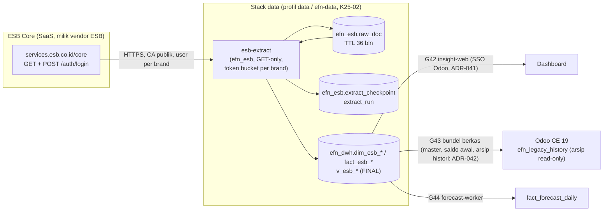

# ADR-040: Integrasi ESB Core → Datamart ClickHouse (ekstraksi GET-only per brand)

- **Status:** Proposed — belum disetujui klien. G41 boleh dibangun mengikuti rekomendasi ini dengan `ESB_ENABLED=false`
  default; ekstraksi production menunggu **Q-ESB1** (user API read-only) dan **Q-ESB7** (izin beban backfill).
- **Tanggal:** 2026-11-17 (Gelombang 41) · revisi 2026-11-18: §3.1 butir 1, §3.2, §4.4 dipersempit mengikuti ADR-042
  (Accepted); keputusan ADR-040 sendiri tetap Proposed · revisi 2026-11-25: §6b amandemen ESB OMS POST-baca (G69),
  rujukan singkat di §3.1 butir 3 dan §7
- **Pemutus:** pemilik proyek (lingkup & cutover), IT klien (user API ESB, beban server), Finance (cutover & saldo awal
  G43), Legal/DPO (kepemilikan data & PDP)
- **Referensi review:** R-O02 (migrasi data sistem lama), R-O01 (master data), R-L01 (PDP), R-O03 (beban ETL),
  usulan R-O09, R-O10, R-S17 (`docs/01` §4); Q5 (sistem lama yang harus dimigrasi) dan Q-ESB1..Q-ESB9 (`docs/01` §5.12,
  `docs/04` §25.9)
- **Terkait:** ADR-003 (ETL 15 menit, Accepted 25 Okt), ADR-004 (topologi), ADR-007 (PG source of truth), ADR-010 (AI di
  luar jalur transaksi), ADR-022 (TLS), ADR-024 (kredensial per service), ADR-037 (pola egress allowlist), ADR-038
  (`efn_t2s` row policy), K25-02 (stack data terpisah), K25-12 (forecast CK), `docs/04` §25

> **Ringkasan manajemen.** Saat ini kelima brand (Paris Baguette, Wetzel's, Bacha, Im Donut, Curry Up) masih berjalan di
> ESB. Kami menarik data ESB **hanya dengan membaca** (tanpa mengubah apa pun di ESB) ke gudang data EFN, satu akun API
> per brand, pada jam sepi malam. Hasilnya dipakai untuk dashboard (G42), migrasi ke Odoo (G43), dan prediksi permintaan
> (G44). Data pelanggan/member **tidak** ditarik. Biaya: ±2,5–3,5 minggu-engineer, Rp0 lisensi. Yang dibutuhkan dari
> klien: **akun API ESB yang hanya bisa membaca** (saat ini akun admin) dan izin menarik 24 bulan histori.

## 1. Konteks

### 1.1 Kebutuhan
- Klien memakai **ESB Core + ESB POS** (SaaS, `https://services.esb.co.id/core`) untuk lima brand. Prototipe G41
  (17 Nov 2026, skrip di luar repo, PB saja, satu bulan) membuktikan API ESB cukup untuk merekonstruksi alur produk jadi
  CK → kirim → produksi toko → transfer → jual.
- Permintaan pemilik proyek (rencana induk G41–G44): (1) datamart dari API ESB untuk dashboard dan sumber migrasi;
  (2) dashboard Next.js dengan login akun Odoo (G42); (3) migrasi master + saldo awal + histori ke Odoo (G43);
  (4) satu brand = satu user API; (5) Im Donut (IMD) & Curry Up (CUP) menjadi company baru; histori 24 bulan.

### 1.2 Pertentangan dengan dokumen/prinsip yang berlaku
| Sumber | Bunyi | Pertentangan |
|---|---|---|
| `CLAUDE.md` prinsip | "PostgreSQL = source of truth; ClickHouse hanya turunan via ETL incremental 15 menit dari replica … **Tidak ada tulis langsung API → ClickHouse**." | `esb-extract` menulis ke ClickHouse dari API eksternal, bukan dari replica PostgreSQL. |
| ADR-003 (Accepted 25 Okt) | ETL batch 15 menit dari replica, tanpa CDC. | Data ESB tidak ada di PostgreSQL mana pun; jadwal ESB = per jam / harian, bukan 15 menit. |
| ADR-014 / ADR-037 | Container data/AI tanpa egress kecuali lewat overlay ber-allowlist. | Ekstraksi butuh egress internet ke host ESB. |
| `docs/01` R-O02 | "Migrasi data dari sistem lama tidak disebut sama sekali." | Sistem lama kini diketahui = ESB; ADR ini menjadi dasar migrasi. |
| Rencana induk | "`fact_esb_sales_line` (hari×cabang×menu×produk resep)" dan "`v_esb_hourly` (bila tersedia)" | API laporan baris (`/report/sales-menu-cogs`) tidak memuat jam → view per jam tidak dibuat (L-112). Grain resep = tabel terpisah `fact_esb_fin_sold_daily`. |

### 1.3 Fakta API (diverifikasi 17 Nov 2026 lewat prototipe; spec publik `developers.esb.co.id/esb-core/openapi.json`)
- Login `POST /auth/login` → Bearer JWT; 401 → login ulang.
- `/report/sales-menu-cogs` = level baris transaksi-menu, **limit tetap 20 baris/halaman** (parameter `limit` diabaikan),
  ±0,3–0,5 dtk/halaman, ±450 baris/toko/hari → **±23 panggilan/toko/hari**. Tanpa jam transaksi.
- `/report/sales-menu-cogs-detail?mode=recap&productName=FIN` ±3 panggilan/toko/hari; `/report/sales-payment-summary`
  1 panggilan/hari untuk semua cabang.
- Spec memuat banyak endpoint tulis (`POST …/push`, `…/import`, `…/authorize`) yang **bisa dipanggil akun admin** yang
  saat ini dipakai → risiko R-S17.
- `/inventory/stock-list` menerima `stockDate` + `branchID` (menurut spec; **belum diuji di production**).

## 2. Opsi yang dipertimbangkan

| # | Opsi | Kelebihan | Kekurangan | Biaya / waktu (perkiraan architect) |
|---|---|---|---|---|
| **A** | **Service baru `esb-extract`** (Python, GET-only, satu-satunya egress ke host ESB) → raw JSON + mart di **ClickHouse** | Otomatis, incremental, bisa diulang (idempoten), backfill bisa dilanjutkan; ETL & Odoo tetap tanpa internet; pas dengan K25-02 (pindah ke mesin data) | Satu service + image + secret baru; pengecualian terbatas prinsip "tanpa tulis langsung ke ClickHouse" (§3.2) | **±2,5–3,5 minggu-engineer** (data 2–2,5, devsecops 0,5–1), Rp0 lisensi, RAM ±256–512 MB |
| B | Ekspor CSV/Excel manual dari layar ESB per brand, diunggah staf | Hampir tanpa kode, tidak butuh akun API | Pekerjaan manual harian × 5 brand; tidak ada incremental/koreksi; format laporan bisa berubah tanpa pemberitahuan; rentan salah unggah; histori 24 bulan = ratusan berkas; tidak mendukung forecast harian | Build ±1 minggu, lalu ±0,5–1 jam staf/brand/hari (±10–20 jam/minggu untuk 5 brand) — biaya operasional berulang |
| C | Beri egress internet ke **ETL yang sudah ada** dan tambahkan job ESB | Tanpa service baru (hemat ±3–4 hari) | ETL memegang kredensial replica Odoo + PG platform + ClickHouse writer; menambah internet memperbesar dampak bila ETL disusupi (ADR-024); gagal ESB mengganggu ETL 15 menit; melanggar isolasi ETL | Hemat ±3–4 hari, risiko keamanan naik — **ditolak** |
| D | Tulis langsung **ESB → Odoo** (tanpa datamart) | Satu langkah | Histori sebagai `stock.move`/`account.move`/`pos.order` merusak valuasi stok, pajak, dan penomoran dokumen; tidak ada dashboard/forecast; tidak ada tempat rekonsiliasi/uji ulang; fit-gap belum ada | Tampak cepat, tetapi koreksi pasca-cutover mahal (minggu-engineer + koreksi jurnal) — **ditolak** |
| E | Raw ESB ke **PostgreSQL** (skema staging) lalu ETL 15 menit → ClickHouse | Patuh literal pada "PG source of truth" | Raw 24 bulan menambah beban & ukuran backup PG primary (WAL-G, R-T08); PG bukan pemilik data ini; dua lompatan untuk data yang sama; bertentangan dengan K25-02 (data stack bisa di mesin lain) | +±1 minggu-engineer, + ruang PG & backup — **ditolak** |
| F | Minta vendor ESB memberi ekspor database / feed data warehouse | Paling ringan untuk server ESB | Belum diketahui tersedia; ketergantungan kontrak vendor | Tidak diketahui — **dicatat sebagai pertanyaan** (Q-ESB9), tidak memblokir A |

## 3. Keputusan (direkomendasikan)

### 3.1 Pilih opsi A
1. **ESB Core = sistem sumber eksternal (legacy)** per brand sampai tanggal cutover brand tersebut (Q-ESB6). Setelah
   cutover, **Odoo menjadi sumber kebenaran transaksi**; ekstraksi brand itu dihentikan (brand dikeluarkan dari
   `ESB_BRANDS`) setelah rekonsiliasi terakhir, dan mart ESB menjadi **arsip histori read-only yang tetap menjadi sumber
   angka resmi histori pra-cutover**. *(Dipersempit 18 Nov 2026 mengikuti ADR-042 Accepted:)* yang disalin ke Odoo
   hanya arsip baca-saja `efn_legacy_history` — aliran produk harian (default 400 hari, untuk forecast), penjualan
   harian outlet × menu (24 bulan), dan baris penjualan (parameter `efn_mig_esb.sales_line_months`, default 24 bulan);
   dokumen produksi, delivery, transfer, dan pembayaran per dokumen **tidak** disalin ke Odoo (tetap di mart).
2. **Service `services/esb-extract`** (Python 3.12, paket `efn_esb`) lewat overlay `infra/compose/docker-compose.esb.yml`
   (profil `data`, siap pindah ke project `efn-data`, K25-02). Satu-satunya komponen dengan egress ke
   `services.esb.co.id:443` (allowlist host di aplikasi; network `egress`), dan hanya menjangkau ClickHouse lewat network
   internal `esb` (tidak di `data`: tidak menjangkau PostgreSQL/RabbitMQ). ETL, Odoo, BFF tetap tanpa egress ke ESB.
3. **GET-only**: klien HTTP menolak method selain `GET`, kecuali `POST /auth/login` (ditegakkan di kode + test).
   Satu user API per brand (`ESB_USER_<BRAND>`, password dari `/run/secrets/esb_core_password_<brand>`). Klien diminta
   membuat **user API read-only** (Q-ESB1); sampai ada, akun admin yang ada dipakai **hanya di dev/uji** (R-S17).
   *(25 Nov 2026:)* aturan ini berlaku untuk klien **ESB Core**; klien baca **ESB OMS** (method POST, allowlist path
   persis) diatur terpisah di §6b.
4. **Alur**: fetch → `efn_esb.raw_doc` (JSON apa adanya minus field identitas, L-110) → transform (logika prototipe
   `aggregate.py`, ditulis ulang teruji) → `efn_dwh.dim_esb_* / fact_esb_*` (ReplacingMergeTree) → checkpoint
   `efn_esb.extract_checkpoint` ditulis **terakhir**. Idempotensi = **versi slice**: semua baris fakta satu slice
   (brand, entitas, cabang/`*`, hari) membawa `_version` = `finished_at` checkpoint, dan view hanya membaca versi slice
   yang punya checkpoint, sehingga tarik ulang mengganti isi hari itu (termasuk baris yang dihapus di ESB). Batasan teruji:
   bila checkpoint gagal ditulis setelah fakta, hari itu tampak kurang sampai ditarik ulang (`docs/04` §25.4).
5. **Cakupan per `company_code`** (bukan `company_id`): PB, WTZ, BCF/BCR (override per cabang), IMD, CUP. IMD/CUP belum
   ada di Odoo (company dibuat di G43) sehingga `company_id` tidak tersedia.
6. **Retensi**: raw 36 bulan (TTL `doc_date`); mart mengikuti retensi DWH **10 tahun** (keputusan #59 / Q-6).
7. **PDP**: customer/member ESB **tidak ditarik** di G41. Supplier hanya kode, nama perusahaan, status.
8. **Beban server ESB**: token bucket per brand (default 2 req/dtk, 4 worker), backoff 429/5xx, batas panggilan per run,
   backfill 24 bulan hanya di jendela 22:00–05:00 WIB, satu brand pada satu waktu (§4.2).
9. Kill switch `ESB_ENABLED=false` (default) → service idle tanpa memanggil apa pun.

### 3.2 Kenapa ini tidak melanggar "PostgreSQL = source of truth"
- Prinsip itu melindungi **data transaksi EFN** (order, poin, stok, jurnal) yang dibuat oleh sistem EFN: sumbernya PG,
  ClickHouse hanya salinan. Data ESB **bukan milik platform EFN dan tidak pernah ada di PG**; sumber kebenarannya adalah
  database ESB (sistem eksternal). Mart ESB tetap **turunan** (salinan sistem lain), tidak pernah menjadi sumber untuk
  menulis balik ke sistem transaksi mana pun.
- Larangan "tulis langsung API → ClickHouse" ditujukan ke jalur transaksi (BFF/Odoo menulis ke ClickHouse sehingga
  ClickHouse menjadi satu-satunya catatan). Di sini penulis adalah **job batch ekstraksi**, bukan API transaksi, dan
  isinya bisa dibangun ulang kapan saja dari ESB (sampai cutover) atau dari raw 36 bulan.
- Setelah cutover, Odoo (PG) kembali menjadi satu-satunya sumber **transaksi**; salinan histori di Odoo hanya arsip
  read-only `efn_legacy_history` (G43, ADR-042 §3.1) yang tidak pernah menjadi transaksi Odoo, dan selisihnya terhadap
  mart = cacat migrasi (mart tetap acuan angka histori pra-cutover). Jalur ke Odoo = bundel berkas, bukan koneksi
  ClickHouse → Odoo.
- Pengecualian ini **terbatas**: hanya `esb-extract`, hanya database `efn_esb` dan tabel `efn_dwh.*esb*`. Prinsip
  `CLAUDE.md` perlu catatan rujukan ke ADR-040 (tugas efn-lead).

## 4. Konsekuensi

### 4.1 Positif
- Dashboard dan forecast bisa dimulai **sebelum** migrasi Odoo selesai; migrasi G43 membaca sumber yang sudah
  dibersihkan, teruji, dan bisa direkonsiliasi (jumlah & total per entitas).
- Isolasi: kegagalan ESB / `esb-extract` tidak memengaruhi POS, BFF, ETL, atau Odoo.

### 4.2 Beban API & backfill (angka agregat, dari prototipe)
| Komponen | Panggilan per toko-hari | Catatan |
|---|---|---|
| `sales-menu-cogs` (baris) | ±23 | limit tetap 20; ±450 baris/toko/hari |
| `sales-menu-cogs-detail` recap FIN | ±3 | limit tetap 20 |
| payment summary, produksi, delivery, transfer, master | kecil (per brand-hari, bukan per toko) | detail dokumen 1 panggilan/dokumen |

- Perkiraan: **±26–30 panggilan per toko-hari**. Pada 2 req/dtk per brand → ±13–15 dtk per toko-hari. Backfill 24 bulan
  untuk **10 toko** ≈ 7.300 toko-hari ≈ 190–220 ribu panggilan ≈ **26–31 jam efektif** ≈ **4–5 malam** jendela 7 jam.
  Skala linear dengan jumlah toko; brand dijalankan **berurutan** (operasional) agar beban puncak ke ESB tetap
  ±2 req/dtk. Contoh: 60 toko total ≈ 25–30 malam (±1 bulan kalender). Menaikkan rate ke 4 req/dtk memangkas setengahnya
  hanya bila ESB mengizinkan (Q-ESB7). Perkiraan engineer data (README `esb-extract`): PB ±25 toko ≈ **9–10 malam**.
  Satu proses backfill dibatasi `ESB_BACKFILL_MAX_CALLS`=60000 (≈ satu malam), lalu dijalankan ulang malam berikutnya.
- Incremental harian (sekali/hari setelah 03:00 WIB): hari H-1 dan H-7 (`ESB_CORRECTION_DAYS=1,7`) + gap fill hari tanpa
  checkpoint (maks 7 hari) → ±2× beban satu hari per toko dalam kondisi normal; untuk 60 toko ±3–4 ribu panggilan/hari
  (±30 menit pada 2 req/dtk). Entitas `branch` tiap siklus dan `master` sekali/hari (beban kecil). Belum terukur di
  production.

### 4.3 Negatif / utang teknis yang diterima
- Ketergantungan pada API yang tidak kami kontrol: perubahan skema/perilaku (mis. batas 20 baris) memutus ekstraksi
  (R-O09) → test kontrak dengan fixture sintetis, `v_esb_data_quality`, alert umur data.
- Dokumen ESB yang dihapus/diubah **lebih dari 7 hari** setelah tanggalnya tidak tertangkap incremental → rekonsiliasi
  bulanan total per brand (backfill ulang satu bulan) sebelum cutover (L-114).
- Akun admin dipakai sampai Q-ESB1 dijawab (R-S17).
- Network Docker `egress` tidak membatasi tujuan di level jaringan (sama dengan ADR-037); allowlist di aplikasi.
  Rekomendasi: proxy egress allowlist sebelum production.
- Prinsip `CLAUDE.md` butuh catatan pengecualian (lihat §3.2).

### 4.4 Dampak ke gelombang berikutnya (desain G41 tidak boleh menghalangi)
| Gelombang | Yang disiapkan G41 | Keputusan menyusul |
|---|---|---|
| **G42** insight-web (Next.js) + SSO dari Odoo | View `v_esb_*` stabil (nama di `docs/04` §25.5), kolom `company_code` di semua mart → row policy per PT bisa ditempel tanpa mengubah tabel | User ClickHouse `efn_insight` + row policy bertanda tangan (pola `efn_t2s`, ADR-038) **tidak** dibuat di G41; modul `efn_insight` butuh fit-gap `efn-odoo-functional` + ADR tersendiri (token sekali pakai ≤ 60 dtk) → **ADR-041** (G42, `docs/04` §26) |
| **G43** migrasi master + saldo awal + histori | `map_esb_odoo` (kosong), `dim_esb_*` sebagai sumber master, `fact_esb_*` sebagai histori | **ADR-042 (Accepted 18 Nov 2026, dengan amendemen)** — *dipersempit dari rumusan awal "histori 24 bulan masuk `efn_legacy_history`"*: mart tetap sumber angka resmi histori; Odoo menerima arsip read-only `efn.legacy.flow.daily` (400 hari default, maks 730, input forecast), `efn.legacy.sales.daily` (24 bulan) dan `efn.legacy.sales.line` (parameter `efn_mig_esb.sales_line_months`, default 24), `company_id` + record rule, **bukan** `stock.move`/`account.move`/`pos.order`; produksi/delivery/transfer/pembayaran per dokumen tidak disalin; saldo awal = `stock.quant` inventory mode + jurnal pembukaan draft per tanggal cutover; company IMD/CUP mengikuti pola G24 WTZ (dibangun G43-A); pilot PB |
| **G44** forecast worker | `v_esb_sales_daily` & `fact_esb_fin_sold_daily` sebagai input harian | Model, kalender libur, output `fact_forecast_daily`; tetap proposal yang disetujui planner (K25-12), AI di luar jalur transaksi (ADR-010) |

### 4.5 Dampak ke dokumen lain
- `docs/04` §25 (kontrak tabel/view/env) — dibuat bersama ADR ini.
- `docs/01` §5.12 (Q-ESB1..9) dan usulan risiko R-O09, R-O10, R-S17.
- `docs/compliance/PDP_DATA_INVENTORY.md`: entri baru "Datamart ESB" (raw tanpa identitas staf/pelanggan; nama supplier
  perorangan = data pribadi bila supplier adalah orang) — **belum dibuat**, tugas architect/DPO gelombang berikut.
- `CLAUDE.md`: catatan pengecualian prinsip ClickHouse (efn-lead).

## 5. Risiko terkait
| ID | Ringkas | Mitigasi di G41 |
|---|---|---|
| R-O02 | Migrasi sistem lama | Datamart = staging migrasi, rekonsiliasi per entitas (G43) |
| R-O01 | Master data tidak seragam | `dim_esb_product_alias` (normalisasi nama), `NAME:<alias>` untuk yang tak terpetakan, `v_esb_data_quality` |
| R-L01 | PDP | Customer/member tidak ditarik; raw tanpa field identitas; supplier minimal |
| **R-O09** (usulan) | ESB mengubah skema/perilaku API | Parser toleran + test kontrak sintetis + alert umur data + `extract_run.errors` |
| **R-O10** (usulan) | Beban ekstraksi mengganggu server ESB / akun diblokir | Token bucket, backoff, `ESB_MAX_CALLS_PER_RUN`, jendela malam, satu brand per waktu, izin klien (Q-ESB7) |
| **R-S17** (usulan) | Akun admin ESB dipakai ekstraksi (bisa menulis ke ERP produksi klien) | GET-only di kode + test, secret per brand, egress allowlist, user read-only (Q-ESB1), rotasi password setelah user read-only tersedia |

## 6. Pertanyaan terbuka (dijawab klien)
Rinci di `docs/04` §25.9 dan `docs/01` §5.12: **Q-ESB1** user API read-only per brand · **Q-ESB2** WP = Wetzel's
Pretzels (WTZ)? (**terjawab 18 Nov 2026: ya**) · **Q-ESB3** pemetaan cabang Bacha ke BCR/BCF · **Q-ESB4** 11 cabang PB tanpa data produk FIN ·
**Q-ESB5** nama PT, NPWP, jenis pajak Im Donut & Curry Up · **Q-ESB6** tanggal cutover per brand · **Q-ESB7** izin beban
backfill 24 bulan (rate, jendela) · **Q-ESB8** daftar cabang CK per brand · **Q-ESB9** hak EFN atas data & penggunaan API
massal menurut kontrak ESB / ketersediaan ekspor resmi.

## 6a. Catatan amandemen 24 Nov 2026 (ADR-051, Proposed)
Kebutuhan tulis ke ESB (transfer + produksi untuk production planning CK, G66) **tidak** melonggarkan §3.1 butir 3:
`esb-extract` tetap GET-only (kode + test tidak berubah). Tulis ditangani service terpisah `services/prodplan` dengan
kredensial, network egress, dan allowlist POST/DELETE sendiri — lihat ADR-051 dan `docs/04` §30.

## 6b. Amandemen 25 Nov 2026 — ESB OMS POST-baca (G69)

> **Ringkasan manajemen.** Data per jam, per kanal (dine-in/takeaway/online), jumlah tamu, dan promo per struk **tidak
> ada** di ESB Core, tetapi ada di **ESB OMS** (API lain dari vendor yang sama). Kami menarik data struk OMS untuk
> Paris Baguette saja, **hanya membaca**, untuk dashboard penjualan per jam & kanal dan sell-through per jam. Data
> member dan kartu **dibuang** sebelum disimpan. Biaya ±1,5–2 minggu-engineer, Rp0 lisensi; fitur mati secara default
> dan production menunggu akun read-only (Q-ESB1) serta izin beban intraday dari ESB (Q-OMS2). Arah ini disetujui
> pemilik proyek 25 Nov 2026; ADR tetap **Proposed** sampai klien menandatangani.

### 6b.1 Konteks
- L-112 (`docs/04` §25.9): `v_esb_sales_hourly` tidak dibuat karena laporan Core tidak memuat jam transaksi. Pemilik
  proyek meminta dashboard penjualan per jam/kanal dan sell-through per jam (25 Nov 2026).
- Probe baca-saja production 25 Nov 2026 (akun brand PB, hanya jumlah yang dicatat di repo) menemukan ESB OMS
  (`https://esbcore.co.id/external/general/*`, spec publik `developers.esb.co.id/esb-oms/api_data.json`) dengan data
  struk: jam masuk/keluar, kanal (*visit purpose*), pax, diskon/promo, pembayaran, dan baris menu ber-`menuCode`.
  Rekonsiliasi satu cabang × satu hari: jumlah struk dan Σ `grandTotal` struk = ringkasan cabang-hari OMS (selisih 0).
- **Pertentangan dengan rumusan yang berlaku:**

| Sumber | Bunyi | Pertentangan |
|---|---|---|
| §3.1 butir 3, `docs/04` §25.3, L-106 | "GET-only … klien HTTP menolak method selain `GET`, kecuali `POST /auth/login`"; allowlist host `services.esb.co.id:443` | **Semua** endpoint baca OMS memakai `POST` + body JSON filter, di host lain (`esbcore.co.id`). |
| §6a | `esb-extract` tetap GET-only; tulis ke ESB di service terpisah | POST di sini **bukan tulis** (filter pencarian); tetapi method POST membuka risiko salah panggil endpoint tulis OMS (`push/*`, `create-*`, `update-*`) dengan akun admin (R-S17). |
| ADR-003 / `CLAUDE.md` | ETL incremental 15 menit **dari replica PostgreSQL** | Tarik intraday tiap 15 menit langsung dari API eksternal ke ClickHouse. |

### 6b.2 Opsi yang dipertimbangkan
| # | Opsi | Kelebihan | Kekurangan | Biaya / waktu |
|---|---|---|---|---|
| **A** | **Klien OMS terpisah di dalam `esb-extract`**, allowlist POST persis (5 path), kredensial brand yang sama | Memakai ulang slice/checkpoint/raw/mart, token bucket, deploy, dan secret G41; satu tempat egress ESB | Pengecualian kedua di `esb-extract` (POST-baca); host egress bertambah | **±1,5–2 minggu-engineer** (data-AI 1–1,5; frontend Insight 0,5; devsecops/QA ≤ 0,5), Rp0 lisensi, RAM tambahan dapat diabaikan |
| B | Service baru `esb-oms-extract` | Isolasi proses dari klien Core | Kredensial ESB **sama** (Basic, user brand yang sama) sehingga isolasi tidak mengecilkan dampak bocor; duplikasi image, overlay, secret mount, checkpoint | +±3–4 hari di atas A, + satu image untuk di-hardening dan di-review |
| C | Tidak menarik OMS; tunggu endpoint jam di Core / ekspor vendor (opsi F) | Tanpa beban & risiko baru | Kebutuhan pemilik proyek tidak terpenuhi; tidak ada jadwal dari vendor | Rp0, waktu tidak diketahui |
| D | OMS **harian saja** (H-1, H-7), tanpa intraday | Beban ±300 panggilan/hari (§6b.6) | Tidak ada "hari ini per jam"; sell-through per jam hanya untuk kemarin | Sama dengan A minus ±1–2 hari; **fallback** bila Q-OMS2 ditolak |

### 6b.3 Keputusan (direkomendasikan: opsi A, dengan D sebagai fallback beban)
1. **Allowlist OMS persis**, ditegakkan sebelum koneksi dibuka (kode + test): skema `https`, host persis
   `esbcore.co.id`, port 443; method **hanya `POST`**; path persis salah satu dari `/external/general/get-branch`,
   `/external/general/get-visit-purpose`, `/external/general/get-payment-method`,
   `/external/general/sales-branch-summary`, `/external/general/sales-head`. Query hanya `page` (bilangan bulat ≥ 1,
   hanya untuk `sales-head`). Body hanya kunci filter yang dikenal per path (`docs/04` §33.2). Selain itu (GET, method
   lain, path lain termasuk `push/*`, `sales-data`, `create-*`, `update-*`, host lain, query lain) → ditolak. Redirect
   tidak diikuti.
2. **Klien Core tidak berubah**: tetap GET-only + `POST /auth/login` (§3.1 butir 3). Dua klien, dua allowlist, tidak
   ada jalur kode yang memakai allowlist OMS untuk host Core atau sebaliknya.
3. **Auth**: `Authorization: Basic` dari `ESB_USER_<BRAND>` + `/run/secrets/esb_core_password_<brand>` (kredensial brand
   yang sama dengan Core; tidak ada secret baru). Tanpa JWT, sehingga tidak memutus sesi Core. Header `Authorization`
   (password ter-encode di setiap permintaan) **tidak pernah** di-log/dimasukkan ke exception. `User-Agent` eksplisit
   non-identitas wajib (Cloudflare menolak UA default library). R-S17 tetap: akun saat ini admin → production menunggu
   **Q-ESB1** (user read-only, kini mencakup OMS).
4. **Cakupan**: `ESB_OMS_BRANDS=pb` (subset `ESB_BRANDS`). Brand lain cukup konfigurasi setelah izin beban.
5. **PDP / PCI**: field identitas member, data kartu/rekening, kode verifikasi/voucher, teks bebas, dan pelaku
   dokumen **dibuang sebelum** `efn_esb.raw_doc` maupun mart (daftar persis `docs/04` §33.6); member hanya menjadi
   `has_member UInt8`. Nama/nomor meja dan jam transaksi **bukan** data pribadi (tidak menunjuk orang tanpa sistem lain).
   Tidak pernah menyimpan PAN; `cardNumber` (sudah ter-mask sebagian di sumber) tetap dibuang.
6. **Kill switch** `ESB_OMS_ENABLED=false` default, terpisah dari `ESB_ENABLED` (OMS bisa dimatikan tanpa menghentikan
   Core). Production `true` hanya setelah Q-ESB1 + Q-OMS2 dan entri PDP disetujui DPO.
7. **Idempotensi**: pola versi slice §3.1 butir 4; slice `(brand, oms_sales, branch_code, sales_date)`; hari berjalan
   ditarik ulang utuh tiap interval (slice diganti). Detail `docs/04` §33.4.

### 6b.4 Penyimpangan dari ADR-003 (15 menit dari replica)
Interval intraday 15 menit di sini **bukan** ETL ADR-003: sumbernya API sistem eksternal, bukan replica PostgreSQL.
Alasannya sama dengan §3.2: data struk ESB tidak pernah ada di PostgreSQL EFN, mart tetap turunan yang bisa dibangun
ulang dari ESB/raw 36 bulan, dan penulisnya job batch, bukan API transaksi. Pengecualian tetap terbatas pada
`esb-extract`, database `efn_esb`, dan tabel `efn_dwh.*esb_oms*`. ETL ADR-003 tidak berubah.

### 6b.5 Konsekuensi
- **Positif:** dashboard per jam/kanal dan sell-through per jam untuk PB; rekonsiliasi silang OMS ↔ ringkasan OMS ↔
  pembayaran Core (`docs/04` §33.5 `v_esb_oms_recon_daily`).
- **Negatif / diterima:** host egress kedua (allowlist aplikasi; allowlist jaringan tetap sisa risiko, §4.3); perilaku
  paginasi OMS yang tidak standar (halaman sesudah terakhir mengulang halaman terakhir) → batas keras halaman + deteksi
  `salesNum` baru (R-O09); beban intraday ke server ESB (R-O10, Q-OMS2); `menuCode` kosong pada sebagian kecil baris →
  porsi tak terpetakan ditampilkan, tidak disembunyikan.

### 6b.6 Beban (perkiraan kasar, PB ±21 toko, 2 req/dtk per brand; belum terukur di production)
Dasar probe: `sales-head` 20 struk/halaman, ±0,5 dtk/halaman, **±6 halaman per toko-hari** (+ paling banyak 1 panggilan
pendeteksi halaman berulang bila halaman terakhir tepat 20 baris).

| Komponen | Rumus | Panggilan/hari |
|---|---|---|
| Final harian H-1 + koreksi H-7 | 21 toko × 2 hari × ±7 | ±300 |
| Intraday 07–23 WIB tiap 15 menit (±64 interval) | 64 × 21 × halaman hari berjalan (naik dari 1 ke ±6–7; rata-rata ±4) | ±5.400 (batas atas ±9.400) |
| `sales-branch-summary` + master (cabang, kanal, metode bayar) | ±1 per interval + 3/hari | ±70 |
| **Total** | | **±5.800–9.800** |

- Per interval ±85–150 panggilan ≈ **45–75 detik** pada 2 req/dtk (≤ 10% dari interval 900 dtk); jauh di bawah
  `ESB_OMS_MAX_CALLS_PER_RUN`=5000 (batas pengaman, bukan target).
- Sebagai pembanding, incremental harian Core untuk 60 toko ±3–4 ribu panggilan/hari (§4.2): intraday OMS PB saja
  ±1,5–3× itu → **izin beban tersendiri (Q-OMS2)**. Fallback opsi D (harian saja) ≈ ±370 panggilan/hari.
- Backfill: ±7 panggilan per toko-hari → 12 bulan ≈ 54 ribu panggilan (≈ 7,5 jam, satu malam); 24 bulan ≈ 107 ribu
  (≈ 15 jam, 2–3 malam dengan `ESB_OMS_BACKFILL_MAX_CALLS`=60000), di jendela 22:00–05:00 WIB, tidak bersamaan dengan
  backfill Core brand yang sama.

### 6b.7 Risiko & pertanyaan
- Risiko: **R-S17** (akun admin, kini juga untuk endpoint tulis OMS → allowlist + test), **R-O10** (beban intraday),
  **R-O09** (perilaku paginasi/skema OMS), **R-L01** (PDP: member/kartu dibuang).
- Pertanyaan klien: **Q-ESB1** (kini termasuk OMS), **Q-ESB9** (hak data, berlaku juga untuk OMS), **Q-OMS1** token
  statis PIC ESB untuk material usage & member (`core-api.esb.co.id`, 401 dengan kredensial brand; **di luar G69**),
  **Q-OMS2** izin beban intraday, **Q-OMS3** retensi struk (usul raw 36 bulan, mart 10 tahun seperti G41). Rinci
  `docs/04` §33.9 dan `docs/01` §5.12.
- Ditinjau ulang bersama §7, ditambah: Q-OMS2 ditolak (beralih ke opsi D), ESB mengubah paginasi/skema OMS, atau
  brand kedua ditambahkan ke `ESB_OMS_BRANDS`.

## 7. Kapan ditinjau ulang
- Q-ESB1 atau Q-ESB7 dijawab (mengubah status ekstraksi production); untuk OMS juga Q-OMS2 (§6b.7).
- ESB mengubah API (alert R-O09) atau vendor menawarkan ekspor resmi (opsi F).
- Cutover brand pertama (G43) — ekstraksi brand itu dihentikan, mart menjadi arsip.
- Paling lambat **28 Feb 2027**, atau saat seluruh brand sudah cutover (ADR ini lalu `Superseded` oleh catatan arsip).
