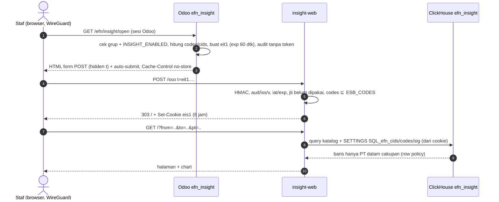

# ADR-041: Dashboard Insight (Next.js `insight-web`) dengan SSO dari Odoo dan cakupan PT bertanda tangan

- **Status:** Proposed — belum disetujui klien. G42 boleh dibangun mengikuti rekomendasi ini dengan
  `INSIGHT_ENABLED=false` default (Odoo dan insight-web); production menunggu review security, DPO (nama tampilan di
  cookie + log audit), **Q-ESB1/Q-ESB7/Q-ESB9** (G41), dan **Q-INS1/Q-INS4** (ADR ini).
- **Tanggal:** 2026-11-18 (Gelombang 42); **revisi 2026-11-18 (Supermarket, §3.3): cakupan level outlet + 5 persona**;
  §3.4 2026-11-20; **addendum §3.5 2026-11-21 (G51): filter terpadu F&B + SMD, Proposed**
- **Pemutus:** pemilik proyek (lingkup pengguna & grup Holding), IT klien (jaringan staf/outlet), Legal/DPO (data
  pribadi staf di sesi & log), Security (kunci SSO)
- **Referensi review:** R-L01 (PDP), R-S03 (Odoo tidak terekspos), R-S10 (insider), R-T06 (angka dashboard dipakai
  manajemen), R-T11 (beban Odoo), usulan **R-S18** (kunci SSO bocor / pemalsuan sesi, lihat §5); SEC-182 (G41,
  `metabase_reader` lintas PT); Q-ESB1..9 (`docs/04` §25.9); Q-INS1..Q-INS9 (`docs/04` §26.12)
- **Terkait:** ADR-022 (TLS CA internal), ADR-024 (kredensial per service), ADR-031 (tanpa modul pihak ketiga),
  ADR-038 (row policy `efn_t2s` bertanda tangan — pola yang diikuti), ADR-040 (datamart ESB), K25-02 (stack data
  terpisah), `docs/04` §25 dan §26

> **Ringkasan manajemen.** Manajemen, operasional, dan planner mendapat **dashboard web modern** (ringkasan penjualan,
> produksi vs penjualan, menu mix, pembayaran, distribusi, kualitas data; forecast menyusul G44) di atas data ESB.
> Login cukup dari Odoo: klik menu *Dashboard Insight*, tanpa password kedua. Setiap orang hanya melihat PT yang boleh
> ia akses di Odoo; pembatasan ditegakkan dua kali (aplikasi dan gudang data). Odoo tetap tidak terbuka ke internet.
> Biaya ±3,5–5 minggu-engineer, Rp0 lisensi. Mati secara default; yang perlu diputuskan klien: siapa yang mendapat akses
> semua brand (Holding) dan apakah manajer outlet boleh membuka dashboard dari jaringan outlet.

## 1. Konteks

### 1.1 Kebutuhan
- Rencana induk G41–G44: dashboard Next.js dengan login akun Odoo, data dibatasi PT pengguna, di atas mart ESB
  (`efn_dwh.v_esb_*`, ADR-040). Pengguna: staf EFN per PT (manajemen, operasional, planner) dan Holding (semua brand).
- Im Donut (IMD) dan Curry Up (CUP) **belum menjadi company Odoo** sampai G43, tetapi datanya sudah ada di mart ESB.
- Metabase sudah ada (ADR-004), tetapi `metabase_reader` membaca **semua PT** (SEC-182, `docs/04` §25.7).

### 1.2 Pertentangan dengan dokumen/prinsip yang berlaku
| Sumber | Bunyi | Pertentangan / celah |
|---|---|---|
| `CLAUDE.md` prinsip | "Odoo tidak pernah diakses langsung dari internet." | SSO tidak boleh mengandalkan browser/servis lain memanggil Odoo dari luar; insight-web juga tidak boleh punya jalur ke Odoo. |
| `docs/04` §25.7 | "`metabase_reader` saat ini melihat **semua PT** di mart ESB … Row policy per PT … ditunda ke G42." | Metabase tidak cocok untuk pengguna per PT tanpa pembatasan baris. |
| Metabase (edisi OSS) | Data sandboxing (row-level) dan SSO JWT/SAML = fitur edisi berbayar (menurut dokumentasi Metabase; **belum diverifikasi ulang** untuk versi yang dipakai repo). | Pembatasan per PT dan login Odoo tidak bisa dicapai di Metabase OSS tanpa lisensi. |
| Odoo CE 19 | Modul `auth_oauth` di CE adalah **klien** OAuth (login ke Odoo memakai penyedia luar), bukan penyedia/OIDC provider. | Tidak ada mekanisme standar CE untuk "login ke aplikasi lain memakai akun Odoo". |
| ADR-038 | Kunci `text2sql_scope_key` hanya clickhouse-init + text2sql. | Dashboard butuh tanda tangan cakupan sendiri; memakai kunci text2sql memperluas dampak kebocoran. |
| ADR-040 §4.4 | "modul `efn_insight_sso` … ADR tersendiri"; "**ADR-041** menyusul" untuk migrasi G43. | Nomor ADR-041 kini dipakai keputusan ini; ADR migrasi G43 menjadi **ADR-042** (rujukan di ADR-040 dan indeks diperbarui). Nama modul menjadi `efn_insight`. |

## 2. Opsi yang dipertimbangkan

### 2.1 Tempat dashboard
| # | Opsi | Kelebihan | Kekurangan | Biaya / waktu (perkiraan architect) |
|---|---|---|---|---|
| **A** | **App Next.js baru `insight-web`** (terpisah dari superapp-web), query di server ke ClickHouse `efn_insight` | UX bebas (drill-down, dark mode, id-ID), stack sama superapp-web, read-only, bisa pindah ke mesin data (K25-02) | Satu app + image + sertifikat + secret baru | **±3,5–5 minggu-engineer** (frontend 2–3, Odoo 0,5, data 0,5, devsecops 0,5–1), Rp0 lisensi, RAM ±256–512 MB |
| B | Metabase per PT (user ClickHouse per PT, koleksi per PT, akun Metabase terpisah) | Hampir tanpa kode (±1 minggu) | Tanpa sandboxing di OSS → satu koneksi per PT dan kombinasi PT untuk user multi-PT; akun & password kedua di luar Odoo; tidak ada pencabutan akses otomatis saat user Odoo dinonaktifkan | ±1 minggu awal + administrasi akun berulang; atau lisensi Metabase Pro (biaya per pengguna, **belum dihitung**) |
| C | Dashboard di dalam Odoo (OWL / spreadsheet dashboard) | Satu login | Odoo harus memegang kredensial ClickHouse (bertentangan `docs/04` §23.5: "Odoo tidak punya kredensial ClickHouse"); query analitik membebani worker Odoo (R-T11); UX terbatas | ±3–4 minggu + risiko performa POS — **ditolak** |
| D | Halaman staf di `superapp-web` | Tanpa app baru (hemat ±3 hari) | Mencampur zona kepercayaan: superapp-web publik untuk pelanggan, dashboard staf internal; satu celah membuka data manajemen ke internet | **Ditolak** |

### 2.2 Mekanisme login (SSO)
| # | Opsi | Kelebihan | Kekurangan | Biaya / waktu |
|---|---|---|---|---|
| **1** | **Token HMAC sekali pakai dari Odoo, dikirim lewat POST form** (`eit1`, umur ≤ 60 dtk, `jti`) | Tanpa stack baru; Odoo tidak perlu dijangkau insight-web; token tidak masuk access log/riwayat browser; implementasi kecil & teruji | Kunci simetris dipegang dua service; replay dicegah cache `jti` di memori (replika tunggal); sesi tidak bisa dicabut sebelum kedaluwarsa | **±2–3 hari** (Odoo ±1, insight-web ±1–2) |
| 2 | Identity provider OIDC (Keycloak/Authentik) + Odoo `auth_oauth` (klien CE) + insight-web sebagai klien OIDC | Standar industri, MFA terpusat, pencabutan sesi, siap multi-app | **Stack baru** (DB, backup, HA, patch, PKI) dan migrasi login seluruh user Odoo (POS, portal vendor ADR-035); keputusan identitas lintas platform, bukan untuk satu dashboard | ±2–3 minggu-engineer + operasi berulang ±0,5 hari/bulan + RAM ±1–1,5 GB — **ditolak untuk G42, dicatat sebagai opsi masa depan** (§7) |
| 3 | Bangun Odoo sebagai OAuth/OIDC provider (`efn_oauth_provider`) | Satu sumber identitas | Komponen keamanan kritis ditulis sendiri (PKCE, refresh, rotasi kunci, consent); permukaan serangan di Odoo | ±3–4 minggu + review keamanan khusus — **ditolak** |
| 4 | Token di **query string** (redirect GET `…/sso?t=…`) | Paling sederhana | Token masuk access log Traefik, riwayat browser, header `Referer`; jendela 60 dtk tetap cukup untuk dipakai ulang dari log | Hemat ±0,5 hari — **ditolak** |
| 5 | **Cookie sesi Odoo bersama** (insight-web membaca `session_id` lalu memvalidasi ke Odoo) | Tanpa token baru | insight-web harus menjangkau Odoo (jalur jaringan baru ke ERP); cookie Odoo harus berlaku lintas host (melemahkan isolasi sesi Odoo); beda host/mesin (K25-02) | **Ditolak** |
| 6 | Akun lokal di insight-web | Mandiri | Password kedua, administrasi ganda, tidak sinkron dengan PT/aktif-nonaktif user Odoo | **Ditolak** |

### 2.3 Pembatasan data per PT
| # | Opsi | Catatan | Keputusan |
|---|---|---|---|
| **a** | **Row policy ClickHouse `efn_insight_scope` bertanda tangan** (format sama dengan text2sql, **kunci berbeda** `insight_scope_key`) + filter di aplikasi | Dua lapis; bug query/filter aplikasi tidak bisa melewati batas PT | **Dipilih** |
| b | Pakai ulang `text2sql_scope_key` | Satu kunci untuk dua service → kebocoran salah satu membuka keduanya (ADR-024) | Ditolak |
| c | User ClickHouse per PT | N user + kombinasi untuk user multi-PT; rotasi berat | Ditolak |
| d | Filter `WHERE` di aplikasi saja | Satu lapis | Ditolak |

## 3. Keputusan (direkomendasikan)

1. **Opsi A + 1 + a.** App baru `services/insight-web` (Next.js App Router, TypeScript strict, Node 22, standalone),
   **read-only** (tidak pernah menulis ke Odoo/ClickHouse/PostgreSQL), profil compose `data` (K25-02), di belakang
   sidecar TLS `insight-web-tls`, router Traefik `insight.<domain>` hanya di entrypoint WireGuard (`wg-https`).
2. **Modul Odoo `efn_insight`** (depends `efn_core`, dibangun sendiri, ADR-031): grup *Insight: pengguna* dan
   *Insight: semua brand/Holding* (implies pengguna); menu *Dashboard Insight* → `GET /efn/insight/open`.
3. **Cakupan**: kode PT ESB (`PB, WTZ, BCF, BCR, IMD, CUP`) dari **semua** `user.company_ids` (Q-INS2); grup semua
   brand = keenam kode tetap (termasuk IMD/CUP yang belum menjadi company sampai G43) dengan `cids` = semua company Odoo
   berkode ESB. Tidak ada kode → Odoo menampilkan pesan, **tidak** membuat token. Setiap pembukaan dicatat di
   `ir.logging` (uid, kode, peran, jti; tanpa token/nama; retensi Q-INS3).
4. **Token `eit1`** (JSON kanonik `sort_keys`, base64url tanpa padding, HMAC-SHA256 dengan kunci = byte ASCII string hex
   secret, bukan hex-decode), umur 60 dtk, `jti` sekali pakai, **tanpa email/login/telepon**; dikirim dengan
   **auto-submit POST form** (JS statis, CSP ketat, `no-store`) dari halaman Odoo ke `https://insight.<domain>/sso`.
   Rinci byte-exact + vektor uji di `docs/04` §26.3.
5. **Sesi** = cookie stateless `eis1` (HMAC `insight_session_key`, **beda** dari kunci SSO), 8 jam, `HttpOnly; Secure;
   SameSite=Lax; Path=/`; tidak ada penyimpanan sesi server; logout = hapus cookie; kedaluwarsa → buka lagi dari Odoo.
6. **ClickHouse**: user `efn_insight` (role `insight_reader`, profil `insight_readonly`) hanya membaca database
   `efn_insight` (view `SQL SECURITY DEFINER` di atas `efn_dwh.v_esb_*`); row policy `efn_insight_scope` =
   `company_code ∈ SQL_efn_codes` **dan** `SQL_efn_sig = hex(SHA256(insight_scope_key|cids|codes))`. Setting dihitung
   server dari cookie, tidak pernah dari browser. Query = **katalog bernama** di kode dengan parameter bertipe; tidak
   ada SQL dari pengguna.
7. **Metabase tetap** untuk analis Holding saja. SEC-182 dianggap tertutup bila akses Metabase (koleksi + akun)
   dibatasi grup Holding dan pengguna per PT dialihkan ke insight-web.
8. Kill switch `INSIGHT_ENABLED=false` default di Odoo dan insight-web.

### 3.1 Kenapa token di POST form, bukan redirect biasa
- Body POST tidak dicatat access log Traefik dan tidak tersimpan di riwayat browser maupun header `Referer`.
- Browser yang membawa token; insight-web tidak pernah menghubungi Odoo dan Odoo tidak pernah menghubungi insight-web
  (tidak ada jalur jaringan baru ke ERP; cocok bila stack data di mesin lain, K25-02).
- Sesuai pola webhook bertanda tangan yang sudah ada (HMAC + replay window + idempotency/`jti`).

### 3.2 Addendum 18 Nov 2026 — keputusan dari uji end-to-end dan review keamanan (efn-lead)
Uji E2E (token dibuat pustaka Odoo `efn_insight` → POST `/sso` → semua halaman; Chromium lewat sidecar TLS) dan review
keamanan G42 menghasilkan keputusan berikut; semuanya sudah diimplementasikan dan dikunci di docs/04 §26:
1. **Halaman form Odoo `Referrer-Policy: strict-origin`** (bukan `no-referrer`). Dengan `no-referrer`/`same-origin` browser
   mengirim `Origin: null` pada POST lintas-origin sehingga cek C1 menolak semua login sah. `strict-origin` hanya
   mengirim origin (tanpa path/query). Traefik memakai middleware khusus `secure-headers-insight-sso` untuk router
   `/efn/insight/open`; halaman insight-web tetap `no-referrer`.
2. **Header Origin wajib** di `POST /sso` dan harus sama persis dengan origin `EFN_INSIGHT_ODOO_URL`; tanpa Origin
   atau `null` → 401. Origin dicek sebelum token dan rate limit sehingga `jti` dan jatah login sah tidak terbakar.
3. **Gerbang sesi memakai rewrite internal**, bukan redirect (redirect ber-Location relatif membuat proxy Next 16
   gagal 500; URL absolut akan memuat host internal di belakang sidecar).
4. **Konkurensi**: satu user ClickHouse dipakai bersama semua staf → profil `max_concurrent_queries_for_user = 24`,
   semaphore per proses 12 slot untuk halaman (`INSIGHT_CH_MAX_CONCURRENCY`, 1..24) dan semaphore ekspor terpisah,
   plus batas per pengguna (SEC-189). Multi-replika = tinjau ulang (L-124).
5. **Row policy**: predikat format kanonik `SQL_efn_codes`/`SQL_efn_cids` (SEC-190, menutup length-extension pada
   `SHA256(kunci|cids|codes)`) dan DDL policy tanpa `query_log` (SEC-191); berlaku juga untuk `efn_t2s` (text2sql).
6. **Grup "semua brand" = grup sensitif** (SEC-193): tidak bisa ikut sinkron jabatan; penetapan manual (Q-INS1).

### 3.3 Revisi 18 Nov 2026 — cakupan level outlet & persona supermarket (Proposed, rencana Supermarket G44–G49)

> **Ringkasan manajemen.** Untuk supermarket, dashboard Insight tidak cukup dibatasi per PT: kepala toko hanya boleh
> melihat **tokonya sendiri**, sedangkan Direksi, Category manager, DC, dan Marketing melihat semua toko PT-nya. Insight
> juga menjadi satu-satunya tempat dashboard supermarket (lima persona). Mekanisme login dan tanda tangan yang sama
> diperluas dengan daftar gudang/outlet; halaman ESB lama tidak berubah. Biaya tambahan ±1–1,5 minggu-engineer di atas
> pembangunan halaman G47.

Keputusan pemilik proyek 18 Nov 2026: "Semua dashboard supermarket di EFN Insight; persona Direksi, Category
manager/buyer, Kepala toko, DC/logistik, Marketing; row policy **level outlet**." Ini menjawab sebagian **Q-INS6**
(pembatasan per cabang) untuk PT supermarket.

| # | Opsi cakupan outlet | Kelebihan | Kekurangan | Biaya |
|---|---|---|---|---|
| **R1** | **Tambah `wids` (id `stock.warehouse`) ke token & sesi versi baru (`eit2`/`eis2`) + tanda tangan kedua `SQL_efn_sig2 = hex(SHA256(insight_scope_key|cids|codes|wids))`; row policy view supermarket `warehouse_id ∈ SQL_efn_wids`** | View ESB lama tetap memakai `eit1`/sig v1 (tanpa regresi); satu kunci; dua lapis tetap | Dua versi format selama transisi | **±1–1,5 minggu** (Odoo ±2 hari, insight-web ±2–3 hari, ClickHouse ±1 hari) |
| R2 | Filter outlet di aplikasi saja | Murah (±2 hari) | Satu lapis; bug = kepala toko melihat toko lain | Ditolak |
| R3 | User ClickHouse per outlet | Isolasi kuat | Rotasi & jumlah user tidak terkendali | Ditolak |

Rekomendasi **R1**:
1. Grup persona baru di `efn_insight` (implies *Insight: pengguna*): `group_insight_exec` (Direksi),
   `group_insight_category` (Category manager/buyer), `group_insight_store` (Kepala toko), `group_insight_dc`
   (DC/logistik), `group_insight_marketing`. Menu/halaman insight-web ditampilkan per persona (klaim `roles`).
2. `wids`: persona store = warehouse yang ditugaskan eksplisit ke user lewat **`res.users.efn_outlet_warehouse_ids`**
   (field dari `efn_assortment`, sama dengan record rule kepala toko di `efn_replenishment`/`efn_expiry_monitor` —
   satu sumber penugasan outlet, fit-gap G45 §5; bukan default warehouse CE agar penugasan disengaja); persona lain = semua warehouse di `cids` (`wids = *` direpresentasikan
   sebagai daftar eksplisit, bukan wildcard, agar row policy sederhana). Persona store tanpa warehouse → tidak ada token.
3. Persona Marketing hanya membaca agregat kampanye/funnel (tanpa `subject_key`, ADR-047); persona store tidak melihat
   margin/harga beli (keputusan bisnis — dikonfirmasi Q-SM29).
4. Byte-exact `eit2`/`eis2` ditulis di `docs/04` saat G47 (bukan sekarang); kontrak ringkas di `docs/04` §28.11.
5. Grup persona exec/category/dc/marketing = **grup sensitif** (tidak ikut sinkron jabatan, SEC-193); store boleh ikut
   sinkron bila jabatan "Kepala toko" dipetakan dengan warehouse.

### 3.4 Revisi 20 Nov 2026 — kontrak byte-exact G47 (Proposed)

> **Ringkasan manajemen.** Rincian teknis §3.3 kini ditetapkan di `docs/04` §28.13. Tiga penyesuaian: (1) grup peran
> supermarket dipasang di modul tambahan yang hanya aktif bila modul supermarket terpasang; (2) tanda tangan cakupan juga
> mengunci peran dan kategori, sehingga margin/GMROI tertutup bagi kepala toko di level database, bukan hanya di layar;
> (3) data tingkat PT (harga pasar, kampanye) memakai "outlet 0" yang tidak terlihat oleh kepala toko. Biaya tambahan
> terhadap §3.3: ±1 hari-engineer; menunda (2) akan memaksa format token baru kelak (±1 minggu + migrasi sesi).

| # | Opsi tanda tangan cakupan | Kelebihan | Kekurangan | Biaya |
|---|---|---|---|---|
| S1 | `SHA256(key|cids|codes|wids)` (ringkasan §3.3) | Sederhana | Margin hanya dibatasi aplikasi (satu lapis, pola R2 yang ditolak); pembatasan kategori kelak = format baru | — |
| **S2** | **`SHA256(key|cids|codes|wids|personas|cats)` + allowlist persona per view di row policy** | Dua lapis untuk data biaya; pembatasan kategori kelak cukup ubah row policy | Dua setting tambahan per query | **+±1 hari** |

Rekomendasi **S2**. Penyesuaian lain: grup persona di modul **`efn_insight_sm`** (`depends` `efn_insight` +
`efn_assortment`, `auto_install`) agar instalasi F&B tidak membawa modul supermarket; field
`res.users.efn_insight_categ_ids` untuk "kategori dikelola" (CE 19 tidak punya padanan); baris tingkat PT
`warehouse_id = 0` hanya untuk persona exec/category/dc/marketing. Keputusan L-186..L-199, pertanyaan Q-SM40..Q-SM45 di
`docs/04` §28.13. Risiko baru: R-S22 (usulan; bug cakupan outlet), R-T22 (usulan; metrik turunan menyesatkan).

### 3.5 Addendum 21 Nov 2026 — filter terpadu F&B + supermarket di halaman F&B (G51, Proposed)

> **Ringkasan manajemen.** Direksi bisa memilih SMD langsung di halaman Insight F&B (Ringkasan, Penjualan, Pembayaran,
> Distribusi, Forecast), seperti memilih brand F&B lain. Tidak ada login, kunci, atau database baru: pembatasan per
> toko dan per peran tetap sama dengan dashboard supermarket. Biaya ±5–6,5 hari-engineer di aplikasi web, bagian dari
> G51 (±15–20 hari total termasuk data demo). Yang perlu diputuskan klien: apakah total gabungan F&B + SMD perlu
> ditampilkan, karena omzet F&B tanpa pajak dan omzet SMD termasuk PPN (Q-SM46).

**Konteks.** Spesifikasi lead G51 (`docs/design/G51_SMD_E2E_LEAD_SPEC.md` B1, keputusan pemilik proyek 21 Nov 2026
"lengkapi data end to end") meminta SMD menjadi filter sungguhan di halaman F&B. Ini bertentangan dengan dua aturan yang
berlaku: `docs/04` §28.13.6 ("sesi tanpa kode ESB → query ESB tidak dikirim, **menu F&B disembunyikan**") dan §28.13.11
("`pt` tidak dipakai di halaman SM"; halaman SM dan F&B terpisah). PR #133 hanya menambah chip **tautan** ke halaman SM.

| # | Opsi | Kelebihan | Kekurangan | Biaya |
|---|---|---|---|---|
| **U1** | **Gabung di aplikasi**: loader halaman F&B menjalankan query ESB (scope v1) dan query SM (sig2 sesi) lalu menggabungkan per kode PT; hanya persona `exec` | Tanpa format token/tanda tangan/row policy baru; cakupan outlet & persona tetap ditegakkan ClickHouse; dapat dibalik (hapus chip) | Dua query per kartu; basis pajak berbeda harus diberi label; aturan "tidak berlaku" per kartu | **±5–6,5 hari** (insight-web) + ±1–1,5 hari 3 view baru |
| U2 | Tetap terpisah (chip tautan PR #133) | Rp0; tidak ada risiko angka campuran | Tidak memenuhi B1; Direksi berpindah dua dashboard untuk membandingkan PT | 0 |
| U3 | Mart terpadu: view ClickHouse UNION ESB + SM dengan satu row policy | Satu query per kartu | Row policy gabungan v1 (`company_code`) + v2 (`warehouse_id`, persona) jadi rumit dan rawan bocor; mencampur data legacy ESB dengan mart Odoo (bertentangan L-196); harus dibongkar saat brand F&B cutover ke Odoo | ±6–8 hari + review security ulang |

**Keputusan yang direkomendasikan: U1.** Rinci di `docs/04` §28.14 (L-219..L-233): hanya sesi `eis2` dengan `exec` + kode
SM + `INSIGHT_SM_ENABLED`; cabang `sm:<warehouse_id>` ⊆ `wids`; omzet SMD termasuk PPN (L-202) dan HPP % selalu dari basis
tanpa pajak; halaman `/flow`, menu/BOM/FIN, dan Kualitas data ESB "Tidak berlaku untuk SMD".

**Konsekuensi.** (+) Satu tempat perbandingan antar-PT bagi Direksi; tidak ada kunci baru; persona lain tidak berubah.
(−) Angka total gabungan berbasis pajak berbeda (wajib label; Q-SM46); dua jalur query per kartu menambah beban
`max_concurrent_queries_for_user` (semaphore §26.7 tetap); aturan menu F&B §28.13.6 diralat.

**Risiko terkait.** R-T22 (angka gabungan disalahartikan), R-S22 (query SM di halaman F&B membuka outlet di luar sesi:
dimitigasi sig2 sesi + row policy kelas W + test negatif baru), R-T06.

**Pertanyaan terbuka.** Q-SM46 terjawab 21 Nov 2026 (total + subtotal segmen, L-236), Q-SM47 terjawab 21 Nov 2026 (semua lot ditampilkan);
Q-INS-S9 tetap (exec membuka halaman persona lain).

## 4. Konsekuensi

### 4.1 Positif
- Pengguna per PT tidak lagi butuh Metabase → SEC-182 bisa ditutup dengan membatasi Metabase ke Holding.
- Pencabutan akses mengikuti Odoo: user dinonaktifkan / dikeluarkan dari grup / PT tidak bisa membuka sesi baru.
- Tanda tangan cakupan memuat `cids` sejak awal → halaman yang membaca mart Odoo (`company_id`) setelah G43 bisa memakai
  mekanisme yang sama tanpa format baru.

### 4.2 Negatif / utang teknis yang diterima
- **Sesi tidak bisa dicabut sebelum 8 jam** (stateless). Pencabutan darurat = rotasi `insight_session_key` (semua sesi
  keluar) atau `INSIGHT_ENABLED=false`.
- **Replika tunggal**: cache `jti` dan rate limit di memori. Restart = cache hilang → token yang belum kedaluwarsa
  (≤ 60 dtk) bisa dipakai ulang sekali lagi. Multi-replika butuh Redis (gelombang berikut).
- Kompromi insight-web = akses semua PT di mart ESB (container memegang `insight_scope_key` + password ClickHouse). Row
  policy melindungi dari **bug aplikasi**, bukan dari container yang disusupi — sama dengan text2sql.
- Jam Odoo dan host insight-web harus sinkron (NTP); toleransi 30 dtk.
- Manajer outlet melihat **seluruh cabang PT-nya**, bukan hanya cabangnya (cakupan cabang = gelombang berikut, Q-INS6).

### 4.3 Dampak ke gelombang berikutnya
| Gelombang | Dampak |
|---|---|
| **G43** migrasi (ADR-042) | Company IMD/CUP dibuat → user per PT otomatis mendapat kodenya lewat `company_ids`; grup semua brand tetap untuk Holding. Setelah cutover per brand, halaman bisa ditambah dari mart Odoo (`efn_dwh.v_pos_*`) lewat view `efn_insight.*` baru dengan row policy `company_id ∈ SQL_efn_cids` (cids sudah ditandatangani). Halaman ESB menjadi arsip histori. |
| **G44** forecast | Menu "Forecast — segera" sudah disediakan. `fact_forecast_daily` dibaca lewat view `efn_insight` + row policy yang sama. Persetujuan planner (K25-12) **tetap di Odoo**; insight-web tetap read-only. |
| Multi-replika / HA | Butuh Redis untuk `jti` + rate limit (kredensial sendiri, ADR-024). |
| IdP terpusat | Bila klien memilih OIDC (opsi 2), `/sso` diganti callback OIDC; cookie, katalog query, dan row policy tidak berubah. |

### 4.4 Dampak ke dokumen lain
- `docs/04` §26 (kontrak), dibuat bersama ADR ini.
- ADR-040 §4.4: rujukan G43 diganti **ADR-042**; nama modul `efn_insight` (sudah diperbarui).
- `docs/01`: usulan **R-S18** dan §Q-INS — **belum** ditambahkan (tugas efn-lead/architect gelombang berikut).
- `docs/compliance/PDP_DATA_INVENTORY.md`: nama tampilan staf di cookie + log audit pembukaan Insight (retensi) —
  **belum** dibuat; SEC-182 di entri datamart ESB diperbarui setelah Metabase dibatasi Holding.

## 5. Risiko terkait
| ID | Ringkas | Mitigasi |
|---|---|---|
| **R-S18** (usulan) | `insight_sso_key` bocor → siapa pun di jaringan WG bisa membuat token dengan `codes` apa pun (pemalsuan sesi semua brand) | Kunci hanya di Odoo + insight-web (check-encryption), ≥ 64 hex, file secret; **rotasi** terjadwal (usulan 90 hari) dan segera bila dicurigai bocor (ganti di kedua service bersamaan, token lama gagal); router hanya `wg-https`; audit pembukaan di Odoo bisa dicocokkan dengan log `/sso` (jti) untuk mendeteksi token yang tidak berasal dari Odoo |
| R-S18 (lanjutan) | Replay token yang tertangkap | Umur ≤ 60 dtk, `jti` sekali pakai (TTL cache 120 dtk), tidak di query string/log, `Cache-Control: no-store` di halaman Odoo |
| R-S18 (lanjutan) | `insight_session_key` bocor → cookie palsu | Kunci terpisah, hanya insight-web; rotasi = semua sesi keluar |
| R-L01 | Data pribadi staf | Payload tanpa email/login/telepon; nama tampilan maks 64 karakter; log tanpa token/cookie |
| R-S03 | Odoo terekspos | Tidak ada jalur insight-web → Odoo; SSO lewat browser |
| R-T06 | Angka dashboard salah dipakai keputusan | Halaman Kualitas data (umur data, alias tak terpetakan, toko tanpa penjualan); label sumber "ESB" dan tanggal data terakhir |
| R-T07 (lokal) | Replika tunggal mati | Dashboard bukan jalur transaksi; POS/checkout tidak terdampak |

## 6. Pertanyaan terbuka (dijawab klien)
Rinci di `docs/04` §26.12: **Q-INS1** siapa yang mendapat grup pengguna / semua brand dan siapa yang menyetujui ·
**Q-INS2** cakupan semua `company_ids` (rekomendasi) vs company aktif · **Q-INS3** retensi log audit pembukaan
(usulan 400 hari, DPO) · **Q-INS4** manajer outlet boleh membuka dari jaringan outlet (`internal-only`) atau hanya
jaringan staf (`internal-ops`) · **Q-INS5** durasi sesi 8 jam · **Q-INS6** pembatasan per cabang · **Q-INS7** ekspor
CSV untuk semua pengguna atau grup tertentu · **Q-INS8** konfirmasi Metabase hanya Holding (SEC-182) · **Q-INS9**
jadwal rotasi kunci SSO/sesi.

## 7. Kapan ditinjau ulang
- Revisi §3.3 (outlet & persona supermarket) dibangun di G47 — tinjau format `eit2`/`eis2` dan Q-SM29.
- §3.4: klien meminta pembatasan data per kategori (Q-INS-S6) atau PT supermarket kedua (`SM_CODES`).
- §3.5: Q-SM46 dijawab; brand F&B pertama cutover ke Odoo (halaman F&B bisa membaca mart Odoo, opsi U3 ditinjau ulang);
  persona selain `exec` meminta filter SMD di halaman F&B; galat `TOO_MANY_SIMULTANEOUS_QUERIES` muncul di halaman
  campuran.
- Klien memilih identity provider terpusat (opsi 2) atau butuh MFA untuk dashboard.
- Kebutuhan multi-replika/HA insight-web (→ Redis).
- G43 (company IMD/CUP dibuat, halaman dari mart Odoo) dan G44 (forecast).
- Paling lambat **31 Mar 2027**.
