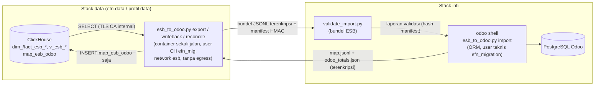
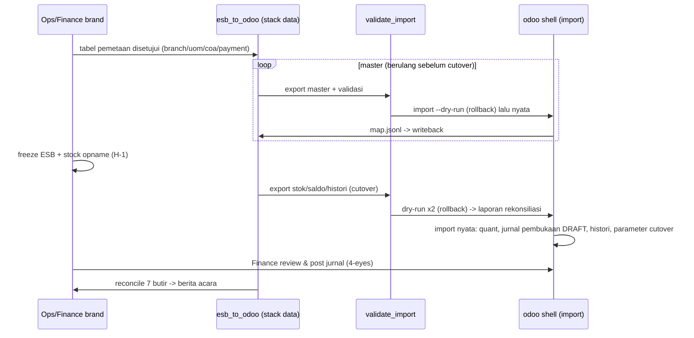

# ADR-042: Migrasi ESB Core → Odoo CE 19 (master, saldo awal) dan penyimpanan histori 24 bulan

- **Status:** Proposed — **BUTUH PERSETUJUAN USER sebelum fase 2 G43** (modul `efn_legacy_history`, mesin migrasi
  `scripts/migration/esb_to_odoo.py`, validator, dry-run). Fase 1 (company IMD/CUP placeholder, fit-gap, ADR ini,
  kontrak `docs/04` §27) tidak mengunci pilihan apa pun yang mahal dibalik.
- **Tanggal:** 2026-11-18 (Gelombang 43 fase 1)
- **Pemutus:** pemilik proyek (lingkup histori, urutan brand), Finance (cutover, saldo awal, akun kliring, metode
  biaya), Ops per brand (pemetaan cabang, paket menu, stock opname), Legal/DPO (bundel data, partner B2B)
- **Referensi review:** R-O02 (migrasi sistem lama), R-O01 (master data), R-L01 (PDP), R-L03 (pajak), R-T01 (salah
  konsep phantom/kit), R-B06, usulan baru **R-O12**, **R-O13**, **R-L12** (§5); Q5; Q-ESB5/6/10..24 (`docs/04` §27.12)
- **Terkait:** ADR-040 (ESB → datamart, Proposed), ADR-041 (Insight, Proposed), ADR-018 (paket CK = BoM manufaktur,
  combo POS = kit), ADR-020 (poin di ledger BFF), ADR-022 (TLS), ADR-024 (kredensial per service), ADR-031 (tanpa modul
  pihak ketiga), ADR-036 (enkripsi PII partner), ADR-003 (ETL 15 menit), K25-02, K25-06, K25-12; fit-gap
  `docs/fit-gap/G43_MIGRASI_ESB_ODOO.md` (efn-odoo-functional, 18 Nov 2026); kontrak `docs/04` §27

> **Ringkasan untuk manajemen (yang perlu Bapak/Ibu setujui).**
> **Yang dipindah ke Odoo:** data induk (cabang menjadi gudang/kasir, produk, menu, resep, supplier, pelanggan B2B) dan
> **saldo awal** per tanggal pindah (stok hasil hitung fisik, utang/piutang yang belum lunas, neraca pembukaan).
> **Yang tidak dipindah sebagai transaksi:** histori penjualan 24 bulan **tidak** dibuat ulang sebagai struk kasir,
> jurnal, atau mutasi stok di Odoo, karena itu akan **menggandakan** nilai persediaan, pajak restoran, dan nomor dokumen
> yang sudah dilaporkan dari ESB. Histori tetap **lengkap** di gudang data dan bisa dilihat di Dashboard Insight; Odoo
> hanya menyimpan **ringkasan harian aliran produk** (±13 bulan) agar usulan stok min/max langsung jalan sejak hari
> pertama. Biaya fase 2 **±5–7 minggu-engineer** (±3–4 minggu kalender bila paralel), Rp0 lisensi. Setiap brand diuji
> coba minimal 2 kali tanpa menyimpan (dry-run) dan ditutup dengan berita acara rekonsiliasi yang ditandatangani Finance.

## 1. Konteks

### 1.1 Kebutuhan (keputusan user 18 Nov 2026)
- Migrasi ESB → Odoo = **master + saldo awal + histori transaksi** (24 bulan sudah ditarik ke datamart oleh G41).
- Im Donut (IMD) & Curry Up (CUP) = **company baru sekarang**, data PT placeholder (Q-ESB5) — sudah dibangun G43-A
  (`efn_setup_company` 19.0.1.9.0, `company_imd`/`company_cup`).
- Bacha: default BCF, override per cabang memakai pemetaan G41 (`dim_esb_branch.company_code`).
- Tanggal cutover belum ditentukan → **parameter per company**, bukan konstanta (Q-ESB6).
- Histori **tidak boleh** merusak valuasi stok, pajak, dan penomoran dokumen; usulan efn-lead = model read-only khusus.

### 1.2 Pertentangan dengan dokumen yang ada
| Sumber | Bunyi asli | Masalah |
|---|---|---|
| Rencana induk G43 (efn-lead) | "histori transaksi" dipindah ke Odoo | Bila ditafsirkan sebagai `pos.order`/`account.move`/`stock.move` → valuasi, PB1, dan nomor dokumen ganda (fit-gap §7, opsi b) |
| Kontrak kerja G43 §B | model read-only "harian per outlet×produk/menu, produksi, transfer" | Menu harian tidak dipakai proses Odoo mana pun (forecast bekerja di level produk stok); ±3–4 juta baris tambahan di PostgreSQL primary tanpa konsumen |
| ADR-040 §4.4 | "histori 24 bulan masuk model read-only `efn_legacy_history`" | Rentang 24 bulan penuh di Odoo tidak dibutuhkan; arsip lengkap sudah di ClickHouse (retensi 10 tahun, L-109) |
| `CLAUDE.md` prinsip | "PostgreSQL = source of truth; ClickHouse hanya turunan" | Setelah cutover benar: Odoo sumber kebenaran. **Sebelum** cutover, histori ESB tidak pernah ada di PG; ADR ini tidak membuat jalur ClickHouse → Odoo otomatis (§3.4) |
| Kontrak kerja G43 §B | xmlid `efn_mig_esb.<brand>_<entity>_<esbid>` | Bacha punya produk **kembar** BCF/BCR dengan kode ESB sama → kunci wajib memuat kode PT: `<brand>_<company>_<entity>_<key>` (fit-gap §3) |
| `efn_demand_forecast` (kode) | input = `stock.move` done 56 hari | Tanpa histori legacy, 8 minggu pertama setelah cutover usulan min/max kosong/terlalu rendah (cold start) |
| `docs/08` §6.4 (validator G13-7) | kode PT poin `{RTL,FNB}` | Kode lama; validator G43 memakai kode §12.1 + IMD/CUP |

### 1.3 Fakta teknis yang dipakai (dikutip dari fit-gap; diverifikasi efn-odoo-functional terhadap source `odoo/odoo` 19.0 / spec ESB, **tidak** diverifikasi ulang oleh architect)
- `pos.order` butuh sesi terbuka; `_process_order` menolak sesi tertutup; `name`/`pos_reference` memakai sequence config.
- `stock.quant` mode inventaris: `inventory_quantity` → `action_apply_inventory()` → `stock.move` `is_inventory=True`;
  `stock_account` mendukung `accounting_date` (konteks `force_period_date`).
- `res.company` punya mekanisme jurnal pembukaan (`account_opening_move_id`, `account_opening_date`).
- `product.category` global (tanpa `company_id`); Odoo 19 tanpa kategori UoM; `mrp.bom.line` tanpa field yield.
- `stock.warehouse.code` maks 5 karakter, unik per company.
- Datamart G41: tanpa komponen resep, harga menu, stok opname, AR/AP, TB; `fact_esb_stock_snapshot` 0 baris pada uji.

## 2. Opsi histori yang dipertimbangkan

Ukuran (perkiraan dari README G41, bukan hitungan ClickHouse): ±10–16 juta baris penjualan 24 bulan; agregat harian
outlet × menu ±3–4 juta; aliran FIN harian outlet × produk ±1–2 juta; bulanan outlet × menu ±0,3–0,5 juta.

| Kriteria | **(a-penuh)** model read-only harian outlet × menu + produksi + transfer (usulan awal) | **(a-ramping)** satu model `efn.legacy.flow.daily` (hari × company × gudang × produk stok) | **(b)** `pos.order` arsip / `sale.order` | **(c)** tetap di ClickHouse + laporan via Insight |
|---|---|---|---|---|
| Valuasi stok | Aman | Aman | **Rusak**: sesi ditutup → picking & `stock.move` → stok/nilai dikurangi dua kali (histori + opname cutover) | Aman |
| Pajak (PB1/PPN) | Aman | Aman | **Rusak**: jurnal penjualan & PB1 ganda atas periode yang sudah dilaporkan dari ESB | Aman |
| Penomoran dokumen | Aman | Aman | **Rusak**: menghabiskan sequence `pos.config`/SO; nomor histori bercampur dengan nomor nyata | Aman |
| Prasyarat teknis | 3–4 model + ACL + rule + view | 1 model + ACL + rule + view + 1 hook forecast | ±35 ribu sesi buatan (hari × outlet) dibuka-tutup; tidak bisa diulang tanpa membatalkan jurnal | Sudah ada (G41/G42) |
| Forecast v1 hari pertama | Bisa | **Bisa** (hook `_efn_legacy_outflow`) | Otomatis tetapi dengan valuasi rusak | **Tidak** (cold start 8 minggu) |
| Laporan di Odoo | Pivot/graph khusus | Pivot/graph aliran produk | Laporan POS standar, tetapi angka ganda | Tidak di Odoo; Insight/Metabase/Tanya Data |
| Ukuran PostgreSQL primary | ±4–6 juta baris, ±2–4 GB dengan indeks | ≤ 2 juta baris (400 hari, jarang terisi), ±0,5–1 GB | Puluhan GB (order + line + payment + sesi + jurnal) — perkiraan kasar | 0 |
| Profil dev ≤ 8 GB (K25-06) | Sedang | Kecil | Berat | Tidak ada |
| Pembalikan | Mudah (uninstall/hapus data) | Mudah | **Sulit** (jurnal & stok terposting, perlu jurnal balik per periode) | Mudah |
| **Biaya / waktu** (perkiraan architect) | **±2,5–3,5 minggu-engineer** | **±1–1,5 minggu-engineer** | **±4–6 minggu-engineer** + koreksi pasca-cutover tak terukur | **Rp0 / 0 hari** (forecast manual 8 minggu) |

Opsi tambahan **(a-bulanan, opsional)**: `efn.legacy.sales.monthly` (bulan × company × `pos.config` × produk menu: qty,
gross, discount, net, cogs, trx) hanya bila manajemen wajib melihat histori penjualan **di dalam Odoo** (Q-ESB20).
Biaya **+2–3 hari-engineer**, ±0,3–0,5 juta baris.

## 3. Keputusan (direkomendasikan)

### 3.1 Histori = (c) + (a-ramping); (b) ditolak
1. **(c) sumber kebenaran histori.** Semua grain ESB (baris penjualan, pembayaran, produksi, delivery, transfer) tetap di
   `efn_dwh.*esb*` (retensi 10 tahun, L-109) dan dibaca Insight (ADR-041)/Metabase/Tanya Data. Laporan histori penjualan
   per outlet/menu = halaman Insight, bukan Odoo.
2. **(a-ramping): satu model wajib `efn.legacy.flow.daily`** di modul baru `efn_legacy_history` (dibangun sendiri,
   ADR-031):
   - grain **hari × company × gudang × produk storable** (FIN/paket CK; bahan baku bila kelak tersedia), qty dalam UoM
     produk: `sold`, `ck_prod`, `store_prod`, `ck_out`, `in_ck`, `in_other`, `st_in`, `st_out` (semantik L-116) dan
     `outflow` = `sold + st_out + ck_out` (definisi keluar stok forecast v1);
   - rentang **default 400 hari** sebelum cutover (56 hari forecast + satu siklus musim tahunan), parameter maks
     **730 hari** (`efn_mig_esb.legacy_days`);
   - **read-only** untuk semua pengguna: ACL hanya `read`; `create/write/unlink` ditolak kecuali `env.su` **dan**
     konteks `efn_legacy_import=True` (hanya skrip migrasi); tanpa `mail.thread`;
   - `company_id` wajib + **record rule multi-company** standar (`company_id in company_ids`), `check_company` pada
     gudang/produk; unik `(company_id, warehouse_id, product_id, day)`.
3. **Opsional** `efn.legacy.sales.monthly` hanya bila Q-ESB20 dijawab "wajib di Odoo" (default: tidak dibangun).
4. **(b) ditolak**, alasan konkret: (i) `stock.move` dari sesi POS histori + stok opname cutover = persediaan & HPP
   berkurang dua kali; (ii) jurnal penjualan & PB1/PPN dibuat ulang atas periode yang sudah dilaporkan dari ESB
   (R-L03); (iii) sequence `pos.config`/SO terpakai sehingga nomor dokumen nyata bergeser dan bercampur; (iv) butuh
   ±35 ribu sesi buatan yang tidak bisa diulang/di-dry-run tanpa membatalkan jurnal; (v) puluhan GB di PG primary
   menambah waktu backup/restore (R-T08) dan melanggar target profil ramping K25-06.
5. **(a-penuh) tidak dipilih**: menu harian, produksi, dan transfer sebagai model terpisah tidak punya konsumen proses
   di Odoo; produksi/transfer sudah tercakup kolom aliran (a-ramping).

### 3.2 Integrasi forecast (`efn_demand_forecast`)
- Hook di `efn_demand_forecast` (tanpa dependency ke modul legacy): method `_efn_legacy_outflow(warehouse, product,
  date_from, date_to)` mengembalikan `(None, {})`. `_efn_daily_outflow` memanggil hook; bila hasil pertama = tanggal
  batas `B`, hari `< B` diambil dari dict legacy dan hari `≥ B` dari `stock.move` seperti sekarang. Tanpa override →
  perilaku lama persis (test regresi wajib).
- `efn_legacy_history` (depends `efn_demand_forecast`) meng-override hook: `B` = parameter
  **`efn_mig_esb.cutover_date.<COMPANY_CODE>`** (ISO `YYYY-MM-DD`) milik company gudang; tanpa parameter / format
  salah → `(None, {})` + log peringatan (fail safe = perilaku lama). Signature rinci `docs/04` §27.8.
- Batasan yang diterima: (i) histori menu non-FIN tidak memberi outflow bahan baku (resep historis tidak di-explode) →
  forecast bahan baku = G44 (ClickHouse); (ii) waste/scrap ESB tidak ada di mart — konsisten karena forecast v1 juga
  tidak menghitung keluar ke lokasi scrap; (iii) produk legacy yang tak terpetakan (alias `NAME:` tersisa) tidak masuk
  model, dilaporkan di rekonsiliasi.

### 3.3 Master & saldo awal (tanpa kode Odoo baru)
- **Master** (cabang → `stock.warehouse`/`stock.location`/`pos.config` tanpa sesi, kategori, UoM, produk & varian,
  menu, BoM produksi `normal` / menu `phantom` / paket `combo` sesuai ADR-018 & `efn_kitting`, supplier, pelanggan B2B,
  payment term, supplierinfo, harga pokok) dengan fitur standar CE lewat ORM di `odoo shell`. Tidak ada modul Odoo baru
  untuk master.
- **Kunci idempoten:** external ID `efn_mig_esb.<brand>_<company>_<entity>_<key>` (`noupdate=True`; normalisasi + hash
  `docs/04` §27.4). Upsert: xmlid ada → tulis **hanya field milik migrasi** dan hanya bila record terakhir diubah oleh
  user teknis migrasi (`write_uid`); diubah pengguna → dilewati + dilaporkan sebagai konflik. Record yang hilang di ESB
  **tidak dihapus** (dilaporkan, arsip manual).
- **Stok awal** = `stock.quant` mode inventaris per lokasi × produk dari **stock opname cutover** (E6 atau template
  `03_stok_awal.csv`), `accounting_date` = `cutover − 1`; `standard_price` wajib terisi sebelumnya.
- **Neraca, AR, AP** = satu `account.move` pembukaan per PT tanggal `cutover − 1` (baris per akun lewat `coa_map`; AR/AP
  **per dokumen terbuka** dengan partner + jatuh tempo; lawan = akun **"Saldo Awal – Kliring"** per PT). Faktur/tagihan
  **tidak** dibuat ulang. Jurnal dibuat **draft**; posting oleh Finance (4-eyes: pembuat ≠ pemosting). Kontrol: kliring
  = 0 setelah stok + TB + AR/AP diposting.
- Nilai persediaan tidak boleh dua kali: akun valuasi lokasi *Inventory adjustment* selama cutover = akun kliring, dan
  saldo akun persediaan TB ESB tidak dimuat (diganti hasil quant) atau dimuat dengan lawan kliring yang sama. Perilaku
  valuasi otomatis CE 19 untuk adjustment bertanggal mundur **belum terverifikasi** → wajib diuji di dry-run (Q-ESB16).
- Member & poin **bukan** Odoo: endpoint BFF migrasi yang ada (`/internal/v1/migration/*`, ADR-020), jalur terpisah,
  setelah DPO (Q-ESB19).

### 3.4 Alur data: export di stack data → impor `odoo shell` → writeback (tanpa jalur jaringan Odoo ↔ ClickHouse)

- **User ClickHouse baru `efn_mig`**: `SELECT` per objek pada dimensi/fakta/view ESB yang diperlukan (tanpa
  `efn_esb.raw_doc`), `INSERT` **hanya** `efn_dwh.map_esb_odoo`; tanpa DDL/ALTER/DROP; dibuat `clickhouse-init` hanya
  bila secret `clickhouse_password_mig` ada dan bukan placeholder (selain itu `DROP USER IF EXISTS`). TLS verify-full.
- Perpindahan bundel antar-stack = berkas (`docker cp`/salinan antar-mesin lewat WireGuard), bukan koneksi jaringan
  Odoo ↔ ClickHouse; K25-02 tetap utuh (stack inti jalan bila `efn-data` mati).
- `map_esb_odoo` = salinan pemetaan untuk dashboard/forecast/rekonsiliasi; **sumber kebenaran pemetaan = `ir.model.data`
  di Odoo**. Writeback setelah transaksi Odoo commit; ReplacingMergeTree → aman diulang.

### 3.5 Keamanan bundel (PDP & enkripsi)
- Bundel hanya memuat data bisnis: kode/nama produk, menu, resep, cabang, angka stok/saldo, agregat aliran. **Tanpa
  data pribadi**, kecuali nama partner B2B/supplier yang ternyata **perorangan** (nama orang = data pribadi). Kunci PII
  (`address`, `picName`, `picPhone`, nama petugas/pembuat dokumen) dibuang di ekstraktor (whitelist, L-110) **dan**
  validator menolak bundel yang memuatnya (fail closed). Partner perorangan di Odoo otomatis terenkripsi ADR-036
  (kelas V/P, `is_company=False`).
- Bundel **terenkripsi at rest** (AES-256-GCM, kunci `migration_bundle_key` di `/run/secrets`) + manifest bertanda
  tangan HMAC (kunci turunan berbeda) + SHA-256 per berkas; plaintext hanya di `tmpfs` container selama proses.
- Retensi: bundel dan laporan antara **dihapus setelah berita acara rekonsiliasi** brand ditandatangani (maks 90 hari
  setelah cutover, Q-ESB24); laporan rekonsiliasi (tanpa data pribadi) disimpan sebagai lampiran berita acara.
  Inventaris PDP: entri "Bundel migrasi ESB" (tugas DPO/architect).
- User teknis Odoo `efn_migration` (tanpa password/API key, `active=False` di luar jendela migrasi) agar setiap tulis
  teraudit lewat `create_uid/write_uid`.

### 3.6 Cutover
- Parameter **per company** `efn_mig_esb.cutover_date.<COMPANY_CODE>` (diisi skrip saat langkah cutover, juga argumen
  CLI `--cutover-date`); Bacha = satu tanggal untuk BCF + BCR (satu akun ESB). Transaksi `< cutover` = ESB (histori),
  `≥ cutover` = Odoo. Saldo awal per akhir hari `cutover − 1`.
- Urutan per brand: master (boleh diulang kapan saja) → **freeze ESB** (tanpa transaksi stok setelah jam cutover;
  dokumen berjalan diselesaikan di ESB, Q-ESB22) → stock opname → stok awal → neraca + AR/AP (draft) → histori →
  rekonsiliasi → berita acara → brand dikeluarkan dari `ESB_BRANDS` (L-105).
- **IMD/CUP:** master boleh dimuat sekarang (setelah Q-ESB23); **saldo awal & histori ditahan** sampai Q-ESB5 (nama PT,
  NPWP, jenis pajak) — ditegakkan skrip (`EFN_MIG_SALDO_BLOCKED=IMD,CUP` default).

### 3.7 Dry-run wajib
- Setiap langkah punya `--dry-run`: seluruh langkah dalam satu transaksi lalu `env.cr.rollback()`, laporan identik
  dengan run nyata (ditandai `dry_run: true`); `writeback` menolak map dari dry-run.
- **Minimal 2 dry-run lengkap per brand** di staging dengan salinan data production sebelum run nyata; run nyata
  production hanya bila dry-run terakhir: 0 error validator, selisih rekonsiliasi butir 2–5 = 0.

## 4. Konsekuensi

### 4.1 Positif
- Valuasi stok, pajak, dan penomoran Odoo bersih sejak hari pertama; histori tidak bisa "bocor" ke laporan akuntansi.
- Forecast min/max jalan sejak cutover (tanpa cold start 8 minggu).
- Migrasi bisa diulang (idempoten) dan diuji tanpa efek (dry-run); rekonsiliasi terukur per entitas.
- Pembalikan murah: uninstall `efn_legacy_history`/hapus data legacy tanpa menyentuh jurnal.

### 4.2 Negatif / utang teknis yang diterima
- Histori penjualan per menu tidak terlihat di laporan Odoo standar (hanya Insight) kecuali opsi bulanan dibangun.
- Dua tempat histori (ClickHouse lengkap, Odoo ringkas 400 hari) → aturan: angka resmi histori = ClickHouse; model Odoo
  hanya input forecast.
- Ekstraktor harus diperluas (E1–E10) sebelum dry-run/cutover; beberapa endpoint ESB **belum ditemukan** (komposisi
  paket, faktur AR B2B, TB/GL) → fallback ekspor Finance / konfirmasi Ops.
- Satu user ClickHouse + satu secret + satu kunci bundel baru (permukaan serangan kecil, hanya aktif saat migrasi).

### 4.3 Biaya & waktu fase 2 (perkiraan architect, minggu-engineer)
| Paket | Pemilik | Perkiraan |
|---|---|---|
| `efn_legacy_history` (model, ACL, rule, view) + hook forecast + test | efn-odoo-engineer | 1–1,5 |
| `esb_to_odoo.py` (export/import/writeback/reconcile, shell ORM, upsert, dry-run) | efn-odoo-engineer + efn-data-ai-engineer | 2–2,5 |
| `validate_import.py` sumber bundel ESB (aturan §27.7) | efn-odoo-engineer / data | 0,5–1 |
| `esb-extract` E1, E2, E4, E5 (prioritas 1) + E6–E10 (prioritas 2) + DDL + grant | efn-data-ai-engineer | 1–1,5 |
| User CH `efn_mig`, overlay migrasi, secret, kunci bundel, runbook | efn-devsecops-engineer | 0,5 |
| QA + 2 dry-run PB (brand pilot) | efn-qa-engineer | 0,5–1 |
| **Total** | | **±5–7** (±3–4 minggu kalender paralel) |

Kerja klien (bukan engineer): tabel pemetaan cabang/UoM/CoA/metode bayar, konfirmasi paket menu, stock opname cutover,
TB & daftar AR/AP per tanggal cutover, penandatanganan berita acara.

### 4.4 Dampak ke dokumen lain
- `docs/04` §27 (kontrak mesin migrasi, IMD/CUP di daftar kode PT) — dibuat bersama ADR ini.
- `docs/04` §25.4/§25.5: entitas ekstraktor baru (E1–E10) dan perubahan kunci `map_esb_odoo` → revisi saat dibangun.
- `docs/01`: usulan R-O12, R-O13, R-L12 dan Q-ESB10..24 di §5.12 (tugas efn-lead).
- `docs/08` §6.4: kode PT validator diperbarui (RTL/FNB → kode §12.1 + IMD/CUP).
- `docs/compliance/PDP_DATA_INVENTORY.md`: entri bundel migrasi + partner B2B ESB.
- ADR-040 §3.1/§4.4: rujukan "histori 24 bulan masuk `efn_legacy_history`" dipersempit menjadi ringkasan aliran 400 hari.

## 5. Risiko terkait
| ID | Ringkas | Mitigasi |
|---|---|---|
| R-O02 | Migrasi sistem lama gagal/tidak lengkap | Urutan langkah, dry-run ≥ 2 per brand, rekonsiliasi 7 butir, berita acara |
| R-O01 | Master tidak seragam (UoM kosong, alias nama) | Validator fail closed (UoM wajib dipetakan, alias berstok = error), `v_esb_data_quality` |
| R-L03 | Pajak ganda / salah PT | Histori bukan transaksi; pajak produk dari default PT, bukan dari ESB; validator pajak per PT |
| R-T01 | Salah konsep phantom vs kit | BoM produksi `normal` di CK; phantom hanya menu POS; paket CK `efn_is_kitting_package` (ADR-018) |
| R-L01 | PDP bundel | Whitelist + validator fail closed, enkripsi bundel, retensi s.d. berita acara |
| **R-O12** (usulan) | **Saldo awal ganda/salah** (persediaan dihitung dari quant **dan** TB; AR/AP saldo partner ≠ total dokumen) → neraca pembukaan salah, koreksi setelah tutup buku | Akun kliring wajib = 0, jurnal draft + posting 4-eyes Finance, uji valuasi adjustment bertanggal mundur di dry-run |
| **R-O13** (usulan) | **Histori legacy bias** (pemetaan cabang/produk salah, outflow tanpa scrap, parameter cutover diubah manual) → usulan min/max menyimpang | Rekonsiliasi butir 5 = 0, parameter hanya diisi skrip (perubahan manual dicatat), usulan forecast tetap disetujui planner (K25-12) |
| **R-L12** (usulan) | **Bundel migrasi bocor** (data bisnis 5 brand, nama partner perorangan) dari laptop/VPS/arsip | AES-256-GCM + HMAC manifest, plaintext hanya di tmpfs, hapus setelah berita acara, tanpa bundel di repo/tiket/chat |

## 6. Pertanyaan terbuka (dijawab klien; rinci `docs/04` §27.12)
Q-ESB5 (data PT IMD/CUP) · Q-ESB6 (tanggal cutover per brand) · **Q-ESB10** cabang Bacha "B2B Consignment" BCR/BCF ·
**Q-ESB11** CK bersama WTZ–CUP · **Q-ESB12** komposisi paket menu · **Q-ESB13** gudang/storage & cabang
Damage/Expired · **Q-ESB14** produksi FIN di toko · **Q-ESB15** harga per cabang & takeaway · **Q-ESB16** metode biaya
& akun kliring · **Q-ESB17** qty BOM bruto/neto · **Q-ESB18** P&L per outlet · **Q-ESB19** sumber member & consent ·
**Q-ESB20** histori penjualan wajib di Odoo? · **Q-ESB21** TB & AR B2B via API atau ekspor Finance · **Q-ESB22**
dokumen berjalan saat cutover · **Q-ESB23** urutan cutover & master IMD/CUP sebelum Q-ESB5 · **Q-ESB24** penandatangan
berita acara & retensi bundel.

## 7. Kapan ditinjau ulang
- Q-ESB20 dijawab "wajib di Odoo" (bangun model bulanan) atau G44 menggantikan forecast v1 (model legacy bisa
  dipensiunkan).
- Dry-run pertama menunjukkan valuasi adjustment bertanggal mundur CE 19 tidak sesuai (§3.3) → revisi mekanisme stok
  awal.
- Endpoint ESB untuk TB/AR/paket ditemukan atau tidak ada (Q-ESB21, Q-ESB12).
- Cutover brand pertama selesai (pelajaran untuk brand berikut); paling lambat **31 Mar 2027**.
