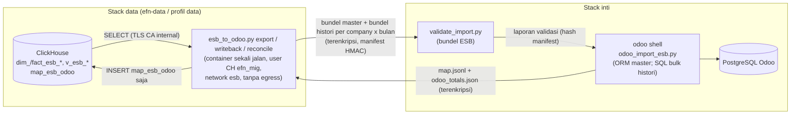
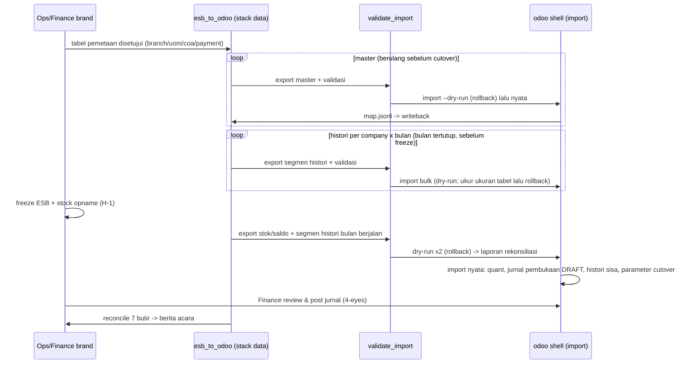

# ADR-042: Migrasi ESB Core → Odoo CE 19 (master, saldo awal) dan penyimpanan histori 24 bulan

- **Status:** **Accepted** — disetujui user (pemilik proyek) **18 Nov 2026**, **dengan amendemen A1–A3** (§0). Fase 2 G43
  boleh dibangun (modul `efn_legacy_history`, mesin migrasi `scripts/migration/esb_to_odoo.py`, validator, dry-run PB).
  Pertanyaan klien yang masih terbuka (§6) tidak membatalkan keputusan ini; jawabannya mengisi parameter/pemetaan.
- **Tanggal:** 2026-11-18 (Gelombang 43 fase 1: Proposed) · **2026-11-18 (fase 2: Accepted + amendemen)**
- **Pemutus:** pemilik proyek (lingkup histori, urutan brand — **sudah diputuskan**), Finance (cutover, saldo awal, akun
  kliring, metode biaya), Ops per brand (pemetaan cabang, paket menu, stock opname), Legal/DPO (bundel data, partner B2B)
- **Referensi review:** R-O02 (migrasi sistem lama), R-O01 (master data), R-L01 (PDP), R-L03 (pajak), R-T01 (salah
  konsep phantom/kit), R-T08 (backup/DR), R-B06, **R-O12**, **R-O13**, **R-L12** (dimasukkan ke `docs/01` §4 pada 18 Nov
  2026); Q5; Q-ESB5/6/10..24 (`docs/04` §27.12, `docs/01` §5.12)
- **Terkait:** ADR-040 (ESB → datamart, Proposed; §3.1/§4.4 dipersempit mengikuti ADR ini), ADR-041 (Insight, Proposed),
  ADR-018 (paket CK = BoM manufaktur, combo POS = kit), ADR-020 (poin di ledger BFF), ADR-022 (TLS), ADR-024 (kredensial
  per service), ADR-031 (tanpa modul pihak ketiga), ADR-036 (enkripsi PII partner), ADR-003 (ETL 15 menit), K25-02,
  K25-06, K25-12; fit-gap `docs/fit-gap/G43_MIGRASI_ESB_ODOO.md` (efn-odoo-functional, 18 Nov 2026); kontrak `docs/04` §27

> **Ringkasan untuk manajemen (disetujui 18 Nov 2026).**
> **Yang dipindah ke Odoo:** data induk (cabang menjadi gudang/kasir, produk, menu, resep, supplier, pelanggan B2B),
> **saldo awal** per tanggal pindah (stok hasil hitung fisik, utang/piutang yang belum lunas, neraca pembukaan), dan
> **arsip histori penjualan 24 bulan** (ringkasan harian per outlet × menu **dan** rincian per baris struk) yang **hanya
> bisa dibaca**, diberi label "arsip sistem lama", dan **bukan** transaksi Odoo, sehingga stok, pajak, dan nomor dokumen
> tidak berubah. Brand pertama yang dipindah (pilot) = **Paris Baguette**; brand supermarket di luar program ini.
> Dampak: database Odoo bertambah **±2–2,7 GB untuk PB** (±4,5–6,5 GB bila semua brand F&B, perkiraan; diukur ulang saat
> uji coba PB) dan backup ikut membesar. Biaya fase 2 **±6,5–9 minggu-engineer** (±4–5 minggu kalender bila paralel),
> Rp0 lisensi. Setiap brand diuji coba minimal 2 kali tanpa menyimpan dan ditutup berita acara yang ditandatangani Finance.

## 0. Amendemen saat penerimaan (keputusan user 18 Nov 2026)

| # | Keputusan user | Mengubah bagian | Dampak |
|---|---|---|---|
| **A1** | **Q-ESB20 = ya, "dengan detailnya jika dimungkinkan":** histori **penjualan** juga masuk Odoo, tetap **bukan** `pos.order`/`account.move`/`stock.move` | §2.2, §3.1 butir 3, §3.5, §4 | Dua model read-only baru: `efn.legacy.sales.daily` (hari × company × outlet × menu, **24 bulan penuh**) dan `efn.legacy.sales.line` (per baris transaksi ESB, rentang parameter **`efn_mig_esb.sales_line_months`** default **24**, `0` = nonaktif), dimuat **bulk** (SQL batch, bukan ORM per baris). Opsi bulanan (a-bulanan) **tidak** dibangun (digantikan harian). |
| **A2** | **Q-ESB23 = pilot Paris Baguette (company `PB`)** | §3.6, §3.7 | Dry-run lengkap pertama dan pengukuran ukuran tabel dilakukan di PB; brand lain menyusul setelah berita acara PB. |
| **A3** | **Brand supermarket ditangani sesi lain (bukan G43)** | Lingkup | G43 = lima brand F&B di ESB (PB, WTZ, Bacha BCF/BCR, IMD, CUP). |

Yang **tidak** berubah: (b) "histori sebagai transaksi Odoo" tetap ditolak; ClickHouse tetap **sumber kebenaran angka
histori** (arsip Odoo = salinan untuk dibaca di Odoo dan input forecast); `efn.legacy.flow.daily` (forecast) tetap.

## 1. Konteks

### 1.1 Kebutuhan (keputusan user 18 Nov 2026)
- Migrasi ESB → Odoo = **master + saldo awal + histori transaksi** (24 bulan sudah ditarik ke datamart oleh G41).
- Im Donut (IMD) & Curry Up (CUP) = **company baru sekarang**, data PT placeholder (Q-ESB5) — sudah dibangun G43-A
  (`efn_setup_company` 19.0.1.9.0, `company_imd`/`company_cup`).
- Bacha: default BCF, override per cabang memakai pemetaan G41 (`dim_esb_branch.company_code`).
- Tanggal cutover belum ditentukan → **parameter per company**, bukan konstanta (Q-ESB6).
- Histori **tidak boleh** merusak valuasi stok, pajak, dan penomoran dokumen → model read-only khusus.
- **(A1)** Histori penjualan terlihat di Odoo, rinci sampai baris transaksi bila memungkinkan.

### 1.2 Pertentangan dengan dokumen yang ada
| Sumber | Bunyi asli | Masalah / penyelesaian |
|---|---|---|
| Rencana induk G43 (efn-lead) | "histori transaksi" dipindah ke Odoo | Bila ditafsirkan sebagai `pos.order`/`account.move`/`stock.move` → valuasi, PB1, dan nomor dokumen ganda (fit-gap §7, opsi b). **Diselesaikan:** histori = model arsip read-only (§3.1) |
| Kontrak kerja G43 §B | model read-only "harian per outlet×produk/menu, produksi, transfer" | Versi Proposed menolak menu harian (tanpa konsumen proses). **Diralat A1:** menu harian **dan** baris transaksi dibangun karena user meminta histori penjualan di Odoo; produksi/transfer tetap hanya kolom `efn.legacy.flow.daily` |
| ADR-040 §3.1/§4.4 | "histori 24 bulan masuk model read-only `efn_legacy_history`" | Dipersempit (18 Nov): penjualan 24 bulan (harian + baris) dan aliran produk 400 hari masuk Odoo; dokumen produksi/delivery/transfer/pembayaran per dokumen **tetap hanya** di ClickHouse |
| `CLAUDE.md` prinsip | "PostgreSQL = source of truth; ClickHouse hanya turunan" | Setelah cutover: Odoo sumber kebenaran transaksi. Histori ESB **sebelum** cutover tidak pernah ada di PG; arsip Odoo diisi lewat bundel berkas (§3.4), bukan jalur ClickHouse → Odoo otomatis |
| Kontrak kerja G43 §B | xmlid `efn_mig_esb.<brand>_<entity>_<esbid>` | Bacha punya produk **kembar** BCF/BCR dengan kode ESB sama → kunci wajib memuat kode PT: `<brand>_<company>_<entity>_<key>` (fit-gap §3) |
| `efn_demand_forecast` (kode) | input = `stock.move` done 56 hari | Tanpa histori legacy, 8 minggu pertama setelah cutover usulan min/max kosong/terlalu rendah (cold start) → hook §3.2 |
| `docs/08` §6.4 (validator G13-7) | kode PT poin `{RTL,FNB}` | Kode lama; diperbarui 18 Nov ke `EFN/GL/PB/BCR/BCF/WTZ/IMD/CUP/FARM` |
| `docs/04` §27.3 (Proposed) | satu bundel AES-GCM berisi semua berkas | Baris penjualan PB ±8 juta (±2 GB JSONL) tidak muat di memori container 1 GB → **bundel histori disegmentasi per company × bulan** (§3.5, `docs/04` §27.3a) |

### 1.3 Fakta teknis yang dipakai (dikutip dari fit-gap; diverifikasi efn-odoo-functional terhadap source `odoo/odoo` 19.0 / spec ESB, **tidak** diverifikasi ulang oleh architect)
- `pos.order` butuh sesi terbuka; `_process_order` menolak sesi tertutup; `name`/`pos_reference` memakai sequence config.
- `stock.quant` mode inventaris: `inventory_quantity` → `action_apply_inventory()` → `stock.move` `is_inventory=True`;
  `stock_account` mendukung `accounting_date` (konteks `force_period_date`).
- `res.company` punya mekanisme jurnal pembukaan (`account_opening_move_id`, `account_opening_date`).
- `product.category` global (tanpa `company_id`); Odoo 19 tanpa kategori UoM; `mrp.bom.line` tanpa field yield.
- `stock.warehouse.code` maks 5 karakter, unik per company.
- Datamart G41: tanpa komponen resep, harga menu, stok opname, AR/AP, TB; `fact_esb_stock_snapshot` 0 baris pada uji.
- `fact_esb_sales_line` (ClickHouse, `12-g41-esb.sql`): kunci `(company_code, brand, branch_id, sales_date, sales_num,
  line_no)`, kolom `menu_code, qty, price, total, discount, cogs, row_type, is_takeaway`; tanpa jam, kasir, pelanggan.
  `v_esb_sales_daily` = agregat semua `row_type` per hari × cabang × `menu_code` (dibaca architect dari DDL repo).

## 2. Opsi yang dipertimbangkan

### 2.1 Opsi bentuk histori (keputusan dasar; tidak berubah)
Ukuran (perkiraan dari README G41, bukan hitungan ClickHouse): ±10–20 juta baris penjualan 24 bulan seluruh brand
(±8 juta PB); agregat harian outlet × menu ±4–7 juta; aliran FIN harian outlet × produk ±1–2 juta.

| Kriteria | **(a-penuh)** model read-only harian outlet × menu + produksi + transfer | **(a-ramping)** satu model `efn.legacy.flow.daily` (hari × company × gudang × produk stok) | **(b)** `pos.order` arsip / `sale.order` | **(c)** tetap di ClickHouse + laporan via Insight |
|---|---|---|---|---|
| Valuasi stok | Aman | Aman | **Rusak**: sesi ditutup → picking & `stock.move` → stok/nilai dikurangi dua kali (histori + opname cutover) | Aman |
| Pajak (PB1/PPN) | Aman | Aman | **Rusak**: jurnal penjualan & PB1 ganda atas periode yang sudah dilaporkan dari ESB | Aman |
| Penomoran dokumen | Aman | Aman | **Rusak**: menghabiskan sequence `pos.config`/SO; nomor histori bercampur dengan nomor nyata | Aman |
| Prasyarat teknis | 3–4 model + ACL + rule + view | 1 model + ACL + rule + view + 1 hook forecast | ±35 ribu sesi buatan (hari × outlet) dibuka-tutup; tidak bisa diulang tanpa membatalkan jurnal | Sudah ada (G41/G42) |
| Forecast v1 hari pertama | Bisa | **Bisa** (hook `_efn_legacy_outflow`) | Otomatis tetapi dengan valuasi rusak | **Tidak** (cold start 8 minggu) |
| Pembalikan | Mudah (uninstall/hapus data) | Mudah | **Sulit** (jurnal & stok terposting, perlu jurnal balik per periode) | Mudah |
| **Biaya / waktu** (perkiraan architect) | ±2,5–3,5 minggu-engineer | ±1–1,5 minggu-engineer | ±4–6 minggu-engineer + koreksi pasca-cutover tak terukur | Rp0 / 0 hari |

Hasil: (c) + (a-ramping) sebagai dasar; (b) **ditolak** (alasan §3.1 butir 5). Produksi/transfer sebagai model terpisah
tetap tidak dibangun.

### 2.2 Opsi histori penjualan di Odoo (Q-ESB20, dijawab "ya, rinci bila mungkin" — amendemen A1)

| Kriteria | **S0** Insight saja (rekomendasi versi Proposed) | **S1** bulanan `sales.monthly` (bulan × company × `pos.config` × menu) | **S2** harian `sales.daily` 24 bulan | **S3 (dipilih)** S2 + `sales.line` per baris, rentang parameter |
|---|---|---|---|---|
| Memenuhi permintaan user | Tidak (di luar Odoo) | Sebagian (tanpa hari, tanpa struk) | Sebagian (tanpa struk) | **Ya** (hari, menu, sampai baris/nomor transaksi ESB) |
| Baris PG — PB (perkiraan) | 0 | ±0,1 juta | ±1,8–2,7 juta | ±1,8–2,7 juta + **±8,2 juta** (24 bln) |
| Ukuran PG + indeks — PB | 0 | < 0,05 GB | ±0,35–0,5 GB | **±1,9–2,5 GB** (+ flow ±0,1 GB) |
| Ukuran — 5 brand F&B | 0 | < 0,2 GB | ±0,8–1,3 GB | **±4,3–6 GB** (+ flow ≤ 0,4 GB) |
| Beban backup/restore (R-T08) | — | Tidak berarti | Kecil | **Sedang**: base backup WAL-G +±0,7–1,3 GB terkompresi per full (PB), WAL sekali muat ±2–2,7 GB, restore +±1–5 menit (asumsi ≥ 50 MB/dtk) |
| Profil dev ≤ 8 GB (K25-06) | — | Aman | Aman | Aman **bila** dev `sales_line_months=0` atau `1` (runbook) |
| Rekonsiliasi | — | Σ bulanan | Σ harian = `v_esb_sales_daily` | Σ harian + Σ baris = `fact_esb_sales_line` (jumlah baris & total per company × bulan) |
| Pembalikan | — | Mudah | Mudah | Mudah (`DELETE` per company/bulan atau uninstall); parameter `0` menghentikan pemuatan baris |
| **Biaya / waktu** (perkiraan architect) | Rp0 | +2–3 hari-engineer | +0,5–1 minggu-engineer | **+1,5–2,25 minggu-engineer** (model & view +1–1,5, bundel tersegmentasi + export + rekonsiliasi +0,5, ukur & QA +0,25) |

Alasan memilih S3 (bukan S2 saja): user meminta rincian; biaya tambahan baris di atas S2 kecil (±0,5–0,75
minggu-engineer) karena mekanisme bulk dan segmentasi juga dibutuhkan S2 untuk volume ±2 juta baris; dan parameter
`sales_line_months` membuat ukuran bisa diturunkan tanpa rilis kode (mis. 6 bulan bila backup terlalu berat).

## 3. Keputusan

### 3.1 Histori = (c) + (a-ramping) + penjualan S3; (b) ditolak
1. **(c) sumber kebenaran histori.** Semua grain ESB (baris penjualan, pembayaran, produksi, delivery, transfer) tetap di
   `efn_dwh.*esb*` (retensi 10 tahun, L-109) dan dibaca Insight (ADR-041)/Metabase/Tanya Data. Bila angka Odoo dan
   ClickHouse berbeda, yang benar adalah ClickHouse dan selisih = cacat migrasi (rekonsiliasi §27.5 butir 5).
2. **Modul baru `efn_legacy_history`** (dibangun sendiri, ADR-031) berisi tiga model **arsip read-only**:

   | Model | Grain | Rentang | Konsumen |
   |---|---|---|---|
   | `efn.legacy.flow.daily` | hari × company × gudang × produk storable; kolom aliran L-116 + `outflow` | default **400 hari** sebelum cutover, maks **730** (`efn_mig_esb.legacy_days`) | hook forecast (§3.2), laporan Inventaris |
   | `efn.legacy.sales.daily` **(A1)** | hari × company × outlet (`stock.warehouse`) × menu (`product.product` POS) × `is_takeaway`: `qty, gross, discount, net, cogs, trx_count` | **24 bulan penuh** sebelum cutover | manajer/analis PT (list/pivot/graph) |
   | `efn.legacy.sales.line` **(A1)** | per baris transaksi ESB: `sales_num, line_no, date`, outlet, menu, `qty, price, total, discount, cogs, row_type, is_takeaway` | `efn_mig_esb.sales_line_months` bulan (default **24**; `0` = tidak dimuat) | penelusuran per transaksi (audit, komplain lama) |

   Aturan bersama: `company_id` wajib + **record rule multi-company** (`company_id in company_ids`); ACL **hanya
   `read`**; `create/write/unlink` ditolak kecuali `env.su` **dan** konteks `efn_legacy_import=True` (skrip migrasi);
   tanpa `mail.thread`/chatter/aktivitas; menu **"Histori ESB (arsip)"** dengan label "arsip sistem lama — bukan transaksi
   Odoo" di judul view; tanpa relasi ke `pos.order`/`account.move`/`stock.move`; tidak dibaca laporan akuntansi/POS
   standar. Kontrak rinci `docs/04` §27.8.
3. **Pemuatan bulk** untuk `sales.daily` dan `sales.line`: `INSERT` multi-baris (batch 5.000–10.000) atau `COPY` lewat
   cursor Odoo di dalam `odoo shell`, **bukan** `create()` ORM per baris; idempoten dengan pola **ganti per irisan**
   (`DELETE` irisan company × gudang × bulan lalu `INSERT`, satu transaksi per irisan). Konsekuensi: constraint Python
   (`check_company`) tidak berjalan → importer memvalidasi kepemilikan company sebelum menulis, dan rekonsiliasi
   menjalankan query pemeriksa (0 baris salah company). Rincian `docs/04` §27.8a.
4. **Opsi S1 (bulanan) tidak dibangun** — digantikan `sales.daily`.
5. **(b) ditolak**, alasan konkret: (i) `stock.move` dari sesi POS histori + stok opname cutover = persediaan & HPP
   berkurang dua kali; (ii) jurnal penjualan & PB1/PPN dibuat ulang atas periode yang sudah dilaporkan dari ESB
   (R-L03); (iii) sequence `pos.config`/SO terpakai sehingga nomor dokumen nyata bergeser dan bercampur; (iv) butuh
   ±35 ribu sesi buatan yang tidak bisa diulang/di-dry-run tanpa membatalkan jurnal; (v) puluhan GB di PG primary.
6. **Produksi, delivery, transfer, pembayaran per dokumen** tidak dibuat model Odoo: produksi/transfer tercakup kolom
   `efn.legacy.flow.daily`; pembayaran harian per metode tetap di Insight.

### 3.2 Integrasi forecast (`efn_demand_forecast`)
- Hook di `efn_demand_forecast` (tanpa dependency ke modul legacy): method `_efn_legacy_outflow(warehouse, product,
  date_from, date_to)` mengembalikan `(None, {})`. `_efn_daily_outflow` memanggil hook; bila hasil pertama = tanggal
  batas `B`, hari `< B` diambil dari dict legacy dan hari `≥ B` dari `stock.move` seperti sekarang. Tanpa override →
  perilaku lama persis (test regresi wajib).
- `efn_legacy_history` (depends `efn_demand_forecast`) meng-override hook: `B` = parameter
  **`efn_mig_esb.cutover_date.<COMPANY_CODE>`** (ISO `YYYY-MM-DD`) milik company gudang; tanpa parameter / format
  salah → `(None, {})` + log peringatan (fail safe = perilaku lama). Signature rinci `docs/04` §27.8.
- Forecast **hanya** membaca `efn.legacy.flow.daily` (produk stok), **tidak** `sales.*` (menu tidak di-explode ke bahan).
- Batasan yang diterima: (i) histori menu non-FIN tidak memberi outflow bahan baku → forecast bahan baku = G44
  (ClickHouse); (ii) waste/scrap ESB tidak ada di mart — konsisten karena forecast v1 juga tidak menghitung keluar ke
  lokasi scrap; (iii) produk legacy yang tak terpetakan tidak masuk model, dilaporkan di rekonsiliasi.

### 3.3 Master & saldo awal (tanpa kode Odoo baru)
- **Master** (cabang → `stock.warehouse`/`stock.location`/`pos.config` tanpa sesi, kategori, UoM, produk & varian,
  menu, BoM produksi `normal` / menu `phantom` / paket `combo` sesuai ADR-018 & `efn_kitting`, supplier, pelanggan B2B,
  payment term, supplierinfo, harga pokok) dengan fitur standar CE lewat ORM di `odoo shell`. Tidak ada modul Odoo baru
  untuk master. **(A1)** Menu yang muncul di histori penjualan dalam rentang tetapi sudah tidak aktif di ESB dibuat
  sebagai produk arsip (`active=False`, `sale_ok=False`, `available_in_pos=False`) agar baris histori terpetakan.
- **Kunci idempoten:** external ID `efn_mig_esb.<brand>_<company>_<entity>_<key>` (`noupdate=True`; normalisasi + hash
  `docs/04` §27.4). Upsert: xmlid ada → tulis **hanya field milik migrasi** dan hanya bila record terakhir diubah oleh
  user teknis migrasi (`write_uid`); diubah pengguna → dilewati + dilaporkan sebagai konflik. Record yang hilang di ESB
  **tidak dihapus** (dilaporkan, arsip manual).
- **Stok awal** = `stock.quant` mode inventaris per lokasi × produk dari **stock opname cutover** (E6 atau template
  `03_stok_awal.csv`), `accounting_date` = `cutover − 1`; `standard_price` wajib terisi sebelumnya.
- **Neraca, AR, AP** = satu `account.move` pembukaan per PT tanggal `cutover − 1` (baris per akun lewat `coa_map`; AR/AP
  **per dokumen terbuka** dengan partner + jatuh tempo; lawan = akun **"Saldo Awal – Kliring"** per PT). Faktur/tagihan
  **tidak** dibuat ulang. Jurnal dibuat **draft**; posting oleh Finance (4-eyes: pembuat ≠ pemosting). Kontrol: kliring
  = 0 setelah stok + TB + AR/AP diposting.
- Nilai persediaan tidak boleh dua kali: akun valuasi lokasi *Inventory adjustment* selama cutover = akun kliring, dan
  saldo akun persediaan TB ESB tidak dimuat (diganti hasil quant) atau dimuat dengan lawan kliring yang sama. Perilaku
  valuasi otomatis CE 19 untuk adjustment bertanggal mundur **belum terverifikasi** → wajib diuji di dry-run (Q-ESB16).
  Fungsi saldo awal di importer **default mati** sampai data E6+ tersedia.
- Member & poin **bukan** Odoo: endpoint BFF migrasi yang ada (`/internal/v1/migration/*`, ADR-020), jalur terpisah,
  setelah DPO (Q-ESB19).

### 3.4 Alur data: export di stack data → impor `odoo shell` → writeback (tanpa jalur jaringan Odoo ↔ ClickHouse)

- **User ClickHouse baru `efn_mig`**: `SELECT` per objek pada dimensi/fakta/view ESB yang diperlukan (tanpa
  `efn_esb.raw_doc`), `INSERT` **hanya** `efn_dwh.map_esb_odoo`; tanpa DDL/ALTER/DROP; dibuat `clickhouse-init` hanya
  bila secret `clickhouse_password_mig` ada dan bukan placeholder (selain itu `DROP USER IF EXISTS`). TLS verify-full.
- Perpindahan bundel antar-stack = berkas (`docker cp`/salinan antar-mesin lewat WireGuard), bukan koneksi jaringan
  Odoo ↔ ClickHouse; K25-02 tetap utuh (stack inti jalan bila `efn-data` mati).
- `map_esb_odoo` = salinan pemetaan untuk dashboard/forecast/rekonsiliasi; **sumber kebenaran pemetaan = `ir.model.data`
  di Odoo**. Writeback setelah transaksi Odoo commit; ReplacingMergeTree → aman diulang. Baris histori tidak di-writeback.

### 3.5 Keamanan bundel (PDP & enkripsi)
- Bundel hanya memuat data bisnis: kode/nama produk, menu, resep, cabang, angka stok/saldo, agregat aliran, dan **(A1)**
  baris penjualan (`sales_num` = nomor transaksi ESB, **bukan** data pribadi: tidak memuat pelanggan, kasir, jam, atau
  pembayaran per kartu). **Tanpa data pribadi**, kecuali nama partner B2B/supplier yang ternyata **perorangan**. Kunci PII
  (`address`, `picName`, `picPhone`, nama petugas/pembuat dokumen) dibuang di ekstraktor (whitelist, L-110) **dan**
  validator menolak bundel yang memuatnya (fail closed). Partner perorangan di Odoo otomatis terenkripsi ADR-036.
- Bundel **terenkripsi at rest** (AES-256-GCM, kunci `migration_bundle_key` di `/run/secrets`) + manifest bertanda
  tangan HMAC (kunci turunan berbeda) + SHA-256 per berkas; plaintext hanya di `tmpfs` container selama proses.
- **(A1) Segmentasi:** histori dikemas sebagai **bundel terpisah per company × bulan** (≤ ±500 ribu baris, JSONL
  dikompresi gzip di dalam tar sebelum enkripsi) agar enkripsi/dekripsi AES-GCM satu kali tetap muat di memori container
  (1 GB) dan `tmpfs`; setiap segmen punya manifest, validasi, dan hasil sendiri, terikat `parent_run_id` (`docs/04`
  §27.3a). Kompresi sebelum enkripsi aman di sini (tidak ada masukan penyerang yang dicampur rahasia secara interaktif).
- Retensi: bundel dan laporan antara **dihapus ≤ 90 hari setelah berita acara rekonsiliasi** brand ditandatangani
  (Q-ESB24); laporan rekonsiliasi (tanpa data pribadi) disimpan sebagai lampiran berita acara. Inventaris PDP: entri
  "Bundel migrasi ESB" + tabel arsip Odoo (`PDP_DATA_INVENTORY.md` §2.8.13, v17).
- User teknis Odoo `efn_migration` (tanpa password/API key, `active=False` di luar jendela migrasi) agar setiap tulis
  ORM teraudit lewat `create_uid/write_uid`; tulis SQL bulk tercatat di `import_report.json` (jumlah baris per irisan,
  `run_id`) karena tidak melewati ORM.

### 3.6 Cutover
- Parameter **per company** `efn_mig_esb.cutover_date.<COMPANY_CODE>` (diisi skrip saat langkah cutover, juga argumen
  CLI `--cutover-date`); Bacha = satu tanggal untuk BCF + BCR (satu akun ESB). Transaksi `< cutover` = ESB (histori),
  `≥ cutover` = Odoo. Saldo awal per akhir hari `cutover − 1`.
- **Urutan brand (A2):** **PB (pilot)** → brand berikutnya setelah berita acara PB (urutan WTZ/Bacha/IMD/CUP ditetapkan
  PO; default architect: WTZ → Bacha → IMD/CUP setelah Q-ESB5).
- Urutan per brand: master (boleh diulang kapan saja) → **freeze ESB** (tanpa transaksi stok setelah jam cutover;
  dokumen berjalan diselesaikan di ESB, Q-ESB22) → stock opname → stok awal → neraca + AR/AP (draft) → histori (flow,
  sales.daily, sales.line; boleh dimuat **sebelum** freeze untuk bulan yang sudah tutup, sisa bulan berjalan setelah
  freeze) → rekonsiliasi → berita acara → brand dikeluarkan dari `ESB_BRANDS` (L-105).
- **IMD/CUP:** master boleh dimuat setelah pilot PB; **saldo awal & histori ditahan** sampai Q-ESB5 (nama PT, NPWP,
  jenis pajak) — ditegakkan skrip (`EFN_MIG_SALDO_BLOCKED=IMD,CUP` default).

### 3.7 Dry-run wajib
- Setiap langkah punya `--dry-run`: seluruh langkah dalam satu transaksi lalu `env.cr.rollback()`, laporan identik
  dengan run nyata (ditandai `dry_run: true`); `writeback` menolak map dari dry-run.
- **(A1)** Langkah histori pada dry-run mengukur `pg_total_relation_size` ketiga tabel **sebelum** rollback dan
  menuliskannya ke `import_report.json` (`table_bytes`); setelah dry-run besar, runbook menjalankan `VACUUM (ANALYZE)`
  pada tabel histori (baris yang di-rollback meninggalkan tuple mati).
- **Minimal 2 dry-run lengkap per brand** di staging dengan salinan data production sebelum run nyata; **dry-run PB
  pertama = dasar angka ukuran DB/backup** yang dilaporkan ke user (mengganti perkiraan §2.2). Run nyata production
  hanya bila dry-run terakhir: 0 error validator, selisih rekonsiliasi butir 2–5 = 0.

## 4. Konsekuensi

### 4.1 Positif
- Valuasi stok, pajak, dan penomoran Odoo bersih sejak hari pertama; histori tidak bisa "bocor" ke laporan akuntansi.
- Forecast min/max jalan sejak cutover (tanpa cold start 8 minggu).
- **(A1)** Manajer/analis PT melihat histori penjualan 24 bulan per outlet/menu dan menelusuri transaksi lama di Odoo
  tanpa membuka ESB atau Insight.
- Migrasi bisa diulang (idempoten) dan diuji tanpa efek (dry-run); rekonsiliasi terukur per entitas.
- Pembalikan murah: uninstall `efn_legacy_history`/hapus data legacy tanpa menyentuh jurnal.

### 4.2 Negatif / utang teknis yang diterima
- **Dua tempat histori** (ClickHouse lengkap, Odoo arsip) → aturan: angka resmi histori = ClickHouse; selisih = cacat
  migrasi yang dilaporkan, bukan dua kebenaran.
- **(A1) Ukuran DB Odoo naik** ±2–2,7 GB (PB) / ±4,5–6,5 GB (5 brand, perkiraan): base backup, WAL saat pemuatan,
  replica (ETL membaca replica), dan restore ikut membesar (R-T08). Mitigasi: parameter `sales_line_months`
  diturunkan, delta backup WAL-G (keputusan devsecops), pemuatan di luar jam toko.
- **(A1) Laporan histori di Odoo bukan laporan POS standar**: view khusus; pivot atas `sales.line` (jutaan baris) wajib
  difilter (default bulan terakhir); analisis lintas brand tetap di Insight/Metabase.
- **(A1) Tulis bulk melewati ORM**: tanpa constraint Python, tanpa `create_uid` per baris; dikompensasi validasi
  importer, query pemeriksa rekonsiliasi, dan `run_id`/laporan impor.
- Ekstraktor harus diperluas (E1–E10) sebelum dry-run/cutover; beberapa endpoint ESB **belum ditemukan** (komposisi
  paket, faktur AR B2B, TB/GL) → fallback ekspor Finance / konfirmasi Ops.
- Satu user ClickHouse + satu secret + satu kunci bundel baru (permukaan serangan kecil, hanya aktif saat migrasi).

### 4.3 Biaya & waktu fase 2 (perkiraan architect, minggu-engineer)
| Paket | Pemilik | Perkiraan |
|---|---|---|
| `efn_legacy_history`: flow.daily + hook forecast + test | efn-odoo-engineer | 1–1,5 |
| **(A1)** `sales.daily` + `sales.line` (model, ACL, rule, view, loader bulk, test) | efn-odoo-engineer | **1–1,5** |
| `esb_to_odoo.py` + `odoo_import_esb.py` (export/import/writeback/reconcile, upsert, dry-run) | efn-odoo-engineer + efn-data-ai-engineer | 2–2,5 |
| **(A1)** bundel histori tersegmentasi + rekonsiliasi butir 5b/5c | efn-data-ai-engineer | **0,5** |
| `validate_import.py` sumber bundel ESB (aturan §27.7) | efn-data-ai-engineer | 0,5–1 |
| `esb-extract` E1, E2, E4, E5 (P1) + E6–E10 (P2) + DDL + grant | efn-data-ai-engineer | 1–1,5 |
| User CH `efn_mig`, overlay migrasi, secret, kunci bundel, runbook | efn-devsecops-engineer | 0,5 |
| QA + 2 dry-run PB (pilot) + **pengukuran ukuran & backup** | efn-qa-engineer + devsecops | 0,75–1,25 |
| **Total** | | **±6,5–9** (±4–5 minggu kalender paralel; versi Proposed ±5–7) |

Biaya infrastruktur tambahan: disk PG primary + replica + object storage backup. Untuk PB: ±2,7 GB × 2 (primary +
replica) + ±10–18 GB object storage bila 14 full backup tanpa delta (perkiraan; Rp0 lisensi, biaya disk mengikuti
penyedia). Diukur ulang di dry-run PB.

Kerja klien (bukan engineer): tabel pemetaan cabang/UoM/CoA/metode bayar, konfirmasi paket menu, stock opname cutover,
TB & daftar AR/AP per tanggal cutover, penandatanganan berita acara.

### 4.4 Dampak ke dokumen lain (status 18 Nov 2026)
- `docs/04` §27 v19.1: model `sales.daily`/`sales.line`, parameter, urutan impor, bulk load, segmentasi bundel —
  **diperbarui**.
- `docs/04` §25.4/§25.5: entitas ekstraktor baru (E1–E10) dan kunci `map_esb_odoo` → revisi saat dibangun (data-ai).
- `docs/01`: R-O12, R-O13, R-L12 (§4) dan Q-ESB10..24 (§5.12) — **dimasukkan**.
- `docs/08` §6.4: kode PT validator — **diperbarui**.
- `docs/compliance/PDP_DATA_INVENTORY.md` v17 §2.8.13 — **ditambahkan** (menunggu DPO).
- ADR-040 §3.1/§3.2/§4.4 — **dipersempit**.

## 5. Risiko terkait
| ID | Ringkas | Mitigasi |
|---|---|---|
| R-O02 | Migrasi sistem lama gagal/tidak lengkap | Urutan langkah, dry-run ≥ 2 per brand, rekonsiliasi 7 butir, berita acara |
| R-O01 | Master tidak seragam (UoM kosong, alias nama) | Validator fail closed (UoM wajib dipetakan, alias berstok = error), `v_esb_data_quality` |
| R-L03 | Pajak ganda / salah PT | Histori bukan transaksi; pajak produk dari default PT, bukan dari ESB; validator pajak per PT |
| R-T01 | Salah konsep phantom vs kit | BoM produksi `normal` di CK; phantom hanya menu POS; paket CK `efn_is_kitting_package` (ADR-018) |
| R-T08 | Backup/restore lebih lama (A1) | Ukur di dry-run PB; parameter `sales_line_months`; delta backup; uji restore staging setelah muat PB |
| R-L01 | PDP bundel | Whitelist + validator fail closed, enkripsi bundel, retensi ≤ 90 hari setelah berita acara |
| **R-O12** | **Saldo awal ganda/salah** (persediaan dari quant **dan** TB; AR/AP saldo partner ≠ total dokumen) | Akun kliring wajib = 0, jurnal draft + posting 4-eyes Finance, uji valuasi adjustment bertanggal mundur di dry-run |
| **R-O13** | **Histori legacy bias/tidak lengkap** (pemetaan cabang/produk salah, outflow tanpa scrap, parameter cutover diubah manual, irisan bulk gagal sebagian) → usulan min/max menyimpang, laporan arsip salah | Rekonsiliasi butir 5 (flow, sales.daily, sales.line) = 0, ganti-per-irisan idempoten, parameter hanya diisi skrip, usulan forecast tetap disetujui planner (K25-12) |
| **R-L12** | **Bundel migrasi bocor** (data bisnis 5 brand, nama partner perorangan) dari laptop/VPS/arsip | AES-256-GCM + HMAC manifest, plaintext hanya di tmpfs, hapus ≤ 90 hari setelah berita acara, tanpa bundel di repo/tiket/chat |

## 6. Pertanyaan terbuka (dijawab klien; rinci `docs/04` §27.12, `docs/01` §5.12)
**Terjawab 18 Nov 2026:** Q-ESB2 (WP = WTZ) · **Q-ESB20** (histori penjualan di Odoo: ya, rinci — A1) · **Q-ESB23**
(pilot PB — A2; urutan brand berikutnya & master IMD/CUP sebelum Q-ESB5 mengikuti default §3.6 sampai PO menyatakan lain).

**Masih terbuka:** Q-ESB5 (data PT IMD/CUP) · Q-ESB6 (tanggal cutover per brand, **PB lebih dulu**) · Q-ESB10 cabang
Bacha "B2B Consignment" · Q-ESB11 CK bersama WTZ–CUP · Q-ESB12 komposisi paket menu · Q-ESB13 gudang & cabang
Damage/Expired · Q-ESB14 produksi FIN di toko · Q-ESB15 harga per cabang & takeaway · Q-ESB16 metode biaya & akun
kliring · Q-ESB17 qty BOM bruto/neto · Q-ESB18 P&L per outlet · Q-ESB19 sumber member & consent · Q-ESB21 TB & AR B2B ·
Q-ESB22 dokumen berjalan saat cutover · Q-ESB24 penandatangan berita acara & retensi bundel.

## 7. Kapan ditinjau ulang
- **Dry-run PB pertama**: ukuran tabel/backup jauh di atas perkiraan §2.2 (> 2×) → turunkan `sales_line_months` atau
  pindahkan `sales.line` ke penyimpanan lain (keputusan user).
- G44 menggantikan forecast v1 (`efn.legacy.flow.daily` bisa dipensiunkan).
- Dry-run pertama menunjukkan valuasi adjustment bertanggal mundur CE 19 tidak sesuai (§3.3) → revisi mekanisme stok
  awal.
- Endpoint ESB untuk TB/AR/paket ditemukan atau tidak ada (Q-ESB21, Q-ESB12).
- Cutover PB selesai (pelajaran untuk brand berikut); paling lambat **31 Mar 2027**.
