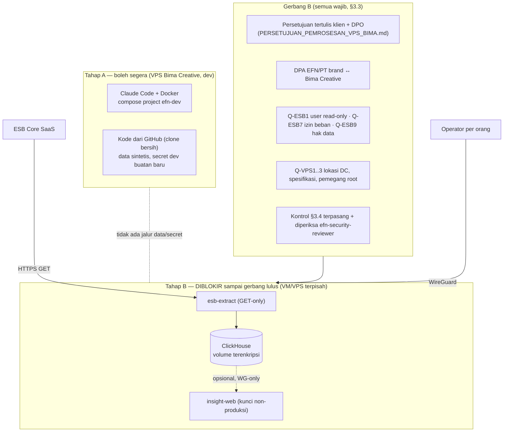

# ADR-043: VPS Bima Creative untuk lingkungan pengembangan (A) dan ekstraksi data ESB (B)

- **Status:** Proposed — belum disetujui klien. **Tahap A** (lingkungan pengembangan tanpa data/secret klien) boleh
  dimulai mengikuti rekomendasi ini. **Tahap B** (ekstraksi ESB dengan kredensial & data klien) **DIBLOKIR** sampai
  semua syarat §3.3 terpenuhi.
- **Tanggal:** 2026-11-18
- **Pemutus:** pemilik proyek (pengecualian K25-06), Direksi/Legal klien + DPO (persetujuan pemrosesan oleh pihak ketiga,
  perjanjian pemrosesan data), IT klien (user API ESB read-only, Q-ESB1), Bima Creative (penanggung jawab teknis VPS)
- **Referensi review:** R-L01 (PDP), R-S17 (akun admin ESB), R-O10 (beban ESB), usulan baru **R-S19**, **R-S20**,
  **R-O11** (§5); Q-ESB1, Q-ESB7, Q-ESB9 (`docs/04` §25.9); pertanyaan baru **Q-VPS1..Q-VPS9** (§6)
- **Terkait:** ADR-004 (topologi, VPS Indonesia + LUKS), ADR-022 (TLS & enkripsi at rest), ADR-023 (WireGuard),
  ADR-024 (kredensial per service), ADR-037 (egress allowlist), ADR-040 (datamart ESB), ADR-041 (insight-web),
  K25-02, K25-06, `docs/compliance/PDP_DATA_INVENTORY.md` §2.8.12 (v16), `docs/compliance/PDP_TRANSFER_LINTAS_NEGARA.md`
  P9, `docs/compliance/PERSETUJUAN_PEMROSESAN_VPS_BIMA.md` (draf lampiran persetujuan)

> **Ringkasan manajemen.** Laptop pengembang tidak bisa menyala terus, padahal penarikan histori ESB 24 bulan butuh
> beberapa malam. Usulan: memakai server sewa (VPS) milik Bima Creative. **Tahap A** — tempat kerja pengembang (kode dan
> data uji buatan, tanpa data atau password klien) — boleh langsung jalan karena tidak memindahkan data klien ke mana pun.
> **Tahap B** — menjalankan penarikan data ESB dengan password ESB klien di server pihak ketiga — **harus menunggu
> persetujuan tertulis klien/DPO dan perjanjian pemrosesan data**, akun ESB yang hanya bisa membaca (bukan admin), serta
> konfirmasi hak klien atas data ESB. Catatan penting: selama akun read-only dan izin beban (Q-ESB1/Q-ESB7) belum ada,
> backfill penuh **tidak boleh jalan di mesin mana pun**, jadi VPS tidak mempercepat apa pun sebelum itu. Biaya tambahan
> tahap B: ±3–5 hari kerja engineer untuk pengamanan, ditambah sewa VPS terpisah (perkiraan, belum dikonfirmasi).

## 1. Konteks

### 1.1 Kebutuhan (keputusan user 18 Nov 2026)
Memakai **VPS milik Bima Creative** (konsultan/pengembang; **pihak ketiga** bagi EFN dan PT pemilik brand) untuk:
- **(A)** lingkungan pengembangan agen Claude Code + Docker: kode, test, data sintetis, **tanpa secret klien**;
- **(B)** menjalankan stack ekstraksi ESB (`esb-extract` + ClickHouse, opsional `insight-web`) termasuk **backfill
  24 bulan 5 brand** dengan **kredensial API ESB klien**.

Alasan: laptop tidak bisa menyala terus; backfill butuh beberapa malam (ADR-040 §4.2: ±4–5 malam per 10 toko; PB ±25
toko ≈ 9–10 malam; 60 toko total ≈ 25–30 malam).

### 1.2 Pertentangan dengan dokumen/prinsip yang berlaku
| Sumber | Bunyi asli | Pertentangan |
|---|---|---|
| `CLAUDE.md` K25-06 (pemilik proyek 25 Okt 2026) | "Tiga environment **di lokal** … Prod lokal = gladi produksi … **Tidak ada deploy ke VPS.**" | (B) menjalankan stack data dengan data & kredensial nyata klien di VPS = setara deploy (walau bukan "aplikasi produksi"). (A) bukan deploy aplikasi, tetapi tetap memindahkan tempat kerja ke luar laptop. |
| `CLAUDE.md` K25-02 | "Data stack terpisah … bisa di **mesin lain** … Koneksi ke replica Odoo & PostgreSQL platform lewat TLS verify-full (antar-mesin + WireGuard)." | Mendukung "mesin lain", tetapi konteksnya mesin di bawah kendali EFN. VPS pihak ketiga menambah pemroses baru dan rantai sub-pemroses (penyedia VPS). |
| ADR-004 (Accepted 10 Okt) | "4 server (VPS atau bare-metal) di **data center Indonesia** … **LUKS + CPU ber-AES-NI wajib**." | Preseden VPS ada untuk produksi, tetapi dengan syarat lokasi Indonesia + LUKS + kontrak atas nama EFN. VPS Bima Creative belum diketahui lokasi, spesifikasi, dan siapa pemegang root (Q-VPS1..3). |
| `PDP_DATA_INVENTORY.md` §2.7 | "Vendor VPS (ADR-004) — Pemroses infrastruktur — Indonesia (syarat) — **DPA wajib**." | Bima Creative belum punya DPA dengan klien; penyedia VPS di bawah Bima = sub-pemroses. |
| `PDP_DATA_INVENTORY.md` §2.8.11 | "Dev/staging boleh memakai data nyata **hanya di mesin terenkripsi (LUKS/BitLocker)**." | Tahap B wajib LUKS/volume terenkripsi; tahap A tidak boleh memuat data nyata sama sekali. |
| ADR-040 §3.1 butir 3 / L-115 | "Akun admin yang ada dipakai **hanya di dev/uji** (R-S17)"; production `ESB_ENABLED=false` sampai Q-ESB1 + Q-ESB7. | Backfill 24 bulan × 5 brand **bukan uji**; secara isi sama dengan ekstraksi production → tunduk pada Q-ESB1/Q-ESB7 di mesin mana pun. Menaruh **akun admin** (bisa menulis ke ERP produksi klien) di server pihak ketiga memperbesar R-S17. |
| `CLAUDE.md` prinsip | "Secret hanya dari `/run/secrets/*` … Least privilege." | Secret B (password ESB, ClickHouse) harus terpisah total dari A; anggota grup `docker` di host yang sama = setara root (bisa membaca semua secret container). |

### 1.3 Fakta repo yang relevan (dibaca 18 Nov 2026)
- Working copy laptop memuat file password ESB nyata kelima brand di `secrets/esb_core_password_<brand>.txt`
  (di-gitignore, nama file saja yang dibaca architect). **Konsekuensi untuk A: VPS harus di-clone bersih dari GitHub;
  menyalin folder kerja laptop (rsync/scp/zip) akan membawa secret klien ke VPS.**
- `esb-extract` sudah GET-only, egress hanya `services.esb.co.id:443`, TLS ke ClickHouse dengan CA internal, memori
  512 MB, kill switch `ESB_ENABLED=false` (`docs/04` §25.2–§25.8).
- Gateway LLM 9router (K25-01) berada di domain Bima Creative; `PDP_TRANSFER_LINTAS_NEGARA.md` P6 mencatatnya "VPS
  Indonesia". Apakah VPS baru sama dengan host 9router **belum diketahui** (Q-VPS8).

## 2. Opsi yang dipertimbangkan

Biaya & waktu = perkiraan architect, **belum diverifikasi harga vendor**.

| # | Opsi | Kelebihan | Kekurangan | Biaya / waktu |
|---|---|---|---|---|
| 1 | **Laptop + mode tidak tidur** (BitLocker, seperti sekarang) | Tanpa pemroses baru; sesuai K25-06 & inventaris §2.8.11; Rp0 | Laptop terikat di satu tempat selama 10–30 malam; update Windows/listrik/Wi-Fi memutus backfill (bisa dilanjutkan, checkpoint ADR-040); pengembang tidak bisa membawa laptop | Rp0 capex; ±0,5 hari setup (power plan, `--resume`); risiko jadwal: backfill bisa molor 1,5–2× |
| 2 | **Mini PC / server milik EFN** (kantor EFN atau lokasi klien, via WireGuard) | Data & kredensial tetap di aset EFN; sesuai K25-02 (mesin lain) dan K25-06 (lokal); bisa menjadi cikal `efn-data` | Pengadaan + lokasi berlistrik/internet stabil; perlu orang di lokasi untuk perawatan fisik | ±Rp6–15 juta sekali (asumsi spesifikasi 8 core/32 GB/1 TB NVMe) + 2–4 hari setup (LUKS, WG, compose) + lead time pengadaan 1–2 minggu |
| 3 | **VPS Bima Creative untuk A saja** | Tempat kerja agen 24 jam tanpa laptop; tidak ada data/secret klien → tidak ada pemrosesan data klien baru | Backfill tetap butuh opsi 1/2/5 | Sewa VPS ditanggung Bima (biaya di luar EFN, belum diketahui); ±0,5–1 hari setup |
| 4 | **VPS Bima Creative untuk A + B** (satu host, tanpa isolasi) | Paling cepat secara teknis | Pemroses pihak ketiga memegang password ESB (admin) + data penjualan 5 brand; A dan B berbagi daemon Docker → agen/akun dev bisa membaca secret & data B; butuh DPA + persetujuan klien; lokasi DC belum diketahui | Setup ±1 hari; risiko kepatuhan & keamanan tinggi — **ditolak dalam bentuk ini** |
| 5 | **VPS Bima Creative A + B dengan isolasi** (B di VM/VPS terpisah, terenkripsi, WG-only, akun per orang) | Backfill jalan terus tanpa laptop; kontrol teknis setara ADR-004; pemisahan tegas dev vs data klien | Tetap butuh DPA, persetujuan tertulis klien/DPO, Q-ESB1/7/9; biaya VPS kedua; Bima Creative menjadi pemroses dengan kewajiban PDP | +sewa VPS/VM B (perkiraan ±Rp0,5–1,5 juta/bulan untuk 4 vCPU/16 GB/200 GB SSD di DC Indonesia, **asumsi**) + **±3–5 hari engineer** (devsecops 2–3: LUKS/WG/firewall/backup/audit; data-ai 1–2: compose `efn-esb-vps`, uji pemulihan, prosedur pindah & hapus) + lead time persetujuan Legal (tidak diketahui, perkiraan 1–4 minggu) |
| 5b | Varian opsi 5: **VPS B dikontrak atas nama EFN/klien**, Bima Creative hanya administrator | Data berada di aset klien; penghapusan & pengalihan saat kontrak Bima berakhir tidak bergantung pada Bima; mengurangi R-O11 | Butuh proses pengadaan klien (akun penyedia, pembayaran) | Biaya sewa sama dengan opsi 5 tetapi ditanggung klien; +lead time pengadaan klien |
| 6 | **Claude Code di cloud** (sesi agen yang dihosting penyedia AI) | Tanpa server sendiri untuk A | Hanya untuk A; dukungan Docker/compose di sandbox penyedia **belum terverifikasi**; **tidak boleh** untuk B (data & kredensial klien ke infrastruktur penyedia AI di luar negeri) | Mengikuti langganan (belum terverifikasi); tidak menyelesaikan backfill |

## 3. Keputusan (direkomendasikan)

### 3.1 Dua tahap

**Opsi 3 sekarang (tahap A)**, dan **opsi 5 — sebaiknya varian 5b — untuk tahap B setelah gerbang §3.3 lulus**.
Sampai B dibuka, backfill tetap di laptop terenkripsi (opsi 1) **hanya** dalam batas ADR-040 (uji dengan akun yang ada,
rentang pendek), atau ditunda sampai Q-ESB1/Q-ESB7 dijawab. Opsi 2 tetap opsi cadangan yang paling patuh bila klien
menolak pemroses pihak ketiga.

Alasan utama: tahap A tidak memproses data klien sehingga tidak butuh persetujuan klien; tahap B menempatkan kredensial
yang (saat ini) bisa menulis ke ERP produksi klien dan data bisnis lima brand di infrastruktur pihak ketiga, sehingga
wajib dasar hukum (UU PDP 27/2022: Bima Creative = **pemroses** yang bertindak atas perintah **pengendali**), kontrak,
dan kontrol teknis setara ADR-004.

### 3.2 Batas tahap A (wajib, berlaku segera)
| # | Batas | Cara menegakkan |
|---|---|---|
| A-1 | **Tidak ada data klien** dalam bentuk apa pun: hasil ekstraksi ESB, dump ClickHouse/PostgreSQL, CSV/Excel, tangkapan layar, log dari mesin yang memegang data nyata | Hanya data sintetis/fixture repo; pemeriksaan berkala `ls`/ukuran volume oleh pemilik VPS |
| A-2 | **Tidak ada secret klien**: password ESB, secret staging/produksi EFN, kunci CA produksi, API key 9router produksi, kredensial WhatsApp/payment | Repo di-**clone bersih dari GitHub**; folder `secrets/` dibuat ulang dengan generator secret dev (`efn-dev`); **dilarang** menyalin working copy laptop atau `.env` laptop |
| A-3 | `ESB_ENABLED=false`, `ESB_BRANDS` kosong; overlay `docker-compose.esb.yml` boleh dibangun/diuji hanya dengan fixture sintetis | Test kontrak sintetis yang sudah ada |
| A-4 | Bukan deploy aplikasi: tidak ada domain publik, tidak ada pengguna klien, tidak ada port publik selain SSH (key-only + allowlist) atau WireGuard | Firewall default deny inbound |
| A-5 | Akses GitHub dengan kredensial cakupan minimum (deploy key/fine-grained token per repo); kerja di branch, satu PR per gelombang, tidak push ke `main` | Branch protection yang sudah ada |
| A-6 | Akun OS per orang (bukan akun bersama); Claude Code memakai akun Bima Creative; tidak ada secret EFN di konfigurasi agen | — |
| A-7 | Kode yang dikirim agen ke penyedia model = sama dengan praktik di laptop (kode + data sintetis); tidak ada transfer data pribadi baru | `PDP_TRANSFER_LINTAS_NEGARA.md` P4/P9 |

Bila salah satu batas A dilanggar (mis. secret klien terlanjur tersalin), perlakukan sebagai near-miss/insiden:
rotasi secret, hapus salinan, catat di register `PDP_DATA_INVENTORY.md` §6.

### 3.3 Gerbang tahap B (semua wajib sebelum kredensial ESB klien atau data ESB berada di VPS)
| # | Syarat | Pemilik | Bukti |
|---|---|---|---|
| G-1 | **Persetujuan tertulis klien** (Direksi/penandatangan yang berwenang) dan **DPO** atas pemrosesan oleh Bima Creative | Klien, DPO (Legal) | `PERSETUJUAN_PEMROSESAN_VPS_BIMA.md` ditandatangani |
| G-2 | **Perjanjian pemrosesan data** (DPA) antara pengendali (EFN Holding dan/atau PT pemilik brand — ditentukan Legal) dan Bima Creative (pemroses), termasuk sub-pemroses (penyedia VPS), kerahasiaan, audit, insiden, penghapusan | Legal klien + Bima Creative | DPA ditandatangani |
| G-3 | **Q-ESB1**: user API ESB **read-only** per brand; akun admin **tidak pernah** dipasang di VPS | IT klien | User baru + rotasi password admin |
| G-4 | **Q-ESB7**: izin beban backfill (rate, jendela) | IT klien / vendor ESB | Jawaban tertulis |
| G-5 | **Q-ESB9**: hak klien atas data & penggunaan API massal menurut kontrak ESB (termasuk apakah pemrosesan oleh pihak ketiga diizinkan kontrak ESB) | Legal klien | Jawaban tertulis |
| G-6 | **Q-VPS1..Q-VPS3** dijawab: penyedia & lokasi DC, spesifikasi (dukungan LUKS/VM), daftar pemegang root & akses konsol penyedia | Bima Creative | Lembar jawaban |
| G-7 | Bila DC di luar Indonesia: catatan transfer lintas negara disetujui DPO (`PDP_TRANSFER_LINTAS_NEGARA.md` P9, Q-T8). **Rekomendasi: wajib DC Indonesia** (selaras ADR-004, Q-P20) | DPO | Keputusan Q-T8 |
| G-8 | Entri `PDP_DATA_INVENTORY.md` §2.8.12 disetujui DPO | DPO | Status entri |
| G-9 | Kontrol teknis §3.4 terpasang dan **diperiksa** (checklist + review `efn-security-reviewer`) | devsecops, security-reviewer | Laporan review |
| G-10 | Pemilik proyek menyetujui pengecualian K25-06 (lalu efn-lead menambah catatan di `CLAUDE.md`) | Pemilik proyek | Status ADR → Accepted |

### 3.4 Kontrol wajib tahap B
| Area | Kontrol | Catatan |
|---|---|---|
| Lokasi | DC di Indonesia (rekomendasi kuat). Di luar Indonesia = transfer lintas negara (UU PDP, rujukan kerja Pasal 56 — nomor pasal diverifikasi Legal) → keputusan DPO Q-T8 sebelum mulai | Q-VPS1 |
| Isolasi A↔B | **B di VM terpisah (KVM) atau VPS terpisah** (rekomendasi). Minimum yang masih diterima bila satu host: user OS terpisah, **Docker rootless per user** (daemon terpisah), compose project terpisah `efn-esb-vps`, user A **tidak** di grup `docker`/`sudo` sistem, volume B hanya bisa dibaca user B. Satu daemon Docker bersama **tidak diterima** (anggota grup `docker` = root) | Tanpa isolasi = opsi 4 (ditolak) |
| Enkripsi at rest | LUKS2 penuh atau volume LUKS terpisah untuk data ClickHouse + `secrets/` + backup lokal; passphrase/keyfile tidak tersimpan di disk yang sama tanpa proteksi; snapshot penyedia VPS hanya berisi data terenkripsi | ADR-004/ADR-022; perlu CPU AES-NI |
| Enkripsi in transit | TLS verify-full CA internal (ClickHouse 8443, insight-web), TLS CA publik ke ESB, WireGuard untuk akses operator; tidak ada fallback plaintext (`EFN_ALLOW_PLAINTEXT=false`, `APP_ENV=production` aturan berlaku) | ADR-022 |
| Jaringan masuk | Tidak ada port publik selain UDP WireGuard; SSH hanya lewat WG (atau key-only + allowlist IP bila WG belum siap — sementara); ClickHouse/insight-web hanya di antarmuka WG | ADR-023 |
| Jaringan keluar | Egress hanya ke `services.esb.co.id:443`, GitHub, registry image yang dipakai (ghcr.io/Docker Hub sesuai pin), mirror paket OS, NTP; **tidak** ke 9router/penyedia LLM dari VM B | Firewall host (nftables) + allowlist aplikasi (ADR-037/040) |
| Secret | Secret B dibuat/diisi khusus B (password ClickHouse baru, CA B sendiri atau CA staging terpisah), **tidak berbagi** dengan dev A atau laptop; password ESB read-only dimasukkan langsung oleh orang berwenang (tidak lewat chat/email/repo); rotasi saat orang keluar dan saat B berakhir | K25-06 "tanpa berbagi secret" |
| Akses | Akun bernama per orang (Bima Creative), daftar disetujui klien; MFA untuk konsol penyedia VPS; tanpa akun bersama; root hanya lewat `sudo` dengan log; daftar akses ditinjau bulanan | Q-VPS3 |
| Audit | `auditd`/journal untuk login, sudo, akses volume B; log WireGuard handshake; `efn_esb.extract_run`; log dikirim/diekspor ke tempat yang tidak bisa dihapus operator yang sama (minimal salinan harian terenkripsi) dan disimpan 400 hari (pola `host-journal`) | — |
| Agen AI | **Claude Code (dan agen/LLM lain) tidak berjalan di VM/user B** dan tidak diberi akses ke volume, secret, atau port ClickHouse B. Verifikasi data oleh manusia lewat query agregat (jumlah baris, total per brand-hari, `v_esb_data_quality`); hanya ringkasan agregat itu yang boleh ditempel ke sesi agen di A — sama dengan praktik G41 saat ini | Tanpa data mentah, tanpa `raw_doc`, tanpa nama supplier ke LLM |
| Backup | Backup terenkripsi (kunci di luar VPS, dipegang kustodian klien/Superadmin), tujuan off-site yang disetujui klien; uji pemulihan sekali sebelum backfill penuh. Alternatif sah: **tanpa backup** (mart bisa dibangun ulang dari ESB sampai cutover) bila klien menerima risiko pengulangan backfill | Q-VPS9 |
| Retensi di VPS | VPS = **tempat sementara**, bukan arsip. Data B dihapus dari VPS (termasuk backup & snapshot) pada yang **paling awal**: (1) data dipindah ke infrastruktur EFN (`efn-data`) dan rekonsiliasi lulus; (2) kontrak/perjanjian Bima Creative berakhir; (3) **cutover brand terakhir + 30 hari** (usulan, Q-VPS6); (4) permintaan tertulis klien. Retensi jangka panjang (raw 36 bulan, mart 10 tahun; ADR-040 L-109) berlaku **di infrastruktur EFN**, bukan di VPS | Bukti penghapusan: kunci LUKS dimusnahkan (crypto-erase) + berita acara |
| Pemindahan | Pindah ke infrastruktur EFN lewat `BACKUP` ClickHouse terenkripsi atau ekstraksi ulang; transfer lewat WireGuard/TLS; checksum + rekonsiliasi jumlah baris per brand-hari | Menjaga K25-02 sebagai tujuan akhir |
| Batas fungsi | VM B **tidak** terhubung ke Odoo, PostgreSQL platform, RabbitMQ, atau replica mana pun; skrip migrasi G43 (`esb_to_odoo`) **tidak** dijalankan dari VPS ke Odoo klien | Odoo tidak pernah diakses dari luar WG EFN |
| insight-web (opsional) | Hanya dengan kunci SSO/sesi **non-produksi** (bukan kunci Odoo produksi); akses hanya lewat WG; pengguna = tim proyek yang disetujui klien (Q-VPS7) | ADR-041 |
| Insiden | Bima Creative memberi tahu klien/DPO paling lambat **24 jam** setelah mengetahui dugaan insiden (agar pengendali bisa memenuhi 3×24 jam UU PDP, rujukan kerja Pasal 46 — diverifikasi Legal); prosedur `PDP_BREACH_RESPONSE.md` | DPA |
| Kill switch | `ESB_ENABLED=false` + hentikan VM B dapat dilakukan Bima Creative **dan** diminta klien kapan saja | — |

### 3.5 Sizing perkiraan VM/VPS B
| Komponen | RAM | Disk | Catatan |
|---|---|---|---|
| `esb-extract` | 512 MB (batas container) | kecil | `docs/04` §25.8 |
| ClickHouse | 2–4 GB | 50–150 GB SSD (raw JSON 24 bulan + mart; **perkiraan**, belum diukur) | Ukuran nyata diukur setelah backfill PB |
| `insight-web` (opsional) | ±512 MB | kecil | ADR-041 |
| OS + WG + audit | ±1 GB | 20 GB | — |
| **Total** | **4–8 GB** (rekomendasi 8 GB) | **±200 GB** dengan ruang backup lokal | 2–4 vCPU cukup (beban dibatasi rate ESB 2 req/dtk) |

## 4. Konsekuensi

### 4.1 Positif
- Pengembangan agen tidak lagi bergantung pada laptop (A, segera).
- Backfill dapat berjalan berhari-hari tanpa pengawasan fisik, dengan kontrol setara produksi (B, setelah gerbang).
- Pemisahan tegas dev vs data klien menjadi aturan tertulis, juga berguna untuk laptop.

### 4.2 Negatif / utang yang diterima
- Bima Creative menjadi **pemroses** data klien (B): kewajiban kontrak & PDP, dan klien bergantung pada pihak ketiga
  untuk penghapusan (R-O11) — dimitigasi varian 5b dan prosedur crypto-erase.
- Biaya sewa VM/VPS B dan ±3–5 hari engineer; lead time persetujuan Legal yang tidak bisa dikendalikan tim.
- Selama Q-ESB1 belum dijawab, B tidak bisa dimulai sama sekali (akun admin dilarang di VPS) — jadwal backfill tetap
  bergantung pada IT klien, apa pun hostnya.
- Dua tempat data ESB (VPS sementara + `efn-data` kelak) → wajib rekonsiliasi saat pemindahan.

### 4.3 Dampak ke dokumen lain
- **`CLAUDE.md` K25-06**: setelah ADR ini **disetujui pemilik proyek**, efn-lead menambah catatan pengecualian
  (contoh rumusan: "Pengecualian ADR-043: VPS Bima Creative untuk lingkungan dev tanpa data/secret klien; ekstraksi ESB
  di VPS hanya setelah gerbang ADR-043 §3.3"). **Architect tidak mengubah `CLAUDE.md`.** Sampai disetujui, bunyi
  K25-06 tetap berlaku untuk B.
- `PDP_DATA_INVENTORY.md` v16 §2.7 + §2.8.12 + Q-P30/Q-P31 (dibuat bersama ADR ini).
- `PDP_TRANSFER_LINTAS_NEGARA.md` P9 + Q-T8 (dibuat bersama ADR ini).
- `PERSETUJUAN_PEMROSESAN_VPS_BIMA.md` (draf lampiran persetujuan, dibuat bersama ADR ini).
- `docs/01` §5.13: Q-VPS1..Q-VPS9 + catatan usulan R-S19, R-S20, R-O11 (dibuat bersama ADR ini); baris risiko di
  tabel §4 **belum** ditambahkan (tugas efn-lead/architect berikut).
- Runbook `docs/runbooks/vps-bima-dev.md` (A) dan `docs/runbooks/vps-bima-esb.md` (B: bootstrap LUKS/WG/firewall,
  checklist gerbang, prosedur pindah & hapus) — **belum dibuat** (devsecops).

## 5. Risiko terkait
| ID | Ringkas | Mitigasi |
|---|---|---|
| R-L01 | PDP: pemroses baru tanpa dasar/kontrak; residu data pribadi (nama supplier perorangan) di VPS | G-1, G-2, G-8; minimisasi L-110 tetap berlaku |
| R-S17 | Akun admin ESB dipakai ekstraksi | Akun admin **dilarang** di VPS (G-3); GET-only di kode |
| R-O10 | Beban backfill ke server ESB | G-4; rate & jendela ADR-040 |
| **R-S19** (usulan) | Pihak ketiga memegang kredensial ESB & data bisnis 5 brand di infrastruktur yang tidak dikendalikan EFN (orang dalam, kompromi VPS, penyedia VPS) | LUKS, WG-only, akun per orang, audit, egress allowlist, varian 5b, kunci backup di klien |
| **R-S20** (usulan) | Agen AI/akun dev di host yang sama membaca secret atau data mentah klien (termasuk prompt injection dari data) dan mengirimnya ke penyedia model | Isolasi VM/rootless Docker; agen tidak berjalan di B; hanya agregat yang ditempel ke sesi agen; A tanpa secret klien (clone bersih) |
| **R-O11** (usulan) | Ketergantungan pada VPS konsultan: kontinuitas, data tertinggal saat kontrak berakhir, sulit membuktikan penghapusan | Retensi VPS sementara, crypto-erase + berita acara, varian 5b, pemindahan ke `efn-data` |

## 6. Pertanyaan terbuka (dijawab klien / Bima Creative)
- **Q-VPS1** (Bima Creative) Penyedia VPS, **negara & kota data center**, sub-pemroses penyedia, dan sertifikasi (mis.
  ISO 27001) bila ada. Bila di luar Indonesia → Q-T8 (DPO).
- **Q-VPS2** (Bima Creative) Spesifikasi (vCPU, RAM, disk, AES-NI), apakah mendukung LUKS penuh/volume terenkripsi,
  VM bersarang atau VPS kedua, dan apakah penyedia membuat snapshot otomatis.
- **Q-VPS3** (Bima Creative → disetujui klien) **Siapa saja yang punya akses root/sudo** (nama per orang), siapa yang
  punya akses konsol/panel penyedia, MFA, dan siapa pemegang passphrase LUKS.
- **Q-VPS4** (Klien: Direksi + Legal/DPO) Persetujuan tertulis pemrosesan oleh Bima Creative dan penandatanganan DPA;
  siapa pengendali penandatangan (Holding EFN atau masing-masing PT brand).
- **Q-VPS5** (Klien/Finance) Varian: VPS B atas nama Bima Creative (opsi 5) atau atas nama EFN/klien (5b)? Siapa
  menanggung biaya sewa?
- **Q-VPS6** (DPO) Batas hapus data di VPS: usulan paling awal dari pemindahan ke `efn-data` / akhir kontrak /
  cutover brand terakhir + 30 hari / permintaan klien; bentuk bukti penghapusan.
- **Q-VPS7** (Pemilik proyek/klien) Apakah `insight-web` boleh dijalankan di VPS untuk tim proyek, dan siapa saja
  penggunanya?
- **Q-VPS8** (Bima Creative) Apakah VPS ini **sama** dengan host gateway 9router? Rekomendasi: B tidak di host yang
  sama dengan 9router.
- **Q-VPS9** (Klien/IT) Backup B: tujuan off-site yang disetujui dan kustodian kunci, atau terima "tanpa backup, bangun
  ulang dari ESB".

Plus yang sudah ada dan menjadi pemblokir B: **Q-ESB1**, **Q-ESB7**, **Q-ESB9**.

## 7. Kapan ditinjau ulang
- Saat Q-VPS1..Q-VPS4 dan Q-ESB1/Q-ESB7/Q-ESB9 terjawab (membuka/menutup tahap B).
- Saat infrastruktur EFN untuk `efn-data` (mesin milik EFN) tersedia → B dipindah dan VPS dikosongkan.
- Saat kontrak Bima Creative berubah/berakhir, atau ada insiden pada VPS.
- Paling lambat **28 Feb 2027** (sama dengan tinjauan ADR-040) atau saat brand terakhir cutover.
