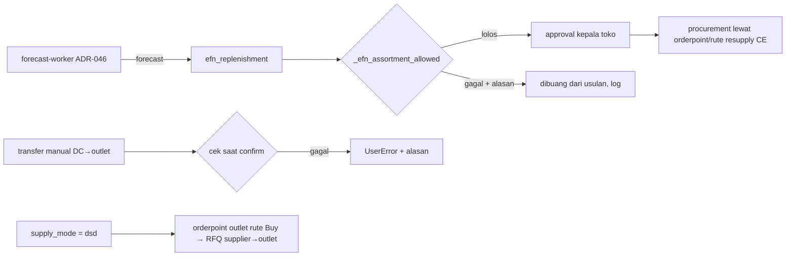

# ADR-045: Distribution Center di PT yang sama dengan outlet supermarket + restriksi assortment saat replenishment

- **Status:** Proposed — belum disetujui klien. Struktur "DC = warehouse di PT yang sama" adalah keputusan bisnis pemilik
  proyek 18 Nov 2026; yang masih menunggu adalah **konfirmasi konsultan pajak & Legal** (fit-gap Q-SM5, Q-SM20) dan tanda
  tangan arsitektur. `efn_assortment` dibangun di **awal G44** (sebelum `efn_replenishment`, urutan fit-gap G45 §5);
  `efn_setup_supermarket` tahap A di awal (seed G48), tahap B di G45. Jalur alternatif (§2, opsi B) tetap terbuka.
- **Tanggal:** 2026-11-18 (Gelombang 0 Supermarket); direvisi hari yang sama setelah fit-gap
  `docs/fit-gap/G45_SUPERMARKET.md` (efn-odoo-functional)
- **Pemutus:** pemilik proyek (struktur entitas), Finance + konsultan pajak (PPN, faktur, NITKU), Legal (izin gudang,
  minuman beralkohol, halal), Ops supermarket/DC (aturan assortment), IT
- **Referensi review:** R-L03 (pajak), R-L04 (transfer pricing), R-L07 (keamanan pangan), R-O01 (master data);
  risiko baru **R-L14** (regulasi DC satu PT), **R-O14** (kesalahan restriksi DC); pertanyaan fit-gap Q-SM1, Q-SM5,
  Q-SM13 dan architect Q-SM20..Q-SM22 (`docs/04` §28.12)
- **Terkait:** ADR-001 (satu DB multi-company), ADR-031 (tanpa modul pihak ketiga), ADR-046 (forecast & usulan order),
  `docs/fit-gap/G45_SUPERMARKET.md` S-01..S-04, S-11, S-16 (fit-gap menang untuk rincian model Odoo)

> **Ringkasan manajemen.** Gudang pusat (DC) supermarket dibuat sebagai **gudang di dalam PT yang sama** dengan
> toko-tokonya, bukan PT terpisah. Akibatnya pengiriman DC → toko adalah **pindah stok biasa** (tanpa faktur jual, tanpa
> PPN antar-PT, tanpa transfer pricing) dan memakai fitur standar Odoo — biaya ±1–1,5 minggu-engineer konfigurasi.
> Aturan "barang apa boleh dikirim ke toko mana" (daftar izin, toko punya freezer/izin alkohol/boleh non-halal, kontrak
> supplier per wilayah, barang dikirim langsung supplier) dicek **saat toko memesan ke DC**; biaya ±2–3 minggu-engineer.
> Yang harus dikonfirmasi: konsultan pajak (PPN & identitas lokasi gudang di Coretax) dan Legal (izin gudang). Bila
> Legal menolak, DC dipindah ke PT terpisah (+3–5 minggu-engineer dan dampak PPN/arus kas).

## 1. Konteks

### 1.1 Kebutuhan (keputusan pemilik proyek 18 Nov 2026)
- Entitas: PT demo baru (placeholder) **"PT Supermarket Demo"** di Odoo multi-company. DC = warehouse di PT yang sama.
- Restriksi DC berdasarkan: daftar izin SKU/kategori per outlet, kemampuan outlet (chiller/freezer/halal/alkohol),
  kontrak supplier/region, **DSD** (direct store delivery, bypass DC). Ditegakkan **hanya di order/replenishment ke DC**.
- Simulasi: 1 DC + 5 outlet (G48).

### 1.2 Pertentangan / koreksi atas brief
| Sumber | Bunyi | Temuan architect |
|---|---|---|
| Brief requirement | "TDG via OSS (KBLI 52101/52102)" | Menurut sumber sekunder (konsultan hukum & situs KBLI universitas, dicari 18 Nov 2026), **KBLI 2025 mengubah 52101** menjadi pergudangan dengan **sistem resi gudang**; pergudangan umum pindah ke **52109**; **52102** tetap gudang dingin. Juga belum jelas apakah gudang milik peritel untuk barang dagangannya sendiri wajib KBLI pergudangan terpisah atau cukup didaftarkan sebagai lokasi usaha ritel. **Belum terverifikasi dari sumber primer (OSS/BPS)** → Q-SM20. |
| Brief requirement | "pemusatan PPN (PER-07/PJ/2021)" | Menurut DDTC & pajak.go.id (sumber sekunder), **PER-07/PJ/2021 mengatur PPN ekspor/impor BKP berwujud**, bukan dasar pemusatan PPN. Rezim administrasi saat ini: **PMK-81/2024** (Coretax; NPWP cabang diganti **NITKU** per tempat kegiatan usaha; diubah PMK 54/2025 & PMK 1/2026 menurut sumber sekunder). Status pemusatan PPN secara jabatan **belum terverifikasi** → ditambahkan ke fit-gap **Q-SM5**. |
| `CLAUDE.md` / ADR-001 | Company root per brand. | PT Supermarket Demo = company root baru (placeholder); kode company diusulkan `SMD` (fit-gap Q-SM1). `efn_brand_code` adalah Selection tetap di `efn_core` yang dikunci test kontrak → butuh revisi `docs/04` §12.1 + `efn_core` (dicatat di §12.1, belum dibangun). |
| Draf awal ADR ini | "Pola CK `efn_ck_production` dipakai untuk DC" | **Dikoreksi fit-gap S-03:** `efn_ck_supplier_wh_id` mensyaratkan gudang bertanda CK dan bergantung `mrp`. DC memakai **`stock.warehouse.resupply_wh_ids` CE** langsung (rute "Supply Product from <DC>" lewat lokasi transit company, stok in-transit terlihat). `efn_ck_production` tidak diperluas. |

## 2. Opsi yang dipertimbangkan

### 2.1 Struktur entitas DC
| # | Opsi | Kelebihan | Kekurangan | Biaya / waktu (perkiraan architect) |
|---|---|---|---|---|
| **A** | **DC = `stock.warehouse` di PT Supermarket Demo** (rute resupply CE dari DC ke outlet) | Standar CE; transfer internal tanpa faktur/PPN antar-PT; satu valuasi stok; forecast & approval sederhana | DC tidak bisa melayani PT lain tanpa jual-beli; izin gudang per lokasi tetap wajib | **±1–1,5 minggu-engineer** (data `efn_setup_supermarket` + rute), Rp0 lisensi |
| B | DC = PT terpisah (PT Logistik) menjual ke PT Supermarket | DC bisa melayani banyak PT/brand; pemisahan risiko hukum | Faktur & PPN setiap pengiriman, transfer pricing (R-L04), modul inter-company sendiri (ADR-031, tanpa OCA), rekonsiliasi antar-PT | **±3–5 minggu-engineer** + beban Finance berulang; PPN keluaran/masukan memengaruhi arus kas |
| C | DC dikelola 3PL | Tanpa aset gudang | Integrasi 3PL, data stok di luar Odoo, biaya per palet | Integrasi ±3–6 minggu + biaya jasa (belum dihitung) |

### 2.2 Titik penegakan restriksi assortment
| # | Opsi | Catatan | Keputusan |
|---|---|---|---|
| **a** | **Saat usulan order / replenishment outlet → DC dan saat transfer manual DC → outlet dikonfirmasi** | Sesuai keputusan pemilik proyek; POS tidak terbebani | **Dipilih** |
| b | Juga di POS (blok jual) | Barang yang sudah di rak tetap harus bisa dijual/ditarik; menambah kompleksitas POS offline | Ditolak (keputusan pemilik proyek) |
| c | Hanya laporan pelanggaran (tanpa blok) | Murah, tapi alkohol/non-halal bisa terkirim ke outlet yang tidak berizin | Ditolak |

## 3. Keputusan (direkomendasikan)

### 3.1 Entitas, gudang, rute (CE standar — fit-gap S-01..S-04)
1. Company root **PT Supermarket Demo** (placeholder, kode `SMD`, fit-gap Q-SM1) dibuat oleh `efn_setup_supermarket`
   (data-only). Mata uang IDR presisi Rp1 (R-T17), pajak via fiscal position (ADR-027, tanpa tarif di kode).
2. **1 warehouse DC** (usul `two_steps` + `pick_ship`) + **5 warehouse outlet** (`one_step` + `ship_only`).
3. Rute DC → outlet = **`resupply_wh_ids` CE** pada warehouse outlet (bukan `efn_ck_production`).
4. **DSD** = rute *Buy* (`purchase_stock`) pada orderpoint outlet (`route_id`), ditandai di `efn.assortment.line`
   (`supply_mode = dsd`, `dsd_partner_id`); tidak melewati DC dan tidak ikut agregasi PO DC (ADR-046).
5. Orderpoint SKU × outlet yang dikelola `efn_replenishment` dipaksa **`trigger = manual`** (cegah dobel order dengan
   scheduler CE, fit-gap §6); kelipatan pack = `replenishment_uom_id` (`qty_multiple` tidak ada di 19.0).

### 3.2 Model restriksi (`efn_assortment`, dibangun sendiri, ADR-031; nama mengikuti fit-gap §5)
| Model / field | Isi | Multi-company |
|---|---|---|
| `efn.assortment.capability` | `name`, `code` (mis. `chiller`, `freezer`, `non_halal_allowed`, `alcohol_license`), `company_id` opsional | capability kosong = bersama |
| `stock.warehouse` | `efn_capability_ids`, `efn_assortment_policy` (`open`/`closed`) | ikut warehouse |
| `product.template` | `efn_required_capability_ids` | ikut produk |
| `efn.assortment.line` | `company_id`, `warehouse_id`, `product_tmpl_id` **atau** `categ_id`, `mode` (`allow`/`deny`), `supply_mode` (`dc`/`dsd`), `dsd_partner_id`, `shelf_capacity_qty`, `date_from/to` | `company_id in company_ids` |
| `product.supplierinfo` | `efn_region_ids` (kontrak supplier per wilayah; region outlet = `warehouse.partner_id.efn_region_id`) | CE `company_id` |
| `res.users` | `efn_outlet_warehouse_ids` (cakupan outlet kepala toko; juga sumber cakupan Insight, ADR-041 §3.3) | — |

Fungsi tunggal `_efn_assortment_allowed(product, warehouse) → (bool, alasan)` dipakai oleh: (1) generator usulan
order `efn_replenishment` (produk yang tidak lolos tidak diusulkan; alasan dicatat), (2) **constraint saat konfirmasi
`stock.picking` DC → outlet** (manual maupun hasil orderpoint), (3) laporan pelanggaran harian. Lolos bila: policy
`open` atau ada baris `allow` (produk/kategori) **dan** tidak ada `deny` **dan** `efn_required_capability_ids` ⊆
kemampuan outlet **dan** (bila supplier berkontrak region) region outlet ∈ region kontrak **dan** `supply_mode ≠ dsd`
untuk pasok dari DC. Override hanya grup *Assortment Manager* dengan alasan wajib, teraudit `efn_audit`; **tidak
tersedia** untuk capability `alcohol_license` dan `non_halal_allowed` (Q-SM22).

### 3.3 Regulasi (bukan keputusan teknis; wajib dikonfirmasi)
- Gudang DC = tempat usaha PT; perizinan lewat OSS-RBA dengan KBLI yang tepat (52109/52102 atau cukup lokasi usaha
  ritel — Q-SM20). Pendaftaran gudang (istilah brief: TDG) mengikuti ketentuan Kemendag terbaru — **belum terverifikasi**.
- PPN: perpindahan barang DC → outlet dalam satu PT diperlakukan **bukan penyerahan** (asumsi architect); lokasi DC &
  outlet terdaftar sebagai NITKU; faktur pajak dari NPWP PT. Konsultan pajak mengonfirmasi (fit-gap Q-SM5, dengan
  tambahan butir di `docs/04` §28.12). Bila perlu dokumen/pelaporan per lokasi, cukup laporan Odoo.
- **Jalur alternatif bila Legal/pajak menolak opsi A**: opsi B (PT terpisah) — warehouse DC dipindah ke company baru,
  rute resupply diganti PO/SO inter-company. Agar tetap murah dibalik: procurement setelah approval dibuat lewat satu
  titik (`_efn_create_supply_document()` di `efn_replenishment`) yang bisa diganti ke SO/PO.

## 4. Konsekuensi

### 4.1 Positif
- Memakai standar CE (warehouse, `resupply_wh_ids`, orderpoint, rute Buy, RFQ) — sedikit kode, upgrade aman.
- Stok DC dan outlet satu valuasi; laporan margin per outlet tidak terdistorsi transfer pricing.

### 4.2 Negatif / utang
- DC tidak bisa melayani brand/PT lain tanpa jual-beli (bila nanti dibutuhkan → opsi B).
- Master data assortment (izin, kemampuan, region) menjadi data kritis: salah isi = OOS atau barang terlarang
  terkirim (R-O14).
- Constraint di konfirmasi picking menambah satu titik gagal; harus punya pesan yang jelas untuk staf DC.

### 4.3 Dampak ke dokumen
- `docs/04` §12.1 (kode `SMD`, belum dibangun), §28.5 (assortment); `docs/01` R-L14/R-O14 dan §5.14.

## 5. Risiko terkait
| ID | Ringkas | Mitigasi |
|---|---|---|
| **R-L14** (baru) | Struktur DC satu PT tidak sesuai ketentuan izin gudang/PPN | Konfirmasi konsultan pajak & Legal sebelum go-live; jalur alternatif opsi B dibungkus satu fungsi |
| **R-O14** (baru) | Restriksi salah (terlalu ketat → OOS; terlalu longgar → alkohol/non-halal/frozen ke outlet tidak mampu) | Alkohol/halal tanpa override; laporan pelanggaran harian; test per aturan; review master data bulanan Category manager |
| R-L07 | Keamanan pangan | Capability chiller/freezer; lot + expiry semua SKU (ADR-046, fit-gap S-05) |
| R-O01 | Master data | Kategori standar 10 (G48), satu pemilik per kategori |

## 6. Pertanyaan terbuka (dijawab klien)
Dari fit-gap (tidak diduplikasi): **Q-SM1** kode/nama/NPWP PT, **Q-SM5** pajak (ditambah: PPN perpindahan DC → outlet
satu PT di bawah PMK-81/2024 + perubahan; koreksi rujukan PER-07/PJ/2021), **Q-SM11** jadwal kirim & cut-off,
**Q-SM13** izin alkohol per outlet. Tambahan architect:
- **Q-SM20** (Legal) KBLI & pendaftaran gudang untuk DC milik peritel (52109 / 52102 untuk ruang dingin / cukup lokasi
  ritel); kewajiban pendaftaran gudang ke Kemendag.
- **Q-SM21** (Legal/Ops) Kebijakan produk non-halal: outlet mana yang boleh menjual non-halal; pemisahan rak/penanganan
  di DC.
- **Q-SM22** (Ops/Pemilik) Boleh override restriksi? Default: produk umum boleh oleh *Assortment Manager* dengan alasan;
  alkohol/halal tidak.

## 7. Kapan ditinjau ulang
- Jawaban fit-gap Q-SM5 dan Q-SM20 tersedia (bila menolak → opsi B).
- DC perlu melayani PT/brand lain, atau jumlah DC > 1.
- Paling lambat sebelum go-live pilot supermarket.
