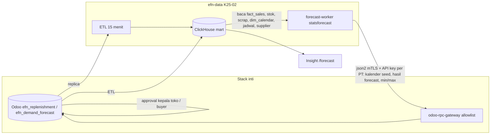

# ADR-046: Forecast engine G44 — worker statistik di `efn-data`, kalender budaya, batas umur simpan, 4 keluaran dengan approval

- **Status:** Proposed — belum disetujui klien. Parameter bisnis (definisi minggu gajian, keluaran, approval) adalah
  keputusan pemilik proyek 18 Nov 2026; ADR ini menetapkan cara teknisnya. G44 boleh dibangun mengikuti rekomendasi.
- **Tanggal:** 2026-11-18 (Gelombang 0 Supermarket)
- **Pemutus:** pemilik proyek, Ops supermarket (kepala toko, buyer DC), Category manager, IT
- **Referensi review:** K25-12, Q-35, R-T06 (angka analitik dipakai keputusan), R-T11 (beban Odoo), R-O03 (ETL);
  risiko baru **R-T21** (akurasi forecast / histori); Q-SM23, Q-SM27, Q-SM28 (`docs/04` §28.12)
- **Terkait:** ADR-003 (ETL 15 menit, CH turunan), ADR-010 (AI di luar jalur transaksi), ADR-034 (`/json/2` lewat
  `odoo-rpc-gateway`), ADR-040 (mart ESB sebagai sumber histori F&B), ADR-045 (DC & assortment), K25-02 (stack data
  terpisah), modul existing `efn_demand_forecast` (v1, G28)

> **Ringkasan manajemen.** Forecast v1 (rumus rata-rata × faktor musim) diganti bertahap dengan **model statistik per
> produk per toko** yang memahami akhir pekan, **minggu gajian** (7 hari terakhir + 7 hari pertama bulan), libur nasional,
> Ramadan/Lebaran, dan cuti bersama. Sistem membuat empat hal: min/max, **usulan order harian toko → DC**, **usulan PO
> DC → supplier**, dan proyeksi penjualan harian. Pesanan tidak pernah melebihi perkiraan terjual sebelum kedaluwarsa.
> Semua usulan **wajib disetujui** kepala toko atau buyer; setiap perubahan dicatat untuk mengukur akurasi. Bila worker
> mati, toko tetap jalan dengan aturan stok terakhir. Biaya ±6–9 minggu-engineer, Rp0 lisensi.

## 1. Konteks

### 1.1 Kebutuhan (keputusan pemilik proyek 18 Nov 2026)
- Model statsforecast (ETS/AutoARIMA) di `efn-data`; faktor kalender: weekend/weekday, minggu gajian (7 hari terakhir +
  7 hari pertama bulan), libur nasional dari library `holidays` (ID) + override manual Lebaran/cuti bersama.
- Input: tren penjualan, on-hand + in-transit, min/max, jadwal kirim DC→outlet (per outlet × kelompok produk: hari,
  lead time, cut-off), supplier (lead time, MOQ/kelipatan, jadwal kunjungan, konsinyasi/retur ED, diskon volume),
  kapasitas rak/planogram, waste historis (menurunkan service level).
- Shelf life: semua SKU lot + expiry; order ≤ perkiraan terjual sebelum ED; sisa umur minimum saat terima per kategori.
- Approval: kepala toko (usulan order outlet, sebelum cut-off), buyer DC (PO). Setiap perubahan dicatat (bias).
- KPI MAPE/bias.

### 1.2 Pertentangan dengan yang berlaku
| Sumber | Bunyi | Pertentangan |
|---|---|---|
| `efn_demand_forecast` README (G28) | "Belum: v2 (statsforecast/Prophet) di worker data setelah ada histori nyata" | ADR ini adalah v2; v1 tetap jalan sampai v2 lulus backtest per gudang (§3.6). |
| `CLAUDE.md` | "PostgreSQL = source of truth; ClickHouse hanya turunan … Tidak ada tulis langsung API → ClickHouse." | Hasil forecast **ditulis ke Odoo** (sumber kebenaran usulan & approval), lalu turun ke ClickHouse lewat ETL. Worker **tidak menulis apa pun** ke ClickHouse; hanya membaca (§3.1). |
| `docs/04` §23.5 / ADR-041 | Odoo tidak memegang kredensial ClickHouse; insight-web read-only | Worker memanggil Odoo (arah data → ERP) lewat gateway terfilter, bukan sebaliknya. |
| `efn.forecast.season` v1 | Kalender musim tanggal & faktor PLACEHOLDER manual | Diperluas: tipe `payday`, `holiday`, `cuti_bersama`, sumber `lib`/`manual`; faktor tidak lagi diisi manual untuk v2 (diestimasi model sebagai regressor); faktor manual tetap dipakai v1. |

## 2. Opsi yang dipertimbangkan

| # | Opsi | Kelebihan | Kekurangan | Biaya / waktu (perkiraan architect) |
|---|---|---|---|---|
| A | Tetap v1 di Odoo (cron Python) + tambah faktor | Tanpa service baru | Tidak ada model tren/musiman sungguhan; beban CPU di worker Odoo (R-T11); MAPE tidak membaik | ±1–2 minggu |
| **B** | **`services/forecast-worker` (Python 3.12, statsforecast) di compose `efn-data`, baca ClickHouse, tulis Odoo lewat `/json/2`** | Model statistik cepat (vektorisasi), CPU di mesin data (K25-02), Odoo tetap sumber approval | Service + user teknis + jalur jaringan efn-data → odoo-rpc-gateway (antar-mesin, WireGuard + mTLS) | **±6–9 minggu-engineer** total: worker ±2–3, Odoo `efn_replenishment` + kalender ±3–4, ETL/mart ±1, Insight ±0,5–1; RAM worker ±1–2 GB saat batch |
| C | Prophet / ML (LightGBM) | Regressor kalender fleksibel | Lebih berat, dependency besar (Stan/cmdstan), butuh histori panjang & tuning | +2–4 minggu; dicatat sebagai evaluasi setelah 6 bulan data |
| D | Worker menulis langsung ke DB Odoo | Cepat | Melewati ORM, record rule, audit; dilarang prinsip | **Ditolak** |

Lisensi statsforecast: Apache-2.0 (Nixtla) dan `holidays`: MIT — **belum diverifikasi ulang dari repo primer** saat ADR
ini ditulis. Library `holidays` mendukung kode negara `ID` dan memuat entri "Cuti Bersama" pada kategori GOVERNMENT untuk
tahun tertentu (dokumentasi readthedocs, sumber Debian 0.71/0.86); cakupan tahun berbeda per versi → override manual
wajib dan tanggal Lebaran/cuti bersama diverifikasi dari SKB pemerintah tiap tahun.

## 3. Keputusan (direkomendasikan)

### 3.1 Arsitektur

- Worker **hanya membaca** ClickHouse (user `efn_forecast_reader`, view whitelist) dan **hanya menulis** ke Odoo lewat
  metode allowlist di `odoo-rpc-gateway` (`docs/04` §28.3), user teknis per PT `efn_forecast_<kode>` (grup
  `group_forecast_bot`, tepat satu company), API key `/run/secrets/odoo_api_key_forecast_<kode>`, sertifikat klien
  CN `forecast-worker`. Antar-mesin: WireGuard + TLS verify-full (K25-02).
- Jadwal: batch harian **setelah tutup toko** (default 23:30 WIB, `FORECAST_DAILY_CRON`), selesai sebelum cut-off
  approval pagi; batch mingguan untuk min/max. Kegagalan → usulan hari itu tidak dibuat, alert
  `EfnForecastRunFailed`; reorder rule & usulan terakhir tetap berlaku (ADR-010).

### 3.2 Kalender
- Sumber kebenaran: model Odoo **`efn.forecast.calendar`** (per company, opsional per warehouse): `date`, `kind`
  (`weekend|payday|holiday|cuti_bersama|ramadan|lebaran_window|custom`), `source` (`lib|manual`), `name`, `active`.
- Seed: worker membangkitkan entri `holiday`/`cuti_bersama` dari `holidays.country_holidays('ID')` untuk tahun berjalan
  + 1 dan memanggil `efn_forecast_calendar_upsert` (source `lib`). **Entri `manual` tidak pernah ditimpa**; entri `lib`
  yang dinonaktifkan user tetap nonaktif (kunci unik `company_id, date, kind, name`).
- Minggu gajian: dihitung, bukan disimpan per tanggal: `payday_tail_days` (default 7) dan `payday_head_days` (default 7)
  per company di `ir.config_parameter`/setelan; hari ke-d dalam jendela = regressor `is_payday_window`.
- Regressor model: `dow` (one-hot), `is_payday_window`, `is_holiday`, `is_cuti_bersama`, `days_to_lebaran` (bucket
  −14..+7), `is_ramadan`, `promo_active` (dari markdown/near-expiry & `sale_loyalty`, bila ada). Kalender turun ke
  ClickHouse sebagai `dim_calendar` lewat ETL.

### 3.3 Model
- Grain: **SKU × outlet × hari** (DC: agregat outlet + permintaan non-outlet). Model per seri: AutoETS dan AutoARIMA
  dengan regressor eksogen (AutoARIMA) — pilih per seri dengan cross-validation rolling 4 × 7 hari; seri pendek/sporadis
  (< 56 hari penjualan atau > 60 % hari nol) → CrostonOptimized/ADIDA; seri tanpa histori (SKU baru) → rata-rata
  kategori di outlet × faktor kalender.
- Data histori: penjualan POS + online (fact_sales), dibersihkan dari hari OOS (on-hand = 0 di akhir hari → penjualan
  hari itu ditandai *censored*, tidak dipakai sebagai nol permintaan).
- Keluaran per seri: `yhat`, `p10`, `p90` per hari, horizon 28 hari.

### 3.4 Empat keluaran
Pembagian kerja: **worker** menghitung permintaan (`yhat/p10/p90/sigma` per SKU × lokasi × hari) dan usulan min/max;
**Odoo `efn_replenishment`** menghitung kebutuhan bersih (keluaran 2 dan 3) dengan data **live** (on-hand, in-transit,
lot & ED, jadwal kirim, MOQ, assortment) segera setelah run forecast ditutup. Alasannya: snapshot stok di ClickHouse
tertinggal ≤ 15 menit + durasi batch, sedangkan usulan harus konsisten dengan stok saat kepala toko menyetujui.

| # | Keluaran | Rumus (ringkas) | Dihitung di → disimpan | Approval |
|---|---|---|---|---|
| 1 | **Min/max** (existing) | Seperti v1 tetapi `d` dan σ dari model; service level diturunkan bila waste historis kategori > ambang | worker → `efn.demand.forecast.line` (existing) | Inventory Administrator / planner (existing) |
| 2 | **Usulan order harian outlet → DC** | `need = Σ yhat (hari ini s/d kedatangan kiriman berikutnya + review) + z·sigma·√L − on_hand − in_transit`; `cap_shelf = Σ yhat sampai (ED terdekat lot DC − sisa umur minimum)`; `qty = round_up_pack(min(need, cap_shelf, kapasitas_rak − on_hand))`; filter `efn.assortment.check` (ADR-045) | Odoo → `efn.replenishment.proposal(.line)` per outlet × tanggal kirim | **Kepala toko** sebelum cut-off jadwal kirim |
| 3 | **Usulan PO DC → supplier** | Agregasi usulan outlet yang disetujui + forecast permintaan DC selama lead time supplier + safety − on_hand DC − PO terbuka; MOQ/kelipatan, jadwal kunjungan supplier, diskon volume (informasi), konsinyasi/retur ED → service level boleh lebih tinggi; DSD dikeluarkan | Odoo menulis `qty_to_order_manual` pada orderpoint DC (`trigger=manual`) → "Order" CE membuat **RFQ draft per vendor** (supplierinfo: `delay`, `min_qty`, `product_uom_id`, harga bertingkat); **tidak ada model usulan PO sendiri** (fit-gap S-13); log bias pada RFQ | **Buyer DC** mengonfirmasi RFQ |
| 4 | **Proyeksi penjualan harian** | `yhat/p10/p90` 28 hari | worker → `efn.forecast.daily` → ETL → `fact_forecast_daily` | Tidak (informasi) |

- **Shelf-life cap** berlaku untuk keluaran 2 dan 3: produk lot/expiry (`product_expiry` CE: `use_expiration_date`,
  `expiration_time`, `removal_time`, `alert_time` — fit-gap formal oleh efn-odoo-functional) tidak boleh dipesan
  melebihi perkiraan terjual sebelum ED. Sisa umur minimum saat terima dari DC per kategori (`efn_min_remaining_days`)
  dicek di penerimaan outlet dan di pemilihan lot (FEFO).
- Usulan **tidak** membuat dokumen stok sebelum approval. Approval → procurement lewat orderpoint/rute resupply CE
  (bukan membuat picking sendiri). Orderpoint yang dikelola `efn_replenishment` dipaksa `trigger=manual` (cegah dobel
  order dengan scheduler CE); kelipatan pack = `replenishment_uom_id` (`qty_multiple` tidak ada di 19.0). Model jadwal:
  `efn.delivery.schedule` (outlet × kelompok produk) dan `efn.supplier.schedule` (hari kunjungan/order supplier).
- Urutan bangun (fit-gap G45 §5): `efn_assortment` → perluasan `efn_demand_forecast` (kalender) → `efn_replenishment`
  → forecast-worker; semuanya G44. Jadwal kirim & cut-off nyata = fit-gap Q-SM11; sisa umur minimum = fit-gap Q-SM9.

### 3.5 Approval & log bias
- State usulan: `draft → proposed → approved | rejected | expired`. Kepala toko boleh mengubah qty per baris; setiap
  perubahan menyimpan `qty_proposed`, `qty_approved`, `changed_by`, alasan (pilihan: promo lokal, event, rak penuh,
  lainnya). Usulan yang belum disetujui saat cut-off → `expired`, **tidak dikirim otomatis** (default, Q-SM23).
- Bias = Σ(qty_approved − qty_proposed)/Σ qty_proposed per outlet/kategori/periode; dikirim ke mart
  `fact_replenishment` (ETL) untuk dashboard kepala toko & Category manager.

### 3.6 KPI & penggantian v1
- MAPE (hari dengan penjualan > 0), WAPE, bias forecast per SKU × outlet × minggu → `fact_forecast_accuracy` (ETL
  membandingkan `fact_forecast_daily` dengan `fact_sales`). Baseline = v1 dan *seasonal naive* (minggu lalu).
- Per warehouse, sakelar `efn_forecast_engine` = `v1|v2` (default `v1`). Pindah ke `v2` hanya bila backtest 8 minggu
  WAPE v2 < v1 dan < seasonal naive. Pengujian G44 dengan data sintetis (G48: Lebaran & gajian harus tertangkap).

## 4. Konsekuensi

### 4.1 Positif
- Usulan order harian mengurangi kerja manual kepala toko; batas umur simpan menurunkan waste.
- CPU forecast di mesin data, Odoo hanya menerima hasil (R-T11).
- Odoo tetap sumber kebenaran usulan + approval + audit.

### 4.2 Negatif / utang
- Akurasi tidak bisa dibuktikan sebelum ada histori nyata supermarket (R-T21); simulasi hanya membuktikan mekanisme.
- Satu jalur jaringan baru efn-data → odoo-rpc-gateway (arah tulis ke ERP) — dibatasi allowlist metode & user per PT.
- Jumlah seri besar (400 SKU × 6 lokasi = 2.400 seri simulasi; produksi bisa > 50.000) → durasi batch harus diukur.

### 4.3 Dampak ke dokumen
- `docs/04` §28.2–§28.4; `docs/01` R-T21; README `efn_demand_forecast` (catatan v2) saat G44.

## 5. Risiko terkait
| ID | Ringkas | Mitigasi |
|---|---|---|
| **R-T21** (baru) | Forecast tidak akurat (histori pendek, SKU baru, OOS tersensor, kalender salah) → OOS atau waste | Approval manusia, sakelar v1/v2 per gudang, backtest, censoring OOS, override kalender manual, KPI MAPE/bias di Insight |
| R-T11 | Beban Odoo | Batch di worker; tulis massal per batch (≤ 500 baris/panggilan) di luar jam toko |
| R-T06 | Angka dipercaya tanpa verifikasi | Label "usulan", p10/p90 ditampilkan, bias tercatat |

## 6. Pertanyaan terbuka (dijawab klien)
- **Q-SM23** (Ops) Usulan yang tidak disetujui sebelum cut-off: tidak dikirim (default) atau dikirim otomatis sesuai usulan?
- **Q-SM27** (Ops/Data) Sumber histori penjualan supermarket nyata untuk produksi (sistem lama apa, berapa bulan); target
  akurasi yang diterima (mis. WAPE ≤ 30 % untuk SKU fast-moving).
- **Q-SM28** (Category manager) Nilai awal per kategori: ambang near-expiry, sisa umur minimum saat terima, service level.

## 7. Kapan ditinjau ulang
- Setelah 6 bulan data produksi (evaluasi opsi C).
- Durasi batch harian > 2 jam atau RAM worker > 4 GB.
- Paling lambat **30 Jun 2027**.
