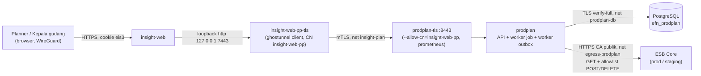

# ADR-051: Production planning Central Kitchen di atas ESB (service `prodplan`, baca + tulis terbatas ke ESB)

- **Status:** Proposed — belum disetujui klien. G66 boleh dibangun mengikuti rekomendasi ini dengan
  `PRODPLAN_ENABLED=false` dan `PRODPLAN_WRITE_ENABLED=false` default. **Tulis ke ESB production terkunci di kode**
  (bukan env). **Amandemen A1 (25 Nov 2026, §8):** Q-PP2 **disetujui pemilik proyek** (penyimpangan §3.4 diterima);
  Q-PP1 **diganti** keputusan pemilik proyek "login per pengguna ke ESB" (disetujui); syarat membuka kunci tulis production
  kini = akun ESB **perorangan non-admin** per planner/kepala gudang + PR terpisah (§8.6). Rincian teknis A1 tetap Proposed.
- **Tanggal:** 2026-11-24 (Gelombang 66) · revisi 2026-11-24 (hasil uji tulis staging ESB, §1.3 butir 5–7, §3.4) ·
  amandemen A1 2026-11-25 (identitas per pengguna ESB, §8)
- **Pemutus:** pemilik proyek (lingkup, penyimpangan draft §3.4), IT klien (akun API non-admin, staging ESB), kepala
  gudang + planner CK PB (proses persetujuan), Finance (dampak stok/HPP dokumen produksi), Security (allowlist tulis)
- **Referensi review:** R-S17 (akun admin ESB), R-O09 (perubahan API ESB), R-O10 (beban ESB), R-S18 (kunci Insight),
  R-T06 (angka dipakai keputusan); usulan baru **R-S23**, **R-O15**, **R-T23** (§5); Q-PP1..Q-PP12 (`docs/04` §30.14)
- **Terkait:** ADR-040 (esb-extract GET-only — **tidak dilonggarkan**, catatan amandemen di sana), ADR-041 (insight-web
  read-only — **diamandemen terbatas**, §3.5 di sana), ADR-022 (TLS CA internal), ADR-024 (kredensial per service),
  ADR-031 (tanpa modul pihak ketiga), ADR-018 / K25-12 (produksi CK, usulan disetujui planner), K25-08 (waste),
  `docs/04` §30

> **Ringkasan manajemen.** Planner Central Kitchen Paris Baguette mendapat halaman **Production Order** di Insight:
> pesanan outlet digabung, kebutuhan bahan dihitung dari resep (BOM), bahan kemasan utuh (mis. susu segar) dibulatkan
> ke kemasan dengan usulan batch tambahan agar sisa tidak terbuang, dan aplikasi mengusulkan transfer stok antar lokasi
> yang **disetujui kepala gudang**. Setelah disetujui, aplikasi membuat dokumen transfer dan produksi di ESB. Karena ESB
> langsung mengesahkan dokumen produksi (tidak ada draft), persetujuan dua orang dipindah ke aplikasi. Tahap 1 (baca +
> rencana) ±3–4 minggu-engineer; tahap 2 (tulis, uji di staging ESB) ±1,5–2 minggu-engineer; Rp0 lisensi. Tulis ke ESB
> production mati sampai klien memberi akun API non-admin dan menyetujui ADR ini.

## 1. Konteks

### 1.1 Kebutuhan (pemilik proyek 24 Nov 2026, sudah diputuskan)
Dashboard Production Order untuk CK PB (prototipe): kebutuhan bahan dari gabungan pesanan (ledakan BOM); repack besar→kecil
= produksi Assembly dengan BOM repack; bahan kemasan utuh dibulatkan ke atas + usulan batch tambahan (pesanan selalu
dipenuhi, usulan hanya berlaku bila disetujui planner); usulan transfer dari lokasi/cabang lain dengan persetujuan kepala
gudang; jembatan sampai cutover Odoo, model mudah dipetakan ke `mrp.production`/`mrp.bom`/`stock.picking`; POST ke ESB
disetujui dengan syarat ADR baru, service terpisah dari `esb-extract`, akun non-admin, dokumen disetujui manusia di ESB;
yang ditulis hanya transfer + produksi; pesanan outlet tetap diinput di ESB. Tahap 1 baca + rencana, tahap 2 tulis (uji di
staging ESB). Pengguna planner CK + kepala gudang, UI modul baru di Insight (login Odoo), stok disegarkan sebelum tiap
perencanaan.

### 1.2 Pertentangan dengan dokumen/prinsip yang berlaku
| Sumber | Bunyi | Pertentangan |
|---|---|---|
| ADR-040 §3.1 butir 3 | "**GET-only**: klien HTTP menolak method selain `GET`, kecuali `POST /auth/login`" | Kebutuhan baru = POST transfer + produksi ke ESB. |
| ADR-041 §3 butir 1 | "`insight-web` … **read-only** (tidak pernah menulis ke Odoo/ClickHouse/PostgreSQL)" | Halaman Production Order menyimpan rencana dan persetujuan. |
| `CLAUDE.md` prinsip | "Async by default (RabbitMQ) untuk OCR, notifikasi, MGM settle, webhook" | Tulis ke ESB harus async; broker menambah jalur jaringan dari service yang memproses JSON internet. |
| `CLAUDE.md` / ADR-040 §3.2 | "PostgreSQL = source of truth; ClickHouse hanya turunan" | Rencana produksi = data transaksi EFN baru (bukan turunan ESB) → wajib di PostgreSQL, bukan mart ESB. |
| Syarat pemilik proyek | "dokumen dibuat sebagai draft (belum di-authorize) dan disetujui manusia di ESB" | Uji staging: produksi (`assembly-actual`) langsung Authorized; goods-transfer-request langsung Authorized (§1.3). |

### 1.3 Fakta API ESB (uji GET prod PB + uji tulis staging, 24 Nov 2026; spec `developers.esb.co.id/esb-core/openapi.json`)
1. BOM `GET /product/bom`, `GET /product/bom/detail/{bomID}?branchID=&locationID=` (qty per 1 satuan hasil, `yieldPercent`,
   `stockQty` di lokasi). Multi-level FIN→WIP→RMT lewat `bomID` produk. Hasil per batch tidak ada di BOM.
2. Master produk tanpa umur simpan/ukuran kemasan → master "kemasan utuh" disimpan di prodplan, diisi planner.
3. Pesanan: `GET /purchase/purchase-request` + detail. **Belum terbukti** semua pesanan outlet FIN lewat PR → rencana
   menerima baris impor PR **dan** input manual.
4. CK PB cabang 4 memakai `simple-manufacturing` Assembly (lokasi asal = tujuan `CK - Kitchen` id 7); CKWH cabang 38
   memakai production-order/material-delivery/production-result → **v1 hanya dibaca**.
5. `POST /simple-transfer` → `result.simpleTransferNum`; lahir **statusID 1 (belum authorize)**; list mendukung filter
   `additionalInfo`; `DELETE` OK.
6. `POST /inventory/goods-transfer-request` → `result.transferNum`; lahir **statusID 3 Authorized**, tetapi stok baru bergerak
   saat staf membuat goods delivery (gerbang manusia tetap di ESB). `transferDetailAssets` harus dihilangkan untuk
   `categoryTypeID` 1. List mendukung `additionalInfo`; `DELETE` diblokir bila sudah ada goods delivery.
7. Produksi staging (mode **Actual Costing**): `POST /production/simple-manufacturing/assembly` → 400; yang berlaku
   `POST …/assembly-actual` dengan material eksplisit. Hasil `result.simpleManufacturingNum` (`"SM202611240001 - 1"`, ada
   spasi) lahir **statusID 3 Authorized** oleh user API → **stok langsung bergerak, tanpa draft**. List tanpa filter
   `additionalInfo`. `DELETE` OK selama stok hasil belum dipakai. Mode costing PB production **belum diketahui** (Q-PP3).
8. Akun production = admin per brand (R-S17); staging = akun terpisah, company PB uji.

## 2. Opsi yang dipertimbangkan

### 2.1 Tempat logika + tulis ke ESB
| # | Opsi | Kelebihan | Kekurangan | Biaya / waktu (perkiraan architect) |
|---|---|---|---|---|
| **A** | **Service baru `services/prodplan`** (Python 3.12, pola esb-extract): GET ESB saat perencanaan, rencana di **PostgreSQL** (DB + role sendiri), POST ke ESB lewat **allowlist persis**, API HTTPS internal untuk insight-web | Satu pemilik kredensial tulis; esb-extract tetap GET-only; transaksi + audit di PG; tidak ada jalur dari internet | Service + image + DB + 2 sidecar + secret baru | Tahap 1 **±3–4 minggu-engineer** (Python 2–2,5, frontend 1–1,5, devsecops 0,5–1); tahap 2 **±1,5–2**; RAM ±256 MB + 2×64 MB sidecar |
| B | Tambah POST ke `esb-extract` | Tanpa service baru (hemat ±1 minggu) | Melonggarkan GET-only ADR-040; service berkredensial ClickHouse writer + internet jadi bisa menulis ERP klien; batch job ≠ transaksi interaktif | **Ditolak** |
| C | Logika di `api-gateway` (BFF) | Stack NestJS sudah ada | BFF menghadap internet; kredensial tulis ERP klien tidak boleh di komponen publik (R-S03) | **Ditolak** |
| D | Modul Odoo `efn_prodplan` sekarang | Langsung model MRP | Odoo tanpa egress (prinsip); harus memanggil ESB dari ERP; dipakai **setelah** cutover (§4.3) | **Ditolak untuk G66**, jalur akhir pasca-cutover |
| E | Simpan rencana di ClickHouse / tulis lewat mart | Tanpa PG baru | ClickHouse bukan sumber transaksi (ADR-003); tanpa transaksi/constraint; melanggar "tanpa tulis API → ClickHouse" | **Ditolak** |

### 2.2 Async tulis ke ESB
| # | Opsi | Kelebihan | Kekurangan | Biaya |
|---|---|---|---|---|
| **1** | **Outbox PostgreSQL + worker polling di dalam prodplan** | Atomik dengan perubahan status rencana (satu transaksi); tanpa jalur jaringan ke broker; DLQ = status `failed` yang terlihat di UI | Polling (10 dtk) | Termasuk tahap 2 |
| 2 | RabbitMQ (`prodplan.post_requested` + DLQ) | Seragam dengan prinsip async | Dual-write (PG + broker) butuh outbox juga; prodplan (memproses JSON internet) mendapat jalur ke broker bersama | +±3 hari + kredensial broker |

Prinsip "async by default" dipenuhi opsi 1: POST ke ESB tidak pernah terjadi di request HTTP pengguna, consumer
idempoten (marker), dan kegagalan terparkir (`failed`). RabbitMQ **tidak wajib** di G66; ditinjau ulang bila konsumen
kedua muncul.

### 2.3 Autentikasi insight-web → prodplan + identitas pengguna
| # | Opsi | Kelebihan | Kekurangan | Keputusan |
|---|---|---|---|---|
| **i** | **mTLS (ghostunnel client sidecar di namespace insight-web → `prodplan-tls`) + asersi aktor HMAC per request `ppa1`** (kunci `prodplan_assert_key`, umur 60 dtk, `jti`, terikat method+path+hash body) | Kunci TLS tidak di proses Node; browser tidak bisa memalsukan aktor (tanpa jalur + tanpa kunci); replay dibatasi | Dua sidecar + satu kunci baru | **Dipilih** |
| ii | Teruskan cookie `eis3` ke prodplan | Tanpa format baru | prodplan harus memegang `insight_session_key` → bisa memalsukan sesi Insight (memperluas R-S18) | Ditolak |
| iii | Token bearer statis insight-web | Sederhana | Tanpa identitas pengguna; bocor = permanen | Ditolak |
| iv | prodplan memvalidasi ke Odoo | Identitas langsung | Jalur baru ke ERP | Ditolak |

Peran: dua peran baru `pp_planner` dan `pp_warehouse` di klaim `roles` token `eit3`/sesi `eis3` (revisi, bukan format
baru), diturunkan dari grup Odoo baru di `efn_insight`. Peran ini **bukan persona** sehingga tanda tangan ClickHouse
(`SQL_efn_personas = roles ∩ PERSONAS`) tidak berubah.

## 3. Keputusan (direkomendasikan)

### 3.1 Opsi A + 1 + i
1. **`services/prodplan`** = satu-satunya pemilik (a) GET ESB saat perencanaan, (b) DB `efn_prodplan` (role login
   `efn_prodplan`, pemilik skema NOLOGIN `efn_prodplan_owner`), (c) POST/DELETE ESB lewat allowlist persis, (d) API
   HTTPS internal. Overlay `infra/compose/docker-compose.prodplan.yml`. Klien HTTP ESB = salinan **dikeraskan** dari
   `efn_esb` (host tetap, https, tanpa redirect lintas host, tanpa proxy env, batas ukuran respons) dengan allowlist tulis
   sendiri; `esb-extract` tidak berubah.
2. **Allowlist tulis** (method + template path, selain itu ditolak sebelum socket dibuka): `POST /simple-transfer`,
   `POST /inventory/goods-transfer-request`, `POST /production/simple-manufacturing/assembly-actual` **atau**
   `…/assembly` (dipilih `PRODPLAN_ESB_MFG_MODE`), `DELETE /simple-transfer/{num}`,
   `DELETE /inventory/goods-transfer-request/{num}`, `DELETE /production/simple-manufacturing/{num}`. Endpoint
   `…/authorize` **tidak pernah** dipanggil.
3. **Base URL** hanya dari allowlist dua host: `https://services.esb.co.id/core` (production) dan
   `https://stg7.esb.co.id/core-stg` (staging). `PRODPLAN_WRITE_ENABLED=true` + base production → **proses menolak start**
   selama konstanta kode `PROD_WRITE_UNLOCKED = False` (diubah hanya lewat PR setelah ADR Accepted + Q-PP1). Username dari
   env non-repo (SEC-180), password dari `/run/secrets/*`.
4. **Insight**: halaman `/produksi/*` memanggil prodplan dari sisi server (server action / route handler + origin guard).
   Grup Odoo `efn_insight.group_prodplan_planner` dan `efn_insight.group_prodplan_warehouse` (implies pengguna Insight).
   **SoD per dokumen ditegakkan di prodplan**: penyetuju rencana/transfer ≠ pembuat ≠ pengaju.
5. **Idempotensi tulis**: outbox PG satu baris per dokumen ESB, marker `pp:<12 hex>` di `additionalInfo`/`notes`,
   rekonsiliasi lewat GET sebelum kirim ulang; **tidak ada kirim ulang otomatis** POST setelah timeout — status `unknown`
   → rekonsiliasi → bila tidak ditemukan, planner menekan "Kirim ulang".
6. Flag `PRODPLAN_ENABLED=false`, `PRODPLAN_WRITE_ENABLED=false`, `INSIGHT_PRODPLAN_ENABLED=false` default.

### 3.2 Alur rencana
`draft → submitted → approved → posted` (+ `cancelled`). Planner membuat & menghitung (stok ESB disegarkan di job
`calculate`), mengajukan; kepala gudang memutuskan tiap usulan transfer lalu menyetujui rencana; planner atau kepala gudang
menekan **Posting** (ringkasan dampak stok wajib dikonfirmasi) → outbox: transfer dulu, lalu produksi per level BOM
(WIP sebelum FIN). Aturan hitung deterministik di `docs/04` §30.5.

### 3.3 Kenapa tidak melanggar ADR-040/041
- `esb-extract` tetap GET-only (kode + test tidak berubah). Pengecualian tulis hanya untuk `prodplan`, hanya endpoint §3.1
  butir 2, hanya dari rencana `approved`.
- insight-web tetap tanpa akses DB/ESB; ia hanya meneruskan aksi pengguna ke API prodplan dengan identitas dari sesi
  terverifikasi (amandemen terbatas ADR-041 §3.7).

### 3.4 Penyimpangan dari syarat "draft di ESB" (Q-PP2 — **diterima pemilik proyek 25 Nov 2026**, §8.1)
Uji staging membuktikan dokumen produksi tidak bisa dibuat sebagai draft (langsung Authorized, stok bergerak) dan
goods-transfer-request lahir Authorized (stok bergerak saat goods delivery). Keputusan lead:
- Gerbang persetujuan manusia untuk **produksi** dipindah ke aplikasi: posting hanya dari rencana `approved`, penyetuju ≠
  pembuat (dua orang), tombol posting eksplisit per rencana dengan ringkasan dampak stok (bahan keluar per lokasi, hasil
  masuk), dicatat di `audit_event`.
- **Simple-transfer** tetap draft di ESB (authorize manusia di ESB). **Goods-transfer-request**: gerbang manusia = goods
  delivery di ESB.
- Pembatalan setelah posting = `DELETE` dokumen ESB lewat outbox (urutan terbalik); gagal (stok hasil sudah dipakai /
  goods delivery ada) → `delete_failed`, ditangani manual di ESB.
- Tulis ke ESB production tetap OFF (§3.1 butir 3).

| Alternatif | Alasan ditolak |
|---|---|
| Tidak menulis produksi (hanya transfer) | Planner tetap mengetik ±328 dokumen/minggu; tujuan menekan salah input hilang |
| Menunggu ESB menyediakan draft produksi | Di luar kendali EFN; tidak ada tanggal |
| Ekspor berkas impor ESB untuk produksi | Endpoint `…/import` belum diuji; tetap tanpa draft (belum terverifikasi) |

## 4. Konsekuensi

### 4.1 Positif
- Kebutuhan bahan dan sisa kemasan terbuka terlihat sebelum produksi (K25-08 waste); transfer terencana dan disetujui.
- Model data (rencana, baris produksi, kebutuhan, transfer) dipetakan langsung ke Odoo MRP saat cutover (§4.3).
- Gagal prodplan/ESB tidak memengaruhi POS, BFF, ETL, Odoo, atau dashboard lain.

### 4.2 Negatif / utang teknis yang diterima
- Dokumen produksi langsung mengubah stok ESB → kesalahan rencana berdampak nyata (R-O15); mitigasi SoD + ringkasan +
  DELETE.
- v1 tanpa netting stok WIP, tanpa FEFO (ESB tanpa lot kedaluwarsa), tanpa pengurangan `pendingQty` transfer berjalan,
  yield tidak diterapkan secara default (Q-PP5) → angka kebutuhan konservatif (R-T23).
- Akun admin ESB dipakai untuk GET tahap 1 di production sampai Q-PP1 (R-S17, R-S23).
- PostgreSQL ikut network kedua `prodplan-db`: aturan `samenet` di `pg_hba.conf` meluas ke subnet itu untuk semua baris
  role (dilindungi SCRAM + password per role; hanya `prodplan` di network itu). Diterima; ditinjau saat K25-02 memisah mesin.
- Sesi Insight 2 jam → pencabutan grup prodplan berlaku paling lambat 2 jam.
- Replika tunggal prodplan (cache `jti` di memori, worker tunggal); multi-replika butuh lock outbox (`FOR UPDATE SKIP
  LOCKED` sudah disiapkan) + cache `jti` bersama.

### 4.3 Pemetaan ke Odoo CE 19 setelah cutover (ringkas; rinci kolom di `docs/04` §30.13)
| prodplan | Odoo CE 19 |
|---|---|
| `plan` (brand, cabang, tanggal) | sekelompok `mrp.production` (origin = `plan_no`), `company_id` dari `company_code` |
| `plan_production_line` | `mrp.production` (product_id, bom_id, product_qty) |
| BOM ESB / `pack_rule` | `mrp.bom` + `mrp.bom.line`; `pack_rule` → `product.packaging` (qty) + atribut umur setelah dibuka (field `efn_*`, gap) |
| `plan_requirement` | `stock.move` bahan (raw) per produksi |
| `plan_transfer` | `stock.picking` internal (cabang sama) / inter-warehouse (antar cabang) |
| persetujuan transfer | belum ada padanan CE (approval = modul Enterprise) → gap `efn_*` saat cutover (fit-gap `efn-odoo-functional`) |

### 4.4 Dampak ke dokumen lain
`docs/04` §30 (kontrak, dibuat bersama ADR ini); catatan amandemen ADR-040 dan ADR-041; indeks `docs/decisions/README.md`;
`docs/01` usulan R-S23/R-O15/R-T23 dan Q-PP (tugas efn-lead); `docs/compliance/PDP_DATA_INVENTORY.md` entri "Production
planning" (nama staf + uid Odoo di audit, retensi §30.10) — belum dibuat; `CLAUDE.md` catatan pengecualian tulis ESB
(efn-lead).

## 5. Risiko terkait
| ID | Ringkas | Mitigasi |
|---|---|---|
| **R-S23** (usulan) | Kredensial/akun tulis ESB disalahgunakan atau menulis ke environment salah (production saat uji) | Allowlist host + method/path di kode + test; `PROD_WRITE_UNLOCKED=False`; banner environment di UI; akun non-admin (Q-PP1); secret terpisah dari esb-extract; egress subnet sendiri |
| **R-O15** (usulan) | Dokumen produksi langsung Authorized di ESB → stok/HPP salah bila rencana keliru | SoD dua orang, ringkasan dampak, posting eksplisit, DELETE terjadwal, uji staging dulu, `PRODPLAN_POST_MAX_DOCS` |
| **R-T23** (usulan) | Rencana dihitung dari stok/BOM basi atau tidak lengkap (tanpa netting WIP, FEFO, pending transfer) | Stok disegarkan di setiap hitung + umur maksimum saat submit/posting; peringatan per baris; keterbatasan tampil di UI |
| R-S17 | Akun admin ESB | Q-PP1; GET tahap 1 di production saja; tulis production terkunci |
| R-O09 / R-O10 | Perubahan API / beban ESB | Parser toleran, test kontrak, token bucket 2 req/dtk, batas panggilan per job |
| R-S18 | Kunci Insight bocor | `prodplan_assert_key` terpisah; prodplan tidak memegang kunci sesi/SSO |

## 6. Pertanyaan terbuka (dijawab klien)
Rinci di `docs/04` §30.14: **Q-PP1** akun API non-admin (hak: baca + transfer + produksi, tanpa authorize) · **Q-PP2**
konfirmasi penyimpangan §3.4 · **Q-PP3** mode costing produksi PB production · **Q-PP4** apakah pesanan outlet FIN selalu
lewat PR · **Q-PP5** arti `yieldPercent` · **Q-PP6** daftar lokasi/cabang sumber transfer · dan seterusnya.

## 7. Kapan ditinjau ulang
- Q-PP1/Q-PP2/Q-PP3 dijawab (mengubah status tulis production).
- ESB menyediakan draft produksi atau mengubah API (R-O09).
- CKWH cabang 38 (production-order) perlu ditulis, atau brand kedua.
- Cutover Odoo PB (G43): prodplan dihentikan untuk PB, rencana terbuka dimigrasi/ditutup, logika pindah ke Odoo MRP.
- Paling lambat **31 Mar 2027**.

---

## 8. Amandemen A1 — identitas per pengguna ESB (25 Nov 2026)

> **Ringkasan manajemen.** Planner dan kepala gudang PB masuk ke modul Produksi dengan **akun ESB masing-masing**
> (bukan akun Odoo, bukan satu akun bersama). Data yang tampil dan dokumen yang dibuat di ESB memakai hak akun itu sendiri,
> sehingga jejak di ESB menunjukkan siapa pembuatnya. Password ESB **tidak pernah disimpan**; aplikasi hanya meneruskannya
> sekali ke ESB lalu memegang token sesi ESB (maks. 1 jam) di memori server. Pengguna yang berhasil masuk dicatat sebagai
> user Odoo nonaktif (tanpa password) agar siap saat migrasi ESB → Odoo. Biaya tambahan ±3 minggu-engineer, Rp0 lisensi.
> Tulis ke ESB production tetap terkunci sampai ada akun ESB perorangan non-admin dan PR terpisah.

Kontrak rinci: `docs/04` §30.17 (menang atas §30.3–§30.12 dan §30.16 bila berbeda).

### 8.1 Keputusan pemilik proyek 25 Nov 2026 (dicatat apa adanya)
| # | Keputusan | Status |
|---|---|---|
| 1 | **Q-PP2 diterima**: dokumen produksi via API langsung Authorized di ESB; gerbang persetujuan = SoD dua orang di aplikasi (§3.4) | **Disetujui** |
| 2 | **Q-PP1 diganti**: pemilik proyek hanya punya akun API admin → **login per pengguna ke ESB**. Modul Produksi punya halaman login yang meneruskan username+password ke `POST /auth/login` ESB; data tersaring izin pengguna di ESB; semua baca/tulis ESB memakai token pengguna itu, bukan akun service bersama | **Disetujui** (prinsip); rincian teknis Proposed |
| 3 | **Login ESB yang berhasil diduplikasi ke Odoo** (`res.users` just-in-time) agar pengguna & perannya sudah ada saat migrasi dan login bisa dialihkan ke Odoo | **Disetujui** (prinsip); rincian (§8.5) Proposed + menunggu fit-gap `efn-odoo-functional` |
| 4 | Sementara memakai akun yang ada (admin) untuk PB; **staging dulu** | **Disetujui** |
| 5 | Setiap POST/DELETE dari akun admin ke ESB production **ditahan** → `PROD_WRITE_UNLOCKED` tetap `False`; syarat membuka = akun ESB perorangan non-admin per planner/kepala gudang + PR terpisah | **Disetujui** |
| 6 | **Q-PP6**: lokasi/cabang sumber transfer mengikuti izin cabang pengguna di ESB (`GET /branch/list/user`), tanpa daftar terpisah di aplikasi | **Disetujui** |

### 8.2 Konteks: yang bertentangan dengan keputusan ini
| Sumber | Bunyi | Pertentangan |
|---|---|---|
| §2.3 / §3.1 butir 4 | "Grup Odoo `efn_insight.group_prodplan_planner` … peran di klaim `roles` token `eit3`/sesi `eis3`" | Pengguna PB adalah pengguna ESB, belum punya akun Odoo; peran kini dari izin ESB |
| §3.1 butir 3 | "Username dari env non-repo (SEC-180), password dari `/run/secrets/*`" | Tidak ada lagi akun service; kredensial = milik pengguna, dipegang sesaat |
| `docs/04` §30.3 | `PRODPLAN_SOURCE_LOCATIONS` (allowlist lokasi sumber) | Q-PP6: sumber = cabang yang diizinkan ESB untuk pengguna |
| `docs/04` §30.7 | Asersi `ppa1` membawa `sub` = uid Odoo, `roles` dari sesi Insight | Identitas = pengguna ESB + id sesi yang dipegang prodplan |
| `docs/04` §30.1 | "`prodplan` … tidak menjangkau … Odoo" | Provisioning JIT butuh satu jalur sempit prodplan → `odoo-rpc-gateway` (§8.5) |
| Prinsip "password tidak disimpan" (ADR-050: login-gateway "tidak memegang password") | – | prodplan + insight-web kini **melihat** password ESB sesaat (credential relay) |

### 8.3 Opsi yang dipertimbangkan
| # | Opsi | Kelebihan | Kekurangan | Biaya / waktu (perkiraan architect) | Keputusan |
|---|---|---|---|---|---|
| S | Akun service bersama (status G66) | Sudah dibangun; tanpa sesi | Hanya akun admin tersedia; tidak ada penyaringan per pengguna; jejak ESB satu akun; password admin di disk host | Rp0 tambahan | **Ditolak pemilik proyek** |
| D | Login ganda: SSO Odoo (identitas) + login ESB (data) | Identitas tetap Odoo | Pengguna PB tidak punya akun Odoo → admin harus membuat dulu; dua kali login; dua sumber peran yang bisa tidak cocok | +±1 minggu di atas U (pemetaan dua identitas) | **Ditolak** |
| **U** | **Login ESB per pengguna; token di memori prodplan; browser hanya cookie buram; JIT user Odoo nonaktif** | Satu login; hak = hak ESB; tanpa password tersimpan; token tidak pernah ke browser | Aplikasi melihat password sesaat; sesi maks 1 jam (tanpa refresh, Q-PP15); restart prodplan = semua login ulang | ±3 minggu-engineer (prodplan 1–1,5; insight-web 0,5–1; Odoo + fit-gap 0,5–1; devsecops 0,5; QA/security 0,5) | **Dipilih** |
| U-pg | Seperti U, token di tabel PG terenkripsi | Bertahan saat restart | Butuh dependency kripto baru (stdlib tanpa AES) atau `pgcrypto` (kunci lewat SQL/log); manfaat < 1 jam karena TTL token 3600 dtk | +±3 hari + kunci baru | Ditolak (ditinjau bila Q-PP15 menemukan refresh token) |
| U-cookie | Token ESB terenkripsi di cookie browser | Stateless | Token ESB keluar dari server; ESB terjangkau dari internet → bocor = akses langsung ke ERP klien | – | **Ditolak** |
| P | Simpan password (terenkripsi) untuk login ulang otomatis | Tanpa putus sesi | Melanggar keputusan "password tidak pernah disimpan"; target bernilai tinggi | – | **Ditolak** |
| O | SSO sungguhan ESB → Odoo (OIDC/SAML) | Tanpa relay password; login terpusat | ESB sebagai provider OIDC/SAML tidak ditemukan di spec (**belum terverifikasi**); `auth_oauth` CE membuat user aktif saat signin | Tidak diestimasi | **Ditunda — di luar lingkup (keputusan pemilik proyek 25 Nov 2026)** |
| L | Login Odoo yang memeriksa password ke ESB (Odoo memanggil `POST /auth/login`) | Satu password, pengguna langsung di Odoo | Odoo butuh egress ke internet (melanggar prinsip); Odoo menjadi perantara kredensial; tetap tanpa refresh | Tidak diestimasi | **Ditunda — di luar lingkup (keputusan pemilik proyek 25 Nov 2026)** |

### 8.4 Keputusan teknis (rinci di `docs/04` §30.17)
1. **Login**: halaman `insight-web` `/produksi/masuk` → `POST /api/prodplan/login` → prodplan `POST /v1/session` → ESB
   `POST /auth/login`, lalu `GET /user/access` + `GET /branch/list/user`. Password hanya ada di memori request dua proses
   itu; tidak pernah ditulis ke log, PG, Odoo, cookie, atau respons.
2. **Token ESB hanya di memori proses prodplan** (dict per sesi, TTL = `exp` token, maks 1 jam). Browser memegang cookie
   buram `__Host-epp` (32 byte acak); prodplan menyimpan hanya SHA-256-nya. Restart prodplan = semua sesi hilang, pengguna
   login ulang; outbox yang belum selesai berhenti aman di status `needs_login` (tanpa POST ganda).
3. **Sesi Insight terpisah**: cookie `__Host-epp` hanya membuka `/produksi*` dan `/api/prodplan/*`; halaman Insight lain
   tetap mensyaratkan `__Host-eis` (SSO Odoo) dan tidak membaca `__Host-epp`. Peran PP di `eis3` tidak lagi dipakai untuk
   akses `/produksi` (grup Odoo PP tetap ada sebagai tujuan pemetaan saat migrasi).
4. **Peran dari izin ESB**: `pp_planner` / `pp_warehouse` dihitung dari `GET /user/access` dengan aturan env non-rahasia
   (default berbasis kode akses B.4/K.5/D.16/C.1 dan D.9/D.4/D.16); cabang dari `GET /branch/list/user` membatasi rencana
   yang terlihat, sumber transfer (Q-PP6), persetujuan, dan posting.
5. **Asersi `ppa2`** menggantikan `ppa1`: tidak lagi membawa identitas; membawa id sesi (`sid`). prodplan = otoritas
   identitas. SoD = dua **akun ESB** berbeda (identitas internal `prodplan.actor`).
6. **Outbox/worker/job memakai token orang yang memicu** (atau yang menekan "Lanjutkan posting"); token habis → status
   `needs_login`, tidak pernah POST tanpa token, tidak pernah POST ulang tanpa rekonsiliasi marker.
7. **Akun service ESB dihapus** untuk semua keperluan (baca maupun tulis); env `PRODPLAN_ESB_USER_*` dan secret
   `esb_prodplan_password_*` dihapus dari repo/compose; file di host dihancurkan operator.
8. **Provisioning JIT ke Odoo** (§8.5) di belakang `PRODPLAN_ODOO_PROVISION_ENABLED=false`, di thread latar, tidak pernah
   menggagalkan atau memperlambat login ESB.

### 8.5 Jalur migrasi ke Odoo (provisioning JIT; selaras fit-gap `efn-odoo-functional` 25 Nov 2026, "G66b")
- Setelah login ESB sukses (dan hanya bila `PRODPLAN_ODOO_PROVISION_ENABLED=true`), prodplan memasukkan payload ke antrean
  **memori** berbatas dan thread latar memanggil `POST /json/2/efn.esb.identity/efn_esb_provision` lewat `odoo-rpc-gateway`
  (filter L7 yang sudah ada, pola `forecast-worker` §28.2: mTLS verify-full CA internal dengan CN khusus + bearer API key
  user teknis `efn_esb_provisioner` + satu path persis) melalui network overlay baru `prodplan-rpc`. Non-blocking,
  idempoten; gagal = log + metrik, diulang otomatis pada login berikutnya (tanpa tabel antrean di PG, tanpa RabbitMQ).
  Odoo tetap tidak terjangkau dari internet; prodplan tidak menyentuh Odoo selain satu method itu.
- Modul baru **`efn_esb_identity`**, model `efn.esb.identity` (unik `esb_account` + `esb_username`; `state`
  `shadow|revoked|activated`). Shadow user = `res.users` **internal yang diarsipkan (`active=False`) sejak dibuat**, grup
  hanya `base.group_user`, tanpa password/email, login `esb:<akun>:<username>` (mis. `esb:pb:<username>`). Arsip menutup
  login password, API key, reset, dan OAuth sekaligus (diverifikasi fit-gap dari source CE 19).
- **Peran PP tidak diberikan sebagai `res.groups`** (SEC-228: grup sensitif wajib manual); izin ESB hanya dicerminkan
  sebagai data `esb_pp_roles` dan ditimpa setiap login. `efn_insight_esb_branch_ids` **tidak** diisi. Tidak ada penautan
  otomatis ke user Odoo yang sudah ada; user tidak pernah dihapus.
- **Konsekuensi untuk sesi:** karena shadow user arsip dan tanpa grup PP, sesi modul Produksi **tidak bergantung pada Odoo**
  sama sekali; peran sesi berasal dari izin ESB (§8.4 butir 4). Odoo mati = provisioning tertunda, login tetap jalan.
- **Saat cutover PB (G43):** Superadmin meninjau identitas → ganti login ke format final, isi email kerja, unarchive,
  tetapkan peran lewat `efn_role` (manual, berdasarkan cermin), reset password standar `auth_signup` (butuh SMTP) + TOTP →
  `/produksi` beralih ke SSO Odoo (`eis3` + grup PP, mekanisme G66) atau prodplan dipensiunkan untuk PB (§4.3).
- Pertanyaan pemilik proyek terkait: **Q-ESBU1..Q-ESBU6** (`docs/agent-reports/efn-odoo-functional.md` "G66b" §5).

### 8.6 Gerbang tulis ESB production (keputusan #5)
`PROD_WRITE_UNLOCKED = False` tetap. Membukanya hanya lewat **PR terpisah** dengan review security, setelah: (a) ADR-051
`Accepted`; (b) setiap planner dan kepala gudang PB punya akun ESB production **perorangan non-admin** dengan hak sesuai
Q-PP17 (tanpa authorize); (c) PR itu sekaligus menambah penolakan runtime tulis production dari sesi yang `userRoleID`-nya
termasuk `PRODPLAN_ESB_ADMIN_ROLE_IDS` (wajib tidak kosong saat production + tulis aktif, selain itu exit 2). Baca (GET)
production dengan akun admin boleh (keputusan #4) setelah staging lulus.

### 8.7 Konsekuensi
**Positif:** satu login bagi pengguna PB; hak dan jejak dokumen di ESB per orang; tidak ada password admin di disk host
prodplan; Q-PP6 selesai tanpa master data baru; daftar pengguna + peran siap untuk migrasi Odoo.

**Negatif / diterima:**
- Aplikasi menjadi **perantara kredensial** (R-S24): password ESB melewati browser → Traefik → insight-web → prodplan → ESB.
  Semua hop TLS; tidak dicatat; batas laju + lockout; halaman hanya lewat WireGuard (sama dengan Insight).
- **Token pengguna di memori server** (R-S25) selama ≤ 1 jam; dump memori/crash dump prodplan = token aktif. Mitigasi:
  container non-root `read_only`, tanpa core dump, token tidak pernah ke log/PG/browser, logout memanggil `POST /auth/logout`.
- **Sesi maks. 1 jam tanpa refresh** (R-O16, Q-PP15): posting panjang bisa terhenti → `needs_login` + tombol "Lanjutkan".
- **Penyaringan per pengguna di ESB belum terbukti** (R-T24, Q-PP16): hanya akun admin yang diuji. Aplikasi menegakkan
  sendiri pembatasan cabang dari `/branch/list/user`; tidak boleh diklaim "data tersaring ESB" sampai diuji dengan akun
  non-admin.
- **SoD butuh dua akun ESB.** Dengan satu akun admin di staging, alur approve tidak bisa diuji sampai ada akun staging kedua
  (Q-PP17).
- prodplan mendapat jalur sempit ke Odoo (overlay `prodplan-rpc`, satu path) → PKI leaf client baru (intermediate
  staging/prod diterbitkan ulang) + API key user teknis baru.
- Kolom aktor `*_sub` di skema prodplan berubah arti: id `prodplan.actor` (bukan uid Odoo). Rencana staging lama dibatalkan
  saat migrasi skema.

### 8.8 Risiko baru (usulan, nomor lanjut `docs/01` §5.15)
| ID | Ringkas | Mitigasi |
|---|---|---|
| **R-S24** | Credential relay: password ESB pengguna terlihat oleh insight-web & prodplan; penyerang di jalur/aplikasi bisa memanennya | TLS di semua hop (WireGuard + Traefik + mTLS); password tidak pernah disimpan/dicatat (test grep log); body login ber-nonce agar `bh` tidak menjadi hash password; batas laju per IP + lockout per username; review security wajib untuk kode jalur login |
| **R-S25** | Token ESB pengguna (akses langsung ke ERP klien yang terjangkau internet) bocor dari memori/log prodplan | Hanya di memori, TTL ≤ 1 jam, tidak ke browser/PG/log; cookie buram dengan hash di server; logout = `POST /auth/logout`; batas sesi per pengguna & total; kontainer dikeraskan |
| **R-S26** | Provisioning JIT membuat akun Odoo yang kemudian disalahgunakan (eskalasi hak dari ESB ke ERP) | User dibuat **diarsipkan tanpa password/email**, hanya `base.group_user`, tanpa grup PP; aktivasi hanya manual oleh Superadmin saat migrasi; tanpa penautan otomatis ke user yang ada; bot `efn_esb_provisioner` (bukan superuser/ERP manager) hanya satu method lewat L7 gateway; payload tertutup; flag default `false` |
| **R-O16** | Token ESB 1 jam tanpa refresh → posting/job terhenti di tengah | Cek sisa umur token ≥ 120 dtk sebelum tiap tulis; `needs_login` tanpa POST ganda; tombol "Lanjutkan posting"; alert `EfnProdplanNeedsLogin`; Q-PP15 |
| **R-T24** | Asumsi "data tersaring izin ESB" salah (ESB tidak menyaring transaksi/stok per pengguna, atau cache aplikasi mencampur data antar-pengguna) | Pembatasan cabang ditegakkan aplikasi; cache per aktor; uji dengan akun non-admin sebelum production (Q-PP16); UI tidak mengklaim penyaringan ESB |

Risiko lama yang berubah: **R-S17** (akun admin) — tulis production dari akun admin dilarang (keputusan #5); **R-S23** —
tidak ada lagi secret password ESB prodplan; kendali bergeser ke R-S24/R-S25.

### 8.9 Pertanyaan terbuka baru (dijawab klien / IT klien; rinci `docs/04` §30.17.14)
**Q-PP15** endpoint refresh token ESB · **Q-PP16** apakah ESB menyaring transaksi/stok per pengguna/cabang · **Q-PP17**
akun ESB perorangan (staging: minimal dua akun non-admin untuk uji SoD; production: per planner/kepala gudang) dan hak
minimum per peran · **Q-PP18** kebijakan lockout/percobaan login di sisi ESB · **Q-PP19** arti klaim `authorized` dan
`userRoleID` mana yang admin. Provisioning Odoo: **Q-ESBU1..Q-ESBU6** (fit-gap G66b: peran → grup otomatis atau cermin data,
kunci identitas, cakupan JIT vs impor batch, retensi shadow user, cabang per user, reset password saat aktivasi).

### 8.10 Kapan ditinjau ulang (tambahan)
- Q-PP15 menemukan refresh token (tinjau U-pg / umur sesi).
- Q-PP16 terbukti **tidak** ada penyaringan per pengguna di ESB (tinjau apakah login per pengguna masih bernilai vs akun
  service non-admin).
- Akun ESB perorangan non-admin production tersedia (PR pembuka kunci §8.6).
- Fit-gap `efn-odoo-functional` untuk provisioning selesai; cutover PB (G43).
