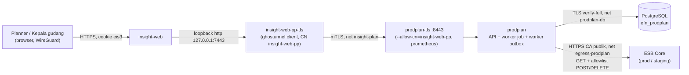

# ADR-051: Production planning Central Kitchen di atas ESB (service `prodplan`, baca + tulis terbatas ke ESB)

- **Status:** Proposed — belum disetujui klien. G66 boleh dibangun mengikuti rekomendasi ini dengan
  `PRODPLAN_ENABLED=false` dan `PRODPLAN_WRITE_ENABLED=false` default. **Tulis ke ESB production terkunci di kode**
  (bukan env) sampai ADR ini `Accepted`, akun API non-admin tersedia (Q-PP1), dan penyimpangan §3.4 dikonfirmasi pemilik
  proyek (Q-PP2).
- **Tanggal:** 2026-11-24 (Gelombang 66) · revisi 2026-11-24 (hasil uji tulis staging ESB, §1.3 butir 5–7, §3.4)
- **Pemutus:** pemilik proyek (lingkup, penyimpangan draft §3.4), IT klien (akun API non-admin, staging ESB), kepala
  gudang + planner CK PB (proses persetujuan), Finance (dampak stok/HPP dokumen produksi), Security (allowlist tulis)
- **Referensi review:** R-S17 (akun admin ESB), R-O09 (perubahan API ESB), R-O10 (beban ESB), R-S18 (kunci Insight),
  R-T06 (angka dipakai keputusan); usulan baru **R-S23**, **R-O15**, **R-T23** (§5); Q-PP1..Q-PP12 (`docs/04` §30.14)
- **Terkait:** ADR-040 (esb-extract GET-only — **tidak dilonggarkan**, catatan amandemen di sana), ADR-041 (insight-web
  read-only — **diamandemen terbatas**, §3.5 di sana), ADR-022 (TLS CA internal), ADR-024 (kredensial per service),
  ADR-031 (tanpa modul pihak ketiga), ADR-018 / K25-12 (produksi CK, usulan disetujui planner), K25-08 (waste),
  `docs/04` §30

> **Ringkasan manajemen.** Planner Central Kitchen Paris Baguette mendapat halaman **Production Order** di Insight:
> pesanan outlet digabung, kebutuhan bahan dihitung dari resep (BOM), bahan kemasan utuh (mis. susu segar) dibulatkan
> ke kemasan dengan usulan batch tambahan agar sisa tidak terbuang, dan aplikasi mengusulkan transfer stok antar lokasi
> yang **disetujui kepala gudang**. Setelah disetujui, aplikasi membuat dokumen transfer dan produksi di ESB. Karena ESB
> langsung mengesahkan dokumen produksi (tidak ada draft), persetujuan dua orang dipindah ke aplikasi. Tahap 1 (baca +
> rencana) ±3–4 minggu-engineer; tahap 2 (tulis, uji di staging ESB) ±1,5–2 minggu-engineer; Rp0 lisensi. Tulis ke ESB
> production mati sampai klien memberi akun API non-admin dan menyetujui ADR ini.

## 1. Konteks

### 1.1 Kebutuhan (pemilik proyek 24 Nov 2026, sudah diputuskan)
Dashboard Production Order untuk CK PB (prototipe): kebutuhan bahan dari gabungan pesanan (ledakan BOM); repack besar→kecil
= produksi Assembly dengan BOM repack; bahan kemasan utuh dibulatkan ke atas + usulan batch tambahan (pesanan selalu
dipenuhi, usulan hanya berlaku bila disetujui planner); usulan transfer dari lokasi/cabang lain dengan persetujuan kepala
gudang; jembatan sampai cutover Odoo, model mudah dipetakan ke `mrp.production`/`mrp.bom`/`stock.picking`; POST ke ESB
disetujui dengan syarat ADR baru, service terpisah dari `esb-extract`, akun non-admin, dokumen disetujui manusia di ESB;
yang ditulis hanya transfer + produksi; pesanan outlet tetap diinput di ESB. Tahap 1 baca + rencana, tahap 2 tulis (uji di
staging ESB). Pengguna planner CK + kepala gudang, UI modul baru di Insight (login Odoo), stok disegarkan sebelum tiap
perencanaan.

### 1.2 Pertentangan dengan dokumen/prinsip yang berlaku
| Sumber | Bunyi | Pertentangan |
|---|---|---|
| ADR-040 §3.1 butir 3 | "**GET-only**: klien HTTP menolak method selain `GET`, kecuali `POST /auth/login`" | Kebutuhan baru = POST transfer + produksi ke ESB. |
| ADR-041 §3 butir 1 | "`insight-web` … **read-only** (tidak pernah menulis ke Odoo/ClickHouse/PostgreSQL)" | Halaman Production Order menyimpan rencana dan persetujuan. |
| `CLAUDE.md` prinsip | "Async by default (RabbitMQ) untuk OCR, notifikasi, MGM settle, webhook" | Tulis ke ESB harus async; broker menambah jalur jaringan dari service yang memproses JSON internet. |
| `CLAUDE.md` / ADR-040 §3.2 | "PostgreSQL = source of truth; ClickHouse hanya turunan" | Rencana produksi = data transaksi EFN baru (bukan turunan ESB) → wajib di PostgreSQL, bukan mart ESB. |
| Syarat pemilik proyek | "dokumen dibuat sebagai draft (belum di-authorize) dan disetujui manusia di ESB" | Uji staging: produksi (`assembly-actual`) langsung Authorized; goods-transfer-request langsung Authorized (§1.3). |

### 1.3 Fakta API ESB (uji GET prod PB + uji tulis staging, 24 Nov 2026; spec `developers.esb.co.id/esb-core/openapi.json`)
1. BOM `GET /product/bom`, `GET /product/bom/detail/{bomID}?branchID=&locationID=` (qty per 1 satuan hasil, `yieldPercent`,
   `stockQty` di lokasi). Multi-level FIN→WIP→RMT lewat `bomID` produk. Hasil per batch tidak ada di BOM.
2. Master produk tanpa umur simpan/ukuran kemasan → master "kemasan utuh" disimpan di prodplan, diisi planner.
3. Pesanan: `GET /purchase/purchase-request` + detail. **Belum terbukti** semua pesanan outlet FIN lewat PR → rencana
   menerima baris impor PR **dan** input manual.
4. CK PB cabang 4 memakai `simple-manufacturing` Assembly (lokasi asal = tujuan `CK - Kitchen` id 7); CKWH cabang 38
   memakai production-order/material-delivery/production-result → **v1 hanya dibaca**.
5. `POST /simple-transfer` → `result.simpleTransferNum`; lahir **statusID 1 (belum authorize)**; list mendukung filter
   `additionalInfo`; `DELETE` OK.
6. `POST /inventory/goods-transfer-request` → `result.transferNum`; lahir **statusID 3 Authorized**, tetapi stok baru bergerak
   saat staf membuat goods delivery (gerbang manusia tetap di ESB). `transferDetailAssets` harus dihilangkan untuk
   `categoryTypeID` 1. List mendukung `additionalInfo`; `DELETE` diblokir bila sudah ada goods delivery.
7. Produksi staging (mode **Actual Costing**): `POST /production/simple-manufacturing/assembly` → 400; yang berlaku
   `POST …/assembly-actual` dengan material eksplisit. Hasil `result.simpleManufacturingNum` (`"SM202611240001 - 1"`, ada
   spasi) lahir **statusID 3 Authorized** oleh user API → **stok langsung bergerak, tanpa draft**. List tanpa filter
   `additionalInfo`. `DELETE` OK selama stok hasil belum dipakai. Mode costing PB production **belum diketahui** (Q-PP3).
8. Akun production = admin per brand (R-S17); staging = akun terpisah, company PB uji.

## 2. Opsi yang dipertimbangkan

### 2.1 Tempat logika + tulis ke ESB
| # | Opsi | Kelebihan | Kekurangan | Biaya / waktu (perkiraan architect) |
|---|---|---|---|---|
| **A** | **Service baru `services/prodplan`** (Python 3.12, pola esb-extract): GET ESB saat perencanaan, rencana di **PostgreSQL** (DB + role sendiri), POST ke ESB lewat **allowlist persis**, API HTTPS internal untuk insight-web | Satu pemilik kredensial tulis; esb-extract tetap GET-only; transaksi + audit di PG; tidak ada jalur dari internet | Service + image + DB + 2 sidecar + secret baru | Tahap 1 **±3–4 minggu-engineer** (Python 2–2,5, frontend 1–1,5, devsecops 0,5–1); tahap 2 **±1,5–2**; RAM ±256 MB + 2×64 MB sidecar |
| B | Tambah POST ke `esb-extract` | Tanpa service baru (hemat ±1 minggu) | Melonggarkan GET-only ADR-040; service berkredensial ClickHouse writer + internet jadi bisa menulis ERP klien; batch job ≠ transaksi interaktif | **Ditolak** |
| C | Logika di `api-gateway` (BFF) | Stack NestJS sudah ada | BFF menghadap internet; kredensial tulis ERP klien tidak boleh di komponen publik (R-S03) | **Ditolak** |
| D | Modul Odoo `efn_prodplan` sekarang | Langsung model MRP | Odoo tanpa egress (prinsip); harus memanggil ESB dari ERP; dipakai **setelah** cutover (§4.3) | **Ditolak untuk G66**, jalur akhir pasca-cutover |
| E | Simpan rencana di ClickHouse / tulis lewat mart | Tanpa PG baru | ClickHouse bukan sumber transaksi (ADR-003); tanpa transaksi/constraint; melanggar "tanpa tulis API → ClickHouse" | **Ditolak** |

### 2.2 Async tulis ke ESB
| # | Opsi | Kelebihan | Kekurangan | Biaya |
|---|---|---|---|---|
| **1** | **Outbox PostgreSQL + worker polling di dalam prodplan** | Atomik dengan perubahan status rencana (satu transaksi); tanpa jalur jaringan ke broker; DLQ = status `failed` yang terlihat di UI | Polling (10 dtk) | Termasuk tahap 2 |
| 2 | RabbitMQ (`prodplan.post_requested` + DLQ) | Seragam dengan prinsip async | Dual-write (PG + broker) butuh outbox juga; prodplan (memproses JSON internet) mendapat jalur ke broker bersama | +±3 hari + kredensial broker |

Prinsip "async by default" dipenuhi opsi 1: POST ke ESB tidak pernah terjadi di request HTTP pengguna, consumer
idempoten (marker), dan kegagalan terparkir (`failed`). RabbitMQ **tidak wajib** di G66; ditinjau ulang bila konsumen
kedua muncul.

### 2.3 Autentikasi insight-web → prodplan + identitas pengguna
| # | Opsi | Kelebihan | Kekurangan | Keputusan |
|---|---|---|---|---|
| **i** | **mTLS (ghostunnel client sidecar di namespace insight-web → `prodplan-tls`) + asersi aktor HMAC per request `ppa1`** (kunci `prodplan_assert_key`, umur 60 dtk, `jti`, terikat method+path+hash body) | Kunci TLS tidak di proses Node; browser tidak bisa memalsukan aktor (tanpa jalur + tanpa kunci); replay dibatasi | Dua sidecar + satu kunci baru | **Dipilih** |
| ii | Teruskan cookie `eis3` ke prodplan | Tanpa format baru | prodplan harus memegang `insight_session_key` → bisa memalsukan sesi Insight (memperluas R-S18) | Ditolak |
| iii | Token bearer statis insight-web | Sederhana | Tanpa identitas pengguna; bocor = permanen | Ditolak |
| iv | prodplan memvalidasi ke Odoo | Identitas langsung | Jalur baru ke ERP | Ditolak |

Peran: dua peran baru `pp_planner` dan `pp_warehouse` di klaim `roles` token `eit3`/sesi `eis3` (revisi, bukan format
baru), diturunkan dari grup Odoo baru di `efn_insight`. Peran ini **bukan persona** sehingga tanda tangan ClickHouse
(`SQL_efn_personas = roles ∩ PERSONAS`) tidak berubah.

## 3. Keputusan (direkomendasikan)

### 3.1 Opsi A + 1 + i
1. **`services/prodplan`** = satu-satunya pemilik (a) GET ESB saat perencanaan, (b) DB `efn_prodplan` (role login
   `efn_prodplan`, pemilik skema NOLOGIN `efn_prodplan_owner`), (c) POST/DELETE ESB lewat allowlist persis, (d) API
   HTTPS internal. Overlay `infra/compose/docker-compose.prodplan.yml`. Klien HTTP ESB = salinan **dikeraskan** dari
   `efn_esb` (host tetap, https, tanpa redirect lintas host, tanpa proxy env, batas ukuran respons) dengan allowlist tulis
   sendiri; `esb-extract` tidak berubah.
2. **Allowlist tulis** (method + template path, selain itu ditolak sebelum socket dibuka): `POST /simple-transfer`,
   `POST /inventory/goods-transfer-request`, `POST /production/simple-manufacturing/assembly-actual` **atau**
   `…/assembly` (dipilih `PRODPLAN_ESB_MFG_MODE`), `DELETE /simple-transfer/{num}`,
   `DELETE /inventory/goods-transfer-request/{num}`, `DELETE /production/simple-manufacturing/{num}`. Endpoint
   `…/authorize` **tidak pernah** dipanggil.
3. **Base URL** hanya dari allowlist dua host: `https://services.esb.co.id/core` (production) dan
   `https://stg7.esb.co.id/core-stg` (staging). `PRODPLAN_WRITE_ENABLED=true` + base production → **proses menolak start**
   selama konstanta kode `PROD_WRITE_UNLOCKED = False` (diubah hanya lewat PR setelah ADR Accepted + Q-PP1). Username dari
   env non-repo (SEC-180), password dari `/run/secrets/*`.
4. **Insight**: halaman `/produksi/*` memanggil prodplan dari sisi server (server action / route handler + origin guard).
   Grup Odoo `efn_insight.group_prodplan_planner` dan `efn_insight.group_prodplan_warehouse` (implies pengguna Insight).
   **SoD per dokumen ditegakkan di prodplan**: penyetuju rencana/transfer ≠ pembuat ≠ pengaju.
5. **Idempotensi tulis**: outbox PG satu baris per dokumen ESB, marker `pp:<12 hex>` di `additionalInfo`/`notes`,
   rekonsiliasi lewat GET sebelum kirim ulang; **tidak ada kirim ulang otomatis** POST setelah timeout — status `unknown`
   → rekonsiliasi → bila tidak ditemukan, planner menekan "Kirim ulang".
6. Flag `PRODPLAN_ENABLED=false`, `PRODPLAN_WRITE_ENABLED=false`, `INSIGHT_PRODPLAN_ENABLED=false` default.

### 3.2 Alur rencana
`draft → submitted → approved → posted` (+ `cancelled`). Planner membuat & menghitung (stok ESB disegarkan di job
`calculate`), mengajukan; kepala gudang memutuskan tiap usulan transfer lalu menyetujui rencana; planner atau kepala gudang
menekan **Posting** (ringkasan dampak stok wajib dikonfirmasi) → outbox: transfer dulu, lalu produksi per level BOM
(WIP sebelum FIN). Aturan hitung deterministik di `docs/04` §30.5.

### 3.3 Kenapa tidak melanggar ADR-040/041
- `esb-extract` tetap GET-only (kode + test tidak berubah). Pengecualian tulis hanya untuk `prodplan`, hanya endpoint §3.1
  butir 2, hanya dari rencana `approved`.
- insight-web tetap tanpa akses DB/ESB; ia hanya meneruskan aksi pengguna ke API prodplan dengan identitas dari sesi
  terverifikasi (amandemen terbatas ADR-041 §3.7).

### 3.4 Penyimpangan dari syarat "draft di ESB" (menunggu konfirmasi pemilik proyek, Q-PP2)
Uji staging membuktikan dokumen produksi tidak bisa dibuat sebagai draft (langsung Authorized, stok bergerak) dan
goods-transfer-request lahir Authorized (stok bergerak saat goods delivery). Keputusan lead:
- Gerbang persetujuan manusia untuk **produksi** dipindah ke aplikasi: posting hanya dari rencana `approved`, penyetuju ≠
  pembuat (dua orang), tombol posting eksplisit per rencana dengan ringkasan dampak stok (bahan keluar per lokasi, hasil
  masuk), dicatat di `audit_event`.
- **Simple-transfer** tetap draft di ESB (authorize manusia di ESB). **Goods-transfer-request**: gerbang manusia = goods
  delivery di ESB.
- Pembatalan setelah posting = `DELETE` dokumen ESB lewat outbox (urutan terbalik); gagal (stok hasil sudah dipakai /
  goods delivery ada) → `delete_failed`, ditangani manual di ESB.
- Tulis ke ESB production tetap OFF (§3.1 butir 3).

| Alternatif | Alasan ditolak |
|---|---|
| Tidak menulis produksi (hanya transfer) | Planner tetap mengetik ±328 dokumen/minggu; tujuan menekan salah input hilang |
| Menunggu ESB menyediakan draft produksi | Di luar kendali EFN; tidak ada tanggal |
| Ekspor berkas impor ESB untuk produksi | Endpoint `…/import` belum diuji; tetap tanpa draft (belum terverifikasi) |

## 4. Konsekuensi

### 4.1 Positif
- Kebutuhan bahan dan sisa kemasan terbuka terlihat sebelum produksi (K25-08 waste); transfer terencana dan disetujui.
- Model data (rencana, baris produksi, kebutuhan, transfer) dipetakan langsung ke Odoo MRP saat cutover (§4.3).
- Gagal prodplan/ESB tidak memengaruhi POS, BFF, ETL, Odoo, atau dashboard lain.

### 4.2 Negatif / utang teknis yang diterima
- Dokumen produksi langsung mengubah stok ESB → kesalahan rencana berdampak nyata (R-O15); mitigasi SoD + ringkasan +
  DELETE.
- v1 tanpa netting stok WIP, tanpa FEFO (ESB tanpa lot kedaluwarsa), tanpa pengurangan `pendingQty` transfer berjalan,
  yield tidak diterapkan secara default (Q-PP5) → angka kebutuhan konservatif (R-T23).
- Akun admin ESB dipakai untuk GET tahap 1 di production sampai Q-PP1 (R-S17, R-S23).
- PostgreSQL ikut network kedua `prodplan-db`: aturan `samenet` di `pg_hba.conf` meluas ke subnet itu untuk semua baris
  role (dilindungi SCRAM + password per role; hanya `prodplan` di network itu). Diterima; ditinjau saat K25-02 memisah mesin.
- Sesi Insight 2 jam → pencabutan grup prodplan berlaku paling lambat 2 jam.
- Replika tunggal prodplan (cache `jti` di memori, worker tunggal); multi-replika butuh lock outbox (`FOR UPDATE SKIP
  LOCKED` sudah disiapkan) + cache `jti` bersama.

### 4.3 Pemetaan ke Odoo CE 19 setelah cutover (ringkas; rinci kolom di `docs/04` §30.13)
| prodplan | Odoo CE 19 |
|---|---|
| `plan` (brand, cabang, tanggal) | sekelompok `mrp.production` (origin = `plan_no`), `company_id` dari `company_code` |
| `plan_production_line` | `mrp.production` (product_id, bom_id, product_qty) |
| BOM ESB / `pack_rule` | `mrp.bom` + `mrp.bom.line`; `pack_rule` → `product.packaging` (qty) + atribut umur setelah dibuka (field `efn_*`, gap) |
| `plan_requirement` | `stock.move` bahan (raw) per produksi |
| `plan_transfer` | `stock.picking` internal (cabang sama) / inter-warehouse (antar cabang) |
| persetujuan transfer | belum ada padanan CE (approval = modul Enterprise) → gap `efn_*` saat cutover (fit-gap `efn-odoo-functional`) |

### 4.4 Dampak ke dokumen lain
`docs/04` §30 (kontrak, dibuat bersama ADR ini); catatan amandemen ADR-040 dan ADR-041; indeks `docs/decisions/README.md`;
`docs/01` usulan R-S23/R-O15/R-T23 dan Q-PP (tugas efn-lead); `docs/compliance/PDP_DATA_INVENTORY.md` entri "Production
planning" (nama staf + uid Odoo di audit, retensi §30.10) — belum dibuat; `CLAUDE.md` catatan pengecualian tulis ESB
(efn-lead).

## 5. Risiko terkait
| ID | Ringkas | Mitigasi |
|---|---|---|
| **R-S23** (usulan) | Kredensial/akun tulis ESB disalahgunakan atau menulis ke environment salah (production saat uji) | Allowlist host + method/path di kode + test; `PROD_WRITE_UNLOCKED=False`; banner environment di UI; akun non-admin (Q-PP1); secret terpisah dari esb-extract; egress subnet sendiri |
| **R-O15** (usulan) | Dokumen produksi langsung Authorized di ESB → stok/HPP salah bila rencana keliru | SoD dua orang, ringkasan dampak, posting eksplisit, DELETE terjadwal, uji staging dulu, `PRODPLAN_POST_MAX_DOCS` |
| **R-T23** (usulan) | Rencana dihitung dari stok/BOM basi atau tidak lengkap (tanpa netting WIP, FEFO, pending transfer) | Stok disegarkan di setiap hitung + umur maksimum saat submit/posting; peringatan per baris; keterbatasan tampil di UI |
| R-S17 | Akun admin ESB | Q-PP1; GET tahap 1 di production saja; tulis production terkunci |
| R-O09 / R-O10 | Perubahan API / beban ESB | Parser toleran, test kontrak, token bucket 2 req/dtk, batas panggilan per job |
| R-S18 | Kunci Insight bocor | `prodplan_assert_key` terpisah; prodplan tidak memegang kunci sesi/SSO |

## 6. Pertanyaan terbuka (dijawab klien)
Rinci di `docs/04` §30.14: **Q-PP1** akun API non-admin (hak: baca + transfer + produksi, tanpa authorize) · **Q-PP2**
konfirmasi penyimpangan §3.4 · **Q-PP3** mode costing produksi PB production · **Q-PP4** apakah pesanan outlet FIN selalu
lewat PR · **Q-PP5** arti `yieldPercent` · **Q-PP6** daftar lokasi/cabang sumber transfer · dan seterusnya.

## 7. Kapan ditinjau ulang
- Q-PP1/Q-PP2/Q-PP3 dijawab (mengubah status tulis production).
- ESB menyediakan draft produksi atau mengubah API (R-O09).
- CKWH cabang 38 (production-order) perlu ditulis, atau brand kedua.
- Cutover Odoo PB (G43): prodplan dihentikan untuk PB, rencana terbuka dimigrasi/ditutup, logika pindah ke Odoo MRP.
- Paling lambat **31 Mar 2027**.
