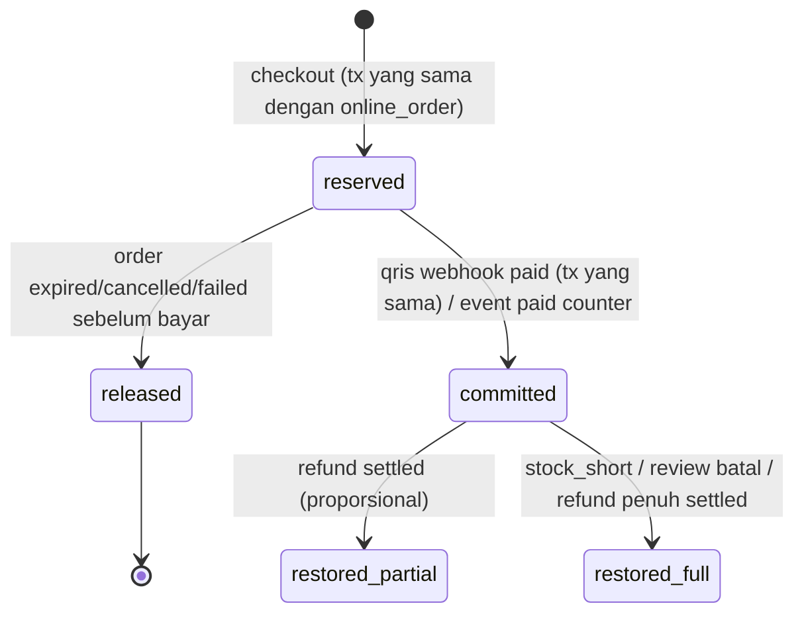
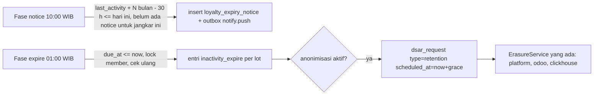

# DRAF Kontrak G22 — QR ponsel, F&B online, poin online, poin hangus 12 bulan (usulan v9.0 untuk `docs/04` §14)

- **Status:** **DRAF efn-architect untuk efn-lead.** Bukan kontrak berlaku. `docs/04` tidak diubah; lead memindahkan bagian yang disetujui ke `docs/04` §14 dan memberi nomor L-70 dst. Penanda **[D-22-n]** = keputusan yang dibutuhkan lead (§0).
- **Tanggal:** 2026-10-19 · branch `chore/wave-22`
- **Dasar:** ADR-032 (Accepted opsi B, sketsa API §"Rincian opsi B"), ADR-020 (Proposed, ledger BFF), ADR-019 (Proposed, porsi per PT), ADR-017 (offline), ADR-023 (Odoo privat), ADR-026 (gateway-agnostic), ADR-027 (pajak dari Odoo), ADR-029 (member opak), ADR-036 §0; `docs/04` §9 (poin POS, K-18-x, L-23..L-26), §10–§13 (online, counter, kebijakan poin & akrual, L-48..L-69); keputusan pemilik proyek 18-14 (poin hangus 12 bulan tidak aktif + jurnal breakage + anonimisasi), 18-18 (bayar di kasir); `docs/08` §7.3 (E-26 KDS), §10.6 (E-29a), §11.5 (W-17), §11.8 (E-45); `docs/10` §A (G22 = W-07, W-04, W-27, W-12, W-17).
- **Aturan baca:** bila draf ini disetujui, §14 menang atas §1–§13 untuk hal yang disebut di sini; selebihnya §1–§13 tetap.

> **Ringkasan manajemen.**
> 1. **Pesan dari ponsel di meja (W-07):** pelayan mencetak QR khusus meja itu saat meja dibuka. QR berlaku paling lama 4 jam dan mati saat meja dibayar. Tamu bisa memesan tanpa login dan tanpa data pribadi; bila ingin poin, tamu login OTP. Pembayaran tetap di kasir (tahap 1).
> 2. **Restoran online (W-04):** Paris Baguette dan Bacha kafe masuk Super-App memakai jalur pesanan online yang sudah ada. Dapur menerima pesanan di layar KDS setelah pesanan dibayar. Status "siap" datang dari dapur.
> 3. **Poin online (W-12):** pelanggan dapat menukar poin sebagai sebagian pembayaran (bukan diskon) dan mendapat poin saat pesanan diambil. Refund mengembalikan poin secara proporsional.
> 4. **Poin hangus (W-17):** poin hangus setelah 12 bulan tidak aktif. Peringatan WhatsApp dikirim 30 hari sebelumnya, dan nilai yang hangus dijurnal sebagai pendapatan.
> 5. **Butuh keputusan/tanda tangan:** Legal & DPO untuk teks syarat program dan anonimisasi; Finance untuk definisi "aktif" dan perlakuan utang poin; Ops F&B untuk mode konfirmasi pelayan. Estimasi tetap **±12–16 minggu-engineer** (≈ ±Rp60–144 jt pada tarif asumsi ADR-031). Opsi yang menambah biaya ditandai per bagian.

---

## 0. Keputusan yang dibutuhkan lead (ringkas)

| ID | Pertanyaan | Rekomendasi | Alternatif & dampak biaya/waktu | Perlu klien? |
|---|---|---|---|---|
| D-22-1 | QR: setiap kiriman tamu **ditambahkan ke satu `pos.order` draft meja** (terikat sesi) atau **satu `pos.order` per kiriman**? | **Satu order per sesi meja** (sesuai sketsa ADR-032 `order_uuid`), dengan syarat functional memverifikasi bahwa POS frontend menerima baris tambahan dari server tanpa konflik ([B] §G) | Order per kiriman: server lebih sederhana (−1–2 hari Odoo), tetapi kasir harus menggabungkan tagihan (risiko salah tagih, SOP) | Tidak (Ops diberi tahu) |
| D-22-2 | Menu QR: harga dari katalog kanal online saja, atau **overlay per `pos.config`** (ketersediaan + harga pricelist dine-in)? | **Overlay per config** (RPC baca #13) | Hanya katalog kanal: −2–3 hari, tetapi harga/ketersediaan bisa beda dengan POS (komplain tamu) | Tidak |
| D-22-3 | Kiriman QR langsung ke dapur (`auto`) atau menunggu konfirmasi pelayan (`waiter`)? | Flag per config `efn_qr_confirm_mode`, default **`auto`** + batas per sesi + cabut token cepat | `waiter` sebagai default: lebih aman dari spam, menambah kerja pelayan; biaya kode sama (dua mode dibangun) | **Ya — Ops F&B** |
| D-22-4 | ALTCHA di QR? | **Mati** default (`FNB_CAPTCHA_MODE=off`); token = bukti hadir di meja; bisa dinyalakan `first_submit` tanpa deploy | Wajib: friksi tamu; biaya sama | Tidak |
| D-22-5 | Poin dari QR: BFF meng-earn ke member yang mengklaim sesi memakai **kunci `pos_earn:<order_uuid>` yang sama** dengan earn POS (siapa duluan menang); `reverse` POS boleh tanpa `member_ref` bila order diklaim lewat QR | **Ya** | Member ditempel ke `pos.order` di Odoo: PII masuk Odoo dari kanal publik, melawan default tamu tanpa PII (ADR-032 Q-QR3) | Tidak |
| D-22-6 | Catatan bebas per baris QR (`note`) | **Boleh**, ≤ 140 karakter, tolak deret ≥ 8 digit (nomor HP), tidak disimpan di BFF | Hanya catatan preset dari Odoo: +1 hari Odoo/FE, privasi lebih baik | Tidak |
| D-22-7 | User teknis Odoo untuk QR | **User terpisah per PT** `efn_qr_pb`, `efn_qr_bcf` (least privilege, pola L-37) | Memakai user kanal online `efn_online_pb`: hemat 2 secret, melanggar SEC-101 (grup kanal saja) | Tidak |
| D-22-8 | Kanal F&B `stock_hold_mode` | **`confirm`** (kode promo berlaku, kupon sekali pakai aman — §11.2 no. 8) | `none`: kode promo selalu ditolak di F&B | Tidak (Marketing diberi tahu) |
| D-22-9 | Modifier/atribut di online & QR (W-27) | **G22: atribut `no_variant`** (gula, es, ukuran tanpa stok) di cart/quote/place/QR; **combo ditunda** (produk `combo` disaring dari katalog F&B online/QR) | Combo di G22: +1–1,5 minggu Odoo/BFF/FE | Ya — daftar modifier (data Ops) |
| D-22-10 | Poin online: alokasi per bagian | **Eksplisit per kanal** di body checkout (`points_redeem[]`), tanpa OTP tambahan (sesi login = OTP, JWT 1 jam), **porsi tunai ≥ Rp1** | Alokasi proporsional otomatis oleh BFF: +2–3 hari, aturan pembulatan lintas PT; OTP tambahan: +1–2 hari, friksi | Finance (batas) |
| D-22-11 | Waktu restore poin & clawback earn pada refund online | Restore poin saat refund **`settled`**; clawback earn saat refund **diminta** (`refunded`) | Restore saat diminta: pelanggan bisa memakai poin sebelum uang kembali | Finance |
| D-22-12 | Definisi "aktif" untuk W-17 | **Aktivitas yang dimulai member**: earn/redeem POS & online, pesanan online dibayar, laporan Price Hunter valid, **login OTP**, pendaftaran POS, klaim poin QR | Transaksi saja (tanpa login): breakage lebih besar, akun yang rajin login tetap dianonimkan | **Ya — Finance + Legal** |
| D-22-13 | Lokasi parameter 12 bulan | **Kebijakan global Odoo** (record EFN, empat mata) `inactivity_expiry_months` + fallback env | Env saja (Superadmin): −0,5–1 hari, tanpa empat mata Finance | Tidak |
| D-22-14 | Anonimisasi setelah hangus | **Ya, otomatis lewat jalur erasure yang ada** (`dsar_request.type='retention'`), **dimatikan** di produksi sampai DPO & Legal menyetujui teks; masa tenggang default 0 hari | (b) Hanya poin hangus, anonimisasi ikut retensi umum (mis. 24 bln): menyimpang dari 18-14; (c) tanpa anonimisasi: melanggar 18-14 | **Ya — DPO + Legal** |
| D-22-15 | Titik awal hitung (go-live/migrasi) | `last_activity_at = GREATEST(aktivitas nyata, LOYALTY_ACTIVITY_EPOCH)`; epoch = tanggal go-live program | Pakai tanggal aktivitas sistem lama: hangus massal di hari pertama | **Ya — Finance** |
| D-22-16 | Dasar notifikasi WA T−30 | **Syarat program (pelaksanaan perjanjian)**, bukan consent marketing; template kategori UTILITY | Bila Meta menggolongkan MARKETING → wajib consent `marketing` (§8.4) dan member tanpa consent tidak diberi tahu, sehingga hangus tetap jalan sesuai syarat | **Ya — Legal**; Meta (review template) |
| D-22-17 | Utang poin (saldo lot negatif) saat anonimisasi | Mengikuti erasure yang ada: lot utang dinolkan (forfeit bertanda positif) dan masuk `forfeited_value_idr` | Finance memilih akun hapus-buku terpisah → perubahan kontrak akrual (Q-F21-2) | **Ya — Finance** |
| D-22-18 | Nasib `LOYALTY_POINT_EXPIRY_DAYS` | **Dihapus**; diganti `LOYALTY_POINT_MAX_AGE_DAYS` (default 0 = tidak ada umur maksimum). Bila env lama masih diset, BFF **gagal start di production** dan memberi warning di dev | Dibiarkan sebagai alias: semantik ganda membingungkan Finance | Tidak |

---

## A. W-07 — QR order dari ponsel (E-27, `/v1/fnb/*`)

### A.1 Alur

```mermaid
sequenceDiagram
    autonumber
    participant W as Pelayan (POS Odoo)
    participant O as Odoo (privat)
    participant B as BFF
    participant P as Ponsel tamu (Super-App)
    participant K as KDS
    W->>O: Buka meja → order draft tersinkron (order_uuid)
    W->>O: pos.config/efn_qr_session_open(config, table, order_uuid)
    O->>B: POST /v1/pos/fnb/table-sessions (mTLS + service key)
    B-->>O: {table_session_id, qr_url (token di fragment), expires_at}
    O-->>W: Cetak slip QR (printer struk), token tidak disimpan
    P->>B: GET /v1/fnb/session + /v1/fnb/menu (X-Table-Session)
    P->>B: POST /v1/fnb/orders (Idempotency-Key)
    B->>O: json2 efn_qr_submit (user efn_qr_<pt>, via odoo-rpc-gateway)
    O->>O: tambah baris ke pos.order draft, hitung harga, hook KDS, notify POS (kanal privat)
    O-->>B: {submission_ref, state}
    B-->>P: 202 {submission_id, status}
    K->>O: bump tiket
    O->>B: POST /v1/pos/fnb/events submission_status (HMAC, seq)
    P->>B: GET /v1/fnb/orders (polling, jawaban dari DB BFF)
    W->>O: Bayar di kasir → order paid
    O->>B: event session_closed {reason: paid, order: {eligible_amount}}
    B->>B: token mati; earn poin bila sesi diklaim member
```

### A.2 Token sesi meja (memenuhi Q-QR4, R-S03, SEC-73/75/77)
| Hal | Ketentuan |
|---|---|
| Penerbit | **BFF** saat Odoo memanggil `POST /v1/pos/fnb/table-sessions`. Tidak diturunkan dari `pos.config.access_token`/`restaurant.table.identifier`. |
| Format | `fts1.<b64url(session_id 16 byte)>.<exp unix>.<b64url(HMAC-SHA256(K, "fts1\|" + session_id_hex + "\|" + exp))>`; `K = HKDF-SHA256(ikm=secret fnb_table_token_key, info "efn:fnb_table_token:v1")`. Tanda tangan diperiksa **sebelum** query DB (murah, anti-DoS). Token dapat dihitung ulang dari `session_id` + `exp`, sehingga BFF tidak menyimpan token atau hash token. |
| Keterikatan | `session_id → (company_code, config_id, table_id, order_uuid)` di `platform.fnb_table_session`; Odoo menyimpan `pos.order.efn_qr_session_ref = session_id` dan memverifikasi kecocokan saat submit. |
| Umur | `exp = opened_at + FNB_TABLE_SESSION_TTL_SECONDS` (default 14 400 = 4 jam, maks 14 400). Tidak diperpanjang otomatis; pelayan bisa **cetak ulang** (sesi lama dicabut, `close_reason=reissued`). |
| Pencabutan | Event Odoo `session_closed` (order dibayar/batal/ditutup staf), cetak ulang, kedaluwarsa (sweeper), kill switch. Sesi tidak `open` → `409 table_session_closed`. |
| Transport | QR berisi `https://<domain tenant brand>/meja#t=<token>`. Token ada di **fragment**, sehingga tidak dikirim ke server dan tidak masuk access log Traefik/Next.js. Frontend membaca fragment, menghapusnya dari address bar (`history.replaceState`), menyimpannya di `sessionStorage`, lalu mengirim header **`X-Table-Session`**. Query `?ts=` **tidak** diterima. |
| Rotasi kunci | Secret `fnb_table_token_key` + opsional `fnb_table_token_key_prev` (verifikasi saja). Karena TTL ≤ 4 jam, rotasi cukup dengan overlap 4 jam. |
| Log | Token tidak pernah di-log. Promtail ditambah pola redaksi `fts1\.[A-Za-z0-9_.-]+`. Log hanya memuat `table_session_id`. |

### A.3 API publik BFF (`/v1/fnb`, lewat router Traefik `api.` — `/v1/fnb` tidak dikecualikan)
Umum: header `X-Table-Session` wajib (kecuali disebut lain). `Authorization: Bearer` **opsional**; bila Bearer ada tetapi tidak valid, BFF membalas `401 unauthorized` (bukan diam-diam menjadi tamu). Body ≤ 16 KB, format error §3, `Cache-Control: no-store` kecuali menu. Token tidak valid, salah tanda tangan, kedaluwarsa, atau sesi tidak dikenal → **`401 table_session_invalid`** generik (tidak membedakan sebab). Kill switch `FNB_QR_ENABLED=false` (default production) atau `efn_qr_enabled=False` di config → `503 ordering_unavailable`.

| Metode & path | Request | Respons sukses | Error | Rate limit (PLACEHOLDER) |
|---|---|---|---|---|
| `GET /v1/fnb/session` | — | `200 { outlet_name, table_label, company_code, brand_code, expires_at, confirm_mode: "auto"\|"waiter", limits: { max_lines, max_line_qty, submissions_left }, points: { claimable, claimed, claimed_by_me } }` (`claimed_by_me` hanya bila Bearer) | 401, 409 `table_session_closed`, 503 | 60/menit/sesi; 120/menit/IP |
| `GET /v1/fnb/menu` | — | `200 { categories:[{ category_id, name, sequence, image_sha }], products:[{ product_id, name, category_id, image_sha, price_excl, tax_labels:["PB1 10%","Service 5%"], price_note:"belum termasuk pajak & layanan", available, attributes:[A.6] }], menu_synced_at }`. `Cache-Control: private, max-age=60`. Gambar lewat `GET /v1/catalog/images/:sha` yang sudah ada | 401, 409, 503 | 60/menit/sesi; 120/menit/IP |
| `POST /v1/fnb/orders` | Header **`Idempotency-Key`** `^[A-Za-z0-9_-]{16,128}$` (frontend: `crypto.randomUUID()` per percobaan, `sessionStorage`). Body `{ lines: [{ product_id:int, qty:int 1..FNB_MAX_LINE_QTY, attribute_value_ids:int[] ≤10, note?: string ≤140 }] (1..FNB_MAX_LINES) , altcha?: string }` | `202 { submission_id, status: "accepted"\|"pending_confirmation", lines:[{ product_id, name, qty }], indicative_subtotal_excl }` | 400 `invalid_request` / `idempotency_key_required` / `note_invalid` / `captcha_required`; 401; 409 `table_session_closed` / `idempotency_conflict` / `item_unavailable` (+`product_ids`); 422 `session_limit_reached`; 429 `rate_limited`; 503 `ordering_unavailable` (Odoo mati/circuit terbuka → teks "silakan pesan ke pelayan"; **tidak** diantrekan) | 6/menit/sesi; 20/10 menit/IP |
| `GET /v1/fnb/orders` | — | `200 { items:[{ submission_id, created_at, status, lines:[{ name, qty }] }] }` (semua kiriman sesi; meja berbagi token) | 401, 409 | 30/menit/sesi |
| `GET /v1/fnb/orders/:submission_id` | — | `200 { submission_id, status, updated_at }` | 401; 404 `not_found` (id bukan milik sesi/bukan UUID) | 30/menit/sesi |
| `POST /v1/fnb/session/points-claim` | **Bearer wajib** + `X-Table-Session`, body `{}` | `200 { claimed: true }` (idempoten untuk member yang sama) | 401; 409 `points_already_claimed` (member lain) / `table_session_closed` / `account_deleting`; 422 `points_unavailable` (poin QR dimatikan) | 5/10 menit/member |
| `DELETE /v1/fnb/session/points-claim` | Bearer (member pengklaim) | `204` | 404 bila bukan pengklaim | 5/10 menit/member |

`status` kiriman: `submitting → accepted | pending_confirmation → preparing → ready → served`, cabang `rejected` (pelayan menolak, mode `waiter`), `cancelled` (dibatalkan di POS), `failed` (Odoo menolak saat submit). Status turunan dari tiket KDS kiriman itu: semua `new` = `accepted`; ada `in_progress` = `preparing`; semua `ready|served` = `ready`; semua `served` = `served`.

**Idempotensi submit:** `UNIQUE (table_session_id, idempotency_key)` + `request_sha256`. Key dan body sama → respons yang sama (status terkini). Body beda → `409 idempotency_conflict`. Ke Odoo dikirim `idempotency_key = fnb:submit:<submission_id>` (unik per config di Odoo) dan `submission_ref = submission_id`. Timeout ke Odoo → BFF mengulang (maks 3×, pola §10.4.2). Bila tetap gagal, status `submitting` direkonsiliasi lewat `efn_qr_status` (A.5 #15) sebelum diputuskan `failed`, sehingga tidak ada pesanan ganda di dapur.

**Validasi `note`:** trim, buang karakter kontrol & baris baru, ≤ 140 karakter, tolak `\d[\d\s.-]{6,}\d` (deret ≥ 8 digit, mirip nomor HP) dan `@` → `400 note_invalid`. Catatan **tidak disimpan** di BFF (hanya `has_note`), diteruskan ke Odoo `pos.order.line.note` (tampil di KDS). [D-22-6]

### A.4 Endpoint Odoo → BFF (in-cluster, `/v1/pos/*` dikecualikan dari router publik)
**`POST /v1/pos/fnb/table-sessions`** — mTLS + `X-EFN-Service-Key` (`odoo_bff_api_key`).
```json
{ "idempotency_key": "fnb_open:<order_uuid>:<n>", "company_code": "PB", "config_id": 7, "table_id": 12,
  "table_label": "T12 / Teras", "order_uuid": "<pos.order.uuid>", "reissue": false }
```
- `company_code ∈ {PB, BCF}` (`business_type=fnb`), `table_label` ≤ 32 karakter tanpa PII (nama meja/area), `n` = nomor cetak per order (1, 2, …).
- Sesi `open` lain untuk `(config_id, table_id)`: bila `reissue=false` → `409 table_session_exists`; bila `true` → sesi lama ditutup `reissued`.
- Replay dengan `idempotency_key` yang sama → respons yang sama (token dihitung ulang).
- Respons `201 { table_session_id, qr_url, expires_at }`. Error: `400 invalid_request`, `401`, `409 table_session_exists | idempotency_conflict`, `422 qr_disabled` (FNB_QR_ENABLED mati / PT bukan F&B), `429` (60/menit/config).
- POS **offline** → tombol "Cetak QR" nonaktif (butuh server, sejalan CLAUDE.md). Sesi yang sudah terbuka tetap bisa menerima pesanan selama server Odoo hidup.

**`POST /v1/pos/fnb/events`** — mTLS + service key + **`X-EFN-Signature`** (HMAC-SHA256 `"<t>." + rawBody`, secret baru **`odoo_fnb_event_hmac`**, replay window 300 s), dikirim dari outbox Odoo `efn.pos.qr.event.outbox` (retry 1 m → 1 j, pola §10.5). Body ≤ 8 KB, `additionalProperties: false`:
```json
{ "schema_version": 1, "idempotency_key": "fnb:<table_session_id>:<event>:<seq>", "seq": 4,
  "table_session_id": "<uuid>", "company_code": "PB", "config_id": 7,
  "event": "submission_status|session_closed",
  "submission": { "submission_ref": "<uuid>", "status": "accepted|pending_confirmation|preparing|ready|served|rejected|cancelled" },
  "close": { "reason": "paid|cancelled|closed_by_staff|reissued",
             "order": { "order_uuid": "<uuid>", "eligible_amount": 125000.00, "pos_member_attached": false } },
  "occurred_at": "<iso>" }
```
- `submission` hanya untuk `submission_status`; `close` hanya untuk `session_closed`. `eligible_amount` dihitung Odoo dengan rumus K-1/K-18-4 (tanpa pajak, tanpa porsi Poin EFN, tanpa kategori dikecualikan) dan hanya diisi bila `reason=paid`.
- Pemrosesan pola §10.5: `claimMessage('fnb.events', idempotency_key)`, `seq ≤ last_seq` → `ignored_stale`, company/config tidak cocok → `409 company_mismatch` (final), event tak dikenal → `ignored_unknown_event`.
- `session_closed reason=paid` + sesi diklaim member + `pos_member_attached=false` → earn **di transaksi yang sama** lewat jalur ledger POS dengan `idempotency_key = pos_earn:<order_uuid>`, `source=pos_qr`, kebijakan earn PT (§13.1), pagar `earn_limit_exceeded` (§9.8; bila kena → anomali, tanpa retry). Bila `pos_member_attached=true`, BFF tidak meng-earn (POS yang meng-earn). Bila POS lalu meng-earn dengan kunci yang sama untuk member lain → `409 idempotency_conflict` (final di outbox Odoo) + anomali `qr_pos_member_conflict`. [D-22-5]
- Respons `200 { ok, status: applied|duplicate|ignored_stale|ignored_unknown_event }`. `400/401/404/409` final; `429/5xx` retry.

**Perubahan §9.4 (`/v1/pos/loyalty/reverse`):** field baru `earn_channel: "pos"|"qr"` (default `pos`); bila `qr`, `member_ref` **tidak dikirim**. BFF menemukan member dari entri `pos_earn:<original_order_ref>`. Odoo tidak tahu apakah BFF berhasil meng-earn (tidak ada PII/flag poin di Odoo). Karena itu Odoo **selalu** mengirim `reverse` dengan `earn_channel:"qr"` untuk refund atas order yang punya `efn_qr_session_ref` dan tanpa member POS. BFF membalas `200 { points_clawed_back: 0, points_restored: 0 }` bila tidak ada earn (bukan error). Bila sesi QR order itu belum menerima `session_closed reason=paid` (event tertunda), BFF membalas `409 earn_pending` (pola K-6; Odoo retry lewat outbox) agar refund tidak mendahului earn.

### A.5 RPC Odoo baru (modul `efn_pos_qr_order`, usulan nama — sketsa ADR-032 menyebut `efn_pos_bff_order`)
Lewat `odoo-rpc-gateway` (path ke-13..15), user teknis per PT `efn_qr_pb` / `efn_qr_bcf` (grup `efn_pos_qr_order.group_qr_service` + `base.group_user` saja; satu company; tanpa ACL dokumen), secret `odoo_api_key_qr_{pb,bcf}` (env `ODOO_API_KEY_QR_<PT>_FILE`), rotasi 30 hari oleh `efn-rotate-online-key` (pola W-11). Galat bisnis = `UserError("efn_qr:<kode>")` → HTTP 422 (L-15). Context dibersihkan kecuali `lang` (pola §10.4.4 no. 4).

| # | Path `/json/2/…` | Argumen → hasil | Idempotensi |
|---|---|---|---|
| 13 | `efn.pos.qr.order/efn_qr_menu` | `config_id, since, cursor, limit ≤ 200` → `{ config:{ config_id, company_code, outlet_name, qr_enabled, confirm_mode }, items:[{ product_id, price_excl, tax_labels, available, attributes }], deleted:[product_id], next_cursor, server_time }` — hanya produk `available_in_pos` + kategori config + bukan `combo` (D-22-9); harga dari pricelist config, label pajak dari FP/preset dine-in | baca |
| 14 | `efn.pos.qr.order/efn_qr_submit` | `config_id, table_session_ref, order_uuid, submission:{ idempotency_key, submission_ref, lines:[{ product_id, qty, attribute_value_ids, note }] }` → `{ submission_ref, state: "accepted"\|"pending_confirmation", lines:[{ product_id, name, qty }], amount_indicative_excl }` | `fnb:submit:<submission_id>` unik per config |
| 15 | `efn.pos.qr.order/efn_qr_status` | `config_id, submission_refs (≤ 100)` → `[{ submission_ref, state, seq }]` (`absent` bila tidak ada) | baca |

Validasi server (#14): config milik company user teknis; `efn_qr_enabled`; sesi POS terbuka (`pos_session_closed`); `order_uuid` milik config & meja, `state='draft'`, `efn_qr_session_ref` cocok (`session_closed`); produk tersedia (`item_unavailable`); `attribute_value_ids` ⊆ PTAV `no_variant` template itu, satu nilai per atribut `radio/select` (`invalid_input`); batas qty/baris (`limit_exceeded`). Harga dihitung ulang oleh Odoo (klien tidak pernah mengirim harga). Baris ditandai `efn_qr_submission_ref`. Mode `auto` → baris dikirim ke dapur lewat hook E-26 (server menandai perubahan persiapan, [B] §G). Mode `waiter` → baris `pending` sampai pelayan menekan "Kirim ke dapur" atau "Tolak". POS diberi tahu lewat kanal **privat** config/partner kasir (pola SEC-77 G15), **bukan** kanal token. Kode: `session_closed`, `pos_session_closed`, `item_unavailable`, `invalid_input`, `idempotency_conflict`, `qr_disabled`, `limit_exceeded`.

Peta ke HTTP BFF: `session_closed|pos_session_closed` → `409 table_session_closed`; `item_unavailable` → `409 item_unavailable`; `limit_exceeded` → `422 session_limit_reached`; `qr_disabled` → `503 ordering_unavailable`; `invalid_input|idempotency_conflict`/401/403/5xx → `503 ordering_unavailable` + alert (pola §10.3.7).

### A.6 Menu = salinan katalog kanal + overlay per config [D-22-2]
- Nama, deskripsi, kategori, gambar diambil dari **salinan katalog kanal F&B PT itu** (`PB`/`BCF`, §10.8.2) yang sudah disinkron BFF. Kanal tidak perlu `active` untuk menu QR. Sinkron katalog berjalan bila PT ada di `FNB_QR_COMPANIES`.
- Overlay `platform.fnb_menu_item (config_id, product_id, price_excl, tax_labels, available, attributes jsonb, updated_at, deleted_at)` disinkron dari RPC #13 setiap `FNB_MENU_SYNC_SECONDS=300` per config yang punya sesi terbuka atau `efn_qr_enabled`. Menu = irisan overlay ∩ katalog kanal. Produk overlay yang tidak ada di katalog kanal tetap tampil dengan nama dari overlay (field `name` ditambahkan di #13 bila functional menilai perlu).
- `attributes` (dipakai juga di W-04): `[{ attribute_id, name, display_type: "radio"|"select"|"multi"|"pills", required: bool, values: [{ id (PTAV), name, price_extra_excl }] }]`.
- Tampilan harga F&B **exclude** + label pajak dari Odoo (`PB1 10%`, `Service 5%` dine-in). Total final ada di bill kasir (PB1 dine-in dihitung Odoo, ADR-027).

### A.7 Anti-spam & batas (OWASP API4/API6)
| Kontrol | Default (PLACEHOLDER, env) |
|---|---|
| Token = bukti hadir di meja, TTL ≤ 4 jam, dicabut saat bayar/cetak ulang | `FNB_TABLE_SESSION_TTL_SECONDS=14400` |
| Kiriman per sesi | `FNB_MAX_SUBMISSIONS_PER_SESSION=20` |
| Item (Σ qty) per sesi | `FNB_MAX_ITEMS_PER_SESSION=150` |
| Baris per kiriman / qty per baris | `FNB_MAX_LINES=30` / `FNB_MAX_LINE_QTY=20` |
| Rate limit | A.3; key `rl:fnb:*`, IP di-HMAC (§8.16) |
| ALTCHA | `FNB_CAPTCHA_MODE=off\|first_submit\|always` (default `off`) [D-22-4]; `first_submit` = kiriman pertama per sesi per perangkat (`altcha` di body; salah/absen → `400 captcha_required`) |
| Mode konfirmasi pelayan | `pos.config.efn_qr_confirm_mode` [D-22-3] |
| Konkurensi json2 | QR memakai semaphore **publik** (`ODOO_RPC_PUBLIC_MAX_CONCURRENCY`, L-20) + circuit breaker per PT |
| Anomali | `EFN_FNB_ANOMALY {kind}`: `session_limit_hit`, `submit_rate_limited`, `qr_pos_member_conflict`, `submit_reconciled`; metrik `efn_fnb_submissions_total{status}`, `efn_fnb_sessions_open`, `efn_fnb_odoo_requests_total{method,outcome}` |

### A.8 Tabel BFF (migrasi `11-platform-g22.sql`, owner `efn_platform_owner`, DML `efn_bff`)
| Tabel | Kolom inti | Catatan |
|---|---|---|
| `platform.fnb_table_session` | `id uuid PK`, `company_code CHECK (PB,BCF)`, `config_id int`, `table_id int`, `table_label text ≤32`, `order_uuid text ≤64`, `open_idempotency_key text UNIQUE`, `print_seq int`, `status CHECK (open, closed, expired)`, `close_reason CHECK (paid, cancelled, closed_by_staff, reissued, expired, ops) NULL`, `opened_at`, `expires_at`, `closed_at`, `member_id uuid NULL`, `member_claimed_at`, `earn_status CHECK (none, earned, skipped, limited, conflict)`, `submissions_count`, `items_count`, `last_seq int`, `member_unlinked_at` | partial unique `(config_id, table_id) WHERE status='open'` |
| `platform.fnb_submission` | `id uuid PK`, `session_id → fnb_table_session`, `idempotency_key`, `request_sha256 char(64)`, `lines jsonb` (product_id, qty, attribute_value_ids, has_note — **tanpa teks catatan**), `status`, `odoo_state`, `created_at`, `updated_at` | `UNIQUE (session_id, idempotency_key)` |
| `platform.fnb_menu_item`, `platform.fnb_menu_sync` | A.6 | non-PII |

### A.9 Env & secret baru
BFF: `FNB_QR_ENABLED` (prod default `false`), `FNB_QR_COMPANIES=PB,BCF`, `FNB_QR_BASE_URL_<PT>` (URL tenant Super-App; https wajib), `FNB_TABLE_SESSION_TTL_SECONDS`, `FNB_MAX_*`, `FNB_CAPTCHA_MODE`, `FNB_MENU_SYNC_SECONDS`, `FNB_RL_*`, `FNB_SESSION_RETENTION_DAYS=180`, `FNB_SESSION_MEMBER_LINK_DAYS=30`, `FNB_QR_POINTS_ENABLED` (default `false`), `FNB_TABLE_TOKEN_KEY_FILE` (rahasia), `FNB_TABLE_TOKEN_KEY_PREV_FILE` (opsional), `ODOO_API_KEY_QR_<PT>_FILE` (rahasia), `ODOO_FNB_EVENT_HMAC_FILE` (rahasia). Odoo: `EFN_FNB_EVENT_HMAC_FILE` (rahasia).
Secret baru: `fnb_table_token_key` (BFF), `odoo_fnb_event_hmac` (Odoo + BFF), `odoo_api_key_qr_pb`, `odoo_api_key_qr_bcf` (BFF; jenis `host:` + rotasi). Gateway: 3 path baru (total 15). `odoo-tls --allow-cn` tidak berubah.

### A.10 Keamanan (OWASP API Security Top 10 2023)
| Risiko | Kontrol |
|---|---|
| API1 BOLA | `submission_id` UUID + cek milik sesi → 404; sesi hanya dari token; klaim poin terikat `member_id` JWT |
| API2 Broken auth | Token HMAC + DB status + TTL; Bearer opsional tetapi bila ada harus valid; Odoo→BFF mTLS + service key + HMAC event |
| API3 BOPLA | DTO `additionalProperties:false`; klien tidak bisa mengirim harga, meja, config, member, company |
| API4 Resource | A.7; body ≤ 16 KB; semaphore json2 publik; overlay menu dari DB (bukan ke Odoo per request) |
| API5 BFLA | Endpoint `/v1/pos/fnb/*` hanya in-cluster (Traefik mengecualikan `/v1/pos`) + service key; user teknis QR tanpa ACL dokumen |
| API6 Business flow | Batas per sesi, mode `waiter`, cabut token, ALTCHA opsional, pesanan tidak bisa dibuat tanpa order meja yang dibuka pelayan |
| API7 SSRF | `qr_url` dibangun dari env, bukan input |
| API8 Misconfig | Kill switch default off di prod; `deploy-validate` menolak `FNB_QR_ENABLED=true` tanpa secret & `FNB_QR_BASE_URL_*` https |
| API9 Inventory | 3 path gateway baru + `RPC_ALLOWLIST` (test SEC-58) + daftar route BFF di README |
| API10 Unsafe consumption | Respons Odoo divalidasi skema; galat Odoo tidak diteruskan ke klien |

### A.11 PDP
- **Tamu:** tanpa nama/HP/email. Data yang ada hanya IP (HMAC, rate limit, TTL Redis) dan catatan pesanan (difilter, tidak disimpan BFF; di Odoo ikut retensi `pos.order`).
- **Login opsional:** tautan `member_id` di sesi dilepas `FNB_SESSION_MEMBER_LINK_DAYS` (30) hari setelah sesi ditutup. Ledger menyimpan `source_ref = order_uuid` (pseudonim). DSAR export memuat sesi yang diklaim (outlet, tanggal, poin). Erasure: `member_id` → NULL.
- Inventaris PDP v8 (architect) menambah: `fnb_table_session.member_id`, catatan baris POS dari tamu.

### A.12 Estimasi
Sesuai `docs/10`: **3–4 minggu-engineer** (Odoo 1–1,5; BFF 1–1,5; FE 1; QA 0,5). D-22-2 overlay sudah termasuk (+2–3 hari bila dihitung terpisah). Bayar online di ponsel = tahap 2 (+±1 minggu setelah vendor, A-4).

---

## B. W-04 — F&B online via SO + jembatan KDS (E-29a)

Perubahan terhadap §10–§12. **Tanpa endpoint baru.** Status `ready` berasal dari KDS.

| # | Bagian | Perubahan |
|---|---|---|
| B-1 | Kanal | Kanal `PB` dan `BCF` di Odoo `active=True` saat data outlet/menu siap; `ONLINE_CHANNELS` ditambah `PB,BCF` (per lingkungan). `stock_hold_mode=confirm` [D-22-8]; produk menu non-storable → `stock_check='none'`. `payment_modes` = `counter` (pilot; `qris` setelah vendor). |
| B-2 | Katalog | Blok `channel` (L-11) bertambah `business_type: "retail"\|"fnb"` dan `loyalty: { earn: bool, redeem: bool }` (C-1). Item bertambah `attributes` (format A.6) — `[]` untuk ritel. Produk `combo` tidak dikirim untuk kanal F&B (D-22-9). |
| B-3 | Stok F&B | `GET /v1/catalog/stock` untuk kanal F&B → `efn_online_stock` mengembalikan `out` bila produk ditandai habis (`efn_online_sold_out`, toggle Ops di Odoo), selain itu `in_stock`; `qty` tidak dikirim. |
| B-4 | Cart/quote/place | Baris cart menjadi `{ product_id, qty, attribute_value_ids?: int[] ≤ 10 }`. Identitas baris = `(product_id, sorted(attribute_value_ids))`, sehingga dua baris produk sama dengan modifier berbeda boleh ada. `efn_online_quote`/`efn_online_place` menerima field yang sama. Odoo memvalidasi PTAV `no_variant` milik template (`invalid_input` → 503 + alert; quote → issue `{product_id, code:"attribute_invalid"}` → `409 cart_has_issues`). `quote_hash` memuat PTAV. Baris quote bertambah `attributes_text`. `price_extra` dihitung Odoo ([B] §G). |
| B-5 | Tampilan pajak | Tetap `tax_groups` dari Odoo (PB1 non-dine-in 0 % W-14b, tanpa SC). Frontend kanal `fnb` menampilkan harga exclude + rincian sebelum bayar. Tidak ada hitung pajak di klien. |
| B-6 | KDS | Odoo `efn_online_kds_bridge`: tiket `efn.kds.ticket` dari SO **saat bagian `confirmed` (setelah bayar)**, tanpa data pelanggan, label = `sale_order_name` pendek. Semua tiket `ready` → `action_efn_ready` → event `ready` yang sudah ada. Batal/refund → tiket `cancelled`. |
| B-7 | Event Odoo → BFF | (a) `ready` membawa field opsional `ready_source: "kds"\|"manual"`. (b) **Event baru opsional `preparing`** (tiket pertama `in_progress`): BFF mengisi `online_order_part.kitchen_started_at` **tanpa** transisi state (peringkat §10.6.2 tidak berubah); BFF lama menjawab `ignored_unknown_event` (kompatibel). `seq` tetap naik monoton. |
| B-8 | API pelanggan | `GET /v1/orders/:id` bagian bertambah `kitchen_started_at` (nullable) dan `prep_minutes` outlet. Notifikasi WA `online_order_ready` tetap (tanpa kode ambil). |
| B-9 | Serah terima | Tetap wizard kode ambil (SEC-105). Tidak diambil (Q-ON13) → aktivitas Odoo, tanpa batal otomatis; perlakuan makanan basi = SOP Ops (pertanyaan klien Q-F22-1). |
| B-10 | Faktur pembeli | PB/BCF → `422 invoice_not_available` (sudah §13.5). |
| B-11 | Cart campuran | Ritel + F&B dalam satu pesanan boleh untuk `qris` (multi-bagian); `counter` tetap satu PT (§12.2). |

Keamanan: B-4 menambah permukaan input → validasi tipe/jumlah di BFF, validasi kepemilikan PTAV di Odoo, PTAV masuk hash. PDP: tidak ada data baru. Estimasi tetap **4–5,5 minggu-engineer** (`docs/08` §10.6). B-7(b) +0,5 hari.

---

## C. W-12 — Poin online (earn saat diambil, redeem = alat bayar P-8)

### C.1 Prinsip
1. Redeem = **porsi pembayaran "Poin EFN" per bagian (per PT)**, bukan diskon. DPP/PPN/PB1 tetap atas harga penuh (K-18-1, K-18-7). Porsi poin **tidak lewat gateway**.
2. Kebijakan PT penjual (§13.1) berlaku: `redeem_min_points`, `redeem_max_pct` (dari `amount_payable` bagian, **termasuk pajak**, K-18-2), `point_value_idr` global (L-62), batas earn harian/per order.
3. Ledger BFF tetap satu-satunya saldo. Odoo hanya mencatat pembayaran Poin EFN di faktur SO (jurnal Poin EFN per PT) dan memvalidasi batas dari kebijakan yang dipublikasikan (pertahanan berlapis).
4. Tidak ada OTP tambahan [D-22-10]: checkout sudah Bearer hasil login OTP + ALTCHA, JWT berumur 1 jam. Opsional `ONLINE_REDEEM_STEPUP_MIN_POINTS` (default 0 = mati) memakai step-up `/v1/me/reauth` yang ada bila klien kelak meminta.
5. Kill switch: `ONLINE_LOYALTY_REDEEM_ENABLED`, `ONLINE_LOYALTY_EARN_ENABLED` (prod default `false`) + flag kanal Odoo `efn.online.channel.loyalty_redeem`/`loyalty_earn` (B-2).

### C.2 API pelanggan
**Quote** (`POST /v1/cart/quote`) — respons bertambah blok informatif (tidak mengikat):
```json
"points": { "balance_available": 1200, "point_value_idr": 100,
  "groups": [{ "channel_code": "PB", "redeem_allowed": true, "min_points": 50, "max_points": 375, "max_value_idr": 37500 }] }
```
`max_points = min(saldo tersedia, floor(floor(amount_payable × redeem_max_pct / 100) / point_value_idr), floor((amount_payable − 1) / point_value_idr))`. Saldo tersedia = saldo − reservasi aktif.

**Checkout** (`POST /v1/orders`) — body bertambah opsional:
```json
"points_redeem": [{ "channel_code": "PB", "points": 300 }]
```
- Maksimal satu entri per kanal, `points` integer > 0, kanal harus ada di quote. Field ini masuk `request_sha256` (key sama + poin beda → `409 idempotency_conflict`). `accept_total` **tidak berubah** (= Σ `amount_payable`).
- Error baru: `409 insufficient_points`, `409 below_minimum`, `409 exceeds_max_pct` (kode sama dengan §9), `422 points_unavailable` (env/kanal/kebijakan mati), `422 points_cover_full_amount` (porsi tunai bagian < Rp1), `400 invalid_request`.
- Respons `201` bertambah `amount_points_value` dan `amount_cash` (yang dibayar lewat QRIS/kasir). Per bagian: `points_redeemed`, `points_value_idr`, `amount_cash`. `payment.amount` (QRIS) = Σ `amount_cash`. Untuk `counter`, Odoo menagih `amount_cash`.
- `GET /v1/orders/:id` & daftar: field yang sama + `points_earned` (setelah diambil) + `points_restored`.
- `GET /v1/me` bertambah `points_reserved` dan `points_expiry` (D.6).

### C.3 Saga poin

| Langkah | Kapan | Ledger / tabel | Kunci idempotensi |
|---|---|---|---|
| Reserve | Checkout, dalam transaksi DB pembuatan order (sebelum `efn_online_place`). `hold_until = order.expires_at + 10 menit` | `loyalty_reservation (channel='online', part_id)` | `online_redeem_reserve:<part_id>` (UNIQUE `part_id`) |
| Place | `efn_online_place(... order:{ ..., points_payment:{ points, value_idr } })` → hasil bertambah `amount_due` (= `amount_payable − value_idr`). Odoo menolak `value_idr` di atas batas kebijakan PT → `UserError("efn_online:points_invalid")` → BFF `409 exceeds_max_pct` | — | ikut `online:place:<part_id>` (masuk `payload_sha256`) |
| Commit | QRIS: di transaksi webhook `paid` (pola §10.7). Counter: saat event `paid` (`payment.method:"counter"`). Debit FIFO per lot, `issuer_company_code` dicatat (§13.1 no. 5) | `reason='online_redeem'`, `source='online'`, `company_code` = PT bagian, `source_ref=part_id` | `online_redeem:<part_id>` |
| Mark paid | `efn_online_mark_paid(... payment:{ amount_paid (= tunai), points_value, ... })`. Odoo mencatat dua pembayaran faktur: tunai (titipan A1/kliring counter) dan **Poin EFN** (jurnal Poin EFN PT). `amount_paid ≠ amount_due` → `review` | — | `online:paid:<part_id>:<payment_id>` |
| Release | Order `expired/cancelled/failed` atau place gagal — di transaksi transisi order | reservasi `released` | idempoten per status |
| Restore | `online_refund` → `settled` [D-22-11]. Nilai = `refund.points_value` dari Odoo; BFF memverifikasi `round(min(ΣR, T) × V ÷ T) − Σrestore sebelumnya` ±Rp1 (pola SEC-128, T = `amount_payable`, V = `points_value_idr`) dan membatasinya ke sisa redeem. Gagal verifikasi → refund `review` + anomali `restore_value_mismatch` | `reason='online_restore'`, penerbit = lot asal | `online_restore:<refund_id>` |
| Restore penuh | `stock_short`, `review` dibatalkan, bayar terlambat **tidak** (reservasi sudah dilepas) | sama | `online_restore:<refund_id>` |
| Earn | Event `picked_up` dengan `loyalty:{ eligible_amount }` dan member masih tertaut → earn PT bagian (= penerbit) sesuai kebijakan; batas terlampaui → `earn_status='limited'` + anomali | `reason='online_earn'`, `source='online'` | `online_earn:<part_id>` |
| Clawback | Event `refunded` (refund **diminta**) dengan `refund.eligible_amount_refunded` setelah earn → tarik proporsional (rasio kumulatif ≤ 1, pola §9.4). Refund sebelum diambil → tidak ada clawback (eligible saat `picked_up` sudah neto) | `reason='online_reverse'` | `online_reverse:<refund_id>` |

Porsi refund tunai ke gateway = `refund.cash_amount` (= `amount − points_value`). Σ refund tunai ≤ porsi tunai bagian (§10.6.6 diperketat). Untuk `counter`, uang keluar = refund POS pelunasan sebesar `cash_amount` (E-31, L-60).

### C.4 Perubahan Odoo (E-28/E-45, ringkas)
- `efn_online_place`: `points_payment` (opsional), hasil `amount_due`.
- `efn_online_mark_paid`: `payment.points_value`.
- `efn_online_counter_lookup` (POS): mengembalikan `amount_due` (porsi tunai), bukan `amount_payable`.
- `efn_online_cancel`/`efn_online_refund`/event `refunded`/`cancelled` (blok `refund`): `points_value`, `cash_amount`, `eligible_amount_refunded` (alokasi proporsional Q-F18-4 dihitung **Odoo**).
- Event `picked_up`: `loyalty: { eligible_amount }` (K-1/K-18-4, `earn_on_money_only`). `efn_online_status` bertambah `eligible_amount` untuk rekonsiliasi.
- Event `paid` (counter): `payment: { method: "counter", points_value }`.

### C.5 Akrual & rekonsiliasi
- Akrual §13.1 no. 6 **tanpa perubahan bentuk**: `online_earn` = earn, `online_reverse` = clawback, `online_redeem` = redeem (lintas PT → by_issuer; PT sama tidak dijurnal di akrual karena sudah lewat jurnal Poin EFN di faktur), `online_restore` = restore.
- Rekonsiliasi K-18-6 diperluas (data-ai): Σ pembayaran jurnal Poin EFN per PT/tanggal (POS **+ faktur SO online**) = Σ (`pos_redeem` + `online_redeem`) − Σ restore.

### C.6 Tabel & migrasi (`11-platform-g22.sql`)
- `loyalty_reservation`: `channel text NOT NULL DEFAULT 'pos' CHECK (pos, online)`, `part_id uuid NULL UNIQUE`, `token_jti` NULL diizinkan hanya bila `channel='online'` (CHECK).
- `online_order`: `amount_points_value bigint DEFAULT 0`, `amount_cash numeric(14,2)`.
- `online_order_part`: `points_redeemed int DEFAULT 0`, `points_value_idr bigint DEFAULT 0 CHECK (points_value_idr < amount_payable)`, `amount_cash numeric(14,2)`, `loyalty_reservation_id uuid NULL`, `eligible_amount numeric(14,2) NULL`, `earn_status CHECK (none, pending, earned, skipped, limited)`, `points_earned int DEFAULT 0`, `points_restored_value bigint DEFAULT 0`, `kitchen_started_at` (B-7).
- `online_refund`: `points_value bigint DEFAULT 0`, `cash_amount numeric(14,2)`.
- `payment_intent_portion.amount` = porsi **tunai** (Σ = `payment_intent.amount`, aturan §10.7 tetap).

### C.7 Keamanan & PDP
- API3: nilai poin dihitung server dari `points × point_value_idr`; klien hanya mengirim jumlah poin. API6: batas kebijakan + reservasi atomik (`lockMember`) + `ONLINE_MAX_OPEN_ORDERS_PER_MEMBER` mencegah poin ditahan massal; reservasi ikut dilepas sweeper.
- Erasure saat ada reservasi: order terbuka sudah ditangani L-21; reservasi `reserved` dilepas, `committed` mengikuti SEC-124.
- Log: tanpa saldo per member; anomali hanya `part_id`.
- Estimasi **2,5–3,5 minggu-engineer** (Odoo 1; BFF 1–1,5; FE 0,5–0,75; QA 0,5). D-22-10 alternatif proporsional +2–3 hari.

---

## D. W-17 — Poin hangus 12 bulan tidak aktif + breakage + anonimisasi

### D.1 Semantik baru (meralat §9.1 `LOYALTY_POINT_EXPIRY_DAYS`, §9.7 "FIFO per bucket")
- Earn baru: `expires_at = NULL`, kecuali `LOYALTY_POINT_MAX_AGE_DAYS > 0` (default 0) [D-22-18]. `LOYALTY_POINT_EXPIRY_DAYS` **dihapus**: masih diset → gagal start di production, warning di dev. Saldo pembuka migrasi (K-7) mengikuti aturan yang sama.
- Lot berumur (data dev pra-G22 atau `MAX_AGE_DAYS>0`) tetap hangus implisit seperti sekarang dan tetap masuk `expired_value_idr`.
- **Hangus karena tidak aktif** = entri ledger **eksplisit** per lot (bukan implisit), karena jam tidak aktif bergeser setiap ada aktivitas dan ledger append-only tidak bisa memperpanjang `expires_at`.

### D.2 Aktivitas [D-22-12, D-22-15]
Tabel `platform.loyalty_member_activity (member_hash char(64) PK, last_activity_at timestamptz NOT NULL, last_kind text, updated_at)`. Kolom diperbarui `GREATEST(...)` **dalam transaksi peristiwa**:

| Dihitung aktif | Tidak dihitung |
|---|---|
| `pos_earn`, `pos_redeem` (commit), `pos_enroll`, `online_earn`, `online_redeem` (commit), order online dibayar, Price Hunter `valid`, **login OTP sukses**, klaim poin QR, impor migrasi | clawback, restore, reverse, forfeit, expire, cek saldo POS (K-8), penyesuaian admin, notifikasi |

`last_activity_at` efektif = `GREATEST(last_activity_at, LOYALTY_ACTIVITY_EPOCH)`. Backfill di migrasi: `MAX(created_at)` entri ledger aktivitas per `member_ref_hash` ∪ `member.created_at`.

### D.3 Job BFF `LoyaltyInactivityJob` (advisory lock per fase, batch, zona Asia/Jakarta)

1. **Jangkar** = `last_activity_at` efektif; `N = inactivity_expiry_months` (kebijakan global EFN [D-22-13], fallback `LOYALTY_INACTIVITY_EXPIRY_MONTHS=12`, rentang 6..36). Kalender bulan PostgreSQL (`+ interval 'N months'`), batas hari 00:00 WIB.
2. **Notice:** `loyalty_expiry_notice (id uuid, member_hash, anchor_at, due_at, notified_at, status CHECK (queued, superseded, expired, cancelled), created_at, UNIQUE (member_hash, anchor_at))`. `due_at = GREATEST(anchor + N bulan, notified_at + LOYALTY_EXPIRY_NOTICE_DAYS)`. Akibatnya setiap member selalu mendapat ≥ 30 hari pemberitahuan, termasuk saat go-live atau job sempat mati.
3. **Expire** (per member, satu transaksi): `lockMember` → cek ulang jangkar belum bergeser (bergeser → notice `superseded`) → tidak ada reservasi `reserved`, bagian online terbuka, atau DSAR aktif (ada → lewati, coba besok) → untuk setiap lot (penerbit, `expires_at`) dengan sisa > 0: entri `delta = −sisa`, `reason='inactivity_expire'`, `source='loyalty_expiry'`, `source_ref=NULL`, `idempotency_key='inactivity_expire:<uuid v4>'` (acak, pola SEC-31), `expires_at` = milik lot, `issuer_company_code = company_code` = penerbit → notice `expired`. Lot utang (sisa < 0) tidak disentuh. Idempotensi dijamin oleh lock + cek ulang + status notice (re-run menemukan sisa 0).
4. **Pengaman massal:** bila kandidat expire dalam satu run > `LOYALTY_EXPIRY_MAX_PER_RUN` (default 20 000) → run dibatalkan + alert critical `EfnLoyaltyExpiryAborted`. `LOYALTY_EXPIRY_DRY_RUN=true` (default di run pertama tiap lingkungan) hanya mencatat jumlah per penerbit.
5. Aktivitas baru setelah notice → notice `superseded`; tidak ada pesan "dibatalkan" (minimisasi pesan).

### D.4 Notifikasi WA T−30 [D-22-16]
- `notify.push` v2: `{ schema_version: 2, idempotency_key: "notify:loyalty_inactivity:<notice_id>", member_hash, source: "loyalty_expiry", source_ref: "<notice_id>", template: "loyalty_inactivity_notice", params: { points, expire_date } }`. Publisher hanya `efn-bff`. Resolver: `loyalty_expiry_notice(id=source_ref)` → `member_hash` cocok → `member.member_ref_enc` (atau entri ledger terbaru subjek bila tidak ada baris `member`) → verifikasi hash.
- Template WA `efn_loyalty_inactivity_notice` (didaftarkan di WhatsApp Manager; kategori diharapkan UTILITY — keputusan kategori ada di Meta, **belum terverifikasi**). Parameter: jumlah poin dan tanggal hangus. Tanpa nama, tanpa nominal Rupiah, tanpa tautan berparameter. Teks menyebut anonimisasi akun bila D-22-14 aktif. **Teks final = Legal.**
- Gagal kirim permanen → DLQ (perilaku consumer yang ada). Hangus **tetap** jalan sesuai syarat program; kegagalan dihitung metrik `efn_loyalty_expiry_notice_failed_total`.
- Dasar pemrosesan: pelaksanaan perjanjian program (syarat program yang diterima saat daftar/login). Bila Legal mensyaratkan opt-in eksplisit atau Meta menggolongkan template sebagai MARKETING → pakai consent `marketing` §8.4 (member tanpa consent tidak diberi tahu lewat WA; tetap tampil di aplikasi D.6).

### D.5 Akuntansi (L-67)
- `GET /v1/pos/loyalty/accruals` bentuk **tidak berubah**. `expired_value_idr` = (lot berumur yang hangus pada tanggal itu, perilaku lama) **+** Σ(−`delta`) entri `inactivity_expire` dengan `created_at` pada tanggal itu (WIB) untuk penerbit itu.
- Jurnal breakage di PT **penerbit**: Dr Liabilitas Poin / Cr Pendapatan Poin Kedaluwarsa (L-67). [B]: memastikan E-44 G21 sudah menjurnal `expired_value_idr`. Bila belum, Odoo +0,5 hari.
- `closing_liability_idr` otomatis turun (entri negatif). RECON tidak berubah.

### D.6 API pelanggan
`GET /v1/me` bertambah `points_expiry: { inactive_since: <date>, expires_on: <date>|null, notice_sent: bool }`. `expires_on` hanya diisi bila ≤ 60 hari lagi (minimisasi; `null` bila saldo 0 atau masih jauh).

### D.7 Anonimisasi [D-22-14]
- **Rekomendasi:** dibangun dan dikendalikan `LOYALTY_INACTIVE_ANONYMIZE` (default `false` di production sampai DPO + Legal menyetujui teks). Setelah expire, BFF membuat `dsar_request(type='retention', status='scheduled', scheduled_at = now + LOYALTY_INACTIVE_ANONYMIZE_GRACE_DAYS (0), reason='inactivity')` lalu memakai **ErasureService yang ada** (platform: tombstone ledger, forfeit lot utang [D-22-17], hapus `member`, `loyalty_member_activity`, notice; Odoo pull `efn_privacy`; ClickHouse). Tanpa receipt token, tanpa step-up.
- Skema: `dsar_request.type` CHECK + `'retention'`; `member_id` boleh NULL **hanya** untuk `type='retention'` (subjek yang hanya ada di ledger POS). Indeks unik "satu hapus aktif" mencakup `retention`.
- Aktivitas selama masa tenggang (bila > 0) → request `cancelled`. Poin yang sudah hangus **tidak** dikembalikan (keputusan Finance).
- `erasure_suppression` (SEC-65) tetap diisi agar impor migrasi tidak menghidupkan kembali subjek. Login OTP ulang oleh pemilik nomor = akun baru (perilaku yang ada).
- **Catatan DPO:** (1) anonimisasi atas inisiatif pengendali karena retensi berakhir; dasar pasal UU PDP **belum diverifikasi** architect, minta DPO menetapkan pasal & retensi di RoPA. (2) Teks syarat program wajib menyebut: definisi tidak aktif, 12 bulan, pemberitahuan 30 hari, poin hangus, akun dihapus. (3) Riwayat transaksi keuangan tetap 10 tahun tanpa tautan identitas (pola L-21). (4) Data Odoo POS (partner member) dianonimkan oleh `efn_privacy`, sedangkan faktur atas nama pembeli mengikuti L-68 (keputusan DPO terpisah).

### D.8 Env baru (BFF)
`LOYALTY_INACTIVITY_EXPIRY_MONTHS=12`, `LOYALTY_EXPIRY_NOTICE_DAYS=30` (7..60), `LOYALTY_EXPIRY_ENABLED` (prod default `false`), `LOYALTY_EXPIRY_DRY_RUN`, `LOYALTY_EXPIRY_RUN_HOUR_WIB=1`, `LOYALTY_EXPIRY_NOTICE_HOUR_WIB=10`, `LOYALTY_EXPIRY_BATCH_SIZE=500`, `LOYALTY_EXPIRY_MAX_PER_RUN=20000`, `LOYALTY_ACTIVITY_EPOCH` (tanggal ISO, wajib bila `ENABLED`), `LOYALTY_POINT_MAX_AGE_DAYS=0`, `LOYALTY_INACTIVE_ANONYMIZE`, `LOYALTY_INACTIVE_ANONYMIZE_GRACE_DAYS=0`, `LOYALTY_POLICY_CEILING_INACTIVITY_MONTHS_MIN=6` / `_MAX=36`. Kebijakan global §13.1 no. 3: `params` record EFN boleh memuat `inactivity_expiry_months` (selain itu `additionalProperties:false` tetap).

### D.9 Observability
Metrik `efn_loyalty_expiry_total{phase="notice|expire|anonymize",outcome}`, `efn_loyalty_expired_points_total{issuer}`; heartbeat log `EFN_LOYALTY_EXPIRY_RUN {json}` (jumlah per fase/penerbit, tanpa member). Alert: `EfnLoyaltyExpiryAborted` (critical), deadman 26 jam tanpa heartbeat (warning).

Estimasi **2–2,5 minggu-engineer** (BFF 1–1,5; Odoo 0–0,5; data-ai 0,25; QA 0,5). Legal/DPO di luar angka.

---

## E. Ringkasan lintas bagian

### E.1 Migrasi `infra/postgres/init/11-platform-g22.sql` (idempoten, hanya ADD/CREATE + ganti CHECK)
`fnb_table_session`, `fnb_submission`, `fnb_menu_item`, `fnb_menu_sync` (A.8); kolom C.6; `loyalty_member_activity`, `loyalty_expiry_notice` + backfill aktivitas (D.2/D.3); `dsar_request` CHECK `type` + `member_id` nullable bersyarat (D.7). Grant `efn_bff` minimum: tidak ada DELETE ledger. DELETE hanya untuk retensi `fnb_*`, `loyalty_expiry_notice` (> 400 hari), dan baris aktivitas saat erasure. `efn_etl`/`efn_readonly` tanpa akses ke tabel baru. **Wajib** ada di daftar migrasi deploy.

### E.2 Gateway `odoo-rpc-gateway`: path 13–15 (A.5). Metode online yang berubah (C.4/B-4) tidak menambah path.
### E.3 RabbitMQ: **tidak ada queue baru.** `notify.push` mendapat `source: loyalty_expiry`. Event Odoo → BFF lewat HTTP bertanda tangan (pola §10.5).
### E.4 Secret baru: `fnb_table_token_key`, `odoo_fnb_event_hmac`, `odoo_api_key_qr_pb`, `odoo_api_key_qr_bcf`.
### E.5 Retensi (usulan, paket DPO): `fnb_*` 180 hari; tautan member QR 30 hari setelah tutup; `loyalty_member_activity` selama subjek ada; `loyalty_expiry_notice` 400 hari; entri ledger 10 tahun (tanpa identitas setelah erasure).

### E.6 Paket kerja usulan (batas file)
| Builder | Cakupan | File |
|---|---|---|
| efn-odoo-functional | Verifikasi [B] §G no. 1–3 sebelum engineer mulai; data kanal PB/BCF, `efn_qr_*` config | `docs/08` §13 (baru), `efn_setup_pos/**`, `efn_setup_online/**` |
| efn-odoo-engineer (A) | E-27 `efn_pos_qr_order` (A.4 outbox, A.5) + hook E-26 | `efn_pos_qr_order/**` (baru), `efn_pos_kds/**` (hanya hook sumber baris) |
| efn-odoo-engineer (B) | E-29a `efn_online_kds_bridge` + B-4 atribut + C.4 poin | `efn_online_kds_bridge/**` (baru), `efn_online_order/**`, `efn_online_pos_counter/**` |
| efn-odoo-engineer (C) | D-22-13 field kebijakan + cek jurnal breakage | `efn_loyalty_accounting/**` |
| efn-bff-engineer | `src/fnb/**` (baru), `src/orders/**`, `src/catalog/**`, `src/loyalty/**`, `src/pos/**`, `src/privacy/**`, `src/notification/**`, `src/config/**`, migrasi 11 | `services/api-gateway/**`, `infra/postgres/init/11-platform-g22.sql` |
| efn-frontend-engineer | `/meja` (fragment → header), menu/modifier/kirim/status/klaim poin; modifier di belanja F&B; poin di checkout; info hangus | `services/superapp-web/**` |
| efn-devsecops-engineer | path gateway 13–15, secret & rotasi kunci QR, redaksi Promtail `fts1.`, `deploy-validate` (A.10 API8, D-22-18), alert D.9 | `infra/**`, `scripts/**`, `.github/workflows/**` |
| efn-data-ai-engineer | RECON online Poin EFN (C.5), tiket KDS online di ETL | `services/etl/**`, `infra/observability/**` |
| efn-architect | Inventaris PDP v8, RoPA anonimisasi, runbook CS QR | `docs/compliance/**`, `docs/runbooks/**` |

---

## F. Pertanyaan klien baru (usulan Q-F22)
| ID | Pertanyaan | Default bila tidak dijawab | Pemilik |
|---|---|---|---|
| Q-F22-1 | Pesanan F&B online tidak diambil: berapa lama sebelum dibuang, dan apakah dana dikembalikan? | Tidak ada refund otomatis; SOP outlet | Ops F&B + Finance |
| Q-F22-2 | QR: langsung ke dapur atau konfirmasi pelayan (D-22-3)? | `auto` + batas | Ops F&B |
| Q-F22-3 | Definisi aktif (D-22-12) dan tanggal epoch (D-22-15) | Termasuk login; epoch = go-live | Finance + Legal |
| Q-F22-4 | Teks syarat program: hangus 12 bulan, anonimisasi, pemberitahuan WA | — (memblokir `LOYALTY_EXPIRY_ENABLED` & `LOYALTY_INACTIVE_ANONYMIZE` di prod) | Legal + DPO |
| Q-F22-5 | Utang poin saat anonimisasi (D-22-17) | Dihapusbukukan ke Pendapatan Poin Kedaluwarsa | Finance |
| Q-F22-6 | Daftar modifier & menu per outlet pilot (W-27) | — (memblokir menu QR/online F&B) | Ops F&B |

## G. Belum terverifikasi (wajib dicek sebelum implementasi)
1. **[B] CE 19 POS:** baris yang ditambahkan **server** ke `pos.order` draft yang sedang dibuka di POS frontend — apakah POS memuat ulang tanpa menimpa (konflik sync). Pola `pos_self_order` mode `meal` diduga melakukan hal ini; **belum dibaca dari source 19.0**. Bila tidak aman → D-22-1 alternatif (order per kiriman).
2. **[B]** Pemicu tiket E-26 untuk baris dari server: hook memakai perubahan `last_order_preparation_change` dari frontend. Baris QR perlu pemicu server (penanda sendiri). Belum diverifikasi.
3. **[B]** `sale.order.line` CE 19: `product_no_variant_attribute_value_ids` + `price_extra` diterapkan pada SO tanpa website/configurator (B-4). Belum diverifikasi dari source.
4. Apakah E-44 (G21) sudah menjurnal `expired_value_idr` sesuai L-67 (D.5) — belum dicek di kode Odoo.
5. Kategori template WA pengingat poin (UTILITY vs MARKETING) dan kebijakan opt-in Meta terkini — belum diverifikasi dari sumber primer Meta.
6. Pasal UU PDP yang menjadi dasar anonimisasi karena retensi — belum diverifikasi (DPO).
7. Estimasi Rupiah = tarif asumsi ADR-031 (±Rp5–9 jt/minggu-engineer), belum divalidasi.

## H. Risiko terkait
R-S03 (Odoo terekspos — dijaga: QR lewat BFF), R-B01 (cakupan G22 ±12–16 minggu-engineer), R-B05/R-B06 (fraud poin online: batas kebijakan, reservasi, clawback), R-L01 (PDP: tamu tanpa PII, anonimisasi), R-L03/R-L09 (pajak F&B: dari Odoo, PB1 non-dine-in 0 % risiko diterima), R-T10 (saga: idempotensi & rekonsiliasi), R-T15 (API key QR baru ikut rotasi), R-S12 (perangkat: tidak ada perangkat baru untuk QR). Usulan risiko baru: **R-B12** — spam pesanan dari QR yang difoto/dibagikan (mitigasi A.7; skor usulan 3×3 = 9). **R-L11** — hangus massal tanpa pemberitahuan sah (mitigasi D.3 no. 2 & 4, D.4; skor usulan 3×4 = 12).

## I. Kapan draf ini ditinjau ulang
Setelah functional menjawab §G no. 1–3; setelah Legal/DPO menjawab Q-F22-4; saat vendor payment dipilih (QR tahap 2, QRIS + poin online); bila uji pilot F&B menunjukkan spam QR (aktifkan `FNB_CAPTCHA_MODE`/mode `waiter`).
