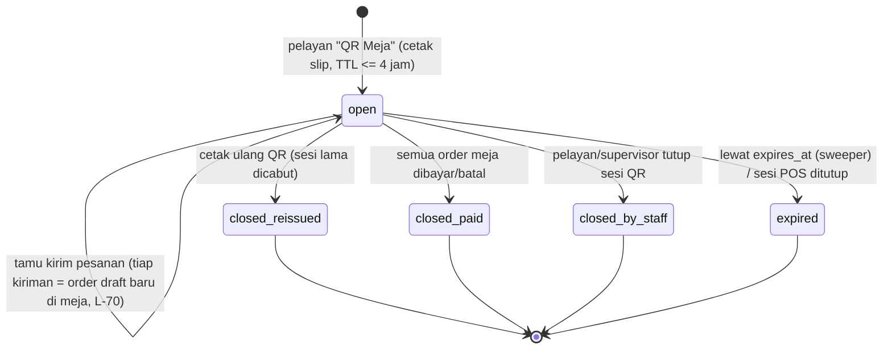

# Runbook: pesanan QR meja F&B (CS & Ops outlet)

Gelombang 22 (19 Okt 2026). Kontrak `docs/04_SERVICE_CONTRACTS.md` §14.A + keputusan lead **L-70** (satu kiriman = satu
`pos.order` draft di meja, modul Odoo `efn_pos_bff_order`) dan **L-71** (default konfirmasi pelayan). Fit-gap
`docs/08_ODOO_FIT_GAP.md` §13.1. ADR-032 (Accepted opsi B), ADR-023 (Odoo tidak publik), ADR-013 (printer = browser POS).
Diperbarui 19 Okt 2026 untuk kontrak **v9.1** (sinkron security review r15 + QA G22, keputusan lead **L-82**).
Risiko: R-B12 (spam QR), R-B14 (poin QR), R-T20, R-S03, R-T15, R-L01. PDP: `docs/compliance/PDP_DATA_INVENTORY.md` v8 §2.8 (N8),
`DPIA_DRAFT.md` DR-27/DR-28.

Audiens: **pelayan/kasir & supervisor outlet** (bagian A), **CS** (bagian B), **on-call IT/Superadmin** (bagian C).

> **Ringkasan manajemen.** Tamu memindai QR di meja, memesan dari ponselnya, lalu membayar di kasir. QR hanya berlaku
> untuk satu sesi meja: paling lama 4 jam, dan mati begitu meja dibayar atau QR dicetak ulang. Pesanan dari ponsel
> **tidak langsung masuk dapur**. Pelayan memeriksanya dulu lalu menekan kirim. Bila sistem QR terganggu, outlet cukup
> **menerima pesanan seperti biasa**, karena kasir, pembayaran, dan dapur tidak bergantung pada QR. Runbook ini mengatur
> enam situasi: cetak ulang QR, mencabut sesi, pesanan salah meja, pesanan iseng/spam, konfirmasi pelayan, dan gangguan
> sistem.

> **Status (19 Okt 2026): fitur sedang dibangun (G22) dan mati di produksi** (`FNB_QR_ENABLED=false`). Nama tombol POS di
> runbook ini berasal dari spesifikasi (`docs/08` §13.1b: "QR Meja", "Order", badge "QR"). Nama akhir bisa berbeda
> **[belum terverifikasi]**. Runbook wajib diperbarui setelah tour E-27 lulus dan sebelum pilot (syarat DPIA M-13).

## 0. Aturan yang tidak boleh dilanggar

| Aturan | Alasan |
|---|---|
| **Jangan** memotret, mengirim lewat WhatsApp, atau menyalin URL/QR meja ke tiket CS, chat, atau email | URL QR memuat token sesi (`#t=fts1.…`). Siapa pun yang memegangnya bisa memesan atas nama meja itu sampai sesi ditutup |
| Untuk pelacakan, cukup sebut **outlet + nomor meja + jam**, atau `table_session_id` (UUID, aman) | Log sistem hanya memuat `table_session_id`. Token tidak pernah di-log dan diredaksi Promtail (`fts1.`) |
| **Jangan** meminta nama, HP, atau email tamu QR | Tamu QR anonim (PDP, minimisasi). Member yang ingin poin login sendiri di ponselnya |
| Catatan pesanan berisi instruksi **menu/bahan** ("tanpa kacang"), bukan kondisi orang ("Pak Budi alergi") | Catatan masuk struk dapur & KDS (90 hari) dan `pos.order` (SOP KDS pilot, DR-20/DR-27) |
| Slip QR lama **dihancurkan** saat meja ditutup atau QR dicetak ulang | Slip lama tidak berguna setelah sesi ditutup, tetapi tetap jangan dibiarkan di meja |
| Fitur QR **tidak bisa dipakai saat POS offline** | Butuh server (CLAUDE.md). Terima pesanan manual |

## 1. Siklus sesi meja



Status kiriman yang dilihat tamu: `pending_confirmation` (menunggu pelayan) → `accepted`/`preparing` → `ready` →
`served`; cabang `rejected` (ditolak pelayan), `cancelled` (dibatalkan di POS), `failed` (Odoo menolak).

Batas default (PLACEHOLDER, env BFF §14.A.7 / field `pos.config`):

| Batas | Nilai default | Bila tercapai |
|---|---|---|
| Umur sesi | 4 jam (maks) | tamu melihat "sesi berakhir", pelayan cetak ulang |
| Kiriman per sesi | **10** (BFF `FNB_MAX_SUBMISSIONS_PER_SESSION` = Odoo `efn_qr_max_submissions`, L-76) | `session_limit_reached`: tamu diminta memesan ke pelayan |
| Item per sesi / baris per kiriman / qty per baris | 150 / 30 / 20 | idem |
| Nominal per sesi (Odoo) | Rp3.000.000 (PLACEHOLDER) | idem |

### 1.1 Syarat konfigurasi umur sesi (L-82 d) — wajib dicek sebelum pilot & setiap mengubah jam

| Setelan | Di mana | Aturan |
|---|---|---|
| `efn_qr_session_hours` | Odoo, pengaturan POS per `pos.config` (POS Manager) | `efn_qr_session_hours × 3600` **≥** `FNB_TABLE_SESSION_TTL_SECONDS` |
| `FNB_TABLE_SESSION_TTL_SECONDS` | env BFF (Superadmin, config rilis) | default 14 400 (4 jam), maks 14 400 |

Disarankan **sama persis** (default keduanya 4 jam). Bila jam di Odoo lebih pendek, Odoo menganggap sesi sudah habis
padahal token di slip masih sah di BFF. Tamu bisa membuka menu, tetapi setiap kiriman ditolak "sesi berakhir"
(`table_session_closed`), dan BFF tidak diberi tahu (QA G22 P3 #5). Bila Ops ingin sesi lebih pendek, turunkan
**keduanya**: env BFF lebih dulu (rilis), baru kemudian jam di Odoo. Validasi otomatis lintas sistem belum ada
(backlog G23).

## A. Prosedur outlet (pelayan, kasir, supervisor)

### A1. Cetak ulang QR
Gunakan bila: slip hilang/rusak/basah, tamu tidak bisa memindai, slip terbawa ke meja lain, atau QR terlihat difoto dan
dibagikan orang lain.

1. POS → denah meja → pilih meja → **QR Meja** → **Cetak ulang**. Sistem mencabut sesi lama (`reissued`) dan
   menerbitkan sesi baru.
2. Hancurkan slip lama dan letakkan slip baru.
3. Beri tahu tamu di meja itu untuk **memindai ulang**. Ponsel yang memakai QR lama akan melihat "sesi berakhir".
4. Pesanan yang sudah masuk **tetap ada** di meja. Cetak ulang tidak menghapus atau menggandakan pesanan.
5. Bila tombol nonaktif: POS sedang offline, fitur QR dimatikan untuk POS ini, atau server QR terganggu (lihat A6).
   Terima pesanan manual.

Catatan: cetak ulang dibatasi ±60 kali/menit per POS (tidak akan tercapai dalam pemakaian normal). Bila muncul galat
"QR tidak tersedia", ikuti A6.

### A2. Mencabut sesi QR meja
Gunakan bila: tamu pergi dan meja dibersihkan sebelum semua order dibayar/dibatalkan, ada dugaan penyalahgunaan, atau
meja digabung/dipindah.

1. POS → meja → **QR Meja** → **Tutup sesi QR** (`closed_by_staff`). Token langsung ditolak (`table_session_closed`).
2. Order draft yang tersisa di meja **tidak** ikut terhapus. Selesaikan seperti order biasa: bayar, gabung (merge), atau
   batalkan sesuai SOP kasir.
3. Sesi juga tertutup otomatis bila semua order meja dibayar/dibatalkan, sesi POS ditutup, atau umur 4 jam habis.

### A3. Pesanan nyasar (masuk ke meja yang salah)
Penyebab umum: tamu memindai slip meja lain, slip tertinggal setelah tamu pindah meja, atau tamu meneruskan foto QR ke
teman di meja lain.

1. **Mode konfirmasi pelayan (default):** jangan tekan *Order*. Konfirmasi ke meja asal. Bila memang bukan milik
   meja itu, tekan **Tolak**. Tamu melihat status `rejected` dan bisa memesan dari QR mejanya sendiri.
2. **Sudah dikirim ke dapur:**
   - pindahkan order ke meja yang benar dengan fitur standar POS **pindah/transfer order**, atau gabungkan (merge)
     sebelum bayar;
   - bila tidak ada pemiliknya, batalkan baris sesuai SOP pembatalan dapur (makanan yang sudah dibuat dicatat sebagai
     waste oleh supervisor).
3. Cetak ulang QR meja asal (A1) bila slipnya berpindah tempat.
4. **Poin:** poin QR terikat ke order dan member yang mengklaim sesi meja asal. Bila order dipindah ke meja lain, CS
   menangani keluhan poin lewat B2. Jangan menambah poin manual dari POS.
5. Bila pesanan nyasar terus berulang di satu outlet, periksa penempatan slip (satu slip per meja, tidak di meja kosong).
   Bila pola terlihat disengaja, ikuti A4.

### A4. Spam / pesanan iseng
Tanda-tandanya: banyak kiriman dari satu meja yang tidak dipesan siapa pun, kiriman dari meja kosong, atau QR beredar di
media sosial.

1. **Segera:** tolak kiriman yang tidak sah (mode konfirmasi pelayan), lalu **cabut sesi** (A2) dan **cetak ulang** (A1)
   untuk meja itu. Token lama mati, dan foto QR yang beredar tidak bisa dipakai lagi.
2. Bila terjadi di banyak meja: supervisor meminta POS Manager mematikan QR untuk POS itu (**`efn_qr_enabled` = mati**
   di pengaturan POS). Outlet kembali ke pemesanan manual.
3. Laporkan ke on-call IT dengan **outlet, meja, jam**, tanpa foto QR. IT menjalankan C3.
4. Pesanan iseng yang sempat dibuat dapur dicatat sebagai waste. Jangan mencari atau mencatat identitas tamu.

### A5. Konfirmasi pelayan (mode default `waiter`)
1. Kiriman QR baru muncul sebagai **order draft baru di meja** dengan tanda **QR** dan notifikasi di POS. Notifikasi
   hanya terkirim ke kasir/pelayan yang membuka POS itu, lewat kanal privat.
2. Buka order, lalu periksa tiga hal: **meja benar**, **isi wajar** (jumlah, kombinasi), dan **catatan aman** (tanpa
   nama/HP; alergi ditulis sebagai bahan).
3. Tekan **Order** (kirim ke dapur) atau **Tolak**. Target ≤ 2–3 menit. Tamu melihat "menunggu konfirmasi pelayan"
   sampai pelayan bertindak.
4. Kiriman yang belum dikonfirmasi > 5 menit (`efn_qr_stale_minutes`) memicu pengingat di POS dan log
   `EFN_QR_ORDER_STALE`. Supervisor menunjuk pelayan.
5. Sebelum bayar, gabungkan order-order QR satu meja dengan order pelayan (merge standar), lalu bayar di kasir seperti
   biasa. Harga sudah dihitung Odoo. Pajak PB1 dine-in + SC ada di bill kasir. Harga di ponsel adalah harga **sebelum**
   pajak & layanan.
6. **Mode `auto`** (langsung ke dapur): hanya bila Ops F&B memutuskan (Q-QR6). Diubah POS Manager per POS. Pada mode
   ini, salah satu terminal POS yang aktif mengirim ke dapur secara otomatis. Server sendiri tidak pernah mencetak.
   Bila semua terminal POS outlet tertutup, pesanan menunggu.

### A6. QR tidak bisa dipakai (gangguan) — langkah outlet
Gejala: tamu melihat "**silakan pesan ke pelayan**", atau tombol *QR Meja* memberi galat "QR tidak tersedia".

1. **Terima pesanan manual.** POS, pembayaran, struk, dan dapur tetap jalan.
2. Jangan meminta tamu mengirim ulang berkali-kali. Sistem tidak mengantrekan pesanan yang gagal, dan pesanan yang sudah
   diterima tidak akan tergandakan.
3. Laporkan ke on-call IT (C1) dengan outlet + jam mulai.
4. Setelah pulih, QR yang belum lewat 4 jam tetap berlaku. Bila ragu, cetak ulang (A1).

## B. Prosedur CS

### B1. Pertanyaan tamu umum
| Keluhan | Jawaban/tindakan |
|---|---|
| "QR tidak bisa dibuka / sesi berakhir" | Sesi sudah ditutup (meja dibayar, dicetak ulang, > 4 jam). Minta pelayan mencetak ulang (A1) |
| "Pesanan saya tidak sampai dapur" | Mode konfirmasi pelayan. Hubungi outlet (A5) dengan meja + jam. CS tidak bisa mengirim ke dapur |
| "Harga di aplikasi beda dengan bill" | Harga di ponsel belum termasuk PB1 & service charge. Total final ada di bill kasir |
| "Pesanan saya ditolak" | Ditolak pelayan (salah meja/stok habis). Sarankan memesan langsung ke pelayan |

### B2. Poin dari pesanan QR (member login)
> **Status 19 Okt 2026: poin QR MATI** (`FNB_QR_POINTS_ENABLED=false`, L-82 b). Selama mati, klaim poin di ponsel
> menjawab "poin tidak tersedia". Jawaban CS: poin untuk pesanan meja diberikan oleh **kasir dengan OTP** saat
> membayar. Prosedur di bawah berlaku setelah aktivasi (bagian D).

1. Minta member login di aplikasi dan buka riwayat poin. Data yang perlu dicatat di tiket CS hanya **outlet, tanggal,
   jam**. Jangan mencatat HP di tiket bila sistem tiket tidak terenkripsi.
2. Status earn sesi (dibaca on-call/BFF, bukan CS):
   - `none`: belum dibayar atau event bayar tertunda;
   - `earned`: poin sudah masuk;
   - `skipped`: tidak memenuhi syarat;
   - `limited`: kena batas earn kebijakan PT;
   - `conflict`: kasir juga memasang member di POS, sehingga POS yang memberi poin (anomali `qr_pos_member_conflict`).
     Sejak kontrak v9.1, order yang member-nya dipasang kasir dikirim dengan `pos_member_attached=true` dan **tidak**
     di-earn untuk pengklaim QR (SEC-165), sehingga konflik seharusnya jarang. Bila tetap muncul, eskalasi BFF.
3. Poin QR masuk **setelah order dibayar di kasir**. Keterlambatan menit–jam bisa terjadi karena event tertunda.
4. CS **tidak** menambah poin manual. Bila terbukti hilang, eskalasi ke Finance lewat SOP penyesuaian poin (tercatat,
   empat mata).
5. Tautan akun ke sesi meja dilepas otomatis 30 hari setelah sesi ditutup (PDP). Setelah itu, keluhan diperiksa dari
   ledger poin (nomor order), bukan dari sesi meja.

### B3. Permintaan privasi
- Tamu QR tanpa login tidak teridentifikasi. Tidak ada data akun yang bisa diekspor atau dihapus.
- Member: gunakan alur DSAR biasa (`PDP_DSAR_DESIGN.md`). Ekspor memuat sesi QR yang diklaim (outlet, tanggal, poin).
  Hapus akun melepas tautan sesi.
- Catatan pesanan yang ternyata memuat nama atau kondisi kesehatan seseorang: catat di register near-miss (Legal,
  `PDP_DATA_INVENTORY.md` §6) dengan outlet + nomor order **tanpa menyalin isi catatan**. Pembersihan catatan di
  `pos.order` dilakukan admin Odoo atas instruksi DPO.

## C. Prosedur on-call IT / Superadmin

### C1. Gangguan BFF / Odoo / gateway
1. Pastikan dampak: QR mati, tetapi POS tetap jalan. Bila POS juga terganggu, tangani dulu lewat
   [service-down.md](service-down.md) / [odoo-http-5xx.md](odoo-http-5xx.md).
2. Periksa penyebab umum sesuai urutan:

   | Penyebab | Cek | Runbook |
   |---|---|---|
   | BFF mati / restart | `$DC ps api-gateway`, health | [service-down.md](service-down.md) |
   | `odoo-rpc-gateway` menolak path QR (13–15 belum di allowlist) | log `EfnOdooRpcGatewayDenied` | [online-orders.md](online-orders.md#efnodoorpcgatewaydenied) |
   | API key user teknis `efn_qr_pb`/`efn_qr_bcf` kedaluwarsa (R-T15) | metrik `efn_fnb_odoo_requests_total{outcome}` 401/403 | pola [odoo-online-api-key.md](odoo-online-api-key.md) (rotasi QR mengikuti timer yang sama — **belum terverifikasi** sampai devsecops G22 selesai) |
   | Circuit breaker per PT terbuka / semaphore publik penuh | log BFF, metrik Odoo | [online-orders.md](online-orders.md) |
   | Sesi POS outlet belum dibuka | outlet | — (`pos_session_closed` → tamu melihat "pesan ke pelayan") |

3. Kiriman yang terputus saat Odoo timeout direkonsiliasi otomatis oleh BFF (`efn_qr_status`) sebelum dinyatakan
   `failed`. **Jangan** mengirim ulang manual ke Odoo, supaya dapur tidak menerima pesanan ganda.
4. Event Odoo → BFF tertunda (outbox `efn.pos.qr.event.outbox` retry 1 menit → 1 jam):
   - sesi di BFF bisa tetap `open` sampai event masuk atau `exp` lewat (pengaman ganda);
   - earn poin tertunda;
   - refund order QR dijawab `409 earn_pending` sampai event bayar masuk, lalu di-retry outbox Odoo. Refund **sebelum**
     sesi ditutup tidak mengirim reverse; nilainya sudah dikurangkan dari `eligible_amount` neto di event tutup (K3,
     kontrak §14.A.4).

   Pantau, jangan dihapus.

### C2. Kill switch
| Lingkup | Cara | Siapa | Efek |
|---|---|---|---|
| Satu POS | `pos.config.efn_qr_enabled = False` | POS Manager | `503 ordering_unavailable` untuk sesi POS itu, tombol QR hilang |
| Satu/semua PT | `FNB_QR_COMPANIES` / `FNB_QR_ENABLED=false` di env BFF + recreate `api-gateway` | Superadmin | semua QR PT itu/semua mati, tamu diminta pesan ke pelayan |
| Darurat: matikan semua token aktif | rotasi `fnb_table_token_key` **tanpa** mengisi `fnb_table_token_key_prev` ([secret-rotation.md](secret-rotation.md)) + recreate BFF | Superadmin | semua slip QR aktif tidak berlaku, outlet wajib cetak ulang. Pakai bila kunci diduga bocor |
| Poin QR saja | `FNB_QR_POINTS_ENABLED=false` (**posisi default saat ini**, L-82 b) | Superadmin | klaim poin `422 points_unavailable`, pemesanan tetap jalan. Menyalakan = bagian D |

Rotasi terjadwal (bukan darurat): isi `_prev` dengan kunci lama selama **≥ 4 jam** (TTL maksimum), lalu kosongkan.

### C3. Investigasi spam / anomali
1. Log BFF `EFN_FNB_ANOMALY {kind}`:
   - `session_limit_hit`: batas sesi tercapai;
   - `submit_rate_limited`: rate limit;
   - `qr_pos_member_conflict`: konflik poin;
   - `submit_reconciled`: kiriman direkonsiliasi.

   Metrik: `efn_fnb_submissions_total{status}`, `efn_fnb_sessions_open`, `efn_fnb_odoo_requests_total{method,outcome}`.
2. Contoh query Loki (nama stream/label final dari devsecops G22 **belum terverifikasi**):
   ```logql
   {service="api-gateway"} |= "EFN_FNB_ANOMALY"
   sum by (kind) (count_over_time({service="api-gateway"} |= "EFN_FNB_ANOMALY" [1h]))
   ```
3. Tindakan berjenjang:
   1. cabut sesi + cetak ulang (A1–A2);
   2. `FNB_CAPTCHA_MODE=first_submit` (ALTCHA pada kiriman pertama per perangkat, ADR-028);
   3. perketat `FNB_MAX_SUBMISSIONS_PER_SESSION` / `FNB_RL_*`;
   4. pastikan mode `waiter` di outlet terdampak;
   5. matikan per POS/PT (C2).
4. IP hanya tersimpan sebagai HMAC di key rate limit (TTL menit). Tidak ada IP mentah untuk "diblokir". Pemblokiran
   jaringan dilakukan di Cloudflare/WAF bila pola datang dari luar outlet (lihat [security-incident.md](security-incident.md)).
5. Bila slip QR beredar publik dan dipakai berulang pada sesi yang masih terbuka: perlakukan sebagai penyalahgunaan,
   cabut sesi terkait, dan catat di laporan shift. Ini bukan insiden data pribadi, karena tidak ada data pribadi di
   token.

### C4. Rekonsiliasi harian (usulan, pilot)
- Jumlah sesi `open` > 4 jam = 0. Bila ada, berarti sweeper gagal → cek job BFF.
- Kiriman `submitting` > 10 menit = 0.
- `earn_status='none'` pada sesi `closed paid` > 1 jam → event/earn tertunda, eskalasi BFF.
- Alert Prometheus/Loki untuk tiga butir di atas **belum dibuat** (usulan devsecops/data-ai G22).

## D. Aktivasi poin QR (`FNB_QR_POINTS_ENABLED=true`) — syarat wajib {#aktivasi-poin-qr}

> **Ringkasan manajemen.** Pemesanan QR boleh dipilot **tanpa** poin. Poin dari pesanan QR baru boleh dinyalakan
> setelah tiga celah dari review keamanan r15 terbukti tertutup dan klien memutuskan cara staf mengoreksi klaim poin
> yang salah. Sebelum itu, poin pesanan meja diberikan kasir dengan OTP seperti biasa.

Semua butir wajib **terpenuhi dan diarsipkan di CR** sebelum Superadmin mengubah flag di production (risiko R-B14,
keputusan L-82 b):

| # | Syarat | Bukti | Pemilik |
|---|---|---|---|
| 1 | **SEC-164 terverifikasi:** refund sebelum close → earn atas neto (order neto ≤ 0 tidak dikirim); refund setelah close di Odoo tetapi sebelum BFF memproses close → tidak hilang/dobel (K3) | Test regresi Odoo + Jest untuk dua skenario (total earn = neto) hijau di CI; UAT K8 | Odoo + BFF engineer, QA |
| 2 | **SEC-165 terverifikasi:** Odoo mengirim `pos_member_attached`; BFF tidak meng-earn pengklaim QR untuk order ber-member POS | Test lintas modul (payload Odoo ↔ parser BFF), bukan hanya mock | Odoo + BFF, QA |
| 3 | **SEC-166 terverifikasi:** order dibayar hanya dilekatkan ke sesi `open`, `date_order ≥ opened_at`, dan hanya order kiriman QR/jangkar/dibawa | Test: tamu berikutnya di meja yang sama tidak masuk `orders[]` sesi lama | Odoo engineer, QA |
| 4 | **Re-review security** atas butir 1–3 tanpa temuan Medium terbuka | Laporan `docs/reviews/SECURITY_REVIEW_*` berikutnya | efn-security-reviewer |
| 5 | **Keputusan SEC-169** (klaim "siapa cepat", tanpa reset staf) diambil dan, bila dipilih, dibangun (G23). Opsi: reset klaim dari POS, OTP kasir mengalahkan klaim QR, klaim dibatasi perangkat pengirim / ≤ X menit, indikator "poin meja sudah diklaim" | Baris keputusan lead/klien + test | Lead + klien (Ops F&B, Finance) |
| 6 | Kebijakan earn PT (§13.1) terpublikasi, plafon harian/per order diisi Finance; SOP CS B2 dilatih | Checklist aktivasi kebijakan poin (L-69) | Finance, CS |
| 7 | Syarat konfigurasi §1.1 (jam sesi Odoo ≥ TTL token) terpenuhi di outlet pilot | Tangkapan setelan POS + env rilis | Ops F&B + Superadmin |

Langkah: staging dahulu (flag `true`, jalankan UAT K1/K8), lalu production lewat config rilis oleh Superadmin. Mematikan
kembali: `FNB_QR_POINTS_ENABLED=false` → Deploy (pemesanan tidak terpengaruh, C2).

## Batas (jujur)
- Modul Odoo `efn_pos_bff_order`, migrasi BFF `11-platform-g22.sql`, dan frontend `/meja` **sedang dibangun**. Runbook
  disusun dari kontrak & fit-gap, bukan dari sistem yang berjalan.
- Perbaikan r15 (K1–K3, SEC-164..168, SEC-171, SEC-173) dikerjakan paralel di G22. Architect **belum memverifikasi**
  kodenya. Bagian D adalah syarat, bukan pernyataan bahwa syarat sudah terpenuhi.
- Ada perbedaan istilah antara `docs/08` §13.1b (`efn_qr_kitchen_mode` `confirm|auto`, path BFF `/internal/v1/fnb/…`)
  dan kontrak `docs/04` §14 (`efn_qr_confirm_mode` `waiter|auto`, `/v1/pos/fnb/…`). **Kontrak + L-71 yang berlaku.**
  Nama tombol POS dan menu belum final.
- Belum ada alert khusus QR (deadman sweeper, `submitting` macet). Pemantauan sementara memakai log anomali.
- Printer struk outlet harus mampu mencetak gambar QR (P-18, **belum terverifikasi** per model).
- Batas kiriman per sesi sudah diselaraskan menjadi 10 di kontrak v9.1 (L-76). Kesamaan nilai default di kode BFF dan
  Odoo dilaporkan QA G22 (G22.3 no. 3), tetapi belum diuji di sistem berjalan.
