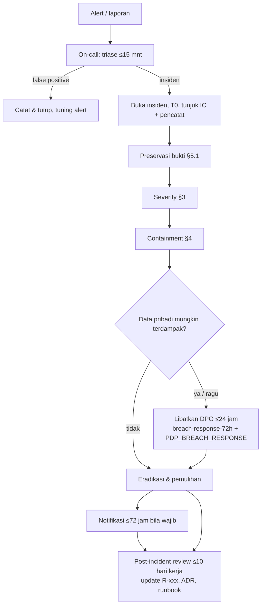

# Runbook: Insiden keamanan (umum) — deteksi, triase, containment, forensik, notifikasi

- **Status:** v1 (2026-10-06, Gelombang 12, efn-architect). Menutup butir "runbook insiden" SEC-11 / SEC-40 (review r4).
- **Hubungan dengan dokumen lain:** runbook ini adalah **pintu masuk** untuk semua insiden keamanan. Bila data pribadi
  (mungkin) terdampak, jalankan paralel: kebijakan [PDP_BREACH_RESPONSE.md](../compliance/PDP_BREACH_RESPONSE.md)
  (peran, keputusan wajib-lapor, template) dan langkah teknis per jam [breach-response-72h.md](breach-response-72h.md).
- **Terkait:** ADR-022 (kunci & PKI), ADR-023 (WireGuard), ADR-024 (kredensial), ADR-030 (object storage), ADR-031
  (`efn_audit`), `docs/compliance/PDP_DATA_INVENTORY.md` (peta data), risiko R-S01, R-S03, R-S10, R-L01, R-T08.

> **Ringkasan manajemen.** Bila ada tanda serangan atau penyalahgunaan, on-call membuka insiden, menunjuk satu
> pemimpin (Incident Commander), mengamankan bukti **sebelum** mengubah apa pun, lalu menutup jalur serangan (ganti
> kunci, cabut sertifikat/akses, putus outlet). Bila data pribadi mungkin bocor, DPO wajib dilibatkan dalam
> **≤ 24 jam** karena UU PDP mewajibkan pemberitahuan ke pelanggan dan otoritas **≤ 3×24 jam** sejak diketahui.
> Hanya peran **Superadmin** yang memegang kunci; karena itu setiap insiden severity tinggi butuh Superadmin yang dapat
> dihubungi 24 jam (rekomendasi ≥ 2 orang, Q-E1a).

## 1. Peran
| Peran | Siapa | Tugas dalam insiden | Wewenang |
|---|---|---|---|
| On-call IT | Rotasi IT/vendor ops | Menerima alert, triase awal (≤ 15 menit), membuka insiden, preservasi bukti awal | Baca log/metrik, `docker pause`, putus network container |
| **Incident Commander (IC)** | Head IT / on-call senior | Memimpin, menetapkan severity, menunjuk pencatat, eskalasi, memutuskan containment | Semua tindakan non-kunci |
| **Superadmin** (keputusan klien 6 Okt) | Pemegang peran (≥ 2 orang, Q-E1a) | Rotasi secret/kunci PII/intermediate CA, akses `/opt/efn/secrets`, approve deploy darurat, break-glass | Satu-satunya pemegang kunci (`docs/04 §8.6`, `key-custody.md`) |
| **DPO** | Belum ditunjuk (**Q-P1**); sementara: Legal | Menilai data pribadi terdampak & wajib lapor, notifikasi | Keputusan lapor |
| Security reviewer | Internal/vendor | Forensik, akar masalah, verifikasi perbaikan | Read-only |
| Pemilik layanan | Odoo/BFF/data/frontend | Perbaikan kode, deploy lewat pipeline bertanda tangan | — |
| Komunikasi/CS, Direksi | Sesuai PDP_BREACH_RESPONSE §1 | Pemberitahuan, persetujuan publik | — |

Pemisahan tugas: pelaku yang terindikasi (mis. `uid` di alert audit) **tidak** boleh menjadi IC atau memegang bukti.

## 2. Alur


## 3. Deteksi & severity
### 3.1 Sumber deteksi yang sudah ada
| Sinyal | Alert / sumber | Indikasi keamanan | Runbook teknis |
|---|---|---|---|
| Perubahan kontrol audit Odoo | `EfnAuditControlChange` (warning, Loki ruler) | Admin mengubah retensi/aturan audit, server action, cron, modul tanpa CR (R-S10) | [audit-sink-alerts.md](audit-sink-alerts.md) |
| Purge log audit di luar jalur sah | `EfnAuditUnexpectedPurge` (**critical**) | Penghapusan jejak (anti-forensik) | [audit-sink-alerts.md](audit-sink-alerts.md) |
| Lonjakan purge retensi | `EfnAuditRetentionPurgeBurst` | Retensi diturunkan / GC dipicu berulang | idem |
| OTP gagal verifikasi / kirim | `EfnOtpVerifyFailureRateHigh`, `EfnOtpSendFailureRateHigh` | Brute force OTP, SMS/WA pumping, penyalahgunaan promo (R-B06) | [otp-failure-rate.md](otp-failure-rate.md) |
| DLQ terisi | `EfnDeadLetterNotEmpty` | Event palsu/ditolak (publisher tidak sah, SEC-08), payload rusak | [rabbitmq-dlq.md](rabbitmq-dlq.md) |
| Handshake TLS internal gagal | `EfnInternalTlsHandshakeFailed` | Klien dengan sertifikat asing/MITM, atau CA tertukar (SEC-42) | [internal-pki.md](internal-pki.md) |
| Sertifikat hampir kedaluwarsa | `EfnCertExpiringSoon/Critical`, `EfnInternalCert*` | Ketersediaan; kadang tanda timer/deploy dimatikan | [tls-cert-expiry.md](tls-cert-expiry.md) |
| Backup/WAL gagal, restore test gagal | `EfnBackup*`, `EfnWalArchive*`, `EfnRestoreTest*` | Ransomware/penghapusan backup, object lock disentuh (R-T08) | [backup-failed.md](backup-failed.md) |
| Service hilang | `EfnServiceDown` (mis. promtail, loki) | Mematikan pengumpul log untuk menutupi jejak | [service-down.md](service-down.md) |
| **Burst 403 s3-gateway** | **Belum ada alert** — query manual di bawah; usulan alert `EfnS3GatewayDeniedBurst` (devsecops) | Container internal mencoba `?retention`, bypass governance, presigned/encoded (SEC-41) = indikasi kompromi | §4 baris "s3-gateway" |
| Laporan eksternal / vendor | Email DPO/CS, Meta, vendor VPS, peneliti | Apa pun | — |

Query manual burst 403 s3-gateway (Grafana → Explore → Loki; label service dicocokkan dengan Promtail):
```logql
sum by (service) (count_over_time({service="s3-gateway"} |~ " 403 " [10m]))
```
Ambang awal usulan: > 5 dalam 10 menit (operasi normal aplikasi tidak pernah menghasilkan 403 filter; 403 dari storage = `AccessDenied` biasa harus dibedakan dari halaman HAProxy).

### 3.2 Severity
| Sev | Kriteria | Target respons | Libatkan |
|---|---|---|---|
| **S1** | Indikasi akses tidak sah ke data pribadi/kunci (dump DB, kunci PII/pepper/intermediate bocor, `EfnAuditUnexpectedPurge`, kompromi container dengan kredensial), ransomware backup | IC ≤ 30 menit, containment ≤ 4 jam | Superadmin, DPO (≤ 24 jam), Direksi |
| **S2** | Penyalahgunaan terbatas tanpa bukti kebocoran (brute force OTP berhasil sebagian, perubahan kontrol audit tanpa CR, burst 403 s3-gateway, perangkat outlet hilang) | IC ≤ 2 jam | Superadmin bila perlu rotasi |
| **S3** | Percobaan gagal / anomali tanpa dampak | Hari kerja berikutnya | — |

Bila ragu antara dua tingkat, pilih yang lebih tinggi. Setiap S1/S2 yang menyangkut data pribadi = jalur DPO.

## 4. Containment (berdasarkan vektor)
| Vektor | Tindakan | Siapa | Runbook |
|---|---|---|---|
| Secret aplikasi bocor (password DB/broker/storage, `jwt_secret`, `otp_pepper`, API key) | Rotasi per service; `jwt_secret` → semua sesi & receipt DSAR batal (umumkan login ulang); `otp_pepper`/`member_hash_pepper` **jangan** dirotasi tanpa prosedur migrasi (mengubah semua hash) | Superadmin | [secret-rotation.md](secret-rotation.md) |
| Kunci PII (`pii_encryption_key*`) bocor | Tambah versi kunci baru di key ring, re-encrypt batch, cabut versi lama; anggap HP terdampak → jalur DPO | Superadmin + BFF | [pii-key-rotation.md](pii-key-rotation.md) |
| Leaf TLS / intermediate CA bocor, atau CA asing di bundle (SEC-42) | Leaf: terbitkan ulang lewat deploy. Intermediate: terbitkan intermediate baru dari root offline, bundle tanpa yang lama, deploy semua leaf (**tidak ada CRL** — penggantian = pencabutan). Periksa pin `EFN_PKI_ROOT_SHA256` di `/etc/efn/deploy.conf` | Superadmin | [internal-pki.md](internal-pki.md), [key-custody.md](key-custody.md) |
| Kunci SSH deploy / GitHub Environment disalahgunakan | Cabut kunci di `authorized_keys`, rotasi secret Environment, periksa `/var/lib/efn/last-release` dan journald `efn-deploy` | Superadmin | [key-custody.md](key-custody.md) §4a–4b |
| Container terkompromi | `docker network disconnect` dari `egress`/`data`; `docker pause` (bukan `rm`); `docker commit` untuk forensik; deploy ulang dari digest bertanda tangan; rotasi semua kredensial container itu | IC + devsecops | [breach-response-72h.md](breach-response-72h.md) |
| Outlet / perangkat POS / laptop staf hilang atau disusupi | **Blok peer WireGuard** (hapus public key di hub, reload), logout sesi Odoo user terkait, rotasi PIN POS, nonaktifkan user | IT ops | [wireguard-outlet.md](wireguard-outlet.md) |
| Admin Odoo menyalahgunakan hak (alert audit) | Nonaktifkan user `uid`, cabut `base.group_system`, nonaktifkan server action/cron terkait, kembalikan konfigurasi; jangan uninstall `efn_audit` | IC + Superadmin | [audit-sink-alerts.md](audit-sink-alerts.md) |
| s3-gateway 403 burst | Identifikasi klien dari access key/IP sumber di log gateway → isolasi container sumber; rotasi access key klien itu (`minio_*_access_key`); cek retensi `pg-backup` (`mcli retention info`) | devsecops + Superadmin | [backup-restore.md](backup-restore.md) |
| OTP pumping / brute force | Naikkan `ALTCHA_MAX_NUMBER` sementara, turunkan budget OTP, blok IP di Cloudflare/CrowdSec | on-call | [otp-failure-rate.md](otp-failure-rate.md) |
| Webhook payment palsu | `PAYMENT_PROVIDER=disabled`, rotasi `webhook_payment_secret`, rekonsiliasi intent `paid` vs provider | IC + Finance | (ADR-026) |
| Edge publik diserang / origin dijangkau langsung | Firewall origin hanya Cloudflare + WireGuard; mode "Under Attack" | on-call | [origin-firewall.md](origin-firewall.md) |

Prinsip: layanan inti tetap jalan bila aman (POS bisa offline; OTP/poin/MGM nonaktif saat offline — ADR-017).
Containment yang menghentikan layanan publik butuh persetujuan IC.

## 5. Forensik
### 5.1 Preservasi bukti (sebelum mengubah apa pun)
1. Catat T0 (WIB) di log insiden (`PDP_BREACH_RESPONSE.md` §5.3, simpan 5 tahun).
2. Simpan ke direktori IR terenkripsi (`age`) **di luar** host terdampak: `docker ps --no-trunc`, digest image,
   `docker compose logs --timestamps`, `wg show`, `sha256sum` file konfigurasi, salinan `/var/lib/efn/last-release`.
3. Ekspor query Loki relevan **segera** (log umum hanya 30 hari).

### 5.2 Sumber bukti
| Sumber | Isi | Retensi | Catatan |
|---|---|---|---|
| Loki (umum) | Log semua container, HP ter-mask, access log Traefik & s3-gateway (tanpa query string) | 30 h | Query via Grafana (mTLS). Ekspor sebelum habis |
| Loki `{stream="efn_audit_sink"}` | Perubahan model kontrol & purge log audit (tanpa nilai) | 400 h | Di luar kendali admin Odoo; bukan WORM |
| Odoo `efn.audit.log` | Siapa mengubah harga/promo/partner/kontrol; nilai lama/baru ter-mask; `is_sudo`, `prev_company_id` | 730 h (min 365) | Menu Pengaturan → Audit; auditor per PT. Bandingkan dengan sink untuk mendeteksi penghapusan |
| Salinan audit ClickHouse | Salinan append-only + `row_hash` berantai, rekonsiliasi id hilang | Usulan ≥ 730 h | **Sedang dibangun (data-AI)** — bila belum tersedia, gunakan PITR |
| PostgreSQL PITR (WAL-G) | Keadaan DB pada titik waktu mana pun dalam retensi | 14 full + WAL | Restore ke container sementara (`scripts/restore-test.sh`), jangan ke produksi |
| `platform.otp_audit` | Hasil OTP per subject hash, IP terenkripsi | 90 h | Dekripsi IP hanya oleh BFF/Superadmin, dicatat, dua orang |
| ClickHouse `system.query_log` | Siapa menjalankan query apa | Default CH | Lihat breach-response-72h |
| Prometheus | Metrik (lonjakan request, error) | 15–30 h | — |
| journald host (`efn-deploy`, sshd, auditd) | Deploy, login SSH | Default host | **Belum dikirim ke Loki** — ambil manual |

### 5.3 Pertanyaan forensik minimum
Vektor masuk; rentang waktu; kredensial/kunci mana yang tersentuh; data apa dan berapa subjek per PT (EFN/RTL/FNB/FARM — pengendali bisa berbeda per PT); apakah data terenkripsi **dan** kuncinya aman (`PDP_BREACH_RESPONSE.md` §3); apakah jejak audit dihapus (selisih Odoo vs sink vs ClickHouse).

## 6. Notifikasi UU PDP (3×24 jam)
- Keputusan wajib lapor dan isi pemberitahuan: **DPO + Legal** — [PDP_BREACH_RESPONSE.md](../compliance/PDP_BREACH_RESPONSE.md) §2–5.
- Fakta teknis yang harus diserahkan IC ke DPO paling lambat T0 + 24 jam: kronologi, kategori data (rujuk `PDP_DATA_INVENTORY.md`), perkiraan jumlah subjek per PT, status enkripsi & kunci, tindakan containment, pemroses pihak ketiga yang terlibat.
- Pemberitahuan ke pelanggan dikirim dari sistem yang **tidak** terdampak (template WA utilitas harus sudah disetujui Meta sebelum go-live).
- Nomor pasal & lembaga penerima: **belum terverifikasi** (Legal).

## 7. Pemulihan & penutupan
- Perbaikan akar masalah lewat pipeline normal (rilis bertanda tangan, manifest, anti-downgrade); tidak ada perubahan manual di host kecuali rotasi kunci oleh Superadmin.
- Restore data hanya bila integritas rusak; setelah restore, **ulangi erasure DSAR** yang selesai setelah titik restore (belum otomatis — SEC-31 rek. #2).
- Post-incident review tanpa menyalahkan ≤ 10 hari kerja: waktu deteksi, kontrol yang gagal/berhasil, tindakan (pemilik + tenggat), update R-xxx/ADR/runbook.

## 8. Latihan
Tabletop sebelum go-live dan 2× setahun. Skenario wajib: (1) admin Odoo menurunkan retensi audit lalu mengubah harga; (2) ocr-worker terkompromi mencoba melepas object lock `pg-backup`; (3) kunci SSH deploy bocor; (4) laptop staf dengan peer WireGuard dicuri; (5) dump `efn_platform` bocor tanpa kunci PII.

## 9. Celah yang diketahui (jujur)
- Belum ada alert burst 403 s3-gateway, alert log `efn-deploy`/auditd, maupun pengiriman journald host ke Loki.
- Loki bukan WORM; salinan audit append-only (ClickHouse) belum selesai.
- CA berbasis skrip tanpa CRL: pencabutan = penerbitan ulang intermediate + deploy semua leaf.
- DPO belum ditunjuk; Superadmin mungkin baru satu orang (bus factor, ADR-022 R-K1).
- Admin sistem Odoo dengan akses host/DB tetap dapat menghapus data; kontrol = deteksi, bukan pencegahan.
